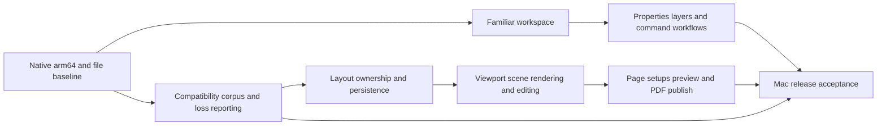

<!--
Copyright (C) 2026 LibreCAD contributors
This planning document may be redistributed and/or modified under the GNU
General Public License, version 2 or (at your option) any later version.
See the repository LICENSE file. No warranty is provided.
-->

# LibreCAD: AutoCAD 2027-inspired 2D drafting plan for macOS arm64

Research date: **October 11, 2026**. Source baseline: **628a1ba845931a37b8d745a8ad08d4731615812c**, `master`, application version macro `2.2.2.6-alpha` (`CMakeLists.txt`, line 42). This is a research and implementation plan. It does not introduce application changes, establish a successful build, or claim visual/functional parity.

## Recommendation

Improve this fork in place using its existing C++17 and Qt Widgets foundation. Create a Windows-style AutoCAD 2027 drafting workspace with top ribbon panels, visible docked Properties and Layers, bottom command input, drawing tabs, and a familiar status bar. Keep macOS system menus, Command-key conventions, Retina behavior, and native arm64 execution. Build complete paper-space layouts and viewport-aware PDF publishing as a document/rendering project, rather than treating them as cosmetic additions.

The quickest useful first milestone is a familiar workspace over current functionality. The biggest technical project is reliable layout editing and plotting, with a separate DWG interoperability gate. A complete 2D release needs all three; a ribbon alone cannot establish interchange or sheet correctness.

## Confirmed scope

The user confirmed the following during this research:

- **Reference:** Windows-style AutoCAD 2027, adapted to macOS rather than reproducing AutoCAD for Mac's arrangement.
- **Platform:** macOS on Apple Silicon, native arm64 execution required.
- **First release:** 2D drafting. Preserve useful elevation/coordinate metadata, but do not make a 3D modeling kernel part of the first release.
- **Formats:** DWG and DXF; the original “dxg” spelling meant DXF.
- **Output:** PDF sheets using layouts, page setup, and scaled model views.
- **Deliverable now:** deep research and Markdown plans. Implementation follows a separate instruction.

Default planning choices: retain the open-source in-tree format implementation first; introduce a CAD Familiar workspace and preserve the current interface as a Classic preset; use original/licensed artwork; support dark and light appearance; prioritize a focused, tested command subset before claiming broad AutoCAD compatibility. These are recommendations, not additional user-confirmed requirements. A paid SDK is an option only if measured format gaps justify it and platform/distribution terms are resolved.

## Reading guide

Implementation has started: see [Phase 0 results and native Mac evidence](phase0/00-results.md). The research below describes the original source baseline; subsequent verification results are recorded separately.

| Document | Purpose |
| --- | --- |
| [UI and commands](01-ui-and-commands.md) | Existing menus, Properties, layers and aliases; proposed ribbon, selection/property behavior and command experience |
| [Formats, layouts and PDF](02-formats-layouts-and-pdf.md) | DWG/DXF compatibility, paper-space ownership, viewports, page setups, PDF publishing and SDK alternatives |
| [macOS arm64 delivery](03-macos-arm64-delivery.md) | Build profiles, dependencies, native interaction, packaging, signing and release tests |
| [Independent review and acceptance](04-review-and-acceptance.md) | Findings checked against source, unresolved evidence, practical acceptance scenarios and release gates |

## What already exists in this fork

“Present” below means source exists and was inspected; runtime behavior remains to be validated. This is based on this checkout, not generic descriptions of stable LibreCAD.

| Area | Source-supported starting point | Work needed for the requested experience |
| --- | --- | --- |
| Main menus | `LC_MenuFactoryMain` constructs File, Settings, Edit, View, Plugins, Tools, Workspace, Help (`librecad/src/ui/main/init/lc_menufactory_main.cpp`, lines 57–93) | Organize a top drafting ribbon and familiar navigation around the existing actions |
| Properties | A real `LC_PropertySheetWidget` is docked as Properties; supports selection-aware content and undoable edits (`lc_widgetfactory.cpp`, lines 262–274; `lc_propertysheetwidget.cpp`, lines 417–527) | Make it easy to find, persistent and visually coherent; verify type coverage, mixed values, defaults, focus and edit validation |
| Layers | Layer list/tree widgets and add/edit/remove/lock/visibility/print actions already exist | Provide a table-oriented manager, familiar command entry and clear distinctions between existing state and new AutoCAD-like semantics |
| Docking/workspaces | Qt docks, many sidebar tabs, workspace/menu machinery and dock layout recovery | A curated default, lower sidebar congestion, bottom command dock, predictable persistence and a one-step reset |
| Commands | `g_commandList`, alias file handling, collision checks and default keyboard shortcut infrastructure | Expose expected command names; verify prompts/options/selection/undo semantics separately from aliases |
| Drawing/editing | Line/polyline, text, hatch, dimensions and modification action families are present | Audit workflows, keyboard sequences and edge cases rather than reimplementing all geometry tools |
| DWG/DXF | Bundled libdxfrw; DWGSUPPORT compiled into CMake targets; readers, writers and extensive test/inventory infrastructure | Prove retained/rendered/edited/round-tripped subsets with actual files and independent readers |
| Layout tabs | Imported layout metadata, per-layout margin API and Model/Layout tab bar | Complete paper-space entity ownership, layout creation/editing, content switching and viewport scenes |
| PDF | GUI print/PDF and CLI PDF converters; model printing and multi-page tiling | Shared per-sheet renderer, each layout's page setup, ordered multi-layout publishing and fidelity checks |
| References | XREF import embedding is implemented (`rs_filterdxfrw.cpp`, lines 4747–4755, 4836 onward) | Distinguish embedded snapshot behavior from attach/overlay/reload/path management; decide live-reference scope |
| Mac delivery | Qt app deployment, app/DMG verification and signing modes implemented; universal build path exists | Establish reproducible native arm64 release evidence and run the user workflows on Apple Silicon |

Key source paths are expanded in the specialist documents. In particular, the Properties panel should be **improved and promoted**, not added as a duplicate editor.

## Reference behavior and visual structure

Autodesk's 2027 Windows documentation describes ribbon tabs containing grouped tool panels, top docking by default, contextual tabs and workspace changes. Use that organization as the reference, with independently implemented controls. [AutoCAD 2027: About the Ribbon](https://help.autodesk.com/cloudhelp/2027/ENU/AutoCAD-Core/files/GUID-D20EF1D7-4135-48A7-B68E-65BF3BFF3D70.htm)

Proposed default workspace, schematic only:

```text
macOS system menu: LibreCAD | File | Edit | View | Draw | Modify | ...
┌────────────────────────────────────────────────────────────────────────┐
│ Window title / Quick access: New Open Save Undo Redo | Workspace        │
│ Home | Insert | Annotate | Layout | View | Manage | Output              │
│ Draw       Modify       Layers       Properties       Annotation       │
│ line/arc   move/trim    current layer color/linetype    dim/text/hatch   │
├──────────────────────────────────────────────┬─────────────────────────┤
│ Drawing A* | Drawing B                       │ Properties | Layers     │
│                                              │ Selection/type/count    │
│             Drawing canvas                   │ General                 │
│       crosshair, UCS, selection grips         │ Geometry                │
│                                              │ Type-specific fields    │
│                                              │                         │
├──────────────────────────────────────────────┴─────────────────────────┤
│ Model | Sheet 01 | Sheet 02 | +                                       │
│ Command history                                                      │
│ Command:                                                             │
│ Coordinates | Grid Snap Ortho Polar OSNAP | Lineweight | Viewport scale│
└────────────────────────────────────────────────────────────────────────┘
```

The native menu is at the top of the display; ribbon tabs and panels are at the top of the app window. This satisfies top command access without taking away macOS menu integration. A compact in-window menu row can be an optional preference if needed, using the same actions and no duplicate shortcut registration. Qt documents native macOS menus and its main-window toolbar/dock framework. [QMenuBar](https://doc.qt.io/qt-6/qmenubar.html#nativeMenuBar-prop), [QMainWindow](https://doc.qt.io/qt-6/qmainwindow.html)

Visual specification work should establish toolbar density, original SVG icons, text contrast, focus/hover/checked states, selected-object highlighting, grip sizes, paper background, panel spacing, and narrow-window collapse rules. Capture reference task screenshots from an available AutoCAD 2027 installation during implementation and compare hierarchy and workflows. Official help screenshots support the research, but this plan does not claim a pixel audit against a running AutoCAD installation.

For the first visual milestone, Home should contain Draw, Modify, Layers, Properties and Annotation. View exposes palettes, workspace reset and canvas toggles. Output exposes current print/PDF actions until layout publishing passes its gates. Introduce Layout commands only as they become functional; unavailable controls should explain the missing capability rather than suggest it already works.

## Functional backlog

Priority means product order; it does not imply the current command is absent or that its full AutoCAD behavior has been validated.

| Priority / group | Target experience | Reuse or new work | Exit evidence |
| --- | --- | --- | --- |
| P0 / baseline | Native arm64 build; versioned feature inventory and representative drawings | Reuse build/package/check infrastructure | Reproducible artifact and documented baseline results |
| P0 / file safety | Format/version diagnostics, loss report, backup and safe Save As | Extend current filter/save contracts | Unsupported content and failed writes cannot silently replace the source |
| P1 / workspace | Top ribbon, quick access, drawing tabs, docked palettes, bottom command line | Reuse QAction/action factories, docks and workspaces | All visible controls invoke real actions, restore/reset works |
| P1 / Properties | Persistent selection inspector; no selection defaults; mixed values; one undo per accepted edit | Existing Property Sheet | Single/multiple/mixed selections, document switching, invalid input and undo pass |
| P1 / Layers | Searchable table: current/name/on/frozen/lock/color/linetype/lineweight/plot; bulk edit and layer commands | Existing layer list/tree/actions; extend model only where necessary | Global layer states are distinct and persist; locked content is protected |
| P1 / drawing commands | LINE, PLINE, CIRCLE, ARC, RECTANG and selection/delete basics | Existing action families; command-name adapters where needed | Agreed prompts, coordinates, cancellation and undo pass |
| P1 / modifications | MOVE, COPY, ROTATE, SCALE, MIRROR, OFFSET, TRIM, EXTEND, FILLET, CHAMFER, STRETCH, JOIN, EXPLODE | Existing families plus interaction adapters | Test resulting geometry and selection semantics, not name lookup alone |
| P1 / precise input | Absolute/relative/polar coordinates, running and temporary snaps, Ortho/Polar and status state | Existing snap/UCS/input tools | Units, rotated UCS and snap precedence remain correct |
| P2 / annotation | TEXT/MTEXT, hatch, dimension tools/styles, leaders and scale behavior | Existing text/hatch/dimension infrastructure | Supported subset matches model and printed output |
| P2 / blocks | BLOCK/INSERT editing, attributes and library discovery | Existing block actions and metadata | Nested transforms/attributes and undo survive save/reopen |
| P2 / layer utility | LAYER/-LAYER, LAYISO/LAYUNISO, MATCHPROP, SETBYLAYER-like workflows and named states | Audit existing functionality; extend command contracts | Restore state deterministically; do not rename visibility as freeze |
| P2 / references | Reference palette with status/paths; distinguish bind from live references | Existing XREF embedding; live lifecycle is additional work | Missing/cyclic refs report clearly; attach/overlay/reload tested if advertised |
| P2 / recovery | Autosave, backup, recovery and drawing validation | Existing autosave; audit recovery behavior | Recovered file opens and original remains intact |
| P3 / layout documents | Create/rename/copy/reorder/delete layouts and per-layout paper entities | Existing metadata/tab shell; substantial document work | Multiple sheets own distinct content; undo and save/reopen pass |
| P3 / viewports | Rectangular model windows, scale/lock/twist, clipping and per-viewport freeze | New first-class scene/edit integration over retained metadata | Multiple viewports show independent views without copying model geometry |
| P3 / page setup | Sheet size/orientation/margins, named setups and device-independent PDF target | Extend current plot settings | Each sheet retains its setup; mm/inch scale remains exact |
| P4 / PDF publish | Preview one sheet; publish selected sheets in order with mixed paper sizes | Share GUI/CLI sheet renderer | Page count/order/size, geometry, lineweights and fonts meet test thresholds |
| P4 / interoperability | AC1032 files produced/opened by AutoCAD 2027; selected older DXF/DWG versions | Existing libdxfrw first; optional measured SDK experiment | Application-level preservation, external open/audit and reference plotting |
| P4 / release quality | Performance, accessibility, Retina/trackpad behavior, clean-machine install | Extend current checks | Recorded native Mac acceptance and accurate support limits |
| Later / advanced parity | Advanced associative annotation, dynamic block authoring, richer clipping/plot-style support, sheet sets and scripting | Separate feasibility decisions | Add only after core evidence and demand justify each feature |

AutoCAD-style names are discoverability targets. Every command needs a contract for initial selection, prompts, option keywords, defaults, accepted coordinates/units, repeated execution, Escape/Enter/Space, feedback and undo. For example, mapping COPY to a move action that opens a dialog is a useful bridge but is not yet equivalent to AutoCAD's COPY interaction. Keep existing aliases and user preferences usable during migration.

## Architecture decisions

1. **Keep Qt Widgets and the current CAD core.** Build ribbon panels using shared QAction instances and existing dispatch. Avoid a second command engine or a frontend rewrite as the first milestone.
2. **Preserve stable identities.** Workspace presets reference action/dock IDs, not translated labels. Version UI state and migrate old settings; a reset restores a curated preset without deleting drawings or user alias files.
3. **One editing path.** Ribbon controls, Properties, layer manager and commands reach common mutation/undo services. Do not create divergent edits or partial multi-selection changes.
4. **Layouts belong to the document.** Reuse/extend existing `LayoutRecord` metadata through typed APIs, explicit owner containers, consistent handles and undo. View preferences and persistent drawing properties need separate dirty-state rules.
5. **One sheet scene for preview and export.** Paper entities plus clipped model views feed GUI preview, printer, PDF and CLI publishing. Keep legacy model tiling available separately.
6. **File support is a measured contract.** Recognized, decoded, retained, rendered, editable and round-tripped are separate capability levels. This fork's generated inventories explicitly require fixtures before promotion.
7. **Native arm64 is the platform requirement.** All executable components must include arm64 and run natively. A universal third-party library that includes arm64 is acceptable; extra Intel slices do not create a compatibility failure. Keep existing universal artifacts separate and clearly labeled.

## Critical technical findings

The layout tab implementation explicitly states that no rendering swap occurs (`lc_layouttabbar.h`, lines 37–53; `qc_mdiwindow.cpp`, lines 175–194). Special paper-space blocks are mapped to the adapter's dummy container (`rs_filterdxfrw.cpp`, lines 4724–4775), so imported metadata does not prove editable sheet contents. The PDF converter renders a graphic using singleton plot settings and a tile loop (`pdf_print_loop.cpp`, lines 267–335). These are the most consequential gaps for the requested layouts/PDF workflow.

The generated DWG readiness matrix describes dispatch and writer entry points as static readiness; fixture proof remains a gate (`DWG_VERSION_SUPPORT_STATUS.md`, lines 5–7, 26–46). AutoCAD 2027 continues to use the **AutoCAD 2018 DWG family**, so target AC1032 plus actual 2027-created documents rather than inventing a new 2027 file version. Format age does not imply that all newer object behavior is supported. [Autodesk's 2027 interoperability note](https://blog.autodesk.io/autocad-2027-interoperability-for-customization/)

Autodesk's layouts comprise paper-space sheets and independently scaled views of model geometry; named setups hold output choices and selected layouts can be published together. Those behaviors define the acceptance target. [Layout viewports](https://help.autodesk.com/cloudhelp/2027/ENU/AutoCAD-Core/files/GUID-2B5D404A-DCAB-4AF6-A5C1-51593B38F519.htm), [named page setups](https://help.autodesk.com/cloudhelp/2027/ENU/AutoCAD-Core/files/GUID-2C5C9DE4-0740-4D7F-A781-745A04F588B0.htm), [publishing selected layouts](https://help.autodesk.com/cloudhelp/2027/ENU/AutoCAD-Core/files/GUID-556BF24C-3996-4F6B-87AC-2BAC0FD9EE21.htm)

## Delivery sequence

These are planning ranges for one experienced full-time C++/Qt CAD engineer with test/review support. They include iteration but cannot predict defects in unseen drawings. They exclude paid SDK procurement, unavailable reference installations, and full AutoCAD parity. Re-estimate after the baseline and first paper-space prototype; the specialist Mac estimates overlap this sequence and must not be added twice.

| Phase | Deliverable | Planning range | Release gate |
| --- | --- | --- | --- |
| 0 | Build/runtime baseline, fixture corpus, capability inventory, design specification | 1–2 engineer-weeks | Native app baseline and confirmed reference tasks |
| 1 | Familiar workspace: top ribbon, quick access, Properties/Layers visibility, command placement, palette persistence | 3–5 engineer-weeks | UI works with existing actions and remains usable on laptop/Retina displays |
| 2 | Prioritized command workflows, property/layer semantics, precise input, annotation and block audit | 4–8 engineer-weeks | Core 2D drafting scenarios pass with coherent undo and persistence |
| 3 | Paper-space owners, layout management, imported content switching and rectangular viewport prototype | 6–12 engineer-weeks | Two distinct sheets and two independently scaled views work after save/reopen |
| 4 | Page setup, shared sheet renderer, PDF publishing, source-specific DWG/DXF loss reports and interoperability fixes | 5–10 engineer-weeks | Layout PDF and declared file subset pass external/reference checks |
| 5 | Native Mac polish, performance/accessibility, packaging/release evidence and documentation | 2–4 engineer-weeks | Release candidate passes clean-machine acceptance |

Sequential total: **21–41 engineer-weeks as a rough planning range**, not a delivery promise. A visual prototype can be reviewed after Phase 1. A usable UI milestone may ship earlier with accurately labeled format/layout limits; the complete requested drafting-and-sheet release waits for Phases 3–5. Large file-format gaps may extend the range substantially.

Work that can overlap: Mac baseline and asset/design work; UI and compatibility corpus; command adapters and format preflight. Layout publishing depends on proven paper-space ownership and viewport composition. Define document services before their new UI forms.



## First implementation backlog

The first work package should be intentionally reviewable:

1. Build this unmodified revision for native Apple Silicon and record the current UI, enabled formats and existing test results; fix prerequisite failures separately.
2. Inventory shared action IDs, dock IDs, shortcuts, aliases and current workspace serialization. Record a small set of reference tasks in AutoCAD 2027.
3. Design the Home ribbon and CAD Familiar preset with Properties active on the right, Layers available alongside it and command history/input below the canvas. Implement only working current actions in this milestone.
4. Preserve the current interface as a Classic preset and retain old user settings/workspaces; test reset, relaunch, monitor changes, document switching and hidden/floating dock recovery.
5. Review the result visually on a native Mac and run a line → select → property edit → layer change → undo → save/reopen scenario.
6. In parallel, establish two-layout DWG/DXF fixtures and document current losses before attempting the layout implementation.

## Decisions still needed later

None blocks this research deliverable. Keep these explicit for the relevant implementation gate:

- Exact minimum macOS version and tested Qt/Xcode versions; macOS 14 is a suggested starting floor, not established LibreCAD support in this work.
- Which advanced functions matter most after core drafting: live xrefs, dynamic block editing, associative annotations, plot styles, scripting or sheet sets.
- Whether native DWG **writing** is a first public-release requirement beyond the requested reading, or can remain restricted to a proven subset while DXF is fully editable.
- Whether a paid format SDK is acceptable if the free in-tree route cannot satisfy the user's actual drawing corpus.
- Reference AutoCAD installation and representative user drawings for visual/file/PDF comparison. Licensing and fixture redistribution determine whether they can be committed.
- Preferred original application name/branding, and whether Developer ID/notarization should be enabled for public downloads.

## Completion criteria for the requested first release

The release is ready when a native Apple Silicon user can open a supported DWG/DXF, see clear diagnostics for unsupported content, draft with familiar top controls and commands, inspect/edit selection properties, manage layers, create multiple layouts with scaled/locked model viewports, and export selected sheets to a correctly sized ordered PDF. Changes survive undo/redo and save/reopen. The support matrix, clean-machine package checks and visual/PDF reference evidence accompany the release.

This research establishes where to build and what to verify. It does not certify existing reader/writer behavior, PDF fidelity, native runtime correctness, or complete AutoCAD command parity.
