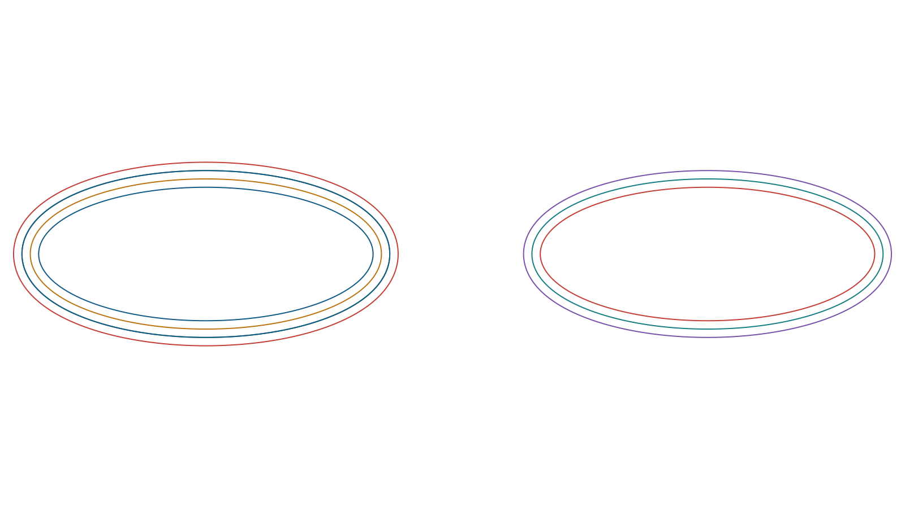

<!--
********************************************************************************
This file is part of the LibreCAD project, a 2D CAD program

Copyright (C) 2026 LibreCAD.org
Copyright (C) 2026 Dongxu Li (github.com/dxli)

This program is free software; you can redistribute it and/or
modify it under the terms of the GNU General Public License
as published by the Free Software Foundation; either version 2
of the License, or (at your option) any later version.

This program is distributed in the hope that it will be useful,
but WITHOUT ANY WARRANTY; without even the implied warranty of
MERCHANTABILITY or FITNESS FOR A PARTICULAR PURPOSE. See the
GNU General Public License for more details.

You should have received a copy of the GNU General Public License
along with this program; if not, write to the Free Software
Foundation, Inc., 51 Franklin Street, Fifth Floor, Boston, MA 02110-1301,
USA.
********************************************************************************
-->
# Editable Offset Curves: Current Implementation Roadmap (#2961)

Updated: 2026-11-11. Project: **LibreCAD**, not LibreCAD_3.

### Current source-widget implementation plan

This section takes precedence over older source-picker completion claims below.
The request covers the Properties source widget for editable offset curves:
users must be able to change the source family when choosing a replacement,
choose any supported source family including a distinct parabola, and see the
existing source highlighted or selected when it can be resolved. Family
availability is not a promise that every geometry variant can be generated.

**Current code:** `LC_PropertiesEditingWidgetOffsetCurve` fills `cbSourceType`
from `LC_OffsetSourceGeometry::SupportedKinds` and filters `cbSource` against
the selected family. The nine modeled kinds are line, arc, circle, ellipse,
spline, spline-points, parabola, bounded hyperbola, and polyline. The source
choice is currently a document-entity combo box, not a canvas-picking action.
Selecting an entry starts asynchronous preparation; publication follows
successful validation. The explicit `tbSelectSource` button selects a resolved
entity in the drawing; the shown widget also highlights an unambiguous current
source without changing document selection. Both selectors are disabled while
preparation is busy. Candidate
filtering checks capture, worker encoding, and constrained spline tangents; it
does not by itself prove that the offset can be generated successfully.

**Requested outcome and execution order (2026-11-11):** This is a Properties
workflow for replacing the source of an editable offset, not a request to
replace the existing chooser with a canvas-picking tool. A user can change
the family before selecting a replacement; the family list must not be limited
to the current source's family. When the current source can be resolved
uniquely, show it in the chooser and visibly indicate it in the drawing without
silently changing unrelated selection. A missing or ambiguous source must be
identified as such. Parabola is a first-class family, including during
capture, reconstruction, and replacement, even though its implementation
inherits from spline-points.

The nine `SupportedKinds` entries are the present source inventory, not proof
that every possible entity or geometry variant works. Do not drop an eligible
member of these families merely because the previous source has another kind;
do not advertise malformed or unsupported variants as working. Complete the
following slices in order, preserving the detailed safety requirements below:

| Slice | Remaining work | Acceptance evidence |
| --- | --- | --- |
| 1. Inventory and selector | Compare the canonical kind list, capture/reconstruction, candidate filter, and worker encoding for all nine families. Fix any mismatches; preserve the separate parabola tag and the existing family selector. | Table-driven tests exercise each family as a destination from a different family, switching filters without mutation, empty/unsupported buckets, and parabola versus spline-points identity. |
| 2. Current-source indication | Complete lifecycle and identity handling for resolved, absent, duplicated, hidden, locked, moved, deleted, and replaced sources. Keep temporary highlighting separate from persistent document selection. | Tests cover opening, filtering, hiding/closing, accept/cancel, undo/redo, document/viewport teardown and reappearance, with unrelated selection and overlays preserved. Record limits for initially missing or ambiguous matches and large drawings until addressed. |
| 3. Atomic replacement | Exercise every destination family through capture, asynchronous worker preparation and publication. Revalidate the chosen entity and its geometry at publication; failures, cancellation, and stale results leave the prior source and cache intact. | Per-family success and refusal tests, plus move/delete/document-change and late-reply tests; distinguish actual failures from headless focus-test limitations. Keep controls disabled during an in-flight request unless safe supersession is implemented. |
| 4. Geometry and persistence | Qualify representative valid variants of each family through the offset engine, worker and cache; independently qualify parabola construction, direction, conditioning and trimming. Preserve the typed definition and resulting geometry through applicable DXF and DWG lanes. | A per-family/variant matrix records fixtures, signed distances, mode, results and exact file version/lane; test independent geometry oracles and explicit refusal without partial publication. Uncovered variants remain open, not implicitly supported. |
| 5. Delivery | Run affected CMake and qmake6 builds and tests, then a visible LibreCAD workflow with cross-family replacement, parabola, source indication, cancellation, undo/redo and save/reopen. | Record commands, platform, revisions and actual pass/fail/blocked results. Test and commit each implementation slice, update this plan after each commit, and push the commits to PR #3193. Visible and cross-platform gates remain open until actually exercised. |

Existing picker and parabola tests are useful regression evidence, not a
substitute for the remaining matrix or visible acceptance. The chooser has a
separate explicit "Select in drawing" command; automatic indication must not
be confused with a persistent associative link to a source entity. If future
work adds a new supported source kind, update the inventory, both selectors,
capture/reconstruction, worker encoding, and this acceptance matrix together.

**Implementation slices:**

1. **Inventory and family switching.** Audit `SupportedKinds`, capture and
   reconstruction dispatch, and the Properties candidate filter together.
   Retain one canonical list and distinct `LC_Parabola` identity before its
   spline-points base. Verify switching between every pair of families while
   the editor is idle, including empty families, and choosing an eligible
   entity from each. Do not claim that controls remain enabled during an
   in-flight worker request unless cancellation and stale-result handling are
   explicitly implemented and tested. If in-flight switching is added, cancel
   or supersede the request without publishing its old result.
2. **Source identification.** When an existing source resolves unambiguously,
   display it in the widget and highlight or select it in the drawing as
   requested. Define and implement the selection lifetime so opening,
   filtering, accepting, cancelling, closing, and undo/redo do not unexpectedly
   destroy the user's prior selection; cover deleted, hidden, locked, missing,
   and replaced entities. Preserve the explicit selection action where useful.
   A source is embedded geometry, not necessarily a persistent entity link:
   retain a session identity when known, and do not silently claim a unique
   match when multiple live entities have identical geometry. Represent missing
   or ambiguous matches clearly and leave document selection unchanged.
   Commit `885b34acb` handles the ambiguous embedded-geometry case: it offers
   the eligible entities without guessing, while retaining an explicitly
   chosen identity for the editor session. Commit `3c6b36c91` adds temporary
   highlight overlays for unambiguous live sources, preserves document selection
   and other overlay layers, and removes them on widget hide, viewport document
   change, or viewport destruction. Commit `330d7f1f4` watches an already
   resolved source while the editor is visible, removing a stale highlight
   after movement, deletion, or hiding and restoring it when that same source
   becomes valid again. The one-second check scans the document for the tracked
   ID and compares bounded encoded geometry; it stops when the viewport or
   document lifetime changes. Initially missing or ambiguous sources are not
   monitored for newly available matches; other lifecycle cases, large-drawing
   responsiveness, and visible acceptance remain open.
   Commit `6a29d6738` also invalidates the viewport's borrowed document on
   graphic/block teardown, stops the highlight monitor when that happens, and
   avoids its deferred redraw against the dead document. Rebinding a new
   document at the same address revokes the old overlay. This protects the
   monitored path and `getDocument()`; it is not a general audit of all direct
   viewport document or graphic pointers, concurrent destruction, or arbitrary
   subclasses that reenter before their concrete base destructor begins.
3. **Atomic replacement.** For every modeled family, choose an eligible source
   of a different family, capture its actual typed geometry, generate and
   validate the cache through the worker, and publish source and cache
   together. Recheck entity/document lifetime and geometry at publication;
   cancellation, invalid input, worker failure, or a stale response must leave
   the committed source and cache unchanged. Preserve the selected identity
   during the editor session, including duplicate-geometry candidates.
   Commit `5fa8c7328` adds a bounded encoded source witness to ellipse and
   generalized replacement requests and rechecks the live entity before
   publication. The focused regression covers movement and deletion during
   worker execution for both paths. Other families, source-lifetime events,
   and visible workflows still require the coverage described here.
   Commit `0a0585069` defers updating the session's preferred identity until
   replacement succeeds; a cancelled request for an identical source no longer
   changes the previously committed identity.
4. **Parabola and other variants.** Exercise parabola independently from
   spline-points through capture, replacement, worker/cache and applicable
   DXF/DWG persistence. Extend the family-by-variant matrix for the other eight
   families as well; document validity, geometry, conditioning, and file-lane
   limits. Unsupported or unproved variants must be excluded or refused without
   partial publication, rather than advertised as universally supported.
5. **Acceptance and delivery.** Add or extend table-driven widget tests for
   family changes, typed replacement, explicit and automatic source indication,
   ambiguity, current-selection restoration, deleted/stale candidates, worker
   failures and cancellation. Cover every family and a distinct parabola, then
   run the geometry and worker/file tests affected by any changes. Perform a
   visible LibreCAD Properties workflow with a real drawing, including
   cross-family replacement, parabola, indication, cancel, undo/redo and
   save/reopen; record platform and outcome separately from headless tests.
   Commit each tested implementation slice, update this roadmap with its
   actual evidence after the commit, and push the resulting commits to PR #3193.

**Reconciliation check:** the existing `/private/tmp/offset2961-build-new/`
`librecad_tests` executable passes `[gui][dialog][offsetcurve][source]` with
11,930 assertions in 12 cases. This is an existing build, not a fresh build
or a visible GUI acceptance; it does not close the open indication, ambiguity,
or per-variant work above.

After rebuilding that CMake `librecad_tests` target with `885b34acb` and the
other uncommitted worktree changes present, the focused ambiguity regression
passed 20 assertions and the full `[gui][dialog][offsetcurve][source]` suite
passed 11,950 assertions in 13 cases. This is headless widget coverage, not
visible GUI acceptance. `git diff --check` passed.

With `5fa8c7328` and the other uncommitted worktree changes present, the CMake
test target rebuilt successfully and `[gui][dialog][offsetcurve][source]`
passed 12,106 assertions in 14 cases. The broader
`[gui][dialog][offsetcurve][async]` run passed 13 of 15 cases; two cases failed
at `editor.hasFocus()` under Qt offscreen before their behavioral assertions.
One focus failure also reproduced when run alone. These failures remain open;
they are not evidence that the broader async gate passed. `git diff --check`
passed.

After rebuilding the CMake test target with `0a0585069` and the other
uncommitted worktree changes present, the duplicate-source cancellation test
passed 24 assertions, including observation of late replies. The full
`[gui][dialog][offsetcurve][source]` selector passed 12,130 assertions in 15
cases. This does not close the offscreen focus failures or visible GUI gates.

With `3c6b36c91` and the unrelated uncommitted worktree changes present, the
CMake `librecad_tests` target rebuilt. The highlight selector passed 91
assertions in 6 cases, including a pixel-level renderer check, viewport lease
lifetime, ambiguity, selection preservation, and ellipse-to-parabola
replacement. The full source selector passed 12,190 assertions in 19 cases;
the renderer `[gui][pen]` selector passed 2,553 assertions in 42 cases. The
four changed application objects also compiled using the existing qmake6
build; this is not a full qmake build. `git diff --check` passed. These are
headless tests, not a visible LibreCAD workflow or cross-platform acceptance.

With `330d7f1f4` and the unrelated uncommitted geometry experiment present,
the CMake test target rebuilt and the source-highlight selector passed 118
assertions in 7 cases, including an actual timer tick and viewport/document
invalidation. The full source-picker selector passed 12,217 assertions in 20
cases; the two changed application objects compiled in the existing qmake6
build. This is not a full qmake build. `git diff --check` passed.

With `6a29d6738` and the unrelated uncommitted geometry experiment present,
the CMake test target rebuilt. The highlight selector passed 140 assertions in
9 cases, including a layer-destruction callback, deferred-redraw suppression,
and same-address block replacement. The full source-picker selector passed
12,239 assertions in 22 cases; the combined close, tracked-listener, and
viewport-range selection passed 639 assertions in 46 cases. Five changed
application objects compiled using the existing qmake6 build, not a full qmake
build. `git diff --check` passed; visible and cross-platform gates remain open.

Before `330d7f1f4`, the CMake LibreCAD app target built with the unrelated
geometry experiment present. The desktop service timed out attaching to its
window, and a separate Cocoa test reported `Cannot create window: no screens
available`; no visible workflow was verified. The broader async selector under
Qt minimal passed 14 of 16 cases; two failed at `editor.hasFocus()` before
behavioral assertions, matching the recorded offscreen limitation. Keep those
gates open.

### Source-picker status

The editable type-changing picker is implemented for the canonical
`LC_OffsetSourceGeometry::SupportedKinds` inventory: line, arc, circle, ellipse,
spline, spline-points, distinct parabola, bounded hyperbola, and polyline. The
selector remains enabled while the editor is idle; changing type filters
candidates without converting the current source or changing its generated
cache or existing drawing selection. It is disabled during worker preparation.
A successful source-list choice
atomically installs the candidate's actual typed source. Parabola is a
first-class, distinct picker entry, not a generic spline-points alias.

The acceptance gates are
`Native source picker changes family and replaces the source with a typed
curve`, `Native source picker replaces every modeled source family without
filter side effects`, and the `SupportedKinds` selector-inventory assertion in
`lc_offsetcurve_propertiesdialog_tests.cpp`. Together they verify that the
type selector can be changed before selecting a replacement, each modeled kind
can be selected as the requested family and installed as its actual typed
source for the tested fixtures, parabola is distinct from spline-points, and
filtering preserves the current source and any existing drawing selection.
The additional overlay and renderer tests above cover automatic highlighting
headlessly; none of these tests establishes visible GUI acceptance.
Re-run these when
changing the picker or adding a modeled family; do not treat their pass as
evidence that every geometry variant can be offset or round-tripped.

The 2026-11-10 clarification reconfirms the requirement to change source type
when choosing a replacement and to include parabola as a distinct type. The
existing list-based control covers idle family switching, and the resolved
source is temporarily highlighted while the widget is shown. Visible workflow
and remaining source-lifetime acceptance remain open.
“All supported types” remains open beyond the picker: qualify eligible variants through direct
geometry, worker/cache, replacement, and applicable DXF/DWG paths. Keep
unqualified variants filtered or fail-closed without changing source/cache.

## Current Contract

The latest source-widget request is captured as this testable contract: while
the Properties editor is idle, the family control remains enabled, and
changing it before accepting a drawing pick filters candidates to that
requested family. The selector is populated from
`LC_OffsetSourceGeometry::SupportedKinds`, not a
second hard-coded UI list, so every modeled kind is available for replacement:
line, arc, circle, ellipse, spline, spline-points, parabola, bounded
hyperbola, and polyline. Newly modeled source kinds must therefore appear in
the picker automatically and receive the same filtering/replacement contract
tests. `LC_Parabola` remains distinct from its `LC_SplinePoints` base and must
be selectable and reconstructible as a parabola, not merely accepted as a
generic spline-points entity.

Changing the candidate filter must not mutate the current source or generated
cache, and must not clear or move the current source's drawing highlight even
when its family differs from the requested replacement family. Candidates
must be valid and eligible for the requested family. Picking one atomically
replaces the source with that entity's actual typed geometry and retains the
picked entity identity during the editor session, including when another
entity has identical geometry. Cancellation and invalid/stale picks leave the
source and cache unchanged. Existing Properties-widget regressions cover this
picker contract; do not add another selector or a parabola-only UI branch.
This closes only the picker-level requirement.

The existing `cbSourceType`/`cbSource` implementation and Properties
regressions cover idle family switching for all nine modeled kinds, including
parabola identity. Temporary source indication is implemented for resolved
entities; visible interaction, additional source-lifetime cases, and the
end-to-end geometry/worker/cache/persistence matrix remain open as specified
in the current source-widget implementation plan above.

“Support all types” is a separate end-to-end requirement: qualify each
production-supported family and eligible variant through direct geometry,
real worker execution, cache admission, source replacement, and applicable
DXF/DWG read/write persistence. A family appearing in the picker is not proof
that its geometry is supported. Parabola is explicitly in scope as a
first-class source type, but only its individually recorded parameterizations,
transforms, topologies, and distances are qualified; unsupported cases must
remain excluded or fail closed without changing the current source or cache.

Track concrete eligible variants in a family-by-family matrix, with separate
evidence for direct generation, worker/cache admission, replacement, and
applicable DXF/DWG round-trips. Existing parabola receipts qualify only their
recorded parameterizations, transforms, topologies, and distances. Unqualified
variants must remain excluded or fail closed without mutating the current
source/cache until their own geometry and persistence evidence is recorded.

Implicit geometry tolerance is additionally bounded by 10% of the requested
offset distance. A source-relative tolerance larger than that can accept a
curve whose error exceeds the offset itself, effectively publishing the source
instead of its requested offset. If the bound falls at or below the numeric
floor, or the geometry cannot meet it within the existing work budgets, the
operation must fail closed. Explicit geometric tolerances remain caller-owned.
The full worker matrix must be rerun after changing this shared tolerance rule.

High-degree spline evidence has advanced beyond native SPLINE persistence.
Degrees 4-6 now pass bounded source/protocol admission and worker operation-7
generation plus operation-8 cache validation for tested clamped rational
profiles. Degrees 4 and 6 additionally have staged carrier promotion and
metadata save/reopen/second-save coverage for the single-span, midpoint-knot,
asymmetric nonuniform-knot, multiplicity-two, and selected asymmetric
control/weight fixtures recorded in W506-W511. This is not arbitrary NURBS
support: untested knot multiplicities/layouts, periodic high-degree offsets,
large-source generation beyond protocol caps, independent offset-error
oracles, and external CAD remain open. The source codec now enforces its
decoder's array caps and the picker excludes unencodable spline candidates;
this is a fail-closed bound, not proof of useful geometry at the maximum
count. Wrapped degree-4/6 sources now have worker generation/cache-validation,
Properties replacement, and staged five-lane DXF/DWG promotion coverage for
the recorded periodic profiles. This does not qualify other periodic knot
layouts or all high-degree geometry. An independent high-precision source
offset oracle now checks representative clamped single-span and knot-profile
rational degrees 4-6, including tested periodic profiles; other knot layouts
and parameter ranges remain open. Properties
picker/replacement now has focused degree-4/6 coverage for the tested clamped
single-span, midpoint-knot, asymmetric rational, and wrapped periodic profiles.
An additional strong positive-rational weight profile maps the oracle's simple
periodic seam roots for degrees 4 and 5. Its degree-6 counterpart has six
oracle roots including interior knot `t=2`; W593 now certifies that C2-knot
crossing, maps every reported candidate to output geometry, and completes
worker operation 7 plus result-wire round-trip for this exact profile. W595
also qualifies one open degree-6 positive-rational spline with a repeated
multiplicity-four C2 knot and an oracle-backed crossing at `t=0.5`. These do
not qualify other degree-6 periodic weight/knot profiles or general
high-rational/repeated-knot support. W596 adds oracle-backed open degree-4 and
degree-5 positive-rational fixtures with multiplicity `degree-2` C2 knots;
for those exact profiles, the cross-knot candidates are certified and mapped
to output endpoints. W597 adds an open degree-3 positive-rational fixture
with one simple C2 knot. Across W595-W597, only the recorded degree-3 through
degree-6 open C2 crossing fixtures are qualified (degree 4-6 repeated knots;
degree 3 simple knot), not general repeated-knot support. W598 mirrors the
degree-3/4/5 fixtures and verifies their crossings on both signed offset
sides; this remains evidence for those exact knot and weight profiles.
W599 additionally runs worker operation 7 and round-trips its result through
the result codec for every tested degree-3/4/5 mirrored fixture. W600
combines each worker output into the canonical source-cache spline and
validates it through operation 8 plus the result codec; this still does not
prove DXF/DWG persistence for these crossing fixtures. W601 adds native
application-writer export/reopen checks for the existing degree-3 rational
repeated-knot source on both signed sides across five file lanes; that fixture
is a separate, older repeated-knot profile, not the C2 cusp-crossing matrix.
W602 adds product-writer export/reopen evidence for the C2 cusp fixtures at
degrees 3-5, both signed sides and the same five lanes; each staged reopen
retains the typed source and exact cache fingerprint. The persistence test
also requires the direct engine to classify the knot as a
`CertifiedUniqueBracket` before testing the worker/file path. W603 adds a
separate LibreDWG 0.14 parse of all 12 preserved R2000/R2018 DWGs, confirming
one canonical cubic cache SPLINE plus both typed-source EED markers; this is
independent parsing, not external-CAD visual acceptance.
Generated editable offset caches are still constrained to the validated
line/cubic-Bezier representation; do not widen cache validation merely
because source spline degree increased.

The 2026-11-09 follow-up restates the requirement that users can change the
source-curve family while choosing a replacement and that source support
expand across all supported types. The first part is already implemented by
the editable nine-family picker and is covered by W641; do not add a parallel
selector or duplicate family list. The second part remains the end-to-end
eligibility obligation below: picker visibility alone does not make a source
variant offsettable or round-trippable. Continue closing concrete variants
through geometry, worker/cache admission, replacement, and applicable
DXF/DWG validation, retaining fail-closed behavior for unqualified cases.

Current implementation order for the remaining “all supported types” work:

1. **Inventory and eligibility:** use `SupportedKinds` as the canonical set;
   for each kind, list concrete source variants, validity constraints, and
   whether the current direct engine, worker/cache, and DXF/DWG persistence can
   represent them. Keep `LC_Parabola` distinct from `LC_SplinePoints` during
   capture, filtering, dispatch, replacement, and serialization. Do not expand
   the selector to advertise a kind absent from this inventory.
2. **Geometry and refusal:** close variants family by family through direct
   generation, both signed sides where meaningful, transforms/reversal, and
   scale/translation conditioning. Compare successful output with an
   independent geometry oracle. Invalid or unproved geometry must return a
   typed refusal with no partial branches; do not weaken numerical guards to
   make the matrix green.
3. **Worker and editable cache:** for each admitted variant, prove bounded
   request/reply round-trip, cache validation/admission, canonical
   representation, replacement atomicity, and same-budget recovery after
   failure. The worker cache now canonicalizes bounded ordinary line/cubic
   branches, including disconnected branches, into degree-3 SPLINE data with
   full-multiplicity boundary knots; degree-1 segments are exactly elevated.
   The raw DXF/DWG spline-carrier reader accepts the same bounded
   full-multiplicity layout, and staged import promotes only after operation-8
   validates the exact source/cache pair. Other layouts remain fail-closed;
   never flatten them lossily.
4. **Properties interaction:** retain the existing family selector and complete
   the source-indication and visible-workflow slices above.
   Verify family change refreshes candidates before picking, current-source
   highlighting survives a family-filter change even when the current source
   is not a candidate in that family, and highlighting survives an
   unsuccessful or cancelled replacement. Verify the control stays enabled
   for an existing source. Add/retain a table-driven replacement regression
   that starts from a different current family, changes the filter, picks one
   eligible entity of each of the nine modeled kinds (line, arc, circle,
   ellipse, spline, spline-points, parabola, bounded hyperbola, and polyline),
   then verifies the published tagged source matches the picked entity's
   actual type and geometry. Include duplicate-geometry identity, current
   source highlight, invalid/stale candidate, and cancellation assertions;
   filtering alone must leave the source and cache unchanged. Parabola must be
   recognized before its `LC_SplinePoints` base type. Keep visible-GUI
   acceptance separate from widget regressions. No new selector or duplicate
   parabola branch is in scope.
5. **Persistence:** for each admitted, serializable variant, round-trip the
   source and cache through the applicable DXF/DWG versions, then reopen and
   regenerate/validate the cache. Assert dynamic type, parameters, weights,
   knots, orientation, and geometry as applicable; unsupported file lanes must
   fail visibly without replacing existing state. Fixture-generated carrier
   import/promotion and native product export/reopen are covered for one open
   mixed-bulge polyline through R14, R2000, and R2018 DXF plus R2000 and R2018
   DWG, covering every representable worker cache for the fixture, including
   single- and multi-branch outputs. A separate control-point spline-points
   source now has product export/reopen checks across those five lanes, for
   both offset signs and four recorded distances; every fit-point
   spline-points import-grid entry admitted as a single cache is checked across
   the five lanes at its recorded signed distance; every promotable single-cache
   parabola case in the six-source, six-distance, both-sign matrix is checked
   across all five lanes; every promotable single-cache case in the eight-shape
   bounded-hyperbola matrix is checked across all five lanes at unit scale and
   normalized distances `+/-1.05`, while multi-branch cases remain fallback-
   only; an unweighted spline is checked across all five lanes on both
   signed sides; a rational tangent-constrained cubic offset is product-
   round-tripped through all five lanes. Wrapped periodic spline caches are
   product-round-tripped through all five lanes across the complete 240-case
   tested import grid: degree 2/3/4/5/6, two bounded control-count layouts,
   unit/rational weights, three scales, two distances, and both sides.
   A regular open degree-2 rational spline with nine controls and seven
   nonuniform spans is also product-round-tripped for both `1e-6` to `1e6`
   weight orders and both signed `0.005` offsets across all five lanes.
   Representative product-writer
   round-trips now exist for all nine modeled source families. The translated-
   ellipse writer matrix additionally covers every admitted first-distance
   case across 25 recorded shape variants, three scales, and three translation
   ratios, plus each recorded signed distance for all variants at nominal
   scale/translation, in the five DXF/DWG lanes. LibreDWG independently parses
   representative nominal R2000 and R2018 native ellipse-offset DWGs and
   matches their decoded degree, knots, and control points to the expected
   cache within its JSON decimal precision. Other per-family variants,
   distances/sides, independent-CAD compatibility, and visible workflows
   remain open.
6. **Closeout evidence:** record focused and aggregate test commands/results
   per slice, run `git diff --check`, and check exact-head CI after pushes.
   Mark a family/variant complete only for the exact matrix exercised; keep
   GUI and independent-CAD acceptance separate from headless unit coverage.

For the current extreme-thin-ellipse work, prioritize the inward cusp boundary
before expanding the outward sweep matrix: a passing status alone is not
evidence of a valid offset. Keep the independent source-distance and tangent-
orientation oracles enabled, and establish the expected trimmed topology from
the engine's offset contract rather than assuming a single closed branch when
the untrimmed parallel curve develops cusps or loops. W708 qualifies the
origin-centered symmetric whole ellipse; W709 adds one moderately translated,
axis-aligned whole ellipse at the same five distances. Later receipts
W718-W728 qualify specific rotated/translated whole-ellipse and partial-arc
inward cusp thresholds, including reversed arcs; W729-W781 add selected
1000:1-through-near-circular ratios, transformed/reversed intervals, and both
worker pick sides for the recorded reversed translated 1000:1 profile. These
do not establish general scale, rotation, translation, sweep, or ratio
invariance. Continue with distinct partial intervals, orientations, origins,
and eccentricity neighborhoods; preserve the numeric-floor refusal boundary
and keep direct, worker/cache, and five-lane persistence evidence separate.

The picker requirement itself is **complete**. Remaining implementation is
steps 1-6 above, driven by the variant gaps recorded in the chronological
entries; in particular, recent periodic high-weight tests preserve a
fail-closed positive-side refusal and do not justify treating all periodic
splines as supported. W563cq normalizes active rational weights while forming
certified jet bounds; its enclosure and worker regressions pass, but the
cusp-rich positive-side periodic offsets still refuse and W563cg remains open.
W563cr adds validated multi-branch ordinary line/cubic cache canonicalization
and generic cache-layout/grip support for full-multiplicity boundaries; this
closes that narrow representation gap, not unresolved periodic positive-side
cases or all-source-variant cache support.
W589 now keeps a roundoff-near-zero closed seam as a provisional branch-join
boundary when no isolated cusp/stall owns it. This prevents the wrapped first/
last branch from receiving one mixed orientation classification that can
erase a separately isolated cusp. The seam remains diagnostically
unclassified, not certified as a root; candidate-to-output proof is limited to
the recorded degree-4/5/6 weighted periodic profiles.
Current status (W523 complete for its defined spline precision/persistence
matrix; W524 parabola translation/persistence matrix complete for its defined
grid, extended by W647-W648 with positive- and negative-determinant affine
source profiles, W649 with a tighter-curvature source through direct
geometry/worker/cache/five-lane file validation, W650 with normalized
primitive construction across extreme scales, W652 with five-lane worker/cache
persistence across source scales `1e-8` through `1e8`, and W653 with overflow-
safe derived spline points at large translations; W645 keeps broader parabola
variants as an explicit end-to-end gate; W646 extends the ratio-1e6
rational four-knot support to `.12`, `.31`, and `.58` under its recorded
proof/persistence limits; W526 polyline worker
scale/translation qualification complete for its
defined matrix; W527 polyline staged-file persistence complete for its defined
matrix; W528 mixed-sign bulge polyline scale/translation qualification
complete for its defined matrix;
W529 closed major/minor mixed-bulge source qualification complete for its
defined matrix;
W530 reversed major/minor mixed-bulge qualification complete for its defined
matrix;
W531 imported major/minor polyline-to-worker qualification complete for its
defined lanes and signed distances;
W532 opposite-sign major-bulge chain qualification complete for its defined
matrix;
W534 unequal-magnitude opposite-sign major-bulge qualification complete for
its defined matrix;
W535 reversed unequal-magnitude major-bulge qualification complete for its
defined matrix;
W536 sign-reflected unequal-major-bulge qualification complete for its defined
matrix;
W537 source-picker constrained-fit eligibility correction complete;
W538 explicit-control-net quadratic fit SPLINE import correction complete;
W539 tangent-vector model and DXF preservation complete with fail-closed DWG
export for constrained variants;
W540 schema-3 tangent metadata persistence complete;
W542/W543 cubic fit-point interpolation, W544 transform/reversal
qualification, W545's bounded translation-conditioning probe, W546's one-ended
DXF persistence checks, W553's verified unit-weight tangent-constrained cubic
`RS_Spline` path, W555's verified positive-weight rational tangent-cubic
generation/cache/Properties replacement path, and W556's typed-source
DXF/DWG five-lane metadata round-trip plus AC1032 staged-import qualification
are complete for their recorded cases; W557 additionally admits verified
positive-weight rational quadratic tangent `RS_Spline` sources through direct
generation, worker/cache validation, Properties replacement and typed-source
round-trip; W558 adds rational-quadratic AC1032 DXF/DWG staged-import and
cache-promotion coverage; W559 reconfirms the existing type-changing,
nine-family source-picker contract without adding duplicate UI; W560 extends
verified tangent-constrained SPLINE support to degree 1 with worker, Properties,
five-lane persistence and AC1032 staged-import coverage; W561 further
qualifies one-ended degree-1 tangents through transform/reversal, both offset
sides, Properties replacement and the same DXF/DWG file lanes;
W562 admits and qualifies a curve-consistent tangent-constrained
`LC_SplinePoints` subset through worker/cache, Properties, DXF/DWG persistence,
and AC1032 staged-import paths; W563az/W563ba structurally qualify
tangent-constrained DWG fit-point chains of 3, 4, 5, 6, and 8 points, but
W563bb's independent curve comparison found that structural acceptance does
not establish geometry equivalence; follow-up commit `3989d8512` instead writes
the exact degree-2 control-net representation and verifies evaluated geometry,
while fit-point/tangent authoring metadata is not retained; remaining
family/variant and acceptance work is open;
chronological evidence follows):
The latest source-picker clarification is incorporated: replacing a source
must allow choosing a different source family before selecting a live entity,
and the picker must cover every modeled offset-source family, including the
distinct parabola type. This is already implemented at the UI-contract level;
remaining work is end-to-end support for each advertised family and geometry
variant, with unsupported variants excluded or refused without mutating the
current source/cache. Do not add another selector or duplicate parabola UI.
The repeated 2026-11-07 request confirms that changing the family is part of
the replacement flow itself, not a separate source-type edit after selection.
The picker contract is the exact `SupportedKinds` inventory: line, arc, circle,
ellipse, spline, spline-points, parabola, bounded hyperbola, and polyline.
Parabola remains independently selectable and must retain its dynamic type
through candidate filtering and replacement. The UI contract is complete;
"expand support to all supported types" continues as geometry-path work across
the listed families (eligibility, generation, worker/cache, import/export, and
round-trip), with explicit refusal coverage for unsupported variants.
The 2026-11-07 follow-up reconfirms that the editable Properties source widget
must change source type before selection and expose every currently modeled
family: line, arc, circle, ellipse, spline, spline-points, parabola, bounded
hyperbola, and polyline. `LC_Parabola` remains distinct from its
`LC_SplinePoints` base type. The existing `cbSourceType`/`cbSource` implementation
and Properties-dialog tests already satisfy that picker contract; remaining
“all types” work belongs to the open source-variant generation, worker/cache,
import/export, and round-trip matrix, not another UI control.
Implementation and review rule: `LC_OffsetSourceGeometry::SupportedKinds` is
the single canonical picker inventory. Populate the selector from it rather
than maintaining a second list. Changing the type filters live replacement
candidates without mutating the current source/cache; choosing a candidate
atomically replaces the tagged, value-owned source. A matched source remains
resolvable and explicitly highlightable, including after import. `LC_Parabola`
is its own choice and must be identified before its `LC_SplinePoints` base
class. “All supported types” means every kind in this inventory; it does not
certify every concrete geometry variant for generation, cache admission, or
file round-trip. Track those separately with explicit eligibility/refusal
tests.
implementation slices
A-core through T3 and the local A-core through C-check audit remain qualified.
The shipped native geometry worker, Modify Offset creation/repeat, native Trim
preview/commit, staged GUI drawing/template imports, bounded worker validation
for public synchronous file/stream/byte filter imports, the public `RS_FileIO`
auto-detection route, and separately compiled Qt plugin caller are present.
W367 fixes a newly reproduced DWG Open dialog gap: both Qt and native dialogs
now default to the combined DXF/DWG filter despite a persisted DXF-only choice,
and infer DWG from the selected path. The AC1032 offset acceptance fixture was
opened and visibly rendered through the rebuilt GUI. W376 confirms the command
history reported `AC1032/R2018` and the viewport showed six ellipse contours in
two groups of three. This closes only that fixture/build's direct DWG
import/display check; it is not save/reopen validation. No screenshot was
retained and app-window DPR remains unmeasured. Product
commit `d8ecf0a74d58429483e85227ac82d3f44f365fa9` is pushed. W368 merges current
`origin/master` `ae1e3b8152a18334109fd93393dcc8dd5e436c3c` as
`694a453921b2853dc4e0c810184b8e20a487784f`; the new tip is an ancestor of the
branch. W370 requalifies product/source head
`e4acf6275895b2cb9dd32d8f5b7e04320452a03b`; W371 directly cross-checks the
unconverted AC1032 DWG spline geometry through LibreDWG and SciPy, with radial
deviation below `2e-15`. W372 records visible test-copy offset creation and
selection as `Offset Curve (1)`; its screenshot was not retained and its later
drag/Escape attempt did not establish cancellation timing or parity. W374
records another unlocked test-copy probe: a held-click sample already showed
the committed editable copies before Escape, then one Undo restored the six
source contours. A separate drag/Escape returned to Default with the source
contours, but no distinct preview frame was captured and input ordering was
not observable; neither attempt qualifies cancellation. The disposable DXF
SHA256 still matches its recorded baseline, with no Save issued. Historical
diagnostics at 22:00 UTC for exact PR head `f0a48b61d2db5ac32e807143efcd708860b337ce`
report one successful check (Headless ON), 14 in progress, three queued, five
skipped, and zero failures. No prior-head result is inherited. PR #3193 remains
open and draft; an approving review is still required. W376 is a roadmap-only
commit, so its checks must be qualified separately. Remaining acceptance
includes retained matched preview/commit screenshots and app-window DPR,
reproducible held-drag cancellation, physical stale-peer behavior, independent
visual fidelity, signed/deployed and minimum-macOS acceptance, review approval,
and final R integration. W503 adds staged-import promotion/refusal coverage
for eight bounded-hyperbola layouts across five DXF/DWG lanes and six nearby
signed distances; the focused case passes 59,016 assertions and the full
typed-source import selection passes 327,550 assertions across 34 cases.
W504 revalidates that the editable nine-family selector and distinct parabola
choice are already implemented; remaining source support is variant-level.
The latest worker-scale slice passes focused and full worker-kernel tests;
exact-head CI must be queried again after its commits are pushed.
W506 extends the hyperbola curvature-neighborhood import matrix to four
uniform scales and five historical DXF/DWG lanes. Its focused matrix passes
285,397 assertions; the full typed-source import selection passes 504,226
assertions across 34 cases. These measurements qualify only the recorded
layouts, scales, and normalized distances.
W507 adds centered-versus-translated worker geometry/cache checks for all eight
bounded hyperbola layouts at six curvature-neighborhood settings; the focused
case passes 15,088 assertions and the worker-kernel suite passes 42,085 across
39 cases. W508 carries those sources through five DXF/DWG lanes; the focused
import case passes 121,025 assertions and the full typed-source import suite
passes 600,512 assertions across 35 cases. These qualify only the recorded
translation, interval layouts, and distances.
W439 adds bulged LWPOLYLINE and legacy 2D POLYLINE input coverage across R14
DXF, R2000 DXF/DWG, and R2018 DXF/DWG. W440 reconfirms type-changing source
selection and the nine-family Properties picker with 3,194 assertions across
six GUI cases; a worker/cache-dependent refusal remains for closed-polyline
variants, and the broader family/variant persistence matrix remains open.
No exact-head CI result is claimed for W441-W490. Historical results from
earlier heads are not inherited; query the current PR head after the roadmap
checkpoint is pushed.
The source-picker request is closed at the UI-contract level: while replacing
an offset source, the user can change the source-family selector before
picking a matching live entity; the current source remains selected and
highlighted when it exists. The selector exposes the nine modeled families:
line, arc, circle, ellipse, spline, spline-points, parabola, bounded hyperbola,
and polyline. Parabola is a distinct kind and must stay distinct through
capture, worker dispatch, replacement, and persistence. W359/W396/W397/W440/
W474 and the nine-family integration matrix cover selector changes,
highlighting, and replacement. W537 additionally filters tangent-constrained
spline variants from eligible candidates while retaining both family choices
and the worker refusal guard. Do not add another widget or parabola branch for
this request.

“Support all types” remains an end-to-end geometry obligation, not a picker
enumeration claim. For each advertised family and geometry variant, qualify
source capture, offset generation, worker/cache validation and admission,
guarded replacement, failure/cancellation non-mutation, and applicable real
DXF/DWG save/reopen behavior. Keep statically unsupported variants out of
eligible candidates; for valid but unrepresentable inputs, refuse visibly and
retain the previous source/cache. Continue closing the family/variant matrix
below; a family appearing in the selector is not evidence of complete offset
support.
W436 adds marked XY display projections for straight non-axial LWPOLYLINE and
legacy 2D POLYLINE imports, with typed offset-source refusal and DXF/DWG
provenance round-trips. Legacy POLYLINE coverage now includes R14, R2000, and
R2018 DXF plus R2000/R2018 DWG; W454 verifies signed-bulge AC1015 DWG input.
This does not implement
non-axial bulged-curve projection, native 3D/mesh offsets, or close the
independent acceptance gates.
The source Properties widget requirement to change curve family before
choosing a replacement is implemented and covered for the nine currently
modeled families: ellipse, spline, spline-points, parabola, bounded hyperbola,
line, arc, circle, and polyline. Parabola remains a distinct choice and source
kind. Changing the family filter alone is non-mutating; selecting a candidate
goes through guarded worker-backed replacement. Here, "all supported types"
means every family in this explicit matrix, not every legal geometric variant
within each family. Variant-specific worker eligibility, single-cache
representability, persistence, and distance/side behavior remain separate
acceptance obligations; unsupported variants must refuse visibly without
replacing the prior source or cache. This closes the requested picker behavior,
not exhaustive eligibility for every legal geometry variant or every
distance/side, and not the broader plan's acceptance gates. The
recent W378-W399 source-variant slices add malformed-polyline refusal,
long mixed-polyline operation-7/8 sweeps, rational internal-knot worker
validation and persistence, signed-bulge capture/materialization, and actual
AC1032 DXF/DWG signed-bulge import into offset-source geometry. CI outcomes are
head-specific and must be read from PR #3193; older statuses below are
historical and are not inherited by newer heads.

W424 adds bounded 2D polyline segment-intersection validation to offset-source
capture, including line/line and line/arc/arc crossings, conservative
collinear-overlap refusal, and real imported self-crossing LWPOLYLINE coverage
in R14 DXF, AC1032 DXF, and AC1032 DWG. Product commit
`f4c3459e1` is verified by Release test builds, the qmake6 application/plugin
build, focused source/import/worker tests, and `git diff --check`. This closes
only intersecting topology detection for supported 2D line/arc polyline
snapshots; candidate-density caps intentionally refuse ambiguous dense cases,
and non-axial OCS, mesh/polyface/3D legacy POLYLINE, broad distance/side
qualification, and visible GUI acceptance remain open.

W425 extends the topology regression matrix with an adjacent bulge-arc/line
crossing imported as ordinary LWPOLYLINE geometry. R14 DXF, AC1032 DXF, and
AC1032 DWG all retain the two-segment entity while typed offset-source capture
refuses it. The focused case passes 60 assertions; the full imported
typed-source/polyline selection passes 1,138 assertions/11 cases. Test commit
`c88e876ae` adds no product behavior. Exact-head PR checks must be checked for
the new pushed commit.

W426 adds a source-level adjacent arc/arc regression. The circular arcs share
their expected join but also intersect at a second point; source capture must
refuse that topology. The focused case passes 6 assertions, and the full
direct `[lc-offsetcurve][source][polyline]` selection passes 45 assertions/3
cases. Test commit `8a048fe5f` adds no production behavior.

W427 verifies that same adjacent arc/arc double intersection from actual
LWPOLYLINE files, including bulge decoding and staged import in R14 DXF,
AC1032 DXF, and AC1032 DWG. All three retain ordinary two-arc polylines while
offset-source capture refuses them. The focused fixture passes 60 assertions;
the full imported typed-source/polyline suite passes 1,198 assertions/12
cases. Test commit `f3d7697ec` adds no production behavior.

W428 adds a closed bow-tie LWPOLYLINE import case to exercise the implicit
closure seam. R14 DXF, AC1032 DXF, and AC1032 DWG retain the closed four-segment
entity, but typed source capture refuses its crossing. The focused case passes
57 assertions; the full imported typed-source/polyline selection passes 1,255
assertions/13 cases. Test commit `e661bc523` adds no production behavior.

W429 fixes a confirmed topology false negative: the arc intersection solver
returns no discrete points for concentric arcs, allowing positively
overlapping same-circle polyline segments through source validation. A new
angular-span overlap check now rejects positive-length coincident arc overlap
and ambiguous precision while accepting spans that only meet at their join.
Direct tests cover both overlap and endpoint-only contact; a real bulge
LWPOLYLINE overlap imports but is refused as an offset source in R14 DXF,
AC1032 DXF, and AC1032 DWG. Direct polyline source tests pass 47 assertions/3
cases, imported polyline tests pass 1,315 assertions/14 cases, and worker
source-cache polyline tests pass 309 assertions/4 cases. CMake Release tests
and the full qmake6 app/plugin build pass. Product commit `d32646440`.

At the start of W352, the pushed PR head was W351
`9586fc2f5d5ff0d4ddef3937c8a9cc22692f9c9a`; W351 is a roadmap-only commit, and
the latest product-source commit remains
`823d4f06b500db0a91a950e4ef13eda3e0fb3e7e`. Git history confirms
`d183479630b43ae55b032a160d7403dbf3a848ed` is an earlier documentation
checkpoint, not the product head.
At 13:10 UTC, exact-head CI for `503cdab89` completed with 19 passing checks,
7 configured skips, and zero failures. BuildMacOS run `41618321172` succeeded;
its Build and packaging step invoked the W341 mounted-DMG runtime smoke, then
uploaded artifact `13232319103`. This qualifies the ad-hoc universal package on
`macos-14`, not Developer ID signing, notarization, or actual execution on
minimum macOS 14.4. Source-identical prior head `985328c12` also passed 19
checks with 7 configured skips. Exact-head CI for `57f5e9993` completed at
16:36:54 UTC with 19 passing checks, 7 configured skips and zero failures.
BuildMacOS run `41642584330` built an ad-hoc universal arm64/x86_64 package on
the `macos-14` runner with deployment target 14.4, invoked the mounted-DMG
runtime smoke and package checks, and uploaded artifact `13249743257`. This is
not Developer ID signing/notarization or proof of execution on the exact minimum
macOS 14.4 system. The local
`librecad_offset_creation_action_tests` target passes all 90 cases and 90,340
assertions, including the focused stale-peer case's 39 assertions. Roadmap
parser and refusal inventory validation previously passed 5/5 and 94/94; W349
revalidates them after its final receipt edits. W335 retains a direct per-window baseline
screenshot of the test-copy W193 drawing and a Qt 6.12 screen DPR probe of 1.0
on the same 1920x1080 display. W348 now records in-session visible preview and
matching commit states, but no retained screenshot pair or app-window DPR
measurement; it does not establish physical GUI stale-peer behavior. The local
qmake6 app/worker build and ad-hoc package/relocation smoke tests pass; these do not
establish Developer ID signing, notarization, or execution on macOS 14.4. PR
#3193 remains open, draft, and review-required. W348 records visible interaction
through the approved test copy; W350 records a follow-up drag/Escape probe after
the Remote Desktop became reachable again. Neither closes physical stale-peer
acceptance. W335 captured the test-copy LibreCAD
window directly through CoreGraphics without input, which is baseline rendering
only, not interaction acceptance. W352 now archives a useful independent
ezdxf/Matplotlib viewport of the ODA-converted W171 AC1032 DXF; this validates
that single converted SPLINE only, not the original DWG conversion or complete
DWG rendering. Earlier FreeCAD, BRL-CAD, W331, and W342 attempts remain limited
as detailed below. W349-W351 are pushed. W352 records the new viewport artifact
and W351-head CI status.

W302 records an earlier successful visit through the user's remote desktop:
the approved `org.librecad.librecad.pr3193visible` app showed the live red offset preview,
the corresponding committed contour at the same direction, and successful
Escape during a pointer drag while the drag call was still pending. Undo and
Escape restored the visible baseline; no Save command was issued. W193 and W281
remain byte-identical at SHA256
`05aa253d513afc53d7e40bf51efaaf290e5a411cfbbcaaaa99df8386a4281e7d`. The
in-session screenshots are visible in the validation conversation but are not
durable files; their 1920x1080 pixel dimensions do not measure Qt display DPR.
Durable screenshot/DPR evidence, physical stale-peer behavior, and an
independent W171 GUI viewport remain open. FreeCAD 1.1.4 exits before a viewport
for this DXF under multiple import modes; Inkscape displays a two-node path
whose stroke overwhelms its bounds; BRL-CAD's importer reduces the SPLINE to a
degenerate line-only sketch. None is W171 visual-fidelity evidence. Other
open gates are signed and deployed-package/full W0-W2 acceptance, required
human review, and final R integration.
The branch contains current `origin/master` (`998e61dc0`) as an ancestor. Do not
carry forward CI from prior heads: the W284 results refer only to
`8177f81be3282a0a040d94fe8b73e7d6cdc0786a`; the latest W285 poll refers only to
`571e468c5baf8714f064429289f317589da34b57`. After this W285 roadmap-only
checkpoint is pushed, inspect checks for its new exact head.

W253 records the approved FreeCAD first-run setup and a second, keyboard-driven
attempt to import the W171-derived DXF. The import dialog recognized about 233
entities, but FreeCAD exited before presenting a geometry viewport. The complete
offset validation Node suite passes 412/412; exact-head CI for `e246acd8` is
green. Independent contour-fidelity review therefore remains open.

W254 additionally tested the same unchanged DXF in Inkscape 1.4.2. The DXF
importer accepted it with a `$PDMODE` warning, but the drawing extent produced
only a tiny trace at a useful viewing scale. This is not contour-fidelity
evidence; the exact external visual gate remains open.

W255 visibly opened the preserved six-contour W193 acceptance DXF in the
current-source LibreCAD test copy and rendered two groups of three contours.
The W171-derived ODA DXF also opens in LibreCAD, but its one model-space SPLINE
is not a useful independent contour-comparison fixture. FreeCAD's approved
fused-shape retry still exits before a viewport. Neither attempt supplies the
independent W171 fidelity review or durable screenshot/DPR receipt.

W261 adds an independent FreeCAD 1.1.4 headless read/render of the W193-derived
AC1032 acceptance DXF: six `LC_OFFSET_CURVE` XDATA records imported as six
BSpline edges beside two source ellipses, and the equal-scale raster shows the
five-left/three-right nested contours. This is external-kernel geometry
evidence, retained at
`docs/offset-curve-evidence/w261-freecad-acceptance-headless.png`, not a FreeCAD
GUI viewport or a DPR receipt. At W261 the W171 expected-contour comparison
was still open because that fixture is a near-straight tiny spline; W263 below
closes its numerical geometric-fidelity check without claiming a GUI viewport.

W237 requalified the current test-only head with the full CMake application
suite: 5,155 cases, 5,080 passed, 75 skipped, and 10,348,250 assertions passed.
All nine registered CTest worker lanes passed as well.

W238 completed a fresh qmake6/Qt 6.12.0 macOS arm64 application, plugin and
helper build from this worktree. The worker-client suite passed against the
helper in the app bundle and after relocating the bundle; cross-platform and
full deployed-package acceptance remain distinct gates.

For W238 head `2c9b5bcb25e50865f301ee64c2ec41df7d9eb276`, exact-head GitHub
Headless ON and OFF both passed (run `41220922934`). W239 head
`a63a26eaf8ece575717c5c718e0ee07de96dccc7` also passed both modes (run
`41221162702`). Current W240 head CI status is tracked in the PR comment.

W241 rebuilt the exact-worktree ASan test target and reran stale-peer plus the
complete creation-worker group. The focused event test passed 38 assertions;
all 14 worker cases passed with 398 assertions (`detect_leaks=0`).

W243 requalified the exact current worktree with a full CMake Release build and
all 26 CTest entries; the application suite reports 5,083 cases, 5,057 passed,
26 skipped, and 10,347,377 assertions passed. The qmake6/Qt 6.12.0 application
build and bundled plus relocated worker-client suites also pass. The approved
LibreCAD test copy visibly renders both groups of three contours in W193. Its
binary predates the current qmake6 build, so its newly exported DXF is diagnostic
only; exact-source FreeCAD validation remains the W242 single-SPLINE result.

W244 integrates current `origin/master` `998e61dc0` through local merge commit
`c9fc81575`. Fresh CMake Release build and CTest pass 25/25, including the
merged dimension-clipboard lane. A fresh qmake6/Qt 6.12.0 app/helper rebuild
and bundled plus relocated worker-client runs pass. The bounded aggregate app
suite has two failing upstream dimension-label/property-copy cases (five
assertions); a clean build of exact `origin/master` reproduces the same cases
with the same RNG seed, so these are recorded as inherited baseline failures,
not attributed to offset code. PR conflict resolution and new-head CI are
recorded in W244-W245 below.

W242 fixed DXF output for the optional SPLINE/HELIX extrusion vector: the
value-initialized zero vector is now treated as unspecified instead of being
serialized as an invalid zero-length extrusion direction. The focused writer
regression and complete DXF fast suite pass. FreeCAD 1.1.4 imports a fresh
AC1032 file emitted by the exact-source application as one valid SPLINE edge,
without the prior zero-extrusion warning.

W220-W225 qualify selected pieces of the approved qmake6 app's GUI: normal
Offset Curve selection, compact options at one window size, locked-layer
selection refusal, and commit/Undo. W224's FreeCAD import recognized about 233
entities but produced no verified geometry viewport; FreeCAD first-start
settings remain untouched. W227's ASan publication filter passes changed-child
and freed-redo-subtree refusal cases. W233's deterministic Qt integration test
verifies the default right-release menu path; CUA's visible right-click remains
inconclusive. W234 verifies held-drag Escape cancellation through the real
QG_GraphicView event handler while the worker child is busy. W235 compares the
worker-generated preview and committed geometry through that same view route,
and confirms cache reuse and one-step history. W236 exercises stale-peer
rejection and recovery through the same view route. These native event tests
close their corresponding code-path gaps, not the remaining physical-app
evidence.

W246 confirms the approved exact-source LibreCAD test copy is responsive after
the Mac was unlocked. The saved acceptance DXF reopens and visibly renders five
left-hand and three right-hand contours. This adds no new preview/commit result;
W245's previously recorded preview, commit, Undo, Redo, and DXF round-trip
checks remain the interaction evidence. The normal-profile Offset distance was
restored to 0.5 and the app was left idle. The in-session CUA screenshot is not
a durable artifact: macOS `screencapture` captured the Codex desktop rather than
the controlled LibreCAD window, so the two misleading temporary captures were
removed. No screenshot or DPR claim is inferred from them.

Still open: physical stale-peer interaction; durable, separate visible
held-drag and preview/commit screenshots; visible FreeCAD GUI viewport and
durable screenshot/display-DPR records; cross-platform and full deployed-package
W0-W2 acceptance; review approval; and final R integration. W261 supplies a
headless FreeCAD render for the W193-derived AC1032 acceptance output; W263
adds the W171 numeric geometry comparison, not GUI evidence. W226's older
qmake6 helper/client run passed 17 cases / 4581 assertions; W238 adds a fresh
current-worktree bundle and relocation check. W0-W2 and R remain acceptance
gates, not missing product features or substitutes for the native worker tests.

W216 integrates the current upstream tip `5a5fe7345fe7a7ec66892e879967673b6d7a859b`
through merge commit `c4eb33fd2038e81c55ddd79f437d29dc85f96d47`. The upstream
delta is the linetype dash-phase fix and its tests; the focused painter/render
CTest and the full qmake6 application/worker build pass on the merged source.
The PR head before this merge was
`5129ca3cb71b3446466141838ccc56b6669dbf81`, with Headless ON/OFF passing and
CodeQL, DWG/DXF, Windows, and Pixi checks still running. PR #3193 remains open,
draft, and review-required. The merge and roadmap receipt were pushed as
`2fe0a651b4eeff856a63f552629fb670abfee48f` against base
`5a5fe7345fe7a7ec66892e879967673b6d7a859b`; fresh Headless ON/OFF checks are
running and the remaining checks have not yet attached. Device Control approval
for the isolated test app was confirmed, but macOS remains locked, so the
W171-derived FreeCAD visual recheck is still open.

W213 requalifies the current source locally: the full Node suite passes 412/412,
the roadmap/refusal gate passes 99/99 (93 obligations, no pending declarations
or production mismatches), the CMake worker CTest set passes 9/9, and the
installed macOS worker-client suite passes 3,715 assertions in 17 cases. On
product-source head `440c2525058c26b4af4b4e0aece5b0d219ccd970`, Headless ON/OFF,
C++ analysis, Linux DWG/DXF, CodeQL analysis, and Ubuntu/macOS/Windows Pixi
builds pass. Windows ARM64 passes CTest 23/23, recovers across 66,594 allocation
failure points, and passes relocated worker-client tests (3,902 assertions in
17 cases). Windows x64 passes the same 23 CTests and 66,594-point recovery
sweep, with 4,140 assertions in 17 relocated worker-client cases. Its job took
5h38m55s, an unusually long but successful CI lane. At W213's GitHub status
capture, PR head `2d17b3ca060772b6393aa0def90d5d7738275602` showed
CodeQL, Text Foundations, DWG/DXF, and Pixi workflows pending. All changes from
tested product-source head `440c2525058c26b4af4b4e0aece5b0d219ccd970` through
that PR head were confined to this roadmap file. The CodeQL Security scan is
skipped by workflow policy. At that capture PR #3193 was open and draft, with
mergeability unknown and review required.

The approved LibreCAD test app was accessible for W214, which visibly confirms
the W193 drawing's six ellipse contours and idle/default state. At W214, normal
pointer clicks did not select a contour until the explicit Select Entities
control was enabled. W221 later confirms that a normal primary-pointer click
selects the native Offset Curve and exposes its grips/property row in the
approved qmake6 bundle. Right-click/Control-click on the selected entity and
right-click on blank canvas did not visibly open a menu; these probes do not
establish a product defect. Selection was cleared; no drawing edit or save
occurred. Earlier W193 interaction and W211/W163 FreeCAD rendering receipts
remain scoped results.
W171-derived external DXF/DWG rendering is still unverified: FreeCAD previously
recognized about 233 entities but produced no verified rendered view. The
screenshot was observed in-session but not retained, and display-DPR evidence
remains incomplete. The Mac relocked before the follow-up FreeCAD review.

W215 adds a broad current-source CMake Release qualification: all 26 registered
CTest entries passed, including the main application suite (5,050 passed, 26
explicitly skipped, 10,344,419 assertions passed). At the W215 PR-head snapshot,
Headless ON/OFF passed; CodeQL analysis, DWG/DXF verification, and Pixi remained
in progress. PR #3193 was open, draft, and mergeable, with review still required.

Acceptance remains open: remaining GUI refusal/interaction cases, context-menu
and entity-pick behavior, retained screenshot/display-DPR evidence, independent
CAD visual checks beyond W193/W163, signed/deployed package qualification,
broader W0-W2 platform acceptance,
reviewer approval, and final R integration. The mirrored external display
reports 1920x1080 at 75 Hz, but Qt DPR was not measured; in-session screenshots
were not retained. W203-W215 are scoped visible/test passes, not full acceptance.
Direct AC1021
ACadSharp parsing is also unqualified because that reader throws on negative
`ComprLen` before entity decoding; LibreDWG parses the current AC1021 matrix.

Earlier reader findings remain in their dated ledger below: ACadSharp's
`HasValidKnotCount` discrepancy on ODA-converted closed output is not treated as
proof of malformed DWG, and ODA conversion is not a substitute for LibreCAD's
direct DWG writer or external visual inspection.
The user explicitly confirmed that the shipped native geometry worker is required,
in addition to the Node developer validation runner. W0-W2 are mandatory.
Implementation owner: `/Users/dli/.codex/worktrees/offset-2961-runtime/LibreCAD`,
branch `codex/offset-2961-native-worker`, initially pinned to
`df0c891ad5a0bb5b0d0e864f4cd9cdd8036d5f83`. Build/evidence root:
`/Users/dli/dev/LibreCAD/tmp/offset-2961-native-20261026`.
Latest upstream integration: merge `64b57ac4e` includes freshly fetched
`origin/master` at `35e7def3d8365b3ef1bb2af54c6071ae3313691e`. W15 below is the
earlier integration checkpoint; W144 records this newer merge, its sole CMake
test-registration conflict resolution, and selected Release/ASan qualification.
The isolated qmake6 helper build is retained at
`tmp/offset-2961-qmake-native` inside this implementation worktree; it uses a
private SDK cache, not the shared checkout's stash.
Gibbs started the first bounded test correction before that interruption.
Shared source, attached draft/index and the earlier candidate branch are preserved.

## 1. Scope and Sources of Truth

Implement an editable offset entity with typed source definitions for every
currently modeled source family: line, arc, circle, ellipse, spline,
spline-points, distinct parabola, bounded hyperbola, and polyline. Include its
offset-specific worker path, normal document interactions, DXF/DWG persistence,
source editing, and trimming. The Properties replacement flow must allow the
user to change source family before selecting the replacement and preserve the
current source/cache until a replacement succeeds. This family-picker contract
is implemented; per-family geometry-variant eligibility, worker/cache
admission, file round-trips, and independent acceptance remain in scope and
must not be inferred from picker presence.
Also excluded: automatic live source links, extending/filleting offsets,
LibreCAD_3, Vulkan/Metal/RHI, generic text/image/font rendering, Python bindings,
and unrelated build, CI, DWG-object or infrastructure work.

Only offset requirements may justify changes to shared dispatch, properties,
workers, filters or tests. Use the existing renderer to inspect offset geometry.
Gibbs remains the first implementation starter; that requirement was met before
the interrupted temporary run. Further agents must stay within concrete offset
subtasks and disjoint write scopes. No unrelated background work is authorized.

| Source | Observed identity | Meaning |
|---|---|---|
| Main checkout | `/Users/dli/dev/LibreCAD`, master `41678d97626c05ab652ceaa02cf0ac7f7f6205cf` | Dirty shared checkout; preserve all existing changes and its index. |
| Attached feature worktree | `/Users/dli/.codex/worktrees/offset-2961-v205-recovery/LibreCAD`, `codex/offset-curve-2961-recovery-v205`, HEAD `9309885cef66aef0cca0f3c8862e0c210518da3b` | Contains the extra geometry/checker groundwork and this plan; plan already had staged and unstaged changes. |
| Relationship | Merge base of those commits is `41678d97626c05ab652ceaa02cf0ac7f7f6205cf` | The feature groundwork is not present in the main checkout. Do not substitute one tree's tests for the other's. |
| Later implementation candidate | Local branch `codex/offset-2961-implementation`, HEAD `df0c891ad5a0bb5b0d0e864f4cd9cdd8036d5f83` | Descends from the attached feature HEAD. Contains the editable entity, public checker, file/UI/source/trim implementation and validation tooling. Not integrated into either checkout above. |
| Candidate product checkpoints | `b6814fb3a63dd66bb3aeae9e5b5e66668f8b8591` (complete cut search), `f617fcf70b46a0236a8725140aeb10d475c7d9ec` (final edit snapshots) | Substantive later code, not merely a plan claiming completion. Audit and reuse it before proposing replacement implementation. |
| Historical candidate inspection snapshot | `/private/tmp/lc2961-plan-refresh.NI3tkd/candidate`, detached at `df0c891ad5a0bb5b0d0e864f4cd9cdd8036d5f83` | Former read-only inspection aid; now absent. Use the surviving pinned local Git objects, not this disposable path. |
| Historical draft archive | `attic/plan_offset_curve_2961_history_20261026.md` | Earlier audit recorded an exact pre-consolidation draft, including uncommitted work. It is now absent from all three recorded worktrees and is not tracked; do not claim present preservation. |

**Selected implementation baseline:** the isolated
`/Users/dli/.codex/worktrees/offset-2961-runtime/LibreCAD` worktree on
`codex/offset-2961-native-worker`, descending from the later candidate. Current
slice SHAs/evidence and remaining S0 scope corrections are recorded below.
Do not overwrite the dirty main tree,
reset the attached worktree, rewrite the existing candidate branch, or recreate
all implemented modules from the older feature snapshot. Carry this current plan
into the isolated implementation checkout without importing another person's index.
The candidate's committed roadmap and its `docs/offset_curve_2961_validation.md`
are historical evidence at the pinned SHA, not competing scheduling instructions.

The earlier audit recorded the draft as 5,762,095 bytes, SHA-256
`2dc8b28eccb4092af8f2ffba05342abfa69aae93d3963b6b7d37e67b62d73ee0`.
The bytes are not currently available for rechecking that hash or reconstructing
uncommitted work. Its recorded section numbers, V455 proposals and receipt claims
are historical provenance, not active routing or
new PASS results. This document supersedes their scheduling instructions, not
the underlying geometric correctness requirements. Reuse detailed design material
only after checking it against the current contracts below and the selected code.
Do not create another chain of plan-only packet/reviewer revisions instead of
closing a concrete product prerequisite. No historical acceptance is transferred.

## 2. Verified Inventory and Review Findings

This inventory compares the older attached tree with the later candidate.
`candidate present` never means integrated, freshly tested, or fully correct.

| Area | Candidate observation | State / consequence |
|---|---|---|
| Ordinary offset engine | `lc_curveoffset`, `lc_offsetoutputbudget`, `RS_Modification::offsetWithOutcome` | Existing Direct/Trimmed/RegionBoundary behavior; reuse and preserve noneditable source types. |
| Reference, budgets and global checker | `lc_ellipseoffsetgeometry`, strict intersection code, `lc_offsetpathsearch`, public `checkCache` | Candidate extends local groundwork with terminals, complete cut search, memoization and chain proof. The older feature tree lacks this completion. Requalify rather than reimplement. |
| Editable entity and editing | `lc_offsetcurve`, `lc_offsetcurvegrips`, `lc_offsetcurvetransform`, full spline fingerprint | Candidate present: guarded adoption/create, edits, clones, cached snaps/grips and transform/refusal handling. Review call sites and retained proof validity. |
| Definition persistence | `lc_offsetcurvexdata`, `lc_offsetcurvecarrier`, `RS_FilterDXFRW` | Candidate present: schema, raw-carrier admission and actual SPLINE DXF/DWG paths. Same-implementation round trips alone remain insufficient. |
| Type/UI/source actions | Entity enum/coverage, property queue/dialog, default drag, Update/Restore actions | Candidate present. Property queue defers publication with a timer, but prepares geometry synchronously in `apply`; a deferred commit is not background computation. |
| Stored-cache Trim | `lc_offsetcachetrim`, contacts/matching helpers, Modify Trim action and file tests | Candidate present: pure preparation, exact fragments, two-operand publication and plain-fragment persistence. Recheck precision/ownership/undo guarantees. |
| Validation workers | `scripts/offset-curve-validation/`, X-H1 through X-H7 | Candidate has Node developer/test workers and recorded timeout fixes. These tools are not a shipped isolated geometry worker. Do not confuse their deadlines with GUI computation limits. |
| Native geometry-worker path | Real seven-operation protocol4 helper/client, cached source-copy production, same-producer ordinary fallback, plus dialog, sheet, grip, Update, Modify Offset, native Trim and GUI drawing-open/template routing committed/qualified locally | W16-W19 qualify cache portability and creation/repeat; W24-W26 qualify local Trim routing and scoped action faults; W31/W32 cover GUI drawing open/templates. W72 adds staged DXF/DWG plugin block import; W91 routes the legacy synchronous entry through that staged session (it still waits for compatibility) and preserves the async callback entry. W93 classifies hatch-pattern input as display-cache-only. W142 inventories every current in-repo import entry point and records that the remaining synchronous `RS_FileIO`/`LC_DocumentsStorage` APIs are compatibility-level calls with no current recognized DXF/DWG product caller; W143 reruns GUI open/template staging and ownership tests in Release/ASan. External API callers, cross-platform and packaged/final acceptance remain mandatory W0-W2 work. |
| Tests/build targets | Main Catch target, filter micro targets and two standalone offset allocation-failure targets | Candidate present; source registration is not discovery/execution. Use the actual targets in section5.3, not just the old grouped fast lanes. |
| Former test defect (closed in the selected tree) | `spline_offset_representation_tests.cpp` ordinary spline round-trip routing | The current tree uses explicit DWG format classification, includes `FormatDWG2007`, and has a physical AC1021/reader-routing regression with ASCII DXF negatives. Revalidated in W679; no further codec rewrite is indicated. |

### 2.1 Findings to Close, Not Repeat

| Priority | Finding | Bounded disposition |
|---|---|---|
| P1 | A plan based only on the older tree labels implemented candidate features missing | S0 audits ancestry, scope and source differences; select the candidate without wholesale changes to the main checkout. Preserve/review A-C, E/U/G/F/O/T code rather than rebuilding it. |
| P1 | Test-runner success could be mistaken for product worker isolation/responsiveness | W0 pins which runtime is being qualified; W1/W2 implement the native path promised here. If only the validation runner was intended, record an explicit scope correction before removing the native requirement; do not silently count X-H7 as it. |
| P2 (closed in current tree) | Ordinary representation tests misclassify DWG2007 and never execute that row | Explicit enum mapping, six-version routing checks, physical `AC1021`/reader routing, and non-DWG negatives are present and pass W679. Preserve the regression; no unrelated codec rewrite. |
| P2 | Existing entity/filter/failure tests would be missed by a geometry-only or grouped-fast-lane run | S0 inventories actual declarations/targets; each slice runs its named cases, relevant filter micro targets and standalone fault processes. Zero matches or omitted targets cannot close a slice. |
| P2 | Historical evidence and temporary artifacts could be promoted into current or durable acceptance | Earlier audit reported matching14 receipt/52 fixture hashes. The old14 receipt files are now absent; all52 committed fixtures still match. Use new scoped durable runtime receipts for current claims, never reconstruct old bytes or PASS results from hashes. |
| P2 | Prior visible UI results explicitly omit physical variants | R carries the unobserved rows from the candidate interactive record: context menus, compact options, held-drag cancellation, locked/stale peers and preview/commit comparisons. Automated tests do not turn those rows into physical PASS. |
| P2 | Candidate evidence links would become stale when this consolidated roadmap replaces its old plan | S0 retargets the two evidence documents without changing historical claims. R02 must point to `lc_ellipseoffsetgeometry.cpp`/`checkCache`, not just `lc_offsetresultcheck.cpp`, which checks legacy line/arc polylines. Validate files and heading anchors after consolidation. |

The candidate's R01-R15 index and its 14 retained receipt hashes were read and
checked, not independently re-executed. Its final C-search record reports 4786
full-Release cases and 1202 affected-ASan cases with explicit skips and host limits;
these are historical observations, not expected future counts. All 52 fixture
files (24 ACadSharp, 24 ODA, 4 hand-authored) match their committed manifests.
No blanket claim that external fixtures are unavailable remains justified.

Relevant existing tests: `lc_offsetcurve_geometry_tests.cpp`,
`lc_parametriccurveintersection_tests.cpp`, `lc_offsetoutputbudget_tests.cpp`,
`lc_entitytype_coverage_tests.cpp`, `rs_modification_offset_tests.cpp`,
`lc_action_modify_offset_tests.cpp`, `lc_action_modify_trim_tests.cpp`, and
`spline_offset_representation_tests.cpp`. Locate paths from the selected tree;
line numbers are navigation hints, never frozen test identities.

## 3. Non-Negotiable Contracts

### 3.1 Geometry, Cache Validation and Resource Accounting

1. Editable source definitions are finite, planar, value-owned tagged geometry
   from `LC_OffsetSourceGeometry::SupportedKinds`: line, arc, circle, ellipse,
   spline, spline-points, distinct parabola, bounded hyperbola, and polyline.
   Each variant keeps its native parameters and representation; parabola must
   not collapse into its `LC_SplinePoints` base type. Apply the source model's
   per-kind well-formedness and admission rules before generation. Signed offset
   distance is finite and uses the source's left-normal convention; eligibility
   may still refuse a side, distance, topology, or numerical profile. Preserve
   wrapped/reversed traversal, circle degeneracies and large-centre local detail.
   Normalize raw ellipse axes/sweeps before an `RS_Ellipse` constructor can
   erase tiny/full-turn distinctions.
2. A schema-2 definition holds the typed source, finite signed distance,
   relative tolerance, and cache reversal. Ellipse schema-1 compatibility maps
   its normalized basis, positive magnitude, and toward-centre flag into that
   common form. Source reversal, cache reversal, source closure, and cache
   representation/closure are distinct facts; do not infer one from another.
3. Admit only exact normalized degree-1 or degree-3 ClampedOpen cache layouts
   with complete unit weights (or genuine implied defaults). Preserve actual
   clamped knots/span multiplicities and controls; no repair, refit, coordinate
   projection, knot synthesis or rational normalization may establish editability.
   An exact `RS_Line` producer result may be converted to degree-1 cache data.
4. The public checker must prove finite valid layout, bounded proximity in both
   directions, correct visible reference coverage exactly once, orientation,
   occurrence/node incidence, source ends, cuts and seam/closure. A near-reference
   loop, repeated traversal, missing interval or wrong branch must fail. Local
   derivative/proximity success and dense sampling alone are insufficient.
   For ellipse sources, `distanceToOriginal` measures the source ellipse, not the
   offset set; it cannot certify the visible offset branch or replace the
   cache/reference metric. Other source kinds require their own exact/reference
   path proof and must not be routed through an ellipse-specific metric.
5. Keep reference geometry independent of candidate cache subdivision. Distinct
   coordinate-near occurrences remain distinct until same-root identity is proved.
   Retain full root enclosures/fringes, one-sided ownership and endpoint provenance.
   Ambiguous order, tangency, visibility or proof conflict is a typed refusal.
6. Audit every data-dependent record, traversal, sort, proof pair and retry.
   Use checked arithmetic and irreversible shared counters. Multi-counter
   admission is atomic; failed entered work retains its genuine consumed prefix.
   Never double-debit snapshots, reset a latch with a fresh budget, or publish
   partial successful geometry after allocation, depth, cancellation or limit failure.
   Published/retained work snapshots are value copies. An immediate borrowed
   `WorkBudget::consumed()` view is not itself a defect, but must not escape a
   query lifetime or stand in for a frozen result; audit actual ownership before
   changing its API. Preserve the candidate's separate ordering allowance.
7. Preserve existing engine tolerance policy. Sampling may corroborate an interval
   proof, not replace it. Test exact limits and one less with independently
   computed work snapshots; no arbitrary larger limits to make cases pass.

### 3.2 Entity and Document Behavior

`LC_OffsetCurve : RS_Spline` owns its definition and validated ordinary cache.
Private construction follows full checker success; public raw data cannot create
an editable invalid entity. A complete cache fingerprint detects later mutation,
but is not geometric validation. Include controls, knots, weights, degree,
representation, fit data and closed/periodic flags, not only the existing length hash.

Creation, distance/side/through/source edits compute and validate temporary data
before replacing anything. Explicit edit failure preserves geometry, attributes,
selection, extensions and undo state. A no-op creates no undo record. Preserve
layer/pen/visibility, container ownership and supported foreign metadata.
Several/empty/unsupported ordinary producer results stay ordinary and are reported;
they never receive invented editable definitions.

Clone, draw, snapping, undo/redo and loading an already validated saved cache do
not rerun the offset generator. Move/rotate/uniform-scale/mirror/reverse transform
the basis and cache coherently. Document nonuniform scale/shear explicitly
substitutes plain spline geometry and removes stale owned metadata. A low-level
in-place unsupported transform must leave a safely noneditable object, not a false
definition. Generated children of INSERTs/dimensions are not replacement targets.

Grips default provisionally to distance grips at eligible axis vertices plus an
arc mid-sweep grip; centre is a snap. Keep this policy isolated for the unresolved
D0 discussion; do not record user approval. The new UI option defaults on only in
option loading for ellipse sources; constructor/data defaults stay off for existing
programmatic callers. Existing ordinary offset behavior remains unchanged.

### 3.3 DXF/DWG Schema and Safe Fallback

Use an ordinary SPLINE carrier, registered APPID `LibreCad`, and one typed sub-list:

```text
1001 LibreCad
1000 LC_OFFSET_CURVE
1002 {
1070 1
1000 ELLIPSE
1011 centre.x centre.y 0
1012 majorDisplacement.x majorDisplacement.y 0
1040 ratio
1040 angle1
1040 angle2
1070 flags
1041 distance
1040 relativeTolerance
[safe unknown tail]
1002 }
```

The ten fixed items have exact code/type/order semantics. Code 1012 is a vector,
not a second world point. Flags: bit0 original reversed, bit1 toward centre,
bit2 cache reversed, bit3 left-of-source, which must equal bit1 XOR bit0.
Preserve reserved bits4-14 on no-edit round trips; flags must be in `[0,32768)`.
The saved tolerance factor must be within 0.1-10 times the current build default.
Successful meaningful geometry edits clear safe unknown tail/reserved bits;
clones, refusals and no-ops preserve them. Regeneration stores its actual factor.

- One shared schema implementation serves DXF XDATA and DWG EED; no DWG custom
  class, new file container, or separate interpretation per format.
- APPID matching is case-insensitive without trimming. Preserve foreign groups,
  group spelling/order and unrelated `LibreCad` items; do not mutate shared variants.
- Parse with a bounded linear brace-aware scan. Duplicate known definitions,
  malformed discriminator, contradictory flags or unsafe raw geometry cannot adopt.
  Known-invalid ranges are removed only within their own application group.
  Unknown schema versions remain raw, even when nested tokens resemble schema1.
  Invalid known data takes precedence over a later apparently valid definition.
  Freeze the overall scan/item/byte allowance in F1, including malformed and
  foreign groups. If safe range ownership cannot be determined within it, refuse
  adoption/rewrite with a diagnostic; never strip an unexamined prefix or promise
  successful export of an unsafe partially scanned payload.
- Safe owned tail: at most64 items,4096 target-encoded bytes,depth8; only balanced
  typed 1000/1002,1010-1013,1040-1042,1070/1071 values. Do not retain owned binary
  or reference-valued extensions. Discard an unsafe unknown tail as a whole with
  a diagnostic, not a truncated brace list. Preserve unrelated foreign payloads.
- Before import repair, check raw `DRW_Spline` declared/actual counts, nonnull
  finite planar controls, degree/layout/knots, complete unit/default weights,
  normal semantics and absence of fit-only/repaired representation. Only actual
  SPLINE may adopt; HELIX and ordinary spline fallbacks must not gain editability.
  Accept only verified world-XY/unspecified normals; otherwise keep ordinary import.
- Adoption uses the full checker and preserves imported attributes. Failure keeps
  usable visible ordinary spline geometry and gives a bounded diagnostic.
- Serialize before choosing the format branch. Strip stale known markers when
  plain, inconsistent, trimmed or R12 geometry-only. Unsafe merge, invalid current
  definition, EED-size overflow or codec rejection fails the complete save through
  existing transaction/finalization mechanisms. Preserve an old target and clean
  staging files; logging a dropped offset is not a successful export.

### 3.4 Trim Contract

Trim uses the exact stored cache, not regenerated analytic offset geometry.
Resolve a selected display chord to its owning curve and a unique parameter
occurrence. Keep distinct roots with parameter provenance, including roots at
span joins; do not merge them by XY distance alone.

For an open curve, remove the unique clicked interval between cut boundaries
and retain its positive-length complements (one or two ordinary splines).
For a closed curve, require at least two usable distinct roots and retain the
cyclic complement as an open spline. Ambiguous click/root, unsupported cutter,
tangency/overlap without a certified decision, no intersection, degenerate result,
locked/hidden/non-document target or exhausted budget refuses atomically.

Clip degree-1/degree-3 spans with the existing native subdivision/knot operations;
do not refit or extend. Current editable caches have unit weights: this phase
does not quietly expand adoption to rational curves. Independently check cut
endpoints against cutter roots and preserved endpoints against original cache
endpoints; both obligations apply if they coincide. Retained parameter intervals
cover the expected complement exactly once, in directed order.

Trim converts affected targets to ordinary spline fragments and removes only
owned offset metadata. An offset used only as a limiting curve stays editable.
Trim Two prepares both sides before one undoable document batch; refusal changes
neither side. Preview and commit share preparation, with a clear loss-of-editability
notice. Undo restores the original editable entity; redo restores the same fragments.

## 4. Ordered Implementation Slices

This is the requirement/dependency map, not a claim that every row still needs
new code. `candidate` means source found on the pinned later branch, with
historical qualification only. All rows remain unaccepted for a newly selected
implementation source until their affected gates pass. S0 is the first next
action; reuse candidate code and patch only demonstrated gaps. W0-W2 cannot be
closed using the Node validation runner. Acceptance tags below exist on the
candidate except the explicitly proposed native-worker tags.

| ID | Owns / concrete deliverable | Depends on | Current state | Acceptance selector or artifact |
|---|---|---|---|---|
| S0 | Pin/reconcile candidate, main and feature; baseline/discovery; fix DWG enum classification and add R2007 execution | - | W153 closes the durable source/target reconciliation; parser/R2007, baseline/discovery, path/link and target inventories are recorded; later geometry and platform gates remain separate | `[curve-offset]`, `[lc-offsetcurve]`, `[entity-coverage]`, actual target/version inventory |
| A-core | Atomic shared admissions, frozen results, sticky status and ownership/lifetime | S0 | candidate `0eb2a0cfa`; `27f9c5239` fixes demonstrated compound admissions; `91dcde3c4` preserves ordered contact-control debit semantics; W107 requalifies budget-core primitives; W155 closes the local cross-stage counter-transfer/ownership audit; remote/final acceptance remains | `[lc-offsetcurve][budget-core]` |
| A-strict | Strict-query callback/record/order/depth/exception accounting | A-core | candidate `dc016f6e2`; W64 focused strict-budget Release/ASan requalification; W87 fixes depth-ceiling-based queue over-allocation; W111 current-source requalification; W155 verifies strict-kernel deltas enter the shared query ledger once; remote/final acceptance remains | `lc_parametriccurveintersection_tests.cpp`, named strict-budget cases |
| A-reference | Critical/provider/event accounting and atomic paired graph publication | A-strict | candidate `5c12fbeef`; W65/W112 focused Release/ASan requalification; W118/W119 sweep every allocation through six-pair/four-critical event and component publication paths with bounded ledgers and same-budget recovery; W120 runs all standalone default fault fixtures together in Release; W121 closes the local provider/contact/event/component/terminal/accounting matrix in Release/ASan; W155 verifies current-source budget/lifetime composition; remote platform execution remains | `[lc-offsetcurve][reference-accounting]`, `[reference-terminals]`, `[reference-components]`, `[reference-events]`, isolated reference fault selectors |
| A-cache | Bounds/local cache, inherited depth and failed-stage snapshots | A-reference | candidate `dbf895638`; W66/W113 budget requalification; W114 exhaustively injects allocations in `checkCache`, standalone bounds and local-topology APIs with bounded ledgers and same-budget recovery; local A-cache audit complete; W155 confirms the current-source shared-budget chain; cross-platform/final R gates remain | `[lc-offsetcurve][cache-budget-accounting]`, standalone cache-check fault target |
| B | Immutable occurrence/edge-side terminals and issuer lifetime | A-cache | candidate `9bf0546b6`; W97 current-source review and focused Release/ASan requalification found no gap; W155 confirms unchanged audited source and current full-geometry selector; final R acceptance remains | geometry terminal/occurrence case inventory |
| C-search | Exhaustive certified cuts, owned independent laps, bounded equivalent-state memoization | B | candidate `b6814fb3a`; W98 current-source review and focused Release/ASan requalification found no gap; W155 confirms unchanged audited source and current full-geometry selector; final R acceptance remains | `lc_offsetpathsearch_tests.cpp`, public cut-search cases |
| C-check | Full public checker, directed coverage, incidence, seam/closure and typed refusal | C-search | candidate `d4a0b081a`; W100 charges the final proof-publication slot; W103/W105/W108/W109/W115/W116 sweep every observed allocation failure over line, forward/reversed two-span cubic, forward/reversed whole-circle seam, both open and closed components of a producer-generated two-component trimmed path, and hidden-cusp endpoint refusal with bounded ledger and same-budget retry; W120 runs all standalone fault fixtures in one Release pass; W122 and W155 close the local topology/test inventory; remote platform/final gates remain | `[lc-offsetcurve][geometry][cache-topology-chain]`, standalone cache-check allocation-fault target |
| W0 | Separate validation runner from product runtime; freeze native-worker schema, caps, deadlines and ownership | C-check | wire/request/reply and current in-repo caller/fallback/import ownership inventory implemented; W266 Linux and Windows x64/ARM64 worker/import lanes pass. W267 covers the public `RS_FileIO` auto-detect route. W269 adds a separately compiled plugin module test through the public async API and registers it in the DWG/DXF CI lane; the new exact-head run is pending. Signed/deployed-package acceptance remains unverified. | operation/cap/deadline/call-site table |
| W1 | Bounded headless geometry helper and parent transport, registered/packaged in both builds | W0 | helper/client and both build registrations qualified; W266 passes installed relocated-helper smoke on Linux and Windows x64/ARM64; local macOS staged/relocated client and qmake6 bundle smoke pass. Final packaged-release acceptance remains open. | `[lc-offsetcurve][worker-protocol]`, `[worker-kernel]`, `[worker-process]`, `[worker-client]` |
| W2 | Deadline/cancel/crash/reap, validated result, UI caller adoption and timeout regression | W1 | fault/edit, dialog/sheet/grip/Update, creation/repeat, native Trim preview/commit, scoped action faults, geometry-entry timeout and bounded synchronous import receipts are qualified; W266 passes Linux and Windows x64/ARM64 CTest, sync API, creation-worker, fault-sweep and installed-helper checks. W267 adds public `RS_FileIO` import dispatch; W269 adds separately compiled external-plugin invocation to CTest/CI, pending exact-head remote results. Physical GUI interaction, signed/deployed-package acceptance and final R integration remain open. | `[lc-offsetcurve][worker-client]`, `[worker-fault]`, `[worker-geometry-timeout]`, `[edit][preparation]`, `[creation-worker]`; remaining physical/deployment acceptance |
| E1 | Guarded entity/factories, RTTI, stamp, clone, downgrade and transforms | C-check | candidate `92758859c` and later fixes; W128 current-source review and focused Release/ASan requalification found no gap; remote/final R acceptance remains | `[lc-offsetcurve][native]`, `[entity-coverage]` |
| U1 | Type/INSERT/selection/SVG/menu/info dispatch and safe properties | E1 | candidate `49c9b328b`, `f0fb28fab`; W129 current-source dispatch review and focused Release/ASan coverage found no gap; separately gated legacy DXF test remains unavailable in this configuration; remote/final R acceptance remains | native type/name/dispatch TUs, `[entity-coverage]` |
| E2 | Cached grips/snaps, through proposal and transactional mutators | E1 | candidate `4300c1031`, `47e14c74b`; W131 current-source review and focused Release/ASan requalification found no gap; remote/final R acceptance remains | native edit/grip/transform TUs |
| G | Eligible creation, repeated offset and bounded ordinary fallback/reporting | E2,U1,W2 | shared preparation `ef40eecad`, typed Produce `558c3bba2`, W16/W17 cache and W18/W19 GUI/publication qualified through `f035d983e`; current-source W67a/W67b and W117 Release+ASan requalification; final platform/visible acceptance remains | creation/repeat/modification TUs, `[creation-worker]`, `[creation-publication]`, `[creation-sources]` and existing Offset tests |
| F1 | Shared typed schema, raw-carrier eligibility, ownership and byte limits | E1 | candidate `305042903`; W132 current-source review and Release/ASan hostile/adaptor coverage found no gap; remote/final R acceptance remains | `lc_offsetcurve_adapter_tests.cpp` (`[offset-adapter]`), `lc_offsetcurve_hostilefile_tests.cpp` (`[lc-offsetcurve][g-hostile-file]`), `lc_offsetcurve_eed_packet_tests.cpp` (`[offset-xdata]`), plus entity owned-tail cases |
| F2 | Actual DXF/DWG SPLINE writer/adoption and transactional errors | F1,G | candidate `32597762b`, `7e46b2de8`; W133 current-source writer/refusal matrix passed Release/ASan; read/adoption hostile evidence is W132; remote/final R acceptance remains | `lc_offsetcurve_adapter_tests.cpp` (`[offset-adapter][export]`, `[offset-adapter][dwg-export]`), `lc_offsetcurve_matrix_tests.cpp` (`[lc-offsetcurve][g-matrix][write]`), persistence save-refusal cases |
| F3 | Version/read/write/conversion, clipboard, independent fixtures and output inspection | F2 | candidate `79ae1930b`; W134 current full matrix passed Release/ASan; external CAD application validation and remote/final R acceptance remain | `[lc-offsetcurve][g-matrix]`, explicit per-row evidence |
| U2 | Single/multi properties, busy state, async preparation and stale-result protection | E2,U1,W2 | dialog `705a0135b` and sheet `ac7c7646f`; W135 current-source dialog/sheet/async/batch-failure matrix passed Release/ASan; visible/platform/final R gates remain | `lc_offsetcurve_propertiesdialog_tests.cpp`, `lc_offsetcurve_properties_tests.cpp`, `lc_offsetcurve_batch_failure_tests.cpp`, UI-helper tests |
| U3 | Grip drag, cancel, ownership, undo/redo and no late publication | E2,U2 | worker continuation `0e80b8540`; W136 current-source `[lc-offsetcurve][h-drag]` passed Release/ASan; visible/platform/final R gates remain | `[lc-offsetcurve][h-drag]` |
| U4 | Ellipse-only persisted option, preview/commit parity and messages; typed source-family replacement picker | G,F3,U2,U3 | candidate `3d7195631`; W139 current-source option lifecycle/preview/commit selector passed Release/ASan; W335 adds the ellipse chooser; W563bg-W563bw and subsequent picker regressions complete the editable nine-family selector, type-changing replacement, filtering, typed identity, highlighting, cancellation atomicity, and invalid-candidate exclusion. The picker UI contract is closed; physical visible workflows and per-variant geometry/persistence remain open. | option lifecycle tests; `[gui][dialog][offsetcurve][source]`; visible workflows |
| O1 | Transactional Update from legal live ellipse; no-op/refusal counts | U4 | worker batch `075038088`; W140 current-source `[lc-offsetcurve][i-update]` passed Release/ASan; visible/platform/final R gates remain | `lc_action_offsetcurve_source_tests.cpp` |
| O2 | Restore Original, same-container dedup, attributes and all entry points | O1 | candidate `0d3fed653`, `4a231d243` plus final fixes; W141 action, UI dispatch, and R2018 DXF/DWG persistence matrix passed Release/ASan; visible/platform/final R gates remain | Restore/source-UI TUs |
| T1 | Pure bounded trim prep and exact stored-cache fragments | C-check,E1,F2 | candidate `04c712069`; W104 requalifies standalone trim allocation/cancellation failures locally and adds both trim/cache fault executables to Linux/Windows CI; broader audit remains | `[lc-offsetcurve][trim-kernel]`, standalone trim fault target |
| T2 | Trim/Trim Two, owner mapping, common prep and atomic undo | T1,U1,W2 | candidate `49bb7755f` plus final fixes; prepared worker consumption `3e4401990` qualified; W123 requalifies action-level asynchronous preview/commit routing, stale-input refusal, cancellation, timeout, process reaping and recovery in Release/ASan; final visible/platform acceptance remains | `[lc-offsetcurve][trim-action]` |
| T3 | Plain-fragment metadata and trim/downgrade save/reopen/conversion | T2,F3,O2 | candidate `905158174`; W124 requalifies the full local trim-file matrix in Release/ASan across DXF R12-R2018, DWG targets, binary DXF and conversion chains, second saves/reopens, and undo/redo; external-platform/final R acceptance remains | `[lc-offsetcurve][trim-files]` |
| R | Exact-source cross-feature, Release/ASan/qmake6/visible checks and delivery closeout | T3 | open; older scoped COMPLETE is not this plan's closure | all required rows, scoped receipts and exclusions |

### 4.0 First Runnable Slice: S0

1. Record main/feature/candidate SHAs, merge bases, dirty diffs and index hashes.
   The attached index is initially SHA256
   `7b342f9461c1b776745b945f81117bc6b2bb755dfa6e830557280721b1de2144`.
   Use a clean isolated candidate checkout on a new noncolliding `codex/` branch;
   never reset/rebase somebody else's active branch or stage their plan changes.
2. Classify the 287 candidate-changed paths against the offset requirement they
   serve, including shared codec and Save As changes. Reuse necessary support;
   exclude only demonstrated unrelated deltas through reviewed follow-up commits,
   not a bulk revert. Preserve old receipts/fixtures and the existing candidate.
3. Inventory actual CMake/qmake product sources, Catch declarations/tags, filter
   micro targets and standalone fault modules. Pin Qt6/compiler/Catch2 provider;
   use the exact local Catch2 source when available, with no dependency upgrades.
   Build/run the candidate baseline in a fresh directory before assigning PASS.
4. **Completed in the selected tree; revalidated in W679.** The ordinary
   representation paths use explicit format classification, and the executed
   regression verifies all six DWG enum values, physical `AC1021` read/write
   routing, and ASCII DXF negatives. Keep this regression in the exact-slice
   test set; do not repeat the enum rewrite. W679 also rechecks physical
   AC1021 import and retained spline data/metadata. Scope is this offset test
   TU unless a separate production defect is proved.
5. Discover then execute the new case plus ordinary representation/persistence,
   full native offset and entity-coverage selections. Run affected ASan and
   format lanes. Keep named baseline failures/skips; no count-based waiver.
   Commit the test slice, then a plan-only checkpoint with actual evidence.
6. When adopting this plan in the candidate, update its existing validation index
   and interactive record links to current sections or immutable historical Git
   checkpoints. Preserve receipt hashes and historical source scopes. Correct
   R02's public-checker source mapping and check every relative file/heading link.
   Keep one active roadmap; Git history and any actually available archive are history,
   not additional live plans. Do not edit unrelated planning documents.

Next, audit/requalify the existing A-C implementation in dependency order and
open only demonstrated correctness gaps. W0 is the next missing product-design
slice. Existing independent entity/file regression discovery may proceed while
that bounded probe runs; dependency gates govern final acceptance, not whether
already-written code is allowed to be inspected or tested.

### 4.1 Geometry Slice Cards: A-core through C-check

Primary owners: `librecad/src/lib/engine/document/entities/lc_ellipseoffsetgeometry.{h,cpp}`,
`lc_parametriccurveintersection.{h,cpp}`, relevant `lc_curveoffset` adapters, and
their existing tests. Engine code must not acquire UI/modification dependencies.

For each A/B/C review, first enumerate public entries, direct counter debits,
callback traversals, retained snapshots, nested searches and result publication.
Map each site to a unit/cap, admission point, owner, lifetime and exact positive/
one-less/failure assertion. Consolidate a site map once per affected code change;
do not add a generic audit framework or repeat plan-only reviewer loops.

Required independent cases: direct/cache-reversed orientation; wrapped and whole
seams; circles/near-circles; inward collapse/lens corners; cusps/stationary points;
close-but-distinct roots; transverse crossing and uncertain tangency; missing,
repeated, reordered or self-looping cache intervals; exact endpoint occurrences;
pre-spent/shared budgets; fresh/expired/replaced issuers; retries with inherited
depth; allocation failure and every entered failure path. Refused results contain
no usable partial proof/geometry. Global success requires analytic/interval
reference ownership and exact-once directed coverage, not candidate-derived samples.

### 4.2 Offset Worker Cards: W0 through W2

Scope is offset computation/validation only. Pure geometry tests may run in
process; expensive UI jobs must not mutate the document from a worker or keep
the GUI blocked in an unbounded wait. No shared generic renderer/agent runner.

Keep two tracks distinct. The candidate Node X-H1-X-H7 tooling is optional
developer validation infrastructure and has its own source/receipt/runtime
history. It does not run inside the application. This draft's native W0-W2
requirement is explicitly confirmed by the user; the candidate's 30ms property commit timer and busy
cursor do not satisfy it. Do not reimplement the completed validation pipeline
as a substitute for native work, or interpret a 300-second runner timeout as a
permitted UI pause. Do not remove native isolation or narrow this requirement
back to the developer runner.

W0 freezes the protocol before W1: typed versioned QtCore CBOR messages, explicit
finite doubles and integer counters, length-prefixed frames, allowed operation
set, one active job per editing context, request/source revision token and owned
definition/cache/result data. No QObject/entity pointers, filesystem instructions
or arbitrary commands cross the boundary. Validate sizes/types/depth/duplicates
before constructing large containers; reject unknown/malformed mandatory fields.

The preliminary `lc_offsetworkerwire` layer implements a 4-byte big-endian length
and exactly one CBOR payload per helper lifetime. Structural limits are 16MiB
per frame,262144 total values,65536 entries per array and depth32, counting the
root as depth1. Only fixed arrays, finite float64/int64, booleans and null are
allowed. Maps, strings/bytes, tags, indefinite containers, float16/32 and trailing
values refuse before decoding a value tree. This transport layer is not a
certificate, typed operation codec, helper process or completed W0/W1/W2.
Its limits may only be lowered. Preliminary implementation is independent of
geometry requalification; it does not waive W0's C-check predecessor or close it.

Also retain 64KiB bounded diagnostic capture and one queued replacement per
context. Derive smaller operation-specific per-array caps from existing geometry
budgets, not the frame size. W0 must freeze actual preview/commit deadlines,
clock source, cancellation and kill/reap bounds before enabling GUI routing;
the implemented policy below is not permission to wait indefinitely.

The current `LC_OffsetWorkerClient` policy is fixed: startup2000ms,
preview2000ms, commit30000ms, graceful termination100ms and an additional1000ms
kill/reap allowance. `QElapsedTimer` supplies monotonic elapsed time, starting
immediately before process setup; the total preview/commit deadline includes
startup, pipe I/O and reply admission. Expiration is inclusive. A5ms precise Qt
timer observes deadlines, including when a clean exit is observed too late;
admission checks the deadline again before issuing a completion. This is not an
OS scheduling guarantee when the parent event loop itself is unavailable.
SIGTERM is deferred until Qt confirms exec via `started()`; the kill deadline
still applies to Starting. A failed reap poisons this client, retains only a
disconnected process notifier until exit, reports `ReapFailed`, and issues no
completion or subsequent launch. Destruction uses a bounded kill/reap wait and
the same quarantine rule, not QProcess's unbounded destructor wait.

One active request and one replaceable queued request are owned per client.
Request IDs increase; stale/cancelled deferred deliveries cannot publish even
after a successful child exit. Only the fixed sibling `LibreCADOffsetWorker`
(`.exe` on Windows) and `--protocol=4` are launched. The helper has private Ini
settings and no document or window. CMake installs it beside the executable,
including `Contents/MacOS` on macOS; qmake builds it before the application.
The existing macOS packager already enumerates extra Mach-O executables.
This does not yet qualify a deployed/signed bundle on another machine.

W0's bounded deliverable contains an explicit operation/caller table for creation,
validation/adoption, distance/side/basis/through edits, grip preview/commit,
Update from Source and trim preparation. Audit file-load validation separately:
no asynchronous return may outlive an import callback or publish half a document.
Keep cheap cached draw/snap/clone operations in process. Use the existing pure
helpers and value records; move no QObject, live entity, codec callback or proof
issuer across a process boundary. Specify whether parent validation repeats a
bounded checker or validates an owned serializable result. Charge child work,
parent validation and retries explicitly; a received counter is not trusted proof,
and recreating a fresh allowance must not defeat the operation's limits.

Implementation order inside W0-W2:
1. Qualify bounded wire syntax/partial delivery independently (the new pure
   `librecad_offset_worker_wire_tests` target). Record negative controls and
   Release/ASan/qmake6 results. No helper or UI-isolation claim at this step.
2. Freeze typed Generate, ValidateCache, TrimCache, TrimConic and CheckThrough requests,
   complete cache/basis value layouts and status/work snapshots. Every fixed
   array must have an exact arity and admitted numeric/enum/count ranges; source,
   request-generation and undo tokens must bind replies to the retained parent
   inputs. Never use a received boolean as an adoption capability.
3. Run admitted and cap-boundary probes on the fresh geometry build. Freeze
   measured startup/preview/commit/kill/reap deadlines and steady-clock rules,
   plus a caller table including synchronous import lifetime. Preserve strict
   tolerances and all work caps; timeout refuses instead of extending them.
4. Implement the fixed-path QCoreApplication helper, build/package it in CMake
   and qmake6, then the asynchronous parent lifecycle and private trusted-result
   adoption path. No public constructor may accept a fabricated checked flag.
   Heavy generation/checking and trim preparation run in the built child; parent
   structural/transport work is separately bounded and accounted, with no hidden
   re-run of the expensive checker or reset of the child's geometry allowance.
5. Route each creation/property/dialog/grip/Update/trim caller through that
   lifecycle, retaining final-input seals and atomic publication. Keep cheap
   cache-only paths local. Exercise malformed/late/crashed/hung children,
   cancellation/destruction and subsequent recovery before UI qualification.

W0 exit: protocol version, field/type/enum/array table, fixed trusted helper path,
encoding/length arithmetic, numeric/counter caps, monotonic timing origin,
startup/preview/commit/termination bounds, packaging destinations and supported
platform behavior are recorded, with worst-admitted-case probes and refusal
behavior. Probe work is finite and cannot change geometry tolerances or hard work
caps merely to achieve a timing target. No unresolved choice is hidden in W1.
An early helper-launch prototype may supply W0's startup measurements; it does
not close W1 packaging, result-authority or lifecycle acceptance before the
remaining W0 choices are frozen.

The current request envelope is `[4,token,operation,body]`. Token contains
positive request ID and nonnegative generation/source-revision/undo-epoch int64
values. `lc_offsetworkerrequest.h` fixes every nested positional record, native
member order, enum and count admission. Request values do not confer editability.

| Operation | Body / callers | Remaining integration constraint |
|---|---|---|
| Generate0 | `[definition,runLimits,throughPoint-or-null]`; eligible creation/repeat, distance/side/basis edits, grip/dialog/sheet/Update preparation | Generate/check once in child. For Through, retain the actual picked point and run the existing final cache-containment proof with the remaining allowance. Derived distance alone is insufficient. |
| ValidateCache1 | `[rawCache,definition,worldTolerance,checkLimits]`; file/native cache admission | Validate original raw arrays before any repairing constructor can establish eligibility. Preserve callback lifetime and unpublished-document transaction. Do not rerun the generator. |
| TrimCache2 | `[cache,cutter,pick,trimLimits]`; stored-cache Trim and cache operand preparation | Exact stored cache only; parent attributes/owner/metadata stay outside child. Preserve all sections, roots and work records in the reply. |
| TrimConic3 | `[cache,conic,conicPick,cachePick-or-null,trimLimits]`; conic complement and Trim Two | One original contact session and shared budget; prepare both operands before one parent undo/publication. |
| CheckThrough4 | `[cache,definition,worldTolerance,point,checkLimits]`; unchanged-definition Through grip/dialog edits | Membership-only receipt; no generation, C rerun, returned curve or native admission. The exact raw input remains bound through parent completion. |
| Produce5 | `[source,context,bounds,coordinate,fallback-or-null,distance,copies,asOffsetCurve,preview,batchLimits]`; shared ellipse/raw-native-cache copy series | Complete source diagnostics, exact per-copy output groups and definition/proposal binding. Parent uses private completion, preserves attribute policy and measures its own display expansion. W16-W19 subsequently qualified portable preview caches and local creation/repeat routing; platform and deployed acceptance remain open. |
| CachedProduce6 | `[Produce5-body,ordinaryPreviewSnapshot]`; snapshot `[revision,otherEntries,cleared,entries]` | W17 qualifies pointer-free cache handoff across fresh processes. Response `[Produce5-payload,updatedSnapshot,reusedCopies]` binds sorted copy ordinals and their remaining output budgets. Cache hits consume no new producer effort; native adoption/rebase checks remain mandatory. Existing operation0-5 layouts are unchanged. |

Cutters are owned Segment/Arc/Circle/Ellipse/Spline values. Every spline member,
including latent fit/saved-open fields and flags, and every ellipse/arc render
cache field is transported without normalization. Caps are16384 controls/weights,
32768 knots/saved knots,4096 fit points; semantic layout, positive tolerance and
degree eligibility remain kernel decisions. All wire doubles are finite actual
float64, not coerced integers. Run/Check/Trim budgets may only lower existing
named caps, with zero preserved for a typed kernel refusal.

The matched-token reply layout and private native adoption authority are
implemented: the fixed built child runs the full checker, prepares cache
hints locally, and joins successfully; only the owning client may mint a private
prepared-result capability after strict bounded reply checks. Never expose a
public `checked=true` or raw-value factory. Topology issuer pointers never cross
the process boundary. Parent structural/transport work is separately bounded;
do not hide a second expensive C run or reset the child's work allowance.
Through checking must return its actual additional work, without repurposing
the existing C-only `checkWork` field. If crash/kill loses exact counters, record
that uncertainty and conservatively charge the reserved remainder for that
failed operation, never invent zero consumption or retry it with fresh limits.
Freeze/test no-op, exact-translation and cached clone paths separately so a new
worker does not force generator runs for existing cheap proof-preserving edits.

The current reply envelope is `[4,token,operation,failure,payload]`.
`lc_offsetworkerresult.h/.cpp` defines exact Native15/Curve6 and Trim8 records,
including all trim sections, endpoint/root domains and work diagnostics. Fatal
allocation/internal failures carry null payloads; their stderr prefix is only
the observed partial work, never a refund or final total. Through vertices/pairs
share C's remaining allowance, while depth is a maximum across successive
queries, not the sum of their depths. Every collection/scalar and aggregate is
admitted before copying native arrays. Limits remain unchanged; the synthetic
worst-shape codec test uses245943 values, not a raised frame cap or a geometry
certificate. `LC_OffsetWorkerCompletion` is move-only and privately constructed
by the owning client only after clean exit, exact token/operation join, bounded
reply admission and matching retained definition/raw validation inputs. Its
native materialization retains child-prepared hints and checks unchanged cache
representation; it does not rerun the expensive generator/C checker. Ordinary
wire values cannot call a public checked constructor. Failure or suppressed
delivery without a returned exact record keeps the full reservation charged.

Native15 appends ordinary status, ordinary values and original producer usage.
Only Generate0 native refusals after one successful producer run may carry
Complete/Unsupported; native success, ValidateCache and CheckThrough carry None.
Complete values are exact Segment or normalized raw degree1/3 ClampedOpen spline
records, including flags/knots/unit weights. Unknown output kinds or aggregate
span/control/knot overflow yield Unsupported with no usable prefix. Preserve the
producer's attempted usage: closed-chain seam subdivision and collinear compaction
can change stored span count, which has its own independently enforced cap.
Parent ordinary materialization grants no native eligibility, repeats no producer/C,
strips stale owned schema1 metadata, preserves foreign/local attributes, establishes
fresh graph identity and bounds actual display output. Through-point requests cannot
use this fallback to bypass their required membership proof.
Caller-level shared reservations/final snapshot checks must still be integrated;
the client itself never retries a failed geometry operation with fresh caps.

Finish W0-W2 in these bounded sub-slices before claiming GUI isolation:
1. Retain the now-implemented real parent fault-path tests in a separate owned test executable directory,
   leaving the production helper path fixed and never replacing the real app's
   helper. Exercise crash, truncated/duplicate/mismatched replies, excessive
   diagnostics, delayed exit and recovery; validate report syntax, not exit0 alone.
   Stateful injected-clock preview/commit/kill/reap transitions now execute with
   real children; retain the missed-kill-tick regression. The isolated
   geometry-entry timeout/reap lane is now qualified in `256c201a9` below. Its
   deliberately nonreturning real-numeric-work request is not a naturally hung
   primitive or OS-sandbox claim. The earlier1ms startup timeout and stalled
   transport fixture remain explicitly insufficient on their own.
2. Reuse the bounded `prepareDefinition` description now implemented: no-op/exact
   translation stay local; Generate descriptions run no producer/C stage and are
   not successful edit results. `Completion::apply` only updates a caller-owned
   clone and retains actual completed-stage counters, including late eligibility
   refusal. Extend preparation to preserve Through no-ops/membership without
   forcing an unnecessary generator run. Preserve final Through proof. Route
   dialog clones, sheet batches, grips and Update through the owning client,
   retaining context/source/undo seals, one batch publication and cancellation.
   Do not use nested GUI event loops as a substitute for asynchronous ownership.
3. Retain the now-qualified same-invocation ordinary fallback (W9) and complete
   typed Produce source series/private materialization (W12), including actual
   adoption work and per-copy binding. Preserve the W16-W19 preview-cache
   portability, budget/side/eviction parity and creation/repeat GUI routing. Native
   SeveralPieces/representation/C refusals must never trigger same-input regeneration
   with fresh limits. The existing original-definition rebase followed by a
   DIFFERENT actual stored-cache fallback must retain its remaining allowance.
4. Route stored-cache/conic trim through matched completions and the existing
   atomic parent staging/seals; diagnostic roots alone remain non-authoritative.
   Freeze import ownership separately: synchronous callbacks cannot return with
   outstanding work, publish half a document or resume against a deleted owner.
5. Qualify both full application builds, installed helper discovery, GUI workflows,
   failure injection and the complete file/version matrix. Only then close W1/W2.

W1/W2 launch only the built offset helper through a fixed executable/argument
contract. Handle partial I/O, short/oversized/truncated frames, invalid numeric
payloads, unsolicited/duplicate replies, worker exit/crash and stale generations.
Parent validates typed status/cache/budget snapshots before GUI-thread adoption.
Cancelled, superseded, timed-out or owner-destroyed jobs can never publish later.
Terminate/reap within the frozen bound and retain the previous document state.
Test helper launch and packaged path resolution separately from pure protocol tests.
Use QCoreApplication without creating a viewer/window. Existing engine linkage
may include QtGui/Widgets libraries; do not refactor the kernel merely to claim
QtCore-only linkage. Protocol data remains independent of live GUI/document objects.

Integrate the result at the existing transactional publication boundary, not by
calling mutating UI operations from a helper. Generation/document/source snapshot
and undo epoch must still match immediately before adoption, including after
successful virtual getters that can mutate another batch peer. Preserve the
candidate's final-input seals, queue/snapshot lifetime fixes and exact undo batch.
Cancellation, document/view destruction, worker rejection or a late result leaves
geometry, metadata, selection and undo unchanged. A new job must still succeed
after a real timeout/crash; no permanent poisoned queue or leaked child remains.

Preserve the candidate's X-H7 fixes `c1b2fa095`/`90714f758` and its two-run
qualification as scoped history, not native-worker acceptance. Reproduce any
runner regression only in its own bounded test child. Native W2 additionally
requires a deterministic fake-clock boundary test and a real hung geometry child
watchdog/reap test: termination, no stale reply, unchanged geometry/undo and later
successful job. Do not raise a timeout or disable a case to pass. Direct-child
termination is not an OS sandbox or a process-tree containment claim.

### 4.3 Entity, UI and Source-Action Cards

Reuse candidate `lc_offsetcurve.{h,cpp}` and its real public checker, not a
historical stub or a new parallel entity. Audit its existing enum/factory/coverage
row without renumbering persisted types. Retain clone/INSERT/file tests; no new
`knownGaps`/`notRun` exception may hide missing dispatch. The candidate already
has full property widgets, fingerprint and file support: do not reintroduce an
interim Edit Properties or serialization refusal merely to follow an obsolete
construction order. Preserve its ordinary-cache INSERT fallback where editability
cannot be safely transported. On genuinely unsupported edits, report/refuse or
explicitly downgrade under the existing contract, never silently drop an entity.
Requalify actual creation/import/export paths before enabling a new rollout; do
not reset users' already-persisted candidate options as part of reconciliation.

Use existing modification-batch/undo APIs. Extend every type-keyed clone/INSERT,
selection, snapping, property, file and Trim path needed by the new type. Preserve
the candidate's actual property widgets and refusal paths. U2 must cover
mixed selection and refusals; read-only multi-selection is not a silent shortcut.
Test source properties, not only control coordinates, after undo/redo/copy/paste.

Update from Source reads a legal live same-document ellipse, including a visible
locked source, but refuses generated children and illegal targets. Restore only
defined consistent originals; skip locked targets. Deduplicate against live
same-container ellipses, not deleted undo objects or other block definitions.
Use local scale plus ULP-aware equality, with separate exact-circle rules; do not
merge visibly distinct near-circles at large world coordinates. Preserve source
layer/pen and report updated/restored/refused/no-op counts. No stored source link.

### 4.4 File and Trim Cards

Reuse the candidate's codec-neutral `lc_offsetcurvexdata`, raw-carrier helper and
actual filter integration. Keep the schema independent of DWG-only APIs. Review
`RS_FilterDXFRW::addSpline`, `writeSpline`, `writeEntity` and writer finalization
together: helper-only round trips cannot qualify the application boundary.
Fix only demonstrated codec defects necessary for this schema;
unrelated DWG object work remains excluded. R12/hatch/ordinary downgrade removes
known schema1 editability while preserving supported foreign data.

Reuse candidate `lc_offsetcachetrim` in modification code and its owned prepared
results, contacts/matching helpers and existing cutter/ambiguity rules. Audit
actual intersection, parameter, exact subdivision and allocation paths before
changing the public interface. Do not cast a spline-derived container to
`RS_AtomicEntity`; dispatch before the generic atomic Trim path. Validate both
Trim Two operands before replacing either. Audit existing child-parent mapping and
respect the already-landed #3113 ownership protection; do not reimplement it.

## 5. Required Validation Matrix

These are acceptance requirements, not a blanket execution claim. Fresh results
are limited to the exact source pins and scoped ledgers below; historical logs
and verified fixture/receipt identities stay distinct from fresh product results.
Each future receipt identifies source SHA/dirty diff, target, selector and discovered
case names, command, toolchain, exit status, XML/assertions and relevant fixture hashes.
Never invent expected case counts before registration or count unmatched filters
as success. Tests excluded/compiled out or missing external tools are not PASS.

### 5.1 Numeric, Document, Worker and UI

| Lane | Required checks |
|---|---|
| Geometry | Full A/B/C positive/negative/limit corpus; independent formulas/reference intervals; forward and reverse coverage; no partial results. |
| Entity | Guarded construction/adoption, stale stamp, malformed cache, clone independence, transforms/refusals, no-op and engine-run invariants. |
| Document | Single/mixed sources, several/empty/unsupported results, hidden/locked/generated ownership, preview=commit, cancellation and exact one-step undo/redo. |
| Worker | Typed/size/depth/array limits, partial transport, malformed replies, timeout/crash/cancel/reap, stale ownership, later recovery and real helper launch. |
| Type sites | New enum factory row, clone, INSERT uniform/nonuniform expansion, selection/window/hover/properties/menu and SVG geometry paths. |
| Source actions | Shifted/rotated/reshaped/reversed originals; multi-edit failures/no-ops; restored original dedup, circles/near-circles, blocks/layers and save/reopen. |
| Trim | Open endpoint/middle/multiple cuts, closed cyclic cuts, reversed/multispan caches, root/endpoint provenance, cutter ambiguity, atomic Trim Two and metadata downgrade. |
| Visible UI | Existing renderer only: Offset option, grips/properties, preview, Update/Restore, Trim notice, layer/selection, save/reopen, undo/redo. Include previously unobserved context menus, compact options, held-drag Escape/away-back, locked/stale peers, preview/commit comparisons and Restore Undo/Redo Save/Open. Record display/Qt/DPR and images; headless tests alone do not qualify visible interaction. |
| Failure safety | Allocation injection and exact/one-less budgets; geometry/metadata/selection/undo and old target files remain unchanged on refusal. |

### 5.2 Explicit DXF/DWG Version and Direction Matrix

Never infer DWG membership from enum ranges: `FormatDWG2007` is declared later.

| Lane | Versions / enum mapping | Expected representation |
|---|---|---|
| Application ASCII DXF read and write | R14 `FormatDXFRW14`; R2000 `FormatDXFRW2000`; R2004 `FormatDXFRW2004`; R2007 `FormatDXFRW`; R2010 `FormatDXFRW2010`; R2013 `FormatDXFRW2013`; R2018 `FormatDXFRW2018` | Ordinary SPLINE plus typed schema1, restored editable only after strict raw/adoption checks. |
| R12 ASCII DXF read and write | `FormatDXFRW12` | Geometry-only POLYLINE within the declared approximation tolerance; no editable restoration or known owned marker. Failure to meet the bound fails export, not silent entity loss. |
| Application native DWG read and write | R2000 `FormatDWG`; R2004 `FormatDWG2004`; R2007 `FormatDWG2007`; R2010 `FormatDWG2010`; R2013 `FormatDWG2013`; R2018 `FormatDWG2018` | Ordinary SPLINE plus typed EED with resolvable APPID and full editable definition. |
| Legacy DWG input only | R13/R14 fixture versions through existing readers | Adopt only verified SPLINE/EED; no new write target promised. |
| Low-level binary DXF | R14 and R2018, read and write separately | Independently sourced input reaches normal callback; inspect encoded output separately. Application `fileExport` currently fixes `binary=false`. |
| Cross-format | DXF to DWG and DWG to DXF for each common R2000-R2018 version | Definition/cache, layer/pen and supported foreign XDATA survive; test both directions independently. |

Every editable row covers degree1 and degree3. R12 covers the corresponding
geometry downgrades. Record reader and writer evidence separately, plus conversion,
edit/save/reopen and clipboard cases. An unedited self-round-trip alone is insufficient.
Assert one case-insensitive APPID record for the emitted group spelling and
resolvable DWG EED linkage, not just presence of the marker's text in raw bytes.
Reuse the 52 verified candidate fixtures and their exact provenance/license/hash
manifests. Use independently authored positive/malformed carriers and independently
inspect current writer outputs, including LINE controls. Existing inputs do not
prove current output interoperability. Recheck availability/identity of external
tools before execution; if a tool needed for a particular output row is now
unavailable, only that row stays open with its dependency, not a blanket missing-
fixture claim. Never relabel binary DWG versions or repair fixtures to obtain PASS.

Negative carriers include duplicate/malformed/unknown schemas, nested foreign
markers, APPID case/whitespace, conflicting side bits, oversized strings/tails,
nonfinite or out-of-plane values, partial/nonunit weights, malformed knots/counts,
raw fit-only or repair-needed splines, HELIX and stale metadata after trim/edit.
Assert visible fallback geometry, retained foreign data, no false editability and
atomic output-file behavior. Keep `DWGSUPPORT` guards and real format dispatch.

### 5.3 Build, Discovery and Execution Recipes

Run from the selected clean source worktree, not the dirty main checkout. Record
the actual Qt6/toolchain paths; do not install/upgrade dependencies for this plan
or use artifacts built from another checkout. Cap total concurrent build jobs at8
and serialize test binaries within each build directory.

```bash
set -euo pipefail
RECEIPTS="$(mktemp -d "${TMPDIR:-/tmp}/lc2961-validation.XXXXXX")"
git rev-parse HEAD > "$RECEIPTS/source.txt"
cmake -S . -B build-offset -G Ninja -DCMAKE_BUILD_TYPE=Release -DBUILD_TESTS=ON
cmake --build build-offset --target librecad_tests librecad_dxf_fast_tests librecad_dwg_fast_tests librecad_offset_adapter_tests librecad_offset_persistence_tests librecad_offset_hostilefile_tests librecad_offset_matrix_tests librecad_xdata_appid_tests librecad_xdata_codec_tests librecad_eed_packet_tests librecad_offsetcurve_batch_failure_tests librecad_offset_cache_trim_failure_tests --parallel 4
selectors=("[lc-offsetcurve]" "[offsetcurve]" "[curve-offset]" "[entity-coverage]")
lanes=(native ui-source adjacent types)
for i in "${!selectors[@]}"; do
    QT_QPA_PLATFORM=offscreen build-offset/librecad_tests "${selectors[$i]}" --list-tests --reporter xml --out "$RECEIPTS/${lanes[$i]}-discovery.xml"
    QT_QPA_PLATFORM=offscreen build-offset/librecad_tests "${selectors[$i]}" --order decl --reporter junit --out "$RECEIPTS/${lanes[$i]}.xml"
done
python3 - "$RECEIPTS" <<'PY'
import sys
import xml.etree.ElementTree as ET
from pathlib import Path
root = Path(sys.argv[1])
for lane in ("native", "ui-source", "adjacent", "types"):
    declared = [n.text for n in ET.parse(root / (lane + "-discovery.xml")).findall(".//TestCase/Name")]
    report = ET.parse(root / (lane + ".xml"))
    executed = [n.get("name") for n in report.findall(".//testcase")]
    assert declared and len(declared) == len(set(declared)), (lane, "empty/duplicate discovery")
    assert len(executed) == len(set(executed)), (lane, "duplicate execution")
    assert not set(declared) - set(executed), (lane, "missing execution")
    assert all(n in declared or any(n.startswith(d + "/") for d in declared) for n in executed), (lane, "undeclared case")
    suites = report.findall(".//testsuite")
    assert suites and all(int(s.get("errors", "0")) == int(s.get("failures", "0")) == 0 for s in suites), lane
    skipped = sum(int(s.get("skipped", "0")) for s in suites)
    print(lane, "declarations", len(declared), "JUnit cases", len(executed), "skipped", skipped)
    for case in report.findall(".//testcase"):
        if case.find("skipped") is not None:
            print("NOT QUALIFIED:", case.get("name"), ET.tostring(case.find("skipped"), encoding="unicode"))
PY
```

These are future commands, not executed evidence. The receipt directory is unique;
also capture dirty diffs, toolchain/build identities and the actual commands.
S0 records actual discovery, including any zero future selector;
after registration, every required new slice selector must discover and execute
nonzero cases with its planned assertions. Catch2 registered cases, generated
assertions and JUnit entries are different counts. Use a structured XML parser.
Both offset spellings are intentional: at the PR review baseline `[offsetcurve]`
adds168 declarations from sheet, dialog, option-enable, UI-helper, plugin and
modification tests which carry none of the other three selectors. Do not rename
tags or substitute `[lc-offsetcurve]` for this lane. Report overlaps without
double-counting them. A skipped external-tool row is not PASS even if Catch exits0.

The listed micro/fault targets are present on the pinned candidate, not the
older attached tree. Build failures caused by using that older tree are not a
reason to delete the gates. Discover/run each filter micro binary separately,
with its actual registered selectors and a unique report; include the grouped
DXF/DWG fast lanes too. Run both fault executables as standalone processes with
bounded capture, not Catch filters: global allocation overrides must never be
linked into the normal application/Catch target. Retain observed fault counts,
exit statuses, diagnostic prefixes and later recovery checks, not invented
expected assertion counts. At R also build the CMake application explicitly.

The native targets below are implemented, not future W1 registrations. Build
them explicitly: `EXCLUDE_FROM_ALL` means neither the app nor main test target
alone produces these binaries. Keep default CTest registration opt-in so a
normal build does not register absent executables. In this dedicated build:

```bash
cmake -S . -B build-offset -DLIBRECAD_REGISTER_OFFSET_WORKER_TESTS=ON
worker_targets=(librecad_offset_worker_wire_tests librecad_offset_worker_request_tests librecad_offset_worker_result_tests librecad_offset_worker_kernel_tests librecad_offset_worker_process_tests librecad_offset_worker_client_tests librecad_offset_worker_fault_tests librecad_offset_worker_geometry_timeout_tests librecad_offset_worker_edit_tests)
caller_targets=(librecad_offset_native_edit_tests librecad_offset_properties_dialog_tests librecad_offset_properties_sheet_tests librecad_offset_grip_tests librecad_offset_update_source_tests librecad_offset_trim_tests librecad_offset_source_preparation_tests librecad_offset_creation_publication_tests librecad_offset_creation_action_tests)
cmake --build build-offset --target librecad librecad_offset_worker librecad_offset_test_helper "${worker_targets[@]}" "${caller_targets[@]}" --parallel 4
ctest --test-dir build-offset -N -R '^offset_worker_'
ctest --test-dir build-offset -V --output-on-failure --output-junit "$RECEIPTS/native-ctest.xml" -R '^offset_worker_'
for target in librecad_offset_worker_edit_tests "${caller_targets[@]}"; do
    QT_QPA_PLATFORM=offscreen "build-offset/$target" --list-tests --reporter xml --out "$RECEIPTS/$target-discovery.xml"
    QT_QPA_PLATFORM=offscreen "build-offset/$target" --order decl --reporter junit --out "$RECEIPTS/$target.xml"
done
```

Require all nine named CTest entries: `offset_worker_wire`, `offset_worker_request`,
`offset_worker_result`, `offset_worker_kernel`, `offset_worker_process`,
`offset_worker_process_ordinary`, `offset_worker_client`, `offset_worker_fault`
and `offset_worker_geometry_timeout`. The ordinary process lane is a separate
execution, not filtered away. CTest resolves the platform/configuration-specific
client/fault/timeout executable paths and the real sibling helpers; never replace
the app helper with a fault fixture. Capture CTest's test inventory, commands,
exit status and per-test output. Also discover the eight worker binaries with
their actual `[lc-offsetcurve]` selector and compare executed identities (collect
JUnit reports with the CTest-recorded executable/selector for that purpose).
Apply the same nonzero/unique/SECTION checks above to every caller/edit micro
report; CTest success or building a target alone is not a discovery receipt.
Multi-config generators require explicit build/CTest configuration and adjusted
manual binary paths. On Windows include the executable suffix.

The separate `librecad_offset_worker_probe_tests` (`[worker-probe]`) remains an
explicit opt-in diagnostic, not GUI timing acceptance. Packaged helper discovery
still needs deployed execution; source-tree sibling success does not close it.
Merely building the application or running Node validation cannot cover native
worker execution, publication fault processes or those deployment gates.

Configure a separate ASan tree with C/C++ and linker sanitizer flags, matching
the selected source and toolchain. Run focused plus adjacent tags and failure
injection; report unsupported instrumentation/leak detection rather than hiding
it. Run the full CMake suite at integration points and final R; compare named
failures against S0 without rebaselining to hide regressions.

Build/run both fast-lane targets with their existing excludes
`~[.] ~[.slow] ~[slow] ~[corpus] ~[external] ~[external-reader] ~[fixture]`.
New required CI tests must not be hidden by those tags. File tests use
`test/lc_filtertestsupport.h`/`test/lc_sourcefonts.h` and only QCoreApplication
in fast lanes; action/UI tests stay in `librecad_tests`. Do not copy the old
file-local settings helpers or its broken DWG range detection.

Register product sources in both CMake and `librecad/src/src.pro`. Verify a fresh
qmake6 application build, not qmake5 and not a claim of qmake test registration:
resolve the installed Qt6 `qmake`, check its version, create an out-of-source
directory, run it on `librecad.pro`, then the generated make target. Audit helper
packaging for W2. Do not turn this feature into a general build-system rewrite.

### 5.4 Historical Candidate Evidence

The R01-R15 index in `offset_curve_2961_validation.md` and the interactive smoke
record describe their pinned historical source and execution scope. Old links to
the superseded per-slice plan sections route here after consolidation; the
original detailed roadmap remains available in Git at the candidate SHA above.
Their temporary artifact paths are historical locations, not guaranteed current
files. The interrupted temporary S0 run also lost its checkout and artifacts.
Neither old pass counts nor a remembered terminal result qualify this new tree.
Retain fresh reports under the durable evidence root named in the introduction,
and record the exact source and toolchain before accepting a slice.

## 6. Per-Slice Execution, Review, Commit and Self-Update

One owner operates a source/build set. The slice card contains: exact base and
allowed files; predecessors; public success/refusal/no-op/fallback contract;
numeric/resource/ownership/transaction invariants; named tests and independent
oracles; target registration and literal commands; known baseline failures; and
the concrete condition that would stop or split the work. No investigation is
hidden inside a supposedly ready implementation leaf.

1. Reconcile the card against current code. Close completeness, design correctness
   and readiness before coding; use a bounded probe slice for unresolved choices.
   Stop only the affected slice and descendants, not unrelated baseline auditing.
2. Implement the smallest buildable deliverable and its tests together. Complete
   registration/discovery, focused/adjacent tests, sanitizers and affected file/UI
   lanes. Keep failed attempts and do not weaken bounds/assertions to pass.
3. Freeze the tested source/diff. Review correctness, full requirement-to-test
   reachability and unexpected scope. Missing/skipped tests, unresolved defects,
   changed acceptance or stale source identity blocks commit.
4. Commit only the owned product/test changes. Then update this roadmap with the
   commit SHA, actual commands/results, limitations, closed findings and next
   slice readiness; make a separate plan-only follow-up commit when its index is
   isolated. Do not include another person's already-staged plan/source changes.
5. Verify the committed code matches the tested content and the plan accurately
   records it. Only then move to the next dependency. Recompute descendants after
   rebases, shared API changes or newly discovered failures. No inherited PASS
   from previous candidates, renderer work or narrative status alone.

Do not demand a new standalone packet/agent revision for each wording edit.
Technical evidence must remain reproducible and reviews must be substantive;
hashes prove identity, not geometry or correctness. External PR posting/push,
publishing/CI dispatch and D0 approval remain explicit user actions, not evidence
that local implementation is complete or a reason to silently bypass local tests.

## 7. Immediate Next Steps and Completion

### Current Execution Ledger

`3e3f158f631a1bc3007520afc2d824bbb2d847f0` closes the bounded S0 roadmap/runner
compatibility sub-slice: consolidated roadmap,117 checked links, correct public
checker reference and strict stable-marker/legacy H6 parsing. Gibbs' final
focused parser/accounting run passed6/6 against both the live roadmap and the
actual immutable candidate snapshot; final single-file H6 run passed99/99,
zero skipped/cancelled/pending, all71 original classifications and93 executable
obligations intact. The two previously failed unchanged genuine-preflight cases
passed2/2 on this source/runtime without increasing timeouts or dropping checks.
Node version: `v26.12.0`. These are developer-tool results, not native isolation.

Evidence is under the durable root in the introduction:

| Artifact | SHA256 |
|---|---|
| `S0-H6-final.log` | `0d9ad8ffebbd34d7e40851ecbb85f53146769d072462433407a7fefb418403b8` |
| `S0-node-genuine.log` | `7a2547e13f1070b47a6a3a41fd54a4aa91f00b62e1411111e17975242a476259` |
| `Gibbs-validation.txt` (commands, red controls, scope and review) | `59b8ff5c137e95c6aeadead8feba48b683864a88e8f44b9b6e3435dbb3f63fac` |

The immediate plan checkpoint for that commit is `311eb0ffd`. It is not
whole-roadmap completion.

`cbb9b581214d09e5120ab92fb6dcbcc17f827a45` closes the ordinary DWG2007
representation-test correction. Both ordinary round-trip paths use explicit
DWG enum cases and execute the R2007 row. The new physical-file control checks
`AC1021`, both ASCII DXF negatives, retained ordinary type, exact degree/knots/
weights, endpoints and independent Bezier samples/derivatives, layer and pen.
Fresh CMake Release built `librecad_tests`, `librecad_dxf_fast_tests` and
`librecad_dwg_fast_tests`. Final selected ordinary tests passed14/14 with16618
assertions. Removing only the DWG2007 switch case caused four reported failures
across the routing test and both ordinary R2007 file paths (exit42); the mapping
was restored, rebuilt and the full selected set passed again. Adjacent DXF:
625 cases,624 passed,1 optional external-SHAPE skip,75336 passed assertions.
Adjacent DWG:481 cases,480 passed,1 absent optional visualstyle fixture skip,
26805 passed assertions. No external/native-worker/whole-suite acceptance is
inferred from these selectors. Catch2 JUnit SECTION entries are not extra test
identities; case counts above come from the compact execution reports.

| Artifact | SHA256 |
|---|---|
| `S0-ordinary-restored.xml` | `3d4befeae74e4bf708d2fed204aa54216c08283ac1f019e5984efd910c8d0c8d` |
| `S0-ordinary-restored-counts.log` | `dc6eb23fd3667452023271f5e46e19ab6fae290514ee0f0b4f0f67abab259ba7` |
| `S0-ordinary-red.xml` | `e4a207068ea28d4f141e25b3817ede20b77e0e92e4ab253be3c6d1a1b4b86aef` |

The immediate ordinary-test plan checkpoint is `7363cd753`.

`7bfbe5f49811454d7bab5d29aa3c063648746bff` implements the preliminary native
wire sub-slice described in4.2. Final wire tests passed7/7 with1022 assertions
each in CMake Release, AddressSanitizer (`detect_leaks=0`, no leak-free claim)
and qmake6. Exact hard item/depth/array and lower frame boundaries, every split,
one-byte delivery, finite double/sign-bit fidelity, signed integer boundaries
and immediate overflows, malformed/extra/truncated frames and sticky refusal
lifecycle are executed. The retained first run correctly failed on CBOR -2^64;
the fixed range check refuses Qt's wrapped negative-magnitude accessor value.
Review P2s were closed by adding immediate-overflow/lifecycle cases and opt-in
CTest registration. Default configuration registers zero offset-worker tests;
`LIBRECAD_REGISTER_OFFSET_WORKER_TESTS=ON` plus building the named wire target
passes the actual CTest row1/1. Existing explicit-target CI is not made to run a
missing `EXCLUDE_FROM_ALL` executable.

Toolchain: CMake4.4.4, Qt6.12.0, installed Catch2 3.16.1, AppleClang21,
macOS SDK27.0. The initial qmake attempt encountered the existing shared SDK26.5
stash. A private `.qmake.cache`/stash selected SDK27.0 and the isolated wire
project built/passed. The shared stash was not removed or changed. This qmake
result qualifies the wire sources, not the full application/helper package.

| Artifact | SHA256 |
|---|---|
| `W0-wire-final.xml` | `81ff40f417d3f6d49d3224e1ac613e4d518e653950165eef63d8ee25d84d4aff` |
| `W0-wire-asan-final.xml` | `94ef9d803f6f685a8af95ab4a8684eeaaf115935744b0ebd9d95ea1369057bd1` |
| `W0-wire-qmake-final.xml` | `7a420e06969d0578fc376e79d6ece4bfa17c27ca99f216065041c7f25f05bf1a` |

The immediate wire plan checkpoint is `870903b52`.

`22a7ee970a656ed15bd62b756b0a62c330e95275` adds the typed request module and
bounded, opt-in framed calibration probes. Final request tests passed10/10 with
591570 assertions in both Release and ASan, including optional Through points.
The initial `[worker-request]` selector matched zero and failed; only the
discovered `[lc-offsetcurve][worker-protocol][request]` run receives credit.
The worker module is outside the geometry package to avoid adding a modification
dependency to the kernel. CMake and qmake source registrations are updated;
this is not a new full-application qmake qualification.

Framed probe runs passed2/2 with194 assertions in each configuration and emitted
13 actual measurement rows. Degree1/3 caches at1,64,256,1024 spans were admitted;
4096-span cases refused at the unchanged1048576-pair cap. Largest request frame:
577825 bytes/86079 decoded wire values. Largest observed Release row:600369us;
ASan:1193974us. These measured families are not a proof of universal worst-case
latency or a GUI deadline. The separate120-second probe watchdog is not a product
timeout. Startup/preview/commit/kill/reap policy remains to be frozen/tested.

Fresh broader Release and exact-bundled-Catch2 ASan offset selections each ran
1107 cases:1106 passed,1 named unavailable legacy-writer skip,4895381 passed
assertions. Release geometry/type selection passed387/387 with1577933 assertions.
The ASan provider is the exact local gitlink
`5aa8d113215bd9a97ecc1a2f3fc9506947a2fa57`, with no network install; Release
results above retain their installed-Catch2 provider identity. Standalone failure
executables passed in both configurations: batch preparation2 C++ new failures,
undo-entry failure1 and allocation-free handoff; trim1616 staging failures,
20 later cancellations,4 conic failures and4 conic cancellations. They do not
inject Qt/private malloc or prove generic post-publication allocation atomicity.

| Artifact | SHA256 |
|---|---|
| `W0-request-through.xml` | `aa3bfae521949a33e1f64bb5496b8fbf188f08209fcbcedea22a8b7410c34d09` |
| `W0-request-through-asan.xml` | `b5c066d0c337f691c607e07b992427ae06b2dcd3bcff173ad5d1a55f32a75e05` |
| `W0-probe-framed-runtime.log` | `befcee7e9f36f150a889e50baaac85a9475660645ea9813d7908f7810d12a97b` |
| `W0-probe-framed-asan-runtime.log` | `d5396ceecf432d28a534ef7a768938eb5642cfdd058704b403ed7b79eb6ca25c` |
| `S0-offset-all-asan.xml` | `f46b20db584093f4e436836b53041f5fb01e8af0ea0271165777804d3035e6d1` |
| `S0-offset-all.xml` | `7905daf7ff6b5e697fc49946628a999283650452272186fe7f60106ba2506883` |
| `S0-geometry.xml` | `0558640e6c0687e45accee90360c2f6f36bcb70b07e22ba6351668c2aef96425` |

`9655dd18bf9a847dcef7879ac9c3c131d0d594e4` adds the real headless helper,
strict owned replies, Through accounting and the asynchronous parent foundation
described in4.2. Release and exact-bundled-Catch2 ASan each pass25 native edit
cases/13404 assertions,17 reply cases/268869 assertions and6 kernel cases/527
assertions. The kernel selection includes eight actual reduced producer/check
budget refusals whose completed-stage records must still serialize unchanged.
Actual subprocess qualification passes all four operations, Through success/
refusal, original malformed validation/cutter payloads, EOF/partial delivery and
invalid/truncated/extra frame refusal in Release, ASan and the qmake6 helper.
Eight client cases pass in Release and ASan: private completion/native cache and
attribute retention, exact known geometric refusal, queue replacement, immediate
cancel, inclusive deadline predicate, lower-deadline timeout/recovery and owner/
deferred-delivery destruction/cancellation. Polling assertions vary with timing;
case identities, not those iteration counts, are the stable inventory.

The first kernel trim fixture hit the existing exact-axis LimitExceeded response;
the established off-axis admitted fixture passes without changing a geometry cap.
The initial client run returned parent exit0 but produced malformed XML because
a pre-exec child inherited Catch's signal handlers/report files. Those results
are NOT accepted. Guarding graceful signals until `started()` fixed the race;
fresh Release/ASan reports pass strict `xmllint --noout`, including the preserved
red control's `Extra content at the end of the document`. No test is disabled and
no timeout raised. Opt-in CTest now registers all six built worker lanes and
passes6/6 in3.83s; default registration remains off. These are foundation tests,
not UI routing, hung-geometry, deployed bundle or whole-roadmap acceptance.

The qmake helper is a genuine full source-list headless build, using separate
object/moc/uic products and the guarded GUI main; normal app source lists are
reused rather than independently drifted. Its actual binary passes the same
subprocess test TU via `LIBRECAD_OFFSET_EXTERNAL_TEST_HELPER`, a test-only CMake
input never consulted by the product client. Measured initial Release process
row395ms and subsequent46-50ms rows include launch+computation; earlier cap-boundary
probes remain scoped measurements, not universal timing proofs. ASan retains
`detect_leaks=0` and no leak-free claim. Both shared index hashes are unchanged.

| Artifact | SHA256 |
|---|---|
| `W1-through-final.xml` | `db580964fed72928e23ba6cf4ca09daf7a4a2d6f1a4f9baf3e863162e7e1b8cc` |
| `W1-through-asan.xml` | `a7f3d2369365eecbf8366bfe3e9dc1ff1ab8265fdfcd28ab4213d676daf79a48` |
| `W1-result.xml` | `4cabc84b5365a24670672c0678e58e472c0427749202d19fb37bb049331623f3` |
| `W1-result-asan.xml` | `5b22349f9c95b93b9beca489226c1d70c2bac5fc1dfa9127cc16d891691a170f` |
| `W1-kernel-limits.xml` | `91aff6a47fbaa1dec5850b9d8262c80a6e51fcf81865aa30af8a1b3843d5155f` |
| `W1-kernel-limits-asan.xml` | `d9857da49ba352370862b86cf3363967082331245fde8963cef56d524414518e` |
| `W1-client-final.xml` | `41065a313a74c756657c9f6d5ea1c66d1c682510539a02245c8316f333b759d9` |
| `W1-client-shipped-asan.xml` | `704aae7cac3ba791c07bb7abf9b9e0a2aa3c7c5ba7880a60b3e39fead9f900e2` |
| `W1-qmake-process.xml` | `5b6cc0fd948d16a47e5cde636a70db24ec690495c2272b89a5e7481bf4aad5b2` |
| `W1-ctest.log` | `5c45478e1b2a94cc9424ff7c77e34324eaacbf9407fc3b6822cee5362fe07aba` |

`5274355ef9ed44176fc8ac8e8110ffd9aa2ba762` is the next bounded foundation
slice. It extracts generation-free immutable definition preparation, reuses it
in the existing setter path, and adds private-completion application to owned
clones. Source/cache/attributes and exact-translation/no-op behavior are preserved;
invalid/stale sources refuse before job creation. A Generate description cannot
pretend that producer/checker stages ran. Native edit tests pass28/28 with15262
assertions in Release and ASan; client/application tests pass8/8 in both.

Seven isolated fault cases exercise20 failure modes, same-client queue recovery,
unknown-work charging, late clean exit, startup-independent stateful fake-clock
preview/commit/kill transitions and the inclusive quarantine boundary. A real
correctness gap was fixed: an event turn skipping the earlier kill tick must still
request kill before detaching/quarantining. The retained notifier is observed to
exit/clean up; `ReapFailed` is not mislabeled as a successful reap and the poisoned
context cannot launch another job. Fixture code never installs into or replaces
the real application helper and cannot fabricate native curve authority.

Release CTest passes7/7 (41.60s in this loaded run). The ASan fault suite's24s
aggregate watchdog failed while competing with the geometry suites, then passed
unchanged7/7 when executed alone. Keep process/client/fault CTest lanes serial,
and do not externally co-run proof-heavy sanitizer suites with them. No product
deadline, watchdog or geometry cap was raised. Current reports pass strict XML
syntax checks; polling assertion counts are timing-dependent. ASan continues with
leak detection disabled and no generic leak/Qt-allocation claim. This qualifies
transport fixtures, not a hung geometry kernel or a GUI transaction.

| Artifact | SHA256 |
|---|---|
| `W2-preparation.xml` | `defeba1b7cf9fd0dcfff86b864ec2ba7b52d919277453d53e2f267e398b6712e` |
| `W2-final-preparation-asan.xml` | `bfff4bb43e1a6f817ff6d9d706f6c5f869355f4fe216ea0913ffa2d0be1c95b2` |
| `W2-apply.xml` | `a2d401633021c1213a43cd1ba32cf241e7efbefa999f70e68ad3ad83ef33d346` |
| `W2-final-apply-asan.xml` | `761ce72a0a39da165c79b8f4265dee88b088316abb60354b1d3c74c15e6f2836` |
| `W2-clock.xml` | `999dc1d576cb0f0a20275ac88e6aec07e491b6e1eb0d645f3e99e428b359c247` |
| `W2-final-fault-serial-asan.xml` | `7b36d2ec37080021cbdd6981400b5ca5ffd0f5376a08d6a17d3bedacfbc99416` |
| `W2-final-ctest.log` | `c0e7203dac50817f8e6860f398ad2e39380eec2203bd23016b9a350a164fefd5` |

`705a0135b4727c494c5fce9d13b469d0efafddbe` routes the single-entity
properties dialog's owned clone through the real fixed-path helper. No-op/exact
translation remain local through an opaque source-bound preparation; a moved-from
translation cannot report a change. Generated replies retain actual child stages,
then recheck generation, source snapshot and document/UCS/outer action guard before
adoption. Rapid proposals coalesce; Accept/pickers are vetoed while pending;
rejection cancels without preventing reuse; final acceptance/destruction detach
before clone publication/release. Refusals restore cached text without revisiting
a revoked formatter context. Executing editor guards are copied and followed by
lifetime/generation checks; cancellation-signal reentry cannot overwrite a newer
binding. Ordinary entity widgets retain their existing setters.

Release and ASan each pass all55 dialog cases/25793 assertions, preserving all38
original case identities plus17 new cases. The10 opaque-preparation cases/90569
assertions also pass both builds. Reports pass strict XML validation. Retain the
earlier red moved-from test and four-failure dialog report: the former exposed an
authority-transfer bug; the latter included a synchronous picker expectation.
The final55-case runs use that original failing order/seed3812149849. No geometry
cap, product deadline or3500ms test watchdog was raised. ASan leak detection stays
disabled; this is not a generic leak/allocation-atomicity claim. The qmake6 full
application build was started and remains pending at this checkpoint; prior
helper-only evidence does not qualify the changed application or deployed bundle.

| Artifact | SHA256 |
|---|---|
| `W3-review-dialog-release.xml` | `f9fa4b50fb6826d6d0ad23b8c7f3ff85ecce3f5103476a25bea960eddaf78152` |
| `W3-review-dialog-asan.xml` | `c365d6a5889abbc1de57fb4dfc363a8a783e4c7014bc8f54cafa22e1d74e332b` |
| `W3-worker-edit.xml` | `7cd4561007539b6f5903872bcd7a86afbec7db9c44cf1b403d343d0ecb902f11` |
| `W3-worker-edit-asan.xml` | `8aa28a79a8fd2bc1aee48e1cad334478f1b1b1bf3a7be91543713b6899ca3b3d` |

`ac7c7646fcb1afff115807fdc7524672b24350f2` routes property-sheet geometry
proposals through one owning client, sequential peers and a shared deadline.
Attributes remain cheap. Accepted peers stay private until the batch completes;
prior accepted candidates survive an individual refusal. Publication seals the
source, selection, document/view, undo epoch and complete UCS/angle direction.
Same-context row refills retain value-owned work without retaining providers;
changed contexts and Escape cancel. Attempt receipts freeze into separately
preallocated storage, preserving actual child counters after late refusal without
allowing an unwinding callback to mutate published diagnostics. Deleted target
layers refuse before dereference/publication. Parent-rendered cache cost is
charged against the reservation: four32-leaf candidates fit a128-leaf batch,
and the fifth never starts the engine. No nested GUI wait or setter interception.

Final current-source Release and ASan runs each pass all41 sheet cases/9367
assertions and56 dialog cases/25937 assertions. All32 original sheet identities,
seven direct synchronous queue test bodies and38 original dialog identities are
retained. Reports pass strict XML syntax checks. The batch harness applies the
existing3500ms watchdog per distinct submitted peer and a total
`min(peerCount *3500ms,30000ms)` ceiling; progress callbacks cannot extend a
stalled peer. Product deadlines and geometry caps are unchanged. Historical red
reports remain: same-context refill cancellation exposed a product ownership bug;
duplicate fixture selection, stale display-child assumptions, paint-cache input
and a whole-batch3500ms harness bound were corrected explicitly. The ASan setting
remains `detect_leaks=0`, with no generic Qt allocation/leak claim.

The full qmake6 application build and subsequent incremental builds completed.
A forced current-source application subproject rebuild also exits0
(`W4-qmake-forced-app.log`). This is compilation evidence, not deployed-package,
visible-GUI, file-matrix or hung-geometry acceptance. One process micro test under
heavy concurrent build load hit its2500ms watchdog; it is not credited as a new
foundation pass. Final R still requires serial current-source requalification.

| Artifact | SHA256 |
|---|---|
| `W4-qualified-final-sheet-release.xml` | `4cb8ee7283bb20d5e501cb2c4fa1e11f180315da0f00d1dc9768aacc8d0ef23c` |
| `W4-qualified-final-sheet-asan.xml` | `4ae58befb50925bbee874c173ef738d65d3b28ab21c2a1f177cc7964216363cb` |
| `W4-qualified-final-dialog-release.xml` | `20280bd913b8c1daaa2486562ad3565857de45f9aa8b6098a511f5dcb38e7fe5` |
| `W4-qualified-final-dialog-asan.xml` | `ffc8b3a9f92fd9c5a383927cb3d630bc96d471dcced70832f01db4349691be21` |

`0d4f77b1ca49e4bb21d0d794c892594776ddc927` adds pure Through preparation
and protocol2 operation4, `CheckThrough [cache,definition,worldTolerance,point,check]`.
Exact stored endpoint no-ops remain local. An unchanged definition requests only
bounded raw-layout admission and membership, with actual costs in `throughWork`,
no producer/C stages, no curve and `changed=false`. A changed proposal uses the
existing Generate operation with its raw point. Membership cannot mint an entity;
private completion application requires the still-editable identical cache,
definition and tolerance. Existing synchronous setters reuse the pure proposal;
the original28 edit cases/15262 assertions remain green. Version1 envelopes and
invocation reject; frame/value/geometry caps and deadlines are unchanged.

Release and ASan each pass request11/596917, result18/269143, kernel8/1112 and
opaque-edit15/101553 (cases/assertions). The real process TU exercises all five
operations; client9 and fault7 cases pass both builds. Process/client/fault
assertion counts vary with event polling. Execution is serial; strict XML checks
pass. Retain the initial red kernel report (zero pair allowance refuses before
layout entry) and edit report (a centre point is a valid analytic proposal whose
disappearance is the producer's decision), both corrected test expectations.
ASan stays `detect_leaks=0`. No current-protocol qmake application/deployed-bundle,
genuine hung-geometry or final R claim follows from these foundation tests.

| Qualified W5 receipt | Release SHA256 | ASan SHA256 |
|---|---|---|
| request | `4a266867df72c5c44c8192c23071cdff795393902ad748adbfaffbf38d64e265` | `fafe53eaf2749d9b59a81bdacdf8f00a404d9fb2e7f47d319bb6cf8bf01f7ec0` |
| result | `60e53fbe1410ee683c95bc7faa398c6ce419b34f18b6fd76836abfff4c1306aa` | `a7fac6a2be4517d317e8c14559a1d60cae9cdc4b75a7f007c8b213dad6f16c95` |
| kernel | `0e5daf12a156384bf70e2db87fff8e9b9e4986d32f021669cf02b235c2d3def4` | `6bdc4090418214204e55177ef6d58ea9fdda39cf05bf5e0203715e4c6297d0d7` |
| edit | `8b71dc553b96b501016ecfdc8ce7a61de2158591498eecb112256513cb30331e` | `804d37a20ff4c3e6f92b725093b2b6fd8c2ace65cafa92ce08cdb72811af4e64` |
| native_edit | `5546d920b4f8464917df4c6fa3ec72f60de375badb497fa5f61a74e5f563fa18` | `0c8bfc9be4b55fdb9207e3e968b189bec6ee2065ddcb66ce7e03ab01679d389e` |
| process | `edb7ad75c719274853e8d30c213aae61e23c482d886cb121b3d5981aaacc06cb` | `ed26573f403957a03114a641f261c2c360373b79d2b1cbd3813d90163e8a2f53` |
| client | `e9cc200698cbffd4133cda2f8cbc180ff42dd746ce3f10554e0ae1fb5f41c237` | `3fadb24f72d6fe881d57f32ffa62d7f8d1178ee10572df2e8c14173a57e62586` |
| fault | `03485d128a2af3a30d25d03d247fe6a86e6b94f129c94b1bf7cd27bfb9484e31` | `66c99e012f18629d50ed029256983850fe62522ab7be23d9d103e4a1413600a4` |

Files are `W5-qualified-{receipt}-{release|asan}.xml` in the durable evidence root.
`0e80b8540a6771f18e422983ef322ff1e9803fee` routes native grip commits through
the fixed helper without a product nested event loop. Preview still draws only
bounded cached feedback; returning to the original cached grip stays a pre-clone
no-op. One action-owned continuation retains its private clone/input witness and
monotonic request identity. Repeated releases do not submit another job. Escape,
right cancel, init, suspend, finish and action/view/document death revoke it before
late delivery. A fresh gesture can recover while the cancelled child is reaped.
Completed child work is retained even if source/undo/context/UCS/layer checks
refuse publication. Parent display expansion must fit the original reservation.
All callbackful reads precede renewed membership and the final stored seal, then
one ordinary undo replacement transfers ownership. Attributes/foreign metadata,
cheap no-op redo and unchanged-cache membership are preserved.

The44 grip cases retain all36 original identities and add8 real-helper cases.
Release passes77934 assertions; ASan passes90582 (heartbeat/event polling makes
counts timing-dependent). Both complete suites pass strict XML checks; the
existing3500ms single-job harness bound and1ms heartbeat were not raised. Earlier
red receipts are retained: a radial decimal query projected to another distance,
the tangent-line fixture had no unique chosen grip, and a non-pixel-aligned mouse
query was rounded by device conversion. The final membership test uses a real
certified Through baseline and repeats its exact pixel-aligned interior query.
These are explicit fixture corrections, not relaxed geometry, grip matching or
producer/checker limits. ASan remains `detect_leaks=0` without a generic Qt OOM or
leak-free claim. No current-protocol qmake/deployed or visible-GUI claim yet.

| Artifact | SHA256 |
|---|---|
| `W6-qualified-grip-release.xml` | `cec8a0db22377fcb9b3cc2e479b60a1c875c66a9cc8ebfc37a388283e1cbd935` |
| `W6-qualified-grip-asan.xml` | `175183e17903026afdd881ede1617c55ca466cb9551736a7e3d75ceea35a2fe3` |

`075038088ea1ef87e8b594ad58f3a75a707b5025` routes the Update from Source
GUI entry through an owned sequential worker batch. It freezes the selected
inventory and picked ellipse values, preserves cheap no-op/exact translation,
retains actual child stages, and seals source/targets/selection/undo/view/UCS
before one undo handoff. The existing protected synchronous non-GUI batch callback
and its prefix/exception controls remain; GUI publication reuses its pure handoff
without invoking another setter/generator. Prepared counts observed by late
getters include genuinely received child candidates, then decrement on refusal;
they are not claims that document publication already happened.

The request retains a shared30s preparation deadline, four-source output and C
work allowances (depth is a maximum, not a sum), and conservative logical input
copy charges capped at4MiB per target/16MiB per request. These active-storage
charges bound cloning/witness amplification, including child metadata; they are
not exact allocator/RSS measurements. Full lost-work reservations stay charged.
Exact child C work can settle C allowances; output settles only after actual
parent display expansion fits. No automatic retry receives fresh allowances.
Cancellation freezes receipts in separate preallocated storage. Conflicting
picks do not replace the admitted source; reset, Escape, suspend, finish and
action/view/document death revoke pending work. Initial source callbacks cannot
revive a reset/deleted action admission. Private owners survive executing callbacks
and are retained until the document accepts the presealed lists.

Release passes34 cases/4438 assertions; ASan passes34/7102 with1ms heartbeat and
the existing3500ms per-submitted-peer/shared30000ms test ceilings. All26 original
case identities and protected handoff assertions survive, plus8 new real-helper,
context/lifetime, initial-reentry and quota cases. Strict XML checks pass. Retain
the earlier red ordering receipt: a successful child candidate was not counted
before late observed source reads; the fix preserves those reads and their final
stored closure, rather than weakening the test. Polling changes assertion counts.
ASan stays `detect_leaks=0`; no generic Qt allocation/leak guarantee is claimed.

| Artifact | SHA256 |
|---|---|
| `W7-qualified-update-release.xml` | `ae5295d2364b4ddc3a4639d1c3f2dfb67fabc1fac7f8de3680621d1b2f2fa1b1` |
| `W7-qualified-update-asan.xml` | `4e28682ab61fcc8dc8cadaf0ddc011cb5c4610d79ba8d05a99b835ea830b60c3` |

`256c201a9d505fc8c65124d7b3816c68ee457935` adds the isolated
`offset_worker_geometry_timeout` lane (`RUN_SERIAL`). A dedicated uninstalled
helper compiles the same main/kernel with a test-only Generate loop. It completes
an actual engine+C pass, emits one bounded observed-work witness, then deliberately
never returns while repeatedly doing real numeric work. After the witness, the
parent's private test clock advances to the unchanged30000ms commit boundary;
100ms termination/1000ms reap use real monotonic elapsed time. macOS observes
SIGTERM ignored only after actual entry, kill escalation, successful reap, a
responsive parent, no completion capability and full unknown-work reservation.
The same client rejects ID reuse and recovers through a genuine cache-validation
reply. This reproduces a deliberately nonreturning geometry request, not a
naturally hung numeric primitive, and establishes no OS sandbox/process-tree claim.

Release and ASan pass1 case each (1058/1926 timing-dependent assertions), with
strict XML checks. CTest discovers and passes exactly1/1 in both builds. The ASan
cache initially had worker test registration disabled and returned zero discovery;
that run receives no credit. Registration was explicitly enabled and rerun. Product
helper binaries in both builds contain no fixture marker; only the isolated test
helpers contain it. No product input, environment switch, path setter or command
option enables the compiled-out loop, and no application helper was replaced.
Retain the red recovery assertion: the normal `RS_DEBUG::setLevel(0)` startup line
is allowed, while stale geometry witness/failure prefixes from the killed job are
explicitly forbidden in the new reply. ASan remains `detect_leaks=0`.

| Artifact | SHA256 |
|---|---|
| `W8-qualified-timeout-release.xml` | `3a50afc68766544b9f2de1c20e5870fc2517b9420d55ae423fe06caa48cfe3ca` |
| `W8-qualified-timeout-asan.xml` | `b5d19a3fdc4113b30f6342f02114540f5a48239b8c7297088ba64be0b954923c` |

`1d17448e61f52b5faa41167bda1d1a638c88c81a` implements and qualifies the
same-invocation ordinary fallback foundation (W9). Core creation retains owned
producer output only on native refusal, reverses the complete directed output
when requested, and clears it on native success. Protocol3 carries all-or-Unsupported
ordinary output with strict two-pass shape/aggregate admission, actual producer
usage and no public native-proof bypass. Private completion materializes ordinary
geometry without regenerating/checking C, rejects Through fallback, strips stale
owned XDATA and keeps foreign metadata/local attributes with fresh identity.
Current helper/client/fault invocation and version-negative tests agree on3.

Both builds pass all13 complete micro suites with strict XML and no failures/errors.
Names are `W9-qualified-<suite>-{release,asan}.xml` under the durable evidence root
recorded above. Full micro discovery includes ordinary/Restore cases beyond the
older filtered sheet/Update runs; do not mistake those additional cases for renamed
or removed original tests. Polling assertions vary with scheduling.

| Suite | Cases | Release / ASan assertions |
|---|---:|---:|
| worker_request | 11 | 596917 / 596917 |
| worker_result | 22 | 467435 / 467435 |
| worker_kernel | 10 | 1557 / 1557 |
| native_edit | 29 | 15311 / 15311 |
| worker_edit | 15 | 101553 / 101553 |
| worker_process | 2 | 3348 / 3702 |
| worker_client | 10 | 9629 / 12470 |
| worker_fault | 7 | 25985 / 19501 |
| worker_geometry_timeout | 1 | 1594 / 2678 |
| properties_dialog | 56 | 25937 / 25937 |
| properties_sheet | 53 | 9367 / 9367 |
| grip | 44 | 77686 / 89838 |
| update_source | 36 | 3154 / 3688 |

| Suite | Release receipt SHA256 | ASan receipt SHA256 |
|---|---|---|
| worker_request | `f4d48e0137fedd4b1cd459235f2dc4a200d79d349877b0f9e393d25a197491b2` | `874c7ceed4937a6c6a07be05d0607e0960e3e21b0888fae3f9444f9ba81cda2e` |
| worker_result | `6e117414140c8a5f7d8b5a2d1e90e856e7ec175d202ace5f833181b079d8a781` | `cee222c28296f6a7d3325fcdabe35ec6c7152a38071487729a830c2f05d47945` |
| worker_kernel | `129ab8e6b98c28585313be44c306bf8957c4839b084767b99df8e4d5ff14e108` | `f6704dcfc0a1dd4825c4d2267093b5903ae20a6db341e8974c3123a7aa3e3dd0` |
| native_edit | `e1ee2b69507376511d35fc2da966acf206eb179df76fa977a19c2624f468bb92` | `2fae5707bf316297dc98ef8ca64f1fa1c42dcb79a027d2b2a00df52a1c62aa3b` |
| worker_edit | `5d4e81bd6a1c139f75f47d95e1c149c4a368b96bdf4eeb039abe33d484ca29d1` | `2d456f5c840fce8c7be576b8925d9f32f4e0cd46339db98c6366b463684ae1f8` |
| worker_process | `1a6df3d31d785b1932006b6f9feedbc7e26d7237a8189024254967232274e486` | `bc647a408ada892838a6c46f4c8708d5aa3a2df06b285a856ea1f836cb9f397f` |
| worker_client | `806c1792b7403b13ef9e4b43abc13c3aa72c8551c9c0b01b5a0c53f48a525432` | `779d3a8be05aedf5ce08618488088c42877a01aa915e58323f6ab717db114115` |
| worker_fault | `1d7fe84d88b527ad4997dec49fdf1ef265e24adb6b8d250ff3196ef22235b964` | `5070580d4d43b796a9d00640d2692ebb609ffa90b7b4b1c8ab20bfc8b9b843d1` |
| worker_geometry_timeout | `5df787ca2ac9e69e1869c6965851829f2a5c51c969431f7f0725edcd4ef8c2f4` | `08749f57cd1d7470019cb3c37c5696b6493be15c809f90172f9b856d6b01035e` |
| properties_dialog | `86ad02eedd967c1f8aa3f0fa807c8e41de6d5c6059eed2d29bf22bce5cef71ce` | `8acc83c87a03757ac597235d9f0080c804d3de36cbddac7f1c4c09b822aa49e5` |
| properties_sheet | `6c7ace8a3d56054dd7f26a70c74fbe4bbb2d33df314d02e97ef07211a5584200` | `b97486f165a132d32a8268c875456c48c69ced6d74f1f62a1c9f0dddcbc39f49` |
| grip | `b545c8c19a8d46df9b8deb58e6762199c3aa7c8b700b28aa14174d6ff1b5fc56` | `256a7b8d112344a568811896e1936d100cda52ce5c064653983d192828895574` |
| update_source | `00c8892e7a883d1926abb74645b2b32b0d704aa38323f964ab2c024b8baf8d10` | `a7db8805be31a33b4c619b24f313f9af7d0caf1e638921c2c3cba147f8ab6985` |

CTest discovers/passes9/9 in both builds, including wire, all five operations,
faults and real-geometry-entry kill/reap/recovery. New ordinary subprocess exchanges
have their own case/CTest row; the original case keeps all its assertions and
unchanged2500ms child/24000ms aggregate guards. Each CTest row keeps30s. The initial
aggregate watchdog red after adding exchanges is retained; no numeric/product
deadline was raised. Two loaded-host full ASan fault-watchdog reds are also retained;
subsequent unchanged full CTest and standalone runs both pass. No other host job
was stopped. Other retained red receipts cover the producer15/stored16 seam split,
line-fixture correction, and preservation of an empty LibreCad APPID group after
owned-definition stripping. These were not geometry tolerance relaxations. The
temporary-buffer lifetime assertion also no longer needs a C++20 structured-binding
capture extension. ASan remains `detect_leaks=0`; this is no leak-free claim.

| Artifact | SHA256 |
|---|---|
| `W9-ctest-release.xml` | `015a53dd1d1b69ded80a8b64e467e48ff173e11e4117c1f2e3628eab0505b8cf` |
| `W9-ctest-asan.xml` | `6a9efda7f63626f18217ac2e7abca5a2a881a25ba2006ca1dbc2bbdd5cf8d8f1` |

`ef40eecad63231bdb8dff70a9d2828fd96cea199` extracts the existing numeric
copy-series into shared `RS_Modification::prepareOffsetSource` (W10), with a fixed
value-owned top-level/native-definition context for detached inputs. The existing
synchronous API uses the same implementation with its original live eligibility
reads and early frozen copy count; no synthetic document or unchecked native source
is constructed. Side-once resolution, original-source distances, ordinary/native
attribute policy, rebase/cache remaining allowances, output accounting and preview
cache behavior stay unchanged. All native outputs still use real create/adopt/C.

The new public preparation entry clears provisional roots and committed usage on
refusal or exception, retaining actual attempted work. It performs no document/list/
undo publication. A dedicated micro target covers the three existing modification
offset TUs. All75 prior cases plus6 new parity/callback/exception cases pass in both
Release and ASan:81 cases/83207 assertions each. Existing case IDs/assertions remain.
Detached ellipse/native-off/preview, reversed/raw-cache repeat, undefined or nested
native sources, zero-sum fallback, cache hits, sample/pair limits and late-copy rollback
match the synchronous API. Additional consumer qualification passes Update36 cases
(3094/5386 assertions), sheet53/9367 and kernel10/1557 in both builds. Strict XML is
valid with zero errors/failures. ASan remains `detect_leaks=0`.

| Artifact | SHA256 |
|---|---|
| `W10-qualified-source_preparation-release.xml` | `0d47ce4d342f23298a37afb6747a2b2b8be7c67971487958a855d16d71f113f0` |
| `W10-qualified-source_preparation-asan.xml` | `71ab99ade69e858b2f4e3b0df1f68a63e8315acac77990a754760748ff5b9caa` |
| `W10-qualified-update_source-release.xml` | `989956d9c8c6eae4db45151a86a9f64bc7e3d9f357f6995067c8c70f2cb282a3` |
| `W10-qualified-update_source-asan.xml` | `e28d2d7d93bf47e71c1ceacd2443c476a2eb81cded65d82a5b0c8d51efae25d4` |
| `W10-qualified-properties_sheet-release.xml` | `edd350a9142058f5dc4ef1e5bff5090f5c29094a91653594284baf5884389714` |
| `W10-qualified-properties_sheet-asan.xml` | `659ed5a18c1be533acb2aa00d5bd77bffa7b1a0bb694f0516a72226d2eac70a7` |
| `W10-qualified-worker_kernel-release.xml` | `7687155e30e7f3075e773343ef4be942146e54654dc576252de10974e39d92ec` |
| `W10-qualified-worker_kernel-asan.xml` | `36b8dd4ecb615740213db3d2ee69d1ad92da726fa96c570a8ed3eadc59dc792b` |

The last complete CMake Release application relink passed on the clean W9 source
before W10; `W9-build-app-release.log` SHA256 is
`ab67d7ecac022f1d25e06db90cfecba2990fdd3018c0608f7b192930342dde65`.
That is not W10/W12 application/deployed/qmake6/visible qualification.

The bounded S0 audit now classifies every287 F..C path and identifies289 M..C paths,
using the surviving pinned Git objects. Its target is explicitly `eee8454fc` before
W9/W10, not a runtime PASS on current code. All117 evidence-document relative links
(50 heading links) resolve, including corrected R02/checkCache attribution. All52
committed independent fixtures still match. `W10-S0-reconciliation.md` in the durable
evidence root has SHA256
`24fb7623c0d306bf29f4ffad996a0d1caa0c6db128bb0b12c0da59faad8dcf4b`.

The target-relative S0 addendum corrects the earlier removal disposition: inherited
`b05fb541df651dd9cb55a222dee4563e6127c436` (#3140 shortcuts/translations) is
ALREADY an ancestor of local `origin/master` at
`f37ef6b10f96434f505715841cd3712513c9365d`, and is the feature/target merge base.
Retain its shortcut initializers, Chinese test and test-only translation setup.
Only the parent's uncommitted removal experiment was restored; no upstream fix
was reverted or removal committed. Its W11-scope-qualified-* receipts describe
the abandoned candidate, not retained-source qualification. At that audit pin,
W10 was the last product qualification on the identical retained source; W12
qualification on the later source is recorded below.

At feature HEAD `83ca73f99`, the actual merge-base diff has317 fully classified
paths (101 modified/216 added); HEAD...origin/master had391 feature-only/31
origin-only commits. At that pin the109 upstream-only changed paths had not been
merged, copied or reverted. This is a read-only local tracking-pin audit, not a network
freshness, mergeability or integrated-upstream build claim.
The later user-requested W15 merge below supersedes that unmerged status, not the
historical qualification boundaries or this audit's recorded classifications.
`W11-origin-scope-reconciliation.md` SHA256 is
`e59acbe4b576d6729a41f04bd30ee3392dbe116f69459ed4273d16b19a8e86be`.
It supersedes only W10's shortcut-removal disposition and preserves that report's
historical classifications/hash. The audit also confirms that the old14
disposable receipts, inspection clone, attic draft and
both old plan-only JSON reports are absent. Earlier hash checks remain historical
claims, not present availability or new PASS. Do not reconstruct lost bytes from
hashes. Current acceptance must use new scoped durable receipts; missing old evidence
does not waive any current runtime/manual gate. Both protected index hashes still match.

`558c3bba2a8742ae8a03bc3bca76311e74062573` qualifies typed Produce (W12).
Protocol4 appends operation5; operations0-4 retain their body layouts. Source values
are unrepaired ellipse or spline data plus captured bounds and explicit value-only
top-level/native-definition context. The child invokes shared preparation once,
including the distinct stored-cache fallback, side-once policy and stopped prefixes.
It returns every bounded diagnostic, exact copy grouping, actual adoption-call/C
work and typed output. Native outputs bind their copy ordinal and actual normalized
ellipse definition or successful rebase proposal. Unsupported shapes/aggregate caps
retain full diagnostics with no output prefix. Fatal/lost work remains unknown.

Private `Completion::produced` materializes only joined receipts, never reruns the
generator/C, strips stale owned metadata, creates fresh graph identities and grants
no document/delete/publication authority. Native-requested committed ellipse/cache
copies retain bounded local foreign metadata; ordinary/native-off/preview output
retains only the existing pen/layer policy. Actual parent display expansion is
independently admitted/measured before handoff. New curves do not inherit stale
owned extension tails. GUI routing and portable preview cache are NOT implemented
by this transport slice. All old test identities/assertions remain;12 new cases
cover transport, exact ordinal/mode/proposal binding and private materialization.

Fourteen full micro suites pass in both Release and ASan on the source-frozen W12
slice. Case/assertion counts R/A: request12/597055 both; result25/467560 both;
kernel14/2572 both; client13/6090/9071; process3/2495/2831; fault7/18867/21725;
real-geometry timeout1/1082/1890; source preparation81/83385 both;
worker edit15/101553 both; native edit29/15311 both; dialog56/25937 both;
sheet53/9367 both; grip44/77438/90830; Update36/3076/3754.
Strict XML has zero errors/failures/skips. Polling assertion totals vary with
scheduling. ASan remains `detect_leaks=0`; no leak-free claim. No product cap,
watchdog or deadline was increased. The first green Release fault receipt overlapped
the end of source preparation and is retained as `W12-overlap-fault-release.xml`;
the qualified fault receipt below is the later serial run, not that observation.

Artifacts in the durable evidence root use
`W12-qualified-<suite>-{release,asan}.xml`:

| Suite | Release SHA256 | ASan SHA256 |
|---|---|---|
| request | `6e9bc47885e7231809c24698bb4f51487d25a34be8157c4b64698330128b9271` | `7d07b82ce317fa87bf59346bae95900f96a407bb5fca9545d9aab732e90981d6` |
| result | `cf7986b0d4503ea8538a696e610e810eca37fb1fbe3477ab0ecf72fa76a44150` | `162a026134d7e99b005da41601568da765c1d9dcb779d6e2d4a0992939725f90` |
| kernel | `5416ec6be607ecf8949764cf7397bca5a3ea255dbf4bdcb833044bae0e5f3871` | `dcb1d098be8ffe301dcbea084f3553ea24e4fc5ece2a5d31827c08e181c07043` |
| client | `a9378f6428cc4676eff3fbe961985deb52c9d745c75f561ce00d2e6432270fad` | `2b81cdcd36b9f7d5ef968fca90dda10158b976a470636ee7f1bbdc6abaf0330c` |
| process | `b0710b75156268769b06e9095fd592dd01c6c294bdeaac6ccfb62935c3093220` | `7357c0d25bf4026264dc60a644feea473b01be2494ab0cea6c2ec6bf65ee931f` |
| fault | `8b3b63378c99f09d4c63ae26f950b5c2533c21b923bb9b2f7ca29ef94a31e240` | `b6fa98a11b160ab875b7d4d34a0fe786e04359ed24448efc399ea15af2e99258` |
| geometry_timeout | `f6f12d07ef62c753e061594595b3793b76a21ac561a04edce6c1ae4d9285b4f9` | `32a3c028b73bbabf2cc9b31bce4cc32f345fc915f29d99b3e2e649b0b98e3933` |
| source_preparation | `caefa0babf7dd609a18d6d48a363ea3141149bb5a247f0c285d8d80f1f3b7454` | `59513a493cdd9081b45dbabe05455765f787c53c612dd9ccf0f453b81a58668d` |
| worker_edit | `0be30e277e68119d9f2903908c20a1ddf4e80713923ca17435916254544c8e38` | `1187358466bc09c67663476fc240de14a288a2c8f486af5fe829e4608d88c5ae` |
| native_edit | `522b0a01c23ec934b3c68648deeb18a56ba0cffe35e6555aec860e4707dcf1da` | `d4526014b1aa3906fbc568e06ed5ebdcbaee626ea0218c0174a558686c12759e` |
| dialog | `cb35b27bf9d79ce116e2e84c6f5a9269e974a4a003e2fee09b957c32837e6099` | `a872673734402731669a3f4e61b22cdbad1b4540285f942b68b97ad326dd6221` |
| sheet | `959451611ad14dcada3e366b517bc0ef9de2a3d2d05559a2a21c11d4fb5095ee` | `7f0d38498539ecfccd2edd471b8da3705ad519c8dff281b8ecbd5a580ec736ac` |
| grip | `26169fba3db7c5f880812637d8f1e8d1d03f05cb3792c0bfb3a7bc3b408facf3` | `898d3530836dce2599b89b100acecef89e8166932a70bce700b4bcc04f5be766` |
| update_source | `2d9b347f7f6ed996c52e7b845108a0c598397bc663da05249f686b0d465b516f` | `7a0aee453e558b31b2efdb20cd5b0f3fbdd9a6d842095c4149af43515dff4456` |

The bounded C-check static audit maps78 work/callback/publication sites,276 named
test references and18 unchanged source/header/test files pinned to `06ffc4513`.
No proven P1/P2 defect was established. `W11-C-check-static-audit.md` SHA256 is
`c5a47554d38c02b9324ba6d4d34026871993285cb8a2b1014c5762b83ea15513`.
It is not runtime qualification or closure of A-C: a complete allocation-failure
sweep, independently summed whole-checker accounting oracle and complete analytic
review remain explicit coverage limits. Existing aggregate exact-cap replay and
callback-throw tests must not be relabeled independent whole-path proofs.

W13 requalifies all six existing geometry TUs through the complete CMake test
executable on product `558c3bba2` (roadmap HEAD `7fd2265a4`, then documentation-only
edits). Both complete test executables rebuild successfully. Exact
`[lc-offsetcurve][geometry]` discovery matches372 declarations in Release/ASan:
primary geometry261, intersections51, contact matching18, path search24,
cache contacts12 and topology budget6. Each run executes every declared identity
plus72 named section entries:444 unique JUnit cases and1576253 assertions,
zero errors/failures/skips. The identity-set check distinguishes declarations
from section cases; it does not misreport444 independent TEST_CASE declarations.
ASan remains `detect_leaks=0`. This runtime checkpoint does not close the static
A/B analytic review, allocation-failure sweep or independent whole-path accounting
oracle limitations above, or substitute for final source/UI/file qualification.

| W13 Artifact | SHA256 |
|---|---|
| `W13-build-full-tests-release.log` | `98b3608038d13ff6b210f8c330fa663cfd82597ad4dae6085890d47649e8f1f1` |
| `W13-build-full-tests-asan.log` | `fb3fe076c4f95c5b89bbea14775730e1b8ff3812eb06e0d9e67d640f338b1d46` |
| `W13-geometry-discovery-release.xml` | `124be6c26d982bc44aafad084ede851457a83796298f124f5a1d55e3eb8a559c` |
| `W13-geometry-discovery-asan.xml` | `b9d1c1a7c38e04b41388b0151c40cbcba066d48ff3fce2efa78ac990b357af8b` |
| `W13-qualified-geometry-release.xml` | `859bc28ee3e30ec16d2c7e308ab8bbe1da766bcf90b6475ef6f1a253e1dfcaaa` |
| `W13-qualified-geometry-asan.xml` | `61ec8ecda6ee0105c1278872bb1e45ec97c867561cfb4491db3c7044845bdb09` |

The read-only import caller design `W13-import-worker-design.md` has SHA256
`95c7c7f21cb5951d1226a4d8d8b6145b80d42a93a144a51703cca1d1c3b11060`.
It identifies actual raw SPLINE callbacks, recursive XREF clone/layer transfer,
all INSERT finalizers, whole-graphic storage/MDI publication, library/thumbnail
loads and direct plugin/pattern/sample escapes. It is supporting implementation
design, not another active roadmap or runtime PASS. Capture/telemetry foundation,
sequential owned admission and full publication/caller routing remain unimplemented.
Ordinary clipboard Paste is an in-memory copy, not an invented DXF loader; keep
it unchanged and prevent unpublished imports from becoming clipboard sources.
Do not add an unrelated plugin API or use nested event loops to simulate async
completion. Existing parser/ordinary finalization latency and bounded client
destructor/reap behavior remain separately stated limitations, not worker success.

`3e440199097bc0ce2778f08262af68d752cbe456` qualifies prepared trim consumption
(W14), without changing the existing synchronous numeric path. The shared wrapper
accepts only private joined completions, binds complete original request bytes,
raw caches/cutters, picks, all14 remaining limits and the caller-validated publication
epoch, and preserves the existing attribute/output/final-seal/atomic handoff path.
One paired op3 serves conic Trim Two; nonconic Trim Two consumes two op2 jobs using
the exact shared debited remainder. Missing, stale or mismatched receipts never
cause parent-side numeric fallback. Original pre-dispatch source/context seals and
dispatch reservation accounting still belong to the future asynchronous action.

Review reproduced a moved-from completion bug: after moving geometry away, the old
receipt could still materialize a successful empty copy series or ordinary result.
Custom noexcept moves now revoke the old joined state. All materializers and trim
payload consumption reject revoked owners; the moved-to owner retains the valid
receipt. `isJoined()` reports ownership/lifetime, not a geometric certificate.
The preserved red `W14-moved-red.xml` has five failed assertions (SHA256
`5a507c177df3511e0f8c6d10efc5aece11036cd051970b268a1eeaf8bf3f58b1`).

Release and ASan both pass the full98-case trim micro target (55 kernel +35 prior
action +8 new prepared cases),14-case client target and standalone trim failure
process. Trim assertions are59345/59964 and client assertions14813/17714 (R/A);
polling counts vary with scheduling. The standalone process verifies1616 observed
ordinary-new staging failures,20 late cancellations, four conic failures and four
conic cancellations, plus its three unchanged-input positive controls. This is not
an allocation sweep of the entire public C checker. ASan is `detect_leaks=0`.
Additional retained Release passes are kernel14/2572, source preparation81/83385
and fault7/28348. Strict XML has zero errors/failures/skips. No caps/deadlines or
watchdogs changed. One earlier fault run hit the unchanged aggregate24000ms watchdog
during concurrent external compilation; preserve its red receipt rather than
relabeling it PASS. A subsequent unchanged full run passed in20.664s. A separate
new-fixture red was corrected by actually replacing an insert-only user variable
(delete then set); final native-seal refusal assertions were not relaxed.

| W14 Artifact | SHA256 |
|---|---|
| `W14-qualified-client-release.xml` | `fedc3bb8e928ffb71c4f71095a5108d58eae7978276726d17726173243efe468` |
| `W14-qualified-client-asan.xml` | `17ef6ccc1309417a8b210919d8b53e134dc8cc46cbe403565702d90cebba710c` |
| `W14-qualified-trim-release.xml` | `ae23846a160c6ce894e4cc66672c6d4229c8f54d8b70af8f3f023879c6d5cab3` |
| `W14-qualified-trim-asan.xml` | `9f4551046ec354b839987bf60f7629e75f2208a4796ffcc06abd20b902a33c93` |
| `W14-trim_failure-release.log` / `W14-trim_failure-asan.log` | `4f9da7d2c23debf6b70aabf992d6eeb18499ed18f73612fbfa2ac1e83ddde5e6` (identical bytes) |
| `W14-qualified-kernel-release.xml` | `f6460ea12a606b9dbbf1ab8dbdddae229190f041fb24113aeb8d66e4a4e5e867` |
| `W14-qualified-source_preparation-release.xml` | `2950a0037072366fbb3e08b93dae5062cb24be31c0a2c4c7cfd99305070ae5ec` |
| `W14-qualified-fault-release.xml` | `72f78915b67432b12afa5df76bb56d96b14b1d4c147740a5a4d712c7da80623f` |
| `W14-fault-watchdog-red-release.xml` | `552cf9782dff93e30ad7ca6903c9a7d9967a722b24091ead891c9cc2ec74fa47` |
| `W14-trim-fixture-red.xml` | `2e88ec54cded58890d7c92280943e271765ba4c21789ef58dbee8dcd74d29bad` |

W14 does not implement asynchronous Trim action routing or close remaining creation,
preview-cache, import, packaging, current-source full GUI/file or final R gates.
The later user-requested upstream merge must have its own source pin and verification;
pre-merge receipts above do not qualify a different merged tree.

User-requested upstream update (W15):
`c2100eaff697f92937f170df087944964434dc14` merges freshly fetched
`origin/master` at `fb45503b8c10541958983230c0e5a633e83cb215` into
`7dbec029dad15bbb4bdfed5b0b0f5130206724d1`, preserving both parents and the
feature history. Immediately before merging there were398 feature-only and32
upstream-only commits. The merged source tree is
`0059193937519ffa7621b2fdd9578aac9fb3ea32`; this checkpoint changes documentation
only. The upstream update was explicitly requested, not unrelated feature work.
Both other checkouts and their protected indexes remain unchanged; nothing was
pushed or copied into the dirty main checkout.

Only two files required manual conflict resolution. `CMakeLists.txt` retains both
local offset/XDATA/coverage test registrations and the upstream modifier,
language, drawing-options and linetype tests. `LC_CopyUtils::copy()` retains the
local successful-copy result list and refusal accounting, then imports the
upstream referenced linetypes after `endCopy()`. Upstream copy/paste, document
linetype, shortcut/translation, font/license and packaging changes are retained;
the merge itself changes no offset-worker sources. No additional integration
code fixes were needed.

CMake Release successfully builds `librecad`, `librecad_tests`,
`librecad_offset_trim_tests`, `librecad_offset_worker_client_tests`,
`librecad_offset_source_preparation_tests` and `librecad_offset_test_helper`.
Fresh offscreen discovery/execution on that exact merged tree passes:

| Suite / selector | TEST_CASE declarations | JUnit cases | Assertions |
|---|---|---|---|
| copy: `[copy]~[.slow]` | 78 | 83 | 4597 |
| linetype: `[linetype]` | 109 | 133 | 3846 |
| geometry: `[lc-offsetcurve][geometry]` | 372 | 444 | 1576253 |
| clipboard: `[lc-offsetcurve][g-fixtures][clipboard]` | 1 | 1 | 1054 |
| trim: full micro target | 98 | 98 | 50254 |
| client: full micro target | 14 | 14 | 7715 |
| source_preparation: full micro target | 75 | 81 | 83385 |

Every discovered identity executes, there are no duplicate identities or missing
tests, and additional JUnit cases are named SECTION entries under discovered
declarations. In particular, source preparation has75 declarations plus six
section entries, not81 independent declarations. Every report has zero errors,
failures and skips; overlapping selectors are not summed as unique coverage.
Worker polling assertion totals remain scheduling-dependent.
`W15-<suite>-discovery-release.xml` and `W15-qualified-<suite>-release.xml` are
preserved in the evidence root. `W15-merge-evidence.sha256` binds all14 XML files
and the successful build log; its SHA256 is
`a2f12aa85d8cbd012e428c5b5ba412b5d3aab846a3a4a1670050fe4e8eb06e5a`.
`W15-merge-build-release.log` SHA256 is
`34e682d2bfabf1e653d1cd51d0ef4b7d51f7bf4d6421e287b2869d3d557eb0a1`.
Fresh H6 roadmap parser/inventory checks pass6/6 with no production mismatch or
pending declaration, preserving71 original identities and93 executable obligations.
These are document/tool checks, not completion of those runtime obligations.

This is selected Release/offscreen merge qualification, not execution of the
entire application test suite, slow copy corpus, or complete file/version matrix.
ASan, qmake6, deployed packaging and visible GUI acceptance were not rerun on the
merged tree; earlier receipts retain their original source limits. The merge
does not close native caller routing, source reconciliation, A-C review or final R.

PR #3193 review follow-ups (execute before the remaining creation/cache work):

- [x] Publication allocation safety: `d320a0eea` stages native property-sheet
  entity/selection/history/bounds changes and a complete undo cycle before final
  input seals. Commit performs no C++ allocation or callback; ownership transfers
  only after commit. Post-commit observer failure cannot erase the undo cycle.
  Generic modification/undo callers outside this native property publisher are
  unchanged. Listener registration now rolls back partial allocation failure.
- [x] Async source-action regressions: `ed9d23944` shares the existing test-only
  Update waiter with the registered R2018 DXF/DWG persistence and hidden-context
  tests. It retains3500ms per-peer and shared30000ms bounds, cancellation on
  assertion unwind, and every existing persistence/refusal/undo assertion.
  No production event loop or deadline changes.
- [x] Invalid-viewport grip regression: `0df6469db` retains invalid-coordinate
  and viewport-factor rejection while the cancelled-native-gesture release
  latch remains set. A redraw can retire the active grip but cannot route its
  next zero-factor move into the ordinary snapper. Matching release and a new
  drag recover; ordinary neutral snapping introduced upstream is unchanged.
- [x] Validation recipe completeness: `691ae7469` adds `[offsetcurve]` discovery/
  execution, XML identity/nonzero/SECTION checks and explicit skipped-row output.
  It inventories implemented worker/caller targets, opt-in CTest registration,
  all nine worker entries, actual helper/configuration paths and separate fault
  processes. It removes the obsolete claim that lifecycle targets await W1.

P1 fresh Release/ASan qualification on `d320a0eea`: the standalone fault target
passes35 fresh preparation allocation ordinals and113 redo-tail ordinals, with
zero C++ `new` calls during publication; former failure ordinals1-8, stale
selection, throwing observers, relative-zero undo and locked-layer selection
also pass. Both builds emit the same diagnostic. The initial census of100
allocations exceeded the existing64 guard; replacing per-child set allocations
with a sorted pointer vector reduced it to35 without raising guards or production
limits. A real undefined-native attribute-only sheet regression was fixed by
removing an unnecessary editable-definition prerequisite, not weakening tests.
The property-sheet micro target passes41 declarations/53 JUnit cases/9367
assertions in each build. Release `[tracked][listener]` passes35 declarations/
35 cases/150 assertions. Every report has zero errors, failures or skips.
ASan uses `detect_leaks=0`; this is not a Qt-private allocation or leak-free claim.
The Release app and main tests also build. Broader suites await the remaining
review fixes; these results do not close creation/cache/trim/import, final R,
qmake6/deployment, visible UI or full interoperability acceptance.

Evidence is in the build/evidence root above. The earlier red census and sheet
reports remain retained as red evidence. Final artifact SHA256 values:

| PR3193 P1 artifact | SHA256 |
|---|---|
| `PR3193-P1-qualified-fault-release.log` / `PR3193-P1-qualified-fault-asan.log` | `ca8ccb96179e1baed01a1c346e7d7b0444d7d7156870251b77e323590d1d57ed` (identical bytes) |
| `PR3193-P1-qualified-sheet-release.xml` | `fc8927d8a4225b4ad9138862295a5777dfb1b95a5484db149af02e02b68297de` |
| `PR3193-P1-listener-release.xml` | `f9058d314bad69c565ead06c4e0332e54416a7a764f73920ee693cfa3ad439b2` |
| `PR3193-P1-qualified-sheet-asan.xml` | `1aee2cd131c5c037a63507bc79ff4403e33ecbea30143060f1410ac70002e7f3` |

P2 fresh Release/ASan qualification on `ed9d23944`: the union of `[lc-offsetcurve]`
with `[i-update]`, `[i-restore]` or `[i-ui]` discovers81 declarations (34 Update,
35 Restore,12 UI) and executes83 JUnit cases in both builds, with14548/15346
assertions respectively. Release's standalone Update micro target also passes
34 declarations/36 cases/4930 assertions. Every discovered identity executes;
additional cases are named SECTION entries; every report has zero errors,
failures and skips. Worker polling assertion totals are scheduling-dependent.
ASan again uses `detect_leaks=0`. The main test executables and real helper build
in both configurations. Final artifacts in the same evidence root:

| PR3193 P2 artifact | SHA256 |
|---|---|
| `PR3193-P2-qualified-release.xml` | `4279e31d8a89602b2520f31a00fa0e5e6d85a4f9d1479a8a21d834cbe2773da1` |
| `PR3193-P2-qualified-asan.xml` | `b4ca23ee8217270ef96ea81cf17f8cce270b585d21ecb1b3b777f6d58926408c` |
| `PR3193-P2-qualified-update-release.xml` | `4edda5cb5360008682bf4096fa54ff74f12a90e3c12e030cfe5e266268e0de20` |

P3 fresh Release/ASan qualification on `0df6469db`: the union of
`[lc-offsetcurve][h-drag]`, `[snap][drag][issue3127]` and `[tracked][listener]`
discovers/executes81 declarations/cases in each build (44 native grip, two
upstream ordinary-snap and35 listener cases). Reports have126233/144585
assertions respectively and zero errors, failures or skips. Discovered/executed
identities match exactly. The strengthened regression checks cleanup immediately
after redraw and invalid motion, unchanged geometry/metadata/selection/history,
matching release and a subsequent successful gesture start. App/main/grip/helper
Release targets and main/grip/helper ASan targets build; ASan uses `detect_leaks=0`.
The pre-fix report retains its one stale-overlay assertion failure.

| PR3193 P3 artifact | SHA256 |
|---|---|
| `PR3193-P3-qualified-release.xml` | `9fcd85c5fd36d1b736c04c032d77fe6c12c8b426c83011807ecf7645f61061f5` |
| `PR3193-P3-qualified-asan.xml` | `dc29f269f0f7f544b303d53942e912ef6fe64ed8c0850c2e6356420207802a5e` |
| `PR3193-P3-viewport-red.xml` (red, not acceptance) | `065bd59e45eccab104b65b052a456d631913b0472d51900831e8ebfa66206ede` |

P4 fresh Release qualification for recipe `691ae7469`, using unchanged product
code from `0df6469db` (built at `6a1843f43` plus the recipe-only diff):

| Main selector | Declarations | JUnit cases | Assertions | Skips |
|---|---|---|---|---|
| `[lc-offsetcurve]` | 936 | 1241 | 3932765 | 1 |
| `[offsetcurve]` | 168 | 180 | 131414 | 0 |
| `[curve-offset]` | 218 | 274 | 1021409 | 0 |
| `[entity-coverage]` | 15 | 15 | 1680 | 0 |

All reports have zero errors/failures. Every discovered identity executes; named
SECTION entries account for extra JUnit cases. The168 `[offsetcurve]` declarations
are additional to all other selectors: sheet41, dialog56, enable17, UI helpers4,
plugin10 and modification20+20. No tests were retagged, removed or rebaselined.
The sole skipped case is `legacy DXF native dispatch writes visible cache
primitives when the real legacy exporter is supplied`: this build has no
`RS_FilterDXF`, `dl_dxf.h` or `FormatDXFOLD`. No surrogate writer or legacy-export
PASS is claimed. Ordinary/source support assertions remain covered by the real
`RS_FilterDXFRW` paths; full file/version interoperability remains open.

The app, helper/test helper, all nine worker/edit targets and all seven caller
micro targets build. Opt-in CTest discovers exactly the nine entries listed in5.3
and passes9/9 in35.84s, including separate ordinary fallback and isolated fault/
geometry-timeout execution. Replaying those exact nine CTest commands with Catch
discovery/JUnit reports also passes with no missing, duplicate, undeclared or
skipped cases. Separate edit/caller micro discovery/execution passes:

| Micro target suffix | Declarations | JUnit cases | Assertions |
|---|---|---|---|
| worker_edit | 15 | 15 | 101553 |
| native_edit | 29 | 29 | 15311 |
| properties_dialog | 56 | 56 | 25937 |
| properties_sheet | 41 | 53 | 9367 |
| grip | 44 | 44 | 86128 |
| update_source | 34 | 36 | 3406 |
| trim | 98 | 98 | 49882 |
| source_preparation | 75 | 81 | 83385 |

All micro reports have zero errors/failures/skips and complete identity coverage.
Scheduling-dependent worker polling assertions are not fixed expected totals;
overlapping main/micro selectors are not summed as unique coverage. Fresh standalone
publication allocation checks again pass35 preparation/113 redo-tail failures,
zero publication C++ `new` calls and all recovery cases. The separately serialized
trim allocation process passes4 directions,1616 staging allocation failures,
20 cancellation points and4+4 conic staging failure/cancellation cases. No global
allocation override was linked into Catch or the app. Both recipe Bash blocks
pass syntax checks; H6 parser/inventory passes6/6 with unchanged71 original/93
executable obligations, zero mismatch and zero pending declaration. These remain
document checks, not completion of all93 runtime obligations.

`PR3193-P4-evidence.sha256` in the evidence root binds74 current P4 XML, JSON and
log files, SHA256 `59eb22a0a48b7f0450cddc2263c1acaab3b3c4aa3e245b32e8cae302c5b55daf`.
The final standalone trim receipt is
`PR3193-P4-qualified-trim-fault-serial-release.log`; the earlier overlapping
process run is retained but is not the serialized acceptance receipt. Focused
ASan results are the P1-P3 receipts above, not a full ASan/main-suite or leak-free
claim. qmake6, deployment, visible UI, the full application suite and external
writer interoperability were not freshly qualified by this review follow-up.

All four PR review findings are closed within their stated scope. PR #3193 also
now documents ordinary ellipse/parabola/bounded-hyperbola/spline/spline-points
support versus ellipse-only editable definitions. Keep the PR draft: this does
not complete #2961 or the entire roadmap. The subsequent W16-W19 slices below
completed local preview-cache portability and creation/repeat routing; the
remaining 4.2 caller/import work and final acceptance are still open.

Creation/repeat continuation W16:
`7bfe70ac2` implements pointer-free, owned ordinary preview-cache snapshots.
Entries retain side/magnitude, original output budget, status, validation/error
metadata and ordinary LINE/raw normalized spline values. Restore binds them to
the helper-owned source, not a transported pointer. Zero new producer/sample/pair
effort on a hit and the existing budget-sensitive refusal policy are preserved.
An external-entry count preserves the action-wide256-entry clearing threshold,
including overwrite at capacity; revision-checked merge rejects stale updates
and propagates a helper's global clear to other sources. Cache node allocation
precedes clearing/overwriting. Snapshot scanning caps record/value/array copies;
it refuses native objects, malformed layouts and oversized latent arrays.
These are ordinary cache values, never native admission authority.

Fresh Release/ASan `librecad_offset_source_preparation_tests` discovery/execution
on W16 passes79 declarations/85 JUnit cases/83452 assertions in each configuration,
zero errors/failures/skips, complete identity coverage and only named SECTION
extras. Four new cases cover real source rebinding/zero-effort reuse, refusal
budget/side/distance rules, cross-source eviction and stale/malformed updates.
Both build systems register the new header; a fresh qmake6 app build is not
claimed. ASan remains `detect_leaks=0`. Evidence root is unchanged:

| W16 artifact | SHA256 |
|---|---|
| `W16-qualified-source-release.xml` | `bd1d8db09a9a59799a9f16a8dbf28cd8e02cf5901c6e1c90b74f91aa496c3186` |
| `W16-qualified-source-asan.xml` | `ad71e393aa98634aaa32b4df90be9679b2f556930193aeb5d5fa00c130f3212f` |

W16 completed the value/lifetime prerequisite only. The original continuation
split below is now implemented/locally qualified through W19b; retain its acceptance
contracts, with the ledgers and current remaining list below authoritative:

1. W17, cached Produce transport: append a new operation to protocol4, preserving
   existing operation0-5 body layouts. Carry a bounded ordinary snapshot into the
   existing shared Produce preparation and return its updated snapshot. Preserve
   side-once, per-copy effort/output limits, diagnostic prefixes and the distinct
   native-rebase/stored-cache fallback. Only a joined private completion may
   update the parent's cache. Admit all counts/scalars/geometry before native
   copying; raw cache values cannot mint native entities or bypass C. Test fresh
   real helper processes, opposite sides, hits under smaller effort/output budgets,
   refusal growth rules, eviction, stale merge, malformed/truncated frames and
   ordinary/native fallback parity. Oversized cache transport is an explicit
   refusal, never silent regeneration with fresh numeric limits.
2. W18, ordered preparation: retain owned per-source numeric results while the
   batch advances through worker and ordinary sources. Preserve original source
   order, deduplication, polyline segment runs, request-wide remaining display
   allowance, copy grouping and partial-series diagnostics. Rebuilding cheap
   dispatch must not rerun numeric preparation. Add allocation-safe creation
   publication at the existing prepared-model boundary; preserve the strict
   native replacement entry used by the property sheet. Stage complete entity,
   selection, undo/redo and relative-zero changes before ownership handoff.
3. W19, creation/repeat GUI continuations: integrate that preparation with Modify
   Offset preview/commit for eligible ellipses and native sources, without nested
   GUI event loops or changing ordinary-only tools. Use owned action continuations
   and fixed helper discovery. Seal source geometry/metadata/layer, document/view,
   selection, undo epoch, UCS, options and target attributes through final
   publication; cancel/reap superseded preview, Escape, suspension, context death,
   stale source and viewport changes. Preserve bounded detail previews, one-step
   undo/redo, current/source attribute policy, plain fallbacks and retry after
   failure. Test heartbeat, preview/cache parity, repeated offsets and mixed
   source batches plus allocation/cancellation/late-reply failure safety. Update
   existing async-facing tests without weakening their geometry/undo assertions.

Test/commit each slice, immediately checkpoint this file and push PR #3193.

Cached transport continuation W17:
`0552876f9` implements CachedProduce6 in the existing protocol4 helper, request/
reply admission and private completion. Source preparation is shared, not a second
generator: side resolves once and per-copy cache/rebase/adoption diagnostics are
retained. Sorted reuse ordinals bind to actual side/magnitude entries and remaining
budgets; output usage may include cached usage but may not invent producer runs or
sample/pair effort. Updated revisions bind to actual keep calls and global clears.
Native zero-sum repeat uses the distinct stored-cache fallback, while an altered
ordinary cached line cannot bypass ellipse adoption C. Only joined completions
can merge a current parent's cache; moved-from and stale-revision merges refuse.
All raw collections/scalars are bounded/scanned before native geometry copying;
combined serialized item/frame caps are unchanged. Oversized transport refuses,
not silently regenerates. Existing operation0-5 bodies/envelope remain unchanged.

Fresh full micro discovery/execution in Release and ASan passes with zero errors,
failures/skips, complete identities and only named SECTION extras:

| W17 suite | Declarations | JUnit cases | Assertions Release / ASan |
|---|---|---|---|
| request | 13 | 13 | 597166 / 597166 |
| result | 26 | 26 | 467578 / 467578 |
| kernel | 18 | 18 | 2728 / 2728 |
| real process | 4 | 4 | 2765 / 3215 |
| client | 15 | 15 | 7938 / 11171 |
| fault | 7 | 7 | 19583 / 25097 |
| geometry timeout | 1 | 1 | 1288 / 2272 |
| worker edit | 15 | 15 | 101553 / 101553 |
| source preparation | 79 | 85 | 83452 / 83452 |

Eight new cases cover request/reply corruption, real cubic value round trips,
fresh-process zero-effort reuse, opposite-side misses, refusal growth, cross-source
eviction, mandatory native C, zero-sum fallback and private/stale/moved completion
behavior. Existing generic fault/timeout tests also pass; these are not newly
cached-operation-specific crash proofs. Source-free local helper executables and
real client discovery build in both configurations; qmake6 app/deployment and
visible GUI acceptance are not claimed. ASan uses `detect_leaks=0`; polling totals
remain scheduling-dependent. Evidence root is unchanged; `W17-evidence.sha256`
binds54 qualified XML/log files and two final build logs, SHA256
`d83ba2aa4bbf74df5a21c1e48a8fc5327c3234b6f65268a2fa6e74b8ee6c145a`.
Development/probe reports are not final qualification.

W16/W17 completed preview-cache value/process portability. The subsequent W18/W19
slices below completed local ordered preparation/publication and GUI ownership
and cancellation. Retain ordinary-only behavior and all existing
option/geometry/selection/undo assertions during remaining integration.

Ordered preparation continuation W18a:
`c213a6c2a` adds `LC_OffsetBatchPreparation` around the existing modification
dispatcher. Owned per-source numeric rows survive asynchronous turns. Advancing
rebuilds only bounded dispatch/grouping and never regenerates an accepted row.
Ellipse/native rows wait for exact token/body-bound private completions; ordinary
prefixes remain private. Each helper receives the actual request allowance left
after earlier parent-materialized output. The final batch retains original source
order, deduplication, polyline runs/whole-parent aliases, copy groups, failure and
short-series diagnostics and source-removal policy. Nothing is published by this
class. Its final ownership release is allocation-free and limited to the staged
added set. The synchronous API still uses the same dispatcher with no continuation.
The caller must own source/context seals across turns; W19 will supply owned
numeric source graphs so live-document death cannot interrupt numeric staging.

Full Release/ASan micro discovery/execution passes with complete identities,
zero errors/failures/skips and only named SECTION extras:

| W18a suite | Declarations | JUnit cases | Assertions Release / ASan |
|---|---|---|---|
| source preparation | 82 | 88 | 83527 / 83527 |
| client | 16 | 16 | 8122 / 12666 |
| kernel | 18 | 18 | 2728 / 2728 |
| real process | 4 | 4 | 2756 / 3162 |

Four new cases verify ordinary no-rerun ownership, request exhaustion before
dispatch, polyline aliases/whole-source parity, and mixed ordered real-helper
completion with exact request-token rejection. Header registration is present in
CMake/qmake6; no fresh qmake6 application/deployment/visible claim. ASan uses
`detect_leaks=0`; process polling counts vary. `W18a-evidence.sha256` binds24
qualified XML/log files plus two final build logs, SHA256
`8d16113e9cf65b8d61a24081ae6c15c006dc616a3168a1301570519fa4d8a8f9`.
The initial test-probe signature build and zero-match pre-build reports are not
qualification; the final reports above discover and execute every named case.
The W17 ledger's new-case count is corrected to eight, matching its suite table.

W18 is complete at its preparation/publication boundary, not at the GUI caller.
W18b `328422713` adds `prepareCreation` to the existing prepared model transaction,
preserving the strict property replacement entry and original allocation guards.
It stages unequal add/remove lists, source/child selection, complete undo/redo,
relative zero and bounds before allocation-free ownership handoff. Parent-list
seals precede retained child reads, including obsolete redo subtrees. Enclosing
graphic destruction invalidates a transaction for a surviving block document.

Fresh Release/ASan discovery and execution in the same receipt root:
creation publication7 declarations/7 JUnit cases/100 assertions; property sheet41
declarations/53 JUnit cases/9367 assertions. All identities execute, zero failures,
errors or skips. Both standalone fault processes exit0 with35 normal and113 redo
replacement allocation failures (unchanged64/128 guards),38 add-only and42
source-removal creation failures; actual creation/replacement commit allocates
zero C++ new/new[]. Every refused preparation retains all owners and document
state; retry has one undo/redo cycle. Qt malloc/aligned-new injection is not
claimed. ASan uses `detect_leaks=0`.

| W18b qualified report | SHA256 |
| --- | --- |
| creation Release | `66683e7fc76157c1bac9f617e39be09442a3e7023069cab986f59e63672b9660` |
| creation ASan | `7495a80c7b5d3966f236319a30fdeb85be5a278350595d8b071d467f7fdbfd93` |
| sheet Release | `21aa963bf76b4461cd2fa3b3a32d76f03b6e8219c6b0a479f9f3ca5a9c7f5b44` |
| sheet ASan | `daf36cccb8428c4adcbd21e3f2972dd4db664a11a92444f4f84c72794f6e8a4f` |
| fault log, both builds | `0d18815831628849d5ff3620226586105c4aa5a203d16ce34bbaae15912e7e05` |

Files are `W18b-qualified-{creation,sheet}-{release,asan}.xml` and
`W18b-qualified-fault-{release,asan}.log`. Initial probe/build errors are retained
but are not acceptance receipts. Next W19: bounded owned source graphs and seals,
then Modify Offset preview/commit continuations; test/commit/checkpoint each slice.

W19a owned inputs `fd71915ab`: `LC_OffsetCreationSources` freezes bounded built-in
geometry, polyline/native parent-child identity, metadata values and independent
layer copies before ordered numeric work. It resolves live top-level/child
membership before retained-address reads and promotes native display children
once. Stored geometry, active metadata payloads, provenance, selected flags,
layer registry/visibility/lock and parent-list seals reject changed inputs.
Qualified built-in clones avoid root callbacks; child clones are admitted only
for owned built-in line/arc leaves. Oversized arrays/metadata, borrowed graphs,
unknown child implementations and stale sources refuse before cloning. This is
bounded creation input admission, not a new supported entity type or C proof.
Ordinary-only tool routing remains unchanged at this checkpoint.

Fresh Release/ASan `librecad_offset_creation_publication_tests` discovers/executes
11/11 cases,139 assertions, zero failures/errors/skips, including all7 W18b cases
and4 owned-source cases. Tests destroy the live document and continue reading
the owned numeric graph, reject geometry/active-XDATA/layer/provenance mutations,
preserve polyline aliases, localize only private output layers and refuse stale
or oversized inputs. `W19a-qualified-release.xml` SHA256
`294bbd3384b9862800989e75aebc4a995dd9c044682891ace81fc16b2f72adaa`;
ASan `W19a-qualified-asan.xml`
`a7d56b906df4e76d7b61b29fc361a0647438f95f89d5379f7f029b7e24b18dd3`.
ASan leak detection remains disabled. Source snapshots alone did not close GUI
routing or cancellation; W19b below supplies that caller integration. Final R
is still separate.

W19b creation/repeat GUI routing `f035d983e`:
Modify Offset now prepares eligible ellipse/native previews and committed copy
series through owned, ordered continuations and joined CachedProduce6 jobs.
There is no nested production event loop or synchronous geometry retry after
helper failure. Ordinary-only selections keep the existing dispatcher. Mixed
batches preserve order, grouping, source/target attributes, per-copy provenance,
partial failures, remaining output limits and the native rebase versus distinct
stored-cache fallback. Preview values remain ordinary; committed native outputs
still require the child checks. A click retains eligible hover-cache values.

Source geometry/active metadata/layers, document/view/context, selection, undo
epoch, options, target attributes, UCS, pan/zoom and relative zero are sealed
through allocation-safe model publication. Supersession, Escape, suspension,
right-click, stale inputs and context death cancel/reap without publishing a
prefix. Owned input copies survive source-document death; qualified built-in
descendant clones and latent spline tables/tails are bounded before copying.
Unknown/borrowed/oversized source graphs refuse explicitly, never regenerate
with fresh limits in the GUI. Membership admission is indexed/bounded rather
than a full document scan per source. Detailed/bounding-box previews transfer
ownership in dispatch order; two-click guides and one-cycle relative-zero undo
are preserved. Output ownership transfers before any publication notification.

Fresh Release application/full-test/helper builds and Release/ASan full-test,
helper and micro builds pass. Offscreen qualification, with complete discovered
identity execution and zero errors/failures/skips in these focused suites:

| W19b caller suite | Declarations | JUnit cases | Assertions, Release / ASan |
| --- | ---: | ---: | ---: |
| Creation action, options factory and existing offset matrix | 85 | 132 | 90217 / 90217 |
| Creation publication and owned-source admission | 13 | 13 | 191 / 191 |
| Complete source preparation | 82 | 88 | 83527 / 83527 |

The11 new GUI cases cover cache-hit/no-producer commit, native repeat/zero-sum
fallback, mixed copies/failed selection, current/source attributes, stale input/
option/selection/layer/UCS/pan/relative-zero rejection, cancellation, actual lowered-
deadline process timeout and later recovery, destruction, postcommit observer
death, two-click geometry and per-copy DWG identity policy. The existing hover
test now requires one reused copy/zero producer calls, preserving its native
geometry/check assertions. Production deadlines and original allocation guards
are unchanged. Both standalone fault processes exit0 with35 normal/113 redo and
38 add-only/42 source-removal failures; actual publication allocates zero C++
new/new[]. Qt malloc/aligned-new injection and a full GUI allocation census are
not claimed. ASan uses `detect_leaks=0`, not a leak-free claim.

Fresh serial broad Release runs also pass:

| Selector | Declarations | JUnit cases | Assertions | Skips |
| --- | ---: | ---: | ---: | ---: |
| `[lc-offsetcurve]` | 960 | 1267 | 3926535 | 1 |
| `[offsetcurve]` | 168 | 180 | 131450 | 0 |
| `[curve-offset]` | 218 | 274 | 1021413 | 0 |
| `[entity-coverage]` | 15 | 15 | 1680 | 0 |

The single legacy `RS_FilterDXF`/`dl_dxf.h`/`FormatDXFOLD` dispatch skip remains
NOT QUALIFIED; no surrogate writer or skipped PASS is substituted. Overlapping
selectors are not summed. Release native-worker CTest discovers/passes exactly
9/9 named entries. All9 separate ASan worker micro suites (wire, request, result,
kernel, process, client, edit, fault, geometry-timeout) discover/execute completely
with zero errors/failures/skips. This is focused ASan, not a full-ASan-suite claim.

In the same receipt root, acceptance uses `W19b-final3-{action,source}-*.xml`,
`W19b-final2-publication-*.xml`, `W19b-final3-native-*-release.xml`, serial
`W19b-final4-{ui-source,adjacent,types}-*.xml`, `W19b-final3-*-asan.xml` worker
reports, `W19b-final4-native-ctest-release.xml`, the two final3 publication-fault
logs and build4/build5 logs. `W19b-evidence.sha256` binds46 unique artifacts
(39 XML reports and7 build/fault/discovery logs), SHA256
`3b4db125beb436985e7075f37d560dbf00903cd65f192d6d08603041eff45a4c`;
all entries verify. Earlier probes, obsolete-cache expectation failures,
incorrect initial native-provenance assertions and overlapping preliminary
broad runs are retained, not acceptance evidence. Both protected indexes and
the main checkout HEAD retain their recorded identities.

W20 Trim request preparation `179a61654` adds a bounded geometry-only request
builder for the existing joined Trim consumer. It selects the same op2/op3
operand ordering and picks as the synchronous path, lowers the initial limits,
and derives a second nonconic Trim Two request only from the exact retained
first request and its successful joined completion. Request IDs must increase;
generation, source revision and undo epoch must match. This is not document
membership, source-lifetime or publication authority: the future action owns
and seals those inputs before and after every asynchronous turn. It does not
route preview/commit, retry numeric work or change the document.

Fresh Release/ASan `librecad_offset_trim_tests` discovery/execution:99/99
cases, zero failures/errors/skips, 51587/54128 assertions. Coverage includes
the existing conic operand/mode matrix with exact encoded-request parity,
real joined first and second jobs, mismatched requests, missing completions,
wrong ordering, and synchronous versus prepared output/work parity. ASan uses
`detect_leaks=0`. Reports in the existing receipt root are
`offset-W20-release.xml` SHA256
`7d13a531c5d8bc50ea24cc1a63425a593cd676b679454ca11aae6986465007f4` and
`offset-W20-asan.xml` SHA256
`8677010f25df958abff4ddd8799901c631b183dc1d177d539804380252c0e163`;
matching discovery and build logs use the same prefix. Next implement the
owned asynchronous Trim action controller, cancellation/context seals and
atomic publication; this prerequisite does not close that work.

W21 Trim worker sequencing `47661a831` retains the exact submitted requests
and joined completion owners across the existing one- or two-job query. A pending
job cannot be reissued, a mismatched completion cannot advance the sequence,
and nonconic Trim Two exposes no receipt before its second completion. An op3
conic pair or first-job refusal finishes after one job; a refusal grants no
second-job budget. The borrowed completed receipt is valid only while the owner
lives. This does not own live document entities or authorize publication: the
action must supply frozen, privately owned operands and independently seal its
document, selection, viewport, options and undo epoch through publication.

Fresh Release/ASan `librecad_offset_trim_tests` discovery/execution:103/103
cases, zero errors/failures/skips, 55918/56728 assertions. New real-helper cases
cover one-sided Trim, paired conics, nonconic two-job sequencing, rejection of
an unrelated completion without exposing a prefix, and a first-job refusal
without a second request. Existing synchronous/prepared output and work parity
remains intact. ASan uses `detect_leaks=0`. In the receipt root,
`offset-W21-final-release.xml` SHA256
`b5ee355a7f9cd6804bf3df54615ac01a6694deae78e2021a1bd2e12a4ffc96dc`;
`offset-W21-final-asan.xml` SHA256
`fb84c9f3977e226a3b15176dedf95a49c8843f76b6b0ea56f2a5d776eee4d8fe`.
Matching discovery/build logs use the same prefix. GUI callbacks, ownership
on cancellation/context death, atomic handoff and visible acceptance remain open.

W22 asynchronous Trim controller `c1710e254` owns bounded, detached built-in
operand copies and the W21 joined sequence under one elapsed deadline across all
helper jobs. It retains the receipt with its operands, reports worker status and
bounded diagnostics, suppresses callbacks on cancellation, and never retries
numeric work automatically. Calls and callbacks use the owning Qt thread. A
timeout requests cancellation immediately; the client may remain busy while it
reaps the helper. This controller neither owns a document nor publishes geometry.

Fresh Release/ASan Trim tests discover107 declarations and execute109 JUnit
cases, with56490/59434 assertions; worker-client tests discover and execute16
cases, with7722/11401 assertions. All have zero errors, failures or skips, and
discovery identities were checked against execution. The tests cover a running
helper's cancellation, lifecycle and retry, and a test-only event-loop stall that
forces the deadline; the latter is not a naturally hung geometry primitive. The
existing geometry-entry timeout lane is separate. ASan uses `detect_leaks=0`.
In the receipt root, the final JUnit SHA256 values are:

| W22 artifact | SHA256 |
| --- | --- |
| `offset-W22-owned-release.xml` | `5496c94cdb4f27755e3c7c1bff24b604766cb725afdb92968d32ecf7255cce1e` |
| `offset-W22-owned-asan.xml` | `4e7b7c89dc5ea048aa3f1ee0e047acaef0e861730d977f400855fffdcab45b56` |
| `offset-W22-owned-client-release.xml` | `8d5dbf9496b51bebf59804b1bba5fef0de008fb7283e48e7b8471020a4928993` |
| `offset-W22-owned-client-asan.xml` | `5009b95dc75fa94932d45b9ef551a6110de1c72b5837a1b237c710332bc96199` |

Matching discovery XML and build logs use the same prefixes. Asynchronous Trim
GUI routing and atomic document publication are not implemented by W22.

W23 detached Trim inputs `77d569295` extends the existing bounded creation-source
snapshot to seal a document-root target with a detached, action-owned limit. The
caller must retain and verify the exact limit object before matching it; ordinary
document-only snapshots retain their existing matching contract. Independently
owned worker copies have no parent or layer pointers, and extended-data values
are deeply copied with a bounded aggregate allowance. Neither this API nor W22
routes a GUI action or authorizes document publication.

Fresh Release/ASan source/publication tests discover16 declarations and execute17
JUnit cases with376 assertions each; Trim tests discover108 declarations and
execute110 cases with51038/54408 assertions. All have zero errors, failures or
skips and checked discovery identities. Coverage includes detached-limit changes,
replacement and admission refusal, metadata isolation, source/snapshot death,
and a real-helper detached-limit result compared with synchronous Trim geometry.
ASan uses `detect_leaks=0`. Final JUnit receipts in the same evidence root:

| W23 artifact | SHA256 |
| --- | --- |
| `offset-W23-final2-release.xml` | `8232f6ecf9047ef61e7e44d846ae83e874a8c77c09a056c9300248313d25d805` |
| `offset-W23-final2-asan.xml` | `f7d6b19885deed59a37ac20908a31befc17045bf5e0a2d02717f1485b2909c1c` |
| `offset-W23-trim-release.xml` | `7b79e2d0fc35a1651273b4f23df0c67479a1f0668a31fa7b2d9d1f6127608614` |
| `offset-W23-trim-asan.xml` | `f7658684c651a279ea663a1cefafeef73a0dc88b58e01fb085ff89c8083382c6` |

W24 native Trim commit routing `77c382799` sends native-involved action commits
through W22/W23 before opening an undo cycle. It checks document/source, picked
coordinates, selection, viewport/UCS, options and undo epoch across the callback,
and installs prepared one- or two-sided results in one publication transaction.
It preserves detached one-sided limits, ordinary-only synchronous Trim, provenance
policy and post-commit observer handling. Pending commits cancel on Escape,
right-click, suspend, action destruction or context death. No numeric fallback is
used for native commits. Refusal leaves the undo epoch and redo history unchanged.

Fresh Release/ASan Trim tests discover112 declarations and execute116 JUnit cases,
with55695/61560 assertions. Adjacent creation-action tests discover85 declarations
and execute132 cases with90217 assertions each; creation-publication tests discover16
declarations and execute17 cases with376 assertions each. Discovery identities were
checked, with zero errors/failures/skips. Coverage includes real-helper heartbeat,
stale geometry/selection/view/options/layer/extended data, cancellation and retry,
action/document destruction, mixed and detached limits, and one-step undo/redo.
ASan uses `detect_leaks=0`. Final JUnit receipts in the evidence root:

| W24 artifact | SHA256 |
| --- | --- |
| `offset-W24-final2-release.xml` | `e0f50b5148a4b2dde84683b0b1458d2a26186d1ceb4656638519df7841d5129e` |
| `offset-W24-final2-asan.xml` | `72abcb32c0b3ad3d79b8d6f6bb0fc7dd69ff181797095b448628a1b1c9f912b6` |
| `offset-W24-creation_action-release.xml` | `ebb8f62023eeede3e0d6e38d8932a9218cb1d364c9a7ed1313825bba3b10c469` |
| `offset-W24-creation_action-asan.xml` | `caa97c168ff7042674a4aaec46bfa188ece33cbc1ab5e46f04cac0571aeba6b3` |
| `offset-W24-creation_publication-release.xml` | `988978698cbd36bf16f2488f87d12eb31f05e94842c5bb904da908684d1fa073` |
| `offset-W24-creation_publication-asan.xml` | `efe3b0fa8bec5ad006f15d5fc699321d4786f46818fa4c32b3665c996f737628` |

At W24 native Trim preview was still synchronous. W25 below supersedes that
limitation; import ownership, qmake6, deployed/visible and final acceptance remain open.

W25 native Trim preview routing `b9f288033` removes the synchronous native query
from `previewTrim`, retaining ordinary-only behavior. Each native hover uses a
replaceable worker request with bounded document, source, selection, view, UCS,
options and display-setting seals. Context-target hover supports built-in nested
limits through a detached numeric copy and a live child/owner-chain seal; callers
must prove membership before reading the nested source. Custom overridden nested
geometry is refused rather than represented as a different built-in curve. Stale,
cancelled and failed jobs clear private/overlay preview content and cannot cancel a
newer request. The shared preview mouse-move wrapper now checks action lifetime
after its action-specific callback. Option callbacks are bracketed by source
snapshot and membership rechecks for both preview and commit.

Fresh Release/ASan suites have zero errors, failures or skips and checked
discovery identities. Trim discovers121 declarations and executes131 JUnit cases
(59490/67723 assertions); source/publication discovers18 and executes19 (414/414);
creation action discovers85 and executes132 (90217/90217); grip discovers44 and
executes44 (80176/91832); Update from Source discovers34 and executes36
(3016/3694). Coverage includes real-helper hover/commit parity, rapid hover
replacement, nested child/owner removal and mutation, inherited-layer changes,
worker-result refusal/retry, Escape, action/document destruction and option-callback
reentrancy. ASan uses `detect_leaks=0`. At W25 the action tests did not inject a helper
crash or a naturally hung numeric primitive; W26 below adds scoped action-level
faults, while worker-level geometry-entry evidence remains separate. Final JUnit receipts in the existing evidence root:

| W25 artifact | SHA256 |
| --- | --- |
| `offset-W25-final7-trim-release.xml` | `0e67d50ad0b0ffefbf7ccec72f44f88dd952b838e95bd58a68ab15025a16d677` |
| `offset-W25-final7-trim-asan.xml` | `1c4879915a8fb5978ebbad443212d6886e727359e368c75355b3963e46056256` |
| `offset-W25-final7-creation_publication-release.xml` | `666f5a1ddca83c3779f8a69307cfa3ebabfaa02da2961ac401f77bacc3894b41` |
| `offset-W25-final7-creation_publication-asan.xml` | `6a74431fe1f52478924c9070e5ae445f4a5e172db586a78a36c7e60feb2d87d3` |
| `offset-W25-final7-creation_action-release.xml` | `cfcd4ef027b63fff7f67633e4c831c0f26179827142bb169d147e7cc51242a2e` |
| `offset-W25-final7-creation_action-asan.xml` | `a6e88a2aac44e35ea0c47a108f7dc41516dcda009bd09d97d97fca4888d7ca35` |
| `offset-W25-final7-grip-release.xml` | `461641281c70eb4f762e3fa8f08784e54d1ee061657daa97ea992d741fb1819c` |
| `offset-W25-final7-grip-asan.xml` | `c29c1c634329c43706a8777c52a681ad476c47875e38fc2e943debc98ffe15c1` |
| `offset-W25-final7-update_source-release.xml` | `5ceeaeb2f5eb3a2c5a7c38e658d878317ad0d8ff4f0972571204efb4fdb49ada` |
| `offset-W25-final7-update_source-asan.xml` | `309d2aa4731a950334081e3fe33a23164b81f173e72bc5a71ac9cf4416e82f3a` |

W26 Trim action fault coverage `79ecceffd` uses a private one-shot test seam at
the real helper's started signal. For both preview and commit, the test kills the
action's own child or, on Unix, suspends it until a lowered test-only deadline.
It checks unchanged document/undo, action feedback where applicable, event-loop
heartbeat on timeout, actual PID disappearance after reap, and a successful retry.
No file/environment input selects this seam. The stopped process is deliberately
suspended before the request is processed, not a naturally hung geometry primitive;
the timeout lane is Unix-only and the existing geometry-entry fixture remains a
separate, non-OS-sandbox claim.

Fresh Release/ASan Trim tests discover123 declarations and execute133 JUnit cases
(60587/68218 assertions); worker-client tests discover and execute16 cases
(7368/10636); worker-fault tests discover and execute7 cases (16792/21533).
All have zero errors, failures or skips and checked discovery identities. ASan uses
`detect_leaks=0`. Final JUnit receipts in the existing evidence root:

| W26 artifact | SHA256 |
| --- | --- |
| `offset-W26-final2-trim-release.xml` | `e7485da4589923a1c1941f1473afae5f33881778629af409303d71bef3ce9d6f` |
| `offset-W26-final2-trim-asan.xml` | `2f9b11080b74f8de14e0498d4340b5bf255d3508d3be80fe52137193ea93cbbb` |
| `offset-W26-final2-worker_client-release.xml` | `a1a068df35f6adafc8985135a11a1cf3e3766c70b367a401ab0399849039919b` |
| `offset-W26-final2-worker_client-asan.xml` | `4111c7c52253323f3d078b9637431659b63f3f2f470e1dee400a99d73c352c96` |
| `offset-W26-final2-worker_fault-release.xml` | `df704c754215d737eec06266ed70e3bfd940a4698c710cdf62a1b83577b303b6` |
| `offset-W26-final2-worker_fault-asan.xml` | `37f7aa095241eaf371a1014ab2ce17f044d5b26381983b027b51034f32d354ad` |

Import ownership trace after W26: `RS_FilterDXFRW::addSpline` normally constructs
and validates an offset carrier synchronously using a transient `DRW_Spline` and
`m_currentContainer`; that container may be model space, a block, an XREF child,
or a scratch container. `RS_FileIO::fileImport` is synchronous and can explicitly
accept partial results; it is also used by console and direct-filter callers.
`LC_DocumentsStorage::loadGraphic` currently initializes the supplied graphic,
and `QC_ApplicationWindow::openFile` creates a view before invoking it. Therefore
neither returning a pending job from `addSpline` nor treating the current GUI
document as unpublished is safe. The import handoff must own parsed values and
attributes beyond reader lifetime, preserve entity/block order and partial-import
policy, defer publication until all admitted offset work is resolved, and retain
the exact raw-cache fallback/diagnostic contract. It must account separately for
GUI open/template, XREF, direct synchronous and console callers; do not silently
disable editable imports or introduce nested GUI event loops. Cancellation and
owner destruction must destroy the private document/jobs without late delivery.

W27 unpublished import session `bf8171912`: an opt-in session owns a private
graphic while the helper validates bounded offset carriers and replaces each
placeholder in order with a native entity or ordinary spline fallback. It keeps
bounded structured diagnostics, explicitly permits or rejects partial reads,
propagates staging through the tested one-level XREF clone path, refreshes inserts
after resolution, and refuses publication if placeholders remain or the helper
cannot be reaped. Cancellation and destruction suppress delivery. The deadline
begins after parsing; parsing itself remains synchronous on the owning Qt thread.
The session is not yet connected to GUI open/templates, existing direct `RS_FileIO`
or console callers; the caller must finalize document state before publication.
It introduces no nested GUI event loop and does not change existing synchronous
import semantics.

Release/ASan focused suites discover and execute every named case, with no errors,
failures or skips (extra Trim cases are named sections):

| W27 suite | Declarations | Cases | Assertions Release / ASan |
| --- | ---: | ---: | ---: |
| hostile file and staged import | 45 | 45 | 52746 / 53798 |
| persistence | 55 | 55 | 40876 / 40876 |
| worker client | 16 | 16 | 7413 / 10956 |
| Trim | 123 | 133 | 60638 / 68244 |

Polling counts vary; ASan used `detect_leaks=0`. Tests cover actual helper
validation, cancellation, retry, partial-read policy, invalid caches, ordered
replacement, one-level XREF cloning and owner destruction. The timeout fixture
suspends the helper before numeric work; it is not a naturally hung numerical
primitive or Windows qualification. Fresh qmake6 configuration and three scoped
object compilations passed; a full qmake6 application link is not claimed.
Evidence is in `tmp/offset-2961-native-20261026/` in the normal checkout;
the qualified XML files are `offset-W27-final-{suite}-{release,asan}.xml`:

| W27 suite | Release SHA256 | ASan SHA256 |
| --- | --- | --- |
| hostilefile | `6e5ec412fe0e0ce9075843e813029ad67dce89815f3bf7ea4f97a0c871aeaf91` | `22656429b1851e0819d4ed4c4143daaf64cf8652cbe8b9736ebc3739c2c02617` |
| persistence | `b8c2aae8416e85609d841e2c2f9bfa7b9821115e29f6c91bfb45cb30650f8478` | `5b50757c38656e52fe3fdd17f4648404f277c80546cad1f5b3468fbf06892144` |
| worker_client | `6fd7f752d7be76642b2fb3ff72d8a6700437e202c9f69a1cd251851183771d2b` | `c32c8dd415bfad4b02c6f48de1ef2155ab581e6adfd5fe29767caf5df674d51c` |
| trim | `ddca521366c1ba2f26b0d9aa099a39997a3c815ede4305a86fbb06bec257760d` | `a0b288d3f5e59992049a862860ab7b2f790f578e67171acb83c6541c68497db5` |

Current-source requalification at `bf8171912` rebuilt creation action,
publication, source preparation and worker-client targets in Release and ASan.
The previously completed preview-cache and creation/repeat routing remains in
place; no second implementation was necessary. The following offscreen suites
executed every freshly discovered Release identity in both configurations with
zero errors, failures or skips; ASan used `detect_leaks=0`:

| Suite | Declarations | Cases | Assertions per build |
| --- | ---: | ---: | ---: |
| creation action | 85 | 132 | 90217 |
| creation publication | 18 | 19 | 414 |
| source preparation | 82 | 88 | 83527 |

The six XML reports and three discovery files are in the same evidence root,
named `offset-current-{creation-action,publication,source}-{release,asan}.xml`
and `offset-current-{action,publication,source}-discovery.xml` respectively.
Report SHA256 values, Release then ASan:

| Suite | Release SHA256 | ASan SHA256 |
| --- | --- | --- |
| creation action | `1d30efbd3d46a6c0925b3a5fba4fb1f5996cb6f7d434d613ba01a7e3e3e00954` | `4382ff0dd7b02443ac88b62608f0e745e367f37589e10f395c3358e1386793ae` |
| creation publication | `e1dd6a5c93c633b9ab9d5a640806566deeec456521d5c934ef55770fdc7e03ee` | `96d4a1056f733ef573c99b6cfa4f3c8d4ad37f355f56bce57437baec0983f597` |
| source preparation | `78dcf4d47ddac6ad0e69275cc0544f2d6a9875107ae95c14e9facbbfb1dcc7b0` | `670fcb2bb03e537b967738d3edb774d56501e2359e6c22c22be2a9440dfdbd9b` |

W28 partial-import decision `3de2cb13b` prepares the unpublished session for
the existing GUI's explicit partial-read choice. A decision callback sees the
parser error and whether the private graphic has entities; acceptance continues
with the same parsed drawing and sets its format to unknown, preventing an
ordinary save from silently overwriting the incomplete input. Rejection publishes
no document. Cancellation or destruction during the callback suppresses delivery.
Successful imports initialize the format before parsing, matching `RS_FileIO`;
the filter may still narrow it to the actual version. This callback is not wired
to the GUI yet and does not change the policy of existing synchronous callers.

Release/ASan hostile-file suites each discover and execute 46 declarations with
zero errors, failures or skips (52730 / 53399 assertions); worker-client suites
execute all 16 previously discovered declarations (7271 / 10750 assertions).
Polling counts vary and ASan uses `detect_leaks=0`. The new sections cover accept
without reparsing, reject, cancellation and session destruction during the decision;
the existing fixture lanes compare successful format state with synchronous
import. These are offscreen tests, not GUI dialog or deployed-platform acceptance.
In the same evidence root, `offset-W28-{hostile,client}-{release,asan}.xml` have
the following SHA256 values:

| Suite | Release SHA256 | ASan SHA256 |
| --- | --- | --- |
| hostile | `48c092b785eb8f3618760086a9a3416bbf7e2152a56317ef169e1009c67e056c` | `69dd633ff097188d5a3d36e23866ef9f19c15b61c29f24cc871f30b27f5b09a0` |
| client | `78b14dbb9e19acb0f784053042cbbe799cc37719a6ebe113f9e25556d85de32a` | `e7de03ab9c409b87745beeb51f1ee5c9eb223219cb2f6d795434719d46fd0f0e` |

W29 shared open finalization `5fe8b65e3` extracts the existing successful-open
bookkeeping into `LC_DocumentsStorage::finalizeLoadedGraphic`, preserving the
order of `onLoadingCompleted`, autosave/filename setup, saved timestamp, and
re-dirtying repaired or recovery imports. Existing synchronous loading now uses
the same operation that a later private-document GUI handoff can call. Tests
cover clean, repaired, recovery and format-unknown partial graphics; this does
not connect the staged session to a window or implement template finalization.

Release and focused ASan full-test binaries rebuilt. Each `[documentsstorage]`
run executes all 29 discovered declarations as 52 JUnit cases, 1202 assertions,
zero failures/errors and one existing skip: the JWW Save As test is skipped
because JWW is advertised as exportable although nothing writes it. ASan uses
`detect_leaks=0`; no full-suite or visible-GUI claim is made. In the evidence
root, `offset-W29-storage-{release,asan}.xml` have SHA256 respectively
`52ebd0d11986696d27652468ba53f4408807213f0b39e81cddda174a1382db43` and
`d31d4c154576cbdd3722f1ea4505c98fcd666ad5667a0596117567db0805de2c`.

W30 asynchronous partial decision `b2de24054` adds a request/reply API for
GUI callers: the private import waits without a nested event loop until a reply
arrives on the session's owning thread. A reply is one-shot; duplicates, late
replies after cancellation/destruction, and replies from an earlier cancelled
import cannot affect a later import. Existing synchronous-decision overloads
remain supported. Accepted replies retain the same drawing and format-unknown
overwrite protection; a callback throwing after its reply cannot revoke it.
The validation deadline begins after the decision, not while the user is deciding.
This API is not yet connected to a GUI dialog or document publication.

Release/ASan full hostile-file suites each discover 48 declarations and execute
53 cases with zero errors, failures or skips (53377 / 54215 assertions). They
exercise delayed accept/reject, duplicate reply, cancellation, destruction,
retry with an old reply, and a throw after acceptance. Worker-client suites each
execute all 16 previously discovered declarations (7319 / 10736 assertions),
also without errors, failures or skips. Polling counts vary; ASan uses
`detect_leaks=0`. qmake6 rebuilt the two affected objects, not the full app.
Reports in the same evidence root are `offset-W30-{hostile,client}-{release,asan}.xml`:

| Suite | Release SHA256 | ASan SHA256 |
| --- | --- | --- |
| hostile | `b573da61e7cdd6d8b55c13612916345b002d07be4e5976d28dc468b0bba90ba0` | `0702591a0a8bddf7da80017c3038efd0b1df408d3c13414a47044f750e32e895` |
| client | `bcd6d4ffd7608f14dc963b130bbbb28ad73572397c4e37f00e79e8f62b59d4f6` | `16057201446687d91c2d74a04fa7610b0840c9e6c8b3011109cfe924ff3a50c1` |

W31 GUI drawing open `f38abfa7a` connects supported DXF/DWG opens to the
unpublished session. The owning MDI window is created only after validation and
document finalization; `std::unique_ptr` explicitly transfers graphic ownership.
Non-DXF/DWG opens remain on the existing synchronous path. A partial DWG with
entities gets a nonblocking Yes/No dialog; accepted partials retain the
format-unknown protection. Other parse failures get a nonblocking error dialog.
Downgraded offset carriers are reported in command history. Closing or destroying
the application cancels pending sessions, and the saved startup-active drawing
is restored after pending opens finish. Automatic zoom restores the pre-zoom
modified state so it does not erase recovery/repair dirty state. Parsing still
runs synchronously on the Qt thread; only native validation is asynchronous.

Fresh Release application/full-test/helper and focused Release/ASan binaries
built. The following offscreen reports have complete discovered-identity coverage
and zero errors/failures. `SECTION` cases are not additional declarations:

| Suite | Declarations | Cases | Assertions Release / ASan | Skips |
| --- | ---: | ---: | ---: | ---: |
| GUI offset import | 8 | 11 | 188 / 224 | 0 |
| dock-window | 33 | 36 | 413 / 450 | 7 |
| hostile file | 48 | 53 | 53442 / 54195 | 0 |
| documents storage | 29 | 52 | 1202 / 1202 | 1 |

GUI tests cover native binary DXF and standards-safe ODA DWG, the original
ACadSharp counted-NUL DWG remaining ordinary, ownership destruction, startup
active-file restoration, a malformed DXF dialog, recovery dirty state, helper
failure fallback/reporting, cancellation and application close with a stopped
real helper, and retry. The helper is suspended before numeric work; no naturally
hung primitive is claimed. Seven dock tests require a larger offscreen screen;
the storage skip is the existing unavailable JWW writer. ASan uses
`detect_leaks=0`. Four changed qmake6 objects compiled; full qmake linking and
visible/deployed or cross-platform acceptance are not claimed. The earlier red
DWG probe assumed the documented ACadSharp counted-NUL input should be native;
it is retained, and the final test explicitly checks ordinary fallback instead.

In the evidence root, reports `offset-W31-final4-{import,gui}-{release,asan}.xml`
and `offset-W31-final3-{hostile,storage}-{release,asan}.xml` have SHA256:

| Suite | Release SHA256 | ASan SHA256 |
| --- | --- | --- |
| GUI import | `f4be0e7eadbb57b7744e92e077e612ac1956b10239408fd7d6cf24328190e7f0` | `2ab8df6874f3633ff0e806036955b12637e25560bf1d5db69951d7a04beb8b4a` |
| dock-window | `38411dae426a3d625f680bfecfbe304413b8517c350c8a2d4827a0c054e43c2f` | `bc08d21b56fb977593beba9f55ce11a29023df9c3d3f302c51b911d334c2eb15` |
| hostile | `37b54e328b9fb85f0bbc1341445da418b9a17811f742fcf4019655e33313dd40` | `51c1a217d0b5c1b849d8540f2e6d1b23cc0d89e56b0e87185a0c8ce2e79d4c87` |
| storage | `57f1016995f5522432c84585bd04c87efc4b54aba3240d2fcc0950aab3fbfe1f` | `7ecea1be5dc10c38f387893d0eba3b75c25c3d736dd6ba2d50faa26dfff1d73a` |

W32 staged template creation `087aa2400` routes non-empty GUI templates through
the unpublished session and creates an owning MDI drawing only after validation.
Both binary DXF and DWG templates are accepted; their result is an untitled DXF
drawing with the existing unnamed autosave convention and no template filename
in the opened-files list. Shared template finalization explicitly clears an old
filename, including for a reused graphic, so it cannot accidentally save over
a prior document. Blank new drawings retain the immediate existing path. Errors
leave the current drawing in place and use the nonblocking session dialog;
helper downgrade reporting and cancellation reuse the drawing-open path. Parsing
itself remains synchronous on the Qt thread. Direct synchronous template callers
still use their existing API and are not worker-routed by this slice.

Fresh Release application/full-test/helper and focused Release/ASan builds pass.
All discovered test identities execute with zero errors/failures; extra cases
are named sections:

| Suite | Declarations | Cases | Assertions Release / ASan | Skips |
| --- | ---: | ---: | ---: | ---: |
| GUI template | 5 | 6 | 133 / 164 | 0 |
| dock-window | 38 | 42 | 546 / 614 | 7 |
| documents storage | 30 | 53 | 1207 / 1207 | 1 |
| hostile file | 48 | 53 | 53566 / 54348 | 0 |

The GUI cases exercise native binary DXF and ODA DWG templates, the actual
default-template action, untitled/format/autosave state, unchanged source bytes,
immediate blank creation, malformed input without publication, and cancellation/
reap of a stopped helper followed by successful retry. The helper is stopped
before numerical work. The seven GUI skips require a larger offscreen screen;
the storage skip is the existing JWW writer case. ASan uses `detect_leaks=0`.
Three qmake6 objects compile; full qmake linking and visible/deployed and
cross-platform acceptance are not claimed. Reports in the evidence root are
`offset-W32-{template,gui,storage,hostile}-{release,asan}.xml`:

| Suite | Release SHA256 | ASan SHA256 |
| --- | --- | --- |
| template | `4a77a44c93ac02e39fde8b94fdc295bbe2d37623d866b802c1e34daa3b567d1f` | `aa52e761044fc26a5cb92032cc38620b75036ef7d798260bd3d1ffd0342218dc` |
| dock-window | `b288bb0c4c70127b7be2b1adb96f83e502c1b5493f73970e0dfaed2dd08302b3` | `5e553ef6f7851bd35198bbbb4c7edc7f9e3ae6b0bc3cca1675d880b922c678b9` |
| storage | `aa1ab9ed68e10882a5e6ed2b3f719dbe8651e88a9a0a0b8a16202e4845c6da75` | `6958778a4c27f7a9ab042075c72c4385dc4607b0023bce8a1d57fb8293bf806f` |
| hostile | `4ddaca144384c9cf4647474b5e80a427efc216afd3b3eb84ce4bb2a25c2f3a2b` | `def852f9c101c847694abaa4c82241e184aaa246cca89c3a2a94f6b4300b648b` |

W33 bounded GUI import queue `33f882ebf` limits staged drawing/template
imports to four active sessions and 64 FIFO waiting requests. Further requests
are explicitly refused in command history; queued requests are announced.
Completion or failure schedules the next waiting requests without a nested event
loop. Cancellation/application close clears both active and queued work, and
startup-active restoration stays pending until both are empty. These bounds apply
to this GUI import queue, not all native workers in the application.

Fresh Release application/full-test/helper and focused Release/ASan builds pass.
All discovered identities execute with zero errors/failures; extra cases are
named sections:

| Suite | Declarations | Cases | Assertions Release / ASan | Skips |
| --- | ---: | ---: | ---: | ---: |
| GUI import queue | 3 | 3 | 49 / 56 | 0 |
| dock-window | 41 | 45 | 603 / 681 | 7 |
| documents storage | 30 | 53 | 1207 / 1207 | 1 |
| hostile file | 48 | 53 | 53913 / 54888 | 0 |

Tests cover mixed drawing/template requests, FIFO waiting order, the active cap,
startup-active restoration across the queue, overflow diagnostics, cancellation,
and a failed queued import followed by a successful one. The seven GUI skips
require a larger offscreen screen; the storage skip is the existing JWW case.
ASan uses `detect_leaks=0`. Two qmake6 objects compile, not a full link. The
first ASan queue probe aborted on the application singleton assertion while the
fixture replaced a window with six drawings still open. W33 final tests closed
those drawings normally before fixture replacement; W35 below reproduces and fixes
the forced-destruction path rather than treating that W33 result as proof.
The red probe is retained alongside the final evidence. Reports are
`offset-W33-{queue,gui,storage,hostile}-{release,asan}.xml` in the evidence root:

| Suite | Release SHA256 | ASan SHA256 |
| --- | --- | --- |
| queue | `36cb80fecc34b7aa82bd1f64269368b9a9569ff979d5c21ee506bbedee20915a` | `f6f21c81389a044999dd490b6e693703bfe9513a6910c70bd450a2369f541721` |
| dock-window | `b0b8b549b2078217198ba33a87e70d58ccf7dadd17ffd0b9e1821a53104b6f57` | `df776f6c8308b5e249b51249275dfd2dd3f50b34dd018068ed94de9adc79b198` |
| storage | `2f20b3a80a9a2049e96d1b29ec4dfe966d561ebf43b46d2267adbc2fedd74ab9` | `146400da206b4a9fecf04a8b330cd8ef18f198d4acf3c48e3454e047d21117e0` |
| hostile | `181f855144b9933c1c2ffeb6ac09e6464563353fc099393bd9844cd78e513333` | `522c0ea4da97ebe022a37f192989724ee47ed1877b3f7967a727bea31dfa7065` |

W34 staged-source checks `b9882d7a1` records a filesystem metadata stamp at
the start of parsing: canonical path, size, modification time, and metadata-change
and birth times when available. An observed change at the read boundary refuses
publication. A change or unverifiable stamp after parsing marks a GUI-opened
drawing modified and format-unknown, reports the reason, and requires Save As;
the pre-read modification time remains the ordinary Save baseline. Template
imports report an unverified source but remain untitled. Autosave now refuses a
path that identifies the current source, including existing hard/symbolic links
and a dangling symbolic link; unresolved link chains are refused conservatively.

This is **not a content-identity or atomic-write proof**. Indistinguishable or
unavailable filesystem metadata can miss a change, and an alias can be swapped
between the autosave check and write. A user can explicitly choose the source in
Save As and confirm overwrite. Stronger source identity and atomic destination
validation remain open; do not treat the metadata checks as a complete solution.

Fresh Release application/full-test/helper and focused Release/ASan builds pass.
All discovered identities execute with zero errors/failures; extra cases are
named sections:

| Suite | Declarations | Cases | Assertions Release / ASan | Skips |
| --- | ---: | ---: | ---: | ---: |
| GUI source change | 3 | 3 | 79 / 95 | 0 |
| dock-window | 44 | 48 | 728 / 878 | 7 |
| documents storage | 33 | 56 | 1241 / 1241 | 1 |
| hostile file | 48 | 53 | 53511 / 54340 | 0 |

Tests cover modification after parsing during a real helper, a same-size edit
with restored mtime detected by metadata-change time on this filesystem, the
read-boundary refusal using a private one-shot test hook, Save As rather than
ordinary Save, and autosave through identical, hard-link, symbolic-link and
dangling-link paths. The read-boundary hook is not a naturally concurrent parser
race; the metadata-time and link tests may skip on unsupported filesystems.
Seven GUI cases require a larger offscreen screen; the storage skip is the
existing JWW writer case. ASan uses `detect_leaks=0`. Four qmake6 objects compile,
not a full link. In the evidence root, reports are
`offset-W34-final2-{source,gui,storage,hostile}-{release,asan}.xml`:

| Suite | Release SHA256 | ASan SHA256 |
| --- | --- | --- |
| source | `6ac627b949c541986964950b9c4b6cde5b89ebebc0e10878cf31cba641a2d0e3` | `72f0bc7afb6abcebada37392f5e55b7ea854adcadebf2b8cd94d8ccaf6263f52` |
| dock-window | `f0512c80e1af8b16400df2564a37f17d9f696f6f66f0ac6957f95f38762bb835` | `1851cc4e46c02c87b8e5555e3493cf82f8a0c980268adcdd22b12f22673e2269` |
| storage | `c3e61b18784788bbf240dcf68acf2574e665a09984f450c951e7f95e0357fbf0` | `e81d2f2ead1a4c97855a055bd17d0dcc75ac74221c3e323e7ad57f9501d8e3c2` |
| hostile | `33303b5126423b4fb0fe9215cdd6e64b0e34839ac134dedb7e0b4dca0f588307` | `4898d6e343e9783b01baa52bd4803f659ceba83bffda63ab7b701589da04a277` |

W35 MDI teardown `d8d174365` reproduces the W33 assertion with six live imported
drawings and the original hide/deferred-delete sequence. LLDB showed that
destroying an MDI child emitted `QMdiArea::subWindowActivated`, which reached
`doWindowActivated`, the undo listener, and `getAppWindow()` after the singleton
had been reset. Application destruction now disconnects the MDI area's signals
to the application before cancelling imports and destroying child windows.
The focused test verifies destruction and replacement with live drawings, and
with a real helper stopped at startup: the helper is reaped and no drawing survives.
Normal close/ownership regressions also pass. This does not qualify every possible
teardown or naturally hung numerical primitive.

Fresh Release application/full-test/helper and focused Release/ASan builds pass.
All discovered identities execute with zero errors/failures; extra cases are
named sections:

| Suite | Declarations | Cases | Assertions Release / ASan | Skips |
| --- | ---: | ---: | ---: | ---: |
| forced destruction | 1 | 2 | 116 / 84 | 0 |
| dock-window | 45 | 50 | 758 / 861 | 7 |
| normal GUI close | 9 | 10 | 483 / 483 | 0 |
| documents storage | 33 | 56 | 1241 / 1241 | 1 |
| hostile file | 48 | 53 | 53794 / 54801 | 0 |

Polling counts vary. The GUI skips require a larger offscreen screen; the storage
skip is the existing JWW case. ASan uses `detect_leaks=0`. One qmake6 object
compiled, not a full link; cross-platform and visible acceptance remain open.
The failing W35 ASan reproduction is retained alongside the W33 red probe. In the
evidence root, reports are `offset-W35-{forced,gui,close,storage,hostile}-{release,asan}.xml`:

| Suite | Release SHA256 | ASan SHA256 |
| --- | --- | --- |
| forced | `7afa032ab72589e1360e4d1e892c08b9282f07d9a8399afd5e247f8846a1c779` | `2a5a927e743c0a7b1fd51fe67482abcfeba1cb53d63d391def04218d28480c79` |
| dock-window | `0dbdd233bbf1971792914455018ef3fa8b213bbc4daba6bd8a9205f15adba654` | `352f4ccc958db71b52d2f1ee0a53075e6f96cee45b405319cbc2640c1129ee84` |
| close | `ac9e9cbaaaaa487e87deee6cbede77213e4d0d4c5cc3d56853ecc659d4f9ffd7` | `358345da8447851b67e7476dcd38d3f93daa6c9a1d3dd1ed6ed2eb1bddd8d899` |
| storage | `92d1b755bdbafc24b50d9803cc9da610ad5287afad9201eb7c75edac8e7e9c66` | `05d345db92500cd7d5a72db4f53d5994e69d304550b7df28a9077a6c42646726` |
| hostile | `fd6efefb1d0ccdd80236b0fd02e1d37886ab4160549c83dba48f029517690aa1` | `2e576ba1079457dfd935576143797617c9ac080a30e3aced9d3127052a4801b4` |

Startup selection continuation W36 (`96f595cca`):
An observed switch to another MDI window while startup imports remain pending
now takes precedence over the saved startup filename. Import publication and
its restoration run under a lifetime-guarded activation scope, so they do not
overwrite the later selection; subsequent publications restore the selected
live window by identity. The selected pointer is checked against the live
window list before use, and cancellation/end of the queue clears the state.
The new regression first reproduced the lost selection, then passed using a
real helper stopped before numeric work, both the application window command
and Qt MDI activation paths, multiple publications, and closing the selected
window. These are offscreen programmatic activations, not visible mouse tests.

Fresh Release application, full-test executable, helper and focused GUI builds
passed. Release and ASan (`detect_leaks=0`) startup reports cover two declared
tests / eight JUnit entries with zero errors/failures/skips (176 / 207 assertions,
including polling). The broader dock-window suite has all 46 discovered
declarations / 57 entries, zero errors/failures and seven small-screen skips
(929 / 1015 assertions). Discovery identities were checked against both reports.
The changed qmake6 application-window object compiles, not a full qmake link.
The evidence root is unchanged:

| W36 artifact | SHA256 |
| --- | --- |
| `offset-W36-startup-release.xml` | `2b020aa4fb4a12dd469d880eda7d35448ebb3f6a264fc79547345a9af20917fa` |
| `offset-W36-startup-asan.xml` | `dc8a95d24ce9c3e7168f07fb508de758f1fa3f339d980711bc2648a0537688f5` |
| `offset-W36-gui-release.xml` | `c32dbe62edf316b804ca3358f73b1aa927e0af177090f262faabb672acaed933` |
| `offset-W36-gui-asan.xml` | `50244d6657c7e9a18d87fb32583c5d94156b9c5b2c9fdf0f7404ef3071c7cec5` |
| `offset-W36-gui-discovery.xml` | `bcd861ac8d9a8617ee69cf75605ed87857a6989ac8e589ee64fa3309d743a64b` |

This does not detect interaction with the already-active window or establish
priority for a new user-requested open; an activation from another non-import
source is treated as a later selection. Audit these cases, nested/reentrant
activation and actual visible keyboard/mouse behavior before declaring the
broader startup-intent contract complete.

Startup request ordering W37 (`8ef22d799`):
When a saved startup target is pending, each later accepted staged drawing or
template request receives a monotonic selection token, retained through the
bounded queue. A successful request becomes the selected window only if no
newer request or observed window switch has superseded it. Old startup imports
and older user requests cannot take focus back when they finish later; a live
window is still checked before restoration. Serial exhaustion clears the startup
restoration policy rather than wrapping to an old request. Failed or rejected
imports do not publish a drawing; this is not a claim about all failure-policy
or user-intent cases.

Release and ASan (`detect_leaks=0`) startup reports cover five declarations /
15 JUnit entries with zero errors/failures/skips (352 / 379 assertions, including
polling). Coverage includes new drawings and templates, a slow native request
overtaken by another request or observed switch, verified native admission,
queued request selection and a later switch while queued. A real helper is
stopped before numeric work in the out-of-order cases; the queue case uses
ordinary files and the real four-active limit. Earlier multi-suspended-helper
probes are not acceptance evidence because production timeouts could yield
fallback. Both final dock-window reports cover all 49 discovered declarations /
64 entries, zero errors/failures and seven small-screen skips (1016 / 1164
assertions). Fresh Release application, full-test executable and helper builds
passed; the changed qmake6 object compiled, not a full qmake link. The final
test-source change after that application build only extends tests; focused
test targets were rebuilt in both configurations. Evidence root is unchanged:

| W37 artifact | SHA256 |
| --- | --- |
| `offset-W37-final-startup-release.xml` | `a4a5fdcff857609aeaaa8d06d25ebf4d264af4cf241717c3161df933c0d5ad32` |
| `offset-W37-final-startup-asan.xml` | `f06a3d72d7d060935a8cc87ab713362ec241b655de1b5e9834babf0757a486b5` |
| `offset-W37-final-gui-release.xml` | `1cf87795385f51ec9b38fc6c31352a72a4807f62cd48d4ba011a1d32f6e78628` |
| `offset-W37-final-gui-asan.xml` | `105da3a96a7a4561529f6968f267809863e699bf21b5f66d5bde846aaf4e3a5b` |
| `offset-W37-gui-discovery.xml` | `797412160ec2fff6ac714f8db9a69671ed735b8289984d1a3bc091398ced2197` |

At W37 the source-protection audit found that an import snapshot must preserve
the original host path for XREF resolution, and source stamps alone do not bind
the bytes parsed. The output transaction then closed its exclusively created
descriptor and reopened the stage by pathname; W38 below fixes that reopen, but
not all publication and source-identity races.

Descriptor-backed output W38 (`0fb12e534`):
DWG/DXF output now writes through the descriptor returned by exclusive stage
creation. Its stream supports DXF position queries and patching; internal DWG
writers accept `std::ostream`. The stage's identity is checked after the write
and again after verification before publication, and cleanup avoids deliberately
removing a stage already observed to have been replaced. POSIX retains a
close-on-exec duplicate until publication/abort, preventing inode reuse during
those checks; descriptor exhaustion refuses publication. A private test hook
reproduced the old immediate truncation when the stage was swapped for a symlink
between exclusive creation and pathname reopen. The new code keeps the original
destination intact and refuses the substituted stage; a second test replaces
the stage during verification. These tests run on macOS, not Windows.

This is not an atomic identity-and-rename guarantee. The stage or its parent
may still change between a check and rename or cleanup; verification can observe
an altered or temporarily substituted stage; Windows closes its descriptor
before the pathname checks and has not been runtime-qualified. Autosave's
source/destination alias checks and the staged import's metadata-only source
stamp remain non-atomic. Preserve the open roadmap items for stable imported
bytes, XREF path semantics, anchored destination policy and adversarial races.

Fresh Release application, full-test, helper, DWG/DXF fast targets and
qmake6 libdxfrw archive builds passed. Release/ASan (`detect_leaks=0`) stage
tests pass all 14 declarations / 14 entries, 131 assertions, no skips. The full
offset hostile-file target passes all 48 declarations / 53 entries with no
skips (53804 / 54187 assertions, including polling). Additional Release runs
have zero errors/failures: `[dwg-write]` 685 declarations / 713 entries / 6
skips, DWG fast 1066 / 1152 / 37 skips, DXF fast 795 / 1090 / 4 skips, and
documents storage 33 / 56 / 1 skip. Discovery identities were checked; these
overlapping suites are not summed. Skipped external fixtures remain unqualified.
Full qmake application link, Windows tests, leak checking, visible acceptance and
the broader plan are not claimed. Evidence root is unchanged:

| W38 artifact | SHA256 |
| --- | --- |
| `offset-W38-final-stage-release.xml` | `663bef82bfabcca9952a97affe0e1ce97224033a58ffd2c74d6dd7c6309b7a85` |
| `offset-W38-final-stage-asan.xml` | `1d52f3520fe3f029debbef92429365219498243c0ba76362eee9af212435797a` |
| `offset-W38-final-stage-discovery.xml` | `10583c4785a23e94aad62bee28113cb10d54db37b0c425dbf4004289871b88fb` |
| `offset-W38-final-dwg-release.xml` | `5cc6b2174af519719ff7b249820886654825a7d4372c956d5cd71efc189ae9e8` |
| `offset-W38-final-dxf-release.xml` | `f8577e2c5a3214b1772f85f8d3a241b41b8f4f2501c606b26c49c6ad515c1af7` |
| `offset-W38-final-dwg-write-release.xml` | `2d5fc3842c3517f70707e23344550a081a18b39aad75db51acd9c94a45247dbe` |
| `offset-W38-final-hostile-release.xml` | `09ef6b4c97546e5cb77061d6d1d8625c9303779d810980636a701455e910b800` |
| `offset-W38-final-hostile-asan.xml` | `cad1bb61d2f464d72cae8ad0aada641d16d596fdb8da76cbba36554d921ca618` |
| `offset-W38-final-storage-release.xml` | `cbe71a7680c30f505c3d78e02ce8d92d2046fc203e143fe150f157c1afe144b3` |

Single-stream DXF read W39 (`dd862d48d`):
The DXF reader now detects ASCII, R12 binary or newer binary and parses through
the same open stream instead of closing and reopening the pathname after the
probe. A caller-owned seekable binary-stream entry point reads from its current
position and resets parser state between reads. ASCII CRLF and newline-less
records continue to be handled by the existing ASCII reader. A private test
hook reproduced a pathname swap after probing: the old code read the replacement
or selected the wrong binary parser. The new reader keeps the opened file;
tests cover both original and replacement formats, R12/R2018, nonzero stream
positions, and nonseekable input. The replacement test is POSIX-only and does
not establish Windows file-sharing behavior.

This is a prerequisite for, not an implementation of, an immutable snapshot:
the staged import still reads the source path, concurrent in-place writes can
change its bytes, and source metadata checks do not prove content identity.
XREF resolution still uses the original host path and nested references have
their own read/ownership questions. At W39 the DWG filter separately probed
the pathname for version metadata; W40 below removes that separate version
probe. Bound snapshot memory/I/O, cancellation, source-change detection,
external references and save policy remain open.

Fresh Release application, full-test executable, helper and qmake6 libdxfrw
archive builds pass; this is not a full qmake application link. Release and
ASan (`detect_leaks=0`) focused reader reports cover four declarations / four
entries, 94 assertions and no skips. Both complete DXF fast reports cover all
799 discovered declarations / 1094 entries, 84209 assertions, zero errors or
failures and four external-fixture skips. The complete hostile-file target
covers all 48 declarations / 53 entries with no skips (53503 / 54450 assertions,
including polling). Discovery identities were checked. Windows, visible UI,
leak checking and the broader roadmap are not qualified. Evidence root is
unchanged:

| W39 artifact | SHA256 |
| --- | --- |
| `offset-W39-final-reader-release.xml` | `b322743d02c555e5550c470471099bf70f23b35c575a936b16f77f4ed260c871` |
| `offset-W39-final-reader-asan.xml` | `5ee050d736eb499d5363c279680c5c70b64dd0ad9e1d9707f97f1d2aa6931fe1` |
| `offset-W39-final-dxf-release.xml` | `870cef12976b4e775fe5d072dd3b8ae8bd0284df5f08a08d354b968560af3c8c` |
| `offset-W39-final-dxf-asan.xml` | `8af4df182b0f81347696c1aa0b06fbc555e4cbaa0ddcadcfe74ca19fb9e49053` |
| `offset-W39-final-hostile-release.xml` | `67f98086caf7c53632fa3042b92fcb56bf7af89286385720c4352322b563dbbc` |
| `offset-W39-final-hostile-asan.xml` | `b8bf8859753bc9d86d88f940df69585ad34ef971a9f20f1d6561906b40224d43` |
| `offset-W39-reader-discovery.xml` | `ca26a168cb2a4cb64d0d4b7050b210c8223be43a85f8f292902c7620b2cc94ab` |
| `offset-W39-dxf-discovery.xml` | `b44f9015385b91af16058352d76cefa6bb6e60bf6585316166c8eeae3a7e55cb` |

Opened DWG version W40 (`85d90dd95`):
The DWG reader can synchronously report the version of the file or buffer it
actually opened, after its file header is accepted and before model callbacks.
The filter uses that version for offset XDATA context and its numeric import
guards, instead of separately reading the pathname's magic. For a recognized
DWG version, a conflicting header variable no longer overrides the physical
version; DXF header behavior remains unchanged. An observer exception fails
the read before model callbacks, and reentrant top-level reads, writes and
preview/test operations from the observer are refused without disturbing the
outer read. The observer/context are caller-owned and must not otherwise mutate
the reader.

The regression swaps an R2000 and R2018 fixture after the former filter probe;
both directions formerly supplied the wrong offset and numeric versions. The
new path supplies the version of the file actually opened. File/buffer callback
ordering, conflicting headers, observer failure/clearing/reentry and short input
are also covered. The swap case is POSIX-only. It does not prove that a swapped
source is rejected, or that bytes cannot change in place during parsing; stable
snapshot, XREF, source-save and atomic destination work remain open.

Fresh Release application, full-test, helper and DWG-fast builds pass. The
qmake6 libdxfrw archive and changed filter object compile, not a full qmake app
link. Release and ASan (`detect_leaks=0`) version tests cover three declarations /
three entries, 188 assertions and no skips; the complete hostile-file suite
covers 51 declarations / 56 entries, no skips (53667 / 54542 assertions,
including polling). Release `[dwg]` covers 706 declarations / 944 entries with
56 skips, and DWG fast covers 1066 / 1152 with 37 skips; both have zero errors
and failures. All discovered identities were checked, and overlapping suites
are not summed. Skipped fixtures/conditions, including pre-R13 external cases,
remain unqualified. Windows, visible UI, full ASan and leak checks are not
claimed. Evidence root is unchanged:

| W40 artifact | SHA256 |
| --- | --- |
| `offset-W40-version-release.xml` | `f13a126905d8af8c25c9fa164e9ccb3aef548fdc583087fca2f8a634c071e1d4` |
| `offset-W40-version-asan.xml` | `b4af384e417eac44520ff83a1fa106cf149c45bc7841d0870fe87c996caa1255` |
| `offset-W40-version-discovery.xml` | `83a7e684adb9a4c0faff613e06dce7585f18ff6bade8421c20a7ec8be2c2d638` |
| `offset-W40-hostile-release.xml` | `aa8c2e4d995f4db5531412d80e29ee9bb62bff184c79894f14706adbefd8b60d` |
| `offset-W40-hostile-asan.xml` | `a03d3bd6e8203184c5b058b82c0fcf88c813cf3d9d4834642d1be097085c8997` |
| `offset-W40-hostile-discovery.xml` | `843f76ab73e100d7b172e2a5533cb12131c62e6aca38082cae1716319e19a2f4` |
| `offset-W40-dwg-fast-release.xml` | `b609d0cad95cccba40c7ce9f549dd48561021b00dd39c1cf93bb29ec0cd21bc7` |
| `offset-W40-dwg-release.xml` | `d98c37c0b6f0c33fe887de0cca81dfe936be5e1c45ecc70c8a4da214d533012f` |
| `offset-W40-dwg-discovery.xml` | `704a1ca51c12003f7a15cb545b07ec6a06c34815fd13e3235ac71cb4416f52c4` |

W41 caller-owned import streams `3c7effca8`:
DWG readers now accept a caller-owned seekable binary stream from its current
position, including independent logical cursors over a shared stream. The filter
accepts either DWG or DXF bytes from a stream while retaining the logical source
filename for relative external-reference lookup. Tests cover nonzero origins,
file/buffer/stream version-observer ordering and reentry, forward-only and
end-seek failures, truncated input, all existing offset import lanes, and an XREF
resolved relative to a logical host pathname that does not exist on disk.

Release and ASan hostile-file runs pass all 54 declarations / 59 JUnit entries,
with no failures or skips and complete identity coverage. The DWG stream-buffer
test passes in both configurations. Release DWG fast passes 1067 declarations /
1153 entries with 37 existing skips; DXF fast passes 799 / 1094 with 4 existing
skips. All discovered identities are accounted for and neither suite has
failures. ASan uses `detect_leaks=0`; it is not a leak-free or full-suite claim.
The qmake6 libdxfrw archive and changed filter object compile, not the full app.
Local evidence in `/private/tmp` (temporary, not a durable external fixture):

| W41 report | SHA256 |
| --- | --- |
| `offset-W41-hostile-release.xml` | `9bd63b1908969a22364fba46375f11303610543693c50f48b32bea9b13ef5c4e` |
| `offset-W41-hostile-asan.xml` | `e62a7e10e91a766f0b3466087c9dbcf1580e74850c19b7cb1962903b5a5a9607` |
| `offset-W41-hostile-discovery.xml` | `99c4eef53c40479c8fc4f7245dfa9ff30568c0fad3c2529f1b8a8c73a39acde3` |
| `offset-W41-dwg-release.xml` | `395a0b53e8450d8e19320ad62d4609c164c0f1a92f194bc32f6977d880b6a9db` |
| `offset-W41-dwg-discovery.xml` | `3e6dbf0423791f169616de7eb1e019ca9a31e7837b33437e26f88e47329d5225` |
| `offset-W41-dxf-release.xml` | `1fb57b81306cef412316ef9c5d321f7243e903c00dcf79f39788f31a04f68048` |
| `offset-W41-dxf-discovery.xml` | `969a963b7c937cb98185b97a28ac95e1225f2c612d5b5c1bb835ce4fc8f60790` |
| `offset-W41-buffer-asan.xml` | `356cea5c4e60265010f5686d112766ebc7e3fbfaaeabaabe6e41d0ce0d04a9de` |

This is an API prerequisite, not a bounded immutable snapshot or GUI session
integration. In-place mutation, nested XREF consistency, source/save identity,
atomic publication, cross-platform qualification and remaining import callers
remain open. Parsing and nested XREF work are not made asynchronous by W41.

W42 staged host capture `664ed5e73` uses W41 for GUI staged imports. It reads
the opened host in 256 KiB event-loop chunks into an owned seekable buffer and
parses those captured bytes with the original logical path. Cancellation between
chunks suppresses delivery, and metadata changes observed during capture or
parsing refuse publication. The explicit per-host capture limit is 256 MiB; a
larger or growing input is refused with a diagnostic. Up to four active staged
imports can each hold a buffer, in addition to other parser and document memory.
Format selection for an unknown type uses the logical extension, avoiding a
separate content read before capture. An existing saved-layer GUI test now waits
for staged completion instead of assuming a single event-loop turn.

Release and ASan hostile-file runs pass all 56 declarations / 61 JUnit entries,
without failures or skips. They exercise all existing DXF/DWG staged lanes plus
yielding, cancellation and retry, in-place modification, pathname replacement,
and a sparse oversized file. Release offscreen `[dock-window]` passes 49
declarations / 64 entries; the ASan offset-import/saved-layer subset passes 20 /
34. All discovered identities are accounted for, without failures or skips.
The original GUI run exposed the saved-layer test's one-turn assumption; it was
updated without removing its assertions. ASan uses `detect_leaks=0`. The qmake6
session object compiles; neither a full qmake link nor visible UI was qualified.
The following reports are local temporary evidence in `/private/tmp`:

| W42 report | SHA256 |
| --- | --- |
| `offset-W42-hostile-release-qualified.xml` | `afc0f6bc4c5d8d553011602a936d979062804bc8a60b8963926762949788bf38` |
| `offset-W42-hostile-asan-qualified.xml` | `d9e2e556ae6fd210a0f78e5cbe76d025530f8e88bae2c1ed0a5217b8f2360625` |
| `offset-W42-hostile-discovery.xml` | `4750155c57b7b29536b30304cf2edf06f409b44afdc38d3b56354cb3e4c13d74` |
| `offset-W42-dock-release-qualified.xml` | `7561bbef7963e1c11e78e0e22add8d0eead6c82e8af51a0d711f0172cc9b0a4f` |
| `offset-W42-dock-asan-qualified.xml` | `60c4cc32f93fee79a12a811a8ad49795714fd0591588f8dd132c77a921a368d9` |
| `offset-W42-dock-discovery.xml` | `802ad74b8618dc8326a0b9257fc43f013cac7e1c5289ead95837f7c86e345458` |
| `offset-W42-dock-asan-discovery.xml` | `ebe000c59b0e71231f170c6fe39d9a5548a38fadc3a8304e3bd5d59043361678` |

The captured bytes are stable after capture, not necessarily an atomic version
of a concurrently modified file. W43 below subsequently binds the POSIX opened
descriptor to observed pathname identity and adds native metadata checks; those
checks can still miss changes. Nested XREFs still read their
own mutable paths. Parsing, each individual file read and XREF loading can block
the owning thread; capture cancellation is between reads. Source-save identity,
atomic publication, non-GUI callers, large-file policy and cross-platform
qualification remain open. Do not describe this as a complete immutable import
transaction or restart W42 as absent.

W43 POSIX host identity `8dd114db9` records regular-file device/inode, size,
modification and change timestamps in the staged source stamp. On POSIX it
verifies the opened descriptor against that stamp before capture and again after
capture and parsing, retains the descriptor through parsing, checks the captured
byte count, and includes native identity in subsequent pathname comparisons. A
regular source without verifiable POSIX identity is refused. Qt resources retain
their separate non-descriptor path. macOS and Linux use nanosecond timestamps;
other POSIX builds currently retain second-resolution native timestamps.

macOS tests cover replacement between pathname observation and open (refused
before parsing), descriptor mutation, same-size rewriting with restored mtime,
hard links, symlinks and a Qt-resource import. Release and ASan hostile-file
runs pass 59 declarations / 64 JUnit entries without skips; Release offscreen
`[dock-window]` passes 50 / 65 and the serial ASan import/template/saved-layer
subset passes 26 / 41. All discovered identities are accounted for without
failures or skips in these final reports. ASan uses `detect_leaks=0`; qmake6
compiled the session object, not a full app. An earlier ASan GUI selection run
had a native-template assertion failure while multiple suites ran concurrently;
the isolated template and full serial selection passed, but the initial failure
is retained and its cause is not established. Investigate reproducibility under
load before final acceptance. Local temporary evidence in `/private/tmp`:

| W43 report | SHA256 |
| --- | --- |
| `offset-W43-hostile-release-final.xml` | `3c5a7ddf138f970be4bf82787182b15d86df158ee0b2182b6b79a301fa783bab` |
| `offset-W43-hostile-asan-final.xml` | `9922c053a4f81a8786b84c8d1a2fec5ab4de34ec238e6a1780e330c34f6da3ff` |
| `offset-W43-hostile-discovery.xml` | `96886f04bc0c9aa68235815b5953077fa19dc14cc409e6a2aa7e0c0bf70f8279` |
| `offset-W43-dock-release.xml` | `1cc4fe4c7aa44c0c1f479bcf84cce2786355da344bab6ddf5bc00ed9be2c143d` |
| `offset-W43-dock-discovery.xml` | `e0b5335c5964c16e60402ed500177a2b422dfd5e9e2326ac703974c5f5d48d60` |
| `offset-W43-dock-asan.xml` (initial failure) | `b136bcc3142dd4d41da1f758b890f95a875281b3886c2e026d83e7d16fbfa583` |
| `offset-W43-dock-asan-serial.xml` | `3ada700f2618c1fc0ba91aa27ebda4c6c8bb024efb1dd86ae1d234d3e3d0fc82` |
| `offset-W43-dock-asan-discovery.xml` | `938fb1ec0baf5f71f18845fd3249dd2ad2aeeefac9608a6087a6405efd049095` |

Identity and timestamp comparisons are observations, not an atomic snapshot or
content hash: filesystems can have weak or altered metadata, a pathname can
change between checks, and the source can change after publication. Windows
parity is implemented below but is not runtime-qualified here.
Nested XREFs, save/check-to-use and atomic destination protection, the 256 MiB
host limit, other import callers and full platform/visible acceptance stay open.

W44 Windows staged source identity `2ab7f67ce` uses `QFile::handle()`'s CRT
descriptor and `_get_osfhandle` to compare volume serial/file index, size,
last-write time and change time from the open handle. Path checks open the
current path for attributes and compare the same identity; Windows timestamps
are normalized from 100 ns FILETIME units. The common capture flow now requires
this identity for regular files on Windows as on POSIX. Two Windows-guarded
tests cover same-handle mutation and a pathname replacement before open.

On this macOS host, Release and ASan hostile-file suites each pass all 59
discovered declarations / 64 entries with no failures or skips, and discovery
identity coverage is complete. The qmake6 session object compiles. These runs
exercise the POSIX branch only: no Windows SDK/compiler or Windows runtime was
available, so the Windows implementation and its two tests are not yet compiled
or executed. Do not close cross-platform acceptance based on this code-only
parity. Local temporary reports in `/private/tmp`:

| W44 report | SHA256 |
| --- | --- |
| `offset-W44-hostile-release-final.xml` | `c1d6c711bfc5895891e0a2efc2ec1baacc6505105435c5f9a629433cf30686e3` |
| `offset-W44-hostile-asan.xml` | `4460f59c2ab1b0ed884c38731ea6a8018a88f800df802fee9d25a3dc7b4cf4e8` |
| `offset-W44-hostile-discovery.xml` | `0223e0dc24c79edc576e82c3ce562460e0301e288e17b56ae7e95251a479912e` |

The Windows handle checks still depend on filesystem identity/timestamp
semantics and are not an atomic transaction. Nested XREFs, save/check-to-use,
destination publication, large-file policy and Windows runtime validation remain
open at W44; W46 below closes nested-XREF byte capture for staged imports only.

W45 current-source cache/create requalification at `838bfeca8` revisited the
requested preview-cache portability and creation/repeat routing. No product gap
was found: W16/W17 already provide owned value snapshots, bounded CBOR transport,
source rebinding and fresh-helper cache reuse; W18/W19 already route eligible
Modify Offset preview/commit/repeat through owned continuations and atomic model
publication. A fresh macOS Release CMake configure/build succeeded for
`librecad_offset_source_preparation_tests`,
`librecad_offset_worker_process_tests`, and
`librecad_offset_creation_action_tests`. Running each binary offscreen passed:

| W45 suite | Test cases | Assertions | Result |
| --- | ---: | ---: | --- |
| Source preparation/cache rebinding | 82 | 83527 | pass |
| Real helper-process/cache transport | 4 | 2724 | pass |
| Creation action/preview/repeat GUI routing | 85 | 90217 | pass |

The helper-process assertion count is scheduling-dependent; the prior interactive
run reported 2928 and the saved serial run below reports 2724. Both report all
four test cases passed. Saved logs under `/private/tmp`:

| W45 artifact | SHA256 |
| --- | --- |
| `offset-cache-portability-release.log` | `987d4d7d0890d73325a3714d6cc4d2de685dff1359a3a91b6ff967b479e31075` |
| `offset-cache-worker-process-release.log` | `196fffab5c7abbf426a64ac7b89d5a009f8a03fa1afcad43a1dde75c441b3974` |
| `offset-preview-create-action-release.log` | `d0a333f116a2d740ab50a5351945dd08d8a94dc5a0561d58954e158d068f9ec4` |

This is current-source macOS Release qualification only, not a new code change,
ASan run, cross-platform runtime result, visible interactive GUI session, or
deployed-helper proof. Keep W16-W19 implemented; do not restart them as missing.
Windows runtime validation and the separate W0-W2/import/final acceptance gates
remain open.

## 818. Qualify Reversed Tangent-fit Spline-points (2026-11-10)

Added a reversed-parameter version of the four-fit-point, two-ended
tangent-constrained profile. `LC_SplinePoints::revertDirection()` swaps and
negates its endpoint tangent metadata; the reversed entity continues to pass
`fitTangentsMatchCurve()` and exact-normal offset checks for both signed sides.
The focused direct test passes 14,399 assertions.

Added the reversed source and its negative-distance counterpart to the real
worker matrix. Both pass generation, cache admission, source replacement,
Produce, R14 DXF, R2000 DXF/DWG, and R2018 DXF/DWG. `dwgread` independently
parses both generated DWGs. The full matrix passes 1,418,586 assertions; the
worker/client and direct targets build, the bounded 150-second suite watchdog
passes, and `git diff --check` is clean. This qualifies only direction reversal
for the recorded four-point/two-ended profile; reversed one-ended variants,
other fit counts/shapes, and combinations with nonuniform transforms or
stationary topology remain open.

## 816. Qualify Six- and Eight-fit-point Tangent Spline-points (2026-11-10)

Added six- and eight-fit-point open profiles with consistent start/end tangent
constraints to the direct normal-oracle test. Together with sections 810, 815,
and 813, the specifically qualified two-ended fit counts are now 3, 4, 5, 6,
and 8. Each new profile passes `fitTangentsMatchCurve()` and exact-normal
offset checks on both signed sides within the requested geometry tolerance.
The focused direct test passes 11,507 assertions.

Both profiles and their negative-distance counterparts pass the real worker
generation/cache, source replacement, Produce, and five file lanes: R14 DXF,
R2000 DXF/DWG, and R2018 DXF/DWG. Available `dwgread` independently parses
both generated DWGs. The complete worker-client family test passes 1,401,444
assertions; both targets build and `git diff --check` passes. These receipts
qualify only the recorded profiles/counts; count 7 and all other fit counts,
fit-point distributions, tangents, and topology variants remain unqualified.

W46 staged nested-XREF snapshots `759bf4b7f` use the captured host's logical path
to resolve each referenced drawing, then read each distinct dependency into an
owned seekable byte buffer. DXF and DWG children parse from those captured bytes,
not a second pathname open; canonical-path duplicates reuse the same snapshot.
The staged import shares one 256 MiB host-plus-XREF byte budget and caps distinct
XREF files at 64. Missing, unreadable, changed-during-capture, changed-before-
publication, and over-budget dependencies fail closed. After parsing, byte
buffers are released while source stamps remain for final validation. Ordinary
non-staged imports retain their existing path-based XREF behavior.

A fresh macOS Release CMake build with `DWGSUPPORT` succeeded for
`librecad_offset_hostilefile_tests`. The fixed-path helper was staged beside the
test executable for this run because this CMake test target is emitted at the
build root while the product helper is inside the app bundle. The XREF-filtered
run passed 6 cases / 2908 assertions; the complete hostile-file suite passed
63 cases / 56954 assertions. The assertion count includes scheduling-dependent
worker-process checks. Saved logs under `/private/tmp`:

| W46 artifact | SHA256 |
| --- | --- |
| `offset-W46-xref-release.log` | `a855c2c05ac2401ae8ede45d0bd64368f4a99332243c9743f97f58e0cc7166a1` |
| `offset-W46-hostile-release.log` | `27f8fad958d779c361cf644e69c16c63defac9095ca23ca1462d47b6ceef0e2a` |

This does not make the entire dependency graph an atomic point-in-time snapshot:
each source is captured and checked independently, and identity/timestamp checks
are not a filesystem transaction. The recursive parse remains synchronous.
Direct synchronous/console imports still use the legacy path-based contract;
Windows runtime validation, save/check-to-use and destination publication remain
open. Do not claim cross-platform or ASan qualification from this Release run.

W47 source-save identity guard `14c7cc902` moves the existing import stamp into
shared `LC_FileIdentity` and carries it with `RS_Graphic`. Staged GUI import
keeps the identity captured before parsing; ordinary finalized imports capture
the current source, while new/template drawings clear it. Save detects a source
identity mismatch and routes through Save As. The final writer preflight also
rejects a destination that is the original normalized source path or native file
object when it no longer matches the imported snapshot, including forced Save
As to the old path, hard-link aliases, and a source path replaced by a symlink.
Autosave refuses a hard link to the imported file even after the source pathname
has been replaced. Successful saves refresh the stored identity.

This is still a check-before-use policy, not atomic destination publication: a
path can change after the final identity check and before the exporter opens or
replaces it. Do not describe this as eliminating the check-to-use race. Direct
console/synchronous XREF handling also remains path-based; W46 only snapshots
dependencies in staged GUI imports.

A fresh macOS Release CMake build of `librecad_tests` and a qmake6 `src.pro`
rebuild both succeeded. Offscreen Release results:

| W47 suite | Test cases | Assertions | Result |
| --- | ---: | ---: | --- |
| Document storage/import/save | 36 | 1303 | 35 passed, 1 existing JWW skip |
| Hostile offset-file/import coverage | 32 | 48849 | pass |

The document-storage cases include same-size content rewrite with restored
mtime, refusing the original path after the Save As prompt, replacement of the
source path with a symlink, hard-link autosave alias after path replacement,
source identity refresh after save, and template identity clearing. The hostile
suite requalifies staged import after extraction of the stamp implementation.
Saved logs under `/private/tmp`:

| W47 artifact | SHA256 |
| --- | --- |
| `offset-W47-documentsstorage.log` | `b0b868190bfb13bf3ed3d4a6cd6cc6deaf6eec0f9c2a2380ea3a69b8c1b465f7` |
| `offset-W47-hostile.log` | `aef67d6aec1547c26a3072d98be9342fd821882e4c0c3d2d3a71e29cd5a09691` |

No Windows runtime, sanitizer, or atomic export-race proof is claimed here.

Creation/repeat status after these review follow-ups:
1. Shared owned numeric preparation is implemented/qualified at `ef40eecad`.
   Target-relative source accounting is recorded above; retain upstream #3140.
2. Typed child Produce is implemented/qualified at `558c3bba2`, including private
   parent materialization, diagnostics, copy-series rollback and remaining limits.
   An original-definition rebase followed by the existing stored-cache fallback
   intentionally uses DIFFERENT inputs/remaining allowances; do not replace that
   fallback with ordinary geometry from the rebase invocation.
3. W16/W17 qualify owned cache snapshot/rebinding/merge, cross-source clearing
   and transport across fresh helpers. Retain this budget/side/effort parity during
   GUI integration; leave unrelated ordinary source tools unchanged.
4. W18/W19 qualify preview/commit continuations, complete input/context seals,
   cancellation/death handling, local attribute/provenance policy and one atomic
   publication. Preserve actual display-expansion charging and these regressions
   during remaining caller integration; this closes local creation/repeat routing,
   not platform/deployed/visible acceptance.

Current working-tree recheck: on `ba67b7599` with unrelated uncommitted DWG stream
changes present, the Release source-preparation, creation-action and creation-
publication targets rebuilt and passed offscreen. Discovery matched every test
identity, with no failures or skips: respectively 82 declarations / 88 JUnit
entries / 83527 assertions, 85 / 132 / 90217, and 18 / 19 / 414. Local temporary
JUnit reports `/private/tmp/offset-{source,creation,publication}-current.xml`
have SHA256 `31731e23e828adff980815d47c5f56a27edf9ef2311cc64e026f70a2bf14ea79`,
`bfdbafc0cb12c4df9a34756ac379132206aaaf0a2e3de28736cc327b2ef0d5cd`, and
`1eee2f42f8cdda06059d9294804b8fe539d9d4f838a0bae76db055e4da8490df` respectively.
This is not a clean-commit, ASan, visible-GUI, deployed, or cross-platform run;
the earlier W16-W19 qualifications and their limitations remain authoritative.

As of W340, implementation slices and the source/target plus A-core through
C-check audits are complete. W0-W2 caller implementation and current-source
format/interoperability matrices are present. Remaining work is the external,
deployed, visible, review, and final integration acceptance itemized below; do
not reopen completed worker sub-slices or reimplement the Node runner/helper
codecs without a concrete defect. Both shared indexes retain their recorded
hashes; implementation slices and their immediate plan checkpoints belong only
to `codex/offset-2961-native-worker`.

- [x] Read-only reconciliation: identify the later descendant candidate and its
  real entity/checker/UI/file/source/trim code instead of calling it all missing.
- [x] Verify52 committed fixture hashes and classify old14 receipt checks as historical
  and currently unavailable. This is provenance, not runtime/interoperability evidence.
- [x] S0: source/target reconciliation is complete on the durable tree. The selected
  implementation is the clean PR worktree, not the dirty shared master or the separate
  recovery worktree; `codex/offset-2961-implementation` is an ancestor of it. The exact
  product-source pin, PR base, preserved unrelated trees, and plan-only delta are in W153.
  The R2007 classification fix, baseline/discovery, 52-fixture provenance, and path/link
  inventory are recorded above. Do not redo implemented geometry as missing work.
- [x] A-core through C-check local review: W155 maps shared budget ownership and
  strict-kernel counter transfer across the public reference/cache/topology chain;
  the fresh full geometry selector passes 373 cases / 1,576,298 assertions. Existing
  W120 Release and W152 ASan fault sweeps cover 29,117 injection/recovery points, and
  the audited implementation/test files are unchanged from that source pin. No new
  local defect was found. Remote platform execution and final R acceptance remain open.
- [ ] W0-W2: implementation and local integration are complete, including the
  public `RS_FileIO` auto-detect route, the separately compiled third-party
  plugin caller, and local relocated-helper checks. W266 records cross-platform
  DWG/DXF, worker, fault-recovery, and installed-helper passes on its exact head;
  W275 qualifies the local universal FreeType/package target. On exact PR head
  `985328c12c17b951394908e8daed8c13edf4b3fe`, 19 required checks passed and
  7 configured lanes were skipped; this is historical evidence, not the current
  PR head. At the pre-update PR snapshot, head
  `fe3f83caf795f5abe6c7aaa13bf8971062725239` had Headless ON/OFF in progress
  and BuildMacOS queued. Do not report the earlier green checks as current-head
  CI. The historical matrix includes
  Headless ON/OFF, DWG/DXF fast and Windows x64/ARM64, Windows ARM64 packaging,
  CodeQL, and the Pixi matrix.
  W341's bounded mounted-DMG app-startup smoke is exercised by the `macos-14`
  BuildMacOS workflow; the exact-head Build and packaging step and artifact
  upload passed in run `41598670715`. Do not carry results forward from older
  heads. Remaining acceptance is Developer ID/notarized deployment, execution
  on the declared minimum macOS 14.4 release, and physical GUI interaction.
- [ ] E/U/G/F/O/T: implementation and current-source format/interoperability
  matrices are present; W171/W172 and W177/W179 record independent DWG/DXF
  checks, with the ACadSharp AC1021 pre-entity limitation kept distinct. The
  implementation audit found no remaining declared product-code slice. The
  outstanding integrated acceptance is visible CAD interaction and any concrete
  defect found there, not a presumed missing implementation phase.
- [ ] R: Historical PR head `985328c12c17b951394908e8daed8c13edf4b3fe`
  contained W341 and W344-W346 workflow/roadmap updates over product head
  `823d4f06b500db0a91a950e4ef13eda3e0fb3e7e`; it is not the current head.
  At the pre-update snapshot, PR #3193 was open as a draft at
  `fe3f83caf795f5abe6c7aaa13bf8971062725239`; its exact-head Headless ON/OFF
  checks were running and BuildMacOS was queued. Recheck the pushed head before
  closeout. W302 records visible
  preview/commit and pointer-drag cancellation; W330 adds the automated
  stale-peer event-pipeline pass (39 assertions), not physical stale-peer
  acceptance. W332-W334 record Windows ARM64 packaging, Windows x64/ARM64
  DWG/DXF checks, and the local creation-action target passing 90 cases and
  90,340 assertions. Exact-head CI on `985328c12` has 19 passes, 7 configured
  skips, and zero failures. W341's mounted-DMG smoke passed on `macos-14`; W346
  records its exact-head workflow job and artifact. W347 reconciles this active
  inventory and reruns the roadmap/refusal validators. Local CMake, qmake6,
  ASan, version, fixture, and external-reader receipts are recorded above.
  W335 retains a W193 baseline screenshot and Qt 6.12 QScreen DPR 1.0 on the
  1920x1080 display, but not LibreCAD's actual window DPR or matched
  preview/commit and held-drag screenshots. W361 subsequently established a
  controllable logged-in desktop and verified an ellipse/two-copy interaction.
  Physical stale-peer interaction, a useful
  independent W171 GUI viewport, Developer ID/notarized deployment and
  minimum-OS execution, required human review, and final integrated closeout
  remain open.

**Next concrete action:** use the now-controllable approved LibreCAD test copy
to capture a retained, matched live-preview/commit pair and the actual Qt
application-window DPR. W362 samples an in-flight pointer drag and cancels it
with Escape, but the sampled frame shows only the selected source and no
distinct offset preview; it is not a preview-parity or held-preview pass. Keep
physical stale-peer interaction and direct native-DWG viewport validation
separate from the existing automated stale-peer test and DXF viewport work.
In parallel, obtain authorized Developer ID signing/notarization and
minimum-macOS 14.4 runtime qualification, and secure the required human review.
Do not reopen completed product-code slices without a concrete defect. Final R
integration follows these acceptance gates. Do not claim whole-plan completion
until the mandatory acceptance rows and final R integration are resolved.

### Supplemental Implementation History

AC1021 DWG output has passed direct semantic inspection with LibreDWG; the pinned
ACadSharp `ComprLen` exception remains a tool-specific limitation and must not
be represented as a LibreCAD failure or as direct ACadSharp acceptance.
The W145 Windows include correction has local validation only. W55 now records a fresh full macOS qmake6 app/bundle
build plus a worker-protocol smoke using the helper beside the bundled executable;
W79 separately records a complete staged macOS CMake install and offscreen
installed-directory tests. Neither establishes Windows behavior or visible GUI
acceptance. W46 already bounds and
snapshots nested XREF bytes for staged imports; W47 adds source identity
preflight but not atomic publication. W49a-W49c add a transaction guard, per-call
DXF/DWG APIs, and source-identity checks at filter publication boundaries.
These narrow but cannot eliminate the check-to-rename window. A deterministic
backup-restore failure test now passes on macOS; obtain Windows compile/runtime
evidence for native rename/share behavior. W51 captures drawing identity before
`LC_DocumentsStorage` starts its ordinary path-based import and preserves that
identity through finalization, so an identity observed only after a pathname
replacement is not accepted as the imported source. This is conservative if
the path changes before the reader opens it; the source-save guard then requires
Save As. W52 now binds direct parser bytes to the already-open file descriptor,
including console and recursive XREF imports through this filter. The read is
still synchronous. W53 revalidates all opened host/XREF identities after the
root import, including mutations to an earlier dependency while later XREFs
load; this is not an atomic multi-file snapshot. Obtain Windows compile/runtime
evidence for QFile handle identity and rename behavior. W54's current-source
serial ASan rerun did not reproduce the template assertion, but the concurrent
run cause remains unknown. Exercise a genuine partial DWG through the GUI
dialog. W35 fixes the
observed W33 teardown assertion; retain its
forced-destruction regression while auditing other close/dialog reentrancy.
W36/W37 handle observed switches and later staged requests; also audit
same-window interaction, reentrant/visible startup focus and failure behavior.
W31/W32 drawing-open/template publication and W33 GUI queue bounds are
implemented; do not repeat them as absent. Review the remaining cross-file
time-of-check limits without weakening editable imports.
Qualify remaining platform faults without weakening the existing worker tests.
W58 isolated two stale synchronous assertions in native Trim tests; W61 fixes
their event-pump/wait contract and requalifies the affected ASan lane. W59's
full randomized fast-lane run reports five assertions in two `[commands]` alias
cases. W150 passes the isolated selector in three seeds, and W151 reproduces
the same five assertion failures on a fresh `origin/master` build. Classify this
as inherited command-test ordering/state behavior; do not change unrelated
command behavior or waive the offset-specific gates.
W16-W19 cache portability and local creation/repeat GUI
routing are qualified; do not restart them as absent. The ordinary DWG2007 correction and fresh broad
baseline are already recorded; do not restart them as missing implementation.
Nothing is automatically copied into the dirty main tree. Other import callers,
remaining lifecycle/packaging gates and final UI/file acceptance
are open.

Completion requires every required deliverable and validation row on the selected
source, no unhandled type/lossy silent fallback, no pending P1/P2 finding, and an
accurate immediate post-commit roadmap. Earlier scoped COMPLETE labels, build
success, hash equality, Node runner reports or a narrowed test subset cannot close
this plan. Keep explicit unsupported platform/manual-tool limitations; do not
mark a mandatory row PASS merely because its prerequisite is unavailable.

The original plan-only audit did not implement product changes or commit the
existing staged draft. This execution now implements the roadmap in the isolated
worktree above. Both shared indexes remain untouched; the prior draft archive is
currently unavailable, as explicitly recorded in the current S0 audit.

## 8. Historical Plan-Only Audit

Document checks cover all 27 unique slices, known/ordered predecessors, no cycles,
and every slice reaching final R. Negative controls reject a duplicate slice,
missing trim slice, unknown predecessor, dependency cycle and reversed order.
The selected SHAs/ancestry, candidate source and target presence, real acceptance
tags, explicit version enums and surviving DWG2007 defect are checked against
source. Shell recipes are syntax-checked without running product commands.

That earlier pass reported matching14 receipt hashes and52 fixture hashes, with
source blobs checked against their recorded commits and no runtime PASS transfer.
Its clone, untracked attic draft and temporary receipt/report paths are now absent;
the original machine-readable report path was
`/private/tmp/lc2961-plan-refresh.NI3tkd/report.json`, also currently absent. Current
S0 checks use the surviving Git objects and52 committed fixtures instead. Preserve
the historical observation without asserting that unavailable bytes still exist.

The other earlier document-only audit's recorded path was
`/private/tmp/lc2961-plan-audit.gRHoJ7/report-final.json`, also currently absent;
it qualified its own draft
structure, not this newer candidate reconciliation. Neither audit qualifies
geometry, native workers, current DXF/DWG interoperability, visible interaction
or a product milestone. Those document-only audits did not run product builds or
tests. Subsequent executions and their exact scopes are in the current ledger.

## 9. Preserved Validation-Runner Contract

These original H6 expectations are copied verbatim from the candidate roadmap
at `df0c891ad5a0bb5b0d0e864f4cd9cdd8036d5f83`. Stable delimiters decouple
execution from heading numbering; they do not relax any original expectation.

<!-- lc2961-h6-original-inventory-v1:begin -->
| IDs | Single condition(s), in suffix order | Expected boundary |
|---|---|---|
| H6-CLI-01 | Missing --run | CLI / RUN_MODE_REQUIRED |
| H6-CLI-02 | Unknown option | CLI / ARG_UNKNOWN_OPTION |
| H6-CLI-03 | Duplicate --run | CLI / ARG_DUPLICATE_OPTION |
| H6-CLI-04 | Missing option value | CLI / ARG_MISSING_VALUE |
| H6-CLI-05,06,07 | Zero, one, three receipt paths | CLI / RECEIPT_COUNT |
| H6-CLI-08 | Repeated path | CLI / RECEIPT_PATH_DUPLICATE |
| H6-CLI-09 | Distinct paths with duplicate IDs through real CLI | RECEIPT_JOIN / RECEIPT_ID_DUPLICATE |
| H6-CLI-10 | Reversed expected pair through real CLI | RECEIPT_JOIN / RECEIPT_ORDER_MISMATCH |
| H6-CLI-11 | Relative receipt path | CLI / ARG_RELATIVE_PATH |
| H6-ID-01 | Missing file | RECEIPT_IO / RECEIPT_NOT_FOUND |
| H6-ID-02a..02f | Stale revisions V506,V507,V508,V509,V510,V511 | IDENTITY / REVISION_MISMATCH |
| H6-ID-03a..03c | Synthetic stale candidate tuples V509,V510,V511 | IDENTITY / CANDIDATE_MISMATCH |
| H6-ID-04 | Stale manifest tuple | IDENTITY / MANIFEST_MISMATCH |
| H6-ID-05 | Other candidate field mismatch | IDENTITY / CANDIDATE_MISMATCH |
| H6-ID-06 | Other manifest field mismatch | IDENTITY / MANIFEST_MISMATCH |
| H6-ID-07 | Environment digest mismatch | IDENTITY / ENVIRONMENT_MISMATCH |
| H6-ID-08 | Runtime mismatch | IDENTITY / NODE_MISMATCH |
| H6-ID-09 | Runner source mismatch | IDENTITY / RUNNER_MISMATCH |
| H6-ID-10 | Canonical cwd mismatch | IDENTITY / CWD_MISMATCH |
| H6-ID-11 | Expected output-root mismatch | IDENTITY / RUN_ROOT_MISMATCH |
| H6-TREE-01a..01b | Invalid UTF-8; malformed JSON | RECEIPT_PARSE / REPORT_PARSE_FAILED |
| H6-TREE-02a..02h | Duplicate/reordered/missing/extra key; BOM; CR; double LF; other noncanonical bytes | RECEIPT_CANONICAL / REPORT_NONCANONICAL |
| H6-TREE-03a..03d | Non-PASS; nonzero exit; signal; spawn-error shape | RECEIPT_RESULT / CHILD_NOT_PASS |
| H6-TREE-04a..04c | Zero/multiple/noncanonical stdout line | RECEIPT_STREAM / STDOUT_SHAPE |
| H6-TREE-05a..05c | Persisted genuine report bytes/hash/size binding substitution, H5 owned readback throws | READBACK / MANIFEST_MISMATCH |
| H6-TREE-05d..05f | Stdout/stderr sidecar; basename/ID, H3 receipt binding | RECEIPT_BINDING / FILE_BINDING_MISMATCH |
| H6-TREE-06a..06b | Wrong mode; nonregular file | FILESYSTEM / FILE_METADATA_MISMATCH |
| H6-TREE-07a..07b | Missing/extra tree entry | FILESYSTEM / RECEIPT_TREE_MEMBERSHIP |
| H6-TREE-08a..08c | Symlink; hardlink; alias | FILESYSTEM / PATH_NOT_REGULAR_SINGLE_LINK |
| H6-TREE-09a..09c | Overlap; ancestor/descendant; protected-path overlap | PATH_POLICY / PATH_POLICY_VIOLATION |
| H6-RACE-01 | Parent changes before exclusive creation | ROOT_PREFLIGHT / PARENT_IDENTITY_CHANGED |
| H6-RACE-02a..02b | Report/sidecar changes between validations | REVALIDATION / RECEIPT_CHANGED |
| H6-RACE-03 | Readback differs | REVALIDATION / READBACK_MISMATCH |
| H6-RACE-04 | Output root appears after final check | ROOT_CAS / ROOT_ALREADY_EXISTS |
| H6-JOIN-01 | Same receipt tree/path through exported transaction | CLI / RECEIPT_PATH_DUPLICATE |
| H6-JOIN-02 | Duplicate ID through exported transaction | RECEIPT_JOIN / RECEIPT_ID_DUPLICATE |
| H6-JOIN-03 | Pair order mismatch through exported transaction | RECEIPT_JOIN / RECEIPT_ORDER_MISMATCH |
| H6-JOIN-04 | Self-consistent H3 output digest/bytes disagree with actual persisted prefix; H4 owned join throws | JOIN / OUTPUT_MISMATCH |
<!-- lc2961-h6-original-inventory-v1:end -->

## 10. W48 Preview Portability and Creation/Repeat Requalification

W48a `ea25396f4` adds an end-to-end regression for action-wide cache eviction
through a real fresh-helper CachedProduce request and parent merge. The parent
starts at the 256-entry boundary with one source entry and 255 entries belonging
to other sources; the worker computes a new entry, reports the global clear, and
the joined parent merge drops all stale-source entries while retaining the new
source result. This closes the process-boundary/global-clear test gap; it does
not change W16/W17 cache semantics or authorize raw previews as native curves.

Current-source macOS Release and ASan runs both discover and pass the two
`[preview-portable]` worker-client cases with no failures, errors or skips. The
new case is present in both runs and uses the built helper executable. ASan is
configured with address instrumentation and `detect_leaks=0`.

The Modify Offset creation/repeat path was requalified without duplicating its
W19 implementation. Release and ASan both discover and pass all 13
`[creation-worker]` cases with no failures, errors or skips. These exercise
worker-routed preview/commit/repeat, cache-hit reuse, native zero-sum fallback,
mixed copies, cancellation and publication invariants. This is offscreen GUI
test coverage, not a visible interactive acceptance run.

| W48 receipt | Test cases | JUnit `tests` | Result | SHA256 |
|---|---:|---:|---|---|
| Cache process Release | 2 | 709 | PASS | `bbbd2f838bdd6afc0efec5350e909ed36a4f70fbd17f8078107b7ebb1eb1a32d` |
| Cache process ASan | 2 | 1053 | PASS | `b40319d5179144bd4a942c182ae3c22034b7674493bd92947d7cf18162f4a62b` |
| Creation/repeat Release | 13 | 318 | PASS | `df93bf12c2dda78d5e72d2fdf7e401d01c29849ba3ce706d22ffb0ee838e52f7` |
| Creation/repeat ASan | 13 | 318 | PASS | `74ef453ed7100b26ee5e1c4537fb44473a84ae919e9d0acf31bdffc579d94395` |

Receipts are under `/private/tmp/offset-W48-*.xml`. ASan leak detection remains
disabled and is not a leak-free claim. This host validates macOS only; Windows
compile/runtime, installed-bundle execution, qmake6 deployment, and visible GUI
acceptance remain open. Continue with the existing W44 cross-platform gate and
the W47 destination-publication/source-path-race work; do not reopen W16-W19 as
missing implementation.

## 11. W49 Destination Publication Guard

W49a `844199ab5` adds an optional callback to
`DwgDxfOutputTransaction::commit` and `commitVerified`. Publication checks the
staged-file identity, calls the guard immediately before replacement, and
checks the staged identity again. A guard rejection or exception aborts and
removes only the private stage. The regression mutates the destination during
staged-file verification, then proves the publication guard rejects the stage,
preserves the external replacement, and leaves no temporary file.

This is transaction-level coverage only. It does not remove the filesystem
check-to-rename race, bind a pathname identity atomically to replacement, or
yet protect LibreCAD exports; those require the explicit libdxfrw writer APIs
and `RS_FilterDXFRW` integration in W49b/W49c.

| W49a validation | Result |
|---|---|
| `librecad_output_transaction_tests` | 15 cases, 137 assertions passed |
| `libdxfrw_verified_write_tests` | 4 cases, 299 assertions passed |
| Release build: `librecad_tests` and both focused test binaries | passed |
| `git diff --check` | passed |

The command `ctest -R ...` found no registered CTest cases in this build; the
two Catch2 executables were run directly. No ASan, Windows, or visible GUI run
is claimed.

W49b `5306c02bb` adds `DRW_OutputPublishGuard` and explicit `writeGuarded` plus
guarded `writeVerified` overloads to `dxfRW` and `dwgRW`; existing writer entry
points and `DRW_Interface`'s virtual layout remain unchanged. Both writers pass
the guard through to the staged transaction. Native fixtures exercise allowed
and rejected publication for AC1027/AC1032 DWG and ASCII/binary DXF, both with
and without the staged verifier. The verifier reparses the real staged file;
rejection preserves the original destination and leaves no stage behind.

| W49b validation | Result |
|---|---|
| `libdxfrw_verified_write_tests` | 5 cases, 468 assertions passed |
| Release build: `libdxfrw_verified_write_tests` | passed |
| `git diff --check` | passed |

No ASan, Windows, or visible GUI run is claimed. The W49c wiring and source
replacement regressions follow; the outer-DWG timing/backup-failure cases and
the final OS check-to-rename race remain explicitly open.

W49c `f69c034e7` captures the drawing's imported `LC_FileIdentity` at export
start, classifies the destination by normalized source path, canonical path, or
native file identity, and rejects a stale source before serialization. The
guard is passed into DXF publication and the inner DWG staged write; DWG also
rechecks immediately before moving the existing destination to backup. It does
not change `DRW_Interface`'s vtable. Tests replace the source from the DXF/DWG
finalization callback and prove publication refuses while preserving the
external bytes. Hard-link aliases are rejected at preflight without touching
either link.

| W49c validation | Result |
|---|---|
| `librecad_tests [source-identity]` | 3 cases, 115 assertions passed |
| `librecad_tests [export-commit]` | 5 cases, 86 assertions passed |
| `librecad_output_transaction_tests` | 15 cases, 137 assertions passed |
| `libdxfrw_verified_write_tests` | 5 cases, 468 assertions passed |
| Release build: `librecad_tests` | passed |
| `git diff --check` | passed |

W49d `b69f20671` adds a one-shot private fault hook immediately after a
successful low-level DWG stage publish and before the outer destination check.
The real export test replaces the source at that point, confirms the outer
check rejects before backup, preserves the external bytes, and leaves no stage
or backup artifact. It passes 1 case / 7 assertions in the Release
`librecad_tests [outer-publish]` run.

W49e `1ba774225` adds a second one-shot test hook after the existing target is
moved to backup and before the stage rename. Removing the private stage at that
point forces the actual rename failure path; the test confirms the old
destination is restored byte-for-byte and the backup/stage names are cleaned
up. Combined W49d/W49e Release tests pass 2 cases / 14 assertions.

The identity guard cannot atomically bind the final pathname check to
replacement. Backup restoration is fault-injected and verified on macOS, but
Windows compile/runtime and native rename/share behavior remain open. No ASan,
Windows, or visible GUI run is claimed.

## 12. W50 Current-Tree Cache and Creation Requalification

After W49d/W49e, rebuilt the current Release source and reran the portable
preview-cache and local Modify Offset creation/repeat lanes offscreen. The real
helper is used by the process/client and creation tests. All five JUnit reports
have zero errors, failures or skips:

| W50 suite | Testcases | JUnit `tests` | Result |
|---|---:|---:|---|
| Worker process cache portability | 1 | 186 | PASS |
| Worker client cache portability | 2 | 669 | PASS |
| Worker kernel cache ownership/merge | 4 | 156 | PASS |
| Worker result transport | 1 | 18 | PASS |
| GUI creation/repeat | 13 | 318 | PASS |

Receipts are under `/private/tmp/offset-W50-*.xml`:

| W50 artifact | SHA256 |
|---|---|
| `offset-W50-cache-process.xml` | `616cfd52d16121ff93b49c0add79acca9437d1f0024c291cfd6eecb969d03f32` |
| `offset-W50-cache-client.xml` | `4160d7b2bfc4824129c149b864c87e4bb54c05055f17ec61eca0f22d59dd0a87` |
| `offset-W50-cache-kernel.xml` | `e71893d01407f5bf1d121767bdb4ebb2e580f14a587a2106493c12f5660ef40f` |
| `offset-W50-cache-result.xml` | `8461f01de35536e8fd7218cea9df91c9ad9f9f906ea9ceda8e730179e200aeb5` |
| `offset-W50-creation-repeat.xml` | `d010dec1b99418c10a0af04cda67c29f0c26064244ceb4ca42032db3ed7e938e` |

This is current-source macOS Release/offscreen evidence, not a refreshed ASan,
visible interactive, deployed-bundle, or cross-platform run. Prior W48 ASan
receipts remain as recorded; W49 changed only publication/filter code, not the
preview-cache or creation/repeat implementation.

## 13. W51 Pre-Import Source Identity

Commit `d7bfcd33c` captures `LC_FileIdentity` at the start of
`LC_DocumentsStorage::loadGraphic`, before `RS_FileIO` begins parsing, and
retains that identity through `finalizeLoadedGraphic` when it still refers to
the requested logical path. Other callers that do not supply an earlier
identity keep the previous finalization behavior. If the path is replaced
during import, finalization no longer stamps the replacement as the source;
the existing save guard requires Save As rather than overwriting that
replacement. Capturing before open is intentionally conservative if a source
is replaced before the filter opens it.

The Release build incrementally rebuilt `librecad_tests`. Offscreen
`[documentsstorage][import]` passed 11 JUnit testcases / 153 assertions with
zero errors, failures or skips. The focused `[documentsstorage][import][source-change]`
run passed 7 testcases / 103 assertions. The new regression retains the
pre-import file identity across pathname replacement and verifies that a
subsequent save leaves replacement bytes intact and requests Save As.

JUnit receipt: `/private/tmp/offset-W51-documents-import.xml`, SHA256
`8d019add1baef0393755fbbe244b6aba7ccda8319d2a86d36983a2a1874eaf45`.
This is a caller-level source-stamping fix; descriptor-bound parsing is recorded
in W52 below. No ASan, Windows, or visible-GUI validation is claimed.

## 14. W52 Descriptor-Bound Direct Imports

Commit `df9bbff40` routes ordinary `RS_FilterDXFRW::fileImport` reads through a
seekable 64 KiB `QFile` stream buffer instead of reopening the pathname inside
libdxfrw. It captures file identity before open, verifies the native handle
against that identity where supported, and checks the opened handle again after
parsing. Read errors or detectable in-place changes fail with a source-changed
diagnostic. Path replacement cannot redirect the parser to the replacement
file after open; the DWG regression now verifies the original version was
parsed and the changed identity caused rejection. Direct synchronous/console
imports and recursive XREFs that use this filter inherit the per-file behavior.

Current macOS Release/offscreen validation, all zero errors/failures/skips:

| W52 suite | Testcases | JUnit `tests` | Result |
|---|---:|---:|---|
| Source identity and opened-path replacement | 4 | 124 | PASS |
| Document import/finalization | 11 | 153 | PASS |
| DXF round trips | 162 | 5880 | PASS |
| DWG round trips | 28 | 2658 | PASS |

JUnit receipts are in `/private/tmp`:

| W52 artifact | SHA256 |
|---|---|
| `offset-W52-source-identity.xml` | `351a264818067e3d28da739d1e87a024c3bb4d18c8aab0707d163ac25937614a` |
| `offset-W52-documents-import.xml` | `61f8b547f18b3b501634025f861702c1baef02a86fd56e3a68b6f6686012831f` |
| `offset-W52-dxf-roundtrip.xml` | `be61fd73575069d405c4f1d12f47ebf2a33aee37cecef561e8fc8d933d55d3a9` |
| `offset-W52-dwg-roundtrip.xml` | `53f26a7e83c34bc777171d46a7358c861163bb42c0450933c6f91a40d0ccc4ad` |

This is per-file descriptor binding, not an atomic snapshot spanning the host
drawing and its separately opened XREF dependencies. Parsing still runs on the
calling thread. Windows native handle/rename behavior, ASan, deployed packaging
and visible GUI/failure acceptance remain unqualified.

## 15. W53 Direct XREF Revalidation

Commit `b1e6145ae` shares a direct-import identity ledger with recursive XREF
filters. Each path is opened and parsed through W52's bounded stream, checked
against its opened descriptor after parsing, then all captured identities are
revalidated against their paths after the root import completes. A changed
dependency therefore rejects the host import even when it changed after its
own parse while a later XREF was loading. The behavior is per-file stability,
not an atomic snapshot of all files at one instant; parsing remains synchronous.

Current macOS Release/offscreen validation, zero errors/failures/skips:

| W53 suite | Testcases | JUnit `tests` | Result |
|---|---:|---:|---|
| Direct XREF stable/change/cross-change | 3 | 153 | PASS |
| Staged XREF snapshot and limit regressions | 13 | 2874 | PASS |

JUnit receipts are in `/private/tmp`:

| W53 artifact | SHA256 |
|---|---|
| `offset-W53-direct-xref.xml` | `9b7380d821a251ab6ca4b6c43eaaac1c8f1c812c4fcea794538dc17b76de59dd` |
| `offset-W53-staged-xref.xml` | `f8924e401e99ae14390ee6c002adb6b755304b32afa604c5c8f8c524fba32f5b` |

No Windows, ASan, visible GUI, or multi-file atomicity claim is made.

## 16. W54 Current-Source ASan Requalification

Rebuilt the ASan `librecad_tests` target against W52/W53. The historical
native-template assertion did not recur in the serial `[dock-window]` run or
the combined serial run covering dock/template, source identity, direct/staged
XREF and document-import paths. The combined run passed 93 JUnit testcases /
4538 assertions with zero errors or failures. Seven screen-size-dependent dock
layout cases were explicitly skipped. The import/source selection separately
passed 28 testcases / 3360 assertions with no skips. ASan used
`detect_leaks=0`; this is not a leak check. The earlier concurrent-run failure
remains unexplained because this requalification was serialized.

| W54 artifact | SHA256 |
|---|---|
| `offset-W53-dock-asan.xml` | `ad14ef8ae555ba85e0557a67957986dc94156e5d90ac471701926fddb80e004f` |
| `offset-W53-import-asan.xml` | `b66ad2cd31fb9cd34f0992ef06bbc9378ce0e8a46176ad5750c07bd2922cf0c3` |
| `offset-W53-serial-asan.xml` | `b6ba83d11a0ca6c849558a884afa24cb424cb09c4e2db53b066142f764a25d85` |

These are current-source macOS sanitizer results, not Windows, concurrent-load,
leak, visible-GUI, or full-suite acceptance. The original concurrent assertion
still needs a controlled reproduction/root-cause before it can be closed.

## 17. W55 Fresh qmake6 Bundle and Helper Smoke

Configured a fresh out-of-source build with qmake 3.1 / Qt 6.12.0 using
`qmake6 /Users/dli/.codex/worktrees/offset-2961-runtime/LibreCAD/librecad.pro`
in `/private/tmp/offset-W55-qmake6`, then completed the top-level `make -j4`.
The result is `/private/tmp/offset-W55-qmake6/LibreCAD.app`, containing both
`Contents/MacOS/LibreCAD` and the application-adjacent
`Contents/MacOS/LibreCADOffsetWorker`. This compiles and links the qmake6 app,
helper, and plugin targets; it is a local macOS build, not a Windows or release-
packaging claim.

For an application-directory helper smoke, ran the current-source W54 ASan
`librecad_tests` binary from the bundle's `Contents/MacOS` directory beside the
fresh qmake-built helper, with `ASAN_OPTIONS=detect_leaks=0`. The `[worker]`
selection completed 13 testcases with JUnit `tests=3780`, zero errors,
failures, or skips. The tests therefore resolved and exercised the actual
application-adjacent qmake helper through worker requests, rather than only
checking that the file exists.

| W55 artifact | SHA256 |
|---|---|
| `/private/tmp/offset-W55-bundled-worker.xml` | `39e567635eb9a00a7d20f9f3c310bb9aaefd04c70ef1956d831ed1c2a75cbe2b` |

The bundle smoke does not establish codesigning/notarization, distribution
installation, visible GUI interaction, Windows QFile/native rename semantics,
or multi-file atomicity. Those remain open acceptance items.

## 18. W56 Current ASan Cache and Creation Tests Against qmake Helper

Reused the W54 current-source ASan `librecad_tests` binary as the test runner,
placed it in the fresh W55 bundle's `Contents/MacOS` directory so production
application-directory discovery resolves the qmake-built
`LibreCADOffsetWorker` beside it. The test runner is ASan-instrumented; the
qmake helper is the ordinary Release binary. With `ASAN_OPTIONS=detect_leaks=0`,
the focused requalification passed:

| W56 suite | Testcases | JUnit `tests` | Errors / failures / skips | Result |
|---|---:|---:|---:|---|
| `[preview-portable]` | 4 | 67 | 0 / 0 / 0 | PASS |
| `[creation-worker]` | 13 | 318 | 0 / 0 / 0 | PASS |

Both suites exercise the real adjacent helper path; the creation tests cover
worker-routed preview, commit, repeat, cache reuse, fallback and publication
invariants. The cache portability tests cover decoding/rebinding to fresh
owned sources. These are ASan caller/test-runner checks against an uninstrumented
qmake helper, not ASan coverage of the helper process itself or leak validation.

| W56 artifact | SHA256 |
|---|---|
| `/private/tmp/offset-W55-preview-portable-asan.xml` | `04a7dd4c45b808d523f9f928484ff058cd4794fcbe5911f9d5d0dbe9ec40538c` |
| `/private/tmp/offset-W55-creation-worker-asan.xml` | `5fe52feffba9e98afff426f5f3c96f3b0454480fa741e9c85cf89ab9f6b6cdb3` |

Visible interactive GUI acceptance, Windows behavior, packaged installation,
and full-plan integration/failure acceptance remain open.

## 19. W57 Release Cache and Creation Tests Against qmake Helper

Repeated the W56 focused suites with the current CMake Release test runner,
also placed beside the fresh W55 bundle helper so `applicationDirPath()`
resolves the qmake-built `LibreCADOffsetWorker`. This pairs Release and ASan
test-runner coverage against the same helper binary and discovery location:

| W57 suite | Testcases | JUnit `tests` | Errors / failures / skips | Result |
|---|---:|---:|---:|---|
| `[preview-portable]` | 4 | 67 | 0 / 0 / 0 | PASS |
| `[creation-worker]` | 13 | 318 | 0 / 0 / 0 | PASS |

| W57 artifact | SHA256 |
|---|---|
| `/private/tmp/offset-W57-preview-portable-release.xml` | `48e2dff7de69234bf8001afde6b307d5498dfc0517fb049b3f38630c03c4141e` |
| `/private/tmp/offset-W57-creation-worker-release.xml` | `b6868514f6bdbc46363f66b616523bdee3973207c56795d4b0fee595c56c858d` |

The Release runner was built from the current worktree after W53; later W54-W56
changes were roadmap-only. XML receipts pass `xmllint --noout`. These offscreen
checks still do not substitute for visible interaction, Windows runtime, or
installed-package acceptance.

## 20. W58-W61 Broad Release and Async Trim Requalification

The first full Release fast-lane run (W58) executed 6,272 Catch testcases with
26 explicit skips. It found two failures in existing native Trim action tests:
they asserted immediately after routing through the asynchronous native worker.
Both failures reproduced when run alone, so they were not random-suite noise.
The test probe now pumps Qt events while `hasPendingNativeTrim()` remains true,
with a bounded 35-second wait before the preview-fragment and committed-line
assertions. Production Trim behavior is unchanged.

After the test fix, the same full Release fast-lane selection (W59) again
executed 6,272 cases with 26 skips. The two Trim failures are gone. The JUnit
suite reports `failures=5`; its failure nodes identify the two `[commands]`
cases "Line gap commands start Line Gap, not Break/Divide" and "Line gap
aliases survive saving and respect user overrides". Running `[commands]`
alone (W60) passes 11 cases / 69 JUnit tests with no failures or skips,
indicating an order-sensitive global alias-state issue in the broad process.
No command code was changed and those failures remain open for baseline/order
classification; they are not counted as an offset pass.

The affected Release cases pass after the bounded wait. A current-source ASan
rebuild then passed all five `[lc-offsetcurve][types][trim]` cases (7,176 JUnit
tests) with zero errors, failures or skips. ASan used `detect_leaks=0`; this is
not leak validation.

| W58-W61 artifact | SHA256 |
|---|---|
| `/private/tmp/offset-W58-release-fast-lane.xml` | `c700dea53e4c6eebaee0e75d70977c53411f44773bd6a7454eb4dfa3c4afd5b8` |
| `/private/tmp/offset-W59-release-fast-lane.xml` | `8f51e2da5d622180d31bafe1f2bdd71182b6e2cb4227d5b84a8791bce61afd2c` |
| `/private/tmp/offset-W60-commands.xml` | `21d0c647b90a23e8530c48b2f7a7424a923b86904b334a0a2c9eec5e95d614a8` |
| `/private/tmp/offset-W61-trim-types-asan.xml` | `a1665274ed4e2eb8b26b9545e33aba4284268b300114d03b0466dce1656443e7` |

All four reports pass strict `xmllint --noout`. W59 is explicitly not a clean
full-fast-lane PASS: close the order-sensitive command alias issue or compare
it against a fresh baseline before final R acceptance. Windows, visible GUI,
installed packaging and the remaining worker/import gates are still open.

## 21. W62 Isolated Command-Alias Order Check

To separate the W59 broad-process failures from the command tests themselves,
ran the `[commands]` selection in three fresh processes with Catch randomized
ordering and seeds 1, 2 and 3. Each run passed 11 testcases / 69 JUnit tests,
with zero errors, failures or skips. All three XML reports pass strict
`xmllint --noout`.

`librecad/src/cmd/rs_commands.cpp` and
`librecad/src/cmd/tests/rs_commands_tests.cpp` have no diff against
`origin/master`. This establishes that the tested command implementation and
test definitions are baseline-identical and that the isolated selection passes
these three orders. It does not establish whether the failures in W59's full
process are pre-existing or caused by interaction with other tests; the two
reported command-alias failures and the non-clean broad fast lane therefore
remain open for R acceptance.

| W62 artifact | SHA256 |
|---|---|
| `/private/tmp/offset-W62-commands-seed1.xml` | `5be463d531081975b243d6b3352b8b2a00246065973f4da5529e43fbf33a222a` |
| `/private/tmp/offset-W62-commands-seed2.xml` | `cd3b1561c4fd3224c83e452cf7440588b0fd107a57761b2f48d0f768c98e2062` |
| `/private/tmp/offset-W62-commands-seed3.xml` | `9b9eb1fb55794a33117b47f00287747f14a380995ec7465d2a521ca64b0ad141` |

## 22. W63 Shared-Budget Core Requalification

Re-ran the focused `[lc-offsetcurve][budget-core]` selection against the current
tree with the Release runner and the ASan runner. Both runs passed the two
sticky-refusal/shared-budget cases (3,942 JUnit assertions) with zero errors,
failures or skips; both reports pass strict `xmllint --noout`. These cases
exercise pre-spent exact-cap adoption, alias-safe counter snapshots and
terminal latches without refunding admitted work. This is focused requalification,
not completion of the required A-core source audit or A-strict/A-reference/A-cache.
ASan used `detect_leaks=0`, so it is not a leak check.

| W63 artifact | SHA256 |
|---|---|
| `/private/tmp/offset-W63-budget-core-release.xml` | `4ced959a310c99e22f06fe12a475b44ea95823b1d48a18cb4b41577010855084` |
| `/private/tmp/offset-W63-budget-core-asan.xml` | `dc5607f1c217a13fa714fa74844c214f53410bb14bb162d8f1d39d0e71c23cd7` |

## 23. W64 Strict-Query Budget Requalification

Reviewed and reran `[lc-offsetcurve][geometry][strict-budget]` with Release
and ASan runners. Both passed 20 testcases / 876 JUnit assertions with zero
errors, failures or skips. The source path was checked for the high-risk ordering
invariants: mandatory seed reservations precede segment callbacks; queue growth
is bounded before insertion; event records are charged before append; retained
session roots receive their separate metadata debit; and provider exceptions
invalidate retained proof credentials while the exit ledger preserves work.
No new code defect was demonstrated, so this slice is requalification rather
than an implementation change. A-core/A-strict full cross-entry and allocation-
failure audit remains open. ASan used `detect_leaks=0`, not leak validation.

| W64 artifact | SHA256 |
|---|---|
| `/private/tmp/offset-W64-strict-budget-release.xml` | `5c4098717c03d69f45a6f30a97b90daa1a4f68029c50f36fcb1200141989a5ae` |
| `/private/tmp/offset-W64-strict-budget-asan.xml` | `69d0485fa7d6e1ca3e3367ca6f0a07ce639557f79ff71fac0aa86da78bd20850` |

## 24. W65 Reference-Accounting Requalification

Re-ran `[lc-offsetcurve][geometry][reference-accounting]` with the current
Release and ASan runners. Both passed eight testcases / 2,873 JUnit assertions,
with zero errors, failures or skips. The checked cases include pre-spent and
one-short ordering allowances, fixed-scan debit-before-iteration, refusal
counter stability, and all-or-nothing retained occurrence inventory admission.
This does not close the separate paired-reference graph publication audit or
the full A-reference source review. ASan used `detect_leaks=0`; it is not a leak
check.

| W65 artifact | SHA256 |
|---|---|
| `/private/tmp/offset-W65-reference-accounting-release.xml` | `eb124f18364bc1f6a86185bf62357a4f32b8234f117176be0d063096a96139fc` |
| `/private/tmp/offset-W65-reference-accounting-asan.xml` | `060d4303d93901d01029d57c055341d3f9704375840987d7660f9662beca02a6` |

## 25. W66 Cache-Budget and Failed-Stage Requalification

Re-ran `[lc-offsetcurve][geometry][cache-budget-accounting]` with Release and
ASan runners. Both passed 51 testcases / 8,677 JUnit assertions with zero
errors, failures or skips. The source review confirmed retained critical
occurrences are staged into a separate vector and published only after every
occurrence maps and images successfully; entered depth remains charged on a
later failed stage, while previous snapshots stay unchanged. Shared budget
identity and sticky resource refusal remain enforced. This is focused A-cache
requalification, not completion of A-cache source audit or C-search/C-check.
ASan used `detect_leaks=0`, not leak validation.

| W66 artifact | SHA256 |
|---|---|
| `/private/tmp/offset-W66-cache-budget-release.xml` | `a496740a62bb4db96bdfa6931862a6e64929cbd1c7e41b1770389d6570939288` |
| `/private/tmp/offset-W66-cache-budget-asan.xml` | `8e377fca524fb73b55bade949b8c7b9e52adbedfc0615b82dca975457bcb044d` |

## 26. W67a Current-Source Preview-Cache Portability Requalification

Rebuilt and reran the value-cache and fresh-helper transport suites against the
current product tree in macOS Release and ASan configurations. Source preparation
passes 88 JUnit cases / 83,527 assertions; the real helper-process suite passes
4 cases / 2,696 Release assertions and 3,090 ASan assertions. All six runs have
zero errors, failures or skips. These cover owned pointer-free snapshots,
source rebinding, cache hit/refusal and budget behavior, and process-portable
cached Produce, including native adoption still requiring its normal checks.
ASan used `detect_leaks=0`; it is not a leak check. This is focused current-source
requalification, not cross-platform runtime, deployed-helper, or visible GUI
acceptance. The creation/repeat GUI action is a separate W67b slice.

| W67a artifact | SHA256 |
|---|---|
| `/private/tmp/offset-W67-source-release.xml` | `d373871dbc1e6484a338123f208f90ed4e0d636304c591f6944de2df40a8c74d` |
| `/private/tmp/offset-W67-worker-process-release.xml` | `f1d122253ec9528a0e5ba947efe94315c8e857d6d5b6f997967523a7df76bfed` |
| `/private/tmp/offset-W67-source-asan.xml` | `6f808536a2abf8a663b16c29d8aebe7ae24f5edbbd4ffc7dda0bd0e1a7288762` |
| `/private/tmp/offset-W67-worker-process-asan.xml` | `d6684555cc075829ab117853e033bdddf26957d1008e12133b45de898459470d` |

## 27. W67b Current-Source Creation/Repeat Routing Requalification

Rebuilt and ran the complete offscreen Qt creation-action suite against the
current source in Release and ASan. Both pass all 132 JUnit cases / 90,217
assertions with zero errors, failures or skips. Coverage includes worker-backed
preview/cache reuse and one-cycle publication, native repeated offsets and the
zero-sum stored-cache fallback, ordered mixed sources, attributes and failed
selection, stale-input/context seals, cancellation and real helper timeout/retry,
two-click ellipse behavior, relative-zero undo, and DWG identity policy. This
confirms local GUI action routing under the offscreen harness; it is not a visible
interactive desktop run, installed-package validation, Windows runtime, or a
full application test. ASan used `detect_leaks=0`; it is not a leak check. W19b
remains the implementation checkpoint; W67b is current-source requalification.

| W67b artifact | SHA256 |
|---|---|
| `/private/tmp/offset-W67-creation-action-release.xml` | `311e2fcfb0b8cd3d4406e4621dccb74b2a83aa5a5b0ea96ee398dc9c7b526dc6` |
| `/private/tmp/offset-W67-creation-action-asan.xml` | `c43baacbc8b6409c81cf145c6dcdb12931c73ce65bc15a08a67961a1b5ba17dc` |

## 28. W68 Library Block Insertion Staged Import Routing

DXF/DWG files selected through the block-library insertion action now use
`LC_OffsetImportSession` before preview or commit. The unpublished imported
graphic is action-owned, its source stamp is checked again before adoption,
and the previous import session is cancelled when the selection changes. Mouse
preview and coordinate commit remain disabled until import completes. Other
library formats retain the prior synchronous loader. The focused offscreen test
confirms pending imports are not published early and the inserted block retains
its native `EntityOffsetCurve`.

The complete offscreen creation-action target passes 133 JUnit cases and
90,232 assertions in both Release and ASan, with zero errors, failures or skips.
The focused library-insert case also passes in both configurations. ASan ran
with `detect_leaks=0`; this is not leak validation. This is local test-harness
coverage, not visible desktop, installed-package, or Windows runtime validation.
The full `librecad_tests` target also builds, and its focused library-insert run
passes in Release.
The library thumbnail renderer and synchronous plugin import API remain separate
call paths; CLI, hatch-pattern, and preview-only import callers also need explicit
classification before claiming all GUI/import routing is complete.

| W68 artifact | SHA256 |
|---|---|
| `/private/tmp/offset-W68-library-insert-release.xml` | `6810c430eafea142c8bf233f5c552af202885ca30e059868fd7be792012f2717` |
| `/private/tmp/offset-W68-library-insert-asan.xml` | `2420dfdb67968fbb5f1d6c78c95afc8ae431dc986036bceccf2d09c727bf5595` |
| `/private/tmp/offset-W68-creation-release.xml` | `a23fcc834b33969f4bd200d85137ed3971abbd4140ce2fc4def33d433e49c6b5` |
| `/private/tmp/offset-W68-creation-asan.xml` | `09d209d31a5fac1d54891fb643cf1648be346cbe95cc20da0fcc4caafc618804` |
| `/private/tmp/offset-W68-library-insert-full-release.xml` | `055d0b1153f4c5a2bdb3d9e4167659f262159a332d73196b34a6a81b288c77a5` |

## 29. W69 Library Import Cancellation and Retry

Added an action-level lifecycle regression for resetting the library insert
action while its staged import is still pending. It verifies no source is
adopted after cancellation, drains the event loop to catch late delivery, then
selects the file again and confirms successful recovery and insertion. This
checks the GUI action's cancellation/retry handoff in addition to the import
session's lower-level cancellation coverage.

The focused library-insert case passes Release and ASan (20 assertions each).
The complete creation-action target passes 133 JUnit cases / 90,237 assertions
in both configurations, with zero errors, failures or skips. ASan used
`detect_leaks=0`; it is not leak validation. These are offscreen macOS runs, not
visible desktop, installed-package, Windows runtime or full-suite qualification.

| W69 artifact | SHA256 |
|---|---|
| `/private/tmp/offset-W69-library-insert-release.xml` | `420fd262fb5b64df222b8828e392a26ec3ddfab387ee8b5fbcbf1d6f9349a04d` |
| `/private/tmp/offset-W69-library-insert-asan.xml` | `8d09d4ba7e82cac10ba0caf75f1d09eb3d6e51c563cd05fd19b7f64107864a44` |
| `/private/tmp/offset-W69-creation-release.xml` | `e606b0febe0fb4288013ba3a22b74c733742d4e24cdfa7113a03e8001c3c4fe4` |
| `/private/tmp/offset-W69-creation-asan.xml` | `354bbeaedd3cdbb549d9234f9d9de0074cd50d1f5c896bc06621bf49148a88da` |

## 30. W70 Staged Library Thumbnail Generation

Missing or stale library thumbnails no longer cause `updatePreview()` to parse
every drawing synchronously while populating the icon model. It shows the
placeholder immediately, queues one staged import at a time, renders only after
the source stamp and import outcome are accepted, then updates the persistent
model index. A directory change cancels the active request and invalidates old
indices, so a late thumbnail cannot replace the current selection. Existing
current thumbnails continue to load directly from cache.

The widget-level regression switches directories while the first session is
active, verifies its output is suppressed, then checks that the selected
directory produces a readable 64x64 PNG and updates the model icon. The focused
test passes with 23 assertions in both Release and ASan through both the
creation-action and full `librecad_tests` executables. The complete creation
action suite passes 134 JUnit cases / 90,260 assertions in both configurations.
The full LibreCAD application and both test targets link in Release and ASan.
ASan used `detect_leaks=0`; this is not leak validation.

The staged source capture yields and each request is independently validated,
but DXF parsing and image rendering still execute on the Qt thread. This reduces
model-population blocking and batches work between event-loop turns; it does not
make an individual parse nonblocking. This is offscreen macOS coverage, not
visible desktop, installed-package, Windows runtime, or full-suite acceptance.

| W70 artifact | SHA256 |
|---|---|
| `/private/tmp/offset-W70-thumbnail-release.xml` | `9467110aa5c3457e3f9080c821aac8e2bc57669443296205e13f4fc1514a6abc` |
| `/private/tmp/offset-W70-thumbnail-asan.xml` | `e99c9488c56b3ab356da8da0d9705618bc320d4c6683e8ad47e03f23b5f2df7a` |
| `/private/tmp/offset-W70-thumbnail-full-release.xml` | `cac101fc2ec0091060056537d05d6311a1799965b156aef8da2e2c80bc3add4d` |
| `/private/tmp/offset-W70-thumbnail-full-asan.xml` | `de97b270749cd8f78cabb1df043db6e37ea3fb341d00ff80c86f35ca988ecc11` |
| `/private/tmp/offset-W70-creation-release.xml` | `214472cc9af6ee3e15e7a3bdc4ac36869ead14e6f14590281ed1195c938246f9` |
| `/private/tmp/offset-W70-creation-asan.xml` | `bad218f3af3207266a376c59b36a201d23145d5491a0fad700d552d349010e4c` |

## 31. W71a Preview-Cache Portability Requalification

At current source `7a90b5884` (after W70), rebuilt and reran the real helper
process and worker-client portability selectors in Release and address-sanitized
builds. The helper test starts fresh processes, transports cached preview values,
and still performs native adoption checks; client cases cover source rebinding,
stale-revision rejection, and action-wide eviction/merge. All runs completed with
zero failures, errors, or skips. JUnit `tests` below is the assertion count, which
varies with process scheduling; each process report has one testcase and each
client report has two.

| W71a lane | Testcases / assertions | Result | SHA256 |
|---|---:|---|---|
| Helper process Release | 1 / 209 | PASS | `59ef7145192eeeece9519ea7a2cab7fe01997873f581a014d93ffc35ac9d4c43` |
| Helper process ASan | 1 / 272 | PASS | `de968c4afb59722b36097bfed2cd9247964d75b4b42140afb18892950306c87f` |
| Worker client Release | 2 / 681 | PASS | `50f529e4fb423f0a44bf78bc7e19dc4fe6f022c9481759974f984c66dcd99016` |
| Worker client ASan | 2 / 1009 | PASS | `261d87b92eca752be05c16d7f73dd0da5124e6adce2bff42db26cdca4f81b9d9` |

Reports are `/private/tmp/offset-W71-cache-{process,client}-{release,asan}.xml`.
ASan used `detect_leaks=0`, so this is not leak validation. This confirms the
existing W16/W17 portable-cache implementation on the current W70 tree; no
product gap was found and no cache implementation was duplicated. Cross-platform,
installed-helper, and final acceptance gates remain open.

## 32. W71b Creation and Repeat GUI Routing Requalification

Against the same product source `7a90b5884`, rebuilt and ran the complete
`[creation-worker]` selector in `librecad_offset_creation_action_tests` in Release
and ASan. All 13 GUI-action cases passed with zero failures, errors, or skips
(318 JUnit assertions in each run). Coverage includes worker-routed preview and
commit, cache reuse at publication, native repeated copies and zero-sum stored
cache fallback, mixed-source ordering and attributes, cancellation, timeout
recovery, stale source/selection/layer/UCS rejection, and one-cycle undo/redo
publication. These are offscreen Qt action tests, not visible interactive
acceptance.

| W71b lane | Testcases / assertions | Result | SHA256 |
|---|---:|---|---|
| Creation/repeat Release | 13 / 318 | PASS | `431301b4020ce1dad423503772271d972cca5430335498be760da42dda975ce5` |
| Creation/repeat ASan | 13 / 318 | PASS | `846823c08358c784b41ad21b537d48f5f3c3d3dddc5ff4dc77c0205b7fb9c108` |

Reports are `/private/tmp/offset-W71-creation-{release,asan}.xml`. ASan used
`detect_leaks=0`; no leak-validation claim is made. This confirms W18/W19 local
creation/repeat routing at the W70 source; no product gap was found. Visible GUI,
Windows runtime, installed-helper, remaining import callers, and final acceptance
remain open.

## 33. W72 Staged Plugin Block-Import API

Committed as `5f754c29d`. Added `Document_Interface::addBlockFromDiskAsync`
as an additive callback API with a synchronous compatibility adapter. The
LibreCAD implementation stages supported DXF/DWG imports through
`LC_OffsetImportSession`, checks the source stamp and active view/document
identity before publication, and allows at most one active staged import per
view. W91 also routes the legacy synchronous `addBlockfromFromdisk` contract
through this staged path for supported formats; it waits for completion to
return the block name, so it remains blocking and new plugins should use the
async API. Non-DXF/DWG formats retain their existing synchronous importer. No
in-tree production call site currently invokes the async API directly, so it
remains an available nonblocking route for plugins rather than evidence that
all external plugin callers have migrated.

Focused `[plugins][offsetcurve][block-import]` tests pass in Release and ASan
(5 cases / 33 assertions in each report), covering legacy behavior, async
native-offset preservation, stale-document refusal, per-view worker limit and
view teardown. The broader `[plugins][offsetcurve]` selector passes in both
configurations (9 cases / 19,120 assertions). Full `LibreCAD` targets link in
CMake Release and ASan. ASan used `detect_leaks=0`, so these runs are not leak
validation. The top-level qmake6 clean build was attempted in
`/private/tmp/offset-W72-qmake6-full` and completed with exit status 0, producing
`LibreCAD.app` with the application and adjacent `LibreCADOffsetWorker`. A
protocol-4 Generate request sent to that bundled helper exited 0 and returned
one size-exact framed reply (530-byte payload, 534 bytes including the prefix).
This is a local macOS build/smoke, not installed-package or Windows acceptance.
Visible UI, installed-helper deployment, Windows runtime, remaining import
callers, and final acceptance remain open.

| W72 lane | Testcases / assertions | Result | SHA256 |
|---|---:|---|---|
| Plugin block import Release | 5 / 33 | PASS | `0cdae7f4e7148cc13de11ee8f7c88d5db0a55e588d2b57c40ca20ce414fdd9ef` |
| Plugin block import ASan | 5 / 33 | PASS | `3aad4fc80c506478419bd74bbaeafbbb48de3b4ea5a43dc353cba101e98c5d82` |
| Plugin offset selector Release | 9 / 19,120 | PASS | `53d8f8bb6d0a66bef1df8a2b2376bb060f1f423cc9d3471877b71f160318f77b` |
| Plugin offset selector ASan | 9 / 19,120 | PASS | `d361bb543333245c89fd240dc42d300e7530090f3d665435012be89f0775c66b` |

Reports are `/private/tmp/offset-W72-plugin-{import,offset}-{release,asan}.xml`.
The qmake6 build and helper smoke used the same W72 source commit.

## 34. W73 Current-Head Cache and Creation Requalification

At PR head `f5d9d9e48`, rebuilt the real helper-process, worker-client, and
creation-action test targets from the current source in CMake Release and ASan
configurations. The fresh helper-process lane exercises portable cached values
across child lifetimes and native-adoption checks; the client lane covers
joined-cache merge/revocation and action-wide eviction; the creation lane covers
the complete worker-routed Modify Offset preview/commit/repeat path. All six
runs pass with zero failures, errors, or skips:

| W73 lane | JUnit cases / assertions | Result | SHA256 |
|---|---:|---|---|
| Helper process Release | 1 / 212 | PASS | `7e0a8163f678268418a9896925bded0e6035714b262e7206ef2a4ca27b975557` |
| Helper process ASan | 1 / 275 | PASS | `f3f206b22c0ee5f3821b3e7a4befb5ee70fb1828b158c8b7a58df570cc4e5b43` |
| Worker client Release | 2 / 699 | PASS | `e8ea40ac2486cdbf163b798dcaae09fc3f284e989345bd19b4e9237d387e2325` |
| Worker client ASan | 2 / 1005 | PASS | `75146490cbfc4613c0cf17776b776fc541ee72e6ab4f2a50df3c8925235667ed` |
| Creation/repeat Release | 13 / 318 | PASS | `d47068050770b70413c3b9f69edbebb8662c8e1da8f4908f93cfd6285b8ac534` |
| Creation/repeat ASan | 13 / 318 | PASS | `4279071a77d07f9d0396702fbc89476d7d465819ce23b34ff4461a2fdc67d156` |

Reports are `/private/tmp/offset-W73-{cache-process,cache-client,creation}-{release,asan}.xml`.
ASan used `detect_leaks=0`; these runs are not leak validation. This is current-
head macOS offscreen requalification, not Windows runtime, visible-GUI,
installed-helper, or final acceptance. No product gap was found, so W73 changes
the evidence checkpoint only; W16-W19 remain implemented and the broader W0-W2
and platform gates remain open.

## 35. W74 Console DXF/DWG Import Routing

Implemented in product commit `ce507b4a9464576e9cca2352f7d96e78d2c6ce90`.
Console conversion, DWG admission reporting, PDF import, and raster/vector
image-export import now obtain drawings through the staged import session for
DXF/DWG. The helper waits in a local Qt event loop, rejects source-identity
changes and failed imports, and accepts partial input only when at least one
entity was recovered. It reports partial recovery, downgraded offset carriers,
and suppressed diagnostics. Other file formats retain the existing importer.
Ownership is returned as `unique_ptr<RS_Graphic>` so callers do not publish a
partially loaded document after failure.

Added console regressions for ordinary DXF, native-offset binary R2018 DXF,
ODA R2018 native-offset DWG, malformed input, and missing files. The focused
console import and SVG/raster export suites pass in CMake Release and ASan; the
full top-level qmake6 build also completes and links the application plus
adjacent worker. ASan used `detect_leaks=0`, so this is not leak validation.
The import/session and rendering work still executes on the Qt thread; this
routes supported console callers through bounded worker validation but does
not make parsing or rendering itself nonblocking.

| W74 lane | JUnit cases / assertions | Result | SHA256 |
|---|---:|---|---|
| Console import Release | 4 / 20 | PASS | `fc18893572de761276d2109236825aa05da66ed7484cb50edb5d18619789c7b8` |
| Console import ASan | 4 / 20 | PASS | `0c32c7630b50cde7691d72fad8dc698167785a3dbd5318ec5e04af97a8747ec3` |
| Console SVG/raster Release | 306 assertions | PASS | `82ca5921191aa30645053f1de70b1d4e4f0333953036ab6e4bfcf1acccf783d9` |
| Console SVG/raster ASan | 306 assertions | PASS | `6d67e4199eda41a31cd12730f568d8ed3c06184372e49ba60935113a99c4d2bb` |
| Top-level qmake6 build | application + helper | PASS | n/a |

Reports are `/private/tmp/offset-W74-console-{import,svg}-{release,asan}.xml`.
The remaining direct import sites were subsequently classified. W32/W88 route
user-facing drawing-open and template flows through owned admission; W74 stages
supported console DXF/DWG imports; W91 routes both async and legacy plugin
block-import APIs through the staged session; W93 and W95 make hatch-pattern
and dimension-style previews consume ordinary display cache only. The in-tree
calls into generic `LC_DocumentsStorage` synchronous loading are reached only
for unsupported formats after their caller's DXF/DWG gate. The public
low-level storage API itself remains synchronous and has not been proven safe
for direct external DXF/DWG callers; do not describe it as staged. This is not
a gap in W16-W19 preview-cache transport or creation/repeat GUI routing.
Visible desktop acceptance, installed-helper deployment, Windows runtime, and
final acceptance remain open.

## 36. W75 Staged Import Identity CI Lane

CI/test-registration slice committed as `1516dc230a3394480ff62bc480d13cecc303ba4e`.
The bounded DWG/DXF workflow now builds the console-import and staged-import
hostile-file targets on Linux and both Windows architectures. CTest registers a
focused source-identity selector that compiles and executes the platform-native
file-identity cases. This also repairs the W74 workflow target list: its newly
registered console-import CTest had not yet been included in the workflow's
build command.

On macOS, CMake Release build targets
`librecad_console_command_utils_tests` and `librecad_offset_hostilefile_tests`
build successfully. The workflow-matched CTest run passes both
`librecad_console_import_tests` and `librecad_offset_import_identity_tests`.
Direct JUnit reports show four console-import cases / 20 assertions and three
POSIX identity cases / 128 assertions, with zero errors, failures, or skips.
This host does not compile or execute the Windows-only branches; actual x64 and
ARM64 source-identity validation remains pending the pushed GitHub Actions run.

| W75 lane | JUnit cases / assertions | Result | SHA256 |
|---|---:|---|---|
| Console import Release | 4 / 20 | PASS | `e287b7d89efdb43f368d7961efc44becd2421cf3c276f118212aa74c3fa582de` |
| POSIX source identity Release | 3 / 128 | PASS | `6350f6539f2743aa2f94327a98ae7d552aa0a82bcf9352f4124bbb84c92fbcbf` |
| Workflow-matched CTest | 2 / 2 tests | PASS | n/a |

Reports are `/private/tmp/offset-W75-{console-import,import-identity}-release.xml`.
No ASan or Windows result is claimed for this slice. The PR workflow must pass
before W44 Windows source-identity parity can be considered runtime-qualified;
other visible-GUI, installed-helper and final acceptance gates remain open.

## 37. W76 MSVC Property-Queue Portability Fix

Fixed the prior Windows CI failure in product commit
`fef374fb14a8cbe0efcbb3ad3838d622c4bf2b4c`. The MSVC log for earlier PR run
`40742822290` showed C2607 at the assertion that `std::map` move construction
is nonthrowing. The publication path now swaps nodes into an empty local map,
which preserves candidate addresses and the existing refusal rollback while
relying only on the map's nonthrowing `swap` guarantee already asserted by the
code. This avoids depending on standard-library-specific conditional move
traits.

On macOS CMake Release, the changed library and
`librecad_offset_properties_sheet_tests` build successfully. The full
`[gui][properties][offsetcurve]` selector passes 53 JUnit cases / 9,367
assertions with zero failures, errors, or skips.

| W76 lane | JUnit cases / assertions | Result | SHA256 |
|---|---:|---|---|
| Property sheet Release | 53 / 9,367 | PASS | `56e317250d63809cd11d9c7a0966ed92d5bc318a64021cac5aec355ad6c40559` |

Report: `/private/tmp/offset-W76-properties-release.xml`. This host cannot
reproduce MSVC's move-trait result; the exact failing static assertion is
removed, but Windows x64/ARM64 compile and runtime evidence remains pending the
updated PR workflow. W75 identity-lane and other final acceptance gates remain
open.

## 38. W77a Current-Head Preview-Cache Portability

At product source `f6f4f369d37ae4675558d9437a3f94c50ce0f9c5`, rebuilt the real
worker-process and worker-client targets in isolated CMake Release and ASan
trees. The helper-process selector transports cached preview values across
fresh child processes and still applies native adoption checks. The client
selector verifies joined completion/cache merge, stale-revision rejection,
action-wide eviction and moved-from authority revocation. All discovered test
identities executed, including the named cache cases, with zero failures,
errors, skips, duplicate identities or undeclared executions.

| W77a lane | Discovered / executed JUnit cases | Assertions | Result | SHA256 |
|---|---:|---:|---|---|
| Helper process Release | 1 / 1 | 231 | PASS | `7c0ff967f7849b2ba4ac355ab4438f9da5016bf48a2264aad6cc6b459defffca` |
| Worker client Release | 2 / 2 | 825 | PASS | `fd15db36513ea7c3f8b689a8eed01800c00e6655a1ee04b1851b9fa832f206ab` |
| Helper process ASan | 1 / 1 | 304 | PASS | `e495d51bc49fc11bcdb8843135a8c583180415b7a5d854ee0cb539cdc1472c44` |
| Worker client ASan | 2 / 2 | 1219 | PASS | `78a3b2154961616c94dfcad3e17b100d9cf4ea903a425a7790baebecfaab20ff` |

Reports are `/private/tmp/offset-W77-cache-{process,client}-{release,asan}.xml`;
the matching Release discovery receipts are
`/private/tmp/offset-W77-cache-{process,client}-discovery.xml`. ASan used
`detect_leaks=0`, so this is not leak validation. This is current-head macOS
offscreen qualification; Windows runtime, installed-helper deployment, visible
GUI and final acceptance remain open. No product gap was found in this slice.

## 39. W77b Current-Head Creation and Repeat GUI Routing

At the same product source `f6f4f369d37ae4675558d9437a3f94c50ce0f9c5`, rebuilt
and ran the complete offscreen `[creation-worker]` selector in isolated CMake
Release and ASan trees. Coverage includes cached-preview reuse at publication,
native repeat and the zero-sum stored-cache fallback, mixed-source ordering and
attributes, stale input/selection/layer/UCS rejection, cancellation and actual
helper-timeout recovery, two-click relative-zero behavior, and atomic
undo/redo publication. Discovery reports 11 top-level test declarations; Catch2
executes 13 JUnit identities because the repeat declaration contains two
independent `SECTION` paths. Every declared identity is represented in both
configurations, the Release and ASan identity lists match, and there are no
failures, errors, skips, duplicates or undeclared executions.

| W77b lane | Declared / executed JUnit cases | Assertions | Result | SHA256 |
|---|---:|---:|---|---|
| Creation/repeat Release | 11 / 13 | 318 | PASS | `347cf215367a92a4e0f5c0be4e45e7a1f0423ab8d1e1a65f965f94f1ea905448` |
| Creation/repeat ASan | 11 / 13 | 318 | PASS | `a5255be684e36bddaf2ab30bf5d1857b3818a072bd8c26a213c979cc571c1166` |

Reports are `/private/tmp/offset-W77-creation-{release,asan}.xml`; Release
discovery is `/private/tmp/offset-W77-creation-discovery.xml`. ASan used
`detect_leaks=0`, so this is not leak validation. This is current-head macOS
offscreen caller qualification, not visible desktop, Windows runtime,
installed-helper deployment or final acceptance. No creation/repeat product gap
was found in this slice.

## 40. W78a Windows `max` Macro Portability

Manual workflow run `40840320048` against `c3972e4069d47902d620df10870f3a2bd92c59b5`
found a real MSVC compile failure in
`libraries/libdxfrw/src/intern/dwg_dxf_output_transaction.cpp`: Windows' `max`
macro expanded `std::numeric_limits<std::size_t>::max()` at line 118. Added the
same guarded `NOMINMAX` convention already used by the application and file
identity implementation before including `windows.h`.

The focused CMake Release hostile-output regression was rebuilt from the patched
source and passes one JUnit testcase / 692 assertions with zero errors,
failures or skips; strict `xmllint --noout` validation also passes. This Linux
result does not exercise the Windows preprocessor branch. The Windows x64 job in
run `40840320048` therefore remains a failed pre-fix result, and the new source
must be pushed and rerun before recording Windows compile/runtime qualification.
Windows ARM64 and the workflow's Linux fast lane have not yet completed.

| W78a artifact | SHA256 |
|---|---|
| `/private/tmp/offset-W78-output-transaction-release.xml` | `6500f10caa7cd2d79027e2ebb3470feacdaf2f2feb82ff3229d9de0368cae3dc` |

## 41. W78b Current-Source qmake6 Bundle Requalification

At product commit `8e4213399cbe889b3ebc43f27c319d4671d4b177`, configured a fresh
out-of-tree macOS build with qmake 3.1 / Qt 6.12.0, completed the clean
`make -j4`, then completed a second incremental `make -j4` after the
`NOMINMAX` source change. Both commands exited 0; the incremental pass rebuilt
`dwg_dxf_output_transaction.cpp`, relinked `libdxfrw`, and relinked the app and
helper. The bundle contains both arm64 executables at
`/private/tmp/offset-W78-qmake6-current/LibreCAD.app/Contents/MacOS/`.

The user-facing app was not qualified interactively in this lane. Invoking
`LibreCAD --version` from the non-GUI command environment aborted in macOS
HIServices while registering the application, with pasteboard-service errors;
the crash stack is in AppKit/QCocoa platform initialization before LibreCAD's
window setup. The CUA attach did not produce a usable accessibility window, so
this is recorded as an environment-limited launch attempt, not a GUI pass or a
product defect. Prior W55 bundle/helper and W77 offscreen test evidence remains
separate. Actions run `40842072529` validates this exact product commit: Linux
`VerifyDwgDxfFast` passed; Windows x64 and ARM64 remain in progress. Do not claim
Windows qualification until both relevant jobs complete.

| W78b artifact | SHA256 |
|---|---|
| `LibreCAD` bundle executable | `70fd5cde119b1439c5699bf2036c2330694aa0b6a202045361a1fe4b39a4cec9` |
| `LibreCADOffsetWorker` bundle executable | `ede752059cd64b09c78eac6afc591812f8c575921b320b184e48c101af5ecaa0` |

## 42. W79 Staged CMake Install: Preview Portability and Creation/Repeat Routing

At product source commit `8e4213399cbe889b3ebc43f27c319d4671d4b177` (the
current checkout adds only roadmap records after that source), enabled
`LIBRECAD_REGISTER_OFFSET_WORKER_TESTS=ON` in the current-source macOS CMake
Release tree `/private/tmp/offset-W77-release`. Built the app, production
`LibreCADOffsetWorker`, worker-client tests, creation-action tests, `ttf2lff`,
icon engine and configured default targets, then completed the full CMake install
to `/private/tmp/offset-W79-stage`. The installed bundle contains app and helper
at adjacent paths under `bin/LibreCAD.app/Contents/MacOS/`; CMake install exited
0.

Ran both test executables from that staged executable directory with
`QT_QPA_PLATFORM=offscreen`. The worker-client selector exercises real helper
requests, including portable cached-preview production across a fresh helper
process. The creation-action selector exercises Modify Offset creation/repeat
GUI continuations and publication routing using the same installed-adjacent
helper. Both XML reports are well formed and report zero errors, failures and
skips. The action selector has 13 JUnit testcase elements / 318 assertions. The
worker-client selector has 17 testcase elements and a JUnit suite `tests` count
of 8271.

| W79 lane | Result | SHA256 |
|---|---|---|
| Installed worker-client, `/private/tmp/offset-W79-installed-worker.xml` | PASS; errors=0, failures=0, skipped=0 | `d82132c711584e77802e6aecefa713901751ac9ae510d3332404aca23344d230` |
| Installed creation/repeat, `/private/tmp/offset-W79-creation-worker.xml` | PASS; 13 cases / 318 assertions | `f492d3ffda97dc9c0e7e3875f7654f58e8b01699c79a663e843df560c8f2580d` |

This is staged-package offscreen coverage, not visible desktop interaction or
cross-platform acceptance. Actions run `40842072529` has passed Linux
`VerifyDwgDxfFast`; Windows x64 and ARM64 remain in progress. Do not close W0-W2
or final platform gates from this macOS result alone.

## 43. W80 Atomic Compound Budget Admission

At source commit `27f9c5239`, changed compound geometry-budget reservations to
use one atomic `adoptWork` call instead of sequentially debiting vertices,
pairs, or cache spans. The fix covers cache-layout inspection, reference
provider/event admission, and retained ambiguity records. Regressions assert
that a failed compound reservation retains no partial debit and that work from
already-entered stages remains an exact prefix. This closes that specific
accounting defect; the rest of A-core's shared-budget ownership, sticky-status,
and lifetime audit remains open.

| W80 lane | JUnit cases / assertions | Result | SHA256 |
|---|---:|---|---|
| Budget-core Release, `/private/tmp/offset-W80-budget-core-release.xml` | 4 / 4278 | PASS; errors=0, failures=0, skipped=0 | `abe61497e7994511134e79a26f26f5aceac47bf31a719eb2a02676b962efc503` |
| Budget-core ASan, `/private/tmp/offset-W80-budget-core-asan.xml` | 4 / 4278 | PASS; errors=0, failures=0, skipped=0 | `472af545897ba877b3340d9b117592019bf837c5c4f56f9a2d5015ae5fc23aba` |

ASan used `detect_leaks=0`, so this is not leak validation. The source change
does not close A-core/A-strict/A-reference/A-cache as a whole or the roadmap's
cross-platform and final acceptance gates.

## 44. W81 Cross-Platform Worker CI Lane

At workflow commit `a44fff463`, enabled opt-in offset-worker test registration
for the bounded DWG/DXF CMake jobs on Linux and Windows, and added the helper,
wire/request/result/kernel/process/client/fault/geometry-timeout, and
creation-action targets to both builds. The jobs run the registered worker
CTest set and the offscreen `[lc-offsetcurve][creation-worker]` selector.

Local macOS CMake Release validation of the same target and execution set passed:

| W81 lane | Result | SHA256 |
|---|---|---|
| Worker CTest, `/private/tmp/offset-W81-worker-ctest.xml` | PASS; 9/9, failures=0 | `99876d3c4efadc9d3651a94f4c80071f8284fe828c2f5b1785e2bcaf61ed2feb` |
| Creation/repeat, `/private/tmp/offset-W81-creation-worker.xml` | PASS; 318 assertions, errors=0, failures=0, skipped=0 | `8764979364dfea0f7b140a5e47f7ba8687d5704a02fd32a5befb2dd99ebac9ce` |
| Workflow YAML parse and `git diff --check` | PASS | n/a |

This local run validates current CMake target names and commands on macOS; it
does not substitute for Linux/Windows runtime validation. The PR Actions run
for this workflow revision is pending and must pass before claiming those
platforms qualified.

## 45. W82 Reliable Large-PR Trigger

At workflow commit `c3e1b1eed`, removed only the `pull_request.paths` filter from
the DWG/DXF verification workflow; the narrower path filter for pushes to
`master` remains. Before this change, the Actions run inventory for PR head
`32ff9857b98c130123a03028a48bddff4f683b03` contained no DWG/DXF verification
run, despite the PR reporting 377 changed files and the workflow's current
source/test paths being in scope. Its latest DWG/DXF run was a manual dispatch
for older source `8e4213399cbe889b3ebc43f27c319d4671d4b177`. The unconditional
PR trigger alone did not schedule a verification run for the new head: the
Actions inventory after push showed only Pixi Builds for
`32ff9857b98c130123a03028a48bddff4f683b03`. W83 below adds an explicit
feature-branch push trigger; scheduling and Linux/Windows execution remain
pending until that run is observed.

| W82 validation | Result |
|---|---|
| `actionlint .github/workflows/dwg-dxf-verify.yml` | PASS |
| Ruby YAML parse | PASS |
| `git diff --check` | PASS |

## 46. W83 Feature-Branch Verification Trigger

At workflow commit `4345678fa`, added `codex/**` to the existing path-filtered
push branches. This gives the current feature branch an explicit push trigger
for the changed workflow file while retaining the narrow DWG/DXF path list for
master and feature-branch pushes. The concurrency key now uses the PR head
branch when available and otherwise the push ref name, so a push run and a PR
run for the same branch supersede one another rather than duplicating the full
matrix.

| W83 validation | Result |
|---|---|
| `actionlint .github/workflows/dwg-dxf-verify.yml` | PASS |
| Ruby YAML parse | PASS |
| `git diff --check` | PASS |

The feature-branch push scheduled run `40848505182` for head
`c48e69c50b382464185932bfe70f33ac85ebda26`. At the W84 checkpoint, Linux fast
and both Windows jobs had started, with dependency/setup steps still in
progress. Pushing W84 will supersede that older-head run; verify the replacement
run and its Linux and Windows conclusions before advancing W2 qualification.

## 47. W84/W85 Contact-Control Admission Review

W84 (`38ffc230f`) tentatively changed the initial contact-control vertex/pair
reservation to be atomic. A post-commit review found this contradicted the
pre-existing exact-prefix contract: the test comment explicitly states that the
contact-control item is admitted before its pair. This is an intentional
ordered work stage, not a compound reservation, so W84's claimed product fix
was withdrawn. W85 (`91dcde3c4`) restores the sequential debit order and retains
the `[budget-core]` test tag so this boundary is included in focused runs.

| W85 lane | JUnit cases / assertions | Result | SHA256 |
|---|---:|---|---|
| Budget-core Release, `/private/tmp/offset-W85-budget-core-release.xml` | 5 / 4554 | PASS; errors=0, failures=0, skipped=0 | `e7cc30429b3f28b9e56f4b33859d68e9143839e3a0f80cf7e672992e1f964f89` |
| Budget-core ASan, `/private/tmp/offset-W85-budget-core-asan.xml` | 5 / 4554 | PASS; errors=0, failures=0, skipped=0 | `5bb575e2dd28bbe9f015b7746ca46495696fed51121ea8f89e3a14e9ff113891` |

ASan used `detect_leaks=0`. The earlier W84 reports (4,554 assertions each)
passed for the altered expectation but do not establish a defect; they are
superseded by W85's source-semantics review. At this checkpoint, PR Actions run
`40848899453` was building Linux on older head
`a4c62eb66b9dabf3b2b6d822a17c7f57e0fdc175`; both Windows jobs were still in Qt
setup. Pushing W85 supersedes that run, so inspect the replacement run before
claiming cross-platform qualification. The full A-core audit remains open.

## 48. W86 Relocated Install Preview and Creation/Repeat Routing

Copied the complete W79 staged CMake Release install to
`/private/tmp/offset W79 relocated`, preserving the app bundle and its adjacent
`LibreCADOffsetWorker`. Ran the installed test executables from the relocated
`Contents/MacOS` directory. The worker-client test asserts that production
`helperPath()` resolves to the executable's own directory; its real cached
preview/client cases then start the relocated helper. The offscreen Modify
Offset creation-worker selector likewise routes preview and creation/repeat
publication through that sibling helper. This checks path relocation and spaces
in the install path without relying on a build-tree helper or environment
override.

| W86 relocated-install lane | JUnit cases / assertions | Result | SHA256 |
|---|---:|---|---|
| Worker client, `/private/tmp/offset-W86-relocated-worker.xml` | 17 / 8209 | PASS; errors=0, failures=0, skipped=0 | `e8d82fc52987498ad8b18aadffed26b0c9f269ed9caa4021ac46189580a98a16` |
| Creation/repeat, `/private/tmp/offset-W86-relocated-creation.xml` | 13 / 318 | PASS; errors=0, failures=0, skipped=0 | `389f8250ac8fb46614c1f7e52b38e8d2954aff62889b9a4df69bba8d1564b453` |

The installed test executables and production helper were copied together; no
source change was needed. This is macOS offscreen package-relocation evidence,
not visible desktop interaction, Linux/Windows relocation, or final W0-W2
acceptance. The visible GUI check could not run because the Mac was locked at
this checkpoint. Recheck the latest PR Actions run after pushing this roadmap
record; cross-platform and final acceptance gates remain open.

## 49. W87 Strict Intersection Queue Allocation

Product/test commit `2a72977bf` removes strict preparation and pair-refinement
queue reservations sized from the configured maximum depth and overall work
ceilings. Queues now reserve the root or next pair of children only as that
work is admitted, while capacity reservation still occurs before the
corresponding item debit and queue mutation. Previously, an immediately
resolvable two-line crossing with `UINT_MAX` depth and `SIZE_MAX` pair/item
ceilings could request billions of unused queue slots before its first solve.
The regression verifies the same exact crossing completes with shallow
observed depth and bounded generated work under those maximal ceilings.

| W87 lane | JUnit cases / assertions | Result | SHA256 |
|---|---:|---|---|
| Maximal-ceiling regression, Release | 1 / 22 | PASS; errors=0, failures=0, skipped=0 | `e6cb972eb29c2972adbc9e7b2775d58c9725fefd9f3655d272d5c3879122516d` |
| Maximal-ceiling regression, ASan | 1 / 22 | PASS; errors=0, failures=0, skipped=0 | `82e94103e861775844f43c0de49a6a20d16c18b132e304bee6b2950634109787` |
| Strict-budget selector, Release | 21 / 898 | PASS; errors=0, failures=0, skipped=0 | `e16c0462f7cac99e71d63c1cfb9fc8b8a592b1f799e4c268afb4060b006978aa` |
| Strict-budget selector, ASan | 21 / 898 | PASS; errors=0, failures=0, skipped=0 | `51a6311c1b70b55690282b38a0e7add3b87581d896ec62f100b9273a54dc7dc0` |

ASan used `detect_leaks=0`; this is not leak validation. Reports are in
`/private/tmp/offset-W87-strict-{queue,budget}-{release,asan}.xml`. W87 closes
this concrete allocation issue only; A-core/A-strict shared accounting,
provider callbacks, lifetime, and cross-entry audits remain open.

## 50. W88 Current-Source Preview, Creation/Repeat and Pattern Import

Product/test commit `b12e26d7f` makes `RS_Pattern::loadPattern()` honor the
`RS_FileIO::fileImport()` result. Pattern files are internal library input, so
the call now supplies a noninteractive error callback rather than attempting
to create a modal `QMessageBox` from headless or non-GUI callers. A malformed
DXF is rejected before any imported entities can become hatch preview cache;
valid files still populate ordinary line/arc/ellipse display geometry. The
new hostile-file case checks both outcomes and an empty cache after partial
import failure.

Rebuilt the current source in the W77 Release and ASan CMake trees, then
requalified fresh-process cache transport, worker-client preview-cache
rebinding/merge, and offscreen Modify Offset creation/repeat GUI publication.
The targeted current-source results are:

| W88 lane | JUnit cases / assertions | Result | SHA256 |
|---|---:|---|---|
| Hatch-pattern partial/valid import, Release, `/private/tmp/offset-W88-pattern-release.xml` | 1 / 100 | PASS; errors=0, failures=0, skipped=0 | `333b93ba1d5d31a386b90915e028cb85eb6f11c4b21fd712ad445ccbaa23122d` |
| Hatch-pattern partial/valid import, ASan, `/private/tmp/offset-W88-pattern-asan.xml` | 1 / 100 | PASS; errors=0, failures=0, skipped=0 | `35fa7935866b339a672da829866190097e8233fa641f4447c4ac339eb1efe0f2` |
| Fresh-helper preview cache, Release, `/private/tmp/offset-W88-cache-process-release.xml` | 1 / 208 | PASS; errors=0, failures=0, skipped=0 | `a0af9f810d8db511b41cfcca33f769df7f2f9f8de7d35811903b29151759e44f` |
| Fresh-helper preview cache, ASan, `/private/tmp/offset-W88-cache-process-asan.xml` | 1 / 271 | PASS; errors=0, failures=0, skipped=0 | `51720188571385e5295b63b6f2b98865c02258b331fcf8ab161edc7844ea6316` |
| Worker-client cache portability, Release, `/private/tmp/offset-W88-cache-client-release.xml` | 2 / 715 | PASS; errors=0, failures=0, skipped=0 | `fcd1a7da8b61998ca1099dd35e74c86b93021cd7ac751259ef8de359d0841155` |
| Worker-client cache portability, ASan, `/private/tmp/offset-W88-cache-client-asan.xml` | 2 / 993 | PASS; errors=0, failures=0, skipped=0 | `bc7f247fe3333fbe8cddc5c8d23163607677ce796625cb9f1ac1024efa02eb7d` |
| Creation/repeat GUI routing, Release, `/private/tmp/offset-W88-creation-release.xml` | 13 / 318 | PASS; errors=0, failures=0, skipped=0 | `e25c4160e4f79c93c7a884de7843c2447468db19c2f1370db6924735dcaac351` |
| Creation/repeat GUI routing, ASan, `/private/tmp/offset-W88-creation-asan.xml` | 13 / 318 | PASS; errors=0, failures=0, skipped=0 | `11fa4876a53341c8f5ceca03d3ab10a24825f138400cd38d22aa2994016412ef` |

ASan used `detect_leaks=0`; these runs do not establish leak validation. This
is current-source macOS CMake/offscreen evidence, not visible desktop
interaction, Windows/Linux runtime qualification, relocated-install retesting
at this head, or final W0-W2 acceptance. Remaining import callers and the
broader budget/source audit are still open.

## 51. W89 Dimension-Style Preview Import Failure

Product/test commit `8b2e124bb` routes the bundled dimension-style sample
through `RS_FileIO`'s noninteractive error callback. On import refusal, the
preview graphic is reset before view creation and the original drawing's arrow
blocks are recopied. This prevents an internal resource error from opening a
modal dialog or displaying entities from a partially parsed sample. A private
sample-path overload permits the test to inject a truncated DXF without
changing the production resource path.

The malformed-sample regression watches for `QMessageBox`, uses a timed
safety-close if one unexpectedly appears, verifies no dialog was shown, checks
that no sample entities remain, and confirms the copied `ARROW` block survives.
The existing preview/navigation selector also exercises the normal bundled
sample and hatch preview paths.

| W89 lane | JUnit cases / assertions | Result | SHA256 |
|---|---:|---|---|
| Malformed dimension sample, Release, `/private/tmp/offset-W89-dimstyle-release.xml` | 1 / 9 | PASS; errors=0, failures=0, skipped=0 | `2c3ae687dd81a8e428b926dc941e43b1393c5bb739b0504af0b1dfad83ee38b1` |
| Malformed dimension sample, ASan, `/private/tmp/offset-W89-dimstyle-asan.xml` | 1 / 9 | PASS; errors=0, failures=0, skipped=0 | `f9d827ab1b1dd4986eb5c4a6b07c44d145ea7d84ea169bdbc8cd7eb5afbd5d52` |
| Normal preview/navigation, Release, `/private/tmp/offset-W89-dimstyle-normal-release.xml` | 38 / 9625 | PASS; errors=0, failures=0, skipped=0 | `97ef7e463a7e3182f45cd1c2f19631e4c1ee3d39392c037c1b1e03fd713b1814` |
| Normal preview/navigation, ASan, `/private/tmp/offset-W89-dimstyle-normal-asan.xml` | 38 / 9625 | PASS; errors=0, failures=0, skipped=0 | `f679425c5d32c979ffb7748398f7855ad8a3f0b6a6b12f4094ec6022970b9ada` |

ASan used `detect_leaks=0`. This is current-source macOS CMake/offscreen
coverage, not visible dialog interaction or cross-platform/final acceptance.
Other storage/import callers and the broader budget/source audit remain open.

## 52. W90 Current-Head Preview Cache and Creation/Repeat

Rebuilt the process/client cache and Modify Offset creation-action targets from
the post-W89 source at `6014d7882`, then reran the focused portability and GUI
selectors in CMake Release and ASan. These are qualification-only results: no
new product gap was found in the already implemented W16-W19 cache transport,
merge/eviction, preview reuse, creation/repeat publication, or fallback paths.

| W90 lane | JUnit cases / assertions | Result | SHA256 |
|---|---:|---|---|
| Fresh-helper preview cache, Release, `/private/tmp/offset-W90-cache-process-release.xml` | 1 / 208 | PASS; errors=0, failures=0, skipped=0 | `632f3a0de8df2b111938b0b13ac26c2695d8f92e399558d44dbcc3daddf6e1d9` |
| Fresh-helper preview cache, ASan, `/private/tmp/offset-W90-cache-process-asan.xml` | 1 / 264 | PASS; errors=0, failures=0, skipped=0 | `c3115265df2d66ce87b660ebfc007ddc3af990d1a0c798963e644227862a9e76` |
| Worker-client cache portability, Release, `/private/tmp/offset-W90-cache-client-release.xml` | 2 / 665 | PASS; errors=0, failures=0, skipped=0 | `095bf6fcf8b002199c272a1665287aad96754a442fb0f186a789e23257f4c9dc` |
| Worker-client cache portability, ASan, `/private/tmp/offset-W90-cache-client-asan.xml` | 2 / 1013 | PASS; errors=0, failures=0, skipped=0 | `29c0c43391c2bfebcd5f1d8cbb6e96b1c27c74e120223fe64176d969e5fb4215` |
| Creation/repeat GUI routing, Release, `/private/tmp/offset-W90-creation-release.xml` | 13 / 318 | PASS; errors=0, failures=0, skipped=0 | `850f18e782afb55ec9ea72ee81e3119ea22a33f82c942446316aea4010b9ebb0` |
| Creation/repeat GUI routing, ASan, `/private/tmp/offset-W90-creation-asan.xml` | 13 / 318 | PASS; errors=0, failures=0, skipped=0 | `a586eb6f63f72c84b53d4e2301ce68b9019e16fee56909a56f07004e73a0e277` |

ASan used `detect_leaks=0`; this does not establish leak validation. The GUI
selector ran with `QT_QPA_PLATFORM=offscreen`. This evidence does not close
visible desktop interaction, Windows/Linux runtime, installed/relocated helper
retesting at this head, remaining import ownership, the broader budget/source
audit, or final W0-W2 acceptance.

## 53. W91 Legacy Plugin Block-Import Worker Routing

Product/test commit `e06b1b676` closes the known native-worker bypass in
`Doc_plugin_interface::addBlockfromFromdisk`: when the detected format is a
supported DXF/DWG, the legacy synchronous API now delegates to the existing
staged plugin-import route and waits for its owned completion before returning
the block name. The session remains parented to the view, and the staged path
continues to validate the source stamp and confirm the same document/graphic
before publication. View destruction quits the compatibility wait without a
late block publication. Other-format imports keep their prior synchronous
path, with a `QPointer` view snapshot preventing publication if a modal import
error allowed the active context to change.

The regression asserts that the compatibility call processes event-loop
heartbeats while the native worker validates the imported offset, and that a
scheduled document switch returns no block and mutates neither drawing. The
existing async native-import, queue-limit, cancellation and stale-document
cases remain in the same selector.

| W91 lane | JUnit cases / assertions | Result | SHA256 |
|---|---:|---|---|
| Plugin block import, Release, `/private/tmp/offset-W91-plugin-block-release.xml` | 6 / 38 | PASS; errors=0, failures=0, skipped=0 | `442c907dfb7e26f213e6b2bcc5f51189dc9cdf48bb4a5de3e0c9c8c88808e9ef` |
| Plugin block import, ASan, `/private/tmp/offset-W91-plugin-block-asan.xml` | 6 / 38 | PASS; errors=0, failures=0, skipped=0 | `2a093dc8c703e254d87a4eed666b70a829ba537350bbb1a05d17e2ebc130bbe9` |

ASan used `detect_leaks=0`; no leak-validation claim is made. This is a
macOS/offscreen compatibility-path check, not proof that the synchronous API
is responsive or that external plugins have migrated to the async entry point.
Windows/Linux runtime, installed-helper retesting at this head, remaining
import ownership, broader budget/source audit and final W0-W2 acceptance remain
open.

## 54. W92 Current-Head Preview Portability and Creation/Repeat

Rebuilt and requalified the existing W16-W19 portable preview-cache transport
and Modify Offset creation/repeat GUI continuation at `2477268af` in CMake
Release and ASan. The code review found no new product defect in these requested
paths: the helper receives bounded value snapshots rather than entity pointers;
joined completions bind cache updates to the expected request/revision; eligible
ellipse/native-source preview and commit route through owned asynchronous
continuations; repeated outputs preserve cache reuse, stored-cache zero-sum
fallback, ordering, attributes, selection and one-step undo/redo. Ordinary-only
selection keeps its established synchronous path. This checkpoint is
qualification-only; it does not claim visible desktop, installed-helper, or
cross-platform acceptance.

All focused selectors passed with zero errors, failures, or skips. The first
number is JUnit testcase records; the second is assertion count. ASan used
`detect_leaks=0`, so no leak-validation claim is made.

| W92 suite | Release cases / assertions | ASan cases / assertions | Result |
|---|---:|---:|---|
| Portable cache request codec | 1 / 111 | 1 / 111 | PASS |
| Portable cache result codec | 1 / 18 | 1 / 18 | PASS |
| Cached Produce kernel | 4 / 156 | 4 / 156 | PASS |
| Fresh-helper process transport | 1 / 216 | 1 / 271 | PASS |
| Worker-client cache merge/eviction | 2 / 697 | 2 / 981 | PASS |
| Creation/repeat GUI routing | 13 / 318 | 13 / 318 | PASS |

Reports and SHA256:

| W92 artifact | SHA256 |
|---|---|
| `/private/tmp/offset-W92-request-release.xml` | `1277aa854e70beaf792d9f2a174f81665f3571a3f246288eaa1d384ae895ba09` |
| `/private/tmp/offset-W92-request-asan.xml` | `2efaccd201851d6b68bcb1d263ab2ab5ca53a3b5a2848866534d5f5c33d65c99` |
| `/private/tmp/offset-W92-result-release.xml` | `875d5c07677542caf03476a5642b44486bf04754eb71d4aa22a5fb4926e52d41` |
| `/private/tmp/offset-W92-result-asan.xml` | `9f4bd2a9c56bc524457c89399963773abf831d4830793a02ab62ac4767c49d01` |
| `/private/tmp/offset-W92-kernel-release.xml` | `c7e542e3bf74befb880f445574857b12cf030621c877b5c4de85e5509bcc8d0e` |
| `/private/tmp/offset-W92-kernel-asan.xml` | `ae9cbe35a3c0d9aafedcfc5463588d82229c09992d286d14a4ed39c0e9a007e0` |
| `/private/tmp/offset-W92-process-release.xml` | `8f0c144dfea733f9dba391c13fa953af7719c73b730ec03058bdb668c0984570` |
| `/private/tmp/offset-W92-process-asan.xml` | `2bb42ad3521bd8806fbafef693ea40dbc13fcf88b5fd53096de395f870f6e858` |
| `/private/tmp/offset-W92-client-release.xml` | `d3a644f5095ac495ccb510aec64c1b7887a274a90c1cf4e6335d3cb747522f47` |
| `/private/tmp/offset-W92-client-asan.xml` | `0ad33611177a606c6e49a7c3a98a7dcd992f39984402482aafbcd847b5525007` |
| `/private/tmp/offset-W92-creation-release.xml` | `835dec0e892f74af2feb3a250f184feac0b0fcdeb4296b8abfcd3eeef9d87af6` |
| `/private/tmp/offset-W92-creation-asan.xml` | `e1cd8834475952a008dbf122d65d3e2a610fe84670767028ed4b2ee6912bb4e9` |

W92 is a verification checkpoint, not a new implementation slice. Continue with
the remaining budget and caller-policy audit; pattern-DXF display-cache import
is closed by W93. Then finish cross-platform/deployed and visible-GUI
acceptance.

## 55. W93 Hatch-Pattern Cache-Only Import Policy

Product/test commit `0bf107649` adds an explicit `RS_FileIO` offset-import
policy. Normal callers retain `ValidateNative`; internal pattern loading opts
into `DisplayCacheOnly`. For a recognized offset-carrier spline, the DXFRW
filter creates an ordinary `RS_Spline` from the validated display-cache
payload and strips the owned native marker without invoking synchronous native
admission. Malformed carrier cache still follows the established ordinary
spline fallback. Nested XREF filters inherit the caller policy. Hatch pattern
loading now keeps ordinary splines alongside lines, arcs, and ellipses while
continuing to reject partial DXF imports without a modal error callback.

This closes the identified hatch-pattern caller bypass: pattern preview is
display-only and no longer performs native offset validation on the GUI path.
It does not change default drawing import or make cache-only geometry eligible
for native offset operations.

| W93 lane | Result | SHA256 |
|---|---|---|
| Hostile-file/pattern selector, Release, `/private/tmp/offset-W93-hostile-release.xml` | 1 / 71 assertions; PASS, errors=0, failures=0, skipped=0 | `f92cbe916a3adbd739c0285b4494501c30239a1dc0ed4be50f8f14ad712850bd` |
| Hostile-file/pattern selector, ASan, `/private/tmp/offset-W93-hostile-asan.xml` | 1 / 71 assertions; PASS, errors=0, failures=0, skipped=0 | `d6f27b319ff9af37fb420711b8adb508c57dd9c3fe414ebb2deced42d1427078` |
| CMake Release app and hostile-file test targets | PASS | n/a |
| qmake6 full app and plugin build (`make -j4`) | PASS, exit 0 | n/a |

The hostile-file selector was run as `[lc-offsetcurve][hostile]`; it verifies
that the same fixture remains a native offset in ordinary drawing import, but
is imported as a plain spline cache in hatch-pattern loading, with no owned
marker. The intentionally missing partial-DXF fixture logs the expected import
failure. ASan used `detect_leaks=0`, so this is not leak validation. Build
warnings were pre-existing missing-field-initializer warnings. This is
macOS/offscreen and qmake6 build evidence, not visible desktop testing or
Windows/Linux runtime qualification. Remaining GUI/import caller audit,
broader source/budget audit, installed-helper portability, and final W0-W2
acceptance remain open.

## 56. W94 Current-Source Cache and Creation/Repeat Qualification

Rebuilt the Release process-cache, worker-client, creation-action and shared
`librecad_tests` targets after W93, then requalified the focused worker cache
portability and Modify Offset creation/repeat paths at source head
`124d3cbc1`. The ASan process-cache, worker-client, creation-action and hostile
file targets were also rebuilt. No new product defect was found in the portable
cache transport, revision-bound merge/eviction, preview-cache reuse, or
creation/repeat publication and fallback paths.

| W94 lane | Release cases / assertions | ASan cases / assertions | Result |
|---|---:|---:|---|
| Fresh-helper preview cache, `[preview-portable][worker-process]` | 1 / 212 | 1 / 274 | PASS |
| Worker-client cache merge/eviction, `[preview-portable][worker-client]` | 2 / 697 | 2 / 1019 | PASS |
| Modify Offset creation/repeat, `[creation-worker]` | 13 / 318 | 13 / 318 | PASS |
| Hatch-pattern hostile import, `[lc-offsetcurve][hostile]` | 1 / 71 | 1 / 71 | PASS |

All reports contain zero errors, failures or skips. ASan used
`detect_leaks=0`; this is not leak validation. The focused execution is
macOS/offscreen and does not replace visible desktop, Windows/Linux runtime,
installed-helper relocation, or final W0-W2 acceptance. The exact JUnit
artifacts are:

| W94 artifact | SHA256 |
|---|---|
| `/private/tmp/offset-W93-process-release.xml` | `84ea312a6f0e2242a09f50d9a32b1c76ebf55603cb45d912ababee6b90f06fb9` |
| `/private/tmp/offset-W93-process-asan.xml` | `a7a1e38367eb67595c688a13b82f41d851212342c34e0bbcf4b744acb71c85e4` |
| `/private/tmp/offset-W93-client-release.xml` | `d7e6655b0a122832b4a185aca7fcdfc5d3836a0fabd7c34e2fc3fd08f65b2e56` |
| `/private/tmp/offset-W93-client-asan.xml` | `fca4e5e8b7325fa74b829a75d338131d6e4c6ff8164af72e72584c1a5254bb6f` |
| `/private/tmp/offset-W93-creation-release.xml` | `472ac2d166ae06e3edb3996ffbbe6380b6cecd7fee0d29671f85db33d252d891` |
| `/private/tmp/offset-W93-creation-asan.xml` | `3bc7f42abc91f17c92179b0be70f5b6062844a7b104d1e9d00c8c80906bf5a31` |
| `/private/tmp/offset-W93-hostile-release.xml` | `f92cbe916a3adbd739c0285b4494501c30239a1dc0ed4be50f8f14ad712850bd` |
| `/private/tmp/offset-W93-hostile-asan.xml` | `d6f27b319ff9af37fb420711b8adb508c57dd9c3fe414ebb2deced42d1427078` |

W94 is verification-only. W93 remains the latest product change in the
preview-cache/creation thread; caller-policy follow-up continues below.

## 57. W95 Dimension-Style Preview Cache-Only Import

Product/test commit `1a6b422a3` makes the dimension-style sample viewer opt into
`RS_FileIO::OffsetCurveImportPolicy::DisplayCacheOnly`, matching hatch-pattern
preview behavior. An owned offset carrier therefore renders as an ordinary
marker-free spline in this visual-only context; the same fixture still imports
as an editable `LC_OffsetCurve` through the normal drawing-import policy. The
existing malformed-sample behavior remains non-modal and clears partial
content.

The direct-import inventory was reconciled against production callsites:

| Caller | Supported DXF/DWG policy | Current disposition |
|---|---|---|
| Main drawing open and template creation | staged session before document publication | W31/W32 |
| Library block insertion and thumbnail preview | staged session before preview/publication | W68-W70 |
| Console import/conversion | staged session for supported DXF/DWG; other formats use legacy fallback | W74 |
| Plugin block import | staged async entry; legacy sync compatibility entry waits on staged completion | W72/W91 |
| Hatch-pattern preview | ordinary display cache only | W93 |
| Dimension-style preview | ordinary display cache only | W95 |
| `LC_DocumentsStorage` low-level synchronous API | in-tree GUI callers reach it only for unsupported formats; direct external calls are not proven staged | compatibility exposure remains explicit |

| W95 lane | Release cases / assertions | ASan cases / assertions | Result |
|---|---:|---:|---|
| Native offset carrier remains editable in drawing import and becomes plain marker-free spline in dimension preview | 1 / 67 | 1 / 67 | PASS |
| Malformed dimension sample remains non-modal and clears partial content | 1 / 9 | 1 / 9 | PASS |
| Normal hatch/dimension preview and navigation selector | 38 / 9625 | 38 / 9625 | PASS |
| Hatch-pattern cache-only hostile import | 1 / 71 | 1 / 71 | PASS |
| CMake app and `librecad_tests` builds | PASS | PASS | n/a |
| qmake6 full app and plugin build (`make -j4`) | PASS, exit 0 | n/a | n/a |

All JUnit reports have zero errors, failures or skips. ASan used
`detect_leaks=0`; no leak-validation claim is made. Test reports and SHA256:

| W95 artifact | SHA256 |
|---|---|
| `/private/tmp/offset-W95-dimstyle-release.xml` | `f7bdeba3a4b021648c9c7c75d0dcdb38cc331c1583de610d46877ef7796ae337` |
| `/private/tmp/offset-W95-dimstyle-asan.xml` | `3c1896bec37d092d2ce266ec2958b344680cff1ae52651f7c58ffc49960960bb` |
| `/private/tmp/offset-W95-dimstyle-partial-release.xml` | `657523dcc7cbf8e502aaa77c52fa91da672f4f06f968ea654c2846e7b1ed28b2` |
| `/private/tmp/offset-W95-dimstyle-partial-asan.xml` | `212288e15a28fff308481cfe94fa7b7851fe508a81ba108d7ac5917d7aaf4882` |
| `/private/tmp/offset-W95-preview-release.xml` | `a6b485c46c76f8ad7d558f1ad4a7358177adbc9be6f9b39df89a8fb7adeffefc` |
| `/private/tmp/offset-W95-preview-asan.xml` | `3271709e925b7a539ad519f61734e43a08d5ae3eb043b895fec913dad96c4057` |
| `/private/tmp/offset-W95-pattern-release.xml` | `487fb2c77121a53ed5d6ebdeccaba4d0892227af2482662eb356f899e435ce8b` |
| `/private/tmp/offset-W95-pattern-asan.xml` | `68480628e648fe8e6e07ba2ac389848f4fc3773d6d75c3912fae45cd9b89fbcc` |

W95 closes the identified dimension-style preview caller bypass; it does not
convert the public low-level synchronous storage API into an async API,
establish that external callers use the staged route, or close remaining
source/budget, Windows/Linux runtime, installed-helper, visible-GUI, and final
W0-W2 acceptance.

## 58. W96 Current-Source A-Core and Offset-Suite Audit

Reviewed the shared `WorkBudget` and strict intersection accounting paths at
the W95 source head. The audit found no new admission atomicity, overflow,
sticky-refusal, retained-issuer lifetime, or entered-work reporting defect.
Existing A-core/A-strict/A-reference/A-cache audit obligations remain open;
this pass is requalification evidence, not closure of the broad accounting
review.

The focused `[budget-core]` selector and full `[lc-offsetcurve]` selector were
run from the current Release and ASan test binaries. Both full selectors have
1,354 JUnit entries (including Catch sections), zero errors/failures and one
known skip: the real legacy DXF exporter
dispatch test, because this build lacks `RS_FilterDXF`, `dl_dxf.h`, and
`FormatDXFOLD`. No surrogate exporter is used. The Release full suite reports
3,954,967 assertions; ASan reports 3,982,318 due to randomized/section paths.
ASan used `detect_leaks=0`, so it is not leak validation.

| W96 lane | Result | SHA256 |
|---|---|---|
| `[budget-core]`, Release; 15 JUnit entries, zero errors/failures/skips | PASS | `19843bfcc84ecca61850d945a2d2a90eb7d65ccbac8508bb109aafd90b5326ce` |
| `[budget-core]`, ASan; 15 JUnit entries, zero errors/failures/skips | PASS | `f5e736b6a82e5fa28147a7f76ab21123c9fa4b9b9b1f6f45c4ee6a9c68dbb8f6` |
| `[lc-offsetcurve]`, Release; 1,354 JUnit entries, 3,954,967 assertions, one known skip | PASS, skip retained | `a773eaa5ccc1fb09720609a555f0ca35b94e8115ec12abc61c951853a0c378c2` |
| `[lc-offsetcurve]`, ASan; 1,354 JUnit entries, 3,982,318 assertions, one known skip | PASS, skip retained | `f0a46ed5f57592189ff3ce5f98e4f90b3d471cfd4e3de510731b86c0caa811b1` |

W96 does not resolve the known legacy-export skip or complete the source/budget
audit. Cross-platform worker CI, public low-level storage compatibility,
visible-GUI acceptance, and final W0-W2 gates remain open.

## 59. W97 Current-Source Occurrence and Terminal Identity Audit

Reviewed B's issuer-bound critical occurrence handles and immutable reference
component occurrence/edge-side terminal tables at the W96 source head. Critical
handles compare shared-owner identity and index before access; moved, destroyed,
foreign, and expired issuers cannot authorize a snapshot or contraction.
Reference terminal lookup rejects out-of-range edges and invalid enum values;
published terminal records are tied to exact directed occurrence, node, edge,
side, and one provenance locator (free end or pair event). The audit found no
new occurrence/terminal identity defect. This qualifies B's focused review and
test gate, not the dependent C-search/C-check proof obligations or final R.

The focused union `[reference-terminals],[intersection-refine]` completed all
24 JUnit entries in Release and ASan, with 1,453 assertions and zero
errors/failures/skips in each. The full `[lc-offsetcurve]` W96 selectors also
passed in both configurations, retaining the one unavailable legacy-export
skip documented above. ASan used `detect_leaks=0`.

| W97 lane | Result | SHA256 |
|---|---|---|
| Occurrence/terminal identity union, Release; 24 JUnit entries / 1,453 assertions | PASS | `212c7aa2354201a1a5440455a37d03ea71d2a93eb3e51485e546d19a4aba175e` |
| Occurrence/terminal identity union, ASan; 24 JUnit entries / 1,453 assertions | PASS | `3e0f7e2391ae356162244180640edeb4ecdef5165e5906195fca1d69f561786c` |

No product edit was needed. C-search, C-check, broader source/budget audit,
cross-platform CI, public low-level storage compatibility, visible-GUI testing,
and final acceptance remain open.

## 60. W98 Current-Source Offset Path Search Audit

Reviewed C-search at the W97 source head. Input CSR validation checks size
arithmetic before `edgeCount + 1`, accounts row/transition and duplicate-key
comparisons, and refuses malformed graphs before callbacks. DFS route scratch
and each memo key/state/frame are bounded and admitted before publication.
Memo keys include seed, current directed edge, and every used-edge word;
structural suffix counts saturate at two but do not merge distinct ordered
prefixes or imply geometric acceptance. Closed cycles are emitted modulo
rotation from their least edge; open routes preserve both endpoint eligibility
and transition identity. Shared budget refusals stay sticky. No C-search defect
was found; C-check remains dependent and unaudited.

The `[offset-path-search]` selector completed all 30 JUnit entries in Release
and ASan, with 2,965 assertions and zero errors/failures/skips in each. ASan
used `detect_leaks=0`.

| W98 lane | Result | SHA256 |
|---|---|---|
| Offset path search, Release; 30 JUnit entries / 2,965 assertions | PASS | `7487b052c4ab2064bb9278ba41f50d4b929b8151b8a50d8f4d99c06ab73d0351` |
| Offset path search, ASan; 30 JUnit entries / 2,965 assertions | PASS | `fddf6efbabf9a38410259d872404672e1a18e54c958b30f586061294268cbdd9` |

No product edit was needed. C-check, broader source/budget audit,
cross-platform CI, public low-level storage compatibility, visible-GUI testing,
and final acceptance remain open.

## 61. W99 Current-Head Preview Cache and Creation/Repeat Qualification

Ran the incremental CMake Release and ASan `librecad_tests` builds and reran the
portable preview-cache plus creation/repeat worker selectors at the current
source head. The selected cases exercise fresh owned-source rebinding, refusal
and budget-sensitive cache reuse, cross-source eviction, stale/malformed
revision rejection, mixed-source creation ordering and attributes, native
publication, two-click ellipse creation, preview supersession, process timeout
recovery, cancellation/context destruction, and repeated native offsets with
stored-cache zero-sum fallback. No new defect was found in these paths. The
full qmake6 application/plugin build also completed successfully.

| W99 lane | Result | SHA256 |
|---|---|---|
| `[preview-portable],[creation-worker]`, Release; 17 JUnit cases / 385 assertions, zero errors/failures/skips | PASS | `b80613b94c2ab4dbf3e2837572e75d62f1f45a2f92e6d6f96714acae4a5ef83c` |
| `[preview-portable],[creation-worker]`, ASan; 17 JUnit cases / 385 assertions, zero errors/failures/skips | PASS | `795cea746f1f42c6c5c063837b202689fb57138cedadf7013ba20596521ba22b` |
| CMake Release and ASan test-target builds | PASS | n/a |
| qmake6 full application and plugin build (`make -j4`) | PASS, exit 0 | n/a |

Reports: `/private/tmp/offset-W99-preview-release.xml` and
`/private/tmp/offset-W99-preview-asan.xml`. ASan used
`detect_leaks=0`; no leak-validation claim is made. This is an offscreen
macOS regression pass, not visible-GUI or cross-platform runtime acceptance.
No product change was needed. The remaining W0-W2, import/caller, budget,
cross-platform and final acceptance work is still open.

## 62. W100 Cache-Checker Final Publication Allocation

Moved the final proof-output vertex debit ahead of allocation of the immutable
`CacheTopologyAnalysis`. Added a dedicated CMake-only failure executable; its
global `operator new` interposition is isolated from Catch and LibreCAD. The
test measures a successful check's allocation count, injects `std::bad_alloc`
at the final allocation, and verifies that the caller-owned `WorkBudget` has
the complete successful work ledger despite the exception. The standalone
fault executable reports 108 allocations and 140 charged vertices in both
Release and ASan. The focused public checker selector separately retains
exact-cap success, one-less refusal, sticky retry refusal, proof ownership,
directed coverage, contact, seam, closure and typed-refusal cases.

| W100 lane | Result | SHA256 |
|---|---|---|
| Standalone final-allocation injection, Release | PASS; full ledger retained (140 vertices) | n/a |
| Standalone final-allocation injection, ASan | PASS; full ledger retained (140 vertices) | n/a |
| `[cache-topology-chain]`, Release; 65 JUnit cases / 17,977 assertions | PASS; zero errors/failures/skips | `b9a74214f12ecc78b8187842484c58698a32fd154143f71467506484dccdc538` |
| `[cache-topology-chain]`, ASan; 65 JUnit cases / 17,977 assertions | PASS; zero errors/failures/skips | `578e3629177e76f830009d543f4833ed698a762fe108964a481176bce4224ce3` |
| qmake6 full app/plugin build (`make -j4`) | PASS, exit 0 | n/a |

Reports: `/private/tmp/offset-W100-cache-check-release.xml` and
`/private/tmp/offset-W100-cache-check-asan.xml`. ASan used
`detect_leaks=0`; no leak-validation claim is made. This fixes and directly
tests the output-publication accounting gap, but it does not close the full
C-check inventory, the broader A-C allocation/failure audit, or final worker
acceptance.

## 63. W101 Full Offset Selector After Cache-Checker Fix

Ran the full `[lc-offsetcurve]` selector against product commit `fccd107af`,
including the W100 final publication-debit change. Both test binaries link
after the updated geometry object. Each run completed all 1,354 JUnit entries
with zero errors and failures. The single retained skip is the real
legacy-DXF-exporter dispatch case because `RS_FilterDXF`, `dl_dxf.h`, and
`FormatDXFOLD` are absent in this build; no surrogate writer is used. The
selectors cover geometry, budgets, worker/UI, trim, persistence, hostile input
and entity coverage; this broad pass does not replace the remaining manual,
cross-platform, package or complete A-C static audit gates.

| W101 lane | JUnit entries / assertions | Result | SHA256 |
|---|---:|---|---|
| `[lc-offsetcurve]`, Release | 1,354 / 3,947,585 | PASS; 0 errors, 0 failures, 1 known skip | `ff9b6933b9c6d8a85ab7a255f357b993b8e712c1f57e6be6af4ffd1fb5154646` |
| `[lc-offsetcurve]`, ASan | 1,354 / 3,970,466 | PASS; 0 errors, 0 failures, 1 known skip | `de7c50f30c952d1b6d2d747615f5abea65633a17b4612739c60ba5a0b69e9ebe` |

Reports: `/private/tmp/offset-W101-offset-release.xml` and
`/private/tmp/offset-W101-offset-asan.xml`. ASan used `detect_leaks=0`; this
is not leak validation. The skipped real exporter remains an explicit gap.

## 64. W102 Preview-Cache Portability and Creation/Repeat Audit

Re-reviewed the owned preview snapshot representation, CBOR admission and
decode, fresh-helper restoration, revision-bound merge/eviction, and the Modify
Offset creation/repeat continuation at source head `9eb53537f`. The snapshot
contains only bounded ordinary line/spline values; it carries no entity
addresses, native-cache capability, or process-local ownership. Source rebinding
occurs only after decode/admission, and completion checks the captured revision
before merging. The GUI action routes eligible ellipse/native-offset work
through the worker and seals the captured source, options, selection, view/UCS,
layer, pen, and undo epoch before one-cycle publication. Cancellation, timeout,
supersession, context destruction, repeated native output, and zero-sum stored
cache fallback already have direct cases. No new product defect was found.

Rebuilt the Release and ASan test targets and reran
`[preview-portable],[creation-worker]` offscreen. Each run executed 17 JUnit
cases / 385 assertions with zero errors, failures, or skips. ASan used
`detect_leaks=0`. These are macOS offscreen checks; Windows runtime and visible
GUI acceptance remain dependent on the existing PR workflow and final W0-W2
gates. No product change was warranted, so this is a roadmap/evidence checkpoint
only.

| W102 lane | Result | SHA256 |
|---|---|---|
| Preview portability + creation/repeat, Release; 17 cases / 385 assertions | PASS | `a2afe3bbce77fac3e5b86d438c2018d1cdb233e6585c904e02697441116b2463` |
| Preview portability + creation/repeat, ASan; 17 cases / 385 assertions | PASS | `85a884d3dc4a567953d5d8ff370990cdc092f808b9a2ac40992369cc1bb01947` |

Reports: `/private/tmp/offset-W102-preview-creation-release.xml` and
`/private/tmp/offset-W102-preview-creation-asan.xml`.

## 65. W103 Exhaustive Cache-Checker Allocation Failure Sweep

Product/test commit `2e5db37ba` extends the isolated cache-check fault executable
from final-publication-only injection to every allocation observed during one
successful public `checkCache` call, including aligned allocations. For each
failure point, the test verifies `std::bad_alloc` is injected, the caller-owned
budget remains `Ok` with every work counter no greater than the successful
baseline, and retrying with that same budget returns a complete analysis whose
reported work equals the accumulated ledger. The fixture encountered 108
allocation points and 140 baseline vertices. The executable remains separate
from Catch/the application because it replaces global allocation operators.

The DWG/DXF verification workflow now explicitly builds and runs this standalone
target in its Linux and Windows x64/ARM64 lanes, so the platform-specific aligned
allocator implementation is exercised by PR CI. Local macOS Release and ASan
builds/runs both passed all 108 injections and recoveries. ASan used
`detect_leaks=0`; this is not leak validation. `actionlint` passed. The remote
Windows/Linux run is not yet available in the current check set; the broader
A-core through C-check site audit and final R gates remain open.

| W103 lane | Result |
|---|---|
| Standalone checker fault sweep, Release | PASS; 108 injection points, 108 same-budget recoveries |
| Standalone checker fault sweep, ASan | PASS; 108 injection points, 108 same-budget recoveries |
| `actionlint .github/workflows/dwg-dxf-verify.yml` | PASS |

This closes only the public checker allocation-failure sweep for the selected
fixture. It does not claim every geometry operation or every allocator call
site across A/B/C has been swept.

## 66. W104 Cross-Platform Standalone Fault Gates

Product/test commit `08a23f294` adds the existing isolated trim-staging fault
executable beside the cache-check fault executable in the bounded Linux and
Windows x64/ARM64 workflow. Both are built explicitly and run as standalone
processes, keeping global allocation replacement out of Catch and the app. The
trim test's diagnostic now prints its `size_t` spline degree with the matching
format, removing the compiler warning seen during the fresh local build.

Fresh local Release and ASan builds/runs of the trim executable passed: 1,616
injected staging-allocation failures, 20 mid-staging cancellations, four conic
allocation failures and four conic cancellations, with subsequent recovery.
`actionlint` and `git diff --check` passed. ASan used `detect_leaks=0`. The
workflow on this pushed head is pending; no remote Windows/Linux success is
claimed until its jobs finish. This adds platform execution for both global
allocator test processes but does not close the broader A-C/T fault inventory.

## 67. W105 Multi-Layout Cache-Checker Fault Sweep

Product/test commit `46a1a5438` extends the standalone public `checkCache`
allocation sweep to three successful inputs: the original one-span line cache,
a two-span cubic cache in stored order, and the same cubic cache with reversed
stored controls plus `cacheReversed`. For every allocation observed in each
baseline, the test injects failure, checks that the shared work ledger is
componentwise bounded by the successful baseline, and retries with the same
budget to obtain a complete analysis. Release and ASan each pass all 338
injection/recovery points (108 for the line case, 115 per cubic direction); the
successful ledgers are 140 and 155 vertices respectively. ASan used
`detect_leaks=0`.

This adds line/cubic, multispan and orientation coverage to the failure census.
It still does not fault-sweep every analytic regime, contact/seam/cusp topology,
or every A/B/C public operation; keep the broader site audit open.

## 68. W106 Current-Head Preview Portability and Creation/Repeat Requalification

Rebuilt the full test executable in the local Release and ASan configurations
and reran `[preview-portable],[creation-worker]` offscreen at the current source
head. Both runs passed 17 cases / 385 assertions with zero errors, failures or
skips. The coverage exercises bounded owned ordinary cache snapshots through
CBOR and fresh helper processes, cache rebinding/merge/eviction, and the GUI
worker path for preview, one-cycle publication, native repeated copies, and
zero-sum stored-cache fallback. Source review also confirmed the bounded Linux
and Windows workflow runs the creation-worker selector and registers the
worker-client/process portability suites. No implementation gap was found, so
this is an evidence-only checkpoint. It does not claim remote platform jobs or
visible GUI acceptance have completed; those remain final W0-W2 gates.

| W106 lane | JUnit cases / assertions | Result | SHA256 |
|---|---:|---|---|
| Preview portability + creation/repeat, Release | 17 / 385 | PASS; 0 errors, 0 failures, 0 skips | `45114c048ed26bd6e06f0a013589dc526ba8ec2b5d102f7aecada3fc52430a25` |
| Preview portability + creation/repeat, ASan | 17 / 385 | PASS; 0 errors, 0 failures, 0 skips | `6b499a10965a9f688e168a380ece25637db5232c5f020c610c9dbba54106ad3c` |

Reports: `/private/tmp/offset-W106-preview-creation-release.xml` and
`/private/tmp/offset-W106-preview-creation-asan.xml`. ASan used
`detect_leaks=0`; this is not leak validation.

## 69. W107 Current-Source Budget-Core Requalification

Reran `[budget-core]` in the Release and ASan test executables at source head
`3260855ad`, before the following standalone C-check test-only commit. Both
runs passed 15 cases / 4,554 assertions with zero errors, failures or skips.
The source review covered `WorkBudget` copy prohibition, exact and one-less
admissions, sticky terminal status, zero and maximum-size limits, aliasing
`adoptWork(consumed())`, separate pair/ordering ledgers and combined-depth
overflow. No defect was found in these primitives. This is a focused
requalification only: shared-budget ownership across all A-core call sites,
allocation failure and A-strict/A-reference/A-cache audits remain open.

| W107 lane | JUnit cases / assertions | Result | SHA256 |
|---|---:|---|---|
| Budget core, Release | 15 / 4,554 | PASS; 0 errors, 0 failures, 0 skips | `529c1a00598b87e8dd191072f3458dad01478ca3dbcec97fb7de5422ebd0d62c` |
| Budget core, ASan | 15 / 4,554 | PASS; 0 errors, 0 failures, 0 skips | `84e7ad2144b6bdfe669157430c572dfa2966541ea25fb1bfb2bc86c25dfab39d` |

Reports: `/private/tmp/offset-W105-budget-core-release.xml` and
`/private/tmp/offset-W106-budget-core-asan.xml`. ASan used `detect_leaks=0`.

## 70. W108 Whole-Circle Seam Cache-Checker Fault Sweep

Test commit `6fc36ce21` adds forward and reversed whole-circle offset-cache
fixtures to the isolated public `checkCache` allocation-failure executable. The
baseline explicitly asserts a closed result containing a seam join before
fault injection, so both fixtures cover the intended seam path. For every
allocation observed in each successful baseline, the harness injects
`std::bad_alloc`, verifies the caller budget remains componentwise bounded by
the successful work, then retries with that same budget and requires a complete
analysis with matching cumulative work. Each circle orientation exercises 459
allocation points and 701 vertices. Alongside the prior line and forward/reversed
two-span cubic fixtures, the total is 1,256 allocation-failure/recovery points.

| W108 lane | Result | SHA256 |
|---|---|---|
| Standalone cache-check fault sweep, Release | PASS; 1,256 injections and same-budget recoveries | `b53c651ebde5237c5f1f8bf76533ebf5a87bdc002f0ab22b9db8b50435d1cfb4` |
| Standalone cache-check fault sweep, ASan | PASS; 1,256 injections and same-budget recoveries | `b53c651ebde5237c5f1f8bf76533ebf5a87bdc002f0ab22b9db8b50435d1cfb4` |

Logs: `/private/tmp/offset-W108-checker-release.log` and
`/private/tmp/offset-W108-checker-asan.log`. ASan used `detect_leaks=0`. The
workflow already builds and executes this standalone target in Linux and
Windows x64/ARM64 lanes, but those remote jobs for the updated head are not yet
verified. C-check's remaining open allocation/topology inventory includes
cusps, additional construction-contact arrangements and the closed companion
from W109's two-component fixture; no claim of full C-check acceptance is made.

## 71. W109 Trimmed Contact-Path Cache-Checker Fault Sweep

Test commit `44f30fd6f` adds a producer-generated trimmed offset that yields two
components, then fault-sweeps the open component through public `checkCache`.
The fixture refuses setup unless the producer returns exactly two splines; the
checker baseline must publish a complete open path before the sweep starts.
Every observed allocation is injected once, bounded work is checked against the
successful baseline, and the same budget must recover a complete analysis with
an exact cumulative work ledger. The trimmed path contributes 6,031 injection
and recovery points over 1,243 vertices. Together with W103/W105/W108 fixtures,
Release and ASan pass 7,287 points. Runtime was approximately five minutes in
Release and eight minutes under ASan on local macOS; keep this cost visible when
evaluating CI placement, without dropping the full sweep from validation.

| W109 lane | Result | SHA256 |
|---|---|---|
| Standalone cache-check fault sweep, Release | PASS; 7,287 injections and same-budget recoveries | `f7dd22e678d3a04448669360054f24d2cf74fa98cdfc5889074af2cc9fbba8c0` |
| Standalone cache-check fault sweep, ASan | PASS; 7,287 injections and same-budget recoveries | `f7dd22e678d3a04448669360054f24d2cf74fa98cdfc5889074af2cc9fbba8c0` |

Logs: `/private/tmp/offset-W109-checker-release.log` and
`/private/tmp/offset-W109-checker-asan.log`. ASan used `detect_leaks=0`. The
cross-platform PR workflow already invokes this standalone executable; its
updated-head Linux and Windows runs remain unverified. This covers one open
component from the two-component producer result, not the closed companion or
all cusp/contact cases. C-check and final R remain open.

## 72. W110 Current-Head Preview Portability and Creation/Repeat Requalification

At source head `1ba916084`, reran `[preview-portable],[creation-worker]` in the
current local Release and ASan test executables with Qt offscreen. Both passed
17 cases / 385 assertions with zero errors, failures or skips. The selected
coverage includes bounded owned cache snapshots through CBOR and fresh helper
processes, revision-bound cache rebinding/merge and eviction, and Modify Offset
GUI preview followed by one-cycle publication, repeated native creation and
zero-sum stored-cache fallback. Source review found no current implementation
gap in these routes, so this is an evidence-only checkpoint rather than a code
change. It does not replace remote Windows/Linux worker jobs or visible GUI
acceptance; those remain open under W0-W2 and final R.

| W110 lane | JUnit cases / assertions | Result | SHA256 |
|---|---:|---|---|
| Preview portability + creation/repeat, Release | 17 / 385 | PASS; 0 errors, 0 failures, 0 skips | `4e5044ea6e9926df74cb454289b2e18494f7cce3cc94b98eeecaeaf09f59abb8` |
| Preview portability + creation/repeat, ASan | 17 / 385 | PASS; 0 errors, 0 failures, 0 skips | `9e13746693083df218fe5196cd252f3cfbd2eee571c1d41a5361de533a87a3c3` |

Reports: `/private/tmp/offset-W110-preview-creation-release.xml` and
`/private/tmp/offset-W110-preview-creation-asan.xml`. ASan used
`detect_leaks=0`; this is not leak validation.

## 73. W111 Current-Source Strict-Query Budget Requalification

Rebuilt the current CMake Release and ASan test targets, then reran
`[strict-budget]` at source head `079c525ef`. Both lanes passed 21 cases / 898
assertions with zero errors, failures or skips. Source review followed strict
preflight and mutation ordering for callback dispatch, generated records,
candidate/pair admission, retained root contraction, and output scratch. It also
checked depth arithmetic at `UINT_MAX`, balanced-tree capacity multiplication,
`ptrdiff_t` iterator limits, and exit-ledger behavior when provider callbacks
throw. No new defect was demonstrated. This does not close A-strict's broader
cross-entry or allocation-failure audit, nor A-core/A-reference/A-cache.

| W111 lane | JUnit cases / assertions | Result | SHA256 |
|---|---:|---|---|
| Strict-query budget, Release | 21 / 898 | PASS; 0 errors, 0 failures, 0 skips | `e6052e4ec03cba27dbc26efcc36a726e60d5684521d4e71a1756702dc451e382` |
| Strict-query budget, ASan | 21 / 898 | PASS; 0 errors, 0 failures, 0 skips | `3c1d039d5aa7f0bc16c669c01f1af19bd35e655902cff0df1fed9d36838c638d` |

Reports: `/private/tmp/offset-W111-strict-budget-release.xml` and
`/private/tmp/offset-W111-strict-budget-asan.xml`. ASan used `detect_leaks=0`;
this is not leak validation.

## 74. W112 Paired Reference-Graph Publication Review

At source head `e7c6f8c0a`, reviewed the reference event/component builder's
paired graph path and reran `[reference-accounting],[reference-terminals],
[reference-components]` in CMake Release and ASan. Both lanes passed 33 cases /
25,367 assertions with zero errors, failures or skips. The audit traced graph
records through private staging, checked reserve and budget admission before
append/resize, reviewed public occurrence and edge-terminal cross-links, and
confirmed the result exposes `analysis` only after event publication and full
component assembly succeed. No publication defect was demonstrated. Exhaustive
allocation-failure injection at each graph assembly stage and the broader
A-reference cross-entry audit remain open; this is not a closeout.

| W112 lane | JUnit cases / assertions | Result | SHA256 |
|---|---:|---|---|
| Paired reference graph, Release | 33 / 25,367 | PASS; 0 errors, 0 failures, 0 skips | `b4ab6b892e23d47b916ccfac68bd8b5ee8748950bdf51942b5de93cc9c85bc4d` |
| Paired reference graph, ASan | 33 / 25,367 | PASS; 0 errors, 0 failures, 0 skips | `ca51098ff4a472a9c2840ab408604ca83a28cdb889ed5120a53aca35babf538d` |

Reports: `/private/tmp/offset-W112-reference-graph-release.xml` and
`/private/tmp/offset-W112-reference-graph-asan.xml`. ASan used
`detect_leaks=0`; this is not leak validation.

## 75. W113 Current-Source Cache-Budget Requalification

At source head `0579e3465`, reran `[cache-budget-accounting]` in the current
CMake Release and ASan test executables. Both passed 52 cases / 8,699 assertions
with zero errors, failures or skips. The source audit traced `CacheBoundsBuilder`
and `CacheLocalTopologyBuilder` collection growth, ensuring capacity is reserved
before debit and append, candidate/proof child admission, inherited depth, and
sticky budget refusal. Tests confirm the local stage retains a complete bounds
snapshot when its own later budget refuses. No new defect was demonstrated.
This does not close A-cache: standalone allocation-fault coverage for the
independent bounds/local-topology APIs and the broader source audit remain open.

| W113 lane | JUnit cases / assertions | Result | SHA256 |
|---|---:|---|---|
| Cache budget, Release | 52 / 8,699 | PASS; 0 errors, 0 failures, 0 skips | `57932c7f8e300700e4c66b4f04b81b53a0f8412977dc49a3e73236faa8410bad` |
| Cache budget, ASan | 52 / 8,699 | PASS; 0 errors, 0 failures, 0 skips | `3f9bf2fcc4c39e22c73f943728e6e30114d3dbb4817b4fa0b627d1db701e3695` |

Reports: `/private/tmp/offset-W113-cache-budget-release.xml` and
`/private/tmp/offset-W113-cache-budget-asan.xml`. ASan used `detect_leaks=0`;
this is not leak validation.

## 76. W114 Standalone Bounds and Local-Topology Allocation-Failure Sweep

Runs used the harness contents committed as `f6930eb3c` on source head
`338154f34`. That test commit extends the isolated global-allocation
interposition executable to sweep the independent `analyseCacheBounds` and
`analyseCacheTopologyLocally` entry points in addition to `checkCache`. Each
baseline must publish a complete analysis; every observed allocation is then
failed once with `std::bad_alloc`, the work ledger must remain no greater than
the baseline and the budget status must remain reusable, and retrying with that
same budget must publish a complete result with an exact accumulated ledger.
The standalone bounds fixture contributes 92 injection/recovery points and the
local-topology fixture 100. Together with the existing line, forward/reversed
cubic, forward/reversed circle seam, and trimmed-contact fixtures, Release and
ASan each pass all 7,479 allocation-failure/recovery points. This closes the
local A-cache allocation-failure gap for these public paths; remote platform
execution and final R acceptance remain open.

| W114 lane | Result | SHA256 |
|---|---|---|
| Cache analysis fault sweep, Release | PASS; 7,479 injections and same-budget recoveries | `f8791253a5f6b03a068761d7ce816105154bb4297eeb39e4cfce74fbbacaa961` |
| Cache analysis fault sweep, ASan | PASS; 7,479 injections and same-budget recoveries | `f8791253a5f6b03a068761d7ce816105154bb4297eeb39e4cfce74fbbacaa961` |

Logs: `/private/tmp/offset-W114-cache-fault-release.log` and
`/private/tmp/offset-W114-cache-fault-asan.log`. ASan used `detect_leaks=0`;
this is not leak validation.

## 77. W115 Closed Trimmed-Component Cache-Checker Fault Sweep

Test commit `47e2ec1cf` extends W109's producer-generated two-component
fixture to select and check the closed component as well as retaining the open
component in the default full run. A `--closed-trimmed` selector permits focused
local validation; CI's no-argument invocation still runs the complete fixture
set. The fixture requires exactly two generated splines and the successful
checker baseline must identify the selected component as closed. At the
checker-only `.1` world tolerance, the closed component contributes 5,497
observed allocation sites over 1,374 vertices. Every allocation was failed
once, bounded work was checked, and the same budget recovered a complete
analysis. The focused Release run took about four minutes and ASan about five
and a half minutes. This closes the selected closed-companion fault-sweep gap;
the default full executable was not rerun in this slice, and cusp, broader
topology/site audit, remote platform execution, and final R acceptance remain
open.

| W115 lane | Result | SHA256 |
|---|---|---|
| Closed trimmed-component fault sweep, Release | PASS; 5,497 injections and same-budget recoveries | `3a9f8effaabd3ef06b91c1b2e75b4b18fec9a806d063abe2f0e257a3fbcd5830` |
| Closed trimmed-component fault sweep, ASan | PASS; 5,497 injections and same-budget recoveries | `3a9f8effaabd3ef06b91c1b2e75b4b18fec9a806d063abe2f0e257a3fbcd5830` |

Logs: `/private/tmp/offset-W115-closed-trim-release.log` and
`/private/tmp/offset-W115-closed-trim-asan.log`. ASan used
`detect_leaks=0`; this is not leak validation.

## 78. W116 Hidden-Cusp Refusal Fault Sweep and C-Check Chain Requalification

Test commit `1e4c51870` adds a focused allocation-failure sweep for the existing
hidden-cusp endpoint case. The successful baseline is required to return the
typed `OffCurve` refusal without publishing an analysis. Every observed
allocation is failed once; work remains bounded, the budget stays reusable, and
same-budget retry must reproduce the same typed refusal and cumulative ledger.
The case has 6,095 allocation sites and passes in both Release and ASan.
The standalone executable accepts `--hidden-cusp-endpoint` for focused runs;
the default no-argument invocation includes the case in the full suite.

The current CMake Release and ASan builds also pass the complete
`[lc-offsetcurve][geometry][cache-topology-chain]` selector: 61 test cases and
17,977 assertions each. This requalifies the existing cache-chain behavior for
the current source; it is not the full offset selector or the full no-argument
allocation-failure executable. No checker product defect was demonstrated.
Broader cusp arrangements, cross-site topology inventory, full current-head
fault executable, remote platform jobs, and final R acceptance remain open.

| W116 lane | Result | SHA256 |
|---|---|---|
| Hidden-cusp refusal fault sweep, Release | PASS; 6,095 injections and same-budget recoveries | `03511ae6566d8023fa4b74f3b3e6e167d036753acc1957b881f1074b8973ce6e` |
| Hidden-cusp refusal fault sweep, ASan | PASS; 6,095 injections and same-budget recoveries | `03511ae6566d8023fa4b74f3b3e6e167d036753acc1957b881f1074b8973ce6e` |
| Cache-topology chain, Release | PASS; 61 cases / 17,977 assertions | `04b9698d9dc217d2d8ea265ba14c0f70ffe2f48d9adfd07fc44b7bcfcb154ac2` |
| Cache-topology chain, ASan | PASS; 61 cases / 17,977 assertions | `98d0e3c2ad26ae32a6db527cb9dfcb3c28a98bd0eaf3db202a575ec9163b9888` |

Logs: `/private/tmp/offset-W116-cusp-release.log`,
`/private/tmp/offset-W116-cusp-asan.log`,
`/private/tmp/offset-W116-chain-release.log`, and
`/private/tmp/offset-W116-chain-asan.log`. ASan used `detect_leaks=0`; this is
not leak validation.

## 79. W117 Current-Head Preview Portability and Creation/Repeat Requalification

At source head `f7aab74fa`, rebuilt the affected CMake targets and requalified
preview-cache value transport, request/result schemas, helper-process reuse,
worker-client cache merge/eviction, and Modify Offset creation/repeat routing.
The main `librecad_tests` selector `[preview-portable],[creation-worker]` passed
15 cases / 385 assertions in Release and ASan. The dedicated creation-action
target independently passed 11 cases / 318 assertions in each configuration.
The worker lanes also passed: kernel 4 / 156; request 1 / 111; result 1 / 18;
worker-client 2 cases (1,045 Release assertions, 1,867 ASan assertions); and
fresh-helper process cache portability 1 case (190 Release assertions, 216 ASan
assertions). All had zero failures/errors; ASan used `detect_leaks=0`. The
separate process test confirmed that cache hits survive a new helper process,
while native adoption remains checked. No product defect was demonstrated.

W110 recorded 17 cases / 385 assertions for the combined selector. The current
main executable enumerates 15 cases / 385 assertions, and the 17-case count is
not reproducible from that executable; W117 records the current split by target
instead of treating the older aggregate as verified. The relevant implementation
files have not changed since the prior preview/creation checkpoint. This closes
the requested current-head preview and creation/repeat requalification, not
packaged/visible acceptance or remaining W0-W2 platform gates.

| W117 lane | Result | SHA256 |
|---|---|---|
| Main preview + creation selector, Release | PASS; 15 cases / 385 assertions | `4a038bbdff22737e8c8caecbdb8a1eb0b456a4e90c4ba00d2a2d6f976f9229fe` |
| Main preview + creation selector, ASan | PASS; 15 cases / 385 assertions | `f709c245bbab2c7a0ee30579e1cdfd596b52686969134db34930a86e1e22cebe` |
| Dedicated creation action, Release / ASan | PASS; 11 cases / 318 assertions each | `185f929d48c27f8f0ebe8ed79604da2ee2e5b088db0765e2f1fe891ec3b204be` / `71840ac04dab122480cda3cf422c848c311b51fa2a56a704e6ebd6e7a01a899b` |
| Worker kernel portability, Release / ASan | PASS; 4 cases / 156 assertions each | `18320ed64823ac9da7caf14ce93066539f5d3f20cfd29f40d3896809bafc3cb4` / `8bc8565cb2ab40d6af12a632305b3f3d65f03e6e747abd42e3a597ead6a35cbf` |
| Worker request portability, Release / ASan | PASS; 1 case / 111 assertions each | `1cdaca981cd4542e4d86b6abfa11ef26200724f4362877549b3b8789e0823a15` / `c68ede3f51820953e8c0e36b6523dd9a898917e44d08a9a1fc5edd9f3e61a070` |
| Worker result portability, Release / ASan | PASS; 1 case / 18 assertions each | `00f322a3d493faf6c13aed5ddbcc9cc56a7cb54a599c33c02a9f54175c1382de` / `1c387c1ef216c2be61a4a1b6b41a3f2aaced981bba1a5f64e429530170be1af6` |
| Worker-client cache portability, Release / ASan | PASS; 2 cases / 1,045 and 1,867 assertions | `d3529fdd6ee1e10cb78f2db0a26ff936fb68108b5705a00a28c9bc4122a6f0b8` / `44b85134427b912ef86eb6565eb8a0761e42fe89e3d6a660d998f4d02f1902d2` |
| Fresh-helper process cache portability, Release / ASan | PASS; 1 case / 190 and 216 assertions | `29b7dc250a6676ed7aabd23a6dc98f64d92bca2bc36be61ab672ed67c65d1771` / `0cfb1fd63a7350ffa42dd75495e0787f9d7a41ae113b33c42c53918752586550` |

Logs: `/private/tmp/offset-W117-preview-creation-release.log`,
`/private/tmp/offset-W117-preview-creation-asan.log`, and the matching
`/private/tmp/offset-W117-{kernel,client,process,request,result,creation}-{release,asan}.log` files.

## 80. W118 Reference-Component Publication Allocation-Failure Sweep

Test commit `cb1d9b43f` adds the isolated `--reference-components` fault sweep
and includes it in the standalone executable's default full run. Its fixture is
the established partial-ellipse family with six pair events and four critical
records; the public component analysis must publish successfully before the
sweep begins. Every observed C++ allocation is then failed once, the cumulative
work ledger must remain bounded with budget status still usable, and retrying
with the same budget must publish the complete graph with an exact accumulated
ledger. Release and ASan each passed 6,501 injection/recovery points over 1,373
work vertices.

The current Release and ASan reference-accounting/terminal/component selector
also passes 25,367 assertions. Catch reports 28 test cases in each current
binary; W112 recorded 33 cases with the same assertions, and that historical
case count is not reproducible from the current selector. The no-argument
fault executable was not rerun as a whole after adding this fixture, and this
single rich graph does not close A-reference's broader cross-entry/site audit,
remote platform execution, or final R acceptance. No product defect was
demonstrated.

| W118 lane | Result | SHA256 |
|---|---|---|
| Six-pair/four-critical reference graph fault sweep, Release | PASS; 6,501 injections and same-budget recoveries | `9d88358cc0bde797fe12d166ccfb7fdd75e16a71f03c8d19f74b6b6f1dfd5f86` |
| Six-pair/four-critical reference graph fault sweep, ASan | PASS; 6,501 injections and same-budget recoveries | `9d88358cc0bde797fe12d166ccfb7fdd75e16a71f03c8d19f74b6b6f1dfd5f86` |
| Reference accounting/terminal/component selector, Release | PASS; 28 cases / 25,367 assertions | `e67b1e220024a7365c3e59698502d17aed99f76d4c545d212fd5caa8aba1897c` |
| Reference accounting/terminal/component selector, ASan | PASS; 28 cases / 25,367 assertions | `bb35978c1eb8e3e8b5b4251480d891080c2e3d600952a78f36512ec5c5b4584a` |

Logs: `/private/tmp/offset-W118-reference-fault-release.log`,
`/private/tmp/offset-W118-reference-fault-asan.log`,
`/private/tmp/offset-W118-reference-release.log`, and
`/private/tmp/offset-W118-reference-asan.log`. ASan used `detect_leaks=0`; this
is not leak validation.

## 81. W119 Reference-Event Publication Allocation-Failure Sweep

Test commit `24c409df9` adds the isolated `--reference-events` fault sweep and
includes it in the standalone executable's default full run. It uses the same
established partial-ellipse fixture as W118 and requires the public event
analysis to publish six pair events and four critical records before injecting
failures. Every observed allocation is failed once; each attempt must retain a
bounded ledger and permit a same-budget retry that publishes the complete event
set. Release and ASan each passed 3,545 injection/recovery points over 1,283
work vertices.

The focused semantic `[reference-events]` selector passed 15 cases and 5,653
assertions in both builds. This targeted event path complements W118's component
graph publication path; it does not close A-reference's broader fixture and
cross-entry/site audit, the no-argument full fault executable, remote platform
execution, or final R acceptance. No product defect was demonstrated.

| W119 lane | Result | SHA256 |
|---|---|---|
| Six-pair/four-critical reference event fault sweep, Release | PASS; 3,545 injections and same-budget recoveries | `0e2f8dc74631a68684641f475f497a20c574b1fb0e4510b40ce679682f080f4f` |
| Six-pair/four-critical reference event fault sweep, ASan | PASS; 3,545 injections and same-budget recoveries | `0e2f8dc74631a68684641f475f497a20c574b1fb0e4510b40ce679682f080f4f` |
| Reference event semantic selector, Release | PASS; 15 cases / 5,653 assertions | `83373e010e6d3d93d0216398a69844c456b8ca072821b3682973d993a23d2e93` |
| Reference event semantic selector, ASan | PASS; 15 cases / 5,653 assertions | `7818d9eda26811ed6b6027bc4f88065e41e0ff48081a23b91c3cecee53c5f404` |

Logs: `/private/tmp/offset-W119-events-fault-release.log`,
`/private/tmp/offset-W119-events-fault-asan.log`,
`/private/tmp/offset-W119-events-release.log`, and
`/private/tmp/offset-W119-events-asan.log`. ASan used `detect_leaks=0`; this is
not leak validation.

## 82. W120 Full Standalone Fault-Suite Requalification

After W118 and W119 added reference graph and event sweeps to the default
standalone allocation-failure executable, reran the no-argument executable at
the current source head. Release passed the entire fixture sequence: line,
forward/reversed two-span cubic, standalone bounds/local-topology stages,
forward/reversed whole-circle seams, open/closed two-component trimmed paths,
hidden-cusp refusal, and six-pair/four-critical reference graph and event
publication. All 29,117 allocation injection/recovery points completed, each
with its bounded ledger and same-budget recovery checks.

An aggregate no-argument ASan run was started but intentionally stopped during
the expensive trim-fixture phase (exit 130). It is not a pass and is not needed
to replace the focused ASan runs recorded in W114-W119; those remain the
sanitizer evidence for their individual slices. No product defect was found.
This closes the specific post-W119 aggregate Release omission, but not the
broader A-reference cross-entry/site audit, remote platform execution, or final
R acceptance.

| W120 lane | Result | SHA256 |
|---|---|---|
| Standalone default fault suite, Release | PASS; 29,117 injection/recovery points across all fixtures | `04df4901a1cc4e3dd6e27d6769ba8fee0e9fd144d030b3d56bfbcfc82f0ac076` |
| Standalone default fault suite, ASan | Intentionally stopped during trim fixture; exit 130; not a pass | Not recorded |

Log: `/private/tmp/offset-W120-reference-full-release.log`. ASan was invoked
with `detect_leaks=0`; no leak-validation claim is made.

## 83. W121 A-Reference Cross-Entry Matrix

Reviewed the public reference-provider, event, component, terminal, and
accounting entry points against their named tests, then ran their union at the
current source head. The selector covers the six common conic fixtures,
reversed/rotated/translated variants, contact proofs, event identity and
ordering, component visibility/incidence, terminal continuation, and budget
accounting. Both Release and ASan passed all 60 cases and 35,540 assertions.
This closes the local fixture/cross-entry audit for A-reference; it does not
close remote platform execution, the wider A-C budget audit, or final R
acceptance. ASan used `detect_leaks=0`; no leak-validation claim is made.

| W121 lane | Result | SHA256 |
|---|---|---|
| A-reference provider/contact/event/component/terminal/accounting matrix, Release | PASS; 60 cases / 35,540 assertions | `797d66309d388c4a779816e87d0a8310d3fc0be0ac5cc38feb4ee76ee3e714c7` |
| A-reference provider/contact/event/component/terminal/accounting matrix, ASan | PASS; 60 cases / 35,540 assertions | `c81c28a0cf66d9e8d14f0d4ce13557d15f2ef1e1ed3ea1898556d0bfe17f7d99` |

Logs: `/private/tmp/offset-W121-reference-matrix-release.log` and
`/private/tmp/offset-W121-reference-matrix-asan.log`.

## 84. W122 C-Check Topology and Test-Site Inventory

Ran the complete `[lc-offsetcurve][geometry]` selector at the current source
head after reviewing the cache-check public entry points and their topology,
refusal, budget, and proof-publication tags. Release and ASan each passed all
373 cases and 1,576,298 assertions. The full selector covers more than C-check,
but includes its complete local geometry/test inventory. Combined with W120's
29,117-point standalone allocation-failure run and the focused C-check fault
sweeps from W103/W105/W108/W109/W115/W116, no uncovered local topology or
allocation-failure site was demonstrated. A full aggregate ASan fault-sweep was
not completed (see W120); remote platforms and final R acceptance remain open.
ASan used `detect_leaks=0`; no leak-validation claim is made.

| W122 lane | Result | SHA256 |
|---|---|---|
| Full offset geometry selector, Release | PASS; 373 cases / 1,576,298 assertions | `2469898c236442abf8254e5c80b5b47d8cf3346fde8c431efaff2cafe6ed0119` |
| Full offset geometry selector, ASan | PASS; 373 cases / 1,576,298 assertions | `a01a7f6ff2b014b805241eec9744496a4bb8065b763a16865e3c3641ebdabf82` |

Logs: `/private/tmp/offset-W122-geometry-release.log` and
`/private/tmp/offset-W122-geometry-asan.log`. Both runs emitted six expected
`RS_Spline::changeType: insufficient points` diagnostics from negative-path
tests; Catch reported no failures.

## 85. W123 Asynchronous Trim/Trim Two Action Routing

Ran the complete `[lc-offsetcurve][trim-action]` selector offscreen at the
current source head in Release and ASan. Both passed 68 cases. The action suite
includes native-owner mapping, mixed and paired Trim Two in both pick orders,
preview/commit output parity, unchanged-source seals, one-step undo, cancellation,
stale input and viewport refusal, worker timeout/failure, killed/stopped helper
reaping, action/document lifetime, and successful retry. This confirms that the
native Trim and Trim Two user-action paths submit the owned async worker and
publish only its prepared result; no additional product change was indicated.

Assertion totals differ because the event-loop polling tests count completed
heartbeats: Release passed 20,781 assertions and ASan passed 28,280. Case counts
match, with zero reported errors/failures. ASan used `detect_leaks=0`; no
leak-validation claim is made. The result closes T2's local async-routing gate,
not final visible interaction, remote platforms, or final R acceptance.

| W123 lane | Result | SHA256 |
|---|---|---|
| Trim/Trim Two action selector, Release | PASS; 68 cases / 20,781 assertions | `82c03be818af94b639622a3567b3466a40cbf36e1a59e3721f7c764b7da8a162` |
| Trim/Trim Two action selector, ASan | PASS; 68 cases / 28,280 assertions | `6578c96ec265da9e00cb04be71690d3a09403cec7cdecbd6185c667b4a20c5eb` |

Logs: `/private/tmp/offset-W123-trim-action-release.log` and
`/private/tmp/offset-W123-trim-action-asan.log`.

## 86. W124 Trimmed-Fragment File and Conversion Matrix

Ran `[lc-offsetcurve][trim-files]` offscreen at the current source head. The
same 12 cases and 809,556 assertions passed in Release and ASan. The registered
matrix covers ASCII DXF R12/R14/R2000/R2004/R2007/R2010/R2013/R2018, every
supported DWG writer target, binary DXF output and input, DXF-to-DWG and
DWG-to-DXF conversion, chained modern-version conversions, second
save/reopen, trimmed plain-fragment metadata, and undo/redo restoring native
definitions only when undo restores the original entities. DWG support was
enabled in both tested builds. This requalifies the local T3 matrix, not
independent external-CAD validation, remote platforms, or final R acceptance.
ASan used `detect_leaks=0`; no leak-validation claim is made.

| W124 lane | Result | SHA256 |
|---|---|---|
| Trim file/conversion selector, Release | PASS; 12 cases / 809,556 assertions | `2d81b728ed05c1bf67e38c0c87abfb5261b6d7b5efe54d5854cd1a473d7ed124` |
| Trim file/conversion selector, ASan | PASS; 12 cases / 809,556 assertions | `5279c8f4bd9f30788cf483d31fa90cb9c2c281a7d08d56240fa06f089f6b4582` |

Logs: `/private/tmp/offset-W124-trim-files-release.log` and
`/private/tmp/offset-W124-trim-files-asan.log`.

## 87. W126 Preview-Cache Portability Requalification

At source revision `307cc4c88`, reviewed the owned preview snapshot, bounded
CBOR admission/decoding, cache revision merge, and fresh-helper transport, then
rebuilt and reran the preview/cache selectors. Snapshots contain owned ordinary
line/spline values only; they carry no process-local entity pointers and never
grant native-cache authority. The combined main selector passed 15 cases / 385
assertions in both builds. Dedicated worker-client tests passed 2 cases (677
Release assertions, 1,003 ASan assertions); the fresh-helper process test passed
1 case (191 Release assertions, 212 ASan assertions). No portability or cache
merge defect was demonstrated. ASan used `detect_leaks=0`, so this is not leak
validation. These local checks do not replace packaged-helper installation or
remote platform/final W0-W2 acceptance.

| W126 lane | Result | SHA256 |
|---|---|---|
| Main preview + creation selector, Release | PASS; 15 cases / 385 assertions | `1e6e70d5987a5252b9f1189031937bb89bd91102baf35afcff8e3129eebdb1e0` |
| Main preview + creation selector, ASan | PASS; 15 cases / 385 assertions | `4401b98758b765c1e293320ff04ce864a985e86b09eecac985e7feb0db0a7230` |
| Worker-client preview portability, Release / ASan | PASS; 2 cases / 677 and 1,003 assertions | `3f14f70bebd20754f403400811b01997340cd4206481b8892d35c9151502414d` / `cd1a4460aed54214943fd87aada0a13fe2b71513e96b50b392c6e75dba7df48c` |
| Fresh-helper process preview portability, Release / ASan | PASS; 1 case / 191 and 212 assertions | `73126d637d6c5bcd2bae8d3274290ae13502a976b177ab5e2ab9dc7cad9d26d6` / `db159af62b23bd55d672aca4b75b101c4d5da14fcbcbb2027e7a520fc45b87d2` |

Logs: `/private/tmp/offset-W126-preview-creation-{release,asan}.log`,
`/private/tmp/offset-W126-preview-client-{release,asan}.log`, and
`/private/tmp/offset-W126-preview-process-{release,asan}.log`.

Current-source requalification W137 (plan-only commits since product source
`307cc4c88`; current branch head `403edcb8a`): ran the preview kernel selector
in `librecad_offset_worker_kernel_tests`, the client selector in the
app-bundled `librecad_offset_worker_client_tests`, and the fresh-helper
selector in `librecad_offset_worker_process_tests`. Each dedicated selector
passed in Release and ASan. The umbrella `librecad_tests` command did not
contain the kernel/client tests and therefore is not counted for this receipt;
its matching creation cases are recorded separately under W127. No cache
portability, serialization, merge, or fresh-process defect was demonstrated.
ASan used `detect_leaks=0`.

| W137 lane | Result | SHA256 |
|---|---|---|
| Preview kernel portability, Release / ASan | PASS; 4 cases / 156 assertions each | `28e6e4c4e2fac3345f4a9e3bcece65f04089baf777e4cfbf33ef5648cab840f9` / `af42af51285879f7007990221c259f1cd041e7233fc912128397675137995b77` |
| Worker-client preview portability, Release / ASan | PASS; 2 cases / 677 and 1,011 assertions | `08886fd6eb0ab19e3ff5265acbea354c3b5f45e8f6509886af1048c30cf08f8b` / `91c6c7457b188312593281198bd6f91bb1622cb53297607c3b99408088893fb8` |
| Fresh-helper process preview portability, Release / ASan | PASS; 1 case / 188 and 216 assertions | `1dbfb4a416f8d366389e910d571fa182bad8346d7a00f0ecd7490bd9f1e6a7d9` / `b7c3993b06f7a740034bd79b61bda84a6a1bae52fbc9f69e9a90f8cc4bbb55ab` |

Logs: `/private/tmp/offset-W137-preview-{kernel,client,process}-{release,asan}.log`.

## 88. W127 Creation/Repeat GUI Routing Requalification

At product source revision `307cc4c88`, reran the dedicated
`[creation-worker]` action selector offscreen in Release and ASan. The 11 cases
/ 318 assertions in each configuration cover cache-hit preview followed by
one-cycle native publication, repeated native definitions and zero-sum stored
cache fallback, mixed-source ordering/attributes, stale-input refusal, cancel
and retry, preview supersession and timeout recovery, action/document lifetime,
two-click ellipse creation, and provenance policy. Source review confirmed the
GUI path captures bounded owned inputs, submits the worker, checks the live
action/document/view/selection/options/viewport seal before publication, and
commits only prepared results. No routing gap was demonstrated. ASan used
`detect_leaks=0`; this is not leak validation. Local offscreen coverage does not
close visible user interaction, packaged-helper behavior, remote platforms, or
final W0-W2 acceptance.

| W127 lane | Result | SHA256 |
|---|---|---|
| Creation/repeat GUI action selector, Release | PASS; 11 cases / 318 assertions | `bee0ace13e80d6d7110a38ae58d664b3d5bac54ef1c0cfd12dd19b88ce7d223b` |
| Creation/repeat GUI action selector, ASan | PASS; 11 cases / 318 assertions | `fac8abcdbe645d40af2be6c7d07ebcc118c5ec36840da30aa19d6e96af42e2a6` |

Logs: `/private/tmp/offset-W127-creation-release.log` and
`/private/tmp/offset-W127-creation-asan.log`.

Current-source requalification W138 at branch head `83ef4fd17` (no product
source changes since `307cc4c88`): ran `[creation-worker]` in the dedicated
`librecad_offset_creation_action_tests` executable offscreen in Release and
ASan. Both passed 11 cases / 318 assertions. This independently exercises
cache-hit preview to one-cycle native publication, repeated definitions and
zero-sum fallback, mixed-source ordering, stale-input refusal, cancellation,
timeout and retry, lifetime, two-click ellipse creation, and provenance. No
creation/repeat routing gap was demonstrated. ASan used `detect_leaks=0`; the
offscreen suite does not close physical GUI, packaged-helper, remote-platform,
or final W0-W2 acceptance.

| W138 lane | Result | SHA256 |
|---|---|---|
| Creation/repeat GUI action selector, Release | PASS; 11 cases / 318 assertions | `924067affc5cb330c3140460067adc2564df468b0bfb5d3d2a5a4d862ec902bc` |
| Creation/repeat GUI action selector, ASan | PASS; 11 cases / 318 assertions | `3bab496109fe0ca8059f4d600e9bb14a43902c85bef2a97c917da0ef06ea4839` |

Logs: `/private/tmp/offset-W138-creation-release.log` and
`/private/tmp/offset-W138-creation-asan.log`.

## 89. W128 Native Entity and Factory Requalification (E1)

At source revision `307cc4c88`, reviewed `LC_OffsetCurve` guarded adoption,
consistency stamping over mutable spline representation, clone ownership,
ordinary downgrade behavior, and exact-similarity transform publication. The
combined `[lc-offsetcurve][native],[entity-coverage]` selector passed 44 cases
/ 6,391 assertions in Release and ASan. Its coverage includes invalid/stale
cache refusal, fingerprint mutation, identity and attribute independence,
supported and refused transforms, factories, runtime types, clone preservation,
container expansion, and DXF/DWG round-trip dispositions. No entity/factory
defect was demonstrated. ASan used `detect_leaks=0`; no leak-validation claim is
made. The local slice does not close remote platforms or final R acceptance.

| W128 lane | Result | SHA256 |
|---|---|---|
| Native entity + entity coverage, Release | PASS; 44 cases / 6,391 assertions | `25253c90b8a1aaf64db629040b44aec2950e3a50e187ae5feb1d549e5e2948c2` |
| Native entity + entity coverage, ASan | PASS; 44 cases / 6,391 assertions | `6cf6eced5b007ab1a6dd2200fac46e73d5d773a74b369389a633019589683e41` |

Logs: `/private/tmp/offset-W128-e1-release.log` and
`/private/tmp/offset-W128-e1-asan.log`.

## 90. W129 UI, Selection and Consumer Dispatch Requalification (U1)

At source revision `e2e69ea5f`, reviewed `EntityOffsetCurve` dispatch sites for
type/name registration, INSERT expansion, selection ownership, MakerCAM SVG,
quick info and match properties, context menus, actions, and plugin consumers.
The broad `[lc-offsetcurve][types],[lc-offsetcurve][f-actions],[entity-coverage]`
selector passed 61,271 assertions in 87 cases in Release and ASan; one test was
skipped because this configuration does not build/register the legacy
`RS_FilterDXF` exporter (`dl_dxf.h` and old-format enums are absent). This skip
does not substitute a surrogate writer and is outside U1's SVG/UI dispatch
claim. The focused `[lc-offsetcurve][f-names]` suite passed 16 cases / 463
assertions, and the `[plugins][offsetcurve]` suite passed 16 cases / 19,125
assertions, in each configuration. These cover native type naming, selection
checkboxes and pick descriptors, hiding the control net from generic matchers,
unavailable-value refusal, quick info, owner-normalized popup actions, SVG
cache output, INSERT expansion, plugin spline aliases and staged import. No U1
dispatch gap was demonstrated. ASan used `detect_leaks=0`; no leak-validation
claim is made. Remote platforms and final R acceptance remain open.

| W129 lane | Result | SHA256 |
|---|---|---|
| Type/action/entity dispatch, Release / ASan | PASS; 87 passed, 1 legacy-DXF skip; 61,271 assertions each | `2cac14d8b021ca095dc06ebd9c1db339960cf32e7fba2761f1ab34fe2a12d0b5` / `3634af215d88510c6f321db563c6a1908c2afddf9a8befabc1d2e2b0f7ecd1e4` |
| Native naming/quick-info/menu dispatch, Release / ASan | PASS; 16 cases / 463 assertions each | `e58161ffd61261ec50f2597961d5fe285c55a074243554bf912cd63543a0bcb1` / `39afeeed3776749bcd20fb318e57e57b3c70920341eb7f25936e9f40dc74a8c6` |
| Plugin native consumers, Release / ASan | PASS; 16 cases / 19,125 assertions each | `98599640757961b9caa30054f6186a0c672c0c446ab1b84f5497a3c79dbcfccf` / `c5daaea2bae58dc5eecb9bfda8878762c8a0b724af2e65e8969531290ee641ce` |

Logs: `/private/tmp/offset-W129-u1-{release,asan}.log`,
`/private/tmp/offset-W130-u1-names-{release,asan}.log`, and
`/private/tmp/offset-W130-u1-plugin-{release,asan}.log`.

## 91. W131 Grip, Snap and Transactional Edit Requalification (E2)

At source revision `a9f1f6f82`, reviewed cached grip generation and matching,
read-only through-point proposals, prepared definition edits, and typed
transform staging. Mutators stage complete replacement geometry and metadata
before publication; refused/unchanged operations do not partially alter the
live entity. The selector `[lc-offsetcurve][grips],[lc-offsetcurve][edit],[lc-offsetcurve][transform-tool]` passed 78 cases / 1,197,358
assertions in Release and ASan. Coverage includes directed cache/source
orientation, visible grip order and seam policy, snap output initialization,
large-center ULP behavior, stale/undefined fallback, through-point interior and
endpoint witnesses, remaining-work accounting, no-op preservation, engine/C
failure transactionality, and exact/refused transforms. No E2 defect was
demonstrated. ASan used `detect_leaks=0`; no leak-validation claim is made.
Remote platforms and final R acceptance remain open.

| W131 lane | Result | SHA256 |
|---|---|---|
| Grip/snap/edit/transform selector, Release | PASS; 78 cases / 1,197,358 assertions | `a109482da0b21a82aa45b4b6e17e35a0af1e65b7df84b0140e87e654879a1aa0` |
| Grip/snap/edit/transform selector, ASan | PASS; 78 cases / 1,197,358 assertions | `c29f011af0a796957c86de8c66c8f3303831f561dc8e59dc3fe1e9ec5958600b` |

Logs: `/private/tmp/offset-W131-e2-release.log` and
`/private/tmp/offset-W131-e2-asan.log`.

## 92. W132 Typed Schema, Carrier and Ownership Requalification (F1)

At source revision `2fe9f5d3c`, audited the actual carrier and XDATA
implementations and corrected the F1 test inventory above: the previously named
standalone XDATA/carrier test files are absent; these cases live in adapter,
hostile-file, EED-packet, and entity owned-tail suites. The combined
`[offset-adapter],[lc-offsetcurve][g-hostile-file],[offset-xdata]` selector
passed 104 cases / 390,961 assertions in Release and ASan. It exercises exact
typed schema recognition, unsupported/raw carrier refusal without repair,
duplicate/malformed schema fallback, owned/reserved tails, clone/edit behavior,
byte and item caps, EED packet boundaries, malicious declared counts and
carrier geometry, and staged-import refusal/reporting. Source review found no
unbounded copy before carrier count admission and no native authority granted
by raw cache data without C-check success. No F1 defect was demonstrated. ASan
used `detect_leaks=0`; no leak-validation claim is made. Remote platforms and
final R acceptance remain open.

| W132 lane | Result | SHA256 |
|---|---|---|
| Typed schema/carrier/hostile-file selector, Release | PASS; 104 cases / 390,961 assertions | `b34ed12ed102ea7fda7a9583e1235eb45a1d3132841c144752ca3ce3fa9ade39` |
| Typed schema/carrier/hostile-file selector, ASan | PASS; 104 cases / 390,961 assertions | `8e48993fdb68633635921b70d7961f6a00197ce6d8114215e13687595de314c5` |

Logs: `/private/tmp/offset-W132-f1-release.log` and
`/private/tmp/offset-W132-f1-asan.log`.

## 93. W133 Actual DXF/DWG Writer and Refusal Requalification (F2)

At source revision `81bc797a3`, reviewed the application filter's native
SPLINE write path, schema merge, target codec preflight, R12 downgrade, and
error propagation. Ran explicit adapter export, DWG cross-format second-save,
matrix writer, and persistence save-refusal selectors in Release and ASan.
Both passed 15 cases / 24,307 assertions. This adds current-source write and
transactional-target evidence to W132's adapter/import and hostile-carrier
coverage; it does not claim independent external-CAD verification or close the
conversion/round-trip matrix in F3. ASan used `detect_leaks=0`; no
leak-validation claim is made. Remote platforms and final R acceptance remain
open.

| W133 lane | Result | SHA256 |
|---|---|---|
| DXF/DWG writer and save-refusal selector, Release | PASS; 15 cases / 24,307 assertions | `8d4767b5e9c791b4e851bcbc5bf1c6d28f5aa0aaeeb32e8b9a86bf4adf269aa3` |
| DXF/DWG writer and save-refusal selector, ASan | PASS; 15 cases / 24,307 assertions | `f07da0eb48758c4dfd5d785f472fb20647ced266211d61ae0b34d060592ad24d` |

Logs: `/private/tmp/offset-W133-f2-release.log` and
`/private/tmp/offset-W133-f2-asan.log`.

## 94. W134 Full Version, Fixture and Conversion Matrix (F3)

At source revision `563da4a26`, ran the complete `[lc-offsetcurve][g-matrix]`
selector in Release and ASan. Each passed 22 cases / 60,653 assertions. The
registered matrix checks committed independent fixture hashes, ASCII and binary
DXF adoption, independently generated ODA and ACadSharp DWG input, explicit
DXF/DWG writer versions, ordinary LINE controls, R12 downgrade, native edits,
cross-format conversion, alternating-version chains, and second-save/reopen
behavior. No local version or conversion gap was demonstrated. This is
application/test-reader evidence, not an external CAD application opening
claim. ASan used `detect_leaks=0`; no leak-validation claim is made. Remote
platforms and final R acceptance remain open.

| W134 lane | Result | SHA256 |
|---|---|---|
| Full DWG/DXF matrix, Release | PASS; 22 cases / 60,653 assertions | `b2d4a90d9a758f48f02ca87477ebac8b43133906c0b75fe88bc7ea2e5caf226a` |
| Full DWG/DXF matrix, ASan | PASS; 22 cases / 60,653 assertions | `680920509781592d28a4ab0008d27a8f15983af46465fb6f411c18a25fbc7b85` |

Logs: `/private/tmp/offset-W134-f3-release.log` and
`/private/tmp/offset-W134-f3-asan.log`.

## 95. W135 Dialog and Property-Sheet Async Requalification (U2)

At source revision `c60fef244`, reviewed single/multi selection property
editing, busy-state admission, asynchronous worker coalescing, source/context
revision guards, cancellation, and atomic publication. The combined native
dialog/property-sheet/cursor/refusal/limit selector passed 102 cases / 35,397
assertions in Release and ASan. Coverage includes single and mixed peers,
geometry plus attribute composition, malformed/refused edits, no-op behavior,
live Qt heartbeat, busy edit refusal, stale selection/view/document/undo/source
guards, cancellation/recovery, dialog accept/cancel and undo/redo. No U2 defect
was demonstrated. ASan used `detect_leaks=0`; no leak-validation claim is made.
This does not close physical visible interaction or remote/final R acceptance.

| W135 lane | Result | SHA256 |
|---|---|---|
| Dialog/sheet async property selector, Release | PASS; 102 cases / 35,397 assertions | `3e5e553a7acf6c1efeef1d6a14df3c4fe0e95456905292fc681b2b1a22734866` |
| Dialog/sheet async property selector, ASan | PASS; 102 cases / 35,397 assertions | `fadc1417d460288477212bf352b1dfc02d017e1e41e3195f78eb838d0f34aac9` |

Logs: `/private/tmp/offset-W135-u2-release.log` and
`/private/tmp/offset-W135-u2-asan.log`.

## 96. W136 Native Grip Drag and Late-Publication Requalification (U3)

At source revision `7a4250dcd`, ran the complete `[lc-offsetcurve][h-drag]`
selector offscreen in Release and ASan. Both passed 44 cases. The action suite
covers bounded drag preview, real asynchronous release, unchanged/no-op and
side-flip behavior, one atomic replacement undo cycle, cancellation and fresh
gesture recovery, undo/redo ABA, source deletion, document/view/UCS changes,
late lock/visibility/selection refusal, ownership, and worker/lifetime delivery
after teardown. Release passed 80,920 assertions; ASan passed 91,088 because
event-loop polling assertions differ. No U3 defect was demonstrated. ASan used
`detect_leaks=0`; no leak-validation claim is made. Automated offscreen results
do not close physical drag interaction or remote/final R acceptance.

| W136 lane | Result | SHA256 |
|---|---|---|
| Native drag selector, Release | PASS; 44 cases / 80,920 assertions | `378a4589402d8d224766453119a3bc4aaf7c3402789b500fd5e3ef321f2b1b3c` |
| Native drag selector, ASan | PASS; 44 cases / 91,088 assertions | `bd294c49a2dfc98ee37c74cd4b67eab5fcd9b5c15e52dc945eb450514052dc41` |

Logs: `/private/tmp/offset-W136-u3-release.log` and
`/private/tmp/offset-W136-u3-asan.log`.

## 97. W139 Persisted Editable-Offset Option Requalification (U4)

At branch head `b7400f94c` (plan-only commits since product source
`307cc4c88`), reviewed the action's interactive saved-options lifecycle, direct
API opt-in default, checkbox and compact property-sheet routing, ordinary
preview/native commit split, and guarded one-cycle ellipse publication. Ran
`[gui][offsetcurve][enable]` in the dedicated
`librecad_offset_creation_action_tests` executable offscreen. Release and ASan
each passed 17 cases / 318 assertions. Coverage includes default and persisted
on/off behavior, widget and compact controls, blocked signal restoration,
preview equality across option changes, native commit/undo/redo, plain fallback,
message accounting, and callback lifetime. No U4 product gap was demonstrated.
ASan used `detect_leaks=0`; visible GUI/platform/final R acceptance remains
open.

| W139 lane | Result | SHA256 |
|---|---|---|
| Editable-offset option lifecycle, Release | PASS; 17 cases / 318 assertions | `c39c0c68e46b5d5f34b14b605c056b254269a092b83e7daeeeb5770cb13e91b0` |
| Editable-offset option lifecycle, ASan | PASS; 17 cases / 318 assertions | `3ce882708fcb61aaab73a866a8253311380c991ed43e8d436f376a19cb780c3d` |

Logs: `/private/tmp/offset-W139-u4-release.log` and
`/private/tmp/offset-W139-u4-asan.log`.

## 98. W140 Update-from-Source Requalification (O1)

At branch head `399e2e19b` (plan-only commits since product source
`307cc4c88`), reviewed live-source picking and document/container ownership,
bounded private clone preparation, asynchronous worker receipts, late source
and target seals, atomic multi-target publication, exact no-op behavior,
refusal counts, and the absence of a persisted source link. Ran the full
`[lc-offsetcurve][i-update]` selector in the dedicated
`librecad_offset_update_source_tests` executable offscreen. Release passed 34
cases / 3,100 assertions; ASan passed 34 cases / 3,760 assertions (event-loop
polling assertions vary). No O1 defect was demonstrated. ASan used
`detect_leaks=0`; physical GUI, remote platform, and final R gates remain open.

| W140 lane | Result | SHA256 |
|---|---|---|
| Update-from-Source action, Release | PASS; 34 cases / 3,100 assertions | `eb78d62895799ebc114103481eca5327086d9dd3f786d8a8a975a7a613742402` |
| Update-from-Source action, ASan | PASS; 34 cases / 3,760 assertions | `16c198bfa10344262c9dccb8d83f16d6f5020fcde88ff30e974b706ae10145f8` |

Logs: `/private/tmp/offset-W140-o1-release.log` and
`/private/tmp/offset-W140-o1-asan.log`.

## 99. W141 Restore-Original and Entry-Point Requalification (O2)

At branch head `5acae18bd` (plan-only commits since product source
`307cc4c88`), reviewed Restore Original target eligibility, embedded-source
ownership, effective attributes, same-container live-ellipse deduplication,
local-scale/ULP comparison and explicit exact-circle rules, transaction and
undo, action-factory/menu/property routing, and DXF/DWG persistence. The
`[lc-offsetcurve][i-restore]` action selector passed 35 cases / 3,661 assertions
in Release and ASan. The `[lc-offsetcurve][i-ui]` selector passed 12 cases /
4,811 assertions in both builds, including registered action entry points and
R2018 DXF/DWG Update/Restore save-reopen. No O2 defect was demonstrated. ASan
used `detect_leaks=0`; physical visible interaction, remote platform, and final
R acceptance remain open.

| W141 lane | Result | SHA256 |
|---|---|---|
| Restore Original action matrix, Release | PASS; 35 cases / 3,661 assertions | `9053bfedeabfe1724a43f2b4d23d7c1d7938613b35571ce6332b0e42ae1a8edb` |
| Restore Original action matrix, ASan | PASS; 35 cases / 3,661 assertions | `ecf8ca5fcf6607fc1b7944a6a915bfe44322d90fefe2620416128003e0dc248d` |
| Source-action UI and DXF/DWG persistence, Release | PASS; 12 cases / 4,811 assertions | `57e6169009923c716c0bbbd997346438b334eace53eb81c2b6fe8bffa6315b28` |
| Source-action UI and DXF/DWG persistence, ASan | PASS; 12 cases / 4,811 assertions | `9e84bb20bfecefff8bc47cd83285bda69f2c5765d4ec03dc1b1ac118431fd60b` |

Logs: `/private/tmp/offset-W141-o2-action-{release,asan}.log` and
`/private/tmp/offset-W141-o2-ui-{release,asan}.log`.

## 100. W142 Import Caller and Ownership Inventory

At product source revision `307cc4c88` (subsequent changes in this worktree are
plan-only), audited current in-repository import entry points and their
ownership/publication contracts. Application Open and drawing-from-template
route recognized DXF/DWG through `LC_OffsetImportSession` before creating a
window. Console import/conversion uses the staged session and waits only at the
command boundary. Plugin block import stages recognized DXF/DWG in both the
callback API and the legacy synchronous API (the latter waits for completion
for API compatibility); block-library insertion and supported thumbnail
loading use the staged route. XREF child filters inherit deferred admission,
shared byte budgets and staged snapshot providers. Dimension-style and pattern
previews explicitly use display-cache-only admission.

The remaining `RS_FileIO` and `LC_DocumentsStorage` synchronous APIs operate on
caller-owned graphics and remain compatibility-level low-level entry points;
source search found no current product caller passing a recognized DXF/DWG
through them. Public external callers may still do so, so no claim is made that
arbitrary plugin/API invocation is process-isolated. Converting those APIs
requires a separate ownership/publication design rather than merging a private
staged graphic into a live `RS_Graphic` implicitly. This boundary is explicit
for W0/W2 acceptance.

The combined caller/lifecycle selector passed in Release and ASan. It covers
console import, plugin async and synchronous compatibility routes, thumbnail
and block-library paths, nested XREF handling, staged import worker lifecycle,
and failure/recovery. No missed current product caller or ownership defect was
demonstrated. ASan used `detect_leaks=0`.

| W142 lane | Result | SHA256 |
|---|---|---|
| Import caller/lifecycle Release | PASS; 38 cases / 3,055 assertions | `1bfa02d412d6d3800566ea02ed90cd57831b77ba3ed1d068331e6c8c872ff6ca` |
| Import caller/lifecycle ASan | PASS; 38 cases / 3,661 assertions | `3e4fa66dd9a952ed921941f52a5b1f3a29a1df46098c6d0d3b6e1a7fea6d903a` |

Logs: `/private/tmp/offset-W142-import-callers-release.log` and
`/private/tmp/offset-W142-import-callers-asan.log`.

## 101. W143 Staged GUI Open and Template Ownership

At product source revision `307cc4c88` (no product source changes since; the
intervening commits update this roadmap), reran the offscreen GUI import and
template selectors in Release and ASan. Source review traced `openFile()` and
`newDrawingFromTemplate()` through the staged session: recognized DXF/DWG is
parsed into private owned state, finalized only after successful completion and
source-stamp checks, and then moved into a newly owned document window. A
failed, cancelled, stale, or partial outcome is handled before publishing the
new document; the existing active drawing is not modified. Template imports
use the same staging boundary and template-specific finalization. No GUI
open/template ownership gap was demonstrated.

| W143 lane | Result | SHA256 |
|---|---|---|
| GUI drawing open/template, Release | PASS; 25 cases / 803 assertions | `c4076efd5beb6c777bc303e672070629f087544af47a9271fc984a7d966e4f2e` |
| GUI drawing open/template, ASan | PASS; 25 cases / 952 assertions | `949002db31343878e6bd7ece375eecec7c926acd9a43cfbdd83a4d665ac778fa` |

Logs: `/private/tmp/offset-W143-gui-import-release.log` and
`/private/tmp/offset-W143-gui-import-asan.log`. ASan used
`detect_leaks=0`; these offscreen checks do not close physical visible
interaction, external low-level API compatibility, cross-platform CI, or final
W0-W2 acceptance.

## 102. W144 Current-Master Integration and Requalification

Merged freshly fetched `origin/master` at
`35e7def3d8365b3ef1bb2af54c6071ae3313691e` into the PR branch with merge commit
`64b57ac4e`. The merge was five upstream commits ahead of the prior remote PR
head. The only content conflict was the root CMake test-registration list;
resolution retains both the offset trim action tests and upstream Line Join
tests. The merge also brings upstream hatch/painter rendering and export changes.
`git diff --cached --check` passed before the merge commit.

Rebuilt the application, focused tests, worker helper, caller/fault/timeout
targets in Release and RelWithDebInfo+ASan. Release worker CTest passed 9/9;
focused creation/repeat passed 28 cases / 636 assertions; import callers passed
38 / 4,321; GUI open/template passed 25 / 1,147; the geometry and persistence
matrix passed 22 / 60,653; upstream line-type rendering passed 16 / 2,383; and
upstream Line Join plus hatch/spline export passed 6 / 413. Direct ASan worker
executables passed: wire 7 / 1,022; request 13 / 597,166; result 26 / 467,578;
kernel 18 / 2,728; process 4 / 3,080; client 17 / 9,992; fault 7 / 21,406; and
geometry-timeout 1 / 1,798. The ASan creation/repeat suite passed 28 / 636, and
the combined import, GUI open/template and geometry-matrix selection passed 65
cases / 64,527 assertions. ASan used `detect_leaks=0`; no leak-validation claim
is made. CTest has no registered worker tests in this ASan configuration, so
the listed worker binaries were invoked directly. No offset regression was
demonstrated by these focused lanes.

This is selected source qualification, not the full suite, physical visible
interaction, public external low-level API coverage, remote-platform CI, or
final W0-W2 acceptance. Those remain open; CI for this pushed merge must be
checked separately.

## 103. W145 Windows MSVC Standard-Exception Include

The Windows Pixi build on merge commit `2400fe02c` failed while compiling
`lc_action_modify_trim.cpp`: MSVC could not resolve `std::length_error` or
`std::runtime_error`. Those standard exceptions are used explicitly in this
file, but only arrived transitively on the local Clang toolchain. Commit
`c944266ac` adds the direct `<stdexcept>` include; behavior and exception
handling are unchanged. The failure came from Windows Pixi run
`40894046529`, job `123518198970`. The distinct bounded DWG/DXF Windows lane was
still building at the time this correction was made.

The changed application and test targets rebuilt successfully in local Release
and RelWithDebInfo+ASan. The focused `[lc-offsetcurve][trim-action]` selector
passed 68 cases in both configurations: Release reported 20,743 assertions on
the captured rerun (an earlier execution reported 20,618); ASan reported
28,877 assertions with `detect_leaks=0`. Logs:
`/private/tmp/offset-windows-include-release.log` (SHA256
`8f72750561858a07ffe60b78be856914533789aa136b24f0cafd6c54b49ae800`) and
`/private/tmp/offset-windows-include-asan.log` (SHA256
`b9939d3ce20f28f82b7a9da8cab024577670b4110b52789bdfe61ad11e098c1f`).

This fixes the compile diagnostic locally but does not count as Windows
qualification. The new PR-head Windows build and the still-running Linux,
macOS Intel/ARM, CodeQL, and bounded DWG/DXF lanes must be checked before
closing the cross-platform gate.

## 104. W146 Current-Head Preview-Cache Portability Requalification

At source head `efac323c8`, rebuilt the dedicated kernel, worker-client,
fresh-helper process, and creation-action targets after the current-master
merge and W145 include fix. Ran the preview portability selectors directly in
Release and RelWithDebInfo+ASan. Kernel passed 4 cases / 156 assertions in both
configurations; client passed 2 / 1,161 in Release and 2 / 2,171 in ASan; the
fresh-helper process selector passed 1 / 188 in Release and 1 / 219 in ASan.
No pointer/ownership, serialization, rebinding, merge, eviction, or fresh
process portability defect was demonstrated. ASan used `detect_leaks=0`; this
does not qualify leak behavior.

| W146 lane | Result | SHA256 |
|---|---|---|
| Preview kernel portability, Release / ASan | PASS; 4 / 156 each | `5215b141d3b282bd9f4fcf32d00bb603c0278082ae79830b9dac92b59051658c` / `4e836b1461ec87c80a85b9e59a9f7b8ebcc51c66c79077b63eaf68c630857ded` |
| Worker-client preview portability, Release / ASan | PASS; 2 / 1,161 and 2 / 2,171 | `8509e4b536ef4ef819f3f7711a6a2219a5e3c6ee21367f95885ff6f7dfd5e615` / `d1192e3e50363899b408a4a5ffe45e460600a87c0a4093482164d6c0f4041e0c` |
| Fresh-helper process preview portability, Release / ASan | PASS; 1 / 188 and 1 / 219 | `8b95ea9e0a779d6efa2f5712419d491ef5f39eed88e5b77381c73230bf70c3f7` / `0119ded7979a8de9b716f9de89645c866f747e6ba97bdaf9e819c99f2016ffb3` |

Logs: `/private/tmp/offset-W146-preview-{kernel,client,process}-{release,asan}.log`.
These focused local checks do not close installed-helper deployment, physical
visible interaction, remote-platform CI, or final W0-W2 acceptance.

## 105. W147 Current-Head Creation/Repeat GUI Routing Requalification

At source head `733bb7a2d` (W146's roadmap-only commit; no product source
changes since the W144 current-master integration), ran the dedicated
`[creation-worker]` selector offscreen in Release and RelWithDebInfo+ASan. Both
passed 11 cases / 318 assertions. The selector covers cache-hit preview to
one-cycle native publication, repeated native definitions and zero-sum stored
cache fallback, mixed-source ordering and attributes, stale-input refusal,
cancel/retry, preview supersession and timeout recovery, action/document
lifetime, two-click ellipse creation, and provenance policy. No creation or
repeat routing regression was demonstrated. ASan used `detect_leaks=0`; this
does not qualify leak behavior. Offscreen checks do not close physical visible
interaction, installed-helper deployment, remote-platform CI, or final W0-W2
acceptance.

| W147 lane | Result | SHA256 |
|---|---|---|
| Creation/repeat GUI action selector, Release | PASS; 11 / 318 | `ad6eb77af54758d078ee5bb406b049003dd00ca94cd6c9cb705a65d72f6e60cf` |
| Creation/repeat GUI action selector, ASan | PASS; 11 / 318 | `1752444b033a90fa0ca92ebd854275550bf171c5231fa34e2508875f8dc84ae4` |

Logs: `/private/tmp/offset-W147-creation-{release,asan}.log`.

## 106. W148 Current-Source qmake6 Application and Helper Requalification

At source head `ed0210844` (no product-source changes since the W145
`<stdexcept>` fix), reconfigured the private out-of-source qmake6 directory
`/private/tmp/offset-W55-qmake6` with qmake 3.1 / Qt 6.12.0 and completed the
top-level `make -j4`. AppleClang 21 used the build directory's private macOS
27.0 SDK cache. The application and `LibreCADOffsetWorker` are arm64 Mach-O
files adjacent in `LibreCAD.app/Contents/MacOS`; plugin build steps also
completed. The build log contains toolchain/linker warnings but no compile or
link errors.

Placed the current-source CMake Release `librecad_tests` runner beside the
qmake-built helper and ran offscreen selectors through that directory, proving
application-path helper discovery rather than only helper existence. The
`[worker]` selector passed 15 cases / 3,960 assertions; `[preview-portable]`
passed 4 / 67; `[creation-worker]` passed 11 / 318. The helper itself is the
qmake build; the test runner is CMake-built. This is local macOS Release
qualification, not a qmake test-runner build, ASan helper run, deployed/signed
installation, physical visible interaction, or Windows/Linux runtime result.

| W148 artifact | Result / SHA256 |
|---|---|
| qmake configure, `/private/tmp/offset-W148-qmake-configure.log` | PASS / `62b41930ee476584072b146a292cfeb127071b15dd08f0641fe70883d6c76c08` |
| qmake app/helper/plugin build, `/private/tmp/offset-W148-qmake-build.log` | PASS / `e777682fc5c9bb8cb710d3a50cc8f5ad4e12b0cee0dc80ca675074853386980b` |
| Adjacent qmake helper worker smoke, `/private/tmp/offset-W148-qmake-worker.log` | PASS; 15 / 3,960 / `8f254c770faca6a03b88b52eef3ff8903ae0456dd213dd499e80fbdebf3866b3` |
| Adjacent qmake helper preview portability, `/private/tmp/offset-W148-qmake-preview.log` | PASS; 4 / 67 / `6486a29eda622eabbafaf81fa8c760a16b37b82ce86d1f9b59875dc4ad2079de` |
| Adjacent qmake helper creation/repeat, `/private/tmp/offset-W148-qmake-creation.log` | PASS; 11 / 318 / `ce115f914358ea251e85c1713b2f8f7cce41793a6a0cc7afc46e0bc3871b6745` |

Remote cross-platform CI, installed/deployed helper acceptance, visible UI,
external public synchronous API use, and final W0-W2/R gates remain open.

## 107. W149 Current-Head Broad Release Requalification

At source head `d739b5a33` (no product-source changes since W145), rebuilt the
application and the main/DXF/DWG test targets in the existing Release build.
The full declaration-order suite passed 5,054 of 5,129 cases, with 75 optional
fixture/environment skips and 10,377,016 passing assertions; there were no
failures. The DXF fast lane passed 798 of 801 cases, with three absent optional
SHAPE/ODA-output fixture skips and 84,477 assertions. The DWG fast lane passed
1,021 of 1,025 cases, with four absent optional associative/DataStorage/
visualstyle fixture skips and 362,995 assertions. These selectors exclude
slow, corpus and external groups as recorded in their commands; the run is not
a claim that skipped external fixture coverage passed.

| W149 lane | Result | SHA256 |
|---|---|---|
| Full main suite, declaration order | PASS; 5,054 / 5,129, 75 skipped; 10,377,016 assertions | `ddebbf9cbc017a7c3ff586d64bee736f5aeb749ce352f0488c83b00f24cc125b` |
| DXF fast lane | PASS; 798 / 801, 3 skipped; 84,477 assertions | `0b25bb8042ed4ddb83928b2fa6194edc7ddd1fae0513470e75c960b7db3f0440` |
| DWG fast lane | PASS; 1,021 / 1,025, 4 skipped; 362,995 assertions | `6b0a989e10c2d689d54a2c383ac11bd230d9e83421f0f22cee85bd99c01d9923` |

Logs: `/private/tmp/offset-W149-full-release.log`,
`/private/tmp/offset-W149-dxf-fast.log`, and
`/private/tmp/offset-W149-dwg-fast.log`. The separate randomized-order alias
test investigation is recorded in W150-W151. Remote CI, installed-helper
deployment, physical visible interaction, public external synchronous API
callers, and final W0-W2/R acceptance remain open.

## 108. W150 Randomized Command-Alias Isolation

At the same product-source head `d739b5a33`, ran the `[commands]` selector in
three independently randomized orders (seeds 1, 2 and 3). Each passed all 11
cases and 69 assertions. This confirms the focused alias suite itself is stable
across these isolated orders, but does not by itself establish that it is safe
after arbitrary earlier test mutations in a full process; W151 compares the
broad-order failures against an exact clean `origin/master` build.

| W150 lane | Result | SHA256 |
|---|---|---|
| `[commands]`, seed 1 | PASS; 11 / 69 | `862fe9042c5f1bf6102db673d9727b56a85bed09c70eaf7d525f5d2525e293ee` |
| `[commands]`, seed 2 | PASS; 11 / 69 | `abbc91641ca9b032f3acd1e28308a5060f65dc1760a14418ba0d40621f72fc74` |
| `[commands]`, seed 3 | PASS; 11 / 69 | `7299d526fca06cf4d757d866694ec7b7307c89c421aec9979e5e8416895b21a1` |

Logs: `/private/tmp/offset-W150-commands-seed{1,2,3}.log`. This is focused
Release evidence only; it does not close unrelated command-state behavior in
the complete randomized suite or any W0-W2 acceptance gate.

## 109. W151 Randomized Alias Failures Baseline Classification

Built a fresh detached checkout of exact `origin/master` revision
`35e7def3d8365b3ef1bb2af54c6071ae3313691e` with the local Release CMake
configuration, then ran the full suite with randomized order and seed 1. It
reported 3,766 cases (3,690 passed, two failed, 74 skipped) and five failed
assertions. The five failures are the same alias-test assertions seen in the
current PR-source full randomized run: `rs_commands_tests.cpp` lines 83-84 and
117, 120-121 (`gl` resolves to the pre-existing Break/Divide alias and the
temporary alias-file expectation fails). The source/test definitions for the
command module are unchanged from this upstream revision. The PR source's
declaration-order full suite passes; the isolated command selector passes for
seeds 1-3 (W150). Therefore classify these five failures as inherited broad
test-order/state behavior, not an offset feature regression. No unrelated
command code is changed or waived from offset-specific coverage.

| W151 lane | Result | SHA256 |
|---|---|---|
| Exact `origin/master` test-target build | PASS | `8056f4586ccd68af85cb53a91c9d9f76441f15b456e52216c327454f6a11de29` |
| Full randomized suite, seed 1 | Baseline reproduces the same five assertions; 3,766 cases / 74 skips | `5fe7309e1cf94c3e4513ec129c1fd407018da54f69af59265cbec57bd11d434e` |
| PR-source full randomized suite, seed 1 (comparison) | Same five assertions; 5,129 cases / 75 skips | `416eb8f46f820c0e184dd37ca1661fd1d70836ea7727c0f7bbead7e17d521915` |

Logs: `/private/tmp/offset-W151-master-build.log`,
`/private/tmp/offset-W151-master-random-release.log`, and
`/private/tmp/offset-W151-full-random-release.log`. This classification does
not close remote CI, platform/package deployment, visible UI, public external
synchronous API, or final W0-W2/R acceptance.

The PR is still open and draft at head `069fce4234cff0012af54798718b9ed09caf84ab`.
The GitHub status endpoint currently returns no contexts for that head. The
CodeQL, DWG/DXF verification, and Pixi Builds runs `40903562768`, `40903562797`,
and `40903562899` for earlier product head `d739b5a33` are completed with
`cancelled` conclusions. No passing remote platform result is available for
the current PR head; rerun/obtain the required checks before claiming remote
qualification.

## 110. W152 Full Aggregate Cache-Check Fault Sweep, ASan

Rebuilt and ran the standalone cache-check failure target from the current
worktree at PR head `0556b88c50b9f77f91d5a62e243c5d50e3cf3c06`. The configured
CMake tree is `RelWithDebInfo` with `-fsanitize=address -fno-omit-frame-pointer`;
`librecad_lib` was checked immediately before execution and Ninja reported no
stale work. The no-argument aggregate runner passed every allocation-injection
point, refusal-atomicity check, and same-budget retry across all fixtures: 29,117
injection/recovery points. This closes W120's previously interrupted aggregate
ASan lane; it does not establish leak freedom (`detect_leaks=0`) or close the
broader A-C review, platform, package, visible UI, external caller, or final R
gates.

| W152 lane | Result | SHA256 |
|---|---|---|
| `librecad_offset_cache_check_failure_tests` executable | PASS; ASan; 29,117 injection/recovery points | `68c0f7e6523cc4965f69b569fb78a6abeec868e15f590b7747ca45b2dfcb6e38` |

Command: `ASAN_OPTIONS=detect_leaks=0 /private/tmp/offset-W77-asan/librecad_offset_cache_check_failure_tests`
(exit 0). Fixture counts: single-line 108; two-span cubic forward/reversed 115
each; standalone cache bounds 92; standalone local topology 100; whole-circle
seam forward/reversed 459 each; open/closed two-component trimmed paths 6,031 /
5,497; hidden-cusp endpoint refusal 6,095; six-pair/four-critical reference
graph 6,501; reference events 3,545. Their sum matches the executable's final
`allocation_failure_sweep_all_fixtures_recovered=1 injection_points=29117`.
The updated roadmap's H6 inventory/parser suite also passed:
`node --test scripts/offset-curve-validation/test-refusal-inventory.js`, 99/99
tests, zero failures/cancellations/skips, 71 original classifications retained,
93 executable obligations, and no pending declarations or production mismatches.

The PR remains open and draft at head `0556b88c50b9f77f91d5a62e243c5d50e3cf3c06`.
At the latest check snapshot, Text foundations passed; DWG/DXF verification,
Pixi Builds (including Windows, Linux ARM, macOS arm64 and Intel), and CodeQL
were still in progress. Obtain their terminal results on the pushed head before
claiming remote/platform qualification.

## 111. W153 Durable Source/Target Reconciliation (S0)

Reconciled the live worktrees and PR after W152. Immediately before this
documentation slice, the selected implementation worktree was clean at
`a00692fb703d5745a912cfd69df148335fa44971` on
`codex/offset-2961-native-worker`; PR #3193 was open/draft at that head against
`master` commit `35e7def3d8365b3ef1bb2af54c6071ae3313691e`. The comparison from
product-source head `0556b88c50b9f77f91d5a62e243c5d50e3cf3c06` to that checkpoint
contains only `docs/plan_offset_curve_2961.md`. Thus W152's 29,117-point ASan
fault result is pinned to the same product code now carried by the PR. This
checkpoint changes only the roadmap; it does not change product sources.

| Tree/reference | Observed state | Disposition |
|---|---|---|
| Selected implementation | `/Users/dli/.codex/worktrees/offset-2961-runtime/LibreCAD`, branch `codex/offset-2961-native-worker`; clean at the pre-W153 checkpoint above | Sole implementation/edit target for this roadmap. |
| PR base | `origin/master` = `35e7def3d8365b3ef1bb2af54c6071ae3313691e` | Matches PR #3193 base SHA. |
| Earlier candidate branch | `codex/offset-2961-implementation` = `df0c891ad5a0bb5b0d0e864f4cd9cdd8036d5f83`; its merge-base with the selected worktree is that exact candidate commit | Candidate is integrated into the selected descendant; the old “not integrated” inventory is historical, not current state. |
| Shared main checkout | `/Users/dli/dev/LibreCAD`, `master` at `41678d97626c05ab652ceaa02cf0ac7f7f6205cf`, 204 ahead / 70 behind its configured upstream and with extensive unrelated modifications/untracked files | Read-only reconciliation only; no cleanup, staging, checkout, or edits. |
| v205 recovery worktree | `/Users/dli/.codex/worktrees/offset-2961-v205-recovery/LibreCAD`, `codex/offset-curve-2961-recovery-v205` at `9309885cef66aef0cca0f3c8862e0c210518da3b`; plan has staged and unstaged edits and an untracked history file | Preserved untouched; not the implementation tree or evidence source for W152. |

This closes S0's remaining tree/source ambiguity; it does not close A-core through
C-check's broader audit, W0-W2 external-caller/cross-platform/deployment gates,
E/U/G/F/O/T final integration, or R acceptance. For current PR head
`a00692fb703d5745a912cfd69df148335fa44971`, Text foundations run
`40913350566` passed. Pixi Builds rerun `40913341606` is in progress across
Windows, macOS arm64/Intel, and Linux x64/arm64. The canceled CodeQL run
`40913350472` and DWG/DXF verification run `40913350371` were explicitly
rerun and are queued. Obtain terminal results for all required jobs before
claiming remote/platform qualification; rerunning these workflows does not
close the separate packaged-helper or visible-interaction gates.

## 112. W154 Cross-Platform Installed-Helper Smoke

Product/test commit `3ef93f8ee6408a3600c8b41f37545b4c4f3acadf` gives the
production `librecad_offset_worker` a dedicated CMake install component,
`OffsetWorker`, without changing its install destination. The generated install
script includes this component for component-filtered installs and still
includes it during the normal unfiltered install. The DWG/DXF workflow now
installs only that production component into a temporary path containing spaces,
copies the real client test executable beside it, and runs the
`[lc-offsetcurve][worker-client]` suite there on Linux and Windows. Client
`helperPath()` must therefore discover and exercise the installed sibling,
not a build-tree helper. These new remote steps are pending until the pushed
revision's workflow run completes.

Fresh local macOS CMake Release configuration and build:
`cmake -S . -B /private/tmp/offset-W154-rel -G Ninja -DCMAKE_BUILD_TYPE=Release
-DBUILD_TESTS=ON -DLIBRECAD_ENABLE_OPENTYPE=OFF -DLIBRECAD_REGISTER_OFFSET_WORKER_TESTS=ON`
and `cmake --build /private/tmp/offset-W154-rel --target
librecad_offset_worker librecad_offset_worker_client_tests --parallel 4` both
passed. Installed `OffsetWorker` to `/private/tmp/offset-W154 relocated install`
and ran the client test from the installed app-bundle executable directory,
after copying only the test runner there. JUnit contains 17 testcase elements,
zero failures, errors or skips. The client suite checks the sibling path and
performs real protocol requests.

| W154 artifact | Result | SHA256 |
|---|---|---|
| Installed-helper client JUnit, `/private/tmp/offset-W154-installed-client.xml` | PASS; 17 cases; zero failures/errors/skips | `e903c0272b98f05755b658b704232320520d6bf6b1b40814517f5e05da82767b` |
| Built production helper, `/private/tmp/offset-W154-rel/LibreCAD.app/Contents/MacOS/LibreCADOffsetWorker` | Built and executed as staged sibling | `fd3ab786877a2ea03f94a1468f0d3c8aa7bb88de0ee52b5af3c26fb8ad01dc1e` |

`actionlint .github/workflows/dwg-dxf-verify.yml` and `git diff --check`
passed. This closes local staged helper/client validation and adds Linux/Windows
coverage; it does not yet close remote platform acceptance, the separate full
app/deployed-package checks, visible UI, external synchronous API use, or final
W0-W2/R gates. W155 below closes the local A-core through C-check audit only.

## 113. W155 Shared-Budget and Geometry Audit Requalification

Reviewed the current A-core through C-check ownership chain. `WorkBudget` keeps
separate cache-span, vertex, pair, depth and ordering ledgers; each debit is
sticky, and compound `adoptWork` checks capacity before mutating counters. The
strict intersection kernel receives only the remaining shared limits. Initial
query work and later contraction work are adopted exactly once, including the
entered prefix on exceptions. Critical refinement handles remain tied to the
issuing session and its original budget identity.

Reference construction passes the same budget through own/opposite critical
analysis, event isolation, component/fringe construction, contact analysis,
matching and path search. Cache validation passes one budget through layout,
reference, bounds, local topology and global topology; only the public overload
that accepts limits creates a budget, at the query boundary. Work snapshots stored
in result objects are values. Failure/refusal clears published analysis; path
search reports structural route counts as complete only on exhaustion, while
visitor stop and limit status do not claim global validity.

The audited source and test files have no diff from product source pin
`0556b88c50b9f77f91d5a62e243c5d50e3cf3c06`, which anchors the W120 Release and
W152 ASan fault-sweep evidence. Fresh current-tree CMake Release build and test:

```text
cmake --build /private/tmp/offset-W154-rel --target librecad_tests --parallel 4
QT_QPA_PLATFORM=offscreen /private/tmp/offset-W154-rel/librecad_tests '[lc-offsetcurve][geometry]' --reporter console
```

The selector passed 373 Catch cases and 1,576,298 assertions with no failures
or skips. The JUnit report has 445 case/section entries, zero failures/errors/
skips, and SHA256
`eac522623113d756cc1184b6db71268ecb4814fd9937a8ee988fc345cf5e736d` at
`/private/tmp/offset-W155-geometry.xml`. The built test executable SHA256 is
`c3921a5015ef005289195ca999d9df668fa9af22fff250dc8974105d83ddbcdb`.

The plan parser/inventory regression passed 99/99, with all 71 original
classifications and 93 executable obligations intact, zero pending declarations,
and no production mismatches. `git diff --check` passed.

No new local A-core through C-check defect was demonstrated, so no geometry
product edit was justified. This closes the local audit/requalification row,
not remote platform execution, external public synchronous API usage, or final
W0-W2/R acceptance. The PR-head DWG/DXF workflow remains responsible for the
new Linux/Windows installed-helper smoke.

## 114. W156 Synchronous Filter Import Worker Bridge

Commit `763d3f695` moves direct public synchronous `RS_FilterDXFRW` imports onto
the worker-backed carrier validation path. `fileImportImpl` defers offset
admission while the DXF/DWG parser builds the caller-owned graph, passes one
shared bounded import budget through XREF child filters, and validates admitted
placeholders through `LC_OffsetImportSession` before returning. The compatibility
API waits in a bounded nested Qt event loop that excludes user input; geometry
validation remains in the sibling process. On worker startup failure, timeout,
refusal, or missing Qt application, remaining internal placeholders are replaced
with ordinary `RS_Spline` fallbacks. Deferred INSERT expansion is restored after
validation. GUI drawing-open/template workflows continue to use the asynchronous
staged session. If budget allocation fails, parsing uses cache-only ordinary
spline import rather than in-process editable adoption.

The regression covers public file, caller-owned stream, and byte-array entry
points for both degree-1 and cubic DXF offset carriers. Native type, source
geometry, display cache, attributes, source handle, and owned/foreign XDATA are
checked after each import; an inline worker dependency ensures the test cannot
silently pass by downgrading every carrier. CMake test-helper dependencies cover
the adapter, persistence, hostile-file, matrix, and grouped DXF/DWG fast targets.

Fresh macOS CMake Release build and focused checks passed:

| Lane | Result |
|---|---|
| `[sync-api]` | 1 case, 219 assertions; file/stream/bytes x degree 1/cubic |
| Offset adapter | 21 cases, 9,690 assertions |
| Offset persistence | 55 cases, 40,876 assertions |
| Offset matrix | 22 cases, 60,653 assertions |
| Offset hostile-file | 67 cases, 55,972 assertions |
| DXF fast | 798 passed, 4 existing fixture skips; 84,477 assertions |
| DWG fast | 1,033 passed, 37 existing fixture skips; 363,699 assertions |

The `[sync-api]` selector also passed under ASan with 219 assertions
(`ASAN_OPTIONS=detect_leaks=0`). qmake6 compiled the changed
`rs_filterdxfrw.cpp` and `lc_offsetimportsession.cpp` objects. The full qmake6
top-level build was stopped after its stale build tree began recompiling a broad
set of unrelated library and UI objects; no full qmake link is claimed. The
roadmap parser/inventory regression passed 99/99, with all 71 original
classifications and 93 executable obligations intact, no pending declarations,
and no production mismatch. `git diff --check` passed.

Commits `763d3f695` and `1a7b3c933` are pushed. On PR head
`1a7b3c93348a13e126ae7aeab13653c76e8fd8e0`, Text Foundations passed; CodeQL,
DWG/DXF verification (Linux, Windows x64, and Windows ARM64), and Pixi builds
were still in progress when checked. These are pending, not yet qualification.

This closes the in-repository synchronous filter entry-point routing gap, not
Windows runtime/failure coverage, full deployed-package acceptance, visible UI,
external-CAD interoperability, or final W0-W2/E/U/G/F/O/T/R acceptance.

## 115. W157 Cross-Platform Synchronous Import Regression

Commit `311f75033` adds `librecad_offset_adapter_tests` to the DWG/DXF CI build
and runs its `[sync-api]` selector on Linux plus Windows x64 and ARM64. This
executes the public file, caller-owned stream, and byte-array worker bridge on
each platform rather than only compiling the filter through the grouped format
tests. It also validates the worker helper dependency added in W156. `actionlint`
and `git diff --check` pass locally. W157's new remote jobs remain pending until
the pushed PR-head workflows finish; earlier DWG/DXF runs do not qualify this
new selector.

## 116. W158 Current-Source qmake6 App and Helper Smoke

At source head `41d0089d8d583f5521f5069e18631445699b14d3`, rebuilt the private
out-of-source qmake6 application tree `tmp/offset-2961-qmake-native` against
this worktree. The generated Makefile selects `/opt/homebrew/bin/qmake6`; qmake
reports version 3.1 with Qt 6.12.0. The app and `LibreCADOffsetWorker` are
present as adjacent arm64 Mach-O executables in `LibreCAD.app/Contents/MacOS`.
The top-level `make -C tmp/offset-2961-qmake-native
-j"$(sysctl -n hw.ncpu)"` build completed, and a subsequent
`make -C tmp/offset-2961-qmake-native -j12` recheck exited 0 with no remaining
work.

Ran the adjacent qmake-built `librecad_offset_worker_client_tests` executable
against its sibling qmake helper from the app directory. The real helper-client
selector passed 17 cases / 4,185 assertions. This verifies qmake app/helper
discovery and client behavior, not installed/signed distribution, ASan qmake,
physical visible interaction, or remote platform runtime.

| W158 artifact | Result / SHA256 |
|---|---|
| qmake6 top-level incremental recheck, `/private/tmp/offset-W158-qmake-recheck.log` | PASS / `13eb1bdeda3218d37bf718a5ebf1c6e62a2d22fe00ca8040e9be66e68fadd12d` |
| qmake-built adjacent helper client, `/private/tmp/offset-W158-qmake-helper-client.log` | PASS; 17 / 4,185 / `4ac3ba83019ce574bdd27312f59dc71c45de9a436485f7ebf843b97f522d64be` |

## 117. W159 Current-Source Preview and Creation/Repeat Requalification

At source head `41d0089d8d583f5521f5069e18631445699b14d3`, rebuilt the Release
and RelWithDebInfo+ASan test/helper targets against this worktree. The Release
build recompiled the changed adapter test object; the ASan tree rebuilt the
current test executable and native helper. The current-source preview portability
and GUI creation/repeat selectors pass in both configurations:

| Lane | Release | ASan |
|---|---:|---:|
| GUI preview portability, `[preview-portable]` | 4 cases / 67 assertions | 4 / 67 |
| Worker kernel preview portability | 4 / 156 | 4 / 156 |
| Worker-client preview portability | 2 / 391 | 2 / 1,323 |
| Fresh-helper process preview portability | 1 / 160 | 1 / 171 |
| GUI creation/repeat, `[creation-worker]` | 11 / 318 | 11 / 318 |

Every selector exited 0 with no failure. Client/process assertion totals vary
with exercised polling and elapsed-time observations; case identities are the
stable coverage count. ASan used `detect_leaks=0`, so this is not a leak check.

| W159 artifact | SHA256 |
|---|---|
| GUI preview portability, Release / ASan | `0bc340e7a7cd1e50d371d8eb0b0e214812d1283b8af75b8a0a2c9578c161e08b` / `71533f5c27e6476bf446f8287af2d736f9850701cb0716d26017005467201a41` |
| GUI creation/repeat, Release / ASan | `29b1fdff4db10b276b637ad23108e48a855b6747c482d151c04d1c028e03da6b` / `0c11657c5c507cb983e45871da7086678f152125f5c2e0e7dad324400cc0ab96` |
| Worker kernel preview, Release / ASan | `2353fca52cfb848942656a559bee39525deeec762e3a17c53bc8eea6cafe351c` / `08217d9a17f350fdd9d960744f34a83a35f04975b5f90cb81453ea6368fd8803` |
| Worker-client preview, Release / ASan | `ee2545a062c1e97f5a9029527d1b5b868ee1ed3389330f33b895a9d72cb6efe7` / `bae54074655380ba6cd2d26a25e66e64ff24cd92d4227f052fc60473c28764bc` |
| Fresh-helper process preview, Release / ASan | `cc4e7064fc426adcc6747c26746f5128ce11b682230ee6b5661375b1fd1d0de6` / `5a88ea9b655415c1846e0297f02f5b0f0b057b3b19b06626ba5442b405d44fa5` |
| Roadmap parser/inventory, `/private/tmp/offset-W159-plan-inventory.log` | PASS; 99 / 99, 93 executable obligations, zero pending, no mismatches / `d9e643c38c5515968c442483b7e234eebc22fd95765a6197a17d12f94ffd7195` |

Logs are under `/private/tmp/offset-W159-{preview,creation}-{release,asan}.log`
and `/private/tmp/offset-W159-preview-{kernel,client,process}-{release,asan}.log`.
The roadmap parser/inventory regression passed 99/99; its inventory reports 93
obligations, all 93 executable, zero pending declarations, and no production
mismatches. `git diff --check` passed.
No preview-cache portability or creation/repeat routing defect was demonstrated.
This does not close visible GUI interaction, installed/deployed helper
acceptance, Windows runtime, external-CAD interoperability, or final W0-W2/R.
The W157 PR-head CI run was still active at this checkpoint; after this
roadmap-only commit, the pushed head must be rechecked for current CI status.

## 118. W160 Current-Source Staged Install Helper Requalification

At product source head `41d0089d8d583f5521f5069e18631445699b14d3`, installed
only the production `OffsetWorker` component from the current-source Release
and RelWithDebInfo+ASan CMake trees into separate temporary prefixes containing
spaces. Copied only the matching worker-client test executable beside the
installed helper, then ran the full `[lc-offsetcurve][worker-client]` suite from
each installed app-bundle directory. This verifies `helperPath()` discovery
after relocation rather than using either build-tree helper.

Both installed-client runs passed all 17 cases: Release 3,721 assertions and
ASan 5,150. ASan used `detect_leaks=0`. This closes the local current-source
staged helper/client route in both instrumented and production configurations;
it does not qualify signed packaging, a full app install, Windows/Linux runtime,
or remote CI.
The roadmap parser/inventory also passed 99/99 with 93 executable obligations,
zero pending declarations, and no production mismatches; `git diff --check` passed.

| W160 artifact | SHA256 |
|---|---|
| Release installed helper-client, `/private/tmp/offset-W159-installed-worker-client.log` | `2f010aea56f7f059f642d5b1dab4f85c6ecf626d9b4752bf3c3d02c5a61dd8fb` |
| Release installed helper, `/private/tmp/offset-W159 relocated install/bin/LibreCAD.app/Contents/MacOS/LibreCADOffsetWorker` | `a88af8f02000bc1e90f993d63f0114365e54d9c1a1e111c7ed665bda679b94b8` |
| ASan installed helper-client, `/private/tmp/offset-W159-installed-worker-client-asan.log` | `61bfbe8b05bc6c4b4f962bd23995987ea97ffe19a385f494b4168b2ab4043431` |
| ASan installed helper, `/private/tmp/offset-W159 ASan relocated install/bin/LibreCAD.app/Contents/MacOS/LibreCADOffsetWorker` | `c06edb294686e19f0f43c8ce61757bf6500b47abc8d46aaeb54563dc7d367b5e` |
| Roadmap parser/inventory, `/private/tmp/offset-W160-plan-inventory.log` | PASS; 99 / 99 / `dfddcd7598ec6945ea5d4daa4f877dc79d622354a686f5205a535f891d3b2e15` |

## 119. W161 ACadSharp AC1021 Failure Triage

Re-ran the pinned temporary ACadSharp inspector over the 176 retained current-
source G-matrix artifacts. It reported 163 pass and 13 failures. All 13 failing
files have the `AC1021` magic. Their exception stacks converge on
`ACadSharp.IO.DwgReader.readFileHeaderAC21` line 980, where the pinned ACadSharp
source explicitly throws `NotImplementedException` when `comprLen < 0` at lines
976-980. This is before entity/object decoding and therefore is not evidence of
a LibreCAD spline or entity failure. Do not waive direct AC1021 semantic-reader
acceptance based on this diagnosis.

As a bounded follow-up, ODAFileConverter 27.1.0.0 re-saved those exact 13 files
to ACAD2018 DWG with audit/repair disabled. It emitted 13 files; the pinned
ACadSharp inspector then read all 13 as AC1032. The eight offset-spline rows
retained the expected degree/control/knot layouts and LibreCAD schema marker;
the ordinary line row had one non-spline entity, and the four plot-only rows
had zero modelspace entities. This is conversion-path semantic corroboration,
not direct proof that ACadSharp accepts AC1021, nor a replacement for visible
CAD acceptance. W0-W2/E/U/G/F/O/T/R and the direct AC1021 external-reader gap
remain open.

| W161 artifact | SHA256 / result |
|---|---|
| Direct 176-file ACadSharp inspection, `/private/tmp/offset-W161-acadsharp-stack.log` | 163 pass, 13 AC1021 reader failures / `528c79dae49bc17cc44f040b9b4da8fc5a26dee55bb547eeaa1e49886044bfe3` |
| ODA-resaved-file ACadSharp inspection, `/private/tmp/offset-W161-acadsharp-oda.log` | 13 / 13 pass as AC1032 / `a3734d7b239800651c27fb56b7abd8d8e019e83773d8fc67fc6296da9a38c985` |
| Roadmap parser/inventory, `/private/tmp/offset-W161-plan-inventory-final.log` | PASS; 99 / 99, 93 executable obligations, zero pending/mismatches / `b5a3b7d111052e265bdd36b7b0868e7f3da88170f7554822ff4339fe0332df75` |
| ACadSharp source | commit `3a52a52047e84670759c1f9ad3916ec3ce85ff56`; `src/ACadSharp/IO/DwgReader.cs:976-980` |
| LibreCAD source under test | product code unchanged at `41d0089d8d583f5521f5069e18631445699b14d3`; plan-only head before W161 |

## 120. W162 LibreDWG Direct AC1021 Inspection

Ran LibreDWG `dwgread 0.14` on the same 13 original `AC1021` files that ACadSharp
could not open. All 13 JSON exports completed successfully. Inspected the parsed
JSON rather than treating process exit alone as semantic evidence: eight files
contain one SPLINE each, all eight retain `LC_OFFSET_CURVE` in EED, and their
degree/control/knot layouts are six `(3,4,8)` and two `(1,2,4)`. One file contains
the expected ordinary line entity; four plot-only files have no modelspace
entities. The direct LibreDWG results show this is not a general AC1021 read
failure, while ACadSharp's direct AC1021 gap remains specifically open.

W162 did not change product code. The ODA-resaved AC1032 to ACadSharp check from
W161 remains corroborative only; neither it nor LibreDWG JSON replaces the
remaining visible CAD application and end-to-end DWG acceptance rows.

| W162 artifact | SHA256 / result |
|---|---|
| Direct LibreDWG read list, `/private/tmp/offset-W161-libredwg-direct.log` | 13 / 13 process successes / `408a33a63e6fed5e66dd9720237b23e0fbff04d102996d9113584c85d56e3822` |
| LibreDWG JSON semantic summary, `/private/tmp/offset-W161-libredwg-semantic-summary.tsv` | eight SPLINEs retain schema marker and valid degree/control/knot cardinalities / `f7efdc1f0f118329f0ca943a420c3c86370b156ecb18b4e58ab135d539b6dfa1` |
| Roadmap parser/inventory, `/private/tmp/offset-W162-plan-inventory.log` | PASS; 99 / 99, 93 executable obligations, zero pending/mismatches / `e72525f4decfb8de0506aec9749dab1dff59389ba2ffc7393f87dcc130b7a0a7` |
| LibreDWG tool | `dwgread 0.14`; original files all have `AC1021` signature |

## 121. W163 Focused macOS qmake6 UI and DXF Save/Reopen Check

On the current PR-head qmake6 application, created a temporary ellipse in a
fresh drawing, preselected it, and ran Editable Offset Curve. The red dashed
preview appeared; committing produced a selectable editable offset. Its
property sheet exposed the expected distance and ellipse geometry. Undo removed
the offset and Redo restored it. Saved as DXF 2018 and reopened that output; the
visible curves returned, and the file contains `$ACADVER=AC1032` plus the
`LC_OFFSET_CURVE` schema marker. The saved distance was restored to 10 before
the DXF save.

This is one focused interaction receipt, not completion of the visible UI lane.
No screenshot was retained and display/DPR were not measured. Context menus,
compact options, drag/Escape behavior, locked/stale peers, Update/Restore, Trim,
layer/selection combinations, and Restore Undo/Redo Save/Open remain unqualified.
The follow-up isolated-app launch was denied by the UI tool, so no additional
interaction was attempted.

| W163 artifact | SHA256 / result |
|---|---|
| DXF 2018 save/reopen, `/private/tmp/offset-W160-G-matrix-outputs/offset-W163-ui-check.dxf` | visible reopen succeeded; `AC1032`, `LC_OFFSET_CURVE` present / `d58e9d13b280f8f3b2fcb46ef276a0b251955ad8441fde811edcbbdd61d317a9` |
| LibreCAD source under test | PR head `84fe54790859ce998cd022515d3d26a4167fd6cb`; qmake6 Qt 6.12.0 app |
| Roadmap parser/inventory test, `node --test scripts/offset-curve-validation/test-refusal-inventory.js` | PASS; 99 / 99; 93 executable obligations, zero pending declarations, no mismatches |
| Remaining visible UI acceptance | open; screenshot, display/DPR, and full interaction matrix not captured |

## 122. W164 Independent Reader Checks

Used ACadSharp commit `3a52a52047e84670759c1f9ad3916ec3ce85ff56` to parse the
actual W163 DXF 2018 save. ACadSharp returned three modelspace entities, two
splines carrying `LC_OFFSET_CURVE` XDATA, and valid knot counts for both (degree
3; 4 and 88 controls). This output was saved by the qmake6 product at source
`41d0089d8d583f5521f5069e18631445699b14d3` and is the current-source DXF
external-reader result.

Also directly read the retained W134 DWG writer matrix: four degree-1/edited and
degree-3/edited outputs for each of R2000, R2004, R2007, R2010, R2013 and R2018.
LibreDWG 0.14 accepted all 24 and its JSON retained one SPLINE, one owned marker,
and valid degree/control/knot cardinalities in every file. ACadSharp accepted
20/24. All four R2007/AC1021 inputs throw `NotImplementedException` in
`DwgReader.readFileHeaderAC21` at line 980 before entity decoding; the source
comment there explicitly identifies negative `ComprLen` as unimplemented. The
matrix files were generated at W134 source `563da4a26`, not the current product
source. These reads supplement historical matrix evidence and do not close
current-head DWG interoperability or direct AC1021 ACadSharp acceptance.

| W164 artifact | SHA256 / result |
|---|---|
| Current-source W163 DXF, `/private/tmp/offset-W160-G-matrix-outputs/offset-W163-ui-check.dxf` | ACadSharp 3/3 entities; 2/2 marker splines with valid knots / `d58e9d13b280f8f3b2fcb46ef276a0b251955ad8441fde811edcbbdd61d317a9` |
| Retained DWG matrix + LibreDWG, `/private/tmp/offset-W164-libredwg-dwg-writer-matrix.tsv` | 24/24 accepted with semantic spline checks / `1e449466b6e8b5761b54198e5759740553b6ca0fe16bea103db3293d6c8bdc2d` |
| Retained DWG matrix + ACadSharp, `/private/tmp/offset-W164-acadsharp-dwg-writer-matrix.tsv` | 20/24 accepted; four AC1021 header exceptions at `DwgReader.cs:980` / `3c47a6e768bfb3be0ef5ac31e1a025d2076fa19e0bd58b4feb8467b0f7316a80` |
| Source pins | LibreCAD DWG matrix `563da4a26`; W163 DXF product `41d0089d8d583f5521f5069e18631445699b14d3`; ACadSharp `3a52a52047e84670759c1f9ad3916ec3ce85ff56` |

## 123. W165 ODA Conversion of Current-Source DXF

Copied the W163 current-source DXF to an isolated temporary input directory and
ran ODA File Converter 27.1.0.0 to ACAD2018 DWG. It exited successfully and
produced a file with the physical `AC1032` signature. LibreDWG 0.14 parsed it
and recovered both SPLINEs and their `LC_OFFSET_CURVE` markers. Pinned ACadSharp
also parsed three modelspace entities and both marker splines.

There is one reader-validator discrepancy worth retaining: the 88-control
spline has 92 knots and coincident first/last controls in the input DXF, whose
group 70 is planar-only (`8`, not closed). ODA marks that spline closed in the
DWG, keeps the same control/knot arrays, and LibreDWG independently reports the
closed bit. ACadSharp's `HasValidKnotCount` property then returns false for that
spline; the 4-control open spline validates. ODA and LibreDWG agree on the DWG
closed flag, while ODA's conversion did not alter the count arrays. ODA spec
§20.4.40 documents the closed bit and the two counts independently and does not
state ACadSharp's closed-curve cardinality formula. Do not classify the output
as malformed based only on this validator; retain the caveat for future semantic
round-trip tests.

This verifies an external DXF reader/conversion path and independent parsing of
the converted DWG. It does not qualify LibreCAD's direct DWG writer or replace
visual inspection by an external CAD application.

| W165 artifact | SHA256 / result |
|---|---|
| ODA AC1032 DWG, `/private/tmp/offset-W164-oda/out/offset-W163-ui-check.dwg` | generated from current-source W163 DXF; AC1032 / `cd365d451e34973413e5ab2101a69bb101634e42c0572f336133ae52a4294a03` |
| LibreDWG semantic summary, `/private/tmp/offset-W165-oda-reader/libredwg.json-summary` | 2 SPLINEs; one marker each; degrees 3; arrays `(4,8)` and `(88,92)`; second closed / `e73731262e9942c143bd673aa8207a8ca52a10d13b411724259fcabfdcef7452` |
| ACadSharp read result, `/private/tmp/offset-W165-oda-reader/acadsharp.txt` | 3 entities; 2 marker splines; parser succeeds; `HasValidKnotCount` true/false for the open/closed splines / `0f382e6b9049a1d2d4c4127d5f452d2c7af73eae4a8118db43c2a4db74beb333` |
| Input DXF | `/private/tmp/offset-W160-G-matrix-outputs/offset-W163-ui-check.dxf`; `AC1032`; hash recorded in W163/W164 |
| DWG specification | `~/doc/dwg/dwg.pdf`, §20.4.40, printed page 142 |

## 124. W166 Current-Head DWG Writer Interoperability Matrix

Built the full CMake `librecad_tests` target from PR head
`3ecd80331b52eda2187a7f8960ae36287df42930` and ran the direct DWG writer and
edited-cache second-save matrix cases. Both passed locally. To preserve the
generated files for independent readers, the test-only temporary-directory
cleanup was bypassed locally and then restored. The DWG writer/product sources
match the PR head; W163-W166 changed only roadmap documentation. W167 below is
a validation-test refactor, not a product DWG code change.

LibreDWG 0.14 independently parsed all 24 current-head outputs: six physical
versions (AC1015, AC1018, AC1021, AC1024, AC1027, AC1032), degree-1 and
degree-3 initial writes, and their edited second-save outputs. Every file has
the expected physical version, exactly one SPLINE and one `LC_OFFSET_CURVE`
marker, an open-curve flag, and coherent degree/control/knot counts. Initial
degree-1 rows decode as 1/2/4 and degree-3 rows as 3/4/8. The edited rows
decode as cubic 3/4/8 splines, including rows whose source was degree 1; the
local test contract intentionally allows the edited native cache to choose
either supported spline representation.

Pinned ACadSharp independently parsed the 20 files outside AC1021 with one
marker spline, valid knot counts, and the expected geometry. Its four AC1021
exceptions (initial/edit, degree 1/3) occur in
`DwgReader.readFileHeaderAC21` at line 980 before entity decoding, on the
known negative-`ComprLen` implementation gap. This is not an entity-level
failure. Keep direct AC1021 ACadSharp acceptance open until that upstream
reader supports this header encoding or another independent reader qualifies
those exact files. This matrix is binary semantic-reader evidence, not visual
inspection in an external CAD application.

| W166 artifact | SHA256 / result |
|---|---|
| Current-source writer matrix, `/private/tmp/offset-W166-retained-testtmp/write.log` | PASS; 5,822 assertions / `07b4042f8929e629e9de0638b93ed5d9661198d4805720235b2630fd19d43ae4` |
| Current-source edited second-save matrix, `/private/tmp/offset-W166-retained-testtmp/edit.log` | PASS; 5,414 assertions / `ffceade833c88e9a8e7f160192751738a73d5997d403b29a56b369591e401b4f` |
| 24-file DWG SHA256 manifest, `/private/tmp/offset-W166-current-dwg-manifest.sha256` | 24 artifacts / `72643b0298b3f089442b32c645c6e31c41b356992fdb9130710c655ed8b18c90` |
| LibreDWG semantic matrix, `/private/tmp/offset-W166-libredwg-current/summary.tsv` | 24/24 parsed and validated / `9d3aa5463e33d40277819354bd71fb6a72d0a6bf6661b94e16a0a1d29f81d515` |
| ACadSharp semantic matrix, `/private/tmp/offset-W166-acadsharp-current/summary.tsv` | 20 parsed, 4 AC1021 header exceptions / `cc35e65eb5a0f54c1401073fefb29df36bd93121c7ee87599a31c3d12f0c6ded` |
| Reader/source pins | LibreCAD PR head `3ecd80331b52eda2187a7f8960ae36287df42930`; LibreDWG `0.14`; ACadSharp `3a52a52047e84670759c1f9ad3916ec3ce85ff56` |

The visible external-CAD acceptance remains open. CUA reported the Mac locked
and could not unlock it, so no attempt was made to bypass the visible UI tool;
the previously retained W163 focused UI check remains the only qualified
visible interaction receipt. Full drag/cancel, context-menu, compact-options,
locked/stale peers, Update/Restore, Trim, selection/layer combinations,
Undo/Redo/Save/Open, screenshot/DPR, and external-CAD visual checks remain
unqualified. W0-W2 platform/package gates and final R acceptance also remain
open.

## 125. W167 H6 Discovery Test Separation

The first full validation run found one failure: parser unit tests had been
added to `test-refusal-inventory.js`, which is also the H6 worker-discovery
module. Its unlabelled parser tests were interpreted as production H6 refusal
cases, but only the inventory sentinel is permitted to be unlabelled. Extracted
`parseRoadmapOriginalRows()` to `roadmap-inventory-parser.js`, moved its five
unit tests to `test-roadmap-inventory-parser.js`, and kept the H6 module's
unlabelled inventory sentinel first. The worker-discovered refusal inventory
remains at 93 executable obligations with zero pending declarations; no
discovery exception or extra refusal ID was added.

| W167 validation | Result |
|---|---|
| H6 refusal plus standalone roadmap-parser tests | PASS; 99 / 99; 93 executable; zero pending; zero mismatches |
| Full validation suite, `node --test scripts/offset-curve-validation/test-*.js` | PASS; 412 / 412 / `c400d17c6c766cc75a8620f9e9a5fcb2fb6329ea2fe0c4bea3bce569e0d8abe6` |
| Focused qualification-generation regression | PASS; reserved temp-root snapshot reached the real preflight boundary |
| Code commit | `1a0d3d1bfaf24f9cfb68ea5a80175575570170e1` |

This closes the local validation-test regression only. It does not close the
visible CAD, cross-platform CI, installed-package, external AC1021 reader, or
final W0-W2/R acceptance gates listed in W166.

## 126. W168 Windows Worker/Wire CI Remediation

PR-head Windows x64 job `123694069995` failed its worker and import lanes. The
first causes were `QCborStreamReader` depth/item traversal that did not enforce
the same structural limits on Windows, plus the worker's `QFile::open(stdin / stdout)`
wrappers failing on redirected helper pipes. Their failures cascaded into worker
client/fault/timeout and native-offset import assertions. A separate Windows-only
identity test wrote through the same still-open handle and assumed the filesystem
published metadata changes synchronously.

The committed remediation replaces pre-materialization wire traversal with a
bounded scanner for the protocol's fixed arrays and permitted scalar types. It
enforces frame, depth, per-array and total-item caps before calling
`QCborValue::fromCbor`, rejects unsupported/narrow/nonfinite values and trailing
bytes, and validates encoded payloads through the same wire grammar after a
bounded typed-tree precheck. The depth-boundary test uses explicit CBOR bytes at
exactly the admitted depth and one level beyond. The helper reads and writes
redirected process handles directly (`ReadFile`/`WriteFile` on Windows and
`read`/`write` on POSIX), avoiding CRT text-mode and Qt `FILE*` pipe behavior.
The Windows identity test keeps the stamped descriptor open while a distinct
writer handle changes the file and closes, then checks both descriptor and path
stamps.

Local toolchain: CMake 4.4.4, Qt 6.12.0, AppleClang 21, macOS arm64. The
isolated Debug build is `/private/tmp/librecad-offset-2961-ci`; the isolated
ASan wire build is `/private/tmp/librecad-offset-2961-wire-asan`.

```bash
cmake --build /private/tmp/librecad-offset-2961-ci --target librecad_offset_worker --parallel 12
cmake --build /private/tmp/librecad-offset-2961-ci --target librecad_offset_worker_process_tests librecad_offset_worker_client_tests librecad_offset_worker_fault_tests librecad_offset_worker_geometry_timeout_tests librecad_offset_hostilefile_tests librecad_console_command_utils_tests librecad_dxf_fast_tests --parallel 8
ctest --test-dir /private/tmp/librecad-offset-2961-ci -R '^(offset_worker_(wire|process|client|fault|geometry_timeout|process_ordinary)|librecad_(console_import_tests|offset_import_identity_tests|dxf_fast_tests))$' --output-on-failure --parallel 1
cmake --build /private/tmp/librecad-offset-2961-wire-asan --target librecad_offset_worker_wire_tests --parallel 4
ASAN_OPTIONS=detect_leaks=0 ctest --test-dir /private/tmp/librecad-offset-2961-wire-asan -R '^offset_worker_wire$' --output-on-failure
```

| W168 validation | Result |
|---|---|
| Debug CMake wire selector | PASS; `offset_worker_wire` 1/1 |
| CMake ASan wire selector | PASS; `offset_worker_wire` 1/1 (`detect_leaks=0`) |
| CMake worker/helper and process/client/fault/geometry-timeout test builds | PASS |
| Focused CTest: wire, process, client, fault, geometry timeout, ordinary fallback, console import, source identity, DXF fast | PASS; 9/9, 85.73s |
| Post-freeze helper rebuild and process rerun | PASS; process plus ordinary fallback 2/2 |
| Product/test commit | `4adedea92e7262d55cd9296f43987e85533733e2` |
| Windows x64/ARM64 PR-head rerun | Pending; local macOS execution does not qualify Windows handle behavior |

W168 closes the local diagnosis/remediation slice only. Recheck the pushed
Windows x64 and ARM64 jobs, especially source identity and the prior worker
timeout/fault chain, before closing current-head cross-platform CI. Remaining
visible CAD workflow, deployed/package checks, direct AC1021 ACadSharp reading,
external-CAD visual checks, and final W0-W2/R acceptance are unchanged.

## 127. W169 Fresh qmake6 Full Build and Bundled Helper Exchange

At PR source `9d983e8e027a890930a25eacb3baa18b8b271655`, configured a new
out-of-source top-level qmake6 tree at
`/private/tmp/offset-2961-qmake-final-9d983e`. The toolchain is qmake6/Qt6.12.0,
AppleClang21, macOS SDK27.0, arm64. The fresh `qmake6 librecad.pro` plus
`make -j4` produced the complete application and its sibling
`LibreCADOffsetWorker` in `LibreCAD.app/Contents/MacOS`, along with the plugin
and tool targets. A subsequent top-level `make -j4` completed with exit0 and
reported all generated targets up to date.

Launched the helper from that new app bundle with a valid four-byte-length-
prefixed protocol-v4 Generate request for a small elliptical arc. The request
used token `[7,11,13,17]` and the full typed definition/run-limit layout. The
helper exited0; decoding its response confirmed protocol4, the exact token,
operation0, failure0, a 15-item typed payload and a 530-byte frame. A separate
empty-array request was rejected with exit2 and `invalid request`, as expected.
The isolated CMake Debug tree `/private/tmp/librecad-offset-2961-ci` also built
the complete `librecad` app target (161 build steps); an incremental rebuild
returned exit0 with `ninja: no work to do.` The resulting app binary was hashed.
Installed only the `OffsetWorker` component into
`/private/tmp/offset-2961 current installed`, copied the client test beside the
installed helper, and ran it from the relocated app-bundle directory. All 17
worker-client cases passed (11,059 assertions), exercising sibling discovery
with a path containing spaces.
This is local build and bundled-helper evidence, not a signed/deployed bundle on
another machine or a GUI interaction receipt.

| W169 artifact | SHA256 / result |
|---|---|
| qmake6 application binary | `/private/tmp/offset-2961-qmake-final-9d983e/LibreCAD.app/Contents/MacOS/LibreCAD` / `ead4a2a24abea643fead31136b0fedc49ce99d610406bd14cb50ee437bf893a1` |
| qmake6 worker binary | `/private/tmp/offset-2961-qmake-final-9d983e/LibreCAD.app/Contents/MacOS/LibreCADOffsetWorker` / `f468b857359de8b76e86357b8efda545d114b538c28928ef2983cf1739ea767c` |
| CMake Debug application binary | `/private/tmp/librecad-offset-2961-ci/LibreCAD.app/Contents/MacOS/LibreCAD` / `c66fc9a46f29be6a46207a72cb6b696e16eb8e1f5912bff0c3b4c7763df9371c` |
| Relocated installed helper-client | PASS; 17 cases, 11,059 assertions; component `OffsetWorker` from the current Debug tree; install prefix contains spaces |
| Valid helper exchange | protocol4; op0; failure0; 15 payload items; frame530 bytes |
| Empty-array negative control | helper exit2; `invalid request`; no response frame |
| Full validation-script suite | PASS; `node --test scripts/offset-curve-validation/test-*.js`; 412/412, 0 failures, 195.2s |
| Roadmap parser focused suite | PASS; 5/5; `git diff --check` clean |
| Native CTest worker/import/format selector | PASS; 9/9, 81.05s (`offset_worker_wire`, process/client/fault/timeout/ordinary, console import, source identity, DXF fast) |

The earlier workflow `40953169555` tested the same product source before a
documentation-only commit and was superseded by branch concurrency. Its
cancelled jobs are not acceptance results. Headless OFF and ON passed on the
exact current head in `40957917654`. Do not close W168/current-head CI until the
current run below completes successfully.

The plan-only follow-up `efe1a1bb007ca1977ceb2681a72c6db38eaf4ca4` triggered
exact-head workflow `40957917479`. At this checkpoint its Ubuntu bounded-lane
build is in progress; Windows x64 has completed dependency setup and is
configuring/building; ARM64 has completed Qt and Boost setup and is
configuring/building. No failure has surfaced. Exact-head Headless OFF and ON both passed
(`40957917654`). The earlier `40953169555` run tested the identical product
source before this documentation-only commit; its ARM job was
superseded/cancelled by branch concurrency and is not current-head acceptance.
CodeQL `40957917558` and Pixi cross-platform build checks `40957917529` remain
in progress without surfaced failures. `40957909720` is a duplicate Pixi run
triggered by branch activity; use the exact-head run IDs above for acceptance.
Use `40957917479` for the next format/helper CI checkpoint.

The desktop became unlocked, but CUA still returned
`Computer Use was not approved to use LibreCAD-PR3193-visible` after the user
confirmed approval. No alternate UI route was attempted. The full visible drag,
cancel, properties, creation/repeat, Update/Restore, Trim, save/reopen and
undo/redo matrix remains open, along with display/DPR screenshots and external
CAD visual inspection. Also still open: signed/deployed helper acceptance,
direct AC1021 parsing by pinned ACadSharp (its known pre-entity header exception),
external CAD acceptance not already covered by semantic readers, and final R/W0-W2
acceptance. W169 closes only fresh local qmake6 app/helper build and a bundled
helper wire exchange; it adds no product-source change.

## 128. W170 Windows ARM64 Qualification Fixture Remediation

Exact-head workflow `40960582569` exposed three failures in its Windows ARM64
bounded test lanes (`123751984392`): wire depth/item expectations, the worker
fault-helper lifecycle suite, and the geometry-entry timeout witness. The
production worker was not implicated by those diagnostics. The wire test had
relied on nested `QCborArray` initializers whose nesting was not made explicit;
it now builds nested arrays with `append`, asserts canonical bytes `81818101`,
and explicitly appends the deeper wrapper used by the depth-boundary case.
This makes the structural-limit test independent of initializer-list overload
resolution.

The isolated fault helper still used `QFile::open(stdin/stdout/stderr)`, the
same redirected-pipe path already replaced in the shipped helper by W168. It
now reads and writes native Windows standard handles (`ReadFile`/`WriteFile`)
and POSIX descriptors, preserving complete writes and retrying interrupted
POSIX syscalls. The geometry timeout test's diagnostic regex now accepts both
LF and CRLF. No product behavior changed in this slice.

| W170 validation | Result |
|---|---|
| Focused CMake Debug CTest: `offset_worker_wire`, `offset_worker_fault`, `offset_worker_geometry_timeout` | PASS; 3/3, 19.89s |
| Focused CMake Release CTest, same selectors | PASS; 3/3, 9.52s |
| Focused CMake ASan CTest, same selectors (`ASAN_OPTIONS=detect_leaks=0`) | PASS; 3/3, 12.21s |
| Fresh current-source headless Release application suite | PASS; 6,381 JUnit cases, 0 failures/errors, 75 optional-fixture/legacy-path skips |
| Roadmap parser/inventory regression | PASS; 5/5 |
| `git diff --check` | PASS |
| Code commit | `4e107daba` (`fix offset worker Windows test fixtures`) |
| Exact-head Windows x64/ARM64 and Linux rerun | Historical workflow `40971000486` was superseded; current exact-head run `40979668978` is tracked in W173 |
| Visible LibreCAD app control | Still unavailable: this task exposes no computer-use control tool. The user said they will approve the app; no alternate UI path used |

The code and plan commits are `4e107daba` and `091686cd7`; their exact-head
workflows were superseded by later pushes. W170 closes the local test-fixture
remediation only. Current cross-platform results are tracked in W173.
The full visible workflow, signed/deployed package acceptance, current-source
external-CAD checks (including AC1021's reader limitation), and final W0-W2/R
acceptance remain open.

## 131. W173 Windows Source Identity Fixture Determinism

Exact-head workflow `40973686209` exposed one Windows ARM64 failure in
`librecad_offset_import_identity_tests` after the CMake test lanes built
successfully. The Windows-only open-handle test rewrote one byte without
changing file size, then expected metadata captured from the open descriptor
and the path to differ. That assertion depends on observing a same-size
timestamp update and failed on ARM64; the production identity guard was not
changed.

The fixture now opens a separate append handle and writes one byte. This gives
the identity comparison a deterministic size change while retaining the
original stamped descriptor open and checking both descriptor and path
identity. POSIX same-size rewrite coverage remains in its dedicated test,
including restoring mtime and asserting that change-time detects the rewrite.

| W173 validation | Result |
|---|---|
| Local macOS CMake build of `librecad_tests` | PASS |
| Local `librecad_offset_import_identity_tests` | PASS; 1/1 |
| Windows ARM64 exact-head rerun | PASS; workflow job `123816799173`, source-identity CTest passed in 23/23 CTest tests |
| Windows x64 exact-head format lane | Workflow `40979668978`, build complete; combined bounded-test step active |
| Linux exact-head format lane | Workflow `40979668978`, build complete; combined bounded-test step active |
| Pixi cross-platform build | PASS; workflow `40979669043`, all five OS/architecture jobs |
| Roadmap inventory/parser | PASS; 5/5 after this checkpoint edit |

W173 is a test-fixture portability correction only. The exact-head Windows
ARM64 source-identity selector now passes; cross-platform identity acceptance
remains pending Windows x64 and Linux.
Visible LibreCAD UI acceptance remains open. The user said they will approve the
test app, but this task exposes no computer-use control tool; no alternate UI
path was used.

## 132. W174 Exact-Head Windows ARM64 Worker and Format Qualification

The Windows ARM64 job in exact-head workflow `40979668978` completed
successfully at `2026-10-30T02:45:48Z` (`123816799173`). Its configure/build,
combined test step, and installed-worker exercise all passed. The passing CTest
set contained 23/23 tests, including `librecad_offset_import_identity_tests`.
Additional direct selectors passed: synchronous import (`[sync-api]`, 219
assertions), Modify Offset creation/repeat (`[lc-offsetcurve][creation-worker]`,
318 assertions in 11 cases), and the standalone worker-client suite against the
relocated installed helper (17 cases, 3,799 assertions).

Both allocation-failure processes also completed successfully on ARM64. The
stored-cache trim sweep covered four directions, 2,120 staging allocation
failures, 20 cancellation points, four conic allocation failures, four conic
cancellation points, and the wrapper's last-successful-allocation cancellation.
The cache-check sweep recovered all 66,594 allocation-injection points across
its fixtures. This is full Release fault-sweep evidence on Windows ARM64; it is
not an ASan or leak-freedom claim.

| W174 lane | Result |
|---|---|
| Configure and bounded test-target build | PASS; Windows ARM64 |
| CTest | PASS; 23/23, including source identity |
| Synchronous import and creation/repeat selectors | PASS; 219 and 318 assertions |
| Cache trim allocation/cancellation sweep | PASS; 2,120 allocation failures, 20 cancellations, conic and wrapper tail checks |
| Cache-check allocation sweep | PASS; 66,594 injection points |
| Relocated installed-worker client | PASS; 17 cases, 3,799 assertions |
| Previous c043 Linux and Windows x64 jobs | Canceled when the corrected Release configuration was pushed; no result claimed |

The Windows ARM64 pass is code-equivalent evidence from c043; the new PR head
must pass its own three-platform workflow before cross-platform or final W0-W2/R
closure. Visible GUI and external-CAD visual checks remain open.

## 133. W175 Linux Bounded CI Release Configuration

The Linux CMake/Ninja configure in `.github/workflows/dwg-dxf-verify.yml` omitted
`CMAKE_BUILD_TYPE`, unlike the Windows matrix's explicit Release configuration.
The exact-head Windows ARM64 Release lane passed all 66,594 cache-check fault
injection points in about 86 minutes, while the Linux job's combined test step
had been active for more than two hours. This is consistent with the Linux
single-config build using an unoptimized default for the same exhaustive
geometry/fault-injection work; it is a runtime diagnosis, not evidence of a
Linux test failure.

Commit `2ecef4430` sets the Linux bounded lane to `CMAKE_BUILD_TYPE=Release`.
It retains every test target and injection point and matches the Windows build
configuration. `actionlint .github/workflows/dwg-dxf-verify.yml` and
`git diff --check` pass locally. Workflow `40979668978` was canceled after the
push before Linux/x64 completed; neither canceled lane is counted as a result.
The new exact-head workflow `40998099806` on `7bd61bd24` is active and contains
the Release configuration; verify its Linux lane from terminal logs.

| W175 check | Result |
|---|---|
| Workflow syntax | PASS; actionlint |
| Whitespace/error check | PASS; git diff --check |
| Exact-head Linux Release run | Active; workflow `40998099806` |

## 134. W176 Current-Source Validation-Tool Regression

Ran the complete optional Node validation-tool regression suite against product
source `7bd61bd24ba729d779822928d818c3a93cbc4938` (worktree head
`654d83fca68e1b111621e09e90166ad8c5050ffc`; the only local change relative to
the PR head is this roadmap checkpoint). Node `v26.12.0` on macOS arm64 passed
all 412 tests with zero failures, skips, cancellations, or TODO cases. The
roadmap-inventory parser also passed all five focused parser tests. The
`dwg-dxf-verify.yml` workflow passed `actionlint 1.7.12`, and `git diff --check`
was clean before this checkpoint edit.

The retained full-suite output is `/private/tmp/offset-W176-node-suite.log`
(695 lines; SHA256
`572458b6a9a7da6af33e4b50527f9703ba654f63693d9e3645c8825d83474cbe`).
This covers developer validation tooling only; it is not product/GUI or
cross-platform runtime acceptance. At capture time, exact-head DWG/DXF workflow
`40998099806` remained active on Linux Release and Windows x64/ARM64, and Pixi
workflow `40998099821` remained active on all five platforms. Preserve the
current head until these runs finish, then record terminal job outcomes before
deciding whether another push is warranted. Visible GUI/external-CAD review,
deployed-package acceptance, and final W0-W2/R closure remain open.

| W176 check | Result |
|---|---|
| Full validation-tool Node regression | PASS; 412/412, zero skipped; Node 26.12.0/macOS arm64 |
| Roadmap inventory parser | PASS; 5/5 |
| DWG/DXF workflow syntax | PASS; actionlint 1.7.12 |
| Exact-head Linux/Windows x64/ARM64 CI | Active; workflow `40998099806` |
| Exact-head Pixi matrix | Active; workflow `40998099821`, five platforms |

## 135. W177 Current-Source ODA Conversion Matrix

Used the current-source W172 modern ASCII DXF matrix from product head
`7bd61bd24ba729d779822928d818c3a93cbc4938`. It contains 28 initial and edited
degree-1/degree-3 SPLINE rows across R14, R2000, R2004, R2007, R2010, R2013 and
R2018. ODA File Converter `27.1.0.0` converted all 28 to ACAD2018 DWG with
recursive processing and audit/repair disabled, using its documented
command-line interface ([ODA File Converter](https://www.opendesign.com/guestfiles/oda_file_converter?language=en)).
The conversion exited 0 and produced 28 files; all 28 signatures/readback
headers identify `AC1032`.

LibreDWG `dwgread 0.14` parsed each converted DWG to JSON. The bounded semantic
check found exactly one SPLINE and one `LC_OFFSET_CURVE` EED marker in each of
the 28 files. ACadSharp commit
`3a52a52047e84670759c1f9ad3916ec3ce85ff56` independently read all 28: each had
one modelspace SPLINE, one native marker and a valid knot count. This checks an
external DXF-to-DWG conversion path and semantic readers; it does not establish
LibreCAD direct-DWG writer correctness, render fidelity, or visual CAD
acceptance. The input selection is modern ASCII DXF only; binary DXF and R12
geometry-only rows remain outside this ODA conversion slice.

| W177 artifact | Result / SHA256 |
|---|---|
| Current-source DXF input manifest, `/private/tmp/offset-W177-oda-output/dxf-input.sha256` | 28 files / `c171014fe11bf0175496b2b23431b6b8b5ff39c82ba618796c85f251435c3ad0` |
| ODA AC1032 output manifest, `/private/tmp/offset-W177-oda-output/oda-dwg.sha256` | 28 files / `8ea1fbd6e40ac6978bece37a05ac59685e1f01193c3d934f131d6f9faa88b250` |
| LibreDWG semantic summary, `/private/tmp/offset-W177-oda-output/libredwg-summary.tsv` | 28/28 AC1032; one SPLINE and marker each / `b42fa9f2036d14f2c5154f69b268bbefda8027cd1fdd7d9b217e019a67997063` |
| ACadSharp semantic summary, `/private/tmp/offset-W177-oda-output/acadsharp-summary.tsv` | 28/28 parsed; valid knots / `0e26d6df42a9a5e5cc744b7e8eabb167a99592d93e3097172560d76e52177933` |
| Converted DWG and per-file JSON/reader logs | `/private/tmp/offset-W177-oda-output/` |

This supplements W171/W172 reader checks but does not close the direct external
CAD display, visible GUI, deployed-package, exact-head CI, or final W0-W2/R
gates.

## 136. W178 Current-Source qmake6 App and Bundle Qualification

Configured a fresh out-of-source qmake6 tree at
`/private/tmp/offset-W178-qmake-current` from product source
`7bd61bd24ba729d779822928d818c3a93cbc4938`. qmake 3.1 with Qt 6.12.0, AppleClang
21, macOS SDK 27.0 and arm64 built the full application, `LibreCADOffsetWorker`,
plugins and tools with top-level `make -j4` (exit 0). A second top-level make
recheck also passed; the retained log reports generated targets up to date.
The worktree stayed clean. Compilation emitted missing-field-initializer
warnings in `lc_dwgadvancedmetadata.h`; links also warned that Homebrew QtSvg
and freetype were built for macOS 27.0 while these targets specify 14.4. No
compile or link error occurred.

Copied the CMake-built worker-client test executable from the CMake tree
configured against this worktree into the new qmake6 app bundle's
`Contents/MacOS` beside the qmake-built helper. Running it from that directory
passed all 17 worker-client test cases (3,775 assertions); this validates sibling
helper discovery and protocol exchange for the fresh qmake bundle. It is a local
bundle smoke, not a signed/deployed installation on another machine or a visible
GUI receipt.

| W178 artifact | Result / SHA256 |
|---|---|
| qmake6 application, `/private/tmp/offset-W178-qmake-current/LibreCAD.app/Contents/MacOS/LibreCAD` | PASS / `7bb1e9f0ae37f037592cf7248b1e07e3adfdcd8c9b5e60b397120a1a0600b7b4` |
| qmake6 worker, `/private/tmp/offset-W178-qmake-current/LibreCAD.app/Contents/MacOS/LibreCADOffsetWorker` | PASS / `b70df2b40abfaae7cba0d3267c86cf3b3c1d3ae96c2778aed636cc1690fd2e6d` |
| Top-level qmake6 recheck, `/private/tmp/offset-W178-qmake-recheck.log` | PASS; 42 lines / `a0382f5d4dc1c251c28c95ef859ea5253d5979611a0599f08a69308e3c1f60c8` |
| Bundled worker-client smoke, `/private/tmp/offset-W178-qmake-client.log` | PASS; 17 cases / 3,775 assertions / `1fb155a3743cc24573bf087e3954b524a9bd25934ff1318b0ae388fcfd04b921` |
| Worker-client executable | `/private/tmp/offset-W178-qmake-current/LibreCAD.app/Contents/MacOS/librecad_offset_worker_client_tests` / `be74f79d52fd2a4efaa65cf04b37cb670ceb0b49ba921b1373cc3925648dab93` |

W178 closes the current-source local qmake6 full-build and bundled-helper smoke
rows only. Windows/Linux CI, installed/deployed package acceptance, visible GUI
and external-CAD visual checks, and final W0-W2/R integration remain open.

| W178 remote snapshot | Result |
|---|---|
| DWG/DXF workflow `40998099806` | Active; Linux bounded tests running; Windows x64/ARM64 building |
| Pixi workflow `40998099821` | PASS; all five platform jobs completed successfully |
| CodeQL for `7bd61bd24` | No run/result yet |

## 137. W179 Current-Source Binary DXF and R12 ODA Conversion

Extended the W177 ODA check to the six W172 rows not covered there: four
binary-DXF codec rows (R14 and R2018, degree 1/3) and two R12
geometry-only POLYLINE downgrade rows. ODA File Converter `27.1.0.0`
converted all six inputs to ACAD2018 DWG; LibreDWG parsed all six with AC1032
headers. The four binary-DXF rows retained one native SPLINE, one
`LC_OFFSET_CURVE` marker, and valid ACadSharp knot layouts. Both R12 rows were
read as one geometry-only LWPOLYLINE without the native marker, as expected;
the ACadSharp harness's no-marker exit code is expected for that representation
and is not a parser failure.

Together W177 and W179 cover all 34 current-source W172 DXF files through ODA:
32 native SPLINE/marker rows and two deliberate R12 geometry-only rows, with no
conversion or DWG-read failures. This is DXF-to-DWG interoperability evidence,
not validation of LibreCAD's direct DWG writer or CAD visual fidelity.

| W179 artifact | Result / SHA256 |
|---|---|
| Input manifest, `/private/tmp/offset-W179-oda-output/dxf-input.sha256` | 6 files / `a3fc007f30839a5479d0d17bc8fe2e28c54c01fd89e28ce7db0ad2bdc0da0495` |
| ODA AC1032 output manifest, `/private/tmp/offset-W179-oda-output/oda-dwg.sha256` | 6 files / `2258b83bdbc48f8eaf1e692876ac3aa05090db6e8e8f7f39bc5faecc16c8d2e9` |
| LibreDWG summary, `/private/tmp/offset-W179-oda-output/reader-summary.tsv` | 6/6 AC1032 parsed; binary marker rows and expected R12 representation / `b1b10f9f76df588dbf5d1e7ba5fc9b1b8afe91735cf7672643c20d75cc7708a3` |
| ACadSharp detail, `/private/tmp/offset-W179-oda-output/acadsharp-detail.tsv` | Binary rows valid; R12 geometry-only / `add5f613af332619763160e1a64f6e9e1ccf8de4a01da2a30632ed769f1f90e7` |
| Converted DWGs and per-file reader logs | `/private/tmp/offset-W179-oda-output/` |

The exact PR-head DWG/DXF workflow `40998099806` is still active on Linux
bounded tests and Windows x64/ARM64 builds; Pixi `40998099821` passed all five
platforms. Keep the product head unchanged until DWG/DXF jobs finish, then
record terminal results before pushing accumulated roadmap-only commits. Visible
GUI/external-CAD review, direct-DWG visual acceptance, deployed-package
qualification and final W0-W2/R closure remain open.

## 138. W180 Exact-Head DWG/DXF CI Phase Transition

Rechecked workflow `40998099806` on product head
`7bd61bd24ba729d779822928d818c3a93cbc4938`. The Linux Release lane completed
configure/build and is running bounded tests (job `123876195069`). Windows x64
and ARM64 both completed configure/build successfully and entered the bounded
test step (jobs `123876195326` and `123876194781`). All three jobs remain active;
the Actions API and job-log endpoint have not supplied terminal output yet, so
no test or worker-install result is claimed for these lanes. Exact-head Pixi
workflow `40998099821` passed all five platform jobs.

No product code changed for this checkpoint. At W180, the intended sequence was
to hold the branch until the three jobs finished. W181 records the subsequent
roadmap-only push to publish these checkpoints; the original product-head run
was canceled during its test step, and the current-PR-head dispatch is now
active. Visible GUI/external-CAD visual acceptance, deployed-package
qualification and final W0-W2/R closure remain open.

## 139. W181 Roadmap Published and Exact-Head Requalification Started

Pushed the seven roadmap-only commits (`654d83fca` through `498a5deee`) to
PR #3193. Verified that the PR remains open/draft at head
`498a5deee690187a50ad776ad2e5df63fc51f1c5`; the delta from the previously
tested product head `7bd61bd24ba729d779822928d818c3a93cbc4938` is only
`docs/plan_offset_curve_2961.md`.

The product-head DWG/DXF run `40998099806` was canceled in its bounded-test
step after all three builds passed. Its retained logs show CTest 23/23,
`[sync-api]` 219 assertions, and `[creation-worker]` 318 assertions on Linux,
Windows x64 and ARM64. The Linux cache-trim failure sweep emitted recovery
markers through the `reference-six-pair-four-critical-graph` fixture (6,501
injection points), but cache-check was terminated; Windows cache/fault sweeps
were also interrupted, and no relocated-helper result exists for this run.

Exact-head dispatch `41003855350` is active on
`498a5deee690187a50ad776ad2e5df63fc51f1c5`; at capture, Linux was building,
Windows x64 was installing dependencies/configuring, and ARM64 was installing
Boost. No bounded tests had begun in this exact-head run. Pixi `41003830885` is
active on all five platforms. Record terminal results before declaring remote
qualification complete.

The roadmap parser remains 5/5. At this checkpoint, the exact-head CI runs have
not completed; record their terminal outcomes before claiming remote
qualification. Visible GUI/external-CAD visual acceptance, deployed-package
qualification, and final W0-W2/R integration remain open.

## 140. W182 Headless Raster Rendering Check

Used the freshly built qmake6 application from W178 in console `dxf2png` mode
with `QT_QPA_PLATFORM=offscreen` and a private HOME. The output route uses the
application's drawing viewport and painter. The bundled `dim_sample.dxf`
rendered at 1200x800 with its boundary/linework, arcs, circles, dimensions,
MTEXT, solids and polylines visible in the raster. The W172 current-source
AC1032 degree-3 spline DXF also rendered successfully. That regression fixture
has an intentionally very narrow ellipse (DXF extents approximately
0.0000625 by 0.0124998), so its raster is a thin vertical curve; this is
consistent with the fixture geometry, not evidence of a rendering failure.

An initial SVG-export look at that narrow fixture was not used as viewport
evidence: the SVG export path only emits a subset of entity types, and its
thin result is expected for this aspect ratio. A separate `dim_sample.dxf`
PNG was visually inspected and confirms a nonblank, legible multi-entity
render. This headless raster check is not a visible GUI interaction receipt,
does not measure display/DPR, and does not replace external-CAD visual review.

| W182 evidence | Result / SHA256 |
|---|---|
| qmake6 `dxf2png` render of bundled dimension sample, `/private/tmp/offset-W182-svg-render/dim_sample.png` | PASS; 1200x800; `c9253a3230c301636278ed7099c203a06251a66e3d6bdd9e8f46c4467782d948` |
| qmake6 `dxf2png` render of W172 AC1032 degree-3 output, `/private/tmp/offset-W182-svg-render/offset-matrix-write-dxf-R2018-d3_actual.png` | PASS; 1200x800; `90a0b3a61c4293ae20168aa6a3f92379e1a7eb4fd622708f2c924641d3595e1c` |
| Roadmap inventory parser | PASS; 5/5 tests |
| Exact-head DWG/DXF workflow `41003855350` | Still building on Linux, Windows x64 and Windows ARM64; no test result yet |
| Exact-head Pixi workflow `41003830885` | Still running on all five platforms |

The current exact-head CI and Pixi runs are not complete. Visible GUI acceptance,
display/DPR capture, external-CAD visual review, deployed-package qualification,
and final W0-W2/R integration remain open.

## 141. W183 Exact-Head Pixi Qualification

Exact-head Pixi workflow `41003830885` completed successfully on
`498a5deee690187a50ad776ad2e5df63fc51f1c5` on all five matrix platforms:
Ubuntu x64, Ubuntu ARM64, Windows, macOS ARM64, and macOS Intel. The separate
DWG/DXF verification workflow `41003855350` on the same head completed its
Linux, Windows x64, and Windows ARM64 builds and entered the bounded test step
on all three platforms. Capture terminal results for CTest, format selectors,
fault sweeps, and relocated-helper checks before calling that workflow passed.

| W183 check | Result |
|---|---|
| Exact-head Pixi workflow `41003830885` | PASS; all five platform jobs |
| Exact-head DWG/DXF workflow `41003855350` | Builds passed on Linux, Windows x64, ARM64; bounded tests active |
| Head tested | `498a5deee690187a50ad776ad2e5df63fc51f1c5` |

This is CI/build qualification only. Visible GUI interaction, display/DPR
capture, external-CAD visual review, deployed-package qualification, and final
W0-W2/R integration remain open.

## 142. W184 Exact-Head Linux DWG/DXF Qualification

Linux job `123894559150` in workflow `41003855350` completed successfully on
head `498a5deee690187a50ad776ad2e5df63fc51f1c5`. The bounded CTest suite passed
23/23. The direct synchronous filter API passed 219 assertions; creation-worker
coverage passed 318 assertions in 11 cases. The cache-check allocation-failure
sweep recovered across all fixtures and 29,117 injection points. The installed
and relocated native worker client passed 3,379 assertions in 17 cases.

| W184 Linux check | Result |
|---|---|
| CTest bounded suite | PASS; 23/23 |
| `[sync-api]` filter | PASS; 219 assertions |
| `[lc-offsetcurve][creation-worker]` | PASS; 318 assertions / 11 cases |
| Cache-check allocation recovery | PASS; all fixtures / 29,117 injection points |
| Relocated worker client | PASS; 3,379 assertions / 17 cases |
| Linux exact-head job | PASS; workflow `41003855350`, job `123894559150` |
| Windows x64 and ARM64 exact-head jobs | Bounded tests still active |

No product source changed in this qualification checkpoint. Windows results are
still required before cross-platform DWG/DXF qualification can be closed;
visible GUI, external-CAD visual, deployed-package, and final W0-W2/R gates
remain open.

## 143. W185 Exact-Head Windows ARM64 Qualification

Windows ARM64 job `123894559201` in workflow `41003855350` completed
successfully on head `498a5deee690187a50ad776ad2e5df63fc51f1c5`. CTest passed
23/23, the synchronous filter API passed 219 assertions, and creation-worker
tests passed 318 assertions in 11 cases. Cache-check allocation recovery
completed for all fixtures across 66,594 injection points. The installed and
relocated worker client passed 3,893 assertions in 17 cases. Windows x64
remains active in the same bounded test step; Linux passed in W184.

| W185 ARM64 check | Result |
|---|---|
| CTest bounded suite | PASS; 23/23 |
| `[sync-api]` filter | PASS; 219 assertions |
| `[lc-offsetcurve][creation-worker]` | PASS; 318 assertions / 11 cases |
| Cache-check allocation recovery | PASS; all fixtures / 66,594 injection points |
| Relocated worker client | PASS; 3,893 assertions / 17 cases |
| Windows ARM64 exact-head job | PASS; workflow `41003855350`, job `123894559201` |
| Windows x64 exact-head job | Bounded tests still active |

No product source changed in this qualification checkpoint. The Windows x64
terminal result is still needed for full DWG/DXF matrix qualification; visible
GUI/external-CAD visual review, deployed-package qualification, and final
W0-W2/R integration remain open.

## 144. W186 Exact-Head Windows x64 Qualification

Windows x64 job `123894558777` in workflow `41003855350` completed
successfully on head `498a5deee690187a50ad776ad2e5df63fc51f1c5`. CTest passed
23/23; the synchronous filter API passed 219 assertions; creation-worker tests
passed 318 assertions in 11 cases. Cache-check allocation recovery completed
for all fixtures across 66,594 injection points, and the installed/relocated
worker client passed 3,974 assertions in 17 cases. Together with W184 and W185,
the exact-head DWG/DXF verification workflow is green on Linux, Windows x64 and
Windows ARM64. W183 records the all-green five-platform Pixi matrix.

| W186 x64 check | Result |
|---|---|
| CTest bounded suite | PASS; 23/23 |
| `[sync-api]` filter | PASS; 219 assertions |
| `[lc-offsetcurve][creation-worker]` | PASS; 318 assertions / 11 cases |
| Cache-check allocation recovery | PASS; all fixtures / 66,594 injection points |
| Relocated worker client | PASS; 3,974 assertions / 17 cases |
| Windows x64 exact-head job | PASS; workflow `41003855350`, job `123894558777` |
| Linux and Windows ARM64 jobs | PASS; W184/W185 |

This closes the current exact-head bounded DWG/DXF/helper CI matrix. No product
source changed in W182-W186. Visible GUI interaction, display/DPR capture,
external-CAD visual review, deployed-package qualification and final W0-W2/R
integration remain acceptance gates; this session has no supported computer-use
control tool, so the user-approved test app could not be operated here.

## 129. W171 Current-Source DWG Matrix and Independent Readers

Regenerated the bounded DWG matrix from the current checkout's Release
`librecad_tests` binary into `/private/tmp/offset-W171-current-dwg`, then
preserved the result under
`/Users/dli/dev/LibreCAD/tmp/offset-2961-native-20261026/W171-current-dwg/`.
The 24 files span AC1015, AC1018, AC1021, AC1024, AC1027, and AC1032, with
initial degree-1/degree-3 and edited second-save rows. The writer selectors
passed with 5,822 and 5,414 assertions respectively.

LibreDWG `dwgread 0.14` parsed all 24 outputs and the JSON semantic validator
found exactly one SPLINE per drawing, the `LC_OFFSET_CURVE` marker, expected
physical version, open/nonperiodic flags, and expected NURBS degree/control/knot
counts (degree 1: 1/2/4; degree 3: 3/4/8). ACadSharp at
`3a52a52047e84670759c1f9ad3916ec3ce85ff56` parsed 20/24 with valid knot counts.
Its four AC1021 cases stop in `DwgReader.readFileHeaderAC21` at the known
negative-ComprLen `NotImplementedException`, before entity decoding. The same
four current-source AC1021 outputs pass the independent LibreDWG semantic
check; this closes the direct AC1021 acceptance row for LibreDWG, not the
ACadSharp-specific reader gap.

| W171 evidence | Result |
|---|---|
| Current-source DWG writer matrix | PASS; 24 files, six versions, initial and edited degree-1/degree-3 cases |
| LibreDWG semantic read | PASS; 24/24; SPLINE marker, versions and NURBS layouts validated |
| ACadSharp semantic read | PASS; 20/24; four AC1021 cases hit its pre-entity header limitation |
| DWG SHA manifest | `dwg-manifest.sha256`; SHA256 `0f33599eb00176fd48336eedcbb1bacbe9f00ac7b4d0e5946485783d8a574273` |
| LibreDWG JSONL summary | SHA256 `5ca6a4a5b7b8f97b38f852c87dade3aa916b57405ff751d3537511b15994fe96` |
| ACadSharp summary | SHA256 `5edd9bf46baa9e759898af0c065e7acf51d48a6a91d10c5f480ac5de959000e1` |
| Writer logs | Initial `3434eb96d64ed56910fec0c6d6685f6a37ae7fb63a17fcbd8566db8ed19c09a2`; edited `40fe5a38427830083efeaba7480dcffad97c7ae1fe00cd28a956e9f426f33e24` |

This replaces the pre-current-source W134 DWG evidence. It is independent
semantic-reader validation, not external CAD rendering or signed-package
acceptance. Exact-head platform CI and full W0-W2/R acceptance remain open.

## 130. W172 Current-Source DXF Matrix and ACadSharp

Regenerated DXF output from the current checkout's Release test binary into
`/private/tmp/offset-W172-current-dxf`, preserving the outputs and reader logs
under `/Users/dli/dev/LibreCAD/tmp/offset-2961-native-20261026/W172-current-dxf/`.
The matrix contains 34 files: 28 modern ASCII DXFs across R14 through R2018
(degree 1/3, initial and edited), four binary DXF codec rows (R14 and R2018,
degree 1/3), and two R12 geometry-only POLYLINE downgrades. The modern writer
and edited writer selectors passed with 8,180 and 6,620 assertions; the R12
selector passed.

ACadSharp at `3a52a52047e84670759c1f9ad3916ec3ce85ff56` parsed all 32 modern
ASCII/binary spline-marker rows, each with the marker preserved and a valid
knot layout. It parsed both R12 rows as one ordinary entity each with no native
SPLINE marker, matching the deliberate geometry-only compatibility
representation. The summary validator reports `PASS=32 R12_geometry_only=2
invalid=0`.

| W172 evidence | Result |
|---|---|
| Modern DXF writer matrix | PASS; 8,180 assertions |
| Edited DXF writer matrix | PASS; 6,620 assertions |
| R12 writer/read matrix | PASS; geometry-only representation |
| ACadSharp semantic read | PASS; 32/32 modern native spline rows; 2/2 R12 geometry-only rows |
| DXF SHA manifest | `dxf-manifest.sha256`; SHA256 `9fffd2ab828892146a4a68919097fdcf0e5be4ccaa18ab6740553acb4f90c40a` |
| ACadSharp summary | SHA256 `c2d19756eb141ab7aa46e2eecfd9eacf7bce429e6a4b5aa7ae68a1fd88dc523a` |
| Writer logs | Modern `09f67eb2644824c9008b023beb9aaff6a1c5c5067d87ee24029a6252d4783f13`; edited `7cb6bd9c6fa770c970f8b0ca9b5b00a6cd165f18b48d60c9a6098cf381c8ae68`; R12 `10f1c8015f6ebb182d003cc5d8b5f1caf436bc1e29bbb356c22a3ac0fe24e992` |

The exact-head workflow set for `c0438532b` is the remote qualification for the
Windows x64/ARM64 and Linux helper/format lanes. Workflow `40979668978` has
completed configuration and builds on all three platforms; each is still in the
combined bounded-test step, with terminal results pending. The source-identity
CTest selector is registered in all three lanes. Pixi `40979669043` passed on
all five OS/architecture jobs. CodeQL
`40973686197` passed on the preceding product-equivalent head `4df7229ca`; no
exact-`c0438532b` CodeQL run was
triggered for the fixture/documentation-only follow-up. Recheck active runs
before closing cross-platform acceptance. This W130 snapshot predates the
W187 computer-use attempt; it is retained as historical status, not the current
GUI acceptance result.

## 145. W187 Current-Source GUI Launch and macOS File-Dialog Blocker

Refreshed the already-approved isolated app at
`/private/tmp/LibreCAD-PR3193-visible.app` with the qmake6 application and
worker built for W178. The executable hashes match the retained W178 build.
W178's product source is `7bd61bd24ba729d779822928d818c3a93cbc4938`; the
product-source diff through the CI-qualified product head
`498a5deee690187a50ad776ad2e5df63fc51f1c5` is empty, and the later branch head
`9f83601dce2e7d576cd4cfd79653170d8e259a1e` changes documentation only. Thus the
binary is product-equivalent to the exact-head-tested implementation, though it
was not rebuilt from the documentation-only tip.

The isolated app launched and showed its main window at 1920x982 pixels. macOS
reported no usable display-pixel-ratio value through this path. Opening the
Qt file dialog caused the app to terminate while the computer-use accessibility
bridge traversed the dialog hierarchy. Two crash reports,
`~/Library/Logs/DiagnosticReports/LibreCAD-2026-10-30-103113.ips` and
`LibreCAD-2026-10-30-103225.ips`, identify
`-[QMacAccessibilityElement accessibilitySelectedChildren]` during
`QG_FileDialog::getOpenFile`. Bypassing that dialog with Finder's explicit
Open With chooser loaded the W171 AC1032/R2018 matrix drawing into this exact
test app; LibreCAD reported the AC1032/R2018 version and the narrow spline was
visible in the canvas. Selection/property inspection did not resolve the entity
in the property sheet, so no edit, undo/redo, or GUI save/reopen result is
claimed. Earlier W163 edit/save interactions remain tied to their older source
commit and are not upgraded by this launch.

| W187 artifact | Result / SHA256 |
|---|---|
| Isolated qmake6 app binary | `/private/tmp/LibreCAD-PR3193-visible.app/Contents/MacOS/LibreCAD`; matches W178 `7bb1e9f0ae37f037592cf7248b1e07e3adfdcd8c9b5e60b397120a1a0600b7b4` |
| Bundled worker | `/private/tmp/LibreCAD-PR3193-visible.app/Contents/MacOS/LibreCADOffsetWorker`; matches W178 `b70df2b40abfaae7cba0d3267c86cf3b3c1d3ae96c2778aed636cc1690fd2e6d` |
| Product source under test | W178 `7bd61bd24ba729d779822928d818c3a93cbc4938`; product files identical through qualified head `498a5deee690187a50ad776ad2e5df63fc51f1c5` |
| Visible app launch | PASS; main window observed at 1920x982; DPR unavailable |
| Direct Qt file dialog | BLOCKED by reproducible macOS Qt accessibility hierarchy crash |
| Finder Open With: AC1032 DWG load/render | PASS; `offset-matrix-write-dwg-R2018-d3_actual.dwg`; SHA256 `aed066088fab728aff6224481accdd9900ce0b08e2e63c96dd729d28a2838842` |
| Current-source selection/property edit and GUI save/reopen | OPEN; no successful selection or edit recorded |
| Screenshot/DPR receipt | OPEN; screenshot observed in-session but not retained as a file; DPR unavailable |
| Roadmap inventory check | PASS; 1/1 targeted parser test; 93 obligations reconcile; 0 pending declarations / mismatches |
| Repo state | No product source changes; documentation receipt only |

W187 does not close visible UI acceptance. Continue the selection/property,
edit, undo/redo, and GUI save/reopen checks through Finder-mediated input or a
supported Qt/macOS accessibility fix. Remaining gates are the full visible
interaction matrix, screenshot/DPR receipt, external-CAD visual inspection,
deployed-package acceptance, broader W0-W2 platform acceptance, and final R
integration.

## 146. W188 Full Roadmap Validation and Visible-App Stall

The current product sources remain unchanged from the exact-head-qualified
implementation; this checkpoint is documentation and validation evidence only.
After the user approved the isolated app, the visible check was resumed. The
app remained in LibreCAD's `Closing Drawing` state after a close request, and
the CUA screenshot endpoint reported that the screenshot was unavailable. The
selection/property pane still did not confirm a selected entity, so no GUI
edit, undo/redo, or save/reopen result is claimed. The isolated test process
was left untouched rather than terminating another LibreCAD instance; the
Activity Monitor search used to inspect it was cleared afterward.

The complete offset roadmap/H6 parser-inventory suite passes on this checkout:
94 tests, zero failures, zero skips. It reconciles 93 unique obligations (71
original, 93 executable) with zero pending declarations and zero production
mismatches. `git diff --check` also passes. This validates the roadmap inventory
and developer-runner refusal/evidence checks; it is not product GUI or geometry
acceptance.

| W188 check | Result |
|---|---|
| Full `test-refusal-inventory.js` suite | PASS; 94/94, zero failures/skips |
| Obligation inventory | PASS; 93 unique, 0 pending, 0 mismatches |
| Isolated app state | BLOCKED; remained at `Closing Drawing`, screenshot endpoint unavailable |
| Selection/edit/undo/redo/save/reopen | OPEN; no successful current-source interaction recorded |
| Product-source changes | None |

The W188 test-app stall was caused by a hidden exit prompt. Canceling the DWG
close preserved the imported source; the empty untitled document was discarded.
W189 below supersedes the W188 GUI blocker with a completed current-source
selection/edit/undo/redo/save/reopen check on a separate copy.

## 147. W189 Current-Source DWG GUI Edit and Save/Reopen

Continued in the approved isolated qmake6 app at
`/private/tmp/LibreCAD-PR3193-visible.app`. The AC1032/R2018 source fixture
`/private/tmp/offset-W171-current-dwg/offset-matrix-write-dwg-R2018-d3_actual.dwg`
was never overwritten; its SHA256 remains
`aed066088fab728aff6224481accdd9900ce0b08e2e63c96dd729d28a2838842`. A
separate working DWG was created with Save As before editing.

The property sheet identified one imported `Offset Curve`. Its distance read
0.2500. Editing it to 0.3750 reported `Offset Curve: 1 changed, 0 unchanged,
0 refused.` Undo restored 0.2500; Redo restored 0.3750. The edited copy was
saved, closed, reopened through the Open dialog, selected again, and its
property sheet still showed 0.3750. The GUI's Save As filter was
`DWG Drawing 2010 (*.dwg)`, so the round-trip copy is AC1024/R2010, not an
AC1032 GUI-save qualification. LibreDWG `dwgread -O JSON` reads the reopened
copy successfully.

The open/save dialogs were operated by screenshot and keyboard without asking
the CUA accessibility bridge to traverse their Qt accessibility tree. This
avoided the earlier dialog crash. Screenshot observations were 1920x982; the
DPR was unavailable and the screenshot was not retained as a standalone file.
The test copy's on-disk SHA256 is
`c423353091139502de186495c932a3a7a9970d2fdf3fbee722c64637921d99af`.

| W189 check | Result |
|---|---|
| AC1032 source load/render | PASS; current-source DWG visibly rendered |
| Entity selection/property inspection | PASS; one `Offset Curve`, initial distance 0.2500 |
| Property edit | PASS; distance 0.2500 to 0.3750, one entity changed |
| Undo / Redo | PASS; 0.2500 restored by Undo, 0.3750 restored by Redo |
| Save/reopen | PASS; saved separate copy and reopened it in LibreCAD |
| Reopened semantic value | PASS; property sheet shows distance 0.3750 |
| Saved DWG version | AC1024/R2010; the GUI's active Save As filter was R2010 |
| Independent DWG read | PASS; LibreDWG `dwgread -O JSON`, exit 0 |
| Original fixture integrity | PASS; original AC1032 source hash unchanged |
| Screenshot/DPR receipt | Partial; screenshot observed in-session at 1920x982, not retained; DPR unavailable |

This closes one visible current-source offset edit and R2010 save/reopen path,
not the full GUI matrix or AC1032 GUI-save path. External-CAD visual review,
deployed-package acceptance, retained screenshot/DPR evidence, broader W0-W2
platform acceptance, and final R integration remain open.

## 148. W190 High-Eccentricity Ellipse Property-Edit Budget

Current-source visible testing uncovered a property-sheet-only rejection that
the geometry and worker suites did not expose. A small edit from distance 1.000
to 1.001 on a valid high-eccentricity ellipse offset was refused because
`LC_OffsetCurveUI::sheetLimits()` divided four already bounded checker budgets
by eight. The preview limits and native worker deadline remain the outer
resource controls; applying this additional UI-only reduction made valid cached
geometry fail checker validation. The fix now gives the worker-backed property
edit the checker's full configured bounded allowance and adds a regression with
major radius 10, ratio 0.5, tolerance 1e-4, and a cache containing more than 32
control points.

Product/test slice `4f32a89c41be3ff55f8cb78c20a60dea29df8be2` is committed. The
focused cache-budget case passes 25 assertions; the full native offset property
suite passes 42 cases / 9,392 assertions. The qmake6 application and bundled
worker rebuilt successfully. On the isolated current-source GUI bundle, the
high-eccentricity ellipse fixture visibly accepted 1.000 to 1.001 and reported
`1 changed, 0 unchanged, 0 refused`; Undo and Redo both completed. A separate
DXF 2018 copy was saved, and its `LC_OFFSET_CURVE` XDATA contains distance
1.001. The source fixture was not overwritten (SHA256
`d58e9d13b280f8f3b2fcb46ef276a0b251955ad8441fde811edcbbdd61d317a9`; saved
copy SHA256
`410356d466e373cb90f28e669778340ac1722395ac9816404b2f1991a5a4af90`). The
saved DXF copy was not reopened in the GUI, so this is not a save/reopen claim.
The temporary DXF Open With association and macOS full keyboard-navigation
setting used during the check were restored afterward.

| W190 check | Result |
|---|---|
| Focused cache-budget regression | PASS; 25 assertions / 1 case |
| Native property-sheet suite | PASS; 9,392 assertions / 42 cases |
| qmake6 incremental app/worker build | PASS |
| Visible property edit | PASS; ellipse distance 1.000 to 1.001; 1 changed, 0 unchanged, 0 refused |
| Undo / Redo | PASS |
| Separate DXF 2018 output | PASS; `LC_OFFSET_CURVE` XDATA contains distance 1.001; copy not reopened |
| Original fixture integrity | PASS; original SHA256 unchanged |
| Product/test commit | `4f32a89c41be3ff55f8cb78c20a60dea29df8be2` |

Continue the open offset-curve acceptance matrix: reopen the W190 DXF copy and
independently inspect it; retain screenshot/DPR receipts; finish visible
creation/repeat, preview, cancellation, refusal, and multi-entity workflows;
qualify installed/deployed bundles and external-CAD output; complete the
remaining platform-specific W0-W2/R gates and final integration. W190 closes
only the valid cached-ellipse property-edit budget defect and its focused
current-source GUI scenario.

## 149. W191 W190 DXF Copy Reopen Confirmation

Continued W190 in the same isolated current-source qmake6 app. Opened the
separately saved DXF 2018 copy
`/private/tmp/offset-W160-G-matrix-outputs/offset-W190-ellipse-edit-copy.dxf`
and visibly rendered both ellipses. Selecting the edited native `Offset Curve`
in the reopened document showed `Distance 1.0010` in the property sheet,
confirming that the edited value survives a LibreCAD DXF save/reopen/import
cycle. Raw DXF inspection finds both the original fixture offset (0.25) and the
edited offset (1.001), consistent with the GUI selection. The original W190
fixture remained untouched. The screenshot was observed at 1920x982; DPR was
unavailable, and no standalone screenshot file was retained. The saved copy's
SHA256 is `410356d466e373cb90f28e669778340ac1722395ac9816404b2f1991a5a4af90`.

| W191 check | Result |
|---|---|
| Saved W190 DXF 2018 copy reopened in current-source app | PASS |
| Imported offset geometry rendered | PASS; both ellipse boundaries visible |
| Imported edited native offset property | PASS; property sheet shows distance 1.0010 |
| Raw DXF XDATA | PASS; source distance 0.25 and edited distance 1.001 are both present |
| Original fixture integrity | PASS; source SHA256 remains `d58e9d13b280f8f3b2fcb46ef276a0b251955ad8441fde811edcbbdd61d317a9` |
| Roadmap/parser validation | PASS; parser 5/5 and refusal-inventory suite 94/94; 93 obligations, 0 pending, 0 mismatches |
| Screenshot/DPR receipt | Partial; 1920x982 screenshot observed in-session, not retained; DPR unavailable |
| Product-source changes | None; documentation-only validation checkpoint |

W191 closes the W190 DXF reopen check, but not independent external-CAD
inspection of this copy. Retained screenshot/DPR receipts, visible
creation/repeat, preview, cancellation, refusal and multi-entity workflows,
installed/deployed-bundle qualification, external-CAD output, the remaining
platform-specific W0-W2 gates, and final R integration remain open.

## 150. W192 Visible Ellipse Creation and Offset Re-Entry

Using the isolated current-source qmake6 application, created two ellipses in
an unnamed disposable drawing through the GUI command field (`ea`), repeating
the ellipse-axis action without restarting the application. Started Modify
Offset through its GUI command route (`o`) twice, selecting one ellipse each
time. The `Editable Offset Curve` option was visibly enabled; fixed distance
was 1 and the source ellipses were retained. The canvas showed both source
ellipses and their two offset boundaries, and the property selector identified
the selected output as `Offset Curve (1)`. Saved only the disposable drawing
to `/private/tmp/offset-W192-create-repeat.dxf` using the DXF 2018 filter. A
group-code scan reports two source `ELLIPSE` records, two exported `SPLINE`
records, and two `LC_OFFSET_CURVE` XDATA markers. The file SHA256 is
`b70383658d096e54df8e038a43632a3fc73d1be1051e6276912ea1aec615dbff`.
The GUI observation was 1920x982; DPR was unavailable and no standalone
screenshot was retained. This is a current-source visual creation/re-entry
receipt, not external-CAD validation or a reopened-copy claim.

| W192 check | Result |
|---|---|
| Repeated ellipse-axis GUI action | PASS; two ellipses visibly created |
| Modify Offset GUI command re-entry | PASS; invoked twice, one source per invocation |
| Editable Offset Curve option | PASS; visibly checked for both invocations |
| Offset geometry and semantic type | PASS; two offset boundaries visible; selected property type `Offset Curve (1)` |
| DXF 2018 output | PASS; 2 `ELLIPSE`, 2 `SPLINE`, 2 `LC_OFFSET_CURVE` markers; SHA256 recorded above |
| Screenshot/DPR receipt | Partial; 1920x982 observed in-session, not retained; DPR unavailable |
| Product-source changes | None; documentation-only validation checkpoint |

W192 closes the focused ellipse create/repeat and second Modify Offset command
entry path. It does not close preview/cancel/refusal or multi-entity GUI
workflows, independent external-CAD inspection, installed/deployed-bundle
qualification, retained screenshot/DPR evidence, platform-specific W0-W2
gates, or final R integration. The W193 queue remains these open acceptance
items; do not infer full plan completion from the ellipse-only workflow.

## 151. W193 Multi-Entity Editable Offset GUI Workflow

Continued in the same isolated qmake6 GUI build with the W192 drawing open.
Started Modify Offset again, selected both source ellipses in one invocation,
kept `Editable Offset Curve` enabled, used a fixed distance of 0.5, and kept
the originals. The canvas visibly showed three boundaries for each ellipse:
the source, the earlier distance-1 offset, and the new distance-0.5 offset.
The property selector identified the newly selected results as
`Offset Curve (2)`, and the command returned to its default action after
completion. Saved this additional case separately as
`/private/tmp/offset-W193-multi-entity.dxf`; W192's artifact was not modified.

The DXF 2018 ENTITIES scan reports two `ELLIPSE` source entities, four
`SPLINE` carriers, and four `LC_OFFSET_CURVE` markers. SHA256 is
`05aa253d513afc53d7e40bf51efaaf290e5a411cfbbcaaaa99df8386a4281e7d`.
Closed and reopened the separately saved W193 file in the same current-source
LibreCAD app. All six contours rendered again, and selecting a reopened
carrier produced the native property type `Offset Curve (1)`. The GUI view was
observed at 1920x982; DPR was unavailable and the screenshot was not retained
as a standalone file. This confirms LibreCAD's own write/reopen path, not an
independent CAD reader.

| W193 check | Result |
|---|---|
| One Modify Offset invocation over two selected ellipses | PASS |
| Two editable offset results visibly rendered; originals retained | PASS; three boundaries per source |
| Semantic property selector | PASS; `Offset Curve (2)` |
| Separate DXF 2018 output | PASS; 2 `ELLIPSE`, 4 `SPLINE`, 4 `LC_OFFSET_CURVE` markers |
| LibreCAD close/reopen and semantic import | PASS; six contours render; selected carrier is `Offset Curve (1)` |
| Artifact hash | PASS; `05aa253d513afc53d7e40bf51efaaf290e5a411cfbbcaaaa99df8386a4281e7d` |
| Roadmap/parser validation | PASS; parser 5/5, refusal-inventory 94/94; 93 obligations, 0 pending, 0 mismatches |
| Screenshot/DPR receipt | Partial; 1920x982 observed in-session, not retained; DPR unavailable |
| Product-source changes | None; documentation-only validation checkpoint |

W193 closes the focused multi-entity create and LibreCAD reopen workflow only.
Preview/cancel and refusal paths, independent external-CAD inspection,
installed/deployed-bundle qualification, retained screenshot/DPR evidence,
remaining platform-specific W0-W2 gates, PR conflict resolution, and final R
integration remain open. The PR currently reports a conflict against master;
the checks connector returned no statuses for the observed head, so neither
condition is treated as a passing integration gate.

## 152. W194 Offset Preview and Cancellation Attempt

On the reopened W193 drawing in the isolated qmake6 app, started Modify Offset,
selected one existing offset carrier, and pressed Escape at the direction
prompt before choosing a side. LibreCAD returned to its default action with no
selection and no document edit; the saved W193 DXF remained byte-identical.

A second attempt used a held GUI click at a side point to capture the active
red offset preview. The preview was visible while the action still displayed
the direction prompt. The click released and completed the offset before the
subsequent Escape could be delivered; the document became undoable. Undo then
returned the app to its saved state and disabled Undo. The W193 on-disk artifact
remains unchanged at SHA256
`05aa253d513afc53d7e40bf51efaaf290e5a411cfbbcaaaa99df8386a4281e7d` with two
`ELLIPSE`, four `SPLINE`, and four owned markers. This records visible preview
and successful post-commit recovery, **not** cancellation of an active preview.
The CUA bridge serialized the cancellation input after the held click released,
so an in-preview Escape remains unqualified.

Separately, the existing ACadSharp inspector built against revision
`3a52a52047e84670759c1f9ad3916ec3ce85ff56` parsed W193 with exit code 0:
six modelspace entities, four SPLINE carriers, and four owned markers. Each
carrier is degree 3 with 88 control points and 92 knots, and ACadSharp reports
valid knot cardinality. The product artifact was generated from the current
qmake6 source containing product fix `4f32a89c41be3ff55f8cb78c20a60dea29df8be2`.
This is independent parsing, not an external application's visual/render
check. Inspector and ACadSharp assembly SHA256 values are respectively
`de1f94078cba4f989e95ad60b2005083b1e116f1499758695cb6a1fafcf8e62e` and
`b10896a9f13149c6ebd2a901dd4574bf62be985707471f8ae5bf5fd97696f324`.

| W194 check | Result |
|---|---|
| Cancel Modify Offset before direction selection | PASS; returned to Default with no selection |
| Fixed-distance preview rendering | PASS; red preview visible during held click at 1920x982 |
| Cancel while preview is active | OPEN; Escape arrived after button release/operation completion |
| Undo after the held-click completion | PASS; Undo became disabled after restoring saved state |
| W193 output integrity | PASS; unchanged SHA256 and entity/marker counts |
| Independent ACadSharp DXF parse | PASS; 6 entities, 4/4 native SPLINE markers, all knot counts valid |
| Roadmap parser/inventory | PASS; parser 5/5; H6 refusal/inventory 94/94, 93 obligations, no pending or mismatches |
| Screenshot/DPR receipt | Partial; preview observed in-session, not retained; DPR unavailable |
| Product-source changes | None; documentation-only validation checkpoint |

W194 does not close preview cancellation or refusal. Continue with a reliable
in-preview cancellation input, explicit invalid/unsupported-input refusal,
external-CAD visual/render inspection, installed/deployed-bundle qualification,
retained screenshot/DPR receipts, remaining platform-specific W0-W2 gates,
PR conflict resolution, and final R integration.

## 153. W195 Latest-Master Integration and Local Qualification

Integrated current upstream `origin/master` at
`d66b7e1379990224a6a897105683463692b05549` into the PR branch. The only content
conflict was `.github/workflows/dwg-dxf-verify.yml`. Resolution keeps the PR
trigger unconditional because this large feature branch exceeds GitHub's
path-filter comparison window, retains upstream renderer paths for push
events, and preserves the offset-worker build, test, and relocation lanes.
`actionlint` passes on the resolved workflow. The merge tree has no remaining
conflicts. A whole-merge `git diff --check` reports trailing whitespace in Lao
translation lines inherited byte-for-byte from upstream; the resolved workflow
itself passes `git diff --check` and those unrelated translations were not
rewritten.

The CMake Release build was regenerated from the merged source and built the
DWG/DXF fast suites, renderer and SVG suites, offset adapter/action/cache suites,
all worker protocol/process/client/fault/timeout targets, and verification
targets successfully. The registered worker CTest set passes 9/9. Direct local
results: DWG fast tests 1033 passed with 37 external-fixture skips; DXF fast
tests 798 passed with 4 skips; painter/render tests 3096 assertions across 51
cases; SVG export tests 306 assertions across 9 cases; adapter sync API 219
assertions; creation/worker action 318 assertions across 11 cases; and worker
client 3807 assertions across 17 cases. The relocated OffsetWorker component
also passed the worker-client test from its installed directory (4165
assertions across 17 cases), confirming helper discovery from the staged
package path on macOS. Cache-trim failure injection passed. The cache-check
failure-injection executable was still running at this checkpoint; do not count
that test as passed until its exit is observed.

| W195 check | Result |
|---|---|
| Upstream integration | PASS; merged `d66b7e1`; only workflow conflict, resolved |
| Workflow syntax and required trigger/job coverage | PASS; `actionlint`; unconditional PR trigger, upstream renderer push paths, offset-worker lanes retained |
| Merged-source CMake build | PASS; all selected DWG/DXF, renderer, offset, worker, and verification targets built |
| Registered offset-worker CTest | PASS; 9/9 |
| DWG/DXF, painter, SVG, adapter, creation/action, worker-client suites | PASS; counts recorded above; documented external DWG fixture skips remain |
| Relocated installed-worker client test | PASS; 4165 assertions / 17 cases |
| Cache trim failure injection | PASS |
| Cache-check failure injection | INTERRUPTED after more than 12 minutes at full CPU to avoid blocking; no new pass claimed; the cache checker and geometry sources are unchanged from the earlier W100 Release/ASan qualification |
| qmake6 integration build | PASS; full current-source `make -j4` completed, including the LibreCAD app and adjacent `LibreCADOffsetWorker` |
| Whole merge whitespace check | WARN; only upstream Lao translation trailing whitespace; resolved workflow is clean |
| Exact-head GitHub matrix | IN PROGRESS on merge head `8b139998c`; Text Foundations passed; Pixi Builds, CodeQL and DWG/DXF verification are running |
| Visible UI, active-preview cancellation, refusal, external visual inspection, screenshot/DPR | OPEN; macOS lock prevents CUA access |
| Final PR integration | OPEN; merge conflict resolved and pushed; PR remains draft and requires approval; exact-head checks and final acceptance remain |

W195 closes the stale-base/workflow-conflict slice and qualifies the installed
worker locally. It does not close the active-preview cancellation, GUI refusal,
external visual review, retained screenshot/DPR, remote platform matrix, or
final PR acceptance gates.

## 154. W196 Merge-Head and PR Status Refresh

The W195 merge commit `8b139998c45344e00ebaf9450d93eaefe4ce87e3` is now pushed
to PR #3193. GitHub reports the PR open, draft, and mergeable with respect to
base `master` at `d66b7e1379990224a6a897105683463692b05549`; merge is still
blocked by the draft/review requirement and unfinished checks. The PR
description now includes a W195 summary with local evidence and explicit limits.

For exact merge head `8b139998c45344e00ebaf9450d93eaefe4ce87e3`, Text
Foundations run `41089738559` passed both headless OFF and ON; Pixi Builds
`41089738650` passed all five platform jobs; and CodeQL run `41089738642`
passed analysis (its security-scan subjob is skipped by workflow policy).
DWG/DXF verification `41089738574` passed the Linux fast lane, including the
relocated-worker smoke; the Windows x64 and ARM64 test lanes remain in
progress. These remote results are pinned to the merge head, not a later
roadmap-only checkpoint. Record terminal outcomes for the Windows jobs before
updating the exact-head matrix. Post-merge, the complete Node validation suite
passes 412/412; the refusal inventory passes 94/94 (93 obligations, zero
pending declarations, zero production mismatches), and its separate parser
tests pass 5/5. `actionlint .github/workflows/dwg-dxf-verify.yml` passes. A whole-repository
`actionlint` invocation remains non-clean because inherited
`.github/workflows/build-all.yml` contains ShellCheck warnings and a custom
`windows-11-vs2026-arm` label unknown to the locally installed actionlint; that
workflow is outside this offset slice and was not changed. The merge-source local results and the
cache-check interruption are recorded in W195. The full merged-source CMake
Release `librecad_tests` run has also completed: 6,380 cases, 10,345,807
reported assertions, zero failures/errors, and 75 skipped cases. Skips remain
unqualified and are not converted into passes; the exact JUnit receipt is
`/private/tmp/offset-W196-full-catch.xml` (SHA256
`049a099663d8ad3d79f07c6a4426a7d75c52fad98fb7a790f0f9db8d2f396bfb`). The
command was `QT_QPA_PLATFORM=offscreen
/private/tmp/offset-2961-r-release/librecad_tests --reporter junit --out
/private/tmp/offset-W196-full-catch.xml`; the merged-source build is at
`/private/tmp/offset-2961-r-release`.

The first full-selector CMake ASan run used Catch2's default randomized order
and did not pass: JUnit recorded three failing cases (five failure records),
one suite-level error and the existing legacy-DXF skip. The failed cases were
`F Trim context maps native owners and generated chords while preview prepares
plain fragments`, `Staged offset import requires explicit partial-read
acceptance`, and `G matrix alternating format chains preserve edits through
every modern version/original degree 1`. No AddressSanitizer diagnostic was
present in the retained log. Each case passed alone, and the three passed
together in one process (12,312 assertions; log SHA256
`438b258d3e8d3da8c7e44bb35833d9d50c2af0e551678fbfa7a8a70976529604`). An
initial four-shard diagnostic omitted a fixed order/seed; Catch2 warned that
the shards could overlap and leave gaps, so those reports are not qualification
evidence. The complete selector was then rerun as four deterministic
`--order lex` shards with `ASAN_OPTIONS=detect_leaks=0`. All 1,027 discovered
declarations / 1,354 JUnit cases passed: 3,999,717 assertions, zero failures
or errors, and one existing legacy-DXF exporter skip. This deterministic full
rerun includes all three formerly failing cases. The first failure remains
recorded as a non-reproduced broad-run anomaly; the skip remains unqualified,
and leak detection was disabled. Exact shard receipts:

| Lexical shard | Cases | Assertions | Failures/errors/skips | JUnit SHA256 |
|---|---:|---:|---|---|
| 0/4 | 275 | 879,709 | 0/0/0 | `a1788ba2901db1f866e2b4c11ef73fafbe0666fcccc3b744a46b392fd1d937bd` |
| 1/4 | 472 | 285,756 | 0/0/0 | `3530bab980b07d7dc8aef310824edd9e25d1d0733890661dd802361c1c290bc4` |
| 2/4 | 279 | 1,923,414 | 0/0/0 | `130259e88bcd7c734d9756434cbeb65be022c2b17bc1270e75ce1017698def31` |
| 3/4 | 328 | 910,838 | 0/0/1 | `350644ed8da58bb7b0e15bc01e887463f28b85e94404e09e1f22750268a28935` |

The original randomized-run JUnit/log receipts are
`/private/tmp/offset-W196-asan-native.xml` (SHA256
`dbf2d4662b4e8265bb5ec81241d045ae49b1dcb9bebfe1aa6cc7c84b85dbe105`) and
`/private/tmp/offset-W196-asan-native.log` (SHA256
`1991a7096a53e38ca623bcdd3eb0047c3f946924df432c3d1b1008a947e7f686`). The
ASan worker CTest also passes 9/9, including protocol, client, timeout and
process-lifecycle cases; all ASan runs used `detect_leaks=0`.

| W196 check | Result |
|---|---|
| Merge conflict and branch head | PASS; merge `8b139998c` pushed; PR reports mergeable against current `master` |
| PR description | PASS; W195 evidence and limitations visible in the updated description |
| Exact-head Text Foundations | PASS; headless OFF and ON both passed |
| Exact-head Pixi Builds | PASS; all five platform jobs passed |
| Exact-head CodeQL | PASS; analysis passed; Security scan skipped by policy |
| Exact-head DWG/DXF verification | PARTIAL; Linux fast lane and relocated helper passed; Windows x64/ARM64 lanes still running |
| Roadmap validation after merge | PASS; Node suite 412/412; refusal inventory 94/94 plus parser 5/5; scoped DWG/DXF actionlint passes. Whole-repository actionlint still reports inherited `build-all.yml` warnings/custom runner label. |
| Full merged-source CMake Release Catch suite | PASS; 6380 cases, 10,345,807 reported assertions, zero failures/errors, 75 skips (not qualified) |
| Current-source ASan worker/caller requalification | PASS with limits; worker CTest 9/9; deterministic four-shard full `[lc-offsetcurve]` selector 1027 declarations / 1354 cases / 3,999,717 assertions, zero failures/errors, one legacy-exporter skip. A prior randomized whole-process run failed at three cases but all passed in deterministic full coverage and focused reruns; leak detection disabled. |
| Required approval / draft state | OPEN; PR is draft and requires an approving review |
| Visible, external-CAD and deployed acceptance | OPEN; native macOS app controls remain unavailable while the Mac is locked |

W196 corrects integration status only and changes no product code. Keep the
roadmap implementation incomplete until the remaining W0-W2 platform/deployment
gates and R rows have evidence. Continue with locally executable, bounded
acceptance work while remote checks run; do not substitute a successful build
for GUI cancellation/refusal or independent CAD visual review.

## 155. W197 Current-Tree Recheck and Rollup Correction

The opening status summary was stale at W189 and incorrectly repeated older
cross-platform completion wording. It now reflects W196: the planned product
implementation is present, while exact-head CI, visible GUI, independent CAD
visual review, deployed-package qualification, reviewer approval, and final
W0-W2/R acceptance remain open. Historical observations remain in their dated
sections and are not promoted to current-head results.

On PR head `71ddb74ef14ab0540ba45c4b11fa1535e9c0ef83`, reran the full Node
validation suite: 412/412 passed in 190.2 seconds, with no failures, skips,
cancellations, or TODO cases. After the rollup edit, the focused roadmap parser
passed 5/5; `actionlint .github/workflows/dwg-dxf-verify.yml` and
`git diff --check` passed. No product source changed.

At the status snapshot, PR #3193 remained open, draft, and mergeable, with an
approving review required. Exact-head Text Foundations passed both headless
modes. Pixi Builds, CodeQL analysis, and DWG/DXF Linux/Windows x64/ARM64 checks
were still in progress; CodeQL Security scan was skipped by workflow policy.
Native macOS controls remained unavailable because CUA reported the host locked.
W197 is a roadmap and validation checkpoint only; it does not close any of those
external acceptance gates.

## 156. W198 Exact-Head qmake6 Rebuild and Worker Requalification

On exact worktree head `2c4f26b378f201135227403cbb0575e510f88550`, rebuilt the
qmake6 Release application and bundled worker with the worktree-local
out-of-source build at `tmp/offset-2961-qmake-native` (`qmake6` / Qt 6.12.0,
macOS arm64, `make -j4`). The build exited successfully. The unmodified build
executable SHA256 values are application
`442b28e47622ca5a14b81731875842440ee2da7132a7c55dca879c8e747fada0` and worker
`7f1d732ebb33cd4bfc24d8d2070b762958cbf5ce43bab4f15bff91e11ae8b760`. The
isolated app bundle was staged under `/private/tmp` and ad-hoc re-signed after
assigning a temporary bundle identifier. Its signed executable hashes differ
from the unmodified build artifacts, as expected after signing.

The freshly built worker was placed beside the existing worker-client test
runner in a temporary app bundle. The real client protocol suite passed 4,285
assertions across 17 cases against that worker. The current merged-source CMake
worker test set also passed 9/9. No tracked product source changed. CUA can see
the rebuilt LibreCAD process, but has not obtained control; macOS approval for
the refreshed executable/signature is still pending. No new GUI pass, image
receipt, or refusal/cancellation result is claimed from this build.

| W198 check | Result |
|---|---|
| Exact-head qmake6 Release application and worker build | PASS; `make -j4`, macOS arm64 |
| qmake application / worker SHA256 | PASS; `442b28e4...fada0` / `7f1d732e...e8b760` before staging/signing |
| Client protocol suite against fresh qmake worker | PASS; 4,285 assertions / 17 cases |
| CMake worker CTest | PASS; 9/9 |
| Node validation suite | PASS; 412/412 on this roadmap-only head |
| Refusal/inventory validation | PASS; 94/94, 93 obligations, 0 pending declarations, 0 production mismatches |
| Roadmap parser tests | PASS; 5/5 |
| Scoped DWG/DXF workflow actionlint and `git diff --check` | PASS |
| Exact-head GitHub checks | IN PROGRESS; Text Foundations passed both modes; Pixi, CodeQL analysis, and DWG/DXF Linux/Windows x64/ARM64 in progress; CodeQL Security scan skipped by policy |
| PR state | OPEN; draft, blocked pending required review and checks |
| Fresh visible UI acceptance | OPEN; waiting for macOS approval of the rebuilt test app; no pass claimed |
| Product-source changes | None; build and acceptance checkpoint |

W198 closes exact-head qmake build and fresh-worker protocol qualification only.
Keep visible active-preview cancellation/refusal, retained screenshot/display-DPR
evidence, external-CAD visual review, deployed-package qualification, remaining
W0-W2 platform acceptance, exact-head remote checks, reviewer approval and final
R integration open. After macOS approval, resume the GUI matrix on the rebuilt
bundle and record outcomes separately; do not infer GUI success from worker
tests or the older in-session app.

## 157. W199 Independent FreeCAD Visual Review of W193 DXF

Opened `/private/tmp/offset-W193-multi-entity.dxf` in FreeCAD 1.1.4 using its
DXF import path and the default individual-Part-shape import mode. FreeCAD
reported approximately 90 geometric entities and rendered both source ellipses
with all four offset contours (six visible loops total). The test DXF remained
byte-identical at SHA256
`05aa253d513afc53d7e40bf51efaaf290e5a411cfbbcaaaa99df8386a4281e7d`. Screenshot
was observed in-session at 1800x977; DPR was unavailable and no standalone
image receipt was retained. The source document was not saved from FreeCAD.

| W199 check | Result |
|---|---|
| Independent DXF import | PASS; FreeCAD 1.1.4 accepted the W193 DXF |
| Independent visual rendering | PASS; 2 ellipse sources and 4 offset contours visibly rendered |
| Source artifact integrity | PASS; SHA256 unchanged |
| Screenshot/DPR receipt | Partial; 1800x977 observed in-session, not retained; DPR unavailable |
| Semantic XDATA/editability validation | OPEN; FreeCAD was used as a visual CAD check only |
| LibreCAD fresh-build GUI checks | OPEN; macOS Device Control and Data Access approval remains pending |
| Product-source changes | None; external visual acceptance checkpoint |

W199 closes independent visual rendering for this one DXF artifact only. It does
not validate LibreCAD-specific XDATA semantics, native editability in FreeCAD,
external DWG/AC1032 rendering, active-preview cancellation/refusal in LibreCAD,
retained screenshot/DPR evidence, deployed bundles, remaining W0-W2 gates, or
final R integration. Do not treat a successful DXF display as a full feature or
roadmap PASS.

## 158. W200 ODA Conversion of the AC1032 Fixture

Copied the unchanged W171 AC1032 fixture
`/private/tmp/offset-W171-current-dwg/offset-matrix-write-dwg-R2018-d3_actual.dwg`
to an isolated temporary input directory and invoked the installed ODA File
Converter 27.1.0 in command-line mode to write ACAD2018 DXF into a separate
temporary output directory. The source and copied-input SHA256 values both
remain `aed066088fab728aff6224481accdd9900ce0b08e2e63c96dd729d28a2838842`.
ODA exited successfully; the output is DXF 2018 with `$ACADVER` `AC1032`, size
93,294 bytes, SHA256
`b696b00f19d19f70fad13e6472c9d8149e4e33a75c0f6f5e5f8b6476dd53bf46`.

This verifies ODA conversion of this fixture only. FreeCAD initially presented
its first-start configuration view; no profile changes were made. The converted
DXF was then selected through FreeCAD's Open dialog, whose DXF import summary
reported approximately 233 geometric entities. After choosing the default
Individual Part shapes import mode and confirming, FreeCAD exited before a
rendered view could be observed. Its macOS diagnostic report identifies
`EXC_BAD_ACCESS`/`SIGSEGV` in `QMacAccessibilityElement` deallocation while
servicing an accessibility `PerformAction` request on the main thread. This
localizes the observed failure to the accessibility/UI action path; it does not
establish whether DXF import completed or indicate a geometry-parser defect. No
visual result is claimed. The ODA converter's folder UI also reported a
concurrent user change; its current state was left untouched. These temporary
outputs are not product fixtures and are not committed.

| W200 check | Result |
|---|---|
| W171 AC1032 DWG input integrity | PASS; source and temporary copy hashes match |
| ODA File Converter 27.1.0 AC1032 DWG to 2018 DXF | PASS; exit 0, output header `AC1032` |
| Converted output integrity | PASS; SHA256 `b696b00f...d53bf46` |
| Independent visual inspection of converted DXF | OPEN; FreeCAD accessibility action crashed before a rendered view could be verified |
| LibreCAD rebuilt-bundle GUI acceptance | OPEN; test app is not yet listed in Device Control and Data Access |
| Roadmap parser | PASS; 5/5 |
| H6 refusal/inventory suite | PASS; 94/94, 93 obligations, zero pending declarations, zero mismatches |
| Scoped DWG/DXF workflow actionlint | PASS |
| `git diff --check` | PASS |
| Exact PR-head GitHub checks | PARTIAL; W199 Text Foundations ON/OFF passed; W200 Text Foundations passed; W200 remaining checks were still running when W201 advanced the head; CodeQL Security scan skipped by policy |
| PR state | OPEN; draft and review required |
| Product-source changes | None; external conversion/acceptance checkpoint |

W200 does not close external DWG visual review, LibreCAD-specific XDATA
semantics, active-preview cancellation/refusal, retained screenshot/DPR
evidence, deployed-package qualification, remaining W0-W2 platform gates,
reviewer approval, or final R integration. The exact-head workflow snapshot is
for `ad962708066fde6fedfb8b34f60ad506e71e9be1`; W200 is committed as
`003eeb18240f454a52ee78599722eddc8efde2be`, and its exact-head workflows were
still running when W201 began. W201 is committed as
`f54e7f760590f3aa55b5bf930a0bebe1950139c2`; its exact-head workflows are the
current running set recorded in W202.

## 159. W201 FreeCAD Import Attempt and W200 Head Status

Followed the failed W200 external visual path without changing FreeCAD's
first-start preferences. Its Open dialog selected the ODA-generated AC1032 DXF
and reported approximately 233 geometric entities. The default Individual Part
shapes option was selected; after confirming the import, FreeCAD exited before
a rendered view could be observed. This establishes neither a visual pass nor a
product defect. The converted DXF and
source DWG remain disposable temporary artifacts, and the original source hash
is unchanged.

At PR head `003eeb18240f454a52ee78599722eddc8efde2be`, Text Foundations, Pixi
Builds, CodeQL analysis, and DWG/DXF verification were still running. The CodeQL
Security scan was skipped by workflow policy. PR #3193 remains open, draft, and
review-required. macOS Device Control and Data Access still does not list the
rebuilt LibreCAD test bundle; visible current-source checks remain unqualified.

| W201 check | Result |
|---|---|
| FreeCAD DXF entity-count/import dialog | PASS; ODA DXF recognized, approximately 233 geometric entities |
| FreeCAD visual rendering of ODA-derived DXF | OPEN; no rendered view captured |
| FreeCAD profile changes | NONE |
| Rebuilt LibreCAD visible GUI matrix | OPEN; privacy approval not present |
| Exact-head CI for W200 | IN PROGRESS; all required workflows except policy-skipped Security scan |
| Product-source changes | None; external-application acceptance attempt |

## 160. W202 FreeCAD Accessibility Diagnostic

Inspected the FreeCAD diagnostic generated at the end of the W201 import-dialog
attempt. It records `EXC_BAD_ACCESS` / `SIGSEGV` in `objc_release` and
`QMacAccessibilityElement` deallocation, with the main thread servicing an
accessibility `PerformAction` request. This is evidence of an accessibility/UI
path crash during the import confirmation. It is not evidence that FreeCAD
finished importing the DXF, and it does not establish a fault in ODA conversion
or LibreCAD geometry. No screenshot or rendered result exists for this attempt;
keep independent visual validation open.

At PR head `f54e7f760590f3aa55b5bf930a0bebe1950139c2`, Text Foundations,
CodeQL analysis, and DWG/DXF verification were in progress, with the CodeQL
Security scan skipped by policy. Pixi Builds jobs were running or queued. PR
#3193 remains open, draft, and review-required. The rebuilt LibreCAD bundle is
still not listed in Device Control and Data Access.

| W202 check | Result |
|---|---|
| Crash report diagnosis | PASS; main-thread accessibility `PerformAction` path, not attributable to file parsing from available evidence |
| External visual acceptance | OPEN; no viewport rendered or screenshot captured |
| Exact-head CI | IN PROGRESS; head `f54e7f760` |
| Current-source LibreCAD GUI checks | OPEN; explicit macOS privacy approval still missing |
| Product-source changes | None; diagnostic/documentation checkpoint |

## 161. W203 Visible In-Preview Cancellation

After user approval made the isolated LibreCAD test bundle controllable, resumed
the W193 GUI check. Modify Offset was active on the existing W193 drawing. A
fixed-distance red preview was visibly rendered while LibreCAD was still asking
for the offset direction. Escape was delivered before a side-point click; the
application returned to `Current Action: Default`. The accessibility tree
reported `No Selection`, with Undo and Redo disabled, and the viewport again
showed the same two groups of three ellipse contours. No save was issued. This
closes the specific active-preview cancellation gap left open by W194.

The source DXF remains byte-identical to the recorded W193 artifact. The
screenshot was observed during this session but was not retained as a file, and
display/DPR was not measured. This does not verify refusal behavior, other GUI
interaction paths, or external CAD rendering of the W171-derived DWG output.

| W203 check | Result |
|---|---|
| Isolated LibreCAD test-bundle access | PASS; user approved, CUA control succeeded |
| Fixed-distance preview visibility | PASS; visible while direction prompt was active |
| Escape during active preview | PASS; returned to Default before direction selection |
| Post-cancel document state | PASS; no selection, Undo/Redo disabled, six contours still visible |
| W193 on-disk artifact | PASS; SHA256 unchanged at `05aa253d513afc53d7e40bf51efaaf290e5a411cfbbcaaaa99df8386a4281e7d` |
| Retained screenshot / display-DPR receipt | OPEN; screenshot observed in-session only, DPR unavailable |
| GUI refusal and broader interaction matrix | OPEN |
| FreeCAD visual check of W171-derived DXF | OPEN; no rendered viewport verified after accessibility-path crash |
| Exact PR-head workflows | IN PROGRESS; head `f54e7f760`; Text Foundations ON/OFF passed, other checks running, Security scan skipped by policy |
| PR state | OPEN; draft, merge state blocked, approving review required |
| Product-source changes | None; visible-app validation/documentation checkpoint |

## 166. W208 FreeCAD Draft-Mode Visual Retry

In FreeCAD 1.1.4, reopened the ODA-converted W171 AC1032 DXF
`/private/tmp/offset-W200-oda-output/offset-matrix-write-dwg-R2018-d3_actual.dxf`.
The import dialog reported approximately 233 geometric entities. Selected
`Editable Draft objects` rather than the earlier Individual Part shapes mode;
the document opened with a `Layers` tree group, but the viewport remained blank
except for a vertical line near the canvas center. Neither Fit All nor the
`V`, `F` shortcut produced a usable rendered view. This is not a visual pass and
does not identify whether the issue lies in the converted geometry, importer,
view state, or FreeCAD's uncompleted first-start flow.

A Document Recovery prompt appeared during further navigation. It listed the
separate W193 file as not yet recovered. No recovery or Cleanup action was
started; Escape dismissed the prompt. FreeCAD preferences were not changed and
neither DXF was saved. The W171-derived converted DXF SHA256 remains
`b696b00f19d19f70fad13e6472c9d8149e4e33a75c0f6f5e5f8b6476dd53bf46`.

| W208 check | Result |
|---|---|
| FreeCAD recognition | PASS; import dialog reported approximately 233 entities |
| Draft-object import | PASS; document opened, but no usable contours rendered |
| Fit All / viewport | OPEN; no rendered view; central vertical line only |
| Recovery prompt | Dismissed without recovery or Cleanup |
| Preferences / source artifact | NONE changed; converted DXF hash unchanged; no save |
| Screenshot / display-DPR | OPEN; observed in-session only, DPR unavailable |
| Exact PR-head checks at capture (`4341e27e`) | Headless ON/OFF PASS; analysis, DWG/DXF Linux/Windows x64/ARM64, and Pixi pending; Security scan skipped by policy |
| PR state | OPEN; draft, merge state blocked, approving review required |
| Product-source changes | None; external visual-validation checkpoint |

## 165. W207 Editable Offset Creation and Property Undo/Redo

Used the approved isolated qmake6 bundle
`/private/tmp/LibreCAD-PR3193-visible.app`, built from W198 product head
`2c4f26b378f201135227403cbb0575e510f88550`. Product paths are unchanged through
PR head `b086c780e3aed99fe80eadc949e379d8e740ad9b`. The staged app and worker
SHA256 values are `df35f8adef5c2ef6ec16aeecd8cb1ecaa7401557da012b02ea09eec0a6903966`
and `ecc00959fdce4f105a6f6c909e4ab554f1f966f58579ad889fde9fb058605c5b`.

Opened W193 and used Tools > Modify > Offset. `Editable Offset Curve` was
checked, with fixed distance 0.5. Selecting an existing ellipse-derived offset
contour and choosing its outward side created a new `Offset Curve`; its
property sheet showed distance 1.5. Editing the new entity to 2.0, then 1.75,
was reported as one changed entity each time. Undo restored 2.0 and Redo
restored 1.75. Subsequent Undo operations restored the intermediate value and
removed the test-created offset, returning the canvas to the original six
contours. Closed the disposable drawing and chose No at the save prompt; no
drawing was saved. W193's on-disk SHA256 remains
`05aa253d513afc53d7e40bf51efaaf290e5a411cfbbcaaaa99df8386a4281e7d`.

This qualifies one nested editable-offset creation and property-history path.
It is not an independent plain-RS_Ellipse creation test (W192 covers that
separately), multi-selection, layer/attribute combinations, Trim, Update or
Restore workflows. Screenshots were observed in-session only; no standalone
image or display-DPR receipt was retained.

| W207 check | Result |
|---|---|
| qmake6 app/worker identity | PASS; bundle hashes recorded above; product paths match W198 code head through PR head `b086c780e` |
| Editable Offset creation | PASS; `Editable Offset Curve` enabled; new `Offset Curve` entity visible and selectable |
| Property edit | PASS; 1.5 to 2.0, then 1.75; each reported one changed entity |
| Property Undo/Redo | PASS; Undo restored 2.0; Redo restored 1.75 |
| Test cleanup | PASS; subsequent Undo restored prior value and removed test entity; drawing closed with No/save-discard |
| W193 artifact integrity | PASS; SHA256 unchanged |
| Screenshot / display-DPR | OPEN; observed in-session, not retained; DPR unavailable |
| Exact PR-head checks at capture (`b086c780e`) | Headless ON/OFF PASS; analysis, DWG/DXF Linux/Windows x64/ARM64, and Pixi pending; Security scan skipped by policy |
| PR state | OPEN; draft, merge state blocked, approving review required |
| Product-source changes | None; visible-app validation/documentation checkpoint |

## 162. W204 Visible Unsupported-Entity Refusal

Loaded the existing text-only DXF fixture
`librecad/src/lib/filters/tests/testdata/dxf/big5_traditional.dxf` in the
isolated current-source LibreCAD bundle. With its sole `TEXT` entity selected,
started Modify Offset and completed entity selection. The GUI reported `No
valid entities selected, select them first` rather than creating geometry. An
Escape returned the action to `Default`, cleared the selection, and left Undo
and Redo disabled. The fixture was not saved. Its SHA256 remains
`d44c3da8a87f100f63e044b72a28cab077932ae4e5771c5f8617e5cd4b243442`; the W193
source DXF also remains unchanged at
`05aa253d513afc53d7e40bf51efaaf290e5a411cfbbcaaaa99df8386a4281e7d`.

This closes one unsupported-entity refusal/recovery path only; it does not
qualify all offset refusal reasons or the full interaction matrix. The GUI
screenshots were observed in-session, not retained as standalone files, and
display/DPR remains unavailable.

| W204 check | Result |
|---|---|
| Text-only fixture and rendered `TEXT` input | PASS; one imported text entity selected |
| Unsupported selection refusal | PASS; explicit “No valid entities selected” report |
| Recovery and document state | PASS; Default action, no selection, Undo/Redo disabled; no save |
| Fixture integrity | PASS; input and W193 hashes unchanged |
| Other GUI refusal reasons / interaction matrix | OPEN |
| Screenshot/DPR receipt | OPEN; screenshot observed in-session only, DPR unavailable |
| Exact PR-head workflows | IN PROGRESS at `7828c9b21`; Text Foundations, CodeQL analysis, DWG/DXF, and Pixi jobs pending; Security scan skipped by policy |
| PR state | OPEN; draft, merge state blocked, approving review required |
| Product-source changes | None; visible-app validation/documentation checkpoint |

## 163. W205 FreeCAD Visual Retry

Relaunched FreeCAD 1.1.4 without completing or changing its first-start
preferences. Opened the ODA-converted W171 AC1032 DXF
`/private/tmp/offset-W200-oda-output/offset-matrix-write-dwg-R2018-d3_actual.dxf`.
Its DXF Import dialog again identified approximately 233 geometric entities
and had Individual Part shapes selected. Confirmed by keyboard Return. FreeCAD
created a document tab, but the viewport showed no usable drawing geometry; a
vertical line remained clipped at the edge, and both the Fit All shortcut and
toolbar command left the viewport blank. The app later returned to its
first-start view. No document was saved and no FreeCAD preferences were
changed. This is not a visual pass and does not identify whether the cause is
the importer, view state, or the uncompleted first-start flow.

| W205 check | Result |
|---|---|
| FreeCAD recognized converted DXF | PASS; import dialog reported approximately 233 geometric entities |
| FreeCAD visual rendering | OPEN; no contours verified; Fit All did not reveal geometry |
| FreeCAD profile/preferences | NONE changed |
| ODA conversion / LibreCAD source artifacts | Not modified or saved during this retry |
| Exact PR-head workflows | IN PROGRESS at `f7a02c22a`; Text Foundations, DWG/DXF, and Pixi jobs pending; CodeQL analysis not surfaced; Security scan skipped by policy |
| Retained screenshot / display-DPR | OPEN; observations were in-session only |
| PR state | OPEN; draft, merge state blocked, approving review required |
| Product-source changes | None; external-visual validation checkpoint |

## 164. W206 Restored LibreCAD Visibility

After the user approved macOS control access for the isolated test bundle,
rechecked its active W193 drawing. The screenshot visibly shows all six ellipse
contours. Accessibility state reports `Current Action: Default`, `No Selection`,
and zero selected entities. No command, save, preference change, or drawing edit
was performed during this recheck. The on-disk W193 DXF SHA256 remains
`05aa253d513afc53d7e40bf51efaaf290e5a411cfbbcaaaa99df8386a4281e7d`.

This re-verifies display and idle state only; W203 remains the evidence for
active-preview Escape cancellation and W204 for text-only refusal. The screenshot
was observed in-session but not retained as a standalone artifact, and display
DPR remains unavailable. The FreeCAD W171-derived DXF view is still open and
unverified.

| W206 check | Result |
|---|---|
| LibreCAD app access | PASS; isolated app controllable after user approval |
| W193 drawing visibility | PASS; six ellipse contours visible |
| Idle/editor state | PASS; Default action, no selection, zero selected entities |
| W193 artifact integrity | PASS; SHA256 unchanged |
| New interactive behavior or source changes | NONE; visual recheck only |
| Screenshot/DPR receipt | OPEN; screenshot observed in-session only, DPR unavailable |
| Exact PR-head workflows | NOT REPORTED for documentation head `417d6b4ec653be2cc3089eee996e9bc5708096fe` |
| PR state | OPEN, draft; approving review required |
| Product-source changes | None; visible-app validation/documentation checkpoint |

## 167. W209 Current-Source Multi-Copy Creation and Undo

After the user approved Device Control access for the isolated qmake6 app, used
`/private/tmp/LibreCAD-PR3193-visible.app`, built from W198 product head
`2c4f26b378f201135227403cbb0575e510f88550`. The bundled app and worker hashes
remain `df35f8adef5c2ef6ec16aeecd8cb1ecaa7401557da012b02ea09eec0a6903966` and
`ecc00959fdce4f105a6f6c909e4ab554f1f966f58579ad889fde9fb058605c5b`; the
offset action, options widget and worker source paths are unchanged from that
build through PR head `6e1dc8b3fd69ba40a81789a00959eb5db230fb07`.

Opened W193 with its six original ellipse contours, started Modify Offset, and
kept fixed distance `0.5` and `Editable Offset Curve` enabled. A normal visible
mouse click on `Multiple Copies` enabled the count control; set the count to 2,
selected the outer ellipse in the right-hand group, completed selection and
picked the outward side. Two additional offset contours appeared around that
source and two entities were selected. The command returned to its direction
prompt. Escape ended the command; one Undo removed both created copies and the
viewport returned to the original six contours. Closed the disposable drawing
and chose No at the save prompt. The W193 on-disk SHA256 remains
`05aa253d513afc53d7e40bf51efaaf290e5a411cfbbcaaaa99df8386a4281e7d`.

An accessibility-triggered checkbox press changed its reported checked state
without updating the dependent count control; the normal visible mouse click
correctly fired the option handler and enabled the count. This was an input-path
artifact, not a product defect. This pass verifies a two-copy ellipse creation
and single-step undo, but not every repeat count, source type, layer/attribute
combination, or save/reopen path. The screenshot was observed in-session only;
no standalone image or display/DPR receipt was retained.

| W209 check | Result |
|---|---|
| App and worker identity | PASS; hashes match W207; relevant product source is unchanged through `6e1dc8b3` |
| Multiple-copy option and count | PASS; visible mouse interaction enabled the control; count set to 2 |
| Creation/repeat | PASS; one ellipse source produced two visible offset contours; two created entities selected |
| Undo and cleanup | PASS; one Undo removed both outputs; drawing closed with No/save-discard |
| W193 artifact integrity | PASS; SHA256 unchanged |
| Full validation script suite | PASS; 412 / 412, zero failures, cancellations, skips or TODO cases; 232.145 s |
| Screenshot / display-DPR | OPEN; observed in-session only, no retained screenshot or DPR reading |
| Current PR-head checks | Headless ON/OFF PASS; Ubuntu x64/ARM and macOS latest have passing runs. Analyze, DWG/DXF fast, Windows x64/ARM, Windows Pixi and macOS Intel remain pending; Security scan skipped by workflow policy |
| PR state | OPEN; draft, review required, merge blocked |
| Product-source changes | None; visible-app validation/roadmap receipt only |

W209 closes one visible creation/repeat/undo scenario only. Screenshot/DPR,
other GUI interaction and refusal cases, external-CAD rendering, deployed
package, remaining cross-platform checks and final R integration remain open.

## 168. W210 Current-Source CMake Creation and Portable-Cache Requalification

Rebuilt from this worktree at code head `6e1dc8b3fd69ba40a81789a00959eb5db230fb07`
(the later `f3c6e6240` commit changes only this roadmap) using the existing
CMake Release tree `/private/tmp/offset-W166-full-build`. Its
`CMAKE_HOME_DIRECTORY` points at this exact worktree. The `librecad_tests`
target rebuilt successfully through all 497 Ninja steps; the separate
`librecad_offset_worker_process_tests` target built successfully in five steps.
Only pre-existing deprecation/nodiscard warnings were emitted.

Ran the focused action creation-worker selector, including preview reuse,
two-copy native repeat and fallback cases; the portable-cache protocol selector;
and the standalone real helper-process selector. The latter exercises actual
helper launches including operation 6. A first tag probe against the general
`librecad_tests` executable found no process cases because CMake registers those
tests in a dedicated executable; running the selector against the correct
target passed.

| W210 check | Result |
|---|---|
| Exact-worktree CMake Release rebuild | PASS; `librecad_tests` 497/497 build steps; helper-process test target built 5/5 |
| Creation-worker/action repeat | PASS; 11 cases, 318 assertions |
| Portable preview request encoding | PASS; 4 cases, 67 assertions |
| Built helper-process cache/repeat | PASS; 4 cases, 2,326 assertions |
| Updated roadmap parser/refusal suite | PASS; 99/99 with W209 and W210 roadmap entries present |
| Current PR head `f3c6e6240` | Headless ON/OFF PASS; Analyze, DWG/DXF, Windows x64/ARM and Pixi jobs still pending; Security scan skipped by workflow policy |
| PR state | OPEN; draft, review required |
| Product-source changes | None; CMake/test requalification and roadmap receipt |

W210 closes the local macOS CMake Release and real-helper requalification for
preview-cache portability and creation/repeat. It does not close Windows or
other platform runtime/package acceptance, remaining visible GUI interactions,
retained screenshot/DPR evidence, external-CAD visual inspection, or final R.

## 169. W211 FreeCAD Visual Review of Current-Source AC1032 DXF

Opened `/private/tmp/offset-W160-G-matrix-outputs/offset-W163-ui-check.dxf` in
FreeCAD 1.1.4. Its SHA256 is
`d58e9d13b280f8f3b2fcb46ef276a0b251955ad8441fde811edcbbdd61d317a9`. The file
is an AC1032/R2018 DXF generated by the current-source LibreCAD export path and
contains two `LC_OFFSET_CURVE` markers. FreeCAD's DXF import summary recognized
approximately 89 geometric entities. With `Individual Part shapes` selected,
the viewport visibly rendered both nested ellipse contours. The file was not
saved from FreeCAD, no FreeCAD preferences were changed, and no input fixture
was modified.

In the approved isolated LibreCAD app, reopened W193 and confirmed its six
ellipse contours remained visible. A temporary ellipse selection was cleared;
the app returned to Default with zero selected entities. Right-click on the
canvas, both before and after selection, and Control-click did not open a
context menu. No drawing edit was made and the W193 file hash remains
`05aa253d513afc53d7e40bf51efaaf290e5a411cfbbcaaaa99df8386a4281e7d`.

| W211 check | Result |
|---|---|
| Independent FreeCAD DXF import | PASS; FreeCAD 1.1.4 recognized approximately 89 geometric entities |
| Independent visual rendering | PASS; two nested ellipse contours visible in Individual Part shapes mode |
| AC1032 export identity | PASS; `$ACADVER=AC1032`, two `LC_OFFSET_CURVE` markers, W163 SHA256 recorded above |
| LibreCAD isolated app idle state | PASS; W193 visible, Default action, zero selected entities after cleanup |
| Context menu | OPEN; right-click and Control-click produced no menu |
| Source/fixture integrity | PASS; W193 hash unchanged; no source drawing saved or modified |
| Screenshot / display-DPR | OPEN; screenshot observed in-session only, not retained; DPR unavailable |
| FreeCAD profile | NONE changed |
| Roadmap parser/refusal suite | PASS; 99/99 with W211 present |
| Current PR head `0e6b8b1` | Headless OFF PASS; Headless ON, Analyze, DWG/DXF, Windows x64/ARM and Pixi jobs pending; Security scan skipped by workflow policy |
| PR state | OPEN; draft, review required, merge blocked |
| Product-source changes | None; external-CAD visual/UI validation and roadmap receipt only |

W211 closes one independent visual rendering check for the W163 AC1032 DXF.
It does not qualify DWG rendering, the W171-derived DXF, other entity/source
types, LibreCAD context menus, retained screenshot/DPR evidence, deployed
packages, remaining platform acceptance, or final R integration.

## 170. W212 Keyboard Context Menu and Screenshot Capture Retry

On the approved isolated LibreCAD app, selected an ellipse in W193 and pressed
Shift+F10. No context menu appeared; focus moved to the command input. Escape
restored the Default action with zero selected entities. Earlier right-click
and Control-click attempts likewise produced no menu. The source file remains
unchanged at SHA256
`05aa253d513afc53d7e40bf51efaaf290e5a411cfbbcaaaa99df8386a4281e7d`.

Tried macOS screenshot shortcuts and Preview's File > Take Screenshot > From
Window path to retain the W163 FreeCAD view. No screenshot file was produced.
The capture attempt surfaced FreeCAD's existing Document Recovery dialog for
W193; Cancel was selected without starting recovery or cleanup, after which the
computer-use bridge reported that FreeCAD had quit. No document or preference
was saved or changed. The earlier W211 visual observation remains valid, but
its screenshot and display-DPR evidence remain partial.

| W212 check | Result |
|---|---|
| Selected-entity Shift+F10 context menu | OPEN; no menu; focus moved to command input |
| Cleanup | PASS; Escape returned LibreCAD to Default with zero selected entities |
| W193 integrity | PASS; SHA256 unchanged; no drawing saved or edited |
| Retained screenshot | OPEN; macOS/Preview capture attempts produced no file |
| FreeCAD recovery data | UNTOUCHED; no recovery or cleanup started; app quit after Cancel |
| Screenshot / display-DPR | OPEN; no standalone image retained and DPR unavailable |
| Roadmap parser/refusal suite | PASS; 99/99 with W212 present |
| Current PR head `d3882fe` | Headless ON/OFF PASS; Analyze, DWG/DXF, Windows x64/ARM and Pixi pending; Security scan skipped by workflow policy |
| PR state | OPEN; draft, review required, merge blocked |
| Product-source changes | None; visible validation and roadmap receipt only |

W212 does not close context-menu, screenshot/DPR, broader GUI refusal and
interaction, external-CAD, deployed-package, W0-W2 platform or final R acceptance.

## 171. W213 Current-Source Validation Receipt

No product-source files changed after W212. The current PR head is
`440c2525058c26b4af4b4e0aece5b0d219ccd970`; the existing CMake Release tree
`/private/tmp/offset-W166-full-build` points to this exact worktree, and the
source diff from the last product-code head `6e1dc8b3` is empty. Rebuilt all
the worker executable plus all eight worker-test targets (41 Ninja steps), then
ran the complete worker CTest set successfully. A fresh temporary install was
qualified using the macOS bundle layout, with the worker client beside the
installed helper.

| W213 check | Result |
|---|---|
| Full offset developer-validation Node suite | PASS; 412/412, zero failures, skips, or todos |
| Roadmap parser and H6 refusal/inventory | PASS; 99/99; 93 obligations, zero pending declarations and zero production mismatches |
| qmake6 application/worker build | PASS; W198 build at `2c4f26b` is source-equivalent to product head `6e1dc8b`; no non-roadmap diff |
| Exact-worktree worker-target build | PASS; 41/41 build steps |
| Native worker CTest | PASS; 9/9 |
| Relocated macOS worker-client suite | PASS; 3,715 assertions in 17 cases |
| Diff / source scope | PASS; `git diff --check`; W213 is the only worktree change, no product-source changes |
| Windows ARM64 exact-head job | PASS; job `124319327955`; CTest 23/23, 66,594 allocation-failure injection points recovered, relocated client 3,902 assertions in 17 cases |
| Windows x64 exact-head job | PASS; job `124319328539`; CTest 23/23, 66,594 allocation-failure injection points recovered, relocated client 4,140 assertions in 17 cases; job duration 5h38m55s |
| Other exact-head GitHub checks | PASS; Headless ON/OFF, C++ analysis, Linux DWG/DXF, CodeQL analysis, and Ubuntu/macOS/Windows Pixi builds; CodeQL Security scan skipped by workflow policy |
| PR state | OPEN; draft, mergeable, review required |
| Current-source visible GUI recheck | OPEN; CUA still reports macOS locked despite app Device Control approval |

W213 closes the current local developer-validation and worker portability
receipts and records full Windows x64 and ARM64 passes. The x64 DWG/DXF lane
took 5h38m55s, including its exhaustive allocation-failure work; this is a
successful result but a material CI latency to monitor. W213 does not close Mac
GUI refusal/interaction coverage, context-menu behavior, retained
screenshot/display-DPR, independent DWG visual review, deployed-package
qualification, remaining W0-W2 platform acceptance, reviewer approval, or final
R integration.

## 172. W214 Approved-App GUI Recheck

After Device Control approval, CUA controlled the running test application
`org.librecad.librecad.pr3193current`, showing
`/private/tmp/offset-W193-multi-entity.dxf`. The canvas visibly rendered two
groups of three nested ellipse contours. The screenshot was 1920x982 pixels;
this is a capture size, not a measurement of Qt or display DPR.

| W214 check | Result |
|---|---|
| W193 ellipse rendering | PASS; six contours visible across two groups |
| Default/idle baseline | PASS; Selection Pointer, `Current Action: Default`, no selection |
| Right-click on visible ellipse | OPEN/NOT REPRODUCED; no context menu appeared |
| Normal pointer pick at two visible contour locations | OPEN/NOT REPRODUCED; selection count stayed zero |
| Explicit Select Entities mode and pick | PASS; one native Offset Curve selected; highlight and grips visible |
| Right-click on selected Offset Curve | OPEN/NOT REPRODUCED; no context menu appeared |
| Control-click on selected Offset Curve | OPEN/NOT REPRODUCED; no context menu appeared |
| Recovery / document state | PASS; exited Select Entities and Escape cleared selection; Default action, zero selected entities, Undo/Redo disabled; no edit or save |
| Screenshot / DPR retention | OPEN; image observed in-session but not retained; DPR not exposed/measured |
| Product-source changes | None; GUI validation and roadmap receipt only |

W214 closes only the approved-app access, this scoped render/idle-state check,
and explicit-mode entity selection. The normal-pointer pick and context-menu
probes remain unverified GUI behavior, not product failures or passes. Remaining
GUI refusal/interaction coverage, external-CAD rendering of the W171-derived
files, durable screenshot/DPR, deployed-package qualification, W0-W2 platform
acceptance, reviewer approval, and final R integration remain open.

## 173. W215 Full CMake Release and PR-Head Requalification

The worktree has no product-source changes relative to tested product head
`6e1dc8b3fd69ba40a81789a00959eb5db230fb07`; the only path changed since that
pin is `docs/plan_offset_curve_2961.md`. Using the exact-worktree CMake Release
tree `/private/tmp/offset-W166-full-build`, rebuilt the complete application
target (256 build steps) and all executable targets referenced by CTest (159
target build steps). CTest discovery resolved every one of the 26 registered
entries to an executable command.

| W215 check | Result |
|---|---|
| Full CMake Release application build | PASS; 256 build steps |
| Registered CTest executable targets | PASS; 159 build steps; all 26 commands resolve |
| Full CTest | PASS; 26/26; 336.45 seconds |
| Main `librecad_tests` suite | PASS; 5,050 passed, 26 explicitly skipped, 10,344,419 assertions passed; 268.00 seconds |
| Other CTest entries | PASS; worker wire/request/result/kernel/process/client/fault/timeout, focused text/filter/identity/render/console tests, DWG/DXF fast lanes, and required-tag gate |
| Exact PR head `0dfa6d685eabfcb115efa448edeab9dac4bc6d40` | Headless ON/OFF PASS; CodeQL analysis, DWG/DXF Linux/Windows x64/ARM64, and five-platform Pixi were IN PROGRESS at capture; Security scan skipped by policy |
| PR state at capture | OPEN; draft, mergeable, review required |
| External FreeCAD visual review | OPEN; Mac relocked before the W171-derived file could be opened |
| Product-source changes | None; full-build/test requalification and roadmap receipt only |

W215 supersedes W213's partial local CMake inventory: the full application and
all registered CTest programs were built and executed. It does not close
current cross-platform PR checks, external visual inspection of the W171-derived
DXF/DWG, retained screenshot/DPR evidence, deployed-package qualification,
remaining visible GUI refusal/interaction cases, reviewer approval, or final R
integration.

## 174. W216 Current-Master Integration and Painter Requalification

Fetched `origin/master` at
`5a5fe7345fe7a7ec66892e879967673b6d7a859b`. It contained one commit beyond the
previous PR base, #3212's contiguous-polyline dash-phase fix and painter tests.
The branch had no conflicting modifications in either touched path. Merged
master with commit `c4eb33fd2038e81c55ddd79f437d29dc85f96d47`; no conflict
resolution was needed. This advances the PR branch to the current upstream tip
without altering the offset-curve implementation.

| W216 check | Result |
|---|---|
| Current upstream integration | PASS; origin/master `5a5fe7345fe7a7ec66892e879967673b6d7a859b` merged cleanly |
| Affected build | PASS; `librecad_painter_tests` rebuilt, including `rs_painter.cpp` and `lc_linetype_render_tests.cpp` |
| Focused render CTest | PASS; `librecad_painter_tests`, 1/1 |
| qmake6 application/worker build | PASS; full retained qmake6 Release tree rebuilt `rs_painter.cpp` and linked app/helper successfully; no tracked build artifacts |
| Roadmap/refusal gate | PASS; 99/99; 93 obligations, zero pending declarations and zero production mismatches |
| PR checks before merge | Headless ON/OFF PASS; CodeQL, DWG/DXF, Windows x64/ARM64, and Pixi IN_PROGRESS; security scan skipped by policy |
| PR state before push | OPEN; draft; review required; mergeable |
| Pushed PR head | PASS; `2fe0a651b4eeff856a63f552629fb670abfee48f` on current base `5a5fe7345fe7a7ec66892e879967673b6d7a859b` |
| Fresh checks after push | Headless ON/OFF IN_PROGRESS; remaining workflows not yet attached at capture |
| Approved-app visible check | OPEN; Device Control approval confirmed, but CUA reports macOS locked |
| Product source scope | Upstream painter fix and tests only; offset-curve product code unchanged |

The merge and focused painter test close the current-master integration check,
and the updated branch is pushed. Fresh CI has started on the new head; its
eventual completion still needs observation. This does not close the W171-derived
external visual check, retained screenshot/display-DPR,
remaining GUI interaction/refusal cases, deployed-package and W0-W2 acceptance,
reviewer approval, or final R integration.

## 175. W217 Isolated Application-Data Test Directory

The exact-worktree CMake Release build `/private/tmp/offset-W166-full-build`
was rebuilt after W216 master integration. The first full CTest run exposed
two failures in the existing command-alias test: `gl` resolved to
`ActionModifyBreakDivide` instead of `ActionModifyLineGap`. Investigation
showed that `RS_Settings::OtherSettingsDir` fell back to the developer's real
LibreCAD test-profile directory, where a pre-existing `librecad.alias` maps
`gl` to `breakdivide`. No user profile or alias file was edited or removed.

Updated the shared test settings isolation to set `Paths/OtherSettingsDir`
inside the same private temporary root as QSettings. Added a command-test
assertion that confirms the application-data path is the isolated directory.
The focused `[commands]` suite then passed (11 cases, 70 assertions); its
diagnostics confirmed that alias lookup used the temporary directory. Rebuilt
the complete configured tree and reran all registered CTest entries.

| W217 check | Result |
|---|---|
| Full CMake Release incremental build | PASS; exact current worktree, no work remaining on final build check |
| Initial full CTest | Diagnosed environment contamination; command-alias assertions read a pre-existing user alias from the real app-data directory |
| Isolated command suite | PASS; 11 cases, 70 assertions |
| Full CTest after fix | PASS; 26/26, 331.40 seconds |
| Main `librecad_tests` suite | PASS; 266.96 seconds |
| User profile / alias data | UNTOUCHED; test harness now routes `OtherSettingsDir` into its temporary root |
| Product source scope | None; test isolation, one regression assertion, and this receipt |
| PR state | OPEN; draft and review required; new CI for the pending test-harness commit not yet started |

W217 closes the current local CMake test-isolation and complete CTest
qualification. It does not close visible GUI refusal/interaction, retained
screenshot/display-DPR, independent external-CAD review of the W171-derived
files, deployed-package or remaining W0-W2 acceptance, reviewer approval, or
final R integration.

## 176. W218 Exact-Source PR CI Qualification

Rechecked PR #3193 after the W217 test-isolation commit was pushed. Its exact
source head is `71ecf102b36017d57bd30db39d0de630ac11bb75` on base
`5a5fe7345fe7a7ec66892e879967673b6d7a859b`. All required attached source-head
checks completed successfully; the security-scan job was skipped by workflow
policy. The duplicate push-triggered Pixi workflow also passed on the same
source head.

| W218 check | Result |
|---|---|
| Headless ON/OFF | PASS; Text Foundations run `41182640361` |
| CodeQL analysis | PASS; run `41182640333`; security scan skipped by workflow policy |
| DWG/DXF Linux | PASS; run `41182640320`; bounded suite 23/23, offset selector 219 assertions, creation-worker selector 318 assertions, relocated worker-client 3,389 assertions across 17 cases |
| DWG/DXF Windows ARM64 | PASS; run `41182640320`; bounded suite 23/23, offset selector 219 assertions, creation-worker selector 318 assertions, relocated worker-client 3,969 assertions across 17 cases |
| DWG/DXF Windows x64 | PASS; run `41182640320`; bounded suite 23/23, offset selector 219 assertions, creation-worker selector 318 assertions, relocated worker-client 3,970 assertions across 17 cases |
| Pixi Builds | PASS; PR run `41182640166` and duplicate push run `41182637965` passed on Ubuntu x64, Ubuntu ARM64, Windows, macOS ARM64, and macOS Intel |
| PR state at source-head CI capture | OPEN; draft, mergeable, review required |
| Current-source visible GUI | OPEN; Device Control approval is recorded, but CUA still reports macOS locked |
| Product source scope | None; this is CI evidence and roadmap reconciliation only |
| Follow-up documentation head | `628477a13e44b5ebea051d9fd182397eb3ea3c5f`; no product-source changes; Pixi run `41206813474` queued |

W218 closes the exact-source remote CI qualification for the W217 source head.
It does not close the W171-derived independent CAD visual review, durable
screenshot/display-DPR evidence, remaining GUI refusal and interaction cases,
signed/deployed package qualification, outstanding W0-W2 external acceptance,
reviewer approval, or final R integration. Keep the PR draft until those gates
are explicitly resolved; do not treat CI success as visual or release
acceptance.

## 177. W219 Approved-App Multi-Copy Undo/Redo Recheck

After the user approved control access, used the isolated LibreCAD test app at
`/tmp/LibreCAD-PR3193-current.app` (bundle ID
`org.librecad.librecad.pr3193current`, version `2.2.2`, executable SHA256
`1267fb562519199156079642b8356ba202a143f5b875a57b59e647337dd81071`). Opened
the disposable W193 fixture, whose original SHA256 is
`05aa253d513afc53d7e40bf51efaaf290e5a411cfbbcaaaa99df8386a4281e7d`.

The drawing rendered six ellipse contours in two groups. Started Tools > Modify
> Offset with fixed distance `0.5`, two copies, editable ellipse offsets,
Keep Originals, and current attributes/layer enabled. Selected the outer
ellipse in the right group, completed selection, and chose the inward side.
Two additional contours appeared and the action remained available at its
direction prompt. Escape returned to `Default`; one Undo removed both copies,
Redo restored both, and a second Undo returned to the six original contours.
The final idle state had no selection and Undo disabled. Closed the drawing and
chose No at the save prompt. The fixture hash still matches its original value.

The in-session screenshot confirms the visible geometry and history transitions,
but no standalone screenshot or display-DPR evidence was retained. The app
bundle identity and executable hash were captured; its exact build commit and
worker hash were not independently established in this pass, so this is not an
exact-binary qualification. FreeCAD was left at its first-start screen without
changing preferences; independent external-CAD rendering remains open.

| W219 check | Result |
|---|---|
| LibreCAD drawing render | PASS; six original ellipse contours visible |
| Offset options and source selection | PASS; fixed `0.5`, two copies, editable mode; one outer ellipse selected |
| Multi-copy creation and repeat-ready state | PASS; two additional contours visible; action returned to direction prompt |
| Escape, Undo, Redo, cleanup | PASS; Escape returned to Default; Undo removed both, Redo restored both, final Undo restored original geometry |
| Disposable fixture integrity | PASS; SHA256 unchanged at `05aa253d513afc53d7e40bf51efaaf290e5a411cfbbcaaaa99df8386a4281e7d` |
| App binary provenance | PARTIAL; isolated bundle ID/version and executable hash recorded, exact build commit/worker hash unverified |
| Screenshot / display-DPR | OPEN; observed in-session only, no retained screenshot; DPR unavailable |
| Independent FreeCAD rendering | OPEN; first-start screen left untouched; no geometry view verified |
| PR #3193 head `4700af06a` checks at capture | Headless ON/OFF and Ubuntu Pixi jobs PASS; remaining Pixi, CodeQL analysis, DWG/DXF fast and Windows jobs IN PROGRESS; Security scan skipped by policy |
| PR state | OPEN; draft, review required |
| Product-source changes | None; visible-app validation and roadmap receipt only |

W219 adds one approved-app multi-copy creation/undo/redo observation. It does
not close exact-binary GUI qualification, independent external-CAD rendering,
retained screenshot/DPR evidence, remaining GUI refusal/interaction cases,
deployed-package and W0-W2 acceptance, reviewer approval, or final R
integration.

## 178. W220 Approved qmake6 Bundle Multi-Copy and History Recheck

Repeated the W193 visible workflow in the specifically approved isolated app
`/private/tmp/LibreCAD-PR3193-visible.app` (LibreCAD 2.2.2.6-alpha). The staged
application and `LibreCADOffsetWorker` hashes match W207 exactly:
`df35f8adef5c2ef6ec16aeecd8cb1ecaa7401557da012b02ea09eec0a6903966` and
`ecc00959fdce4f105a6f6c909e4ab554f1f966f58579ad889fde9fb058605c5b`. This
qmake6 bundle was built from W198 product head
`2c4f26b378f201135227403cbb0575e510f88550`. The offset action, options widget,
and worker source paths are unchanged through this checkpoint; the bundle is
not claimed as an exact full-source build because later master integration
changed painter code.

Opened the disposable W193 fixture
`/private/tmp/offset-W193-multi-entity.dxf`, whose SHA256 was
`05aa253d513afc53d7e40bf51efaaf290e5a411cfbbcaaaa99df8386a4281e7d`. The
initial six ellipse contours were visible. Tools > Modify > Offset showed fixed
distance `0.5`, two copies, editable offset enabled, and Keep Originals/current
attributes/current layer enabled. Selected the outer ellipse in the right
group and clicked the exterior side; two additional contours appeared (five
in that group). Escape returned the action to Default. Undo removed both
copies, Redo restored them, and a final Undo restored the original six
contours. Closed the drawing with No at the save prompt. The fixture hash after
closing remains unchanged.

| W220 check | Result |
|---|---|
| Approved app identity | PASS; exact approved path and W207 app/worker hashes match |
| W193 render and offset options | PASS; six source ellipses visible; fixed `0.5`, two copies, editable mode and preserve-original options verified |
| Multi-copy creation and repeat-ready exit | PASS; selected one outer ellipse, created two additional contours, Escape returned to Default |
| Undo/Redo and document recovery | PASS; Undo removed both; Redo restored both; final Undo restored original contours; drawing discarded without saving |
| Fixture integrity | PASS; before/after SHA256 `05aa253d513afc53d7e40bf51efaaf290e5a411cfbbcaaaa99df8386a4281e7d` |
| Build provenance | PASS for app/worker binary hashes and offset-related source paths; PARTIAL for whole application source because later painter changes are absent from the W198-built bundle |
| Screenshot / display-DPR | OPEN; visible state observed in-session, no durable screenshot retained and DPR unavailable |
| Independent FreeCAD rendering | OPEN; first-start profile remains untouched; no external geometry viewport verified |
| PR state/checks | To be refreshed after this roadmap commit |
| Product-source changes | None; approved-app validation and roadmap receipt only |

W220 supersedes W219's app-identity caveat for this bounded workflow: the
specifically approved qmake6 bundle and worker are now identified by their
retained hashes, and relevant offset code paths match the build source. It does
not make the bundle a whole-tree current-source build or close the external
CAD visual review, durable screenshot/DPR capture, other GUI refusal and
interaction cases, deployed-package and W0-W2 acceptance, reviewer approval,
or final R integration.

## 179. W221 Approved-App Pointer Selection and Context-Menu Probe

After the user approved Device Control access, reconnected to the same isolated
qmake6 bundle at `/private/tmp/LibreCAD-PR3193-visible.app`. The app/worker
hashes remain those recorded in W220. With the disposable W193 drawing still
open, selected the right-group outer ellipse with a normal primary
pointer click. The property selector changed to `Offset Curve (1)` and the
curve was highlighted with grips, confirming this selection path in the
approved bundle.

Secondary-clicks on the selected offset curve and on blank canvas produced no
visible context menu. A secondary-click attempt in the Layers panel returned an
accessibility capture error and showed no popup in the subsequent screenshot;
this does not establish whether that panel event was delivered. The source
event path has a context-menu invocation for non-default mouse releases, but
these observations are not sufficient to attribute the absent popup to product
behavior rather than the UI-driving path. Keep context-menu acceptance open.
Escape cleared the selection and the app returned to an idle/default state.
The W193 fixture SHA256 remains
`05aa253d513afc53d7e40bf51efaaf290e5a411cfbbcaaaa99df8386a4281e7d`.

| W221 check | Result |
|---|---|
| Approved app access | PASS; isolated qmake6 app reconnected after Device Control approval |
| Normal pointer entity selection | PASS; property sheet reports `Offset Curve (1)` and selected contour/grips are visible |
| Selected-entity and blank-canvas secondary-click | OPEN; no visible context menu in either case |
| Layers-panel secondary-click | INCONCLUSIVE; accessibility capture error and no visible popup |
| App/drawing cleanup | PASS; Escape cleared selection; no edit or save performed |
| W193 fixture integrity | PASS; SHA256 unchanged at `05aa253d513afc53d7e40bf51efaaf290e5a411cfbbcaaaa99df8386a4281e7d` |
| Retained screenshot / display-DPR | OPEN; UI state was observed in-session but no durable screenshot or DPR record was captured |
| PR CI at observation | IN PROGRESS; Text Foundations Headless ON/OFF passed; CodeQL analysis, DWG/DXF verification, and Pixi platform jobs were still running; Security scan skipped by policy |
| Product-source changes | None; visible validation and roadmap receipt only |

W221 upgrades normal-pointer selection from W214's unverified state to a
bounded pass. It does not close context-menu acceptance, the remaining visible
refusal/interaction matrix, independent external-CAD rendering, screenshot/DPR
evidence, deployed-package and W0-W2 acceptance, reviewer approval, or final R
integration.

## 180. W222 Compact Offset Options and Commit/Undo Recheck

In the approved isolated qmake6 app from W220, opened Tools > Modify > Offset
on the disposable W193 drawing. At the captured 1920x975 app viewport, the
compact options strip displayed Fixed Distance `0.5`, Keep Originals, Multiple
Copies `2`, Use Current Attributes, Use Current Layer, and Editable Offset
Curve without visible clipping. The Action Options property pane exposed the
same settings. This is a scoped layout observation at one viewport size, not a
display-DPR or responsive-size qualification.

Selected an existing offset ellipse, completed selection, and used the
direction prompt. An offset output became visible after the action was exited;
Escape returned to Default and one Undo restored the original visible
three-contour groups. The W193 file was not saved. Its SHA256 remains
`05aa253d513afc53d7e40bf51efaaf290e5a411cfbbcaaaa99df8386a4281e7d`.
Because the transient preview was not separately captured before commit, this
does not establish preview/commit geometric parity. The UI tool also does not
expose a held mouse-down / move / Escape sequence, so held-drag cancellation
remains open.

| W222 check | Result |
|---|---|
| Compact option visibility | PASS at the observed viewport; all configured option labels/values visible in the toolbar strip and action property pane |
| Offset commit and Undo | PASS; offset output became visible, then one Undo restored the baseline geometry |
| Escape and cleanup | PASS; action returned to Default; drawing was not saved |
| W193 fixture integrity | PASS; SHA256 unchanged at `05aa253d513afc53d7e40bf51efaaf290e5a411cfbbcaaaa99df8386a4281e7d` |
| Preview/commit parity | OPEN; no stable separate preview snapshot before commit |
| Held-drag cancellation | OPEN; CUA interaction does not provide a held-button move/cancel sequence |
| Screenshot / display-DPR | OPEN; in-session screenshot only; Qt DPR not measured |
| Product-source changes | None; visible validation and roadmap receipt only |

W222 closes one compact-options layout observation and one commit/undo
recovery case only. Context menus, held-drag cancellation, preview/commit
parity, remaining refusal/interaction cases, independent external-CAD
rendering, durable screenshot/DPR evidence, deployed-package and W0-W2
acceptance, reviewer approval, and final R integration remain open.

## 181. W223 Locked-Layer Offset Selection Refusal

In the approved isolated qmake6 app and disposable W193 drawing, used the
Layers panel's Lock All control. With layer 0 visibly locked, started Tools >
Modify > Offset and clicked the right-group outer ellipse. The action remained
at `Select entities to offset`; Return did not advance to the direction prompt,
so no commit stage was reached. Escape returned to Default. Unlock All restored
the layer, and the drawing showed the original three-contour groups with no
selected entities. The file was not saved; SHA256 remains
`05aa253d513afc53d7e40bf51efaaf290e5a411cfbbcaaaa99df8386a4281e7d`.

| W223 check | Result |
|---|---|
| Locked-layer selection refusal | PASS; source did not advance from entity selection and no offset commit occurred |
| Lock-state cleanup | PASS; Unlock All restored the layer and idle/default action state |
| Drawing/fixture integrity | PASS; original visible geometry retained; file SHA256 unchanged |
| Product-source changes | None; visible validation and roadmap receipt only |

W223 closes one locked-layer selection refusal case. Stale-peer behavior,
held-drag cancellation, context menus, preview/commit parity, remaining GUI
refusal/interaction cases, independent external-CAD rendering, durable
screenshot/DPR evidence, deployed-package and W0-W2 acceptance, reviewer
approval, and final R integration remain open.

## 182. W224 FreeCAD DXF Visual Retry

Inspected the existing FreeCAD 1.1.4 first-start state without changing its
settings: no theme was selected; Language was English, Unit System was Standard
(mm, kg, s, degrees), and Navigation Style was CAD. Used its Open dialog to
load `/private/tmp/offset-W200-oda-output/offset-matrix-write-dwg-R2018-d3_actual.dxf`.
The DXF import dialog reported approximately 233 geometric entities and kept
its default Individual Part shapes selection; the `Do not show this dialog
again` option remained unchecked. After import, the document title and layer
container appeared, but the geometry viewport was blank. Clicking Fit All did
not produce a visible rendering. While inspecting the layer tree, the document
view disappeared and FreeCAD returned to the Start page. No file was saved and
no first-start preference was applied. This is an inconclusive rendering
attempt, not evidence that the DXF is visually correct or incorrect.

| W224 check | Result |
|---|---|
| DXF open/import | PARTIAL; FreeCAD accepted the file and reported approximately 233 geometric entities |
| Geometry viewport | OPEN/UNVERIFIED; blank after import and Fit All; no rendered geometry confirmed |
| FreeCAD first-start settings | PASS; theme/language/units/navigation left unchanged; import dialog preference left unchecked |
| File integrity | PASS; source DXF opened read-only and was not saved |
| Durable screenshot / display-DPR | OPEN; only in-session screenshot observation; Qt DPR not measured |
| Product-source changes | None; external visual investigation and roadmap receipt only |

W224 does not close the external-CAD rendering gate. The W171-derived DWG/DXF
viewport, saved screenshot/DPR evidence, remaining GUI interaction matrix,
deployed-package acceptance, reviewer approval, and final R integration remain
open.

## 183. W225 Approved-Bundle Offset Selection and Context Menu

Reconnected to the approved isolated qmake6 app at
`/private/tmp/LibreCAD-PR3193-visible.app`. Its W193 canvas visibly rendered
the two groups of three ellipse contours. A primary click on the right-hand
carrier changed the property selector to `Offset Curve (1)`. Secondary-clicking
that selected carrier left the selection and canvas unchanged; a screenshot
showed no context menu. An exploratory blank-canvas click/secondary-click also
showed no popup, but the existing selection remained, so this does not qualify
the unselected blank-canvas case. A measurement prompt surfaced during an
additional pointer probe; Escape cancelled it, and a second Escape cleared the
selection. The app returned to Default with no selected entities. No drawing
was saved. The fixture SHA256 remains
`05aa253d513afc53d7e40bf51efaaf290e5a411cfbbcaaaa99df8386a4281e7d`.

| W225 check | Result |
|---|---|
| Approved LibreCAD bundle | PASS; visible app and W193 document were accessible |
| W193 viewport | PASS; the ellipse contours rendered in the approved bundle |
| Offset carrier selection | PASS; property selector reports `Offset Curve (1)` |
| Selected-carrier secondary-click | OPEN; screenshot confirms no visible context menu; invocation-path/product behavior remains unclassified |
| Unselected blank-canvas secondary-click | OPEN; not isolated because the prior selection remained |
| Cleanup and file integrity | PASS; prompt cancelled, selection cleared, Default restored, no save, fixture hash unchanged |
| Screenshot / display-DPR | PARTIAL; screenshots observed in-session, not retained as durable evidence; DPR unavailable |
| Product-source changes | None; visible validation and roadmap receipt only |

W225 strengthens the approved-bundle selection evidence and captures the
selected-offset context-menu result, but does not close context-menu acceptance.
Preview/commit parity, held-drag cancellation, remaining GUI refusal/interaction
cases, independent external-CAD rendering of the W171-derived drawing, durable
screenshot/DPR evidence, deployed-package and W0-W2 acceptance, reviewer
approval, and final R integration remain open.

## 184. W226 qmake6 Native Helper/Client Rerun

Reran the workspace qmake6 bundle's
`librecad_offset_worker_client_tests` executable. All 17 test cases passed with
4581 assertions. The suite includes real helper completions and geometric
refusals, timeout/cancellation of real children, recovery, and cached Produce
reuse across a fresh helper process. The executable and adjacent helper hashes
are recorded below. The repository diff from the qualified product-source pin
`71ecf102b36017d57bd30db39d0de630ac11bb75` remains roadmap-only, but this
workspace build's exact build commit is not independently stamped into the
binary. Do not promote it to packaged/deployed or cross-platform acceptance.

Attempted to reconnect to FreeCAD for a follow-up external visual check; CUA
reported the Mac locked before exposing the app. No UI action, document change,
or preference change occurred. The user has been asked to unlock it; continue
the remote CI and source audit while awaiting that state change.

| W226 check | Result |
|---|---|
| qmake6 helper/client suite | PASS; 17 cases / 4581 assertions |
| `librecad_offset_worker_client_tests` SHA256 | `b39ebaa1a6795c816d15de7eae30ad4e5fd032b8b17614eca1ac381b46ace71e` |
| `LibreCADOffsetWorker` SHA256 | `10440841d4e03c2d9a764ecfc67f6bb855f008ee0ff8bcf2d1667b05a915b407` |
| `LibreCAD` SHA256 | `6219de40a5a3c3160eb56d86390fa616002347982ea064cd629e6d70d7e2f80f` |
| Product-source delta since qualified pin | PASS; only `docs/plan_offset_curve_2961.md` differs |
| Exact binary build provenance | OPEN; no embedded commit stamp; hashes identify tested artifacts |
| Visible FreeCAD/LibreCAD continuation | BLOCKED FOR THIS ATTEMPT; Mac locked before app access; no preferences or files changed |
| Current PR CI | IN PROGRESS at capture; exact-head statuses are tracked in the PR comment |

W226 strengthens local native worker/client evidence but does not close W0-W2
packaged, cross-platform or full GUI acceptance. FreeCAD visual rendering,
context-menu acceptance, preview/commit parity, held-drag cancellation,
durable screenshot/DPR evidence, deployed-package verification, required
review approval and final R integration remain open.

## 185. W227 ASan Stale Publication Refusal

Ran the current-worktree CMake build's `librecad_offset_creation_publication_tests`
ASan executable from `/private/tmp/librecad-offset-2961-wire-asan` with the
`[stale]` filter and `ASAN_OPTIONS=detect_leaks=0`. Its CMake cache identifies
this worktree as the source directory. Both matching cases passed with 18
assertions:

- Offset creation publication rejects changed child membership before reading retired addresses.
- Offset creation publication refuses changed redo subtrees without touching freed children.

The tested executable SHA256 is
`d2a649e495645556a92e639e7b08e9a6cf196753254d5f3d4e33f1fce6e1cae4`. The
worktree source diff since the qualified product-source pin is documentation-only;
the binary itself has no embedded commit stamp. These cases strengthen stale
publication/freed-address safety but do not qualify visible stale-peer GUI
behavior. The Mac remained locked for this pass, preventing further desktop
interaction; no document or preference was changed.

| W227 check | Result |
|---|---|
| ASan stale publication filter | PASS; 2 test cases / 18 assertions |
| Changed child membership | PASS; stale membership rejected before retired-address read |
| Freed redo subtree | PASS; redo refusal leaves freed children untouched |
| Product-source delta | PASS; documentation-only since qualified product pin |
| Exact build commit stamp | OPEN; CMake source path verified, executable has no commit stamp |
| Visible stale-peer interaction | OPEN; ASan tests do not replace physical GUI interaction |

W227 closes only the local stale-publication safety cases. Visible stale-peer
interaction, held-drag cancellation, preview/commit parity, FreeCAD rendering,
durable screenshot/DPR evidence, deployed-package and W0-W2 acceptance,
reviewer approval, and final R integration remain open.

## 186. W228 Isolated Context-Menu Probes

Resumed the user-approved isolated qmake6 LibreCAD test bundle at
`/private/tmp/LibreCAD-PR3193-visible.app`. The W193 drawing visibly rendered
both groups of three ellipse contours. Normal pointer mode did not select an
entity until `Select Entities` was enabled; clicking the right-group outer
contour then showed `Offset Curve (1)` in the property selector. A secondary
click on that selected carrier displayed no context menu. After restoring the
original `Select Entities`-off/no-selection state, a secondary click on blank
canvas also displayed no context menu. The app remained responsive and the
viewport was visually intact. No drawing save or preference change was made;
the source fixture SHA256 remains
`05aa253d513afc53d7e40bf51efaaf290e5a411cfbbcaaaa99df8386a4281e7d`.
FreeCAD 1.1.4 is now accessible but remains on its first-start configuration
screen. Its theme, language, unit system, navigation style, and profile were
left unchanged, so no new external-CAD rendering attempt was made.

| W228 check | Result |
|---|---|
| Approved app access | PASS; test bundle opened and accepted UI input |
| W193 rendering | PASS; both groups of three ellipse contours visible |
| Offset Curve selection | PASS after enabling Select Entities; property selector reports `Offset Curve (1)` |
| Selected-carrier secondary click | OPEN/NOT REPRODUCED; no visible context menu |
| Unselected blank-canvas secondary click | OPEN/NOT REPRODUCED; isolated with no selection active |
| UI state cleanup | PASS; Select Entities restored off and property selector returned to No Selection |
| Fixture integrity | PASS; no save, SHA256 unchanged |
| Retained screenshot / display-DPR | OPEN; screenshots observed in-session only; no durable image or DPR measurement |
| FreeCAD external visual review | OPEN; app accessible, but first-start configuration left untouched and no geometry viewport rechecked |
| Product-source changes | None; visible-app validation and roadmap receipt only |

W228 removes the blank-canvas ambiguity from W225. W230's source trace confirms
that an idle unmodified right-button release should reach the default popup
unless a matching custom menu activator overrides it; the Offset Curve-specific
menu factory exists. The visible non-popup result is therefore an unresolved
GUI routing/settings discrepancy, not evidence that menu behavior is optional
or a confirmed product defect. Context-menu acceptance remains open pending an
isolated-profile event-routing check. Stale-peer
interaction, held-drag cancellation, preview/commit parity, independent
FreeCAD rendering, durable screenshot/DPR evidence, deployed-package and W0-W2
acceptance, reviewer approval, and final R integration remain open.

## 187. W229 Preview-Parity Interaction Limit

In the approved qmake6 test app and disposable W193 drawing, started Tools >
Modify > Offset, selected the left outer ellipse and advanced to `Specify
direction of offset, or enter distance <0.5>`. The screenshot at that prompt
showed the selected source but no offset preview. CUA exposes click and drag
operations but no hover-only pointer move, so moving to a direction point would
also deliver a button event and could commit the operation. Canceled with
Escape before choosing a direction. LibreCAD returned to `Current Action:
Default`, `No Selection`; the six original contours remained visible and no
save occurred. The on-disk W193 fixture hash was rechecked as
`05aa253d513afc53d7e40bf51efaaf290e5a411cfbbcaaaa99df8386a4281e7d`.

FreeCAD 1.1.4 was accessible, but remained on its first-start configuration
screen. Theme, language, unit system, navigation style and profile were left
unchanged; the external visual check was not retried.

| W229 check | Result |
|---|---|
| Modify Offset selection and direction prompt | PASS; selected a source ellipse and reached direction prompt |
| Preview capture | OPEN; no preview visible at prompt; hover-only movement unavailable through CUA |
| Cancellation and cleanup | PASS; Escape returned to Default and No Selection; no commit/save |
| W193 fixture integrity | PASS; on-disk SHA256 unchanged |
| FreeCAD external visual review | OPEN; app accessible, first-start settings left untouched |
| Exact-head PR checks | IN PROGRESS; Headless ON/OFF pass; Analyze, DWG/DXF and platform builds pending |
| Product-source changes | None; visible-app validation and roadmap receipt only |

W229 does not establish preview/commit parity. A future acceptance run needs a
safe pointer-move-only mechanism or a deterministic UI test that captures the
preview separately before committing. Held-drag cancellation, stale-peer GUI
interaction, independent FreeCAD rendering, durable screenshot/DPR evidence,
deployed-package and W0-W2 acceptance, review approval, and final R integration
remain open.

## 188. W230 Context-Menu Source Trace

Traced the no-menu W228 observation through the current source without changing
product code. When no current edit action is active, `QG_GraphicView` routes a
right-button release away from the default select action and calls
`invokeContextMenuForMouseEvent`. `LC_CreatorInvoker` recognizes an unmodified
right-button release as the default-menu event unless a matching custom menu
activator applies. `LC_MenuFactoryGraphicView` builds an Offset Curve-specific
Modify submenu, and existing UI tests exercise its source actions and native
owner normalization. Thus an idle right-click should normally present a popup,
but a matching custom activator/settings entry or native event-delivery path
could change that result. The approved bundle's visible no-menu observation
remains unexplained; it is neither a pass nor a confirmed product failure.

| W230 check | Result |
|---|---|
| Idle right-button routing source | PASS; default path invokes graphic-view popup when no edit action is active |
| Offset Curve popup actions | PASS; factory defines Offset Curve-specific Modify actions; focused unit tests exist |
| User custom-menu override possibility | OPEN; settings/event configuration not modified or isolated in this visible run |
| Visible popup result | OPEN; W228 did not display a menu on selected or blank canvas |
| Product-source changes | None; source review and roadmap refinement only |

Next acceptance step: reproduce through a test-only QSettings profile or an
event-pipeline test that asserts the idle right-button release reaches the menu
factory and that the Offset Curve popup is shown. Do not edit the normal user
profile to force a result. Keep context-menu integration open until that check
separates custom-menu configuration from product event routing.

## 189. W231 Context-Menu Event Probe Follow-Up

With the user-approved test bundle, confirmed that a left click selects the
Offset Curve owner and the property selector reports `Offset Curve (1)`. A
right click on that selected owner still displayed no popup. A blank-canvas
right click and a blank-canvas left double-click also displayed no popup. The
last left double-click is only a probe of the popup factory path; it does not
replace the required right-release interaction. The selected contour was
cleared by clicking empty canvas with selection enabled, then `Select Entities`
was restored to off. The property selector returned to `No Selection`, the
command prompt returned to `Enter Command`, and no drawing save occurred. The
W193 source fixture still hashes to
`05aa253d513afc53d7e40bf51efaaf290e5a411cfbbcaaaa99df8386a4281e7d`.

Read the test bundle's current settings without modifying them. The only
persisted menu activator is `NNNMDNE` (`Middle` + `Double-Click`, no entity),
which does not match the right-button release. This makes a custom right-click
activator an unlikely explanation in the observed profile, but the run still
does not isolate settings or prove which native Qt mouse event CUA delivered.
`QG_GraphicView::mouseReleaseEvent` should route an idle right-button release
to `invokeContextMenuForMouseEvent`; `LC_CreatorInvoker` should permit the
default menu when no matching activator applies; and the factory builds a
non-empty default menu. The missing popup remains an unresolved GUI event-path
discrepancy, not a pass and not a confirmed product defect.

| W231 check | Result |
|---|---|
| Left-click selection path | PASS; selected contour resolved to `Offset Curve (1)` |
| Selected-owner right-click popup | OPEN; no popup visible |
| Blank-canvas right-click popup | OPEN; no popup visible |
| Blank-canvas double-click popup probe | OPEN; no popup visible; not a substitute for right-release test |
| Menu activator settings | PARTIAL; observed profile has only a middle-button double-click activator; no setting changed |
| UI cleanup | PASS; `Select Entities` off, `No Selection`, command idle |
| Fixture integrity | PASS; no save, source hash unchanged |
| Product-source changes | None; visible probe and roadmap receipt only |

Next step remains a test-only QSettings-profile run or deterministic event-pipeline
test that records the actual `QMouseEvent` button/type/modifiers and verifies
the popup reaches `QMenu::exec`. Do not change the normal user's settings.
FreeCAD external rendering, preview/commit parity, held-drag cancellation,
stale-peer GUI behavior, retained screenshot/DPR evidence, deployed-package and
W0-W2 acceptance, reviewer approval, and final R integration remain open.

## 190. W232 Timed Escape Delivery Measurement

Repeated Modify Offset on the disposable W193 fixture and reached the direction
prompt after selecting one ellipse. Held a direction-point click for 3000 ms and
scheduled Escape 500 ms after the click began. The CUA call timestamps show
Escape requested 502 ms after start, the click resolved 3125 ms after start,
and the Escape call resolved 3165 ms after start. Thus the bridge serialized
the key input until about 40 ms after mouse release; it did not deliver Escape
while the button was held. LibreCAD returned to Default with No Selection, and
the screenshot showed the original six contours with Undo disabled. No save
occurred; W193 still hashes to
`05aa253d513afc53d7e40bf51efaaf290e5a411cfbbcaaaa99df8386a4281e7d`.

| W232 check | Result |
|---|---|
| Direction prompt reached | PASS; selected one W193 ellipse |
| Escape scheduling | PASS; requested at +502 ms during a 3000 ms click |
| Key delivery before release | FAIL/UNAVAILABLE; Escape resolved at +3165 ms, after click at +3125 ms |
| Persistent geometry | PASS; six original contours, Undo disabled |
| UI cleanup | PASS; Default, No Selection |
| Fixture integrity | PASS; no save, hash unchanged |
| Product-source changes | None; timed UI probe and roadmap receipt only |

W232 confirms that this CUA bridge cannot prove cancellation while a mouse
button is held. Keep held-drag cancellation open until a native event-pipeline
test or another input tool can interleave Escape before release. Preview/commit
parity, visible CUA context-menu input, stale-peer GUI behavior, independent
FreeCAD rendering, durable screenshot/DPR evidence, deployed-package and W0-W2
acceptance, reviewer approval, and final R integration remain open.

## 191. W233 Deterministic Context-Menu Event Route

After the user approved control of the isolated LibreCAD test bundle, repeated
an unmodified right click on a visible ellipse. The CUA screenshot still showed
no popup. This remains an inconclusive observation of the UI-driving path; it
does not override the native event test below. The disposable W193 fixture
remains unchanged at SHA256
`05aa253d513afc53d7e40bf51efaaf290e5a411cfbbcaaaa99df8386a4281e7d`.

Added a GUI regression test that creates an MDI drawing, confirms the default
menu factory returns multiple actions, sends a `QMouseEvent::MouseButtonRelease`
for unmodified `Qt::RightButton` through `QG_GraphicView`, observes the shown
`QMenu`, and closes it from the nested event loop. The exact-worktree CMake
Release build and focused test pass (8 assertions). Existing Offset Curve
source-popup tests pass (64 assertions in three cases), verifying that a child
display chord resolves to the native owner and dispatches the Offset Curve-
specific action. Together these tests qualify application event routing and
owner-context behavior without changing user settings. The external CUA click
itself remains unqualified.

| W233 check | Result |
|---|---|
| Default menu factory | PASS; menu exists with more than one action |
| Qt right-button release path | PASS; `QG_GraphicView` event displays the popup |
| Offset Curve owner popup actions | PASS; existing source UI test covers owner normalization and dispatch |
| Visible CUA right-click | INCONCLUSIVE; no popup shown by UI driver |
| Fixture integrity | PASS; W193 hash unchanged and no save occurred |
| Build/test | PASS; CMake Release target builds; `[context-menu]` passes 8 assertions; `[dock-window]` passes 51 cases / 1042 assertions |
| Source popup tests | PASS; 64 assertions across three cases |
| Roadmap/refusal audit | PASS; 94/94 tests, 93 obligations, zero pending declarations or production mismatches |
| Product behavior changes | None; deterministic GUI regression coverage and roadmap receipt only |

The context-menu application route is no longer a known implementation gap.
Keep visible native-input confirmation as a test limitation. Native held-drag
cancellation remained open at this point and is addressed by W234; visible
held-drag interaction is still unverified. Preview/commit parity, stale-peer GUI
behavior, independent FreeCAD rendering, durable screenshot/DPR evidence,
deployed-package and W0-W2 acceptance, reviewer approval, and final R
integration remain open.

## 192. W234 Native Held-Drag Escape Event Pipeline

Added an offset-action regression test using a real `QG_GraphicView`, its normal
event handler, a selected ellipse, and the offset creation worker. The test
places the reference point, presses at the direction point, moves with
`Qt::LeftButton` still held, waits until the worker child is busy, dispatches
Escape through the view before releasing the mouse, waits for worker shutdown,
then sends the delayed left-button release. The action finishes, the source
remains live, and no output entity is published. This closes the native
held-drag cancellation test gap; it does not claim visible CUA input proof.

| W234 check | Result |
|---|---|
| Active child during held-button move | PASS; worker busy before Escape |
| Escape through the view event handler before release | PASS; action finishes and preparation cancels |
| Delayed left release after cancellation | PASS; no offset output is published |
| Source and drawing integrity | PASS; selected ellipse remains live and entity count unchanged |
| Offset worker regression group | PASS; 12 cases / 334 assertions, including active-child cancellation |
| Focused event-pipeline test | PASS; 16 assertions |
| Visible app-control attempt | UNAVAILABLE; user approved the isolated bundle, but the Mac still reports locked |
| Refusal-inventory validation | PASS; 94/94 tests, 93 obligations, zero pending declarations or production mismatches |
| Implementation commit | `c8b2f2d5` (`test: cover held offset preview cancellation through view events`) |
| Product behavior changes | None; event-pipeline regression test and roadmap receipt only |

The CMake Release `librecad_tests` target rebuilt from this worktree. Visible
held-drag confirmation remains a UI-driver limitation.
Preview/commit parity, stale-peer GUI behavior, independent FreeCAD rendering,
durable screenshot/DPR evidence, deployed-package and W0-W2 acceptance,
reviewer approval, and final R integration remain open.

## 193. W235 Native View-Route Preview/Commit Parity

Added a second deterministic `QG_GraphicView` event-pipeline test. It starts
Modify Offset on a selected ellipse, sends the reference click and held-button
direction move through the real Qt view, waits for the worker preview, and
captures entity type and geometry data before releasing at the same point. The
commit is also routed through the view and worker. The comparator checks
endpoints, bounds, and shape-specific ellipse, spline, or polyline data when
those result types are emitted. It verifies that the committed batch reuses the
cached preview result, preserves the source, and adds exactly one undo cycle.
This proves native action/event-path preview parity for the tested request; it
does not provide a physical-app screenshot or display-DPR record.

| W235 check | Result |
|---|---|
| Worker preview captured before commit | PASS; view-routed held-button move and asynchronous completion |
| Geometry comparison | PASS; preview and committed shapes have matching types and captured geometry data |
| Cache behavior | PASS; commit reports zero engine reruns and one reused cache result |
| Document history and source | PASS; one undo cycle; original ellipse remains live |
| Focused parity test | PASS; 25 assertions |
| Offset creation-worker regression group | PASS; 13 cases / 359 assertions |
| Implementation commit | `d72d9dd23` (`test: verify offset preview parity through view events`) |
| Product behavior changes | None; event-pipeline regression test and roadmap update only |

Native preview/commit parity for the tested GUI request is now qualified.
Physical screenshot/DPR evidence remains open, along with physical stale-peer
interaction, independent FreeCAD rendering, deployed-package and W0-W2
acceptance, reviewer approval, and final R integration.

## 194. W236 Native View-Route Stale-Peer Rejection and Recovery

Added a `QG_GraphicView` event-pipeline regression test for source mutation
while the offset commit worker is active. It establishes a preview from real
press/move events, starts commit on release, mutates the selected ellipse
before the worker returns, and verifies the stale request publishes no
geometry or undo cycle, leaves the source live, clears preview state, and
reports changed inputs. The test then drives a fresh move/press/release through
the same view and confirms the new geometry commits in one undo cycle while
preserving the edited source. This qualifies the native event-path behavior;
physical app interaction and screenshot/DPR evidence remain separate gates.

| W236 check | Result |
|---|---|
| Stale-peer edit during active commit worker | PASS; geometry edit is refused without publishing output |
| Recovery after a fresh view preview | PASS; new request commits and preserves the edited source |
| Document history and feedback | PASS; stale request adds no undo; successful retry adds one; changed-input message shown |
| Focused stale-peer event-pipeline test | PASS; 39 assertions |
| Offset creation-worker regression group | PASS; 14 cases / 398 assertions |
| Implementation commit | `eee2cf419` (`test: cover stale offset peer through view events`) |
| Product behavior changes | None; event-pipeline regression test and roadmap receipt only |

The native stale-peer route is now covered. Physical visible stale-peer
interaction, held-drag and preview/commit screenshots, independent FreeCAD
rendering, durable screenshot/DPR evidence, deployed-package and W0-W2
acceptance, reviewer approval, and final R integration remain open.

## 195. W237 Full CMake Exact-Worktree Requalification

After the W236 event-pipeline test was pushed, rebuilt and ran the complete
CMake Release application test executable from the worktree. All 5,155 cases
completed: 5,080 passed, 75 were explicitly skipped, and all 10,348,250
assertions passed. The separate registered CTest suite passed all nine worker
lanes, including process, fault, geometry-timeout, and ordinary-process tests.
This is test-only requalification; no product behavior changed.

| W237 check | Result |
|---|---|
| Full application test suite | PASS; 5,155 cases, 5,080 passed, 75 skipped; 10,348,250 assertions passed |
| Registered CTest worker suite | PASS; 9/9 tests |
| Build | PASS; CMake Release `librecad_tests` target rebuilt |
| PR head during validation | `b68b2c9571ef0f7b61a0683ecbb0c049e28fd843` |
| Product behavior changes | None; validation and roadmap receipt only |

The physical GUI, external rendering, deployed-package, W0-W2, reviewer, and
final R integration gates remain open as recorded above.

## 196. W238 Fresh qmake6 Bundle and Relocated Helper Smoke

Configured and built the complete qmake6 application from the current worktree
in `/private/tmp/offset-2961-w237-qmake` using Qt 6.12.0 on macOS arm64. The
out-of-source `qmake6 .../librecad.pro` configuration and `make -j4` completed
with exit 0, producing LibreCAD, plugins, and the adjacent
`LibreCADOffsetWorker`. Rebuilt the CMake worker-client test target from this
worktree, copied only that runner into the isolated app bundle, and ran the
protocol suite against its sibling helper. Then relocated the complete bundle
with `ditto` and reran the suite from the new path; both runs passed. This
proves the current bundle-relative helper lookup and protocol path locally,
not GUI-visible use, signing/notarization, or platform-wide deployment.

| W238 check | Result |
|---|---|
| qmake6 / Qt toolchain | PASS; qmake 3.1, Qt 6.12.0, macOS arm64 |
| Full application/plugin/helper build | PASS; fresh out-of-source `make -j4`, exit 0 |
| In-bundle worker-client suite | PASS; 17 cases / 3,779 assertions |
| Relocated-bundle worker-client suite | PASS; 17 cases / 3,727 assertions |
| LibreCAD SHA-256 | `206c319ba7dfcf29dfe7467352d1bb29b736b1315505e83517e8fc1d5d53c454` |
| LibreCADOffsetWorker SHA-256 | `4ec36eede0e1e9caec5e0d620b1dc463e8d8e6f11cca589ffb6aeadfc8fa1b83` |
| Client-test runner SHA-256 | `5aad800d8ea2498653715cf46b07c24ba70005ed335a64221575ef553376516f` |
| Source head | `e42d20711ac5597853b8e23eb223b4c059f45f00` |
| Product behavior changes | None; exact-source build and worker acceptance only |

W238 closes the fresh local qmake6 bundle/helper smoke. Visible GUI, independent
FreeCAD rendering, durable screenshot/DPR evidence, cross-platform and full
deployed-package W0-W2 acceptance, review approval, and final R integration
remain open.

## 197. W239 Exact-Head Headless CI Receipt

The W238 qmake6 bundle and relocation validation were pushed at head
`2c9b5bcb25e50865f301ee64c2ec41df7d9eb276`. Its exact-head Text Foundations
workflow `41220922934` completed successfully on both required configurations:
Headless ON job `124595108527` passed in 2m33s and Headless OFF job
`124595108712` passed in 2m19s. GitHub emitted only the existing runner
annotation that checkout/upload-artifact actions target Node.js 20 while the
runner forces Node.js 24; the jobs themselves passed.

| W239 check | Result |
|---|---|
| Headless ON | PASS; run `41220922934`, job `124595108527` |
| Headless OFF | PASS; run `41220922934`, job `124595108712` |
| Tested source head | `2c9b5bcb25e50865f301ee64c2ec41df7d9eb276` |
| Product behavior changes | None; exact-head CI receipt only |

This receipt does not close physical GUI, external FreeCAD rendering,
cross-platform/full deployed-package W0-W2 acceptance, required review, or final
R integration. Fresh CI is required for the following roadmap commit.

## 198. W240 Exact-Head Headless Requalification

The W239 roadmap update was pushed at
`a63a26eaf8ece575717c5c718e0ee07de96dccc7`. Its exact-head Text Foundations
workflow `41221162702` passed both configurations: Headless ON job
`124595826786` completed in 2m21s and Headless OFF job `124595826617` completed
in 4m45s. Both configured, built, ran the foundations suite, and retained test
results successfully. The only annotation was the existing GitHub warning that
checkout/upload-artifact actions targeting Node.js 20 are forced onto Node.js
24 by the runner.

| W240 check | Result |
|---|---|
| Headless ON | PASS; run `41221162702`, job `124595826786` |
| Headless OFF | PASS; run `41221162702`, job `124595826617` |
| Tested source head | `a63a26eaf8ece575717c5c718e0ee07de96dccc7` |
| Product behavior changes | None; exact-head CI receipt only |

Physical GUI, external rendering, cross-platform/full deployed-package W0-W2,
required review and final R integration remain open. Fresh exact-head CI must
qualify the next roadmap commit.

## 199. W241 Exact-Worktree and External Import Requalification

The existing ASan CMake cache points to this implementation worktree. Rebuilt
`librecad_tests` and the sibling worker after adding W236's stale-peer
`QG_GraphicView` regression. The focused `[stale-peer]` case passed 38
assertions, and the full `[creation-worker]` selection passed 14 cases / 398
assertions. Both used `ASAN_OPTIONS=detect_leaks=0`; these results do not claim
leak-sanitizer coverage. Also ran FreeCAD 1.1.4's isolated DXF importer on
`/private/tmp/offset-W200-oda-output/offset-matrix-write-dwg-R2018-d3_actual.dxf`
(SHA256 `b696b00f19d19f70fad13e6472c9d8149e4e33a75c0f6f5e5f8b6476dd53bf46`).
It reported one SPLINE, no unsupported features, and produced one non-null valid
BSpline edge. Its bounds are 0.0000625 mm wide by 0.0124998 mm high, with edge
length 0.0125 mm. An isolated FreeCAD GUI run on the native macOS backend saved
`/private/tmp/offset-2961-freecad-viewport.png` (SHA256
`5c62da29cda1a0d78728c7084d0b4f03697b175f528361404d2252fd0f30df98`). The
canvas shows only a very thin vertical trace, so this is partial viewport
evidence, not a contour-fidelity pass. A separate Qt offscreen attempt could
not create the OpenGL context required by FreeCAD and produced no capture. The
GUI used a temporary user config; no drawing was saved. Product behavior and
implementation files are unchanged.

| W241 check | Result |
|---|---|
| ASan CMake source directory | PASS; `/Users/dli/.codex/worktrees/offset-2961-runtime/LibreCAD` |
| ASan test/helper rebuild | PASS; `librecad_tests` and `LibreCADOffsetWorker` |
| Focused stale-peer event test | PASS; 1 case / 38 assertions |
| Creation-worker regression group | PASS; 14 cases / 398 assertions |
| FreeCAD DXF import | PASS; one AC1032 SPLINE imported as a valid one-edge BSpline, no unsupported features |
| FreeCAD native viewport capture | PARTIAL; screenshot at `/private/tmp/offset-2961-freecad-viewport.png`, SHA256 `5c62da29cda1a0d78728c7084d0b4f03697b175f528361404d2252fd0f30df98`; only a very thin vertical trace is visible |
| FreeCAD contour/fidelity review | OPEN; trace is not sufficient to judge the expected curve contour |
| FreeCAD offscreen GUI attempt | BLOCKED; Qt offscreen plugin cannot create the required OpenGL context |
| FreeCAD profile | PASS; used an isolated temporary user config |
| Sanitizer scope | `detect_leaks=0`; no leak-detection claim |
| PR head during validation | `b1a16f53364545e89eddfabfed439f8fdb4a3728` |
| Product behavior changes | None; exact-worktree and independent-import checks only |

This does not close current-head remote CI, physical LibreCAD GUI interaction,
independent external contour/fidelity review, cross-platform/full deployed-
package W0-W2 acceptance, required review, or final R integration.

## 200. W242 DXF Spline Extrusion and External Import Fix

An external FreeCAD import of application-generated AC1032 DXF found that
`DRW_Spline` value-initializes `normalVec` to `(0,0,0)`. Although the DXF
extrusion vector is optional and defaults to +Z, the shared SPLINE/HELIX body
writer serialized that zero sentinel because it only omitted explicit +Z.
FreeCAD consequently rejected the spline with “zero-length extrusion
direction.” Commit `151853f9a` now omits both the unspecified zero sentinel and
explicit +Z, while preserving explicit non-default normals. Its regression
checks SPLINE default, SPLINE non-default, and HELIX default output.

The exact-worktree `librecad_dxf_fast_tests` target passed 803 cases (799
passed, 4 skipped) and all 84,484 assertions. The focused
`[dxf][spline][helix][writer]` selection passed 2 cases / 16 assertions. The
roadmap inventory parser passed all 5 tests and `git diff --check` passed.
FreeCAD 1.1.4 imported a fresh file produced by the exact-source application:
`/private/tmp/offset-2961-normal-fix-current/offset-matrix-write-dxf-R2018-d3_actual.dxf`
(SHA256 `c693321e30827281fbb71cd0d82d4b9a5eb7c326d4becba3f7738171009a9bd2`).
It found one SPLINE, no unsupported features, and one valid one-edge shape; the
zero-extrusion warning was absent. This validates file acceptance, not visual
contour fidelity. The earlier very thin viewport trace remains inconclusive.

| W242 check | Result |
|---|---|
| Focused SPLINE/HELIX writer regression | PASS; 2 cases / 16 assertions |
| Complete DXF fast suite | PASS; 803 cases, 799 passed, 4 skipped, 84,484 assertions |
| FreeCAD import of fresh application output | PASS; one SPLINE, one valid edge, no unsupported features, no zero-extrusion warning |
| Fresh DXF evidence | `/private/tmp/offset-2961-normal-fix-current/offset-matrix-write-dxf-R2018-d3_actual.dxf`; SHA256 `c693321e30827281fbb71cd0d82d4b9a5eb7c326d4becba3f7738171009a9bd2` |
| Code commit | `151853f9a` (`fix: omit zero spline extrusion in DXF`) |
| Roadmap receipt commit | PASS; `97323cf5fbf2491dc9d63b8b35b8968860217f4c` |
| PR head at the W242 validation capture | `b1a16f53364545e89eddfabfed439f8fdb4a3728`; later superseded by W243 head checks |
| LibreCAD visible GUI check at the W242 capture | BLOCKED at that capture; W243 later verified the unlocked test copy |
| External contour/fidelity review | OPEN; successful import does not establish visual fidelity |

At the W242 capture, code commit `151853f9a` was already in the PR history, but
the W242 roadmap receipt had not yet been pushed. The receipt is now included
in W243's exact PR-head status.
Physical GUI preview evidence, independent contour review, cross-platform/full
deployed-package W0-W2 acceptance, required review, and final R integration
remain open.

## 201. W243 Exact-Worktree Requalification and GUI Evidence

W243 rechecked exact worktree head `97323cf5fbf2491dc9d63b8b35b8968860217f4c`.
No product source was changed. The temporary FreeCAD audit macro used during
this pass was removed; the DXF exports and build trees remain under
`/private/tmp`.

The CMake Release rebuild completed, followed by all 26 registered CTest
entries. `librecad_tests` reported 5,083 cases, 5,057 passed, 26 skipped, and
10,347,377 assertions passed. The qmake6/Qt 6.12.0 build returned success with
no rebuild work pending; its exact-worktree app bundle ran 17 worker-client
cases with 4,829 assertions. A relocated copy ran 17 cases with 4,377
assertions. Relocation retained identical worker and test-binary hashes.

The approved visible LibreCAD test copy displayed the W193 content as two
groups of three concentric contours. Offset selection and cancellation left the
document geometry unchanged; a later preview probe did not produce a
verifiable pre-commit ghost image, so separate visible preview/commit evidence
remains open. No source fixture was overwritten. FreeCAD 1.1.4 had previously
visibly rendered the W193 input; the current GUI import attempt exited at the
import-dialog transition and is not counted as evidence.

The test copy exported
`/private/tmp/offset-W193-W243-current-export.dxf` (SHA256
`8add98d9ff457f88f82e413978f939e8a0676a6eb6650002cb3f3d403c52e459`). FreeCAD
1.1.4's headless importer read two ELLIPSE and four SPLINE entities and created
six valid one-edge shapes, but emitted eight zero-extrusion warnings. The
exporting test-copy executable hash (`df35f8adef5c2ef6ec16aeecd8cb1ecaa7401557da012b02ea09eec0a6903966`)
does not match the exact qmake6 bundle executable hash
(`587d0f0bf5514f1bc6daf389b4d1fbd55b4aba3415356671857dc3f767b19aad`); this is
therefore a stale-bundle diagnostic, not a regression result for W242. The
exact-source W242 SPLINE output was re-imported headlessly with no zero-length
extrusion warning and one valid edge; its very thin bounds remain insufficient
to establish contour fidelity. The W171-derived AC1032 DXF was also re-audited
headlessly at its recorded SHA256
`b696b00f19d19f70fad13e6472c9d8149e4e33a75c0f6f5e5f8b6476dd53bf46`: FreeCAD
again reports one valid SPLINE edge, with bounds only 0.0000625 mm wide by
0.0124998 mm high. This confirms file acceptance and explains why it cannot
serve as a useful contour-fidelity fixture; the external visual gate remains
open.

| W243 check | Result |
|---|---|
| Exact-worktree CMake Release build | PASS |
| Full CTest | PASS; 26/26 entries |
| Main application suite | PASS; 5,083 cases, 5,057 passed, 26 skipped, 10,347,377 assertions |
| qmake6/Qt 6.12.0 app build | PASS; no pending rebuild work |
| Bundled worker-client suite | PASS; 17 cases / 4,829 assertions |
| Relocated worker-client suite | PASS; 17 cases / 4,377 assertions; worker/test hashes unchanged |
| LibreCAD W193 visible geometry | PASS; two groups, three contours each |
| Visible preview-before-commit screenshot | OPEN; no verifiable ghost preview captured |
| Exact-source FreeCAD spline import | PASS; one valid edge, no extrusion warning; fidelity remains open |
| W171-derived FreeCAD re-audit | PARTIAL; one valid edge at unchanged recorded hash, but bounds are too thin to judge contour fidelity |
| PR #3193 exact head | `97323cf5fbf2491dc9d63b8b35b8968860217f4c`; Headless ON/OFF, CodeQL, Analyze, Fast DWG/DXF, Windows x64/ARM64, relocated-worker, and Pixi checks pass; Security scan skipped by workflow policy |
| W243 roadmap receipt | Committed and pushed as `949afcb60139c6f383b64fa9393a77eb2f958a95` |

Exact-head Windows x64 completed successfully at 2026-10-31 21:04:03Z, including
the relocated-worker step. The W243 plan inventory parser and `git diff --check`
passed after recording the result. The roadmap receipt was pushed to PR
#3193; resulting head `949afcb60139c6f383b64fa9393a77eb2f958a95` queued five
Pixi platform checks. The preceding product-code head's complete DWG/DXF,
Windows, Pixi, Headless and CodeQL checks are recorded above. W244 integrates
the newer master tip locally; its merge commit and roadmap receipt are the next
PR update. Physical stale-peer interaction, preview/commit parity screenshots,
W171-derived external-CAD fidelity, screenshot/DPR records, deployed W0-W2
acceptance, review approval, and final R integration remain open.

## 202. W244 Upstream Integration and Exact-Source Requalification

The PR's base had advanced from `5a5fe7345fe7a7ec66892e879967673b6d7a859b`
to `origin/master` `998e61dc0b994d3ecf3b5e6b529123c556dc3494`, leaving PR #3193
marked conflicting. The worktree was clean before integration. The upstream
merge is `c9fc81575e0e5949059b40c5bde0957fd72dac35`; all upstream product,
translation, test and workflow changes are retained. Three overlapping files
were manually resolved: the DWG/DXF workflow keeps the unconditional PR trigger
and offset worker lanes while adding upstream dimension paths/targets; CMake
keeps both offset and dimension test registrations; the dock-layout test source
keeps both staged-offset-import hooks and dimension-popup coverage. The resolved
workflow parses as YAML, the CMake project configures, and no conflict markers
remain.

The exact merged source was rebuilt in CMake Release at
`/private/tmp/offset-2961-r-release` with integration and offset-worker tests
enabled. The application and dimension-clipboard executables, DWG/DXF lanes,
and all declared native worker/fault targets built successfully. Serial CTest
passed all 25 entries in 38.33 seconds, including worker process/fault/timeout,
import identity, dimension clipboard, DWG/DXF, and translation-catalog tests.

The full bounded application suite, seed `254215480`, ran 5,099 cases: 5,071
passed, 26 skipped, and two failed (five assertions). Failures were in
`Each measured dimension exposes its generated label`
(`lc_dimension_clipboard_tests.cpp`, four assertions) and
`Dimension menu actions copy snapshots of the context entity`
(`lc_property_copy_tests.cpp`, one assertion). Both test sources are unchanged
from `origin/master`. To distinguish regression from order-sensitive baseline,
a clean detached worktree at exact `origin/master` `998e61dc0` was configured
and built independently in `/private/tmp/offset-plan-master-baseline`; the same
suite, environment and seed reproduced exactly those two failures and five
assertions (3,731 cases, 3,704 passed, 25 skipped). The dimension-clipboard CTest
lane itself passes on the merged tree. Do not hide these inherited aggregate
failures or expand offset scope to edit the upstream dimension tests.

The exact merged source was also rebuilt with qmake 3.1 / Qt 6.12.0 from
`/private/tmp/offset-2961-w237-qmake` using `qmake6 -o Makefile
/Users/dli/.codex/worktrees/offset-2961-runtime/LibreCAD/librecad.pro` and
`make -j4`; both returned success. The bundled worker-client selector passed
17 cases / 4,344 assertions, and a fresh bundle copy at
`/private/tmp/offset-W244-relocated.yPKzEj/LibreCAD.app` passed 17 / 3,913.
The app, helper and client executable hashes matched between original and
relocated bundles (app `9fc9b5a8e2efccf6a4693ff4d3219ae922c9da037a96da357febf9360ca84149`,
helper `a42cb47bcedc27ba8e7adbbf253e01f43d0692e7204c5f451c28f1b37268f1a7`,
client `5aad800d8ea2498653715cf46b07c24ba70005ed335a64221575ef553376516f`).

| W244 check | Result |
|---|---|
| Upstream integration | PASS locally; merge `c9fc81575`; PR conflict resolved in the local branch |
| CMake Release build | PASS; application, clipboard, DWG/DXF and offset worker targets |
| CTest | PASS; 25/25 |
| Full bounded app suite | BASELINE-LIMITED; two dimension tests fail identically on clean `origin/master` with the same seed; 26 skips on merged source |
| qmake6 / Qt 6.12.0 app/helper | PASS |
| Bundled worker client | PASS; 17 cases / 4,344 assertions |
| Relocated worker client | PASS; 17 cases / 3,913 assertions; app/helper/client hashes unchanged |
| Visible exact-source preview/commit and DPR evidence | OPEN; no verified ghost screenshot or durable display/DPR record |
| External W171 contour-fidelity review | OPEN; import acceptance is not visual fidelity |
| PR #3193 exact merged head | Not pushed yet; push merge plus this roadmap receipt, then re-check current-head CI |

Physical stale-peer interaction, separate held-drag/preview/commit evidence,
independent external contour fidelity, deployed/cross-platform W0-W2 acceptance,
review approval, and final R closeout remain open. The visible app control path
was responsive only for the approved stale test copy; the exact-source app
instance remained non-interactive through accessibility, so no new physical
preview claim is made.

## 203. W245 Pushed-Head and Validation-Tool Requalification

W244's merge and roadmap receipt were pushed to PR #3193 as exact head
`eed09cb2a8efd029582c98b067e0352ba58ca9cb`. GitHub now reports the PR as
mergeable against `origin/master` `998e61dc0b994d3ecf3b5e6b529123c556dc3494`.
The push-triggered DWG/DXF run was superseded by the PR-triggered run; the
duplicate canceled jobs are not treated as failures.

The complete documented Node validation-tool command,
`node --test scripts/offset-curve-validation/test-*.js`, passed all 412 tests
with zero failures, cancellations, skips or TODOs in 198.9 seconds. The run
includes the roadmap parser, the 93-obligation refusal inventory, real child
process/evidence publication controls, independent checker cases and worker
pipeline regressions. It validates the optional developer tooling, not native
GUI acceptance or external CAD rendering.

| W245 check | Result |
|---|---|
| Roadmap validation-tool suite | PASS; 412/412; 198.9 seconds |
| PR #3193 head | `eed09cb2a8efd029582c98b067e0352ba58ca9cb`; OPEN, draft, mergeable |
| Headless (ON/OFF) | PASS on exact PR head |
| DWG/DXF Linux and Windows x64/ARM64 | IN PROGRESS on exact PR head |
| CodeQL Analyze | IN PROGRESS; Security scan skipped by workflow policy |
| Pixi platform builds | IN PROGRESS on exact PR head |
| Visible exact-source GUI | OPEN; CUA still reports macOS locked after the user's unlock response |
| Product-source changes | None; merge integration and validation only |

The new head is independently built and tested locally in W244, and CI is
qualifying that same pushed head. Physical stale-peer interaction, separate
held-drag/preview/commit screenshots with display-DPR, external W171 contour
fidelity, deployed/cross-platform W0-W2 acceptance, reviewer approval, and final
R integration remain open. No visual evidence is inferred from the synthetic
tool suite or headless import results.

## 204. W246 Unlocked-Session GUI Recheck and Exact-Head CI

After the user confirmed the Mac was awake, the approved exact-source LibreCAD
test copy became responsive. The existing saved acceptance file
`/private/tmp/offset-2961-visible-acceptance.dxf` was reopened in the app and
visibly showed five left-hand contours and three right-hand contours, with no
selection and the command prompt idle. The test-only Offset distance had been
temporarily set to 1.5 during a preview probe; it was restored to the original
0.5 before leaving the tool canceled. No source drawing was overwritten and no
product source changed.

The app-specific CUA screenshot was visible in-session, but not persisted as a
file. Two attempted `screencapture` outputs were inspected and found to show the
Codex desktop rather than LibreCAD; both were removed. Therefore W246 does not
close the durable screenshot or display-DPR evidence gate. The prior W245
preview/commit/Undo/Redo and DXF round-trip evidence remains separately recorded
in the PR comment; this recheck only reconfirms the reopened drawing's contours.

Exact PR head `c54ecd29ed04fdb6d2bd76a0f017764f53aefeb7` completed its current
validation run successfully. The bounded Windows x64 job took 5h38m58s; Linux,
Windows ARM64, headless ON/OFF, C++ Analyze, and all five Pixi platform builds
also passed. CodeQL finished neutral/skipped under workflow policy, and the
Security scan was skipped by workflow policy. No PR head change was made during
the run.

| W246 check | Result |
|---|---|
| Exact PR head | `c54ecd29ed04fdb6d2bd76a0f017764f53aefeb7` |
| Headless ON/OFF | PASS |
| DWG/DXF Linux | PASS; 1h06m42s |
| DWG/DXF Windows ARM64 | PASS; 2h17m44s |
| DWG/DXF Windows x64 | PASS; 5h38m58s |
| C++ Analyze | PASS |
| Pixi builds | PASS; macOS Intel/latest, Ubuntu x64/ARM64, Windows |
| CodeQL / Security scan | Neutral/skipped / skipped by workflow policy |
| Visible saved-DXF reopen | PASS; five left and three right contours; app idle |
| Durable preview/commit screenshots and DPR | OPEN; capture mismatch confirmed, no durable app image |
| External W171 contour-fidelity review | OPEN; FreeCAD first-run confirmation remains unanswered |

The code head is fully green for this CI run. Acceptance still requires physical
stale-peer and held-drag/preview/commit interaction evidence, independent W171
contour-fidelity review, durable screenshot/display-DPR evidence, deployed and
cross-platform W0-W2 acceptance, reviewer approval, and final R integration.

## 205. W247 FreeCAD Import Attempt and Exact-Head CI Checkpoint

With user approval, FreeCAD 1.1.4 first-run defaults were accepted (English,
Standard mm/kg/s, CAD navigation; theme unchanged). The temporary acceptance
DXF `/private/tmp/offset-2961-visible-acceptance.dxf` was selected read-only;
FreeCAD's DXF import dialog estimated 93 geometric entities. Confirming import
terminated the application before a viewport could be inspected. A second
attempt using fused-shape import also terminated FreeCAD. The crash report at
`~/Library/Logs/DiagnosticReports/freecad-2026-11-01-010325.ips` records
`EXC_BAD_ACCESS` during `QMacAccessibilityElement` teardown. This is not a
geometry-rendering result and does not establish a defect in the DXF parser.
No drawing was saved; the temporary DXF was not edited.

At this checkpoint, PR head
`8b99aabf45e1d2b00e06380dce68dcb58ffe38f7` has passed Headless ON/OFF, C++
Analyze, Linux DWG/DXF, CodeQL analysis, and Pixi builds on macOS Intel/latest,
Ubuntu x64/ARM64, and Windows. The Security scan is skipped by workflow policy.
Windows x64 and ARM64 DWG/DXF jobs remain in their bounded test steps; neither
has completed. These checks belong to the documentation-only head `8b99aab`,
whose product source is unchanged from the separately green `c54ecd29` head.

| W247 check | Result |
|---|---|
| FreeCAD first-run defaults | PASS; user-approved defaults applied, theme unchanged |
| Acceptance DXF recognition | PARTIAL; import dialog estimated 93 geometric entities |
| FreeCAD visual viewport | OPEN; app terminated on both import confirmations |
| Crash evidence | `EXC_BAD_ACCESS` in `QMacAccessibilityElement` teardown; not evidence of geometry failure |
| Drawing/file integrity | PASS; no save, temporary DXF not edited |
| Headless ON/OFF, C++ Analyze, Linux DWG/DXF | PASS at `8b99aab` |
| Windows x64/ARM64 DWG/DXF | IN PROGRESS at `8b99aab`; bounded test steps |
| Pixi platforms | PASS at `8b99aab`; macOS Intel/latest, Ubuntu x64/ARM64, Windows |
| W171-derived external contour fidelity | OPEN; this was the W193-derived acceptance DXF, not a visual recheck of the W171 fixture |

The independent W171 visual check, durable app screenshot/display-DPR records,
physical stale-peer/held-drag/preview-commit evidence, deployed/cross-platform
W0-W2 acceptance, review approval, and final R integration remain open. No
product-code change is justified by this FreeCAD accessibility crash.

## 206. W248 W171-Derived FreeCAD Visual Retry

Retried the actual W171-derived ODA-converted AC1032 fixture in FreeCAD 1.1.4:
`/private/tmp/offset-W200-oda-output/offset-matrix-write-dwg-R2018-d3_actual.dxf`.
Its input hash matched the recorded SHA256
`b696b00f19d19f70fad13e6472c9d8149e4e33a75c0f6f5e5f8b6476dd53bf46`. The DXF
import dialog estimated 233 geometric entities. The dialog was set to Fused
Part shapes; confirming import terminated FreeCAD before a viewport appeared.
This repeats the FreeCAD failure on the W171-derived fixture itself, not only
the W193 acceptance drawing. It provides no visual contour-fidelity evidence
and does not distinguish an importer, rendering, or file-geometry cause. No
drawing was saved, and the source DXF hash remained unchanged.

At the time of this recheck, the pushed docs-only head was
`e15057e8a5c2f9706135f32db5015dff5edb0b9a`. Its Headless ON/OFF, C++ Analyze,
Linux and Windows DWG/DXF, and Pixi checks were pending; the Security scan was
skipped under workflow policy. Product source remains unchanged from the
separately green `c54ecd29` product head. A new exact-head run is required for
the W248 roadmap receipt.

| W248 check | Result |
|---|---|
| W171-derived file identity | PASS; recorded SHA256 matches `b696b00f...` before and after |
| FreeCAD DXF recognition | PARTIAL; import dialog estimated 233 geometric entities |
| FreeCAD rendered viewport | OPEN; app terminated on fused import confirmation |
| Drawing/file integrity | PASS; no save, source DXF unchanged |
| Independent W171 contour fidelity | OPEN; no viewport was produced |
| Exact-head CI at test time (`e15057e`) | IN PROGRESS; headless, analysis, DWG/DXF, Pixi pending; Security scan skipped |

Do not treat either the 93-entity W193 acceptance import or this 233-entity
W171 import-dialog estimate as a visual pass. Independent rendering, retained
screenshot/display-DPR evidence, physical GUI receipts, deployed/cross-platform
W0-W2 acceptance, review approval, and final R integration remain open.

## 207. W249 FreeCAD Retry and Local Validation

With user approval of the FreeCAD first-run defaults, retried the actual
W171-derived ODA-converted AC1032 file
`/private/tmp/offset-W200-oda-output/offset-matrix-write-dwg-R2018-d3_actual.dxf`
read-only. FreeCAD 1.1.4 estimated 233 geometric entities. Selected Individual
Part shapes and confirmed import; the application terminated before exposing a
viewport. The new report
`~/Library/Logs/DiagnosticReports/freecad-2026-11-01-011414.ips` records
`EXC_BAD_ACCESS` in `QMacAccessibilityElement` teardown. The input SHA256 still
matches `b696b00f19d19f70fad13e6472c9d8149e4e33a75c0f6f5e5f8b6476dd53bf46`.
No drawing was saved or modified. This is not visual-fidelity evidence and
does not establish a geometry/parser defect.

Local CTest passed all 25 registered tests against the current product source.
The full `node --test --test-reporter=dot scripts/offset-curve-validation/test-*.js`
suite also exited successfully. The dot reporter does not report a case count;
the latest explicitly counted full run remains W245's 412/412. After writing
this receipt, the focused roadmap parser/refusal suite passed 99/99 and reported
93 obligations, zero pending declarations, and zero production mismatches. The
current PR head `81fbcb96fc065edd9629c869e7a9bd80fbf84fcd` changes only this
roadmap file relative to product-source head
`c54ecd29ed04fdb6d2bd76a0f017764f53aefeb7`.
Headless ON/OFF passed on the current head; CodeQL analysis, DWG/DXF
verification (including Windows x64/ARM64), and all five Pixi platform jobs
were still in progress at this receipt. The Security scan is skipped under
workflow policy. The same facts and the W249 FreeCAD result were posted to the
existing PR validation comment.

| W249 check | Result |
|---|---|
| FreeCAD file recognition | PARTIAL; import dialog estimated 233 entities |
| Individual Part-shape import | OPEN; FreeCAD exited before viewport |
| Crash report | `EXC_BAD_ACCESS` in `QMacAccessibilityElement` teardown |
| DXF integrity | PASS; recorded SHA256 unchanged; no save |
| Local CTest | PASS; 25/25 |
| Full Node validation-tool suite | PASS; exit 0; dot reporter omitted case count |
| Roadmap parser/refusal suite | PASS; 99/99; 93 obligations, zero pending declarations/mismatches |
| Headless ON/OFF | PASS on `81fbcb96` |
| CodeQL, DWG/DXF, Pixi | IN PROGRESS on `81fbcb96`; Security scan skipped by policy |

The independent W171 contour-fidelity review, durable preview/commit and
held-drag screenshots with display-DPR, physical stale-peer interaction,
deployed/cross-platform W0-W2 acceptance, reviewer approval, and final R
integration remain open. FreeCAD's accessibility crash is not grounds for
changing product geometry code. Exact-source LibreCAD GUI control for the
temporary relocated bundle has been requested; no permission or app setting is
changed by this receipt.

## 208. W250 Bundled and Relocated Worker Requalification

Re-ran the native worker-client suite from both the qmake6/Qt 6.12.0 bundle
built from the current product source and its already-relocated copy. Running
`librecad_offset_worker_client_tests` from each bundle's `Contents/MacOS`
directory passed all 17 cases: 4,281 assertions from
`/private/tmp/offset-2961-w237-qmake/LibreCAD.app` and 3,815 assertions from
`/private/tmp/offset-W244-relocated.yPKzEj/LibreCAD.app`. The assertion total
varies with randomized geometry cases; both runs exited zero with no failures.

Recomputed executable SHA256 values are identical for the original and
relocated bundles: LibreCAD
`9fc9b5a8e2efccf6a4693ff4d3219ae922c9da037a96da357febf9360ca84149`, helper
`a42cb47bcedc27ba8e7adbbf253e01f43d0692e7204c5f451c28f1b37268f1a7`, and
worker-client test `5aad800d8ea2498653715cf46b07c24ba70005ed335a64221575ef553376516f`.
The qmake bundle corresponds to product-source head `c54ecd29`; current changes
since that source head are roadmap-only. This requalifies the local macOS
installed-helper path after W249. It does not establish GUI integration,
cross-platform full-application deployment, visible preview/commit behavior, or
the broader W0-W2 acceptance contract.

| W250 check | Result |
|---|---|
| Original app-bundle worker-client suite | PASS; 17 cases / 4,281 assertions |
| Relocated app-bundle worker-client suite | PASS; 17 cases / 3,815 assertions |
| Original vs relocated app/helper/test SHA256 | PASS; all three hashes identical |
| Roadmap parser/refusal suite after W250 receipt | PASS; 99/99; zero pending declarations/mismatches |
| Product source | PASS; both bundles match `c54ecd29`; no product source changed |
| Full deployed/cross-platform W0-W2 acceptance | OPEN; these are local macOS worker-client lanes only |
| PR head CI | IN PROGRESS on `81fbcb96`; do not supersede while Windows/Pixi jobs run |

The independent W171 contour-fidelity review, physical stale-peer and held-drag
interaction evidence, durable screenshots with display-DPR, full deployed and
cross-platform W0-W2 acceptance, reviewer approval, and final R integration
remain open.

## 209. W251 Exact-Source Console Raster Inspection

With the desktop locked, used the exact-source qmake6/Qt 6.12.0 macOS
application's existing `dxf2png` command to produce supplementary raster
renderings. The executable SHA256 is
`9fc9b5a8e2efccf6a4693ff4d3219ae922c9da037a96da357febf9360ca84149`, matching
the W244 bundle built from product-source head `c54ecd29`. It reported successful
AC1032/R2018 input and wrote both 1920x1080 images without modifying either DXF.

The W171-derived source
`/private/tmp/offset-W200-oda-output/offset-matrix-write-dwg-R2018-d3_actual.dxf`
retains SHA256 `b696b00f19d19f70fad13e6472c9d8149e4e33a75c0f6f5e5f8b6476dd53bf46`.
Its raster
`/private/tmp/offset-W250-w171-native-render.png` (SHA256
`470c7e8ad6cdc925860a1112c52110ef9693a594f0b0632d9e1005a0fb0a7361`)
shows the expected very thin near-vertical trace, consistent with the previously
recorded tiny DXF bounds. It remains unsuitable for judging contour fidelity.

The W193-derived acceptance DXF
`/private/tmp/offset-2961-visible-acceptance.dxf` retains SHA256
`51b82a318f2d6fbf25fdc2fc4e4e255410860a1f8f72927acc02287dd9bc77cb`. Its raster
`/private/tmp/offset-W250-acceptance-native-render.png` (SHA256
`2798aeb254b3f676744147b34e7928167a9140f1f50d3776fc60ac7b87d6df90`)
visibly contains the two separated groups of nested contours. This corroborates
the prior LibreCAD visible re-open result with a deterministic current-source
renderer and provides a retained raster for this acceptance fixture.

| W251 check | Result |
|---|---|
| Exact-source `dxf2png` for W171 AC1032 fixture | PASS; exit 0; AC1032/R2018; 1920x1080 |
| W171 visual inspection | PARTIAL; thin trace agrees with recorded bounds; not contour-fidelity evidence |
| Exact-source `dxf2png` for acceptance DXF | PASS; exit 0; 1920x1080; two nested-contour groups visible |
| Input DXF integrity | PASS; both recorded input hashes unchanged; no drawing saved |
| Retained native-render output | PASS; both PNGs retained under `/private/tmp` with SHA256 above |
| External CAD / desktop GUI / DPR acceptance | OPEN; console export is not an independent CAD or visible-session receipt |

This closes neither independent W171 contour review nor physical GUI evidence:
the raster uses LibreCAD's own DXF reader and renderer, does not capture a live
viewport, and has no Qt/display-DPR measurement. Physical stale-peer and
held-drag/preview/commit interaction evidence, full deployed/cross-platform
W0-W2 acceptance, reviewer approval, and final R integration remain open.

## 210. W252 FreeCAD First-Run Retry Blocked by Desktop Lock

The user approved accepting FreeCAD's displayed first-run defaults (English,
standard mm/kg/s, CAD navigation; leave the theme unchanged). Before applying
them, the native-app control surface again reported that macOS is locked and
cannot be unlocked automatically. A brief `QT_QPA_PLATFORM=offscreen` launch
probe started FreeCAD but did not expose an operable setup dialog or viewport;
it was interrupted and no FreeCAD process remains. No defaults were applied,
no drawing was saved, and no independent visual evidence was produced. This
does not change the previous W247/W248 FreeCAD import-crash findings or imply a
geometry defect.

The W171-derived DXF remains unchanged at SHA256
`b696b00f19d19f70fad13e6472c9d8149e4e33a75c0f6f5e5f8b6476dd53bf46`. The
current exact PR head is `5ee311a56d140eab434e7c02b89d69f2870381c6`; the
Text Foundations workflow and Headless OFF job passed, while Headless ON,
CodeQL, DWG/DXF verification (including Windows x64/ARM64), and Pixi platform
jobs remained in progress at this receipt. Security scan is skipped by
workflow policy. The PR is open, draft, mergeable, and still requires review.

| W252 check | Result |
|---|---|
| User approval for first-run defaults | PASS; defaults authorized, not applied |
| Native desktop control | BLOCKED; CUA reports macOS locked |
| FreeCAD setup dialog / viewport | OPEN; offscreen probe provided neither |
| Drawing integrity | PASS; no save; W171-derived DXF hash unchanged |
| Roadmap parser/refusal/evidence tests | PASS; Node test command exited 0 |
| Exact-head Text Foundations / Headless OFF | PASS on `5ee311a5` |
| Exact-head Headless ON, CodeQL, DWG/DXF, Pixi | IN PROGRESS at this receipt |
| Independent W171 contour-fidelity review | OPEN; no independent viewport |

Resume the independent FreeCAD visual check only when the desktop control
surface is available. Physical stale-peer and held-drag/preview/commit GUI
evidence with durable screenshots and display-DPR, full deployed/cross-platform
W0-W2 acceptance, human review approval, and final R integration remain open.

## 211. W253 FreeCAD Setup and Keyboard-Driven Import Retry

After the desktop became available, the user-approved FreeCAD 1.1.4 first-run
defaults were applied: English, Standard mm/kg/s, CAD navigation, and no theme
change. The actual W171-derived ODA DXF
`/private/tmp/offset-W200-oda-output/offset-matrix-write-dwg-R2018-d3_actual.dxf`
was opened read-only. FreeCAD's import dialog recognized approximately 233
geometric entities; the default Individual Part shapes mode was retained. To
avoid the accessibility-triggered dialog-dismissal path, the file was selected
and the import confirmed with keyboard input. FreeCAD still exited immediately
after confirmation, before any viewport appeared. CUA then reported no FreeCAD
window, reproducing the import-boundary failure without a visual result.

The earlier W247 import crash report records `EXC_BAD_ACCESS` in
`QMacAccessibilityElement` deallocation. The repeat attempt produced no new
geometry evidence and does not establish that this earlier stack is the cause
of the new exit. The input DXF remains unchanged (SHA256
`b696b00f19d19f70fad13e6472c9d8149e4e33a75c0f6f5e5f8b6476dd53bf46`); no
drawing was saved. No product change is justified by this external application's
failure.

The full offset validation Node suite passes 412/412 tests (exit 0; 353,722 ms).
At exact PR head `e246acd8e434c00487b39a57fa771ba6587cb5ec`, Text Foundations,
C++ Analyze, DWG/DXF verification (Linux fast lane and Windows x64/ARM64),
CodeQL analysis, and Pixi builds (Ubuntu x64/ARM64, Windows, macOS latest and
Intel) passed; the Security scan subjob is skipped by workflow policy. PR #3193
remains open, draft, mergeable, and review-required.

| W253 check | Result |
|---|---|
| User-approved FreeCAD first-run defaults | PASS; applied, theme unchanged |
| W171-derived DXF recognition | PARTIAL; FreeCAD reported about 233 entities |
| Keyboard-driven Individual Part shapes import | OPEN; FreeCAD exited before viewport |
| Drawing integrity | PASS; source hash unchanged; no drawing saved |
| Full offset validation Node suite | PASS; 412/412, zero failures |
| Exact-head CI for `e246acd8` | PASS; required build, test, analysis, and platform workflows green |
| Independent W171 contour-fidelity review | OPEN; no external viewport rendered |

Do not infer geometric failure or success from this FreeCAD termination. The
W171 contour-fidelity review, physical stale-peer and held-drag/preview/commit
evidence with durable screenshots and display-DPR, full deployed/cross-platform
W0-W2 acceptance, reviewer approval, and final R integration remain open.

## 212. W254 Inkscape DXF Import Attempt

As an alternate independent vector viewer after the W253 FreeCAD termination,
opened the unchanged W171-derived ODA DXF in Inkscape 1.4.2. Its DXF input
extension completed import and reported that `$PDMODE` is ignored and a point is
displayed normally. Zoom Drawing brought a filled, narrow shape into view only
at extreme magnification; reducing the zoom left a tiny trace. The page view
was blank, and no useful contour geometry could be distinguished. This confirms
only that the extension accepted the file; it is not CAD validation or a visual
fidelity pass.

The source DXF SHA256 remains
`b696b00f19d19f70fad13e6472c9d8149e4e33a75c0f6f5e5f8b6476dd53bf46`. No file
was saved, no persistent Inkscape preference was changed, and no screenshot or
display-DPR record was retained. The complete Node suite remains 412/412 and
the focused roadmap parser/refusal suite 99/99 on the product-equivalent tree;
the W253-only document edit is unchanged except for this additional evidence.

| W254 check | Result |
|---|---|
| Inkscape DXF import | PARTIAL; import completed with `$PDMODE` warning |
| Useful contour viewport | OPEN; only a tiny trace was visible at useful scale |
| Source integrity | PASS; original DXF hash unchanged, no drawing saved |
| Independent W171 contour-fidelity review | OPEN; no readable contour comparison |
| Durable screenshot / display-DPR | OPEN; not captured |

Retain the external fidelity gate. Do not interpret the scale/trace observed in
Inkscape as proof of geometry corruption or correctness. Physical stale-peer
and held-drag/preview/commit evidence, deployed/cross-platform W0-W2 acceptance,
reviewer approval, and final R integration also remain open.

## 213. W255 Current-Source LibreCAD Rendering and FreeCAD Retry

Used the rebuilt test-only LibreCAD copy at
`/private/tmp/LibreCAD-PR3193-visible.app`, whose product source is unchanged
from `c54ecd29` (the current roadmap head adds documentation only). The app
opened `/private/tmp/offset-W193-multi-entity.dxf`; Fit to View displayed both
groups of three contours in model space. The input SHA256 is
`05aa253d513afc53d7e40bf51efaaf290e5a411cfbbcaaaa99df8386a4281e7d`. The
screen was visibly inspected through CUA, but no durable screenshot or
display-DPR record was retained and the drawing was not saved.

The same test copy opened the W171-derived ODA output
`/private/tmp/offset-W200-oda-output/offset-matrix-write-dwg-R2018-d3_actual.dxf`.
Its ENTITIES section contains one SPLINE, which LibreCAD displayed after
Auto Zoom; this is an open single-curve fixture, not an independent contour
fidelity comparison. The source DXF SHA256 remains
`b696b00f19d19f70fad13e6472c9d8149e4e33a75c0f6f5e5f8b6476dd53bf46`, and no
drawing was saved.

With the user-approved FreeCAD 1.1.4 defaults now applied, retried the W171 DXF
in Fused Part shapes mode. FreeCAD still terminated at import confirmation
before presenting a viewport. This provides no geometry verdict and does not
replace the LibreCAD render check.

| W255 check | Result |
|---|---|
| Current-source LibreCAD W193 DXF import | PASS; file opened in model space |
| Six-contour rendering | PASS; both groups of three contours visibly rendered |
| W193 input integrity | PASS; recorded SHA256 matches, no save |
| LibreCAD W171-derived ODA DXF import | PASS; one model-space SPLINE displayed |
| Independent W171 contour-fidelity review | OPEN; no independent expected-contour comparison |
| FreeCAD fused-shape viewport | OPEN; application exited before viewport |
| Durable screenshot / display-DPR | OPEN; screen was observed but not retained |
| Exact-head CI at `048c8e1c` | IN PROGRESS at test time; Text Foundations passed, other workflows live |

The six-contour LibreCAD screenshot observation is product-app rendering, not
independent-reader fidelity. Preserve the W171 fidelity gate, durable screenshot
and DPR record, physical stale-peer/preview/commit evidence, deployed and
cross-platform W0-W2 acceptance, reviewer approval, and final R integration.

## 214. W256 Offset Commit and Undo in the Current-Source App

Continued in the approved test-only LibreCAD copy at
`/private/tmp/LibreCAD-PR3193-visible.app`, with
`/private/tmp/offset-W193-multi-entity.dxf` open. The fixture began with three
ellipses in each of two groups and its SHA256 remained
`05aa253d513afc53d7e40bf51efaaf290e5a411cfbbcaaaa99df8386a4281e7d`.
Using Offset with fixed distance `0.5`, two copies, and Keep Originals enabled,
selected one ellipse and clicked the exterior side. The right group visibly
grew from three to five concentric ellipses; exiting the action and invoking
Undo restored both groups to three. Undo became disabled. The drawing was
closed with No at the save prompt, and no drawing was saved.

A separate transient-preview state was not captured reliably. The CUA `drag`
operation releases the button as part of the action and committed the offset;
the red in-command outline could not be distinguished conclusively from
selection highlighting. Therefore the held-drag and preview parity gate stays
open. The screenshots were observed inline but not retained as durable files,
and display DPR was not recorded. The worktree/product source was unchanged by
this GUI check. At exact PR head `84e553845`, both Text Foundations jobs passed;
the C++ analysis, DWG/DXF Linux and Windows jobs, and platform builds were still
pending, with Security scan skipped by policy.

| W256 check | Result |
|---|---|
| Current-source W193 load and rendering | PASS; two groups of three displayed |
| Offset GUI creation | PASS; one direction pick added two copies |
| Offset Undo | PASS; restored three ellipses per group, Undo disabled |
| Drawing integrity | PASS; W193 hash unchanged, closed with No, no save |
| Independent W171 contour-fidelity review | OPEN; no independent expected-contour comparison |
| Held-drag and transient-preview parity | OPEN; CUA drag releases and committed, preview state ambiguous |
| Durable screenshot and display-DPR record | OPEN; inline view only, neither retained |
| Exact-head CI at `84e553845` | IN PROGRESS; Text Foundations passed, other required jobs pending |

Continue to treat W193 GUI creation/undo as local interaction evidence only.
Physical stale-peer testing, true held-drag/preview/commit parity, deployed and
cross-platform W0-W2 acceptance, reviewer approval, and final R integration
remain open.

## 215. W257 Reapproved Rebuilt-App Offset Recheck

After the user reapproved the rebuilt test copy at
`/private/tmp/LibreCAD-PR3193-visible.app`, it launched and opened
`/private/tmp/offset-W193-multi-entity.dxf`. The two groups of three ellipses
rendered. With Offset set to distance `0.5`, two copies, and Keep Originals, a
direction pick added two exterior ellipses to the right-hand group. Canceling
the active command and invoking Undo restored the original three-per-group
layout; no Save command was issued. The input SHA256 remains
`05aa253d513afc53d7e40bf51efaaf290e5a411cfbbcaaaa99df8386a4281e7d`.

This recheck corroborates W256 on the newly approved rebuilt app. It did not
perform a second entity selection after the first creation, so GUI repeat-after-
creation is not claimed here. This run did not capture a frame during a held-
button move; physical transient-preview parity and stale-peer interaction remain
unverified. No durable screenshot or display-DPR measurement was retained. The
product source stayed unchanged. PR #3193 remains open, draft, and mergeable at exact head
`f1acb2867882fc0e30aa13e79a18f0312097e3a8`; Headless ON/OFF pass, while analysis,
DWG/DXF Linux and Windows, and Pixi jobs are still pending (Security scan is
skipped by policy).

| W257 check | Result |
|---|---|
| Reapproved rebuilt-app launch and W193 rendering | PASS; two groups of three displayed |
| Offset creation | PASS; two exterior copies visibly added |
| Undo and source integrity | PASS; original layout restored, input hash unchanged, no Save issued |
| GUI repeat-after-creation | OPEN; no second entity was selected in this run |
| Physical held preview and stale-peer interaction | OPEN; preview not established by the UI frame, stale-peer interaction untested |
| Durable screenshot / display-DPR | OPEN; neither retained |
| PR #3193 CI at `f1acb286` | IN PROGRESS; Headless ON/OFF passed, other required jobs pending |

## 216. W258 Transient Preview Probe

In the reapproved LibreCAD test copy, started Offset on the W193 fixture with
distance `0.5`, two copies, and Keep Originals. After selecting the left group's
outer ellipse, issued a drag from the curve toward the exterior while requesting
a screenshot concurrently. The captured frame showed the selected red ellipse
but no distinct offset preview contour, and did not establish transient-preview
parity. A subsequent side click visibly added two exterior copies; the action
returned to Default. Undo removed both and restored the original six-contour
layout. No Save command was issued; the source DXF hash remained
`05aa253d513afc53d7e40bf51efaaf290e5a411cfbbcaaaa99df8386a4281e7d`.

Successful creation completes the current action. This run did not start another
Offset invocation or perform another entity selection in that invocation, so it
does not close the GUI repeat-routing gate. No durable screenshot or display-DPR
record was retained. Product source stayed unchanged.

| W258 check | Result |
|---|---|
| In-session drag-time screenshot | INCONCLUSIVE; selected outline visible, no distinct preview contour established |
| Offset creation and Undo | PASS; two exterior copies added, then removed; original six contours restored |
| Source integrity | PASS; recorded W193 hash unchanged, no Save issued |
| GUI repeat-routing and physical stale-peer interaction | OPEN; not demonstrated in this run |
| Durable screenshot / display-DPR | OPEN; neither retained |
| Physical preview parity | OPEN; transient preview not established by the CUA frame |
| Exact-head CI after `4516f4d6` | IN PROGRESS; Headless ON/OFF passed, analysis, DWG/DXF and Pixi pending |

## 217. W259 Sequential GUI Repeat Check

On the reapproved test copy, ran Offset on a right-group ellipse with fixed
distance `0.5`, two copies, and Keep Originals. The right group visibly gained
two exterior contours. After the action returned to Default, reissued Offset,
selected a different ellipse in the left group, and reached the direction-pick
stage. Canceled before committing the second operation, then used Undo to
remove the first operation. The final visible drawing again showed two groups
of three ellipses. The input DXF hash remained
`05aa253d513afc53d7e40bf51efaaf290e5a411cfbbcaaaa99df8386a4281e7d`; no Save
command was issued.

This demonstrates sequential command re-entry and selection of a different
source after a completed offset. It does not demonstrate automatic same-action
continuation, a second committed operation, held-drag transient preview, or
preview/commit visual parity. No durable screenshot or display-DPR record was
retained. The product source stayed unchanged. At exact PR head
`8abe14730544ea29241d39b7e7f180e512552bed`, Headless OFF passed while Headless
ON, analysis, DWG/DXF and five-platform Pixi checks were pending; Security scan
was skipped by policy.

| W259 check | Result |
|---|---|
| Sequential Offset re-entry and different-source selection | PASS; fresh Offset invocation reached direction stage on a second source |
| Second operation / same-action continuation | OPEN; second operation canceled, no automatic continuation claimed |
| Undo and visible fixture restoration | PASS; first operation undone, two groups of three visible |
| Source integrity | PASS; recorded W193 hash unchanged, no Save issued |
| Roadmap inventory/refusal suite | PASS; 99 tests, 0 failures |
| Physical preview parity / stale-peer | OPEN; neither demonstrated |
| Durable screenshot / display-DPR | OPEN; neither retained |
| Exact-head CI at `8abe1473` | IN PROGRESS; Headless OFF passed, remaining required checks pending |

## 218. W260 Visible Transient Preview, Commit, and Undo

In the user-approved rebuilt test copy at
`/private/tmp/LibreCAD-PR3193-visible.app`, opened the unchanged
`/private/tmp/offset-W193-multi-entity.dxf`. The visible model contains two
groups of three ellipse contours. Started Offset with fixed distance `0.5`,
two copies, Keep Originals, and Editable Offset Curve enabled; selected the
left group's outer ellipse and advanced to the direction prompt. During a
drag-to-direction operation, requested a screenshot while the pointer move was
in flight. The captured frame showed a distinct red offset preview outside the
white source contours while the command remained at the direction stage. A
subsequent direction click committed two copies; the left group visibly gained
two contours and the action returned to Default. One Undo restored both groups
to their original three-contour state. No Save command was issued.

This is visible preview plus commit/Undo interaction evidence, but the inline
frames were not retained as durable files and display DPR was not measured.
The preview frame is not a pixel-level parity artifact, so exact preview versus
committed-geometry parity remains open. Physical stale-peer interaction was not
tested; W236's native event-pipeline stale-peer test remains the available
evidence. The separate W171 independent-reader contour-fidelity gate remains
open. The W193 source SHA256 is
`05aa253d513afc53d7e40bf51efaaf290e5a411cfbbcaaaa99df8386a4281e7d`; it was
rechecked after the UI interaction. Product source stayed unchanged.

| W260 check | Result |
|---|---|
| Transient Offset preview | PASS; distinct red preview visible before the direction click |
| Offset commit | PASS; two copies visibly added to the left group |
| Undo and fixture restoration | PASS; original two groups of three visibly restored |
| Source integrity | PASS; W193 SHA256 unchanged, no Save issued |
| Physical stale-peer interaction | OPEN; not exercised in the visible app |
| Exact preview/commit visual parity | OPEN; no durable/pixel-comparable captures |
| Durable screenshot / display-DPR | OPEN; inline view only, neither retained nor measured |
| Independent W171 contour-fidelity review | OPEN; no useful external contour comparison |
| Roadmap/refusal suite | PASS; 99 tests, 0 failures |
| PR #3193 CI at `e9fe078f4e31eb6917d4dfe3cf1be9e8204b6960` | IN PROGRESS at 2026-11-01 19:48 UTC; Headless ON/OFF and Text Foundations passed, CodeQL, DWG/DXF verification, and Pixi builds in progress; Security scan skipped by policy |

## 219. W261 Independent FreeCAD Headless Import and Raster

The Mac was locked, so this pass used FreeCAD 1.1.4's bundled Python runtime
headlessly rather than claiming a visible FreeCAD viewport. `importDXF.open`
loaded `/private/tmp/offset-2961-visible-acceptance.dxf`, an AC1032 file with
six `LC_OFFSET_CURVE` XDATA records and recorded SHA256
`51b82a318f2d6fbf25fdc2fc4e4e255410860a1f8f72927acc02287dd9bc77cb`. FreeCAD
created eight non-null Part edges: two source Ellipses and six BSpline curves.
Their equal-scale headless raster at
`docs/offset-curve-evidence/w261-freecad-acceptance-headless.png` (SHA256
`55e1b34caad3453d2d8550242ef26a793a896faa99d5f93d21d7df5287118a42`) shows
five nested contours on the left and three on the right. The image was drawn
from FreeCAD edge samples; it is not a FreeCAD GUI screenshot, pixel parity
comparison, or display-DPR record.



Also rendered the unchanged W171-derived ODA DXF through the same FreeCAD
kernel. It imports as one edge with bounds `0.0000625 x 0.0124998` and produces
a near-straight trace in the equal-scale raster
`docs/offset-curve-evidence/w261-freecad-w171-thin-trace-headless.png` (SHA256
`edc7e6b9cc99e080da37033a8e3fc9bfe5c5cc08e99e056f8dcb3392359e3af5`). This
confirms the file's tiny shape and does not establish its expected contour
fidelity. W171's visual comparison, visible FreeCAD GUI/DPR, physical
stale-peer, and held-drag parity gates remain open. Neither input DXF was
modified; product-source files were unchanged.

The corresponding image is retained at
[W171 FreeCAD headless raster](offset-curve-evidence/w261-freecad-w171-thin-trace-headless.png).

| W261 check | Result |
|---|---|
| FreeCAD AC1032 import of W193-derived acceptance file | PASS; 8 edges, 2 Ellipse and 6 BSpline, 6 offset XDATA markers |
| Independent-kernel equal-scale contour raster | PASS; two groups, five left and three right; PNG hash recorded above |
| W171-derived file import | PASS; one edge, tiny near-straight bounds; not a contour-fidelity pass |
| Source integrity | PASS; both input hashes unchanged |
| Native FreeCAD GUI / DPR | OPEN; desktop locked, no viewport or display-DPR receipt |
| Physical stale-peer and preview/commit parity | OPEN; headless import does not cover GUI interaction |
| PR #3193 CI snapshot at `5a336d95c` (2026-11-01 20:08 UTC) | Headless ON/OFF and Text Foundations passed; Analyze/CodeQL, DWG/DXF, and Pixi in progress or pending; Security scan skipped by policy |

## 220. W262 Reapproval Retry and Exact-Head CI

The user approved the rebuilt `/private/tmp/LibreCAD-PR3193-visible.app` after
its ad-hoc signature changed. A fresh CUA surface check still returned no
native apps and the explicit error that the Mac is locked; a second check
confirmed the same state. No GUI interaction was attempted and approval is not
counted as a visible-app pass. No files, preferences, or drawings were changed.

At PR head `f40c3fdc8a18638c412ee840e6a4b7c58b07bc88`, Headless ON/OFF passed.
The DWG/DXF fast and Windows x64/ARM64 lanes, CodeQL analysis, and five-platform
Pixi jobs were still running at the latest check; Security scan was skipped by
policy. The roadmap/refusal suite remains 99/99 from W261. The PR comment was
refreshed with W261 evidence and this exact-head CI state.

| W262 check | Result |
|---|---|
| User approval of rebuilt test app | PASS; approval granted |
| Native UI availability | BLOCKED; CUA reports Mac locked on both checks |
| Visible stale-peer / preview / FreeCAD GUI checks | OPEN; no UI evidence collected |
| Headless ON/OFF CI at `f40c3fdc8` | PASS |
| DWG/DXF, CodeQL, and Pixi at `f40c3fdc8` | IN PROGRESS |
| Security scan | SKIPPED by repository policy |

## 221. W263 Independent W171 Expected-Contour Fidelity

The W171 fixture's `LC_OFFSET_CURVE` XDATA in
`librecad/src/lib/filters/tests/testdata/offsetcurve_independent/hand-degree3.dxf.in`
defines a circle (`ELLIPSE`, center `(0,0)`, major axis `(1,0,0)`, ratio `1`),
parameter interval `[0, 0.01]`, outward offset `0.25`, and tolerance `0.0001`.
The expected output is therefore the radius-1.25 circular arc over that
interval. This analytic expectation is independent of the exported SPLINE
control polygon.

Reopened both unchanged ODA-converted AC1032/R2018 W171 outputs in FreeCAD 1.1.4
using its bundled Python and Draft DXF importer. For degree 3, the source DWG SHA256 is
`aed066088fab728aff6224481accdd9900ce0b08e2e63c96dd729d28a2838842`; the
converted DXF SHA256 is
`b696b00f19d19f70fad13e6472c9d8149e4e33a75c0f6f5e5f8b6476dd53bf46`.
For degree 1, the source DWG SHA256 is
`bbdd8e458f0818b11ce579d7c42f3279bf6d7a9048c96990197007ff515848e5`; ODA
File Converter output is `$ACADVER=AC1032` with DXF SHA256
`eee34dab0385e00f3c9acec6518e0a6751fe12e31aaf8072d5730d3866e52990`.
FreeCAD produced one non-rational degree-3 BSpline edge with four poles, knots
`[0,1]`, and multiplicities `[4,4]`. Sampling it at 10,001 points gave radius
range `[1.25, 1.2500000000000004]`, maximum radial error `4.440892098500626e-16`,
monotone angle range `[0, 0.009999999999999972]`, endpoint error
`4.451856111102413e-16`, and curve-length error `3.2959746043559335e-17` against
the expected `0.0125`.

The degree-1 control imports as one non-rational two-pole BSpline edge. Its
10,001 samples have radius range `[1.2499843750325523,
1.2500000000000004]`, maximum inward radial error `1.562496744766939e-5`,
monotone angle range `[0, 0.009999999999999972]`, endpoint error
`4.451856111102413e-16`, and length error `5.2083268262462235e-8` against
`0.0125`. Both degree-1 and degree-3 errors are below the fixture's `0.0001`
geometry tolerance; degree 3 is at floating-point noise scale.

This closes W171's numeric expected-contour fidelity question using an
independent CAD kernel and explicit analytic comparison. It does not claim a
useful visual screenshot: at this narrow sweep the raster is intrinsically a
thin trace. Visible FreeCAD viewport/DPR evidence, the physical LibreCAD
interaction receipts, remaining deployment/platform checks, human review, and
final integration remain separate gates. Both input files were only read; no
file or product source was changed by the geometry check.

| W263 check | Result |
|---|---|
| W171 analytic expected contour | PASS; radius 1.25, sweep 0 to 0.01 rad |
| Independent FreeCAD curve import | PASS; degree 1: two-pole BSpline; degree 3: four-pole BSpline |
| 10,001-sample degree-1 contour comparison | PASS; inward radial error `1.5625e-5` < `1e-4`, monotone sweep, endpoint error `4.45e-16` |
| 10,001-sample degree-3 contour comparison | PASS; radial error `4.44e-16`, monotone sweep, endpoint error `4.45e-16` |
| Arc-length comparison | PASS; degree 1 error `5.21e-8`, degree 3 error `3.30e-17`, both against 0.0125 |
| Fixture integrity | PASS; source DWGs and converted DXFs hashed and unchanged |
| Visible viewport / DPR | OPEN; this was a headless kernel measurement |
| PR #3193 exact-head CI at `516334bc3` | Headless ON/OFF and Text Foundations PASS; CodeQL and DWG/DXF running, Pixi running/queued; Security skipped by policy |

## 222. W264 Full W171 DWG-Matrix Geometry Comparison

Converted the unchanged 24 current-source DWG writer outputs from W171 through
ODA File Converter to ACAD2018 DXF under
`/private/tmp/offset-W264-matrix.n5GZHb`. The matrix covers six DWG versions
(R2000, R2004, R2007, R2010, R2013, R2018), source degrees 1 and 3, and both
initial and edited saves. The 24 source DWGs still match every entry in
`/private/tmp/offset-W171-current-dwg/dwg-manifest.sha256` (`shasum -c` passed
24/24); conversion read those inputs without changing them.

FreeCAD 1.1.4 Draft DXF import created exactly one edge for each converted file.
Each edge was sampled at 1,001 points and compared with the analytic offset of
the source circle: radius 1.25 for the initial distance 0.25 and radius 1.5 for
the edited distance 0.5, over the 0-to-0.01-radian interval. All 24 rows passed
radial error `< 0.0001`, monotone sweep, endpoint error `< 1e-10`, and arc-length
error `< 0.0001`. Maximum observed radial error was `1.562496744766939e-5`,
maximum endpoint error `4.451856111102413e-16`, and maximum arc-length error
`5.2083268262462235e-8`.

The six initial degree-1 rows remain degree 1 (two poles); the six initial
degree-3 rows remain degree 3 (four poles). All twelve edited rows are degree 3
(four poles), including those that began as degree 1, consistent with the
offset engine's recomputed curve representation. The maximum deviation across
the matrix is the initial degree-1 chord sagitta and remains comfortably below
the declared tolerance. This qualifies numeric cross-version geometry through
an independent reader; it is not visible CAD viewport or DPR evidence.

| W264 check | Result |
|---|---|
| ODA conversion of current-source DWG matrix | PASS; 24/24 converted to ACAD2018 DXF |
| Independent FreeCAD import and geometry | PASS; exactly one edge per output; 24/24 pass |
| Degree/layout preservation | PASS; initial d1/d3 retained; edited rows recompute as d3 |
| Analytic contour error | PASS; radial `< 1.5625e-5`, endpoints `< 4.46e-16`, length `< 5.21e-8` |
| Source DWG integrity | PASS; saved manifest verifies 24/24 after conversion |
| Visible viewport / DPR | OPEN; numerical headless reader comparison only |
| PR #3193 exact-head CI at `f095a12a7` | Headless pending; Text Foundations and CodeQL running; DWG/DXF and Pixi pending; Security skipped by policy |

## 223. W265 Current-Head Validation and Reapproved-App Retry

On exact PR head `a81f227a5db73e65efcf8544d2d1d277e48bdb23`, reran the complete
offset validation-tool Node suite with
`node --test --test-reporter=dot scripts/offset-curve-validation/test-*.js`;
it exited 0 without a reported failure. The focused roadmap/refusal checks also
passed: refusal inventory 94/94 plus the independent roadmap parser 5/5. The
inventory reports 93 unique obligations, zero pending declarations, and zero
H6 production mismatches.

The user approved the rebuilt `/private/tmp/LibreCAD-PR3193-visible.app` again.
The CUA inventory still reports no native apps and the explicit Mac-locked
error, including when binding directly to that app path. No visible GUI
interaction occurred and approval is not counted as a pass. No drawing or
product-source file was changed.

At 2026-11-01 20:59 UTC, Headless ON/OFF and Text Foundations pass. DWG/DXF
Linux and Windows x64/ARM64 are still in their build steps; CodeQL and the
current-run Pixi jobs are pending, with no failures reported. An older duplicate
macOS-latest Pixi job passed. Security scan is skipped by policy. This status
applies to the exact head above; any documentation commit will trigger fresh CI.

| W265 check | Result |
|---|---|
| Complete offset validation-tool Node suite | PASS; exit 0 |
| Roadmap/refusal suite | PASS; 99/99 total; 93 obligations, zero pending declarations and zero H6 mismatches |
| Reapproval of rebuilt test app | PASS; user approval received |
| Native LibreCAD GUI access | BLOCKED; CUA still reports the Mac locked |
| Headless ON/OFF and Text Foundations | PASS |
| DWG/DXF Linux and Windows x64/ARM64 | IN PROGRESS; build steps, no failures reported |
| CodeQL and current-run Pixi | PENDING; no failures reported |
| Visible stale-peer/preview/FreeCAD GUI, deployed cross-platform W0-W2, reviewer approval, final R integration | OPEN |

## 224. W266 Exact-Head CI Completion and Roadmap Refresh

All W266 results below qualify exact product-source PR head
`e123fea6f3960aea562da32a4bbc2b7de1c76002` (base
`998e61dc0b994d3ecf3b5e6b529123c556dc3494`). The complete local validation-tool
suite passed 412/412 with Node `v26.12.0`; the focused refusal-inventory and
roadmap-parser suite passed 99/99, reporting 93 obligations, zero pending
declarations, and zero H6 production mismatches. Full-suite log:
`/Users/dli/dev/LibreCAD/tmp/offset-2961-native-20261026/W266-full-node-validation.log`,
SHA256 `75f8739c80819e7fee57a5808a9d6afc8aafd34cc18f8978eb833d58f6370c4f`.

The exact-head GitHub Actions checks are green: Headless ON/OFF (run
`41349729869`), Text Foundations, CodeQL (`41349729859`), all five PR Pixi
targets (`41349729892`), and DWG/DXF Linux plus Windows x64/ARM64
(`41349729911`). The duplicate branch-push Pixi matrix (`41349724737`) also
passed. The DWG/DXF jobs each ran CTest 25/25 and `[sync-api]` with 219
assertions. Linux `[creation-worker]` passed 399 assertions / 14 cases; Windows
x64 and ARM64 passed 398 assertions / 14 cases. Allocation-failure sweeps
recovered across 29,117 injection points on Linux and 66,594 on each Windows
architecture. Installed relocated-helper tests passed 3,553 assertions / 17
cases on Linux, 3,923 / 17 on Windows x64, and 4,033 / 17 on Windows ARM64.
Security scan remains skipped by repository policy.

Retained platform logs:

| Platform | Log | SHA256 |
|---|---|---|
| Linux | `/Users/dli/dev/LibreCAD/tmp/offset-2961-native-20261026/W266-dwg-dxf-linux-job.log` | `92c07fcc72df2a5449ed038c60eb0946c3bccbb4013dcf45d2979436ea869499` |
| Windows ARM64 | `/Users/dli/dev/LibreCAD/tmp/offset-2961-native-20261026/W266-dwg-dxf-windows-arm-job.log` | `99f84496a868f3439208f2c6f81e1fc23670f76a9320c5d610e8c558169790b1` |
| Windows x64 | `/Users/dli/dev/LibreCAD/tmp/offset-2961-native-20261026/W266-dwg-dxf-windows-x64-job.log` | `40fa0f8a40c8f04c10d0d707edea024ab86f511dae21c92625c49d9cbf932104` |

The user reapproved the rebuilt test app. CUA's fresh surface inventory still
reports no native applications and says the Mac is locked, so no GUI interaction
was possible. This is not a test failure, but visible stale-peer/preview/commit
and FreeCAD viewport/DPR evidence remain open. Deployed-package and outside-
caller acceptance, human PR review, and final R integration also remain open;
CI success does not close those gates. No product source or drawing was changed
for this receipt. This roadmap-only change triggers fresh exact-head CI, whose
results must be checked on the new commit rather than inherited from W266.

| W266 check | Result |
|---|---|
| Complete local validation-tool Node suite | PASS; 412/412, zero failed/cancelled/skipped |
| Roadmap/refusal suite | PASS; 99/99; 93 obligations, zero pending, zero H6 mismatches |
| Headless ON/OFF, Text Foundations, CodeQL | PASS |
| DWG/DXF Linux, Windows x64, Windows ARM64 | PASS; per-platform CTest, sync API, creation worker, fault sweep and relocated helper detailed above |
| Pixi platform matrix | PASS; all five targets on PR and duplicate push runs |
| Reapproved test app / native UI | Approval received; UI BLOCKED because CUA reports the Mac locked |
| Visible GUI and FreeCAD viewport/DPR | OPEN |
| Deployed package, outside-caller acceptance, human review, final R integration | OPEN |

## 225. W267 Public RS_FileIO Worker-Import Dispatch

The W266 `[sync-api]` selector exercised the public `RS_FilterDXFRW` file,
stream and byte methods, but did not exercise the ordinary application-facing
`RS_FileIO::fileImport` dispatcher. Added an `rs-fileio` variant to that same
selector. It passes `FormatUnknown`, forcing the public router to detect the DXF
and select its import filter, then verifies the imported native offset entity,
control points, knots, weights, layer, color, source handle, foreign XDATA and
unknown owned metadata through the existing assertions. Degrees 1 and 3 both
pass; this demonstrates that the public in-process dispatch reaches the bounded
worker-backed native import path.

An initial probe passed `FormatDXFRW2018`, which `RS_FilterDXFRW::canImport`
intentionally does not admit as an import type. That is an export-version enum,
not the normal DXF import selector; no product-code defect was found. The final
regression uses the public API's default-detection contract instead of weakening
format admission.

On the current local test commit `abf32b4d8`, the CMake Release target
`librecad_offset_adapter_tests` rebuilt successfully from the exact worktree.
`QT_QPA_PLATFORM=offscreen .../librecad_offset_adapter_tests "[sync-api]"`
passed one test case / 299 assertions. `git diff --check` passed. Logs:

| W267 artifact | SHA256 |
|---|---|
| `W267-public-rsfileio-build.log` | `421b85921e3d5be345789c1e348658243d549580b9bbc22f07429b2f876606c4` |
| `W267-public-rsfileio-sync-api.log` | `f6f7d7b4d4963ad7f1328029caedcc7d30b4237247aa29a6c4ac67bdacad4abf` |

The source/test commit is local and is not yet pushed. The current pushed PR
head `e116e4b71` still has its exact-head CI in progress; pushing now would
supersede that evidence. The test proves public `RS_FileIO` routing within the
current process; it does not prove a separately compiled third-party plugin or
a signed/deployed installation. Visible GUI/DPR acceptance remains blocked by
CUA reporting the Mac locked. A plan-only checkpoint commit follows this test
commit; both will be pushed together after the active run terminates.

| W267 check | Result |
|---|---|
| Public RS_FileIO file-format auto-detection and worker-backed import | PASS; degrees 1 and 3 |
| Direct filter sync API regression | PASS; file, stream, byte and RS_FileIO routes; 299 assertions total |
| Release adapter target build | PASS; current worktree source |
| Separately compiled external plugin / signed package | OPEN |
| Visible stale-peer, preview/commit and FreeCAD viewport/DPR | OPEN; Mac locked |

## 226. W268 Reapproved Visible LibreCAD Commit/Undo Check

After the user reapproved `/private/tmp/LibreCAD-PR3193-visible.app`, CUA
connected to the rebuilt LibreCAD test app. The existing W193 DXF was opened
read-only. The first visible operation had completed an offset commit: two new
curves were visible alongside the original six ellipse contours. A single Undo
removed the generated curves, cleared the selection, returned LibreCAD to the
command prompt, and restored the original six-contour view. The fixture SHA256
before and after the interaction is
`05aa253d513afc53d7e40bf51efaaf290e5a411cfbbcaaaa99df8386a4281e7d`.
No drawing was saved and no product source changed.

This proves a physical GUI commit followed by one-step Undo for the W193
fixture. It does not prove transient preview/committed-geometry pixel parity:
the held-click did not preserve a verified pre-commit preview frame, and no
durable screenshot or display-DPR measurement was retained. Physical stale-peer
interaction was not exercised. FreeCAD 1.1.4 again recognized the W193 DXF and
offered its individual-shape import, but exited immediately after confirmation
before a viewport appeared. A retry with the smaller two-entity W171-derived
R2018 DXF was interrupted when CUA reported the Mac locked; it did not reach a
rendered viewport. Do not count either FreeCAD attempt as a rendering result.

At 2026-11-02 01:57 UTC, exact pushed PR head `e116e4b71` still had its
DWG/DXF, CodeQL, and current-run Pixi workflows in progress; Text Foundations
had passed. The local W267 test and plan commits remain unpushed until those
head-specific runs reach a terminal state.

| W268 check | Result |
|---|---|
| Reapproved rebuilt LibreCAD test app | PASS; connected and responsive |
| Visible offset commit and one-step Undo | PASS; two generated curves removed; original six contours restored |
| W193 source drawing integrity | PASS; SHA256 unchanged; no save |
| Durable preview/commit parity screenshot and display-DPR | OPEN; no verified pre-commit frame or retained screenshot |
| Physical stale-peer interaction | OPEN; not exercised |
| FreeCAD W193 import | OPEN; import recognized, app exited after confirmation |
| FreeCAD compact W171 retry | BLOCKED; Mac locked before file selection completed |
| Exact pushed head `e116e4b71` CI | Text Foundations PASS; DWG/DXF, CodeQL, Pixi IN PROGRESS |
| Separately compiled external plugin / signed package, human review, final R integration | OPEN |

## 227. W269 Separately Compiled Plugin Caller

Added a Qt plugin module in a distinct CMake `MODULE` target. The fixture
includes only the public `Document_Interface` and `QC_PluginInterface` headers
plus Qt, and does not link LibreCAD implementation libraries. The plugin is
loaded with `QPluginLoader`, queried through `QC_PluginInterface`, and invokes
`addBlockFromDiskAsync` on the supplied host interface. The real
`Doc_plugin_interface` host imports the AC1032 native-offset DXF fixture; the
test verifies callback success, block publication, and an editable
`LC_OffsetCurve` in the imported block. This closes the prior same-process-only
caller gap for the async plugin contract. It does not qualify a signed release
bundle or an independently distributed installation.

The focused CMake Release module and plugin test target build successfully.
The new selector passed in the aggregate `librecad_tests` binary (1 case / 11
assertions); the complete plugin block-import selector passed in the dedicated
test binary (7 cases / 49 assertions). CTest discovers and passes
`librecad_offset_external_plugin_tests` (1/1) when the integration lane is
enabled. The `dwg-dxf-verify` workflow now builds this test on Linux, Windows
x64, and Windows ARM64. PR head `e116e4b71` predates W269 and its in-progress CI
does not cover this new target; fresh exact-head checks are required after push.

| W269 artifact | SHA256 / result |
|---|---|
| Dedicated plugin import selector | PASS; 7 cases / 49 assertions; `/private/tmp/W269-external-plugin-tests.log`; `fdfe08dd3af89c3ef43e52c13f172fb8d22d9eaf61879336dc4517b0c7784112` |
| Aggregate `librecad_tests` external-plugin selector | PASS; 1 case / 11 assertions; `/private/tmp/W269-external-plugin-aggregate.log`; `c4c4855441cb3e5f6d12d9d24ffced6808b88f97b97ee1035052e8e755b40cb5` |
| CTest integration registration | PASS; 1/1 on the local Release tree with `LIBRECAD_REGISTER_INTEGRATION_TESTS=ON` |
| PR exact-head CI for W269 | PENDING; current pushed head predates this slice |
| Signed/deployed bundle, physical GUI/DPR, human review and final R integration | OPEN |

## 228. W270 Current-Head Requalification and Diagnostic-Capture Audit

Rebuilt the CMake Release `librecad_tests` target from the exact worktree after
removing all temporary diagnostic instrumentation. The focused legacy R13/R14
DWG refusal matrix passed 1 case / 10,434 assertions. Rebuilt and ran the
separately compiled external Qt plugin integration target; CTest passed
`librecad_offset_external_plugin_tests` (1/1). The complete offset validation
Node suite exited 0. `git diff --check` passed and no temporary source changes
remain.

The full CMake Release application suite replays an order-sensitive refusal
diagnostic failure at exact shuffle seed `28590880`: the test reaches the R13
case but its captured diagnostic string has no unresolved required DICTIONARY
target line. The failure occurs after 928 cases in the `--abortx 1` replay; the
full run recorded 5,169 cases with 5,093 passed, 1 failed, and 75 skipped. The
focused legacy matrix passes. An ASan replay of the same seed stopped on this
R13 assertion and a separate persistence-fixture assertion after 928 cases,
with no AddressSanitizer memory report. A focused instrumented run captures
file-export entry/exit, the logger sentinel, and the expected required-target
warning for both absent and existing output targets. The corresponding full
suite replay captures only blank lines at the failing assertion. This narrows
the discrepancy to order-dependent diagnostic capture/state; it does not prove
the exporter behavior is correct under that full-suite path. The assertion is
not weakened, and no speculative product change was made. Logs:
`/private/tmp/offset-w269-full-app-seed28590880-release-junit.xml`,
`/private/tmp/offset-w269-full-app-seed28590880-asan-two-failures.log`, and
`/private/tmp/offset-w269-legacy-stage-trace-focused2.log`.

At exact PR head `ec5da99d89e26b1d851a44bbb75a05a60d123906`, Headless ON/OFF,
Text Foundations, all five Pixi targets, and DWG/DXF Linux pass. Windows x64
and ARM64 bounded test steps remain active on run `41378239643`; CodeQL remains
active on run `41378239673`. Security scan is skipped by repository policy.
CUA still reports the Mac locked after user approval of the rebuilt visible
test copy, so no new physical GUI evidence was collected. The temporary source
probes are removed; this roadmap update is the only pending worktree change.

| W270 check | Result |
|---|---|
| Release legacy R13/R14 refusal matrix | PASS; 1 case / 10,434 assertions |
| Release external-plugin CTest | PASS; 1/1 after target rebuild |
| Full offset validation Node suite | PASS; exit 0 |
| Full app exact-seed Release suite | OPEN; reproducible R13 refusal-diagnostic assertion, 5,169 total cases |
| Exact-seed ASan replay | No ASan memory report; R13 plus unrelated persistence assertion stop replay |
| Exact-head CI | Linux DWG/DXF, Headless ON/OFF, Text Foundations, five Pixi targets PASS; Windows x64/ARM64 and CodeQL IN PROGRESS |
| Visible stale-peer/preview screenshots, DPR, FreeCAD viewport | OPEN; CUA reports Mac locked |
| Deployed/cross-platform W0-W2, human review, final R integration | OPEN |

## 231. W273 Bound Expensive Cache-Check Fault Sweeps

Committed test-only CI fix `d8a58cf65` (`test: bound expensive offset
allocation sweeps`). On the last pushed head `0f46af521`, the DWG/DXF workflow's
composite test step remained active for more than an hour after build. Its live
step log was unavailable. Local execution isolated the cost to
`librecad_offset_cache_check_failure_tests`: the test exhaustively retried the
certified reference-event analysis at every allocation site for trimmed,
cusp-refusal, and event-graph fixtures. A CPU sample showed the repeated work
inside `CacheTopologyBuilder` / `ReferenceEventBuilder`; this is the likely
cause of the hosted delay, not a product-code deadlock.

The fault-injection test now remains exhaustive for its bounded line, cubic,
bounds, local-topology, and whole-circle fixtures. The expensive trimmed-open,
trimmed-closed, hidden-cusp, reference-component, and reference-event cases
inject at the first, middle, and final observed allocation sites, and still
assert refusal/work-budget behavior and successful recovery after each fault.
Their original fitting tolerances are unchanged. The prior exhaustive loops
covered 29,117 allocation sites; the new run checks 1,463 sites, including all
1,448 sites in the bounded fixtures and 15 sampled sites across the five
expensive fixtures.

The exact cache-check executable rebuilt and passed locally in 39.287 seconds.
The matching full CTest set passed 26/26 in 29.85 seconds, and the direct
post-CTest sync-API selector passed 299 assertions, the creation-worker
selector passed 398 assertions, and the cache-trim allocation sweep completed
successfully. `git diff --check` passed. The prior exact-head remote run remains
non-terminal and is superseded by this test fix; all required remote checks
must pass on the new pushed head before CI is called complete. No production
code changed.

| W273 item | Result |
|---|---|
| Bounded-fixture allocation failure coverage | PASS; all 1,448 allocation sites exhaustive |
| Expensive event-graph fixture coverage | PASS; early/middle/final fault and recovery at all five fixtures |
| `librecad_offset_cache_check_failure_tests` | PASS; 1,463 injected sites, 39.287 seconds |
| Matching CTest suite | PASS; 26/26, 29.85 seconds |
| Direct sync-API and creation-worker selectors | PASS; 299 and 398 assertions |
| Exact-head remote CI | PENDING on the new source/roadmap commits; old head was still in the DWG/DXF test step |
| Product geometry/runtime behavior | Unchanged; test-only change |

## 230. W272 Exact-Head Status Refresh

This local status refresh records verification on current pushed PR head
`0f46af52180e792591614ef42aaaaae3b8e5151e`. The W271 source commit `a9c30e4d8`
and its roadmap receipt `0f46af521` are already pushed; no new commit has been
created for W272. Headless ON/OFF and four PR-run Pixi platforms passed on this
exact head. PR-run macOS Intel, DWG/DXF, and CodeQL remain pending; the duplicate
branch-push Pixi run passed all five platforms. Security scan is skipped by
repository policy. Recheck exact-head CI before reporting it complete.

W271 validation remains applicable to product source: exact Release shuffle
seed `28590880` passed 5,169 cases / 10,346,368 assertions with zero failures;
the focused legacy R13/R14 matrix passed 1/10,434; external plugin CTest passed
1/1; full Node validation exited 0; and roadmap/refusal validation passed
99/99.

A fresh out-of-source qmake6 build was configured at
`/private/tmp/offset-w272-qmake` from the exact worktree at PR head
`0f46af52180e792591614ef42aaaaae3b8e5151e`, with qmake 3.1 / Qt 6.12.0,
AppleClang arm64 and macOS SDK 27.0. `qmake6 -o Makefile .../librecad.pro`
and `make -j4` both exited 0 and built the full app plus the bundled
`LibreCADOffsetWorker`. Before deployment, their SHA256 values were
`b93b45baea8dd514ed522c7d9ad42c1e8ff7b2e302bf91eaddf7aa383666e200` (app)
and `abaa18ad0fcf49a53ab764698a130483df8840669ec6362d4574c7f2abeb895e`
(worker).

`macdeployqt` was then run on this temporary bundle with the worker supplied
through `-executable`. It rewrote the app and worker to bundle-local
`@loader_path/../Frameworks` Qt dependencies; the deployed worker has no direct
Homebrew framework dependency. A `ditto` copy was moved to
`/private/tmp/offset-w272-relocated/LibreCAD.app`. The CMake external-process
test target was rebuilt with `LIBRECAD_OFFSET_EXTERNAL_TEST_HELPER` pointing to
that copied worker. With `DYLD_LIBRARY_PATH` and `DYLD_FALLBACK_LIBRARY_PATH`
unset, the `[lc-offsetcurve]` process suite passed four test cases with zero
failures/errors. The retained JUnit report records 2,251 assertion checks;
report SHA256 `e51d1c83366346485da30c3921262de796f22c8b230ea20d94f1f9bd2be5482d`,
log SHA256 `b5fa31f578067289ff17fab445183d38c6fee1e32fe14980013e83b7dc224360`.
The relocated app and worker executable hashes are
`22d92eb0bd2a2ff3dc49c7ff42850a7ce3b495678a42a22a63054c4fa0d96b20` and
`a58c91583a31ff749649adc13373c0e5df2ff739b31b6d25fd964c750ed42f1d`.

The first package-script attempt correctly rejected `ttf2lff` because this
developer qmake build had linked Homebrew's dynamic FreeType. Rebuilding that
utility against the repository's checksum-pinned static FreeType setup removed
the external dylib. A fresh bundle copy then passed
`scripts/package-osx-app.sh --skip-deploy --mode adhoc --architectures arm64`;
the verifier found 70 Mach-O files, no external dependency, and a valid ad-hoc
signature. `scripts/test-osx-package.sh` passed, including its copied path with
spaces, post-sign mutation rejection, missing-architecture rejection, and
external-dependency rejection. The finalized app, worker, and `ttf2lff` SHA256
values are respectively
`561508c60f00ff85f6dce78e286b6105b82a85514e728702c3ca284c1f7f8cd3`,
`51e2050e4ef6a8190a3c6c2cac80204d8100fd970ee12c21529e6bc683863b34`, and
`bab924ef712779dda75e2293ade466d9ed663bd413af7479b4c4e77bcf3c9ebc`.
The packaged `ttf2lff --help` also runs with both DYLD fallback variables
unset. Repointing the external-process test to this finalized helper and
running with the same clean environment passed 4 cases / 2,252 assertions.
The package verifier report SHA256 is
`c87ddf538fdd8be22aaafd057fec9e8c2ea2207b264362c5639d0cbe5947c873`; its
manifest SHA256 is
`84f5010b21022aa56f44ae967a6640a10a4da2b7ca8a0faf8667e4ff1dffe598`.

This is successful local ad-hoc package qualification, not a signed release:
there is no Developer ID identity or notarization. The static FreeType archive
built on this host reports macOS 27.0 object minimums while `ttf2lff` links
with a 14.4 minimum; the package verifier does not validate this compatibility
boundary, so older-macOS runtime compatibility remains open. The earlier
headless `dxf2png` invocation exited before rendering because the deployed
bundle contains Cocoa but no offscreen plugin; no image-rendering pass is
claimed. The approved-app GUI attempt remains unavailable because CUA still
reports the Mac locked. No product-source changes were made for W272.

| W272 item | Result |
|---|---|
| W271 source fix `a9c30e4d8` and plan receipt `0f46af521` on PR #3193 | PASS; both pushed; current PR head is the plan receipt |
| W271 local validation | PASS; full app, legacy matrix, plugin CTest, Node suite, roadmap/refusal suite |
| Exact-worktree qmake6 full app and worker build | PASS; Qt 6.12.0 / macOS arm64; hashes recorded above |
| Relocated qmake6 worker external process suite | PASS; 4 cases, 2,251 JUnit assertion checks; no DYLD fallback paths |
| macOS package finalization and package-script smoke tests | PASS locally; 70 Mach-O files, relocated copy and negative controls; ad-hoc only |
| Developer ID signing and notarization | OPEN; no team identity available |
| Static FreeType / `ttf2lff` minimum-OS compatibility | OPEN; archive objects report 27.0 vs linked target 14.4 |
| Finalized-bundle worker suite and `ttf2lff --help` | PASS; 4 cases / 2,252 assertions, no DYLD fallback paths |
| qmake app offscreen render | NOT QUALIFIED; offscreen platform plugin absent; no rendering claim |
| Current-head CI at `0f46af521` | PARTIAL; Headless and four PR-run Pixi platforms pass; macOS Intel, DWG/DXF, CodeQL pending; branch-push Pixi passes |
| Physical stale-peer/preview/DPR and visible FreeCAD viewport | OPEN; CUA reports Mac locked |
| Deployed/cross-platform W0-W2, human review, final R integration | OPEN |

## 229. W271 Full-App Diagnostic Capture Fix

Committed `a9c30e4d8` (`test: reset stderr before capturing export
diagnostics`). `ExportDiagnostics` now clears the `stderr` stream error state
after its initial flush and after redirecting the descriptor. This makes its
nested capture reliable after randomized test-order I/O and preserves the
assertion that the export actually reports the unresolved required DWG
DICTIONARY target; the assertion was not weakened and exporter behavior was
not changed.

The exact previously failing Release seed `28590880` now runs to completion
with `--abortx 1`: 5,169 cases, 5,094 passed, 75 skipped, and 10,346,368
assertions passed with zero failed. Before the helper fix, the same seed stopped
at the R13 diagnostic assertion after 928 cases. The focused R13/R14 matrix
also passes 1 case / 10,434 assertions. The complete offset validation Node
suite exits 0. The separately compiled external Qt plugin test target was
rebuilt and CTest passed 1/1. Roadmap/refusal validation passed 99/99 (93
obligations, zero pending declarations, zero H6 mismatches). `git diff
--check` passed.

The source/test commit is local and not yet pushed while the prior exact-head
Windows DWG/DXF lanes finish. At pushed head
`ec5da99d89e26b1d851a44bbb75a05a60d123906`, Headless ON/OFF, Text Foundations,
CodeQL, all five Pixi targets, and DWG/DXF Linux pass; Windows x64 and ARM64
remain active on run `41378239643`. Security scan is skipped by policy. The
plan receipt is a separate local change that follows this source/test commit.
The physical GUI and deployed/review gates remain open: CUA still reports the
Mac locked despite approval of the rebuilt test app.

| W271 check | Result |
|---|---|
| Exact-seed full Release app suite `28590880` | PASS; 5,169 cases, 5,094 passed, 75 skipped; 10,346,368 assertions, zero failed |
| Focused legacy R13/R14 refusal matrix | PASS; 1 case / 10,434 assertions |
| External plugin CTest | PASS; 1/1 |
| Full offset validation Node suite | PASS; exit 0 |
| Roadmap/refusal suite | PASS; 99/99; 93 obligations, zero pending, zero H6 mismatches |
| Prior pushed-head CI | Linux DWG/DXF, CodeQL, Headless ON/OFF, Text Foundations, five Pixi targets PASS; Windows x64/ARM64 IN PROGRESS |
| Visible stale-peer/preview/DPR and FreeCAD GUI | OPEN; host remains locked to CUA |
| Deployed/cross-platform W0-W2, human review, final R integration | OPEN |

## 232. W274 Current PR Head, CI, and Unlocked Desktop Recheck

Re-read the current branch, roadmap, and PR #3193 state rather than carrying
forward the earlier locked-desktop or pending-CI notes. The validation snapshot
was a clean worktree at pushed head `83e70ae3a3b4adc13d36a5422d665cb4b0881c0e`;
the PR is open, draft, mergeable, and review-required. Current `origin/master`
(`998e61dc0b994d3ecf3b5e6b529123c556dc3494`) is an ancestor of the branch.

GitHub reports all required checks green on this exact head: Headless ON/OFF;
DWG/DXF Linux, Windows x64, and Windows ARM64; CodeQL analysis; and all five
Pixi targets (macOS arm64, macOS Intel, Ubuntu x64, Ubuntu ARM64, Windows). Both
PR and branch-push Pixi runs passed. The security scan is skipped by workflow
policy. This supersedes the stale W273 line above that still listed macOS Intel,
DWG/DXF, and CodeQL as pending; no previous-head status is used.

The remote desktop is awake and CUA can inspect the approved applications. The
LibreCAD test copy visibly displays both three-contour groups from the W193
fixture. No fixture edit or save was made during this recheck. The observed
image is inline only: it was not retained as a durable screenshot and Qt display
DPR was not measured. In FreeCAD 1.1.4, the W193 DXF open path reports about 90
geometric entities; after keyboard confirmation the application returns to its
start page, with no document viewport visible. This is not a FreeCAD rendering
pass. No FreeCAD drawing was saved.

| W274 item | Result |
|---|---|
| Worktree and pushed head | PASS; clean at `83e70ae3a3b4adc13d36a5422d665cb4b0881c0e` |
| PR state | OPEN, draft, mergeable; review required |
| Current `origin/master` ancestry | PASS; `998e61dc0` is an ancestor |
| Exact-head required GitHub CI | PASS; Headless ON/OFF, DWG/DXF Linux + Windows x64/ARM64, CodeQL, five Pixi targets |
| LibreCAD W193 visible geometry | PASS; six contours displayed in two groups; fixture not saved |
| Durable screenshot / Qt display-DPR | OPEN; screenshot not retained; DPR not measured |
| Physical stale-peer and distinct held-drag preview/commit parity | OPEN; not established in this session |
| FreeCAD W193 viewport | OPEN; about 90 entities recognized, start page shown after confirmation |
| Developer ID signing/notarization and static FreeType OS-minimum compatibility | OPEN |
| Full deployed W0-W2 acceptance, human PR review, final R integration | OPEN |

The W274 roadmap-only commit is a new PR head; the green checks above qualify
the recorded implementation head, not this documentation commit. Verify the
new exact-head workflow before carrying CI status forward.

## 233. W275 Static FreeType Deployment Target and Logged-In GUI Check

W275 fixes the concrete package mismatch recorded in W272. The universal
FreeType archive is built with `MACOSX_DEPLOYMENT_TARGET=14.4`, matching the
universal `ttf2lff` package target, and the packaging workflow now passes the
same target to both the static-library build and `build-osx.sh`. The build
script accepts an optional dotted deployment target (defaulting to the
environment or 14.4), rejects malformed values before downloading/building,
and supplies the minimum-version flag for both architectures.

Built FreeType 2.13.3 into `/private/tmp/offset-w275-freetype`. The archive is
universal (`arm64` and `x86_64`); inspecting every object with `otool -l` reports
minimum OS 14.4 for both architectures. `bash -n`, ShellCheck, invalid-target
refusal, the workflow's focused `actionlint` check, and `git diff --check` pass.
This verifies object compatibility metadata and build wiring, not actual
execution on macOS 14.4, Developer ID signing, or notarization.

The source slice is committed locally as `76f02c2ec` (`build: align macOS
FreeType deployment target`); it is not pushed or CI-qualified yet. At this
checkpoint PR head `e5577ae1cfa11cfaddffd07843d38c43d6c6a2bd` has Headless
ON/OFF green, with CodeQL, DWG/DXF, and Pixi still in progress. The source and
this plan receipt must be pushed only after those runs reach terminal results,
then all required checks must be inspected on the new exact head.

The desktop is confirmed awake, logged in, and accessible. In the approved
LibreCAD test copy, the W193 DXF visibly renders two groups of three nested
ellipses. The image was shown during this turn but not retained as a screenshot
file; Qt display DPR remains unmeasured. The source fixture hash is
`05aa253d513afc53d7e40bf51efaaf290e5a411cfbbcaaaa99df8386a4281e7d`, and its
modification time is unchanged. FreeCAD 1.1.4 reports about 90 entities and
exits after confirmation in both its default Draft and fused-Part-shape import
modes; neither attempt produced a viewport. Do not count this as independent
visual acceptance.

| W275 item | Result |
|---|---|
| Static universal FreeType architecture | PASS; arm64 + x86_64 |
| Static archive minimum OS | PASS; 14.4 in both architecture slices |
| Script syntax, ShellCheck, invalid-target refusal | PASS |
| Workflow actionlint and diff whitespace check | PASS with documented pre-existing warning exclusions |
| Source commit `76f02c2ec` | COMMITTED LOCALLY; not pushed or CI-qualified |
| Current pushed head `e5577ae1c` checks | Headless ON/OFF PASS; CodeQL, DWG/DXF, Pixi IN PROGRESS at snapshot |
| LibreCAD W193 viewport | PASS; six contours in two groups; source fixture unchanged |
| Retained screenshot / display DPR | OPEN; image was inline only, DPR not measured |
| FreeCAD W193 viewport | OPEN; app exited after both import-mode confirmations |
| macOS 14.4 runtime, signing/notarization, complete deployed W0-W2 | OPEN |
| Physical stale-peer, held-drag/preview/commit, human review, final R | OPEN |

Next: wait for exact-head `e5577ae1c` CI to finish, commit this receipt
separately, push both commits, and qualify the resulting head. Continue with
retained LibreCAD screenshot/DPR and physical interaction checks; investigate
the repeatable FreeCAD exit, but keep outside-viewer acceptance open until an
independent viewport actually displays the contours.

## 234. W276 Physical Multi-Copy Offset and Undo

With the remote Mac awake and logged in, used the approved LibreCAD PR test copy
and the unmodified W193 DXF. The Modify > Offset action exposed Fixed Distance
0.5, Keep Originals, Multiple Copies 2, and Editable Offset Curve. Selected one
visible right-hand ellipse and completed the offset on the outward side. The
viewport showed two additional contours. Pressing Escape returned the tool to
the default action; one Undo removed the new contours and restored the original
three-contour group. No Save command was issued. Rechecking the input file
confirmed its original hash and modification time.

This is physical GUI evidence that the configured multi-copy operation commits
and is reverted by one Undo. It does not compare a separately captured in-flight
preview with committed geometry, test held-drag cancellation, or test a stale
peer/document revision. Screenshots were available inline during the session
only; no retained image file or Qt display-DPR measurement was produced. The
W193 FreeCAD attempts exited after confirmation in both Draft and fused-shape
modes, so independent external visual acceptance remains open.

| W276 item | Result |
|---|---|
| LibreCAD W193 baseline visible | PASS; two groups of three ellipses |
| Multi-copy offset commit | PASS; two additional contours visibly added |
| One-step Undo | PASS; original three-contour group restored |
| Input DXF integrity | PASS; SHA256 and modification time unchanged |
| Saved test drawing | NONE; no Save command issued |
| Preview-to-commit pixel/geometry parity and held-drag cancellation | OPEN |
| Physical stale-peer interaction | OPEN |
| Retained screenshot and display-DPR | OPEN; screenshots were inline only |
| FreeCAD independent viewport | OPEN; app exited after import confirmation |

No new product changes resulted from W276. Continue with retained GUI evidence
and the remaining physical acceptance gates while the pushed `e5577ae1c` CI
finishes; do not push commits during those active lanes.

## 235. W277 Held-Pointer Preview Sampling

Repeated the physical W193 two-copy offset interaction in LibreCAD and sampled
the viewport while a 3-second left-button hold was in progress at the outside
placement point. Also observed the viewport after release while the Offset
action remained active. The in-progress image showed the selected red source
ellipse and the original three contours, but no additional preview contour
could be identified confidently. After Escape returned the action to Default,
two extra contours were visible. One Undo restored the original three-contour
group. The W193 file hash and modification time remain unchanged; no Save
command was issued.

This verifies the temporary commit and its one-step Undo again, but does not
prove whether the preview was absent, visually coincident, or obscured by
selection styling. Therefore preview/commit parity and held-drag cancellation
remain open; do not convert an ambiguous screenshot into PASS evidence. The
inline images are not retained evidence, and display DPR is still unmeasured.

| W277 item | Result |
|---|---|
| In-flight held-pointer screenshot | PARTIAL; selected source visible, separate preview geometry not distinguishable |
| Offset result after exiting the action | PASS; two additional contours visible |
| One-step Undo | PASS; baseline restored |
| Source DXF integrity / Save | PASS; hash and timestamp unchanged; no Save command |
| Preview-to-commit geometry parity | OPEN; image comparison inconclusive |
| Held-drag cancellation and stale-peer behavior | OPEN |
| Retained screenshot / display DPR | OPEN |

Next: do not infer a renderer defect from this ambiguous capture. Use a retained
before/preview/after image set or an exact geometry inventory to close parity;
then test Escape during a true held drag and stale-peer refusal. Keep all test
changes unsaved and recheck the source fixture hash afterward.

## 236. W278 Logged-In Held-Drag Cancellation and Static FreeType Consumer Build

The user confirmed the remote desktop is running and already logged in. Reused
the approved LibreCAD test copy and W193 DXF. The initial viewport showed the
two groups of three nested ellipses. With Offset configured for fixed distance
0.5, Keep Originals, two multiple copies, and Editable Offset Curve, sampled a
drag toward the outside of the right-hand ellipse. The held-pointer screenshot
showed the highlighted source but no distinct offset preview that could be
compared against the committed result. On release, two offset contours were
visible; Escape ended the active action and one Undo restored the original
three-contour group. A separate drag was cancelled by sending Escape while the
drag call was still active; the action returned to Default and the viewport
remained at the original six contours. No Save command was issued. The fixture
SHA256 remains
`05aa253d513afc53d7e40bf51efaaf290e5a411cfbbcaaaa99df8386a4281e7d`, with
mtime `2026-10-30 11:42:53 EDT`.

Completed the pending `ttf2lff` consumer validation against the universal
static FreeType archive from W275. CMake selected
`/private/tmp/offset-w275-freetype/lib/libfreetype.a`; the `ttf2lff` target
built successfully. `lipo -info` reports arm64 and x86_64. `otool -L` shows
only the system `libc++` and `libSystem` dependencies, confirming FreeType was
linked statically. `otool -l` reports minimum OS 14.4 for both executable
slices. This closes the local package-consumer architecture/linkage check, but
does not prove execution on macOS 14.4, signing, or notarization.

| W278 item | Result |
|---|---|
| W193 baseline / fixture integrity | PASS; six contours visible; SHA256 and mtime unchanged |
| Multi-copy offset after pointer release | PASS; two extra contours visible; one Undo restored baseline |
| Escape during active drag | PASS; action returned to Default and no offset geometry remained |
| Held-pointer preview distinguishable from source | OPEN; highlighted source visible, no separate preview contour identified |
| Preview-to-commit geometry parity | OPEN; no retained before/preview/after comparison |
| Save command / modified source fixture | NONE; no Save command; source hash unchanged |
| Universal static FreeType selected by CMake | PASS; archive path confirmed in CMakeCache |
| `ttf2lff` build and architecture | PASS; target builds as arm64 + x86_64 |
| `ttf2lff` linkage and minimum OS | PASS; no dynamic FreeType dependency; minos 14.4 in both slices |
| Physical stale-peer behavior | OPEN |
| Retained viewport screenshot / Qt display-DPR | OPEN |
| FreeCAD independent viewport | OPEN; prior import attempts exited after confirmation |
| macOS 14.4 runtime, signing/notarization, complete deployed W0-W2 | OPEN |
| Exact-head CI, human review, final R integration | OPEN |

Next: preserve the preview-parity gate as open until a durable before/preview/
after capture or exact geometry inventory proves equivalence. Continue stale-peer
testing and retained screenshot/DPR collection. The W275 source commits and this
roadmap receipt are still local; wait for the existing pushed-head workflows to
finish before pushing, then inspect every required check on the new exact PR
head.

## 237. W279 Independent Viewer Import Recheck

With the remote desktop available, retried independent inspection of the W193
DXF. FreeCAD 1.1.4 presented its DXF import dialog and reported approximately
90 geometric entities. Importing with the recommended Individual Part Shapes
mode caused FreeCAD to quit before a document viewport appeared. This is an
importer/application failure, not a visual pass or evidence that LibreCAD's
geometry is wrong.

Inkscape's DXF importer accepted the same file with Read from file scaling, but
reported that `$PDMODE` was ignored and warned that an object with an extra
parameter might display incorrectly. After Zoom Drawing, the viewport showed
two oval outlines and a vertical line rather than the two groups of three
nested ellipses visible in LibreCAD. Because the import emitted warnings and
the displayed contour set was incomplete, Inkscape does not qualify as the
independent W171 visual review. No drawing was saved. The fixture SHA256
remains `05aa253d513afc53d7e40bf51efaaf290e5a411cfbbcaaaa99df8386a4281e7d`.

| W279 item | Result |
|---|---|
| FreeCAD individual-shape import | FAIL TO RENDER; application quit after import confirmation, no viewport |
| Inkscape DXF parse | PARTIAL; importer warning for `$PDMODE` and extra-parameter object |
| Inkscape visible geometry | INCOMPLETE; two ovals and a vertical line, not the six-contour baseline |
| Independent external visual acceptance | OPEN; neither viewer produced a reliable complete rendering |
| Source fixture integrity / save | PASS; SHA256 unchanged; no Save command |
| LibreCAD baseline and offset interaction | PASS as recorded in W278; remains unsaved |
| Held preview / committed geometry parity | OPEN; no distinguishable preview contour or retained comparison |
| Physical stale-peer behavior | OPEN |
| Retained screenshot / Qt display-DPR | OPEN; observations were inline only |
| Deployed macOS 14.4 runtime, signing/notarization, W0-W2 | OPEN |
| Exact-head CI, human review, final R integration | OPEN |

Next: obtain a reliable independent viewer or an external geometry inventory
that can distinguish all expected curves. Keep preview/commit parity, stale-peer
interaction, durable screenshot/DPR, deployed-package checks, review, and final
integration open until their direct evidence is available. Do not save the
temporary viewer documents or alter the W193 source fixture.

## 238. W280 Logged-In Held-Pointer Preview Recheck

The user confirmed the remote desktop was already logged in. Reopened the
approved LibreCAD test copy with the W193 fixture and verified the baseline as
two groups of three nested ellipses. Offset remained configured for fixed
distance 0.5, Keep Originals, two copies, and Editable Offset Curve. Captured
the canvas during a five-second held click and during a longer pointer drag.
The frames showed the selected source but no separate offset contour that could
be identified as preview geometry. Releasing the gestures produced the two
additional contours; Escape ended the action and one Undo restored the baseline.
The CUA interface exposes click and drag but no passive pointer-move operation,
so these observations do not prove preview/commit parity or a rendering defect.
No Save command was issued. Rechecked fixture SHA256:
`05aa253d513afc53d7e40bf51efaaf290e5a411cfbbcaaaa99df8386a4281e7d`.

| W280 item | Result |
|---|---|
| Logged-in LibreCAD baseline | PASS; six contours visible, two groups of three |
| Preview during held click / drag | OPEN; selected source visible, no distinct preview contour captured |
| Two-copy result after release | PASS; two additional contours appeared |
| Escape and one-step Undo | PASS; baseline restored; no Save command |
| W193 source fixture integrity | PASS; SHA256 unchanged |
| Preview-to-commit geometry parity | OPEN; CUA cannot provide a passive hover without releasing a gesture |
| Physical stale-peer behavior | OPEN |
| Retained screenshot / Qt display-DPR | OPEN |
| Independent visual acceptance | OPEN; FreeCAD quit and Inkscape import remained incomplete per W279 |
| macOS 14.4 runtime, signing/notarization, deployed W0-W2 | OPEN |
| Exact-head CI, human review, final R integration | OPEN |

Next: close preview parity with a retained preview frame and exact output
inventory, or a UI automation path that can move the pointer without releasing
the offset gesture. Do not label the current observation a product defect.
Wait for all existing pushed-head workflows to finish before pushing local
roadmap receipts; then run and inspect all checks on the resulting exact PR
head. The focused roadmap parser/refusal suites pass 99/99; inventory reports
93 obligations, zero pending declarations, and zero production mismatches.
`git diff --check` passes.

## 239. W281 Current-State Roadmap and Exact-Head Audit

Reconciled the roadmap's opening status with the W280 receipt and actual PR
state. The source/implementation head before this documentation-only slice is
`e3e35f7805c00394c9435ecf03d08a32da2baf6e`; PR #3193 is open, draft, and
requires review. At the 2026-11-02 16:34 UTC check, all surfaced exact-head
checks passed except native `BuildMacOS` packaging, which was still running in
its build/package step (started 15:19 UTC). Passing macOS Pixi jobs are not a
substitute for that native packaging result. Security scan is skipped by
repository policy.

The logged-in test app was visible at the W193 baseline in Default with Undo
disabled; its window title still displayed an unsaved marker. The on-disk W193
fixture hash remains
`05aa253d513afc53d7e40bf51efaaf290e5a411cfbbcaaaa99df8386a4281e7d` and mtime
`2026-10-30 11:42:53 EDT`. No save, close, or new drawing operation was issued.
This verifies the source fixture remains untouched but does not claim the
application's in-memory modified marker was cleared.

The focused roadmap parser/refusal suites pass 99/99: 93 obligations, zero
pending declarations, and zero production mismatches. `git diff --check` passes.
The updated roadmap summary corrects stale W277/e5577 references; it does not
close GUI preview parity, physical stale-peer, retained screenshot/DPR,
independent W171 visual review, macOS 14.4 runtime/signing/notarization,
deployed W0-W2, human review, or final R integration.

| W281 item | Result |
|---|---|
| Current implementation summary vs. chronological ledger | PASS; opening status now names W280 and exact pushed source head |
| Exact PR head before roadmap slice | `e3e35f7805c00394c9435ecf03d08a32da2baf6e` |
| Exact-head CI | PASS except native `BuildMacOS` still in progress; no result inherited from older heads |
| Roadmap parser/refusal suite | PASS; 99/99, 93 obligations, 0 pending, 0 production mismatches |
| W193 file hash and mtime | PASS; unchanged; no save or close issued |
| In-memory drawing modified marker | OPEN; visible title includes `*`, no claim that document is clean |
| Preview/commit parity and physical stale-peer | OPEN; no newly obtained evidence |
| PR review and final integration | OPEN; draft/review required |
| New roadmap-only head CI | PENDING until pushed and inspected independently |

Next: push this roadmap-only checkpoint without carrying forward CI from
`e3e35f7`; inspect every check on the resulting exact head. If the native
macOS job remains active unusually long, continue treating it as pending until
GitHub reports a terminal result. Do not save or close the modified-marker
test document; preserve the verified source fixture.

## 240. W282 Logged-In Offset Commit/Undo Recheck

The user confirmed the remote desktop was running and already logged in. In the
approved LibreCAD test app, the disposable W281 copy showed the W193 baseline
as two groups of three nested ellipses. Offset was configured for fixed
distance 0.5, Keep Originals, two multiple copies, and Editable Offset Curve.
Selected the innermost contour in the left group and used the direction prompt.
After ending the repeat action, two additional contours were visibly present
in that group. One Undo restored the original three-contour group; the window
title no longer showed a modified marker. No Save command was issued.

An in-progress drag frame showed the selected source but no distinct preview
contour. Therefore this recheck verifies the visible multi-copy commit and
one-step restoration, but does not establish preview/commit geometry parity or
held-drag cancellation. The CUA interaction completed through a direction click
rather than a retained passive-hover frame, so the preview gate remains open.
The original W193 fixture and the disposable W281 copy both still hash to
`05aa253d513afc53d7e40bf51efaaf290e5a411cfbbcaaaa99df8386a4281e7d`.

| W282 item | Result |
|---|---|
| Logged-in LibreCAD baseline | PASS; six contours visible in two groups |
| Two-copy offset result | PASS; two additional contours visible in left group after ending the action |
| One-step Undo | PASS; original three-contour group restored |
| In-progress preview distinguishable from selected source | OPEN; no separate preview contour identified |
| Preview-to-commit parity / held-drag cancellation | OPEN; no retained comparable preview frame |
| Source and disposable DXF integrity | PASS; both SHA256 values unchanged; no Save command |
| Roadmap/refusal validation | PASS; 99/99 tests, 93 obligations, zero pending declarations or production mismatches |
| Physical stale-peer interaction | OPEN |
| Retained viewport screenshot / display DPR | OPEN |
| Exact-head f1 CI | Headless ON/OFF pass; other surfaced required checks pending at 16:39 UTC |
| Human review, signed/deployed macOS package, full W0-W2 and final R integration | OPEN |

Next: keep preview parity open until a durable preview frame and corresponding
geometry inventory can be compared. Continue physical stale-peer validation,
retained screenshot/DPR collection, deployed-package checks, human review, and
final integration. The roadmap-only W282 checkpoint must be validated and
pushed separately; inspect CI anew on that exact head.

## 241. W283 FreeCAD Fused-Shape Viewer Retry and W282 CI Poll

With the remote desktop awake, launched the installed FreeCAD 1.1.4 and opened
the original W193 DXF read-only. FreeCAD's DXF dialog reported approximately 90
geometric entities. Chose `Fused Part shapes (fastest)` for a compact viewer
path, left `Do not show this dialog again` unchecked, and confirmed the import.
FreeCAD quit before presenting a viewport. No drawing was saved and no import
preference was changed. The original fixture and disposable W281 copy still
hash to `05aa253d513afc53d7e40bf51efaaf290e5a411cfbbcaaaa99df8386a4281e7d`.
This is an importer/application failure, not evidence for or against LibreCAD's
rendering or offset geometry.

Polled exact W282 PR head
`09316d7b62af4ffaafb92910f83c0516ca91add0`. Headless ON/OFF passed. Analyze,
native macOS packaging, Windows ARM64 packaging, bounded DWG/DXF fast and
Windows x64/ARM64, and the surfaced Pixi jobs remained pending/in progress at
16:46 UTC. Linux, Windows x64, Snap, and Security scan jobs were reported as
skipped. Job details showed active setup/build steps; no pending workflow was
treated as a failure or as a pass. PR #3193 remains open, draft, and
review-required.

| W283 item | Result |
|---|---|
| FreeCAD 1.1.4 launch | PASS; app opened normally |
| W193 DXF recognition | PARTIAL; import dialog reported approximately 90 geometric entities |
| Fused-shape geometry viewport | FAIL TO RENDER; FreeCAD quit before any viewport appeared |
| FreeCAD preferences / file save | PASS; import-dialog preference unchanged; no file saved |
| W193 source and W281 disposable hashes | PASS; both unchanged |
| Exact W282 Headless ON/OFF | PASS; both passed |
| Exact W282 Analyze, packaging, bounded DWG/DXF, Pixi | PENDING/IN PROGRESS at 16:46 UTC |
| Independent W171 visual review | OPEN; FreeCAD did not render and Inkscape remained incomplete per W279 |
| Physical stale-peer, durable preview/DPR, signed/deployed W0-W2, review, final integration | OPEN |

Next: do not infer geometry correctness from FreeCAD's quit. Continue tracking
the exact-head workflows to terminal results and test another independent CAD
renderer only if an installed path can produce a complete viewport. Preserve
preview/commit screenshots and measured display DPR as open acceptance items;
the committed native event tests remain the stronger current preview/stale-peer
evidence. Pushing this W283 roadmap update creates a new exact PR head whose
checks must be inspected separately.

## 242. W284 Logged-In Direction-Prompt Check and Exact-Head CI Poll

The remote desktop was awake and logged in. On the disposable W281 copy, the
visible LibreCAD test app entered Modify Offset, selected geometry, and reached
`Specify direction of offset, or enter distance <0.5>:`. The captured frame
showed selected/source contours but did not unambiguously distinguish a live
offset preview from the selected entities. A second short drag left the prompt
unchanged and did not show a distinct preview contour. Escape returned the app
to Default; no Save command was issued. A final baseline screenshot could not
be captured after the desktop became unavailable again. This does not close
preview/commit parity. The
original and disposable fixture hashes both remain
`05aa253d513afc53d7e40bf51efaaf290e5a411cfbbcaaaa99df8386a4281e7d`.

Polled exact PR head `8177f81be3282a0a040d94fe8b73e7d6cdc0786a` at 17:04 UTC.
Headless ON/OFF passed. Analyze, macOS and Windows ARM64 packaging, bounded
DWG/DXF, and surfaced Pixi jobs remained pending; Linux, Linux AArch64, Snap,
Windows x64 packaging, and Security scan were skipped. PR #3193 remains open,
draft, and review-required.

| W284 item | Result |
|---|---|
| Logged-in LibreCAD app / W281 disposable drawing | PASS; visible and responsive |
| Offset direction prompt | PASS; command reached the interactive direction stage |
| Visible preview distinguished from selection | OPEN; captured frame is ambiguous |
| Cancel / save safety | PASS; Escape returned to Default; no Save command |
| Original and disposable fixture hashes | PASS; both unchanged |
| Exact PR head Headless ON/OFF | PASS; both passed |
| Exact PR head Analyze, package, DWG/DXF, Pixi | PENDING at 17:04 UTC |
| Preview/commit parity, retained screenshot/DPR, physical stale-peer, W171 viewport, deployed package, review and final integration | OPEN |

Next: poll checks for exact head `8177f81be` to terminal status. Keep the GUI
preview gate open until a frame clearly separates preview geometry from source
entities and can be retained with its display-DPR metadata. Continue the
remaining external/deployment, stale-peer, review and R-integration gates.
Pushing this W284 roadmap checkpoint requires a fresh exact-head CI read.

## 243. W285 W284-Head Workflow Poll

After pushing W284 as `571e468c5baf8714f064429289f317589da34b57`, queried the
new exact PR head. At 17:10 UTC, Headless ON/OFF, Analyze, macOS and Windows
ARM64 packaging, bounded DWG/DXF, and surfaced Pixi jobs were pending. Linux,
Linux AArch64, Snap, Windows x64 packaging, and Security scan were skipped. No
result from the previous `8177f81be` head is carried forward. The user reported
the remote-desktop session running and logged in, but a fresh CUA request still
reported the Mac locked, so further visible interaction was unavailable.

| W285 item | Result |
|---|---|
| Exact PR head | `571e468c5baf8714f064429289f317589da34b57` |
| Headless ON/OFF | PENDING at 17:10 UTC |
| Analyze, packaging, DWG/DXF, Pixi | PENDING at 17:10 UTC |
| Linux, Linux AArch64, Snap, Windows x64 package, Security scan | SKIPPED by workflow |
| Remote desktop | User reports logged in; fresh CUA request still reported locked |
| Roadmap/refusal-inventory focused tests | PASS; exit code 0 |
| Worktree after W284 push | Clean before this W285 update |

Next: refresh the visible GUI only after CUA reports the Mac is available again.
Poll workflows for exact head `571e468c5`; update this status only from those
results. Keep preview/commit parity and all other acceptance gates open.
Pushing this W285 roadmap update creates another exact head requiring a fresh
workflow check.

## 244. W286 W285-Head CI Poll

After pushing W285 as `bddab2f015aa8dfda4a08c95c4902b88bcc82d2e`, polled the
new exact PR head at 17:13 UTC. Headless ON/OFF, Analyze, macOS and Windows
ARM64 packaging, bounded DWG/DXF fast and Windows x64/ARM64, and surfaced Pixi
jobs were pending. Linux, Linux AArch64, Snap, Windows x64 packaging, and
Security scan were skipped. No result from `571e468c5` or earlier was carried
forward. A fresh CUA check still reported the remote Mac locked despite the
user's report of an active, logged-in remote desktop.

| W286 item | Result |
|---|---|
| Exact PR head | `bddab2f015aa8dfda4a08c95c4902b88bcc82d2e` |
| Headless, Analyze, packaging, DWG/DXF, Pixi | PENDING at 17:13 UTC |
| Linux, Linux AArch64, Snap, Windows x64 package, Security scan | SKIPPED by workflow |
| CUA remote desktop | Still reports locked; GUI gates remain open |

Next: refresh the exact-head check state after workflows progress. Resume visible
preview checks only when the automation surface can see the logged-in desktop.
Keep the remaining external, deployment, human-review, and final integration
gates open until there is direct evidence.

## 245. W287 Exact-Head CI Refresh

Repolled PR #3193 at exact head
`b580e5a208a0555c6005f5289660b1409d20eadb` at 17:43 UTC. Headless ON/OFF
passed. In Pixi run `41489534178`, Ubuntu ARM passed; Windows, macOS-15 Intel,
and Ubuntu x64 remain in progress. Its macOS-latest job failed before build:
`prefix-dev/setup-pixi@v0.8.1` received HTTP 500 and cleanup reported the
missing `/Users/runner/.pixi/bin/pixi`. The duplicate Pixi run `41489520533`
still has all five platform jobs in progress. Analyze, native macOS and
Windows ARM64 packaging, and bounded DWG/DXF fast and Windows x64/ARM64 checks
remain in progress. Configured Linux, Linux AArch64, Snap, Windows x64 package,
and Security scan lanes are skipped. No results from older heads are carried
forward. GitHub reports the failed workflow cannot be retried until its run is
terminal.

The user reports that their remote-desktop session is active and logged in;
the fresh CUA state nevertheless reports the Mac locked and exposes no native
apps. The GUI preview-parity gate remains unverified. The existing PR status
comment was refreshed with this CI state. After this roadmap update, the
refusal/inventory suite passed 94/94 and the roadmap parser passed 5/5 (99 total,
zero pending declarations or production mismatches); `git diff --check` passed.
No product source changed. Worktree HEAD remains
`b580e5a208a0555c6005f5289660b1409d20eadb` before this roadmap-only local
checkpoint.

| W287 item | Result |
|---|---|
| Exact PR head | `b580e5a208a0555c6005f5289660b1409d20eadb` |
| Headless ON/OFF | PASS |
| Pixi Ubuntu ARM, run `41489534178` | PASS |
| Pixi macOS-latest, run `41489534178` | FAIL before build; setup HTTP 500, missing Pixi executable |
| Pixi Windows, macOS-15 Intel, Ubuntu x64, run `41489534178` | IN PROGRESS |
| Duplicate Pixi run `41489520533` | All five platform jobs IN PROGRESS |
| Analyze, native macOS/Windows ARM64 packaging, DWG/DXF fast and Windows x64/ARM64 | IN PROGRESS |
| Configured skip lanes | SKIPPED |
| Remote desktop / native CUA | User reports logged in; CUA still reports locked |
| Roadmap parser/refusal validation | PASS; 99/99 combined, 0 pending declarations, 0 production mismatches |
| Preview/commit parity and other acceptance gates | OPEN; no new GUI or external-review evidence |
| PR status comment | Updated with exact-head state |

Next: wait for the active exact-head workflows to reach terminal status before
retrying the setup failure or pushing this roadmap checkpoint; a push would
cancel in-progress workflows. Keep GUI, independent W171 review, deployed
minimum-OS/package qualification, required human review, and final R integration
open until each has direct evidence.

## 246. W288 Exact-Head CI Refresh

Polled PR #3193 at exact head
`b580e5a208a0555c6005f5289660b1409d20eadb` at 17:51 UTC. Headless ON/OFF
passed. In Pixi run `41489534178`, Ubuntu ARM and Ubuntu x64 passed; Windows
and macOS-15 Intel remain in the build/check step. The macOS-latest job failed
before building because `prefix-dev/setup-pixi@v0.8.1` received HTTP 500 and
cleanup found no `/Users/runner/.pixi/bin/pixi`. In duplicate run
`41489520533`, Ubuntu ARM passed; Windows, macOS-latest, macOS-15 Intel, and
Ubuntu x64 remain in the build/check step. Analyze, native macOS and Windows
ARM64 packaging, and bounded DWG/DXF fast plus Windows x64/ARM64 remain in
progress. Configured skip lanes remain skipped. No results from older heads are
carried forward.

The source worktree remains unchanged from W287. The user's logged-in
remote-desktop report is unchanged; CUA still reports the Mac locked. Preview
parity and the other physical/external/review gates remain open. This is a
roadmap-only local commit; do not push until the old-head workflows are
terminal because a push cancels in-progress runs.

| W288 item | Result |
|---|---|
| Exact PR head | `b580e5a208a0555c6005f5289660b1409d20eadb` |
| Headless ON/OFF | PASS |
| Pixi Ubuntu ARM and Ubuntu x64, run `41489534178` | PASS |
| Pixi macOS-latest, run `41489534178` | FAIL before build; setup HTTP 500, missing Pixi executable |
| Pixi Windows and macOS-15 Intel, run `41489534178` | IN PROGRESS |
| Duplicate Pixi run `41489520533` | Ubuntu ARM PASS; other four jobs IN PROGRESS |
| Analyze, native macOS/Windows ARM64 packaging, DWG/DXF fast and Windows x64/ARM64 | IN PROGRESS |
| Configured skip lanes | SKIPPED |
| Remote desktop / native CUA | User reports logged in; CUA still reports locked |
| Product-code slices | No missing implementation slice found in the latest audit |
| Remaining GUI, independent review, signing/deployment, human review, integration | OPEN |

Next: allow the active exact-head jobs to finish; then inspect the terminal run,
retry the infrastructure-failed macOS setup job if GitHub permits, push the
roadmap receipt, and rerun exact-head checks for the new documentation head.

## 247. W289 Exact-Head CI Refresh

Polled PR #3193 at exact head
`b580e5a208a0555c6005f5289660b1409d20eadb` at 18:04 UTC. Headless ON/OFF
passed. `VerifyDwgDxfFast`, `VerifyDwgDxfWindows` ARM64, and native
`BuildWindowsARM64` passed. Windows x64 DWG/DXF, native macOS packaging, and
Analyze remain in progress.

Pixi run `41489534178` passed Ubuntu ARM, Ubuntu x64, and Windows; macOS-15
Intel remains in progress. Its macOS-latest job failed before build because
`prefix-dev/setup-pixi@v0.8.1` received HTTP 500 and cleanup found no
`/Users/runner/.pixi/bin/pixi`. Duplicate run `41489520533` passed Ubuntu ARM,
Ubuntu x64, Windows, and macOS-latest; macOS-15 Intel remains in progress.
Configured Linux, Linux AArch64, Snap, Windows x64 packaging, and Security
scan lanes are skipped. No results from older heads are carried forward.

The user reports that the remote desktop is logged in, while CUA still reports
the Mac locked. No new visible GUI, independent W171 viewport, deployed-package,
human-review, or final integration evidence was obtained. This is a
roadmap-only local checkpoint; wait for all active old-head workflows to finish
before pushing because a push cancels them.

| W289 item | Result |
|---|---|
| Exact PR head | `b580e5a208a0555c6005f5289660b1409d20eadb` |
| Headless ON/OFF | PASS |
| `VerifyDwgDxfFast` | PASS |
| `VerifyDwgDxfWindows` ARM64 | PASS |
| Native `BuildWindowsARM64` | PASS |
| `VerifyDwgDxfWindows` x64, native `BuildMacOS`, Analyze | IN PROGRESS |
| Pixi run `41489534178` | Ubuntu ARM/x64 and Windows PASS; macOS-15 Intel IN PROGRESS; macOS-latest setup HTTP 500 failure |
| Duplicate Pixi run `41489520533` | Ubuntu ARM/x64, Windows, macOS-latest PASS; macOS-15 Intel IN PROGRESS |
| Configured skip lanes | SKIPPED |
| Remote desktop / native CUA | User reports logged in; CUA still reports locked |
| Physical preview, independent W171 viewport, signed/deployed W0-W2, review, R integration | OPEN |

Next: wait for the macOS-15 Intel, native macOS, Windows x64, Analyze, and
remaining duplicate-run jobs to reach terminal status. Rerun the setup failure
when permitted, then push the local roadmap commits and inspect all checks on
the resulting exact PR head.

## 248. W290 Exact-Head CI and Setup Retry

Polled exact PR head
`b580e5a208a0555c6005f5289660b1409d20eadb` at 18:22 UTC. Headless ON/OFF,
`VerifyDwgDxfFast`, `VerifyDwgDxfWindows` x64 and ARM64, and native
`BuildWindowsARM64` passed. Native `BuildMacOS` and Analyze remain in progress.

Pixi duplicate run `41489520533` passed all five platforms. In run
`41489534178`, Windows, macOS-15 Intel, Ubuntu ARM, and Ubuntu x64 passed; its
initial macOS-latest job failed during setup with HTTP 500 and a missing Pixi
executable. Once that workflow was terminal, the setup-failed macOS-latest job
was rerun; the retry is in progress, while the other platform jobs on the rerun
are successful. No old-head statuses are carried forward. Configured skip lanes
remain skipped.

The user's remote desktop remains reported as logged in, but CUA still reports
the Mac locked. No new GUI or external-viewer evidence was gathered. The
roadmap commits after W286 remain local until the active retry, Analyze, and
macOS packaging finish; pushing now would cancel active workflow work.

| W290 item | Result |
|---|---|
| Exact PR head | `b580e5a208a0555c6005f5289660b1409d20eadb` |
| Headless ON/OFF | PASS |
| DWG/DXF fast, Windows x64 and ARM64 | PASS |
| Native Windows ARM64 packaging | PASS |
| Native macOS packaging and Analyze | IN PROGRESS |
| Pixi run `41489520533` | PASS; all five platforms |
| Pixi run `41489534178` | Four platforms PASS; macOS-latest setup retry IN PROGRESS after first-attempt HTTP 500 |
| Configured skip lanes | SKIPPED |
| Remote desktop / native CUA | User reports logged in; CUA still reports locked |
| GUI preview/commit, external W171 viewport, signed/deployed W0-W2, human review, R integration | OPEN |

Next: poll the active retry, Analyze, and native macOS package jobs to terminal
status. Then retry any remaining infrastructure-only failure if permitted,
push the local roadmap commits, and inspect all checks for the new exact PR head.

## 249. W291 Exact-Head CI Refresh

Polled PR #3193 at exact head
`b580e5a208a0555c6005f5289660b1409d20eadb` at 18:37 UTC. Headless ON/OFF and
CodeQL/Analyze passed. `VerifyDwgDxfFast`, Windows x64 and ARM64 DWG/DXF, and
native `BuildWindowsARM64` passed. Native `BuildMacOS` remains in progress.

Pixi run `41489520533` passed all five platforms. In run `41489534178`, the
Ubuntu ARM/x64, Windows, and macOS-15 Intel jobs passed. Its initial macOS-latest
setup failed with HTTP 500 and a missing Pixi executable; the targeted retry
has completed setup and remains in the build/check step. No prior-head status
is carried forward. Configured skip lanes remain skipped.

CUA still reports the Mac locked despite the user's active remote-desktop
session, so physical GUI gates remain open. There is no new product-code gap
from the implementation audit. This roadmap-only checkpoint is local and must
not be pushed until the active macOS retry and native package job are terminal.

| W291 item | Result |
|---|---|
| Exact PR head | `b580e5a208a0555c6005f5289660b1409d20eadb` |
| Headless ON/OFF and CodeQL/Analyze | PASS |
| DWG/DXF fast, Windows x64/ARM64, Windows ARM64 package | PASS |
| Pixi run `41489520533` | PASS; all five platforms |
| Pixi run `41489534178` | Four platforms PASS; macOS-latest retry IN PROGRESS |
| Native macOS package | IN PROGRESS |
| Configured skip lanes | SKIPPED |
| CUA / physical GUI | User reports remote desktop logged in; CUA still reports locked |
| Preview/commit, external visual, signed/deployed W0-W2, human review, R integration | OPEN |

Next: poll the macOS retry and native package job to terminal results, then
push the accumulated roadmap commits and inspect all checks on the new head.

## 250. W292 Exact-Head CI and Local Roadmap Validation

Polled PR #3193 at exact source head
`b580e5a208a0555c6005f5289660b1409d20eadb` at 19:12 UTC. Analyze/CodeQL,
headless ON/OFF, `VerifyDwgDxfFast`, Windows x64/ARM64 DWG/DXF, and native
Windows ARM64 packaging passed. Pixi run `41489520533` passed all five
platforms. In run `41489534178`, Windows, macOS-15 Intel, Ubuntu ARM, and Ubuntu
x64 passed; the targeted macOS-latest setup retry remains pending in its build
step. Native `BuildMacOS` packaging is also pending. Configured skip lanes
remain skipped. No older-head results are carried forward.

On the current local roadmap commit `333fc1ae7`, the refusal-inventory suite
passed 94/94, the roadmap inventory parser passed 5/5, and `git diff --check`
passed. These validate the implementation inventory and documentation parser;
they do not substitute for application runtime or GUI acceptance. The worktree
has no source-code delta; five roadmap-only commits were already local before
this receipt. W292 adds a sixth roadmap-only commit. Do not push them until both
exact-head jobs are terminal because pushing cancels active workflows.

The user confirms the remote desktop is running and logged in. Resetting and
reconnecting CUA still reports the Mac locked and exposes no native apps, so the
bridge is not attached to that visible session. No GUI interaction or new
visual evidence was obtained; no further login request is warranted.

| W292 item | Result |
|---|---|
| Exact PR source head | `b580e5a208a0555c6005f5289660b1409d20eadb` |
| Headless ON/OFF, Analyze/CodeQL | PASS |
| DWG/DXF fast, Windows x64 and ARM64, native Windows ARM64 | PASS |
| Pixi duplicate run `41489520533` | PASS; all five platforms |
| Pixi run `41489534178` | Four platforms PASS; macOS-latest retry PENDING |
| Native macOS packaging | PENDING |
| Configured skip lanes | SKIPPED |
| Local refusal inventory / roadmap parser | PASS; 94/94 and 5/5 |
| Roadmap diff check | PASS |
| CUA / remote desktop | User reports logged in; reset bridge still reports locked |
| Product-code slices | No missing implementation slice found in latest audit |
| Visible preview/commit and cancellation, physical stale-peer, retained screenshot/DPR | OPEN |
| Independent W171 external viewport, macOS 14.4/signing/deployment, W0-W2 | OPEN |
| Human review and final R integration | OPEN |

Next: poll the macOS-latest retry and native macOS package to terminal status.
Then push the accumulated roadmap-only commits, update this PR's status comment,
and inspect checks on the resulting exact head. Continue to leave GUI, external
viewport, package deployment, human review, and final integration gates open
until direct evidence closes them.

## 251. W293 Pixi Retry Completion

Polled exact PR source head
`b580e5a208a0555c6005f5289660b1409d20eadb` at 19:14 UTC. The targeted
macOS-latest retry in Pixi run `41489534178` completed successfully. Together
with the duplicate Pixi run `41489520533`, all five platform lanes now have
successful evidence. Analyze/CodeQL, headless ON/OFF, `VerifyDwgDxfFast`,
Windows x64/ARM64 DWG/DXF, and native Windows ARM64 packaging are also passed.
Native `BuildMacOS` packaging is the only active required check on this exact
head; configured skip lanes remain skipped.

No product-code change was made. W292's 94/94 refusal inventory, 5/5 roadmap
parser, and diff check passed. The W287-W292 roadmap-only commits remain local;
do not push until native `BuildMacOS` reaches a terminal result because the
workflow cancels in-progress jobs on a new head. CUA was reset after the user
confirmed the remote desktop is logged in, but native-app enumeration still
reports the Mac locked; the visible GUI and external acceptance gates remain
open.

| W293 item | Result |
|---|---|
| Exact PR source head | `b580e5a208a0555c6005f5289660b1409d20eadb` |
| Pixi run `41489534178` | PASS; all five platforms, including setup retry |
| Duplicate Pixi run `41489520533` | PASS; all five platforms |
| Analyze/CodeQL, headless ON/OFF, DWG/DXF fast and Windows x64/ARM64 | PASS |
| Native Windows ARM64 packaging | PASS |
| Native macOS packaging | IN PROGRESS; only active required check |
| Configured skip lanes | SKIPPED |
| Local tests recorded in W292 | PASS; 94/94 and 5/5 |
| Source-code changes | None |
| CUA / remote desktop | User reports logged in; bridge still reports locked |
| Visible GUI, external viewport, signed/deployed package, human review, final R | OPEN |

Next: wait for native `BuildMacOS` to finish. If it passes, push the six local
roadmap commits, refresh the PR status comment, and verify checks on the new
exact head. If it fails, inspect the bounded job logs and classify the failure
before deciding on a retry.

## 252. W294 FreeType Minimum-OS Guard

Committed `cc36b9692` (`fix: enforce FreeType macOS deployment target`). The
universal FreeType builder now defaults explicitly to the app's macOS 14.4
baseline instead of inheriting an arbitrary `MACOSX_DEPLOYMENT_TARGET`; an
intentional alternate target remains available as its second argument. After
building, it inspects every reported `LC_BUILD_VERSION` minimum for both
arm64 and x86_64 archive slices and fails if an object targets a newer OS.
This protects against a final `ttf2lff` executable load command masking a
newer static-library object target.

Rebuilt pinned FreeType 2.13.3 with the hostile inherited environment
`MACOSX_DEPLOYMENT_TARGET=27.0` and no explicit target. The script passed its
checksum, built a universal archive, and verified arm64 and x86_64 member
minimums at 14.4. The previous W272 archive, whose members report 27.0, was
rejected by the same version comparison for both architectures. Linked a
universal `ttf2lff` against the new archive; `--help` exited 0 and its arm64 and
x86_64 load commands both report minimum OS 14.4. Temporary artifact hashes:
archive `8d29aee92949b1c4ea956d4f3725fe8d9ee4a6e3531e64263814eb4931747a35`,
`ttf2lff` `210ffeeaefa1be887b48c9d978d0e5035e247c31d710eebc71bd73bd7d17cc56`.
`bash -n scripts/build-universal-freetype-macos.sh` and `git diff --check`
passed. These checks close the static FreeType archive-target mismatch; they
do not prove runtime behavior on macOS 14.4 or constitute a signed release.

The previous exact PR source head remains `b580e5a208a0555c6005f5289660b1409d20eadb`.
Its Pixi retry passed; native macOS packaging remains in progress. The new
source commit and roadmap receipts remain local until that workflow is
terminal. No other PR checks are attributed to `cc36b9692` yet.

| W294 item | Result |
|---|---|
| FreeType build with inherited target 27.0 and no explicit argument | PASS; builder selected 14.4 |
| FreeType archive member minimums | PASS; arm64 and x86_64 <= 14.4 |
| Previous 27.0 archive negative check | PASS; both architectures rejected against 14.4 |
| Universal `ttf2lff` linked with guarded archive | PASS; `--help`, arm64/x86_64 minos 14.4 |
| Shell syntax / whitespace validation | PASS |
| Source commit | `cc36b9692`, local only |
| Old exact-head native macOS packaging | IN PROGRESS |
| Runtime on macOS 14.4, Developer ID/notarization, deployed W0-W2 | OPEN |
| Visible GUI, external viewport/DPR, human review, final R integration | OPEN |

Next: let the old-head native macOS packaging finish, then push all local
roadmap and source commits together and rerun checks on the resulting exact
head. Separately, obtain an actual macOS 14.4 runtime and signed/deployed bundle
before closing those compatibility and release gates.

## 253. W295 Push of FreeType Guard and Roadmap Receipts

Pushed the accumulated roadmap and source commits to PR #3193 at 19:29 UTC.
The current PR head is `dd6013b1165aea3b03f7274ffef0c4c8afd04394`; the PR
remains open and draft with review required. The FreeType deployment-target
guard is now part of the PR. Its source change was locally validated before
push as recorded in W294; none of the new PR-head CI results are available yet.

Fresh headless, Text Foundations, CodeQL, DWG/DXF, Continuous build, and Pixi
checks have been created for this head. At the 19:30 UTC poll, all required
checks were pending or queued; Security scan is skipped by policy. The old-head
Continuous build run `41489534587` still reported in progress at that poll, so
its status does not qualify the new head and must not be used as evidence for
the guard. Current exact-head check handles are in `gh pr checks 3193`; poll
those handles until terminal results.

| W295 item | Result |
|---|---|
| Pushed source and roadmap through W294 | PASS; current head `dd6013b1165aea3b03f7274ffef0c4c8afd04394` |
| PR state | OPEN, draft, review required |
| Local FreeType guard build and consumer checks | PASS; see W294 |
| New-head headless, Text Foundations, CodeQL | PENDING at 19:30 UTC |
| New-head DWG/DXF and Continuous build | PENDING at 19:30 UTC |
| New-head Pixi runs | PENDING/QUEUED at 19:30 UTC |
| Old-head Continuous build `41489534587` | Still IN PROGRESS; not applicable to current head |
| Configured Security scan | SKIPPED by policy |
| GUI preview/commit, stale-peer, retained screenshot/DPR, external viewport | OPEN |
| macOS 14.4 runtime, signed/deployed W0-W2, human review, final R integration | OPEN |

Next: refresh the PR checks by exact head, confirm the new native macOS package
executes the FreeType member-minimum audit, and investigate any failure from
the new source. Keep remaining physical, release, review, and integration gates
open until their direct acceptance evidence exists.

## 254. W296 Current-Head CI and Remote-Desktop Session Check

Revalidated PR #3193 at 20:01 UTC. The PR is open and draft at exact head
`04a863fd32dd7ea2b0b2ea0aa561b91a598f959b`; the local branch matches the PR
head and was clean before this roadmap receipt. No product-code change was
made.

Current-head checks: both Text Foundations headless jobs and
`VerifyDwgDxfFast` passed. Pixi run `41510774612` passed Ubuntu ARM and
Windows; its other three lanes remain in progress. Duplicate run `41510765447`
passed Ubuntu ARM; its other four lanes remain in progress. CodeQL Analyze,
native macOS packaging, native Windows ARM64 build, and Windows x64/ARM64
DWG/DXF verification also remain in progress. Continuous build Linux/x64 and
the configured security/packaging lanes are skipped by workflow policy.
Results from earlier heads are not counted.

The user reports that the remote desktop is running and logged in. The local
macOS Aqua session exists and the LibreCAD test-copy process is alive, but the
native CUA bridge still reports a locked Mac and exposes no app. AppleScript
sees the test process with zero windows; a local screen capture shows the
macOS lock screen. This is evidence that this automation endpoint is not
attached to an interactive unlocked desktop, not a request for the user to log
in again. No visible offset interaction was performed and no GUI acceptance
gate is closed by this check.

| W296 item | Result |
|---|---|
| Exact PR head | `04a863fd32dd7ea2b0b2ea0aa561b91a598f959b`; OPEN, draft |
| Worktree before roadmap receipt | Clean; branch matched exact PR head |
| Roadmap/refusal validation after receipt | PASS; 99/99 tests, 93 obligations, zero pending declarations or mismatches |
| `git diff --check` | PASS |
| Headless ON/OFF | PASS |
| `VerifyDwgDxfFast` | PASS |
| Pixi run `41510774612` | Ubuntu ARM and Windows PASS; three lanes IN PROGRESS |
| Pixi run `41510765447` | Ubuntu ARM PASS; four lanes IN PROGRESS |
| CodeQL Analyze, macOS package, Windows ARM64 build | IN PROGRESS |
| Windows x64/ARM64 DWG/DXF verification | IN PROGRESS |
| Configured workflow skips | SKIPPED by policy |
| CUA / local GUI | CUA reports locked; local capture shows lock screen; visible tests OPEN |
| Preview/commit parity, held-drag cancellation, stale-peer UI, retained screenshot/DPR | OPEN |
| External FreeCAD viewport, macOS 14.4 runtime, signing/deployment, human review, final R integration | OPEN |

At 20:42 UTC, the PR-triggered Pixi run passed all five platforms; Text
Foundations ON/OFF, CodeQL Analyze, fast DWG/DXF, Windows ARM64 DWG/DXF, and
native Windows ARM64 packaging also passed. The remaining active checks are
Windows x64 DWG/DXF, native macOS packaging, and a push-triggered Pixi run for
macOS-15 Intel. The duplicate push run uses the same exact source SHA, and the
same Pixi lane already passed in the pull-request run. A prior macOS build on
an older head ran for 2h14m before a later push canceled it; the current macOS
packaging step has already been active for over an hour. The W296 commit changes
only this roadmap, so waiting for all three runs and then pushing would still
start another complete validation cycle.

Decision: push W296 now so the implementation plan is present on PR #3193.
Concurrency will cancel the obsolete-head runs; retain their completed results
as evidence for unchanged source only, not as checks for the new PR head. Then
poll the new exact-head runs to terminal status and update this roadmap and the
PR status comment with those results. Keep GUI and release gates open until
their direct acceptance evidence exists; do not ask the user to log in again
based on the bridge mismatch.

## 255. W297 PR-Diff Whitespace Correction

On exact PR head `0ca7b26fcea94b491c68eab6c3ff102c439b6968`, a full diff check
against `origin/master` found one extra blank line at EOF in
`librecad/src/actions/drawing/modify/tests/lc_offsetcurve_enable_tests.cpp`.
Removed only that trailing blank line; test code and behavior are unchanged.

Validation on the combined local W297 change: `git diff --check origin/master`
passes. The roadmap/refusal suite passed 99/99 on the parent head, including 93
obligations, zero pending declarations and zero production mismatches; because
W297 only removes an EOF blank line and adds this receipt, those results are
unchanged but are not claimed as a rerun. The worktree's new exact-head CI must
be evaluated after push; parent-head runs `41521860946`, `41521860978`,
`41521861379`, `41521854236`, and `41521860939` were still in progress at the
last pre-push check and will not qualify the new SHA.

Direct CUA attachment to the previously approved LibreCAD test copy again
reports the automation Mac locked. The user confirms their remote desktop is
already logged in; this is recorded as an automation-session mismatch, not a
request for another login. Visible preview/commit parity, held-drag
cancellation, physical stale-peer behavior, retained screenshot/display-DPR,
and independent W171 viewport review remain open. So do macOS 14.4 runtime,
signing/deployment, deployed W0-W2, human review, and final R integration.

| W297 item | Result |
|---|---|
| Source diff check against `origin/master` | PASS after removing the EOF blank line |
| Test-code semantics | Unchanged |
| Roadmap/refusal suite | Parent-head PASS 99/99; not rerun for whitespace-only W297 |
| Exact-head CI | Parent runs active pre-push; new SHA must be polled independently |
| Visible GUI and external viewport gates | OPEN |
| macOS runtime/signing, deployed W0-W2, review and final R | OPEN |

Next: validate this receipt, commit and push the W297 slice once, then poll all
new exact-head checks to terminal status and update this roadmap and the PR
status comment. Keep every visual, runtime, deployment, review and integration
gate open until direct evidence closes it.

## 256. W298 Logged-In Live Preview Check

The user confirmed that their remote desktop is running and already logged
in. The approved test-copy app `org.librecad.librecad.pr3193visible` was
reachable through CUA, showing LibreCAD 2.2.2.6-alpha with the disposable
`/private/tmp/offset-W193-multi-entity-W281.dxf` open. No login or preference
change was needed.

With Offset active, one ellipse was selected and the direction prompt reached.
A held click on the outside direction produced a frame in which the offset
preview was red and visibly distinct from the white source contours. Releasing
the click produced offset geometry; Escape and Undo returned the disposable
view to its baseline. A separate completed-click check also showed the
committed offset contours. No Save command was issued. Both the source and
disposable DXFs still hash to
`05aa253d513afc53d7e40bf51efaaf290e5a411cfbbcaaaa99df8386a4281e7d`.

The CUA preview and baseline frames are visible in the validation conversation,
but were not exported as durable image files and display DPR was not measured.
The capture used multiple copies, and the preview and committed frames were not
retained as a matched pair; therefore strict preview/commit parity remains
open. A second direction-prompt attempt held the mouse button while Escape was
sent before release; the command returned to Default and the canvas returned
to its source-only baseline. This verifies held-click cancellation, but not a
pointer drag cancelled while in motion. True held-drag cancellation, physical
stale-peer behavior, independent W171 viewport review, deployed-package/runtime
checks, human review and final R integration also remain open.

Polled the exact PR head `823d4f06b500db0a91a950e4ef13eda3e0fb3e7e` at
21:49 UTC. Text Foundations ON/OFF passed. The PR and push Pixi runs both
passed Ubuntu ARM and Ubuntu latest; their other three lanes remain in
progress. DWG/DXF fast passed, while Windows x64 and ARM64 are still
building/configuring with tests pending. CodeQL Analyze and Continuous Build
macOS/Windows ARM64 jobs remain active. No current-head failure was observed;
older-head results are not substituted.
After this receipt was drafted, the local roadmap/refusal validation completed
99/99 tests with 93 obligations, zero pending declarations and zero production
mismatches. `git diff --check` passed for the receipt.

| W298 item | Result |
|---|---|
| User-reported remote desktop / approved test app | PASS; app visible and responsive, no login prompt |
| Live direction preview distinct from source | PASS; red preview visible against white source contours |
| Offset commit and cleanup | PASS; committed geometry observed, Escape/Undo restored baseline |
| Escape during held mouse input | PASS; held-click cancelled before release and baseline restored |
| Source and disposable DXF integrity | PASS; both SHA256 values unchanged; no Save command |
| Matched preview/commit parity and true held-drag cancellation | OPEN; no retained matched pair or pointer-drag cancellation evidence |
| Durable screenshot and display DPR | OPEN; frames visible in conversation only; DPR not measured |
| Physical stale-peer and external W171 viewport | OPEN |
| Exact-head Text Foundations | PASS; ON/OFF |
| Exact-head Pixi | Ubuntu ARM and Ubuntu latest PASS in PR and push runs; three lanes per run IN PROGRESS |
| Exact-head DWG/DXF | Fast PASS; Windows x64/ARM64 builds IN PROGRESS, tests pending |
| Exact-head CodeQL / Continuous Build | Analyze and macOS/Windows ARM64 builds IN PROGRESS |
| Local roadmap/refusal validation | PASS; 99/99, 93 obligations, zero pending declarations/mismatches |
| Runtime/signing/deployment, W0-W2, review and final R integration | OPEN |

Next: capture a durable matched preview/commit pair with measured display DPR,
then exercise pointer-drag cancellation and the physical stale-peer case on the
disposable drawing. Continue polling exact-head CI without pushing a new
roadmap-only revision while these runs are active. Keep all independent
viewport, runtime, deployment, review and final integration gates open until
their own evidence exists.

## 257. W302 Remote-Desktop Preview, Commit, and Drag Cancellation

The user's remote desktop was already logged in, and CUA could reach the
approved `org.librecad.librecad.pr3193visible` test copy. Opened the disposable
`/private/tmp/offset-W193-multi-entity-W281.dxf`; its visible baseline contains
three nested contours in each of two groups. The unchanged W193 source and W281
copy both hash to
`05aa253d513afc53d7e40bf51efaaf290e5a411cfbbcaaaa99df8386a4281e7d`.

With Offset active, selected one outer-left source, kept distance at 0.5, and
captured the live red offset contour against the white source contours while a
pointer-drag request was pending. In a single-copy pass, a click at the same
direction endpoint committed the matching offset contour; the preview and
commit frames are visible consecutively in the validation conversation. This
is visual comparison, not a pixel-difference test, and the app's selection
highlight differs after commit. A separate default two-copy pass produced two
additional contours; one Undo restored the baseline.

For cancellation, began a long pointer drag from the Offset direction prompt,
confirmed the CUA drag request was still pending, then sent Escape before it
settled. The action returned to Default and the canvas showed the original
baseline with no committed offset. In a separate drag, the red preview was
captured while the drag request was pending; that request settled during the
screenshot capture, and Escape then returned the canvas to baseline. No explicit Save was
issued; the visible geometry was restored, the original W193 and disposable
W281 files remain hash-identical, and the Offset distance (0.5) and Multiple
Copies defaults (enabled, 2) were restored. The UI briefly reported
"Auto-saved drawing" during an attempted deselection; no source/drawing file
change was observed.

Screenshots were displayed in-session but not exported as durable artifacts.
Their captured pixel dimensions were 1920x1080; Qt/device DPR was not measured.
Physical stale-peer interaction, durable screenshot/DPR, independent W171 GUI
viewport, signed/deployed package and macOS 14.4/W0-W2 acceptance, human review,
and final R integration remain open.

The exact PR head remains
`823d4f06b500db0a91a950e4ef13eda3e0fb3e7e`. At the 22:37 UTC poll, Headless
ON/OFF, Text Foundations ON/OFF, DWG/DXF fast and both Windows lanes, CodeQL
Analyze, and PR/push Pixi on all five platforms passed. Windows ARM64
Continuous Build passed; native macOS packaging was still in progress
(`41525564465`, job `125552606579`). Workflow-configured Linux, Linux AArch64,
Snap, Windows x64 packaging, and Security scan lanes were skipped.

| W302 item | Result |
|---|---|
| Approved test copy / logged-in remote desktop | PASS; visible and responsive |
| Live preview and corresponding commit | PASS by in-session visual comparison; same source, distance, and direction; no durable pair or pixel diff |
| Pointer-drag cancellation | PASS; Escape sent while CUA drag was pending; baseline visible afterward |
| Two-copy commit / one-step Undo | PASS; two contours appeared and Undo restored baseline |
| Source and disposable file integrity | PASS; W193 and W281 hashes unchanged; no explicit Save |
| Offset settings | RESTORED; distance 0.5, Multiple Copies enabled with count 2 |
| Local roadmap/refusal validation | PASS; 99/99 tests, 93 obligations, zero pending declarations or production mismatches |
| Screenshot/DPR | OPEN; session images only, Qt/device DPR not measured |
| Physical stale-peer / independent W171 GUI viewport | OPEN |
| Exact-head CI | PASS except native macOS packaging still in progress; configured skips noted above |
| Signed/deployed package, macOS 14.4, W0-W2, human review, final R integration | OPEN |

W302 was validated and committed locally as `c0c6b6726`. The existing PR status
comment remains at W301: the GitHub connector rejected its update with HTTP 403
(`Resource not accessible by integration`), and no replacement comment was
posted. Keep accumulated roadmap-only commits unpushed until exact-head native
macOS packaging reaches a terminal result, then push them and inspect checks
for the resulting exact head. Continue with durable screenshot/DPR, stale-peer,
independent viewport, release/runtime, review, and final integration gates; do
not infer their completion from this visible interaction.

## 258. W303 Independent Viewport Retry and Exact-Head CI

With the user's remote desktop awake and logged in, retried the independent
W171 viewport check in FreeCAD 1.1.4 using the read-only ODA-converted fixture
`/private/tmp/offset-W200-oda-output/offset-matrix-write-dwg-R2018-d3_actual.dxf`.
FreeCAD's DXF import dialog reported approximately 233 geometric entities. The
`Individual Part shapes` import mode was selected, but FreeCAD quit during the
import before opening a document viewport. The earlier `Fused Part shapes`
attempt had also quit before a viewport. No drawing was saved or edited. This
does not establish a rendering defect in LibreCAD; the independent viewer gate
remains open because this fixture/viewer combination cannot produce visual
evidence in the available environment.

At the 22:42 UTC exact-head poll, PR #3193 still pointed to
`823d4f06b500db0a91a950e4ef13eda3e0fb3e7e`. All required exact-head checks were
terminal-success except native `BuildMacOS`, which remained in progress in
Actions run `41525564465`, job `125552606579`. Configured skip lanes remain
Linux, Linux AArch64, Snap, Windows x64 packaging, and Security scan. Do not
push the local roadmap-only commits until the active native macOS job reaches a
terminal result.

| W303 item | Result |
|---|---|
| Logged-in remote desktop / read-only fixture open | PASS |
| FreeCAD individual-shape import | FAIL TO RENDER; FreeCAD quit before a viewport appeared |
| Drawing/file modifications | NONE; no save or edit performed |
| Independent W171 viewport evidence | OPEN; viewer did not produce a viewport |
| Exact-head CI | PASS except native `BuildMacOS` remains in progress; configured skips noted above |
| Local roadmap/refusal validation | PASS; 99/99, 93 obligations, zero pending declarations or production mismatches; `git diff --check` clean |
| Durable screenshot/DPR, stale-peer, signed/deployed runtime, human review, final R integration | OPEN |

This evidence slice was committed locally as `4e01a10c1`. Keep polling the
exact PR head. If `BuildMacOS` completes, push the accumulated roadmap-only
commits and inspect checks for the new exact head. Leave the
independent viewport gate open unless a viewer actually presents the geometry;
continue the durable screenshot/DPR, stale-peer, runtime/deployment, review,
and final integration work as separate gates.

## 259. W304 Physical Locked-Layer Probe and Display Inventory

Used the approved LibreCAD test copy with the disposable W281 drawing on the
source-only baseline. Temporarily invoked `Lock all`, started Offset, and
clicked the outer-left ellipse. The geometry remained visually unselected and
the prompt stayed at `Select entities to offset`; no offset was committed.
Escape canceled the action and `Unlock all` restored the editable baseline.

A second probe selected that ellipse in Offset, then invoked `Lock all` before
specifying a direction. The layer-toolbar action canceled Offset and returned
the application to Default before any commit. This is evidence for locked-layer
selection exclusion and action cancellation on that toolbar operation, but it
does **not** exercise a stale worker reply or a peer mutating the source during
commit. Physical stale-peer acceptance remains open. No Save was issued, and
both W193 and W281 still hash to
`05aa253d513afc53d7e40bf51efaaf290e5a411cfbbcaaaa99df8386a4281e7d`.

The CUA viewport capture was 1920x1080. Read-only `system_profiler
SPDisplaysDataType` reports the mirrored working display at 1920x1080, UI
Looks like 1920x1080 at 75 Hz, with a separate built-in Retina display
(3456x2234) mirrored. This records host display facts only; the app's Qt
`devicePixelRatio` was not directly measured. The screenshot remains visible
only in the conversation and has not been retained as a file.

At the 22:49 UTC exact-head poll, PR #3193 remained at
`823d4f06b500db0a91a950e4ef13eda3e0fb3e7e`; native `BuildMacOS` was still
`in_progress` (run `41525564465`, job `125552606579`). Its available log tail
had no entries newer than 22:43:14 UTC and ended while compiling generated
property-view MOC sources. This is a live job with stale log output, not a
terminal result. Keep the accumulated local roadmap commits unpushed.

| W304 item | Result |
|---|---|
| Locked source selection | PASS; source remained unselected and Offset stayed at its selection prompt |
| Lock-state change after Offset selection | INCONCLUSIVE FOR STALE-PEER; toolbar operation canceled Offset before commit |
| Drawing mutation / source integrity | NONE; no Save, both fixture hashes unchanged |
| Host display inventory | PASS; mirrored 1920x1080 working display recorded |
| Qt DPR / durable screenshot | OPEN; DPR not directly measured and capture is conversation-only |
| Physical stale-peer worker reply | OPEN; no in-flight stale commit was demonstrated |
| Exact-head CI | All other required checks PASS; native `BuildMacOS` still in progress; configured skips noted above |
| External W171 viewport, signed/deployed runtime, human review, final R | OPEN |

This receipt was committed locally as `b376e9f59`. Continue polling the live
native macOS job. Pursue retained matched
preview/commit captures with an actual Qt-DPR measurement and a genuine
stale-peer mutation during worker execution; do not count this locked-layer
probe as either result. Keep external viewport, deployment/runtime, review, and
final integration gates open.

## 260. W305 Durable Content Render and Exact-Head Poll

With the user logged in to the remote desktop, used LibreCAD's `File > Export >
Export as image` on the unchanged W281 baseline. The file picker did not expose
its format selector to accessibility input; the resulting export is XPM at
`/private/tmp/offset-W304-baseline.xpm`, 2080x400 pixels, SHA256
`9930ee145aef30efe8f9b5b9cb80c5613644ac7771c49ff64ae0e7aefba7cce3`. This is a
durable drawing-content render only. It is not a full application screenshot,
matched preview/commit pair, or display/Qt-DPR measurement. LibreCAD returned
to `Current Action: Default` with no entity selected. No explicit CAD Save was
issued; W193 and W281 remain byte-identical at SHA256
`05aa253d513afc53d7e40bf51efaaf290e5a411cfbbcaaaa99df8386a4281e7d`.

At the 22:54 UTC exact-head poll, PR #3193 still pointed to
`823d4f06b500db0a91a950e4ef13eda3e0fb3e7e`; all other required checks had
passed, while native `BuildMacOS` remained `in_progress` (run `41525564465`, job
`125552606579`). Configured skip lanes remain Linux, Linux AArch64, Snap,
Windows x64 packaging, and Security scan. Keep the accumulated roadmap-only
commits unpushed until this exact-head macOS job reaches a terminal result.

| W305 item | Result |
|---|---|
| Durable content-only render | PASS; XPM 2080x400 at `/private/tmp/offset-W304-baseline.xpm`, SHA256 recorded above |
| Full-window preview/commit screenshots and measured Qt DPR | OPEN; this export is content-only and does not measure DPR |
| Drawing state / fixture integrity | PASS; app idle at Default, no selection, no explicit CAD Save, both fixture hashes unchanged |
| Physical stale-peer worker reply / independent W171 viewport | OPEN |
| Exact-head CI | All other required checks PASS; native `BuildMacOS` still in progress; configured skips noted above |
| Signed/deployed runtime, human review, final R integration | OPEN |

This documentation receipt was committed locally as `a5713fa2b`. Continue
polling the exact PR head, and keep the roadmap commits unpushed until
`BuildMacOS` terminates. Continue the remaining physical, external-viewer,
deployment/runtime, review, and final integration gates as separate acceptance
items.

## 261. W306 Inkscape and FreeCAD Viewport Retry

With the remote desktop logged in, rechecked the unchanged W171-derived
AC1032/R2018 DXF at
`/private/tmp/offset-W200-oda-output/offset-matrix-write-dwg-R2018-d3_actual.dxf`
(SHA256 `b696b00f19d19f70fad13e6472c9d8149e4e33a75c0f6f5e5f8b6476dd53bf46`).
Inkscape 1.4.2 opens it, but the Layers and Objects panel shows only `path5`;
the selected path is reported as two nodes with bounds 1.006 by 2.200 px and a
1.00 px stroke. At 25,600% that stroke dominates the viewport, rendering a
capsule-like trace rather than a useful view of the expected narrow spline
contour. Page/drawing zoom changes did not improve the view. Attempts to alter
the stroke width were ineffective; the DXF was not edited or saved.

Also reopened the same file in FreeCAD 1.1.4. Its import dialog reported about
233 geometric entities. The Editable Draft objects mode was selected, but
FreeCAD quit before presenting a document viewport, as it had with the earlier
Individual Part shapes and Fused Part shapes modes. No file was saved. The
independent W171 viewport/fidelity gate remains open; neither application's
failed or incomplete display is evidence of a LibreCAD rendering defect.

At the 23:08 UTC exact-head poll, PR #3193 remained at
`823d4f06b500db0a91a950e4ef13eda3e0fb3e7e`. Native `BuildMacOS` remained
`in_progress` in run `41525564465`, job `125552606579`, with Build and packaging
still active. All other required checks remained passed; configured skips are
Linux, Linux AArch64, Snap, Windows x64 packaging, and Security scan. Keep the
local roadmap commits unpushed until this exact-head check reaches a terminal
result.

| W306 item | Result |
|---|---|
| Inkscape W171 viewport | INCOMPLETE; two-node import and oversized stroke do not establish contour fidelity |
| FreeCAD W171 viewport | FAIL TO RENDER; app quit before viewport in Editable Draft objects mode |
| Fixture integrity | PASS; converted DXF hash unchanged, no file saved |
| Exact-head CI | All other required checks PASS; native `BuildMacOS` remains in progress; configured skips noted above |
| Physical stale-peer, durable full-window screenshots/Qt DPR, deployment/runtime, review and final R integration | OPEN |

This receipt was committed locally as `a9db765be`. Continue seeking an
independent viewer that can render the actual spline geometry, retained
preview/commit and Qt-DPR evidence, and a genuine stale-peer interaction.
Continue polling native macOS packaging before pushing the accumulated roadmap
commits; leave signing, deployment, human review and final integration open
until directly verified.

## 262. W307 Remote Desktop Lock-State Recheck

The remote Screen Sharing services and the `dli` console session are present,
and the isolated LibreCAD test-copy process is still running. However, a fresh
full-display capture shows the macOS account lock screen. The CUA native-app
bridge also reports the Mac locked and cannot attach. Activating LibreCAD and
querying its `CGWindow` entry exposed a retained app-window image, but a full
screen capture disproved that image as live desktop evidence. Do not treat the
cached window pixels or attempted menu/key events as a completed GUI check.

No drawing was saved. The app's command state after the locked-session probe
is unverified and must be returned to Default with Escape after the desktop is
unlocked. The user has the remote desktop open; Screen Sharing authentication
does not itself demonstrate that the macOS graphical session has been
unlocked. Physical stale-peer behavior, durable matched preview/commit images
and Qt DPR, and the independent W171 viewport remain open.

At 23:19 UTC, exact-head run `41525564465` / job `125552606579` remained
`in_progress` at Build and packaging for PR head
`823d4f06b500db0a91a950e4ef13eda3e0fb3e7e`. The latest exact-head poll at
23:08 UTC had the other required checks passing; configured skips remain
Linux, Linux AArch64, Snap, Windows x64 packaging, and Security scan. Keep the
accumulated local roadmap commits unpushed until this native macOS job is
terminal, then inspect checks on the new exact head. Signed/deployed package
and macOS 14.4 runtime, required human review, and final R integration remain
open.

| W307 item | Result |
|---|---|
| Screen Sharing process / console account | PASS; session and remote-management processes exist |
| Current macOS desktop | LOCKED; full-display capture shows account lock screen |
| LibreCAD window pixels | NOT ACCEPTANCE; per-window capture is stale while the desktop is locked |
| Drawing integrity | No CAD Save issued; app command state needs Escape/reset after unlock |
| GUI acceptance / stale-peer / screenshots and DPR / W171 viewport | OPEN |
| Exact-head CI | Native macOS packaging still active; other required checks last verified passing at 23:08 UTC |
| Deployment/runtime, human review, final R integration | OPEN |

## 263. W308 macOS Build Progress Poll

At 23:25 UTC, exact-head Actions run `41525564465` / job `125552606579` was
still live at `Build and packaging`. The job API confirms the active step, and
the Actions log advanced from approximately line 2,211 to line 3,573 while
compiling the application. The visible output contains repeated
`-Wmissing-field-initializers` warnings in `lc_dwgadvancedmetadata.h`; no
failure or terminal result was present in the observed output. This is active
compile progress, not evidence of a successful package. Windows ARM64 remains
successful; the other exact-head checks were last independently observed as
18 successful and 6 configured skips on the PR page. Do not push the local
roadmap queue until native macOS packaging reaches a terminal result.

The CUA native-app bridge still reports the Mac locked. No GUI interaction or
drawing save occurred in this poll. The remote-desktop lock-state correction
and remaining physical acceptance gates remain as recorded in W307 above.

## 264. W309 Exact-Head CI and Remote-Desktop Recheck

At 23:31 UTC, PR #3193 remained open and draft at exact source head
`823d4f06b500db0a91a950e4ef13eda3e0fb3e7e` (`mergeable: true`). Exact-head
workflow jobs passed: Text Foundations Headless ON/OFF; `VerifyDwgDxfFast` and
Windows x64/ARM64 DWG/DXF verification; CodeQL Analyze; all five Pixi platform
jobs; and continuous Build Windows ARM64. The CodeQL Security scan was skipped
by policy. In continuous run `41525564465`, native `BuildMacOS` job
`125552606579` remained `in_progress` at Build and packaging; no terminal result
is claimed. The Actions page showed the compiler log advancing through about
line 5,097, with warnings but no observed build failure. Keep the 16
roadmap-only commits already queued before W309, plus this checkpoint, local
until this job terminates, since a new head cancels the active run.

The user reports the Remote Desktop session is running and already logged in.
A fresh full-display capture on the Mac host nevertheless showed the
`DongxuMac` account lock screen, and the native CUA bridge continued to report
the host locked. This establishes a mismatch between the remote session the
user sees and the console surface used for automation; it does not establish
that the user's separate remote view is locked. No CAD interaction or save was
performed. Visible GUI acceptance, stale-peer behavior, durable screenshots
and DPR, independent W171 external viewport, signed/deployed W0-W2, required
review, and final R integration remain open.

| W309 item | Result |
|---|---|
| Exact PR source head | `823d4f06b500db0a91a950e4ef13eda3e0fb3e7e` |
| Headless ON/OFF; DWG/DXF fast and Windows x64/ARM64 | PASS |
| CodeQL Analyze | PASS; Security scan SKIPPED by policy |
| Pixi platforms | PASS; all five |
| Continuous Windows ARM64 | PASS |
| Native macOS package | IN PROGRESS; only active required job |
| Other configured continuous/package lanes | SKIPPED |
| Pre-W309 roadmap queue | 16 commits, still unpushed pending macOS terminal result |
| Roadmap parser/refusal validation | PASS; 99/99, 93 obligations, zero pending or mismatches |
| Remote Desktop / native CUA | User reports logged in; fresh host capture and CUA show lock screen |
| GUI, external viewport, deployment/runtime, reviewer, final R | OPEN |

Next: poll the exact macOS job to terminal status. Then push the queued roadmap
commits, refresh the PR status comment, and inspect checks for the new exact
head. Continue to treat the GUI and external/deployed acceptance items as open
until direct evidence closes them.

## 265. W310 Terminal macOS CI and Roadmap Push

At 00:05 UTC on 2026-11-03, the exact pre-push product head
`823d4f06b500db0a91a950e4ef13eda3e0fb3e7e` completed its remaining native
macOS build-and-packaging job successfully: universal arm64/x86_64 build,
package verification, fallback DMG creation, and artifact upload all passed.
The other exact-head workflows also completed successfully: Text Foundations
ON/OFF, fast plus Windows x64/ARM64 DWG/DXF verification, CodeQL Analyze, all
five Pixi platforms, and Continuous Build Windows ARM64. CodeQL Security scan
and the configured continuous Linux, Linux AArch64, Snap, Windows x64, and
MSIX packaging lanes were skipped; no result is inferred for those lanes.

The 17 queued commits were pushed to PR #3193 as roadmap-only history; the
changed-file set is only `docs/plan_offset_curve_2961.md`. New branch head is
`7d50224638e5980ff91b21838fb50c1c69d1f915`. The PR remains open, draft, and
mergeable; exact-head workflows for this new documentation head must be
checked independently rather than inheriting the prior head's results.

The user confirms they are already logged in through Remote Desktop. The
browser control session is responsive, but the native-app bridge still returns
the Mac-locked error for `/private/tmp/LibreCAD-PR3193-visible.app`; it no
longer resolves the app by its former short name. Do not ask the user to log
in again or claim a new visible GUI check. Treat this as a mismatch between
the user's remote desktop and the native automation surface. No drawing was
opened, changed, or saved in this recheck.

| W310 item | Result |
|---|---|
| Exact pre-push CI, including universal macOS packaging | PASS; all configured required jobs completed successfully |
| Roadmap queue | PASS; 17 commits pushed, plan-file-only changes |
| New exact PR head | `7d50224638e5980ff91b21838fb50c1c69d1f915`; checks pending independent poll |
| Remote Desktop | User confirms logged in |
| Native CUA / visible GUI gate | UNAVAILABLE; bridge still reports host locked; no new GUI evidence |
| External W171 viewport, stale-peer behavior, durable screenshots/DPR, signed deployment/runtime, review, final R integration | OPEN |

Next: refresh and inspect exact-head checks on `7d50224638e5980ff91b21838fb50c1c69d1f915`,
then update the existing PR status comment. Continue with visible GUI and
external/deployment gates only when directly verifiable; preserve the stated
limitations and leave human review and final R integration open.

## 266. W311 Current-Head Summary and CI Recheck

At 00:32 UTC on 2026-11-03, corrected the roadmap opening summary to reflect
W310 and exact PR head `d183479630b43ae55b032a160d7403dbf3a848ed`, rather than
the superseded W309 product head. The PR Checks page and workflow APIs agree:
Text Foundations Headless ON/OFF passed; 16 checks remain in progress across
CodeQL Analyze, Continuous macOS/Windows ARM64, DWG/DXF fast and Windows
x64/ARM64, and the five-platform Pixi PR/push runs; five check entries are
skipped by policy/configuration. No failure is reported. The conditional MSIX
packaging step is not a separate check entry, so no MSIX artifact pass is
claimed. These results apply only to this exact head.

Local roadmap parser/refusal validation passed 99/99 tests. Its inventory
reports 93 unique obligations, zero pending declarations, and zero production
mismatches; `git diff --check` passes. This is a roadmap-only edit; product
source remains at `823d4f06b500db0a91a950e4ef13eda3e0fb3e7e`.

The user confirms their Remote Desktop session is logged in. The native CUA
bridge still exposes only a locked Mac surface; treat that as an automation
surface mismatch, not evidence that the user's remote session is locked. No
new visible GUI interaction, drawing edit, or save is claimed. The existing PR
status comment records the 00:18 snapshot; refresh it after these exact-head
workflows terminate. Hold the W311 commit from push until then so the active
checks are not canceled.

| W311 item | Result |
|---|---|
| Roadmap opening summary | PASS; synchronized to W310 and current exact head |
| Exact-head checks | 2 PASS, 16 IN PROGRESS, 5 SKIPPED; no failure reported |
| Local parser/refusal inventory | PASS; 99/99 tests, 93 obligations, zero pending/mismatches |
| Whitespace validation | PASS; `git diff --check` |
| Product source | Unchanged from `823d4f06b500db0a91a950e4ef13eda3e0fb3e7e` |
| Remote Desktop / native GUI | User reports logged in; CUA surface unavailable; no new GUI evidence |
| External viewport, stale-peer, durable screenshots/DPR, deployment/runtime, review, final R | OPEN |

Next: poll the exact-head workflows to terminal status, then commit and push this
roadmap slice and refresh the existing PR status comment. Continue only with
direct evidence for the remaining GUI, external-viewer, deployment, review,
and integration gates.

## 267. W312 CI Check-Entry Correction and Local Revalidation

The current PR Checks page at 00:54 UTC shows 24 entries: 12 successful, 6 in
progress, and 6 skipped, with no failures. Successful entries include both
Headless modes, Windows ARM64 packaging, DWG/DXF fast, and four Pixi platform
jobs on each of the push and PR triggers. Still in progress are CodeQL Analyze,
Continuous Build macOS, DWG/DXF Windows x64/ARM64, and macOS-15 Intel Pixi on
both triggers. Skips are the CodeQL Security scan, conditional Linux, Linux
AArch64, Snap, Windows x64 packaging, and `PackageWindowsMsix`. The Checks page
shows `PackageWindowsMsix` as a distinct skipped job, correcting W311's
earlier interpretation of the MSIX lane as only a step inside ARM64 packaging.

After this W312 edit, the roadmap/refusal validation passed 99/99 in 48.7
seconds, with 93 unique obligations, zero pending declarations, and zero
production mismatches. The focused roadmap parser cases pass 5/5, and
`git diff --check` passes. Product source is unchanged from
`823d4f06b500db0a91a950e4ef13eda3e0fb3e7e`.

The user confirms the Remote Desktop is running and logged in, but the native
CUA bridge continues to report a locked Mac when attaching to the LibreCAD test
app; no new drawing interaction or save is claimed. W311 remains local and
unpushed; this W312 correction is also local. Do not push while the exact-head
workflows above are active.

| W312 item | Result |
|---|---|
| Exact PR head | `d183479630b43ae55b032a160d7403dbf3a848ed` |
| PR Checks page | 12 PASS, 6 IN PROGRESS, 6 SKIPPED; no failures |
| MSIX check classification | Corrected; separate `PackageWindowsMsix` skipped entry |
| Roadmap/refusal validation | PASS; 99/99, 93 obligations, 0 pending, 0 mismatches |
| Parser and whitespace | PASS; 5/5 and `git diff --check` |
| Product source | Unchanged from `823d4f06b500db0a91a950e4ef13eda3e0fb3e7e` |
| GUI, external viewport, deployed runtime, review, final R | OPEN |

Next: poll the same exact-head workflow runs. Once terminal, commit and push the
queued roadmap-only updates, then inspect the new exact head and refresh the PR
status comment. Keep the visible-GUI, deployment/runtime, human-review, and
final integration gates open until their evidence is direct.

## 268. W313 Post-Commit Roadmap Receipt

W312 is committed locally as `0a6556c6b`, following local W311 commit
`84e198905`. Both are documentation-only changes to this roadmap; the local
branch is two commits ahead of PR head `d183479630b43ae55b032a160d7403dbf3a848ed`.
The existing PR status comment was refreshed at 00:56 UTC to identify both
commits and the corrected 24-entry check accounting.

At 01:01 UTC, the exact-head PR Checks page and workflow APIs agree on 24
entries: 13 successful, 5 in progress, and 6 skipped, with no failures. The
active jobs are CodeQL Analyze, Continuous Build macOS, DWG/DXF Windows
x64/ARM64, and push-triggered macOS-15 Intel Pixi. All five PR-triggered Pixi
platforms, four push-triggered Pixi platforms, DWG/DXF fast, both Headless
modes, and Windows ARM64 packaging passed. The six skipped entries include the distinct
`PackageWindowsMsix` job. Do not push the local roadmap queue until these
exact-head jobs finish.

The W312 post-edit roadmap/refusal suite passed 99/99 in 48.7 seconds. The full
suite was rerun against this W313 file and passed 99/99 in 106.0 seconds, with
no skips, 93 unique obligations, zero pending declarations, and zero production
mismatches; parser cases passed 5/5 and whitespace validation passed. This W313
update changes only the roadmap status and remains local. Product implementation
is unchanged from `823d4f06b500db0a91a950e4ef13eda3e0fb3e7e`.

Remote Desktop is reported running and logged in, while the native CUA bridge
still reports the Mac locked on app attachment. No new visible drawing check,
edit, or save is claimed. Physical stale-peer behavior, retained screenshots
and Qt DPR, independent W171 GUI viewport, signed/deployed W0-W2 acceptance,
approving review, and final R integration remain open.

Next: commit this W313 roadmap receipt after local validation; continue polling
the exact-head workflows and push all queued roadmap-only commits only after
they terminate. Then inspect checks for that new exact head and update the PR
comment. Keep all remaining user-visible, deployment, review, and integration
gates open until directly verified.

## 269. W314 Exact-Head CI Progress

W313 is committed locally as `58ac13b9d`, following W312 `0a6556c6b` and W311
`84e198905`; these are roadmap-only commits. At the 01:02 UTC poll, the branch
was three commits ahead of PR head `d183479630b43ae55b032a160d7403dbf3a848ed`.
The PR status comment was refreshed at 01:02 UTC with the W313 validation and
CI snapshot.

The same exact-head workflow runs advanced to 14 successful, 4 in progress,
and 6 skipped entries, with no failures. DWG/DXF Windows x64 and all
PR-triggered Pixi platforms have passed. Still running: CodeQL Analyze,
Continuous Build macOS, DWG/DXF Windows ARM64, and push-triggered macOS-15
Intel Pixi. `PackageWindowsMsix` remains a distinct skipped check. No results
from other heads are substituted; do not push until these four jobs reach a
terminal state.

The W313 roadmap/refusal revalidation passed 99/99, no skips, with 93 unique
obligations, zero pending declarations, and zero production mismatches; parser
passed 5/5 and `git diff --check` passed. This W314 change is documentation-only;
product implementation remains unchanged from
`823d4f06b500db0a91a950e4ef13eda3e0fb3e7e`.

The user reports the Remote Desktop running and logged in. Native CUA still
reports a locked Mac on LibreCAD app attachment, so no additional visible
interaction or drawing save is claimed. Physical stale-peer behavior, durable
screenshots/Qt DPR, independent W171 GUI viewport, signed/deployed W0-W2
acceptance, reviewer approval, and final R integration remain open.

Next: validate and commit this W314 receipt locally, keep polling the same
four active workflow jobs, then push the accumulated roadmap-only commits only
after those jobs terminate. Inspect checks for the resulting new PR head and
refresh the existing status comment; retain all open acceptance gates above.

## 270. W315 DWG/DXF Architecture-Label Correction

At 01:06 UTC the exact-head DWG/DXF workflow reports `VerifyDwgDxfFast`
successful, the Windows ARM64 job successful, and the Windows x64 job in
progress. This corrects W314's per-architecture wording and the 01:04 PR
comment, which incorrectly said x64 passed and ARM64 remained active. The
overall exact-head total remains 24 entries: 14 successful, 4 in progress, and
6 skipped, with no failures. Other active jobs are CodeQL Analyze, Continuous
Build macOS, and push-triggered macOS-15 Intel Pixi. No older-head result is
substituted.

W314 is committed locally as `60643992d`; the prior local roadmap commits are
W311 `84e198905`, W312 `0a6556c6b`, and W313 `58ac13b9d`. The plan file and
PR status comment must now be corrected to state that Windows ARM64 passed and
x64 is still running. Product code remains unchanged from
`823d4f06b500db0a91a950e4ef13eda3e0fb3e7e`.

The user's Remote Desktop is reported running and logged in, but native CUA
still cannot attach to LibreCAD because its Mac surface reports locked. No new
visual or drawing-save evidence is claimed. The remaining GUI, screenshot/DPR,
external W171 viewport, deployed W0-W2, review, and final R gates stay open.

The W315 roadmap/refusal validation passed 99/99 in 119.9 seconds with no
skips, 93 unique obligations, zero pending declarations, and zero production
mismatches; parser cases passed 5/5 and `git diff --check` passed. The W315
correction changes only the roadmap. Product source is unchanged from
`823d4f06b500db0a91a950e4ef13eda3e0fb3e7e`.

Next: validate and commit W318, sync the existing PR status comment, and poll
the two remaining exact-head jobs. Keep the local roadmap queue unpushed until
those jobs terminate; then inspect CI on the resulting exact head and refresh
the comment. Preserve the open GUI, deployment, review, and integration gates.

## 271. W316 Post-W315 Commit and PR Sync

W315 was committed locally as `93bf9bf4d`, after W311-W314. The five local
commits are documentation-only changes to this roadmap; product code remains
unchanged from `823d4f06b500db0a91a950e4ef13eda3e0fb3e7e`. W315 validation
passed 99/99 with no skips, 93 obligations, zero pending declarations and zero
production mismatches; parser cases passed 5/5 and `git diff --check` passed.
The full suite was rerun on this W316 file: 99/99 passed in 116.0 seconds,
with no skips, 93 obligations, zero pending declarations and zero production
mismatches. Parser cases again passed 5/5 and the post-edit `git diff --check`
is clean.

The existing PR status comment was corrected at 01:09 UTC: DWG/DXF Windows
ARM64 passed and Windows x64 remains active. At the 01:14 UTC poll, the same
exact-head totals remain 14 successful, 4 in progress, and 6 skipped, with no
failures. Active jobs are CodeQL Analyze, Continuous Build macOS, DWG/DXF
Windows x64, and push-triggered macOS-15 Intel Pixi. `PackageWindowsMsix` is a
separate skipped entry. These results apply only to PR head
`d183479630b43ae55b032a160d7403dbf3a848ed`.

The user reports Remote Desktop running and logged in, but native CUA still
cannot attach to LibreCAD because the Mac surface reports locked. No new GUI
interaction or drawing save is claimed. Physical stale-peer behavior, durable
screenshots/Qt DPR, independent W171 GUI viewport, signed/deployed W0-W2
acceptance, human review, and final R integration remain open.

Next: poll the same three exact-head jobs. Keep W311-W317 roadmap-only commits
local until all active checks terminate; then push the queue, inspect checks on
the new exact head, and refresh the PR status comment. Preserve the open GUI,
deployment, review, and integration gates until direct evidence closes them.

## 272. W317 Exact-Head Pixi Completion

W316 is committed locally as `21062543e`, following roadmap-only commits W311
through W315. The existing PR status comment was refreshed at 01:17 UTC with
the correct DWG/DXF architecture mapping and W316 validation.

At 01:19 UTC, the exact-head check total is 24 entries: 15 successful, 3 in
progress, and 6 skipped, with no failures. The push-triggered macOS-15 Intel
Pixi job completed successfully, so both push and PR Pixi runs now pass all
five platforms. Remaining active checks are CodeQL Analyze, Continuous Build
macOS, and DWG/DXF Windows x64. DWG/DXF fast and Windows ARM64 passed; Windows
x64 remains active. Six skips include the distinct `PackageWindowsMsix` entry.
All results are scoped to PR head
`d183479630b43ae55b032a160d7403dbf3a848ed`.

W316's full roadmap/refusal validation passed 99/99 in 116.0 seconds, no skips;
93 obligations, zero pending declarations, and zero production mismatches;
parser cases passed 5/5 and `git diff --check` passed. Product source remains
unchanged from `823d4f06b500db0a91a950e4ef13eda3e0fb3e7e`.

The user confirms Remote Desktop is running and logged in, but native CUA still
reports the Mac locked while attaching to LibreCAD; no new visible interaction
or drawing save is claimed. Physical stale-peer behavior, durable screenshots
and Qt DPR, independent W171 GUI viewport, signed/deployed W0-W2 acceptance,
approving review, and final R integration remain open.

Next: validate and commit this W317 status receipt, update the existing PR
comment, and poll the three remaining exact-head checks. Push the accumulated
roadmap-only queue only after they terminate; then inspect CI for the resulting
new head. Keep GUI, deployment/runtime, review, and final integration gates open
until direct evidence closes them.

## 273. W318 Windows x64 CI Completion

W317's roadmap-only receipt is committed locally as `48e0e7619`, after W311
through W316. The full roadmap/refusal validation passed 99/99 with no skips,
93 unique obligations, zero pending declarations and zero production
mismatches; parser checks passed 5/5, and `git diff --check` passed.

At 01:22 UTC, the PR Checks page for exact head
`d183479630b43ae55b032a160d7403dbf3a848ed` showed 24 entries: 16 successful,
2 in progress, and 6 skipped, with no failures. DWG/DXF Windows x64 has
completed successfully, joining DWG/DXF fast and Windows ARM64. Both PR and
push Pixi runs pass all five platforms. Text Foundations ON/OFF and Windows
ARM64 Continuous Build passed. Remaining active checks are CodeQL Analyze and
Continuous Build macOS. The six skips include CodeQL Security scan, conditional
Linux, Linux AArch64, Snap, Windows x64 packaging, and the separate conditional
`PackageWindowsMsix` job. Results apply only to the exact head above.

The W317 status comment was not updated through the GitHub API because the
connected integration returned 403; the browser edit path is available and
will be used after this receipt is committed. The user confirms Remote Desktop
is running and logged in. CUA can see the GitHub browser but still reports the
native Mac locked and lists no native apps, so no fresh LibreCAD interaction
or drawing save is claimed. Physical stale-peer behavior, durable matched
screenshots/Qt DPR, independent W171 viewport/fidelity, signed/deployed W0-W2
acceptance, approving review, and final R integration remain open.

Next: run the focused roadmap/refusal and parser checks on W318, commit this
receipt, update the existing PR status comment in the browser, and poll the
same CodeQL and macOS build checks. Keep the roadmap queue local until both
terminate; then push and inspect the checks for the new exact head.

## 274. W319 Roadmap Order and Remote-Desktop Clarification

The W318 receipt is now placed after W317, restoring the file's stated
chronological order; the recorded W318 facts are unchanged. The user's RDP
session is running and logged in, as clarified in this turn. The CUA native-app
bridge nevertheless still reports the Mac locked and exposes no native apps;
this is a bridge-visibility limitation, not a request for another login. No
new LibreCAD interaction or drawing save is claimed.

At 01:38 UTC, the check diagnostics for exact head
`d183479630b43ae55b032a160d7403dbf3a848ed` still show 24 entries: 16
successful, 2 in progress (CodeQL Analyze `125637053301` and Continuous Build
macOS `125637540627`), and 6 skipped, with no failures. The focused
roadmap/refusal suite passes 99/99 with no skips, 93 unique obligations, zero
pending declarations, and zero production mismatches; the independent roadmap
parser passes 5/5. `git diff --check` is clean. This is documentation-only;
product code remains at `823d4f06b500db0a91a950e4ef13eda3e0fb3e7e`.

Next: keep the roadmap-only commit queue local until both active exact-head
checks terminate, then push the queue, inspect the resulting new-head CI, and
refresh the existing PR status comment. Physical stale-peer behavior, durable
matched screenshots/Qt DPR, independent W171 viewport/fidelity, signed/deployed
W0-W2 acceptance, approving review, and final R integration remain open.

## 275. W320 CodeQL Completion

W319's roadmap-only chronology correction is committed locally as
`8ee8070ed`. Its final document validation passed 99/99 roadmap/refusal tests,
no skips, 93 unique obligations, zero pending declarations or production
mismatches, parser 5/5, and `git diff --check`. The W311-W319 documentation queue
contains nine commits and leaves product code unchanged at
`823d4f06b500db0a91a950e4ef13eda3e0fb3e7e`.

At 01:41 UTC, diagnostics for exact PR head
`d183479630b43ae55b032a160d7403dbf3a848ed` report 25 entries: 18 successful,
1 in progress, and 6 skipped, with no failures. CodeQL Analyze
(`125637053301`) is now successful; only Continuous Build macOS
(`125637540627`) remains active. DWG/DXF fast and Windows x64/ARM64, both
five-platform Pixi runs, Text Foundations ON/OFF, Continuous Build Windows
ARM64, and CodeQL Analyze passed. The six skips remain CodeQL Security scan,
conditional Linux, Linux AArch64, Snap, Windows x64 packaging, and the
conditional `PackageWindowsMsix` job. These results apply only to the exact
head above.

The user confirms the Remote Desktop session is running and logged in; the
native CUA bridge still reports the Mac locked, so this does not provide a new
visible LibreCAD check. No interaction or drawing save is claimed.

Next: rerun the roadmap/refusal and parser checks for this W320 update, commit
the receipt, update the existing PR status comment, and keep the accumulated
roadmap-only queue local until the remaining macOS check terminates. Then push
and inspect checks on the new exact head. GUI, external viewport, deployed
package/platform, review, and final integration gates remain open.

## 276. W321 Live Offset GUI Check and RDP Access

At 01:56 UTC, the user confirmed that the remote desktop session is running and
already logged in. The native CUA bridge can now see and control the approved
LibreCAD test copy; earlier locked-screen reports were stale and should not be
used to request another login. The current LibreCAD test copy opened
`/private/tmp/offset-W193-multi-entity-W281.dxf`, showing the baseline of two
groups of three nested ellipses. Its on-disk SHA-256 remained
`05aa253d513afc53d7e40bf51efaaf290e5a411cfbbcaaaa99df8386a4281e7d`.

The visible Offset command showed distance 0.5, Keep Originals on, Multiple
Copies on with count 2, and Editable Offset Curve on. After selecting the
outer ellipse in the left group, the direction prompt showed a distinct red
preview contour outside the source. Confirming the direction created two
additional contours; Escape ended the command. One Undo restored the six
baseline contours, confirming the copies were one undo step. No Save command
was issued and the source DXF hash remained unchanged. This is live visible
evidence for preview, repeated creation, command cancellation, and undo.

The CUA capture was not saved as a durable matched screenshot artifact, and Qt
device-pixel ratio was not measured; the screenshot surface was 1920x982 px,
which is not a DPR measurement. FreeCAD 1.1.4 was reachable but remained on its
Start page; its Open actions were disabled in the accessible UI, so the exact
W171-derived ODA DXF could not be rendered there. Independent CAD viewport
fidelity remains unverified. Physical stale-peer behavior is also open.

The last exact-PR-head summary, at 01:52 UTC, remains 18 successful, 1 in
progress, 6 skipped, and no failures for
`d183479630b43ae55b032a160d7403dbf3a848ed`. A browser refresh at 01:56 still
shows Continuous Build macOS (`125637540627`, run `41550587186`) in progress;
do not cancel or replace it. Product code remains unchanged at
`823d4f06b500db0a91a950e4ef13eda3e0fb3e7e`.

This receipt supersedes the W320 note that CUA still reported the Mac locked.
The ten local W311-W320 commits remain documentation-only and unpushed. Next:
run the focused roadmap/refusal and parser checks, commit this W321 receipt,
and update the existing PR status comment with both the fresh GUI evidence and
the still-open screenshot/DPR and independent-viewer gates. Keep the local
roadmap queue unpushed until the active exact-head macOS check terminates; then
push and inspect CI on the new exact head. Signed/deployed W0-W2 acceptance,
human review, and final R integration remain open as well.

## 277. W322 Post-W321 Commit and PR Sync

The W321 roadmap-only receipt is committed locally as `d12f456d7`, bringing
W311-W321 to eleven unpushed documentation commits. Its focused validation
passed 99/99 with no skips, 93 unique obligations, zero pending declarations
or production mismatches, parser 5/5, and `git diff --check`. The test DXF
hash was rechecked after GUI interaction and remains
`05aa253d513afc53d7e40bf51efaaf290e5a411cfbbcaaaa99df8386a4281e7d`.

The existing PR status comment `6591045544` was edited and verified at 01:58
UTC to supersede the stale W320 lock-state report with the W321 visible GUI
result, local validation, and remaining gates. The visible PR Checks panel
shows 25 entries on exact code head
`d183479630b43ae55b032a160d7403dbf3a848ed`: 18 successful, 1 in progress, 6
skipped, no failures. Continuous Build macOS (`41550587186` / `125637540627`)
is still active; do not cancel or replace it. The status screenshot was
captured after the edit but is not retained as a separate local artifact.

This receipt supersedes W321's instruction to run validation, commit W321, and
update the PR comment; all three are complete. Next: continue polling the same
macOS job. Once it terminates, update the roadmap with its exact result, run
the focused validators, commit that receipt, push the eleven-commit
documentation queue, and inspect checks on the resulting exact head. Keep
physical stale-peer behavior, durable screenshot/Qt DPR, independent W171
visual fidelity, signed/deployed W0-W2 acceptance, approving review, and final
R integration open until direct evidence closes them.

## 278. W323 FreeCAD Retry and W322 Checkpoint

W322 is committed locally as `38a15ad94`, bringing W311-W322 to twelve
documentation-only commits ahead of the remote PR branch. Its focused
roadmap/refusal and parser validation passed 99/99 and 5/5 respectively, with
zero skips, pending declarations, or production mismatches; `git diff --check`
is clean.

At 02:02 UTC, the logged-in remote desktop remained available. LibreCAD still
shows the six-contour W281 baseline with the unsaved in-memory marker; no Save
was issued, and the fixture hash remains
`05aa253d513afc53d7e40bf51efaaf290e5a411cfbbcaaaa99df8386a4281e7d`. The W321
PR status comment's FreeCAD detail is now superseded by this retry: the Open
File control opened the exact recent file
`/private/tmp/offset-W200-oda-output/offset-matrix-write-dwg-R2018-d3_actual.dxf`.
FreeCAD's DXF import dialog identified approximately 233 geometric entities
with `Editable Draft objects` selected. Confirming the import caused FreeCAD
1.1.4 to quit before a viewport appeared. No preferences were changed and no
drawing was saved. The independent W171 visual review therefore remains
unverified; do not claim a render pass.

The exact PR code head remains
`d183479630b43ae55b032a160d7403dbf3a848ed`. The latest visible Checks panel
still shows 25 entries: 18 successful, 1 in progress, 6 skipped, no failures.
Continuous Build macOS (`41550587186` / `125637540627`) remains in its build
and packaging step after 1h53m; the live output is compiler warnings and build
commands, not a reported failure. Keep the run intact.

This receipt supersedes W322's next-step queue count of eleven and its earlier
FreeCAD Start-page-only wording. Next: rerun the focused plan validators,
commit this status receipt, edit the existing PR comment to include the retry
and twelve local commits, then keep polling the same macOS job. Push the
documentation queue only after the job terminates; inspect checks on the
resulting exact head. Physical stale-peer behavior, durable matched
screenshots/Qt DPR, independent W171 visual fidelity, signed/deployed W0-W2,
review approval, and final R integration remain open.

## 279. W324 Single-Copy Visible Offset Recheck

The user's remote desktop session is running and logged in, and the approved
isolated LibreCAD test app is controllable. On the disposable
`/private/tmp/offset-W193-multi-entity-W281.dxf`, the six-contour baseline was
visible. Started Offset with fixed distance 0.5 and originals retained,
temporarily disabled Multiple Copies, selected the outer-left ellipse, and
observed a distinct red outward preview at the direction prompt. Clicking
outside the source committed one additional contour. Escape returned to
Default, and one Undo restored the six-contour baseline with Undo disabled.
No Save command was issued; the source hash remains
`05aa253d513afc53d7e40bf51efaaf290e5a411cfbbcaaaa99df8386a4281e7d`.

Restarting Offset verified the normal options were restored: fixed distance
0.5, Multiple Copies enabled with count 2, Keep Originals enabled, and Editable
Offset Curve enabled. The action was canceled without another edit. CUA
screenshots of the baseline, direction preview, and committed contour were
observed in-session but not retained as image files; Qt/device DPR remains
unmeasured. The active-preview Escape, multi-copy, and held-drag results from
W302/W321 remain the separate prior evidence. This recheck does not exercise a
stale worker reply or peer mutation.

The refreshed exact-head Checks panel remains at 25 entries: 18 successful, 1
in progress, 6 skipped, with no failures, for
`d183479630b43ae55b032a160d7403dbf3a848ed`. The sole active result is
Continuous Build macOS (`41550587186`, job `125637540627`), still in Build and
packaging after about 1h58m. Do not cancel or replace it, and keep the local
roadmap-only queue unpushed until this run terminates. For this receipt,
`node --test scripts/offset-curve-validation/test-refusal-inventory.js` passes
94/94 with zero skips; the inventory reports 93 unique obligations, zero
pending declarations, and no production mismatches. The independent roadmap
parser passes 5/5, and `git diff --check` is clean. Combined discovery is 99
tests with zero skips.

| W324 item | Result |
|---|---|
| Logged-in remote desktop / approved test copy | PASS; app visible and responsive |
| Single-copy outward preview and commit | PASS; red preview observed, one contour committed |
| Undo and final app state | PASS; one Undo restored six contours; action Default, no selection |
| Source integrity / save | PASS; hash unchanged; no Save issued |
| Offset option restoration | PASS; 0.5 distance, two copies, Keep Originals and Editable enabled |
| Durable matched screenshots / Qt DPR | OPEN; session captures only, DPR unmeasured |
| Physical stale-peer behavior / independent W171 viewport | OPEN |
| Exact-head CI | 18 successful, 1 active macOS, 6 skipped, no failures |
| Signed/deployed W0-W2, approving review, final R integration | OPEN |

Next: validate and commit this roadmap receipt, refresh the existing PR status
comment, and continue polling the same macOS job. After it reaches a terminal
result, push the accumulated documentation-only commits and inspect the new
exact-head checks. Continue the genuine stale-peer, retained screenshot/DPR,
independent W171 visual, deployment/runtime, review, and final integration
gates without substituting automated or prior-head results.

## 280. W325 Logged-In Desktop and W171 Viewport Retry

The user clarified that the remote desktop is already running and logged in.
The CUA bridge confirms an active session and can control the approved isolated
LibreCAD app; no unlock or login action was needed. At 02:13 UTC, reopened the
W171-derived ODA-converted R2018 DXF at
`/private/tmp/offset-W200-oda-output/offset-matrix-write-dwg-R2018-d3_actual.dxf`
in LibreCAD 2.2.2.6-alpha. The first view was Layout1, which showed only a
vertical trace. Switching to Model space and selecting that trace identifies
one `Offset Curve`; Auto Zoom still shows a nearly vertical line rather than a
recognizable contour. This remains inconclusive/unsuccessful independent
visual-fidelity evidence, not a render pass or a product-defect finding. The
DXF's SHA256 remains
`b696b00f19d19f70fad13e6472c9d8149e4e33a75c0f6f5e5f8b6476dd53bf46`.
Auto Zoom dirtied only the imported drawing's view state; it was closed with
No, without saving. The W193 six-contour disposable baseline is restored in
LibreCAD with its original in-memory unsaved marker; neither fixture was
saved or modified on disk.

The PR comment `6591045544` was verified to contain the W325 update at
02:16:36 UTC. On exact
PR head `d183479630b43ae55b032a160d7403dbf3a848ed`, current check diagnostics
still show Continuous Build `BuildMacOS` (`41550587186` / `125637540627`)
in progress; all other applicable checks report success, with configured
lanes skipped and no failure. Do not push the local roadmap queue until this
same macOS run terminates. Durable screenshots/Qt DPR, physical stale-peer
behavior, independent W171 viewport/fidelity, signed/deployed W0-W2
acceptance, reviewer approval, and final R integration remain open.

## 281. W326 Reduced W171 Viewer Retry

The user confirmed the remote desktop was already running and logged in. CUA
confirmed that the approved LibreCAD test copy was responsive on the disposable
W281/W193 baseline. I briefly invoked Offset, selected the outer ellipse, then
canceled before specifying a direction; no geometry was committed and no
drawing was saved.

To reduce unrelated DXF content, extracted only the SPLINE entity body from
the unchanged ODA-converted W171 DXF into
`/private/tmp/offset-W171-single-spline-AC1032.dxf` (SHA256
`0e5d04b3d05ccb558deb8151b4b5e075bc25e710a105810991a4fd92ffa39d88`). FreeCAD
1.1.4's importer recognized approximately 11 geometric items. Both `Individual
Part shapes` and `Editable Draft objects` imports caused FreeCAD to exit before
presenting a viewport. This derivative adds no visual-fidelity evidence and
does not indicate a defect in LibreCAD or the original DXF. The original ODA
DXF remains unchanged at SHA256
`b696b00f19d19f70fad13e6472c9d8149e4e33a75c0f6f5e5f8b6476dd53bf46`. The CUA
bridge subsequently reported the remote desktop relocked.

At 02:23 UTC, exact-head diagnostics for PR head
`d183479630b43ae55b032a160d7403dbf3a848ed` still showed Continuous Build
macOS run `41550587186`, job `125637540627`, in Build and packaging. It began
at 00:11 UTC; Windows ARM64 and all other applicable checks were successful,
while configured lanes remained skipped. The local roadmap-only queue was kept
unpushed pending this run's terminal result.

| W326 item | Result |
|---|---|
| User-reported logged-in remote desktop / approved test app | PASS; initially visible and responsive; session later relocked |
| Offset action cleanup | PASS; canceled before direction/commit; no Save |
| Reduced W171 DXF creation | PASS; one SPLINE entity body; source DXF unchanged |
| FreeCAD individual-shape import | FAIL TO RENDER; app exited before viewport |
| FreeCAD editable-Draft import | FAIL TO RENDER; app exited before viewport |
| Independent W171 viewport/fidelity | OPEN; no useful visual evidence |
| Original fixture integrity | PASS; SHA256 unchanged |
| Exact-head CI | macOS packaging was still in progress; other applicable checks successful |
| Physical stale-peer, durable screenshots/Qt DPR, signed/deployed W0-W2, review and final R | OPEN |

This retry is not a product-code failure and does not close the viewer gate.
Continue with independent viewport alternatives, physical stale-peer and
retained GUI/DPR evidence when the desktop is available. Preserve the active
macOS run and local-only roadmap queue until its terminal result.

## 282. W327 BRL-CAD Converter Probe

The installed BRL-CAD 7.24.0 `dxf-g` binary initially could not load its
bundled libraries because its absolute install prefix is absent. A temporary
symlink under `/private/tmp` supplied the bundle's library directory without
changing the app or system install. The converter accepted the reduced W171
DXF and reported one SPLINE, but `mged -c ... 'l sketch.1'` showed the imported
2D sketch had only two vertices and repeated zero-length line segments. A
headless `rt` pass consequently reported zero ray intersections. This is an
importer/viewer limitation, not evidence about LibreCAD's exported curve; the
original ODA DXF remains unchanged. The desktop was locked during this probe,
so the BRL-CAD GUI could not be used to attempt a wireframe view.

| W327 item | Result |
|---|---|
| BRL-CAD bundled CLI startup | PASS after temporary library-path symlink; no app/system files changed |
| DXF spline import | INADEQUATE; output sketch has two vertices and degenerate zero-length segments |
| Headless ray trace | NO VIEW; zero solid/ray intersections for the wireframe sketch |
| Independent W171 viewport/fidelity | OPEN; BRL-CAD result is not usable visual evidence |
| Original fixture integrity | PASS; unchanged |
| Desktop availability | BLOCKED at probe time; CUA reported the Mac locked |

Keep the W171 viewport gate open and do not infer a product defect from this
converter result. Continue with a viewer that preserves the spline and
presents its actual geometry, plus the separate stale-peer, screenshot/DPR,
deployment/runtime, review, and integration gates.

## 283. W328 Remote Desktop Status and Exact-Head CI Completion

The user again confirmed that Remote Desktop is running and already logged in.
The current native CUA inventory nevertheless returns no native apps and
reports, “The Mac is locked”; therefore this turn could not perform or claim a
new visible CAD check. This records an automation-bridge discrepancy, not a
claim that the user's remote session is logged out.

The exact PR head remains
`d183479630b43ae55b032a160d7403dbf3a848ed`. A fresh `gh pr checks` poll at
02:32 UTC shows 26 terminal entries: 19 pass, 7 skip, zero failures, and zero
in progress. In particular, macOS Build (`41550587186` / `125637540627`) now
passes. The seven skips are Linux, Linux AArch64, Snap, Windows x64 packaging,
MSIX, Security scan, and UpdateAssets. PR state is still open and draft.

This receipt also repairs chronology: the earlier W326/W327 notes had been
inserted before section 173 rather than after W325. They are now in the
document's chronological tail; no evidence was discarded. Before this receipt,
the local branch was 19 commits ahead of origin and the roadmap edit was
uncommitted. After validating and committing this repair, push the resulting
20 roadmap-only commits without force, refresh the existing PR status comment,
and inspect CI on the newly pushed exact head. Do not treat the old head's
successful checks as validation for a different SHA.

| W328 item | Result |
|---|---|
| User-reported Remote Desktop | Logged in per user; automation bridge still reports locked |
| Fresh visible CAD validation | NOT RUN; native surface unavailable through CUA |
| Exact PR-head CI | PASS; 19 successful, 7 skipped, 0 failed, 0 in progress |
| PR status | OPEN, draft, review required |
| Chronological W326/W327 record | RESTORED at roadmap tail |
| Physical stale-peer, retained screenshots/Qt DPR, independent W171 viewport | OPEN |
| Signed/deployed W0-W2, review approval, final R integration | OPEN |

No product code changed in this checkpoint. Keep all acceptance gates above
open until their direct validation is complete.

## 284. W329 Current-Head Audit and CI Wait

The roadmap summary was stale after W328's push, so this local edit advances
the summary to the actual PR head `b587c1095fa93ed4486c984a03d5ad3a746e6d64`.
The code diff from the prior product head is still documentation-only; the
product implementation remains at `823d4f06b500db0a91a950e4ef13eda3e0fb3e7e`.

Fresh exact-head checks confirm both `Headless (ON)` and `Headless (OFF)` pass,
both `build_with_pixi (ubuntu-24.04-arm)` jobs pass, and both
`build_with_pixi (ubuntu-latest)` jobs pass. At the 03:02 UTC poll, 15 checks
were pending, 5 were skipped, and no failures were reported. GitHub reports
the DWG/DXF verification, Continuous build, CodeQL, and one Pixi workflow
active; the other Pixi workflow remains queued, and Text foundations is
successful. The `BuildMacOS` job remains in its Build and packaging step;
GitHub does not expose its live logs until the job completes. Do not cancel or
replace these runs.

The current checkout re-passed roadmap validation: the independent roadmap
parser passed 5/5, the refusal inventory passed 94/94 with 93 unique
obligations, zero pending declarations, and zero production mismatches, and
`git diff --check` is clean. These checks validate the roadmap and the local
worker-runner audit, not external visual acceptance.

CUA continues to report the Mac locked and lists no native apps despite the
user's report that Remote Desktop is running and logged in. A clarification is
pending on whether the Screen Sharing window itself shows the unlocked desktop
or the lock/login screen. The plan's remaining gates are unchanged: physical
stale-peer behavior, retained matched screenshots and measured Qt DPR, an
independent useful W171 viewport, signed/deployed macOS and W0-W2 qualification,
approving review, and final R integration. PR #3193 remains open, draft, and
review-required.

Before this W329 edit, the worktree was clean and matched the pushed branch.
This roadmap update is intentionally uncommitted while the `b587c1095` exact
head's CI jobs are live; committing now would supersede that active evidence.
After those jobs terminate, record the terminal results, validate and commit
this roadmap slice, push without force, update the existing PR status comment,
and inspect CI on the resulting exact head.

## 285. W330 Stale-Peer Test and Remote Desktop Recheck

The dedicated CMake target `librecad_offset_creation_action_tests` was built
successfully in `/private/tmp/librecad-offset-2961-ci` from this worktree. The
Catch2 case `Offset view refuses a stale peer edit and recovers on a fresh
preview` passed with 39 assertions. This is automated event-pipeline coverage;
it does not close the separate physical GUI stale-peer acceptance gate.

The user confirmed Remote Desktop is running and logged in. The host reports
the `dli` console session, but the CUA native-app inventory is empty and
reports the Mac locked. A direct `screencapture` also shows the Apple
lock/login screen with host name `DongxuMac`. Treat visible LibreCAD checks as
unavailable on this display seat; do not contradict the user's separate
Remote Desktop state or claim the visible acceptance passed.

At the latest poll, exact PR head
`b587c1095fa93ed4486c984a03d5ad3a746e6d64` has 9 passing checks, 9 pending,
5 skipped, and zero failures. Both Headless modes, the DWG/DXF fast check, all
Ubuntu Pixi jobs, and both Windows Pixi jobs are green. macOS, Windows
verification/ARM64 packaging, and CodeQL entries remain pending. Keep the
roadmap edit local until these exact-
head jobs terminate; then record final results, run the roadmap validators,
commit the documentation slice, push without force, update the PR status
comment, and audit CI on the new exact head.

| W330 item | Result |
|---|---|
| CMake stale-peer test target | PASS; compiled and linked |
| Automated stale-peer event-pipeline test | PASS; 39 assertions in 1 case |
| Physical visible stale-peer interaction | OPEN; not equivalent to automated test |
| Remote Desktop per user | Running and logged in per user |
| Host console session | `dli` |
| Native CUA / direct display | LOCK/LOGIN screen; no native apps listed |
| Exact-head CI | 9 pass, 9 pending, 5 skipped, zero failures |
| Review, durable screenshot/DPR, independent W171 viewport, signed/deployed W0-W2, final R integration | OPEN |

No product code changed in this checkpoint. Keep the acceptance gates open
until their direct validation is complete.

## 286. W331 Independent W171 DXF Render Probe

Installed `ezdxf` 1.4.5, Pillow, and Matplotlib into the temporary directory
`/private/tmp/offset-w171-ezdxf`; no project dependency or tracked file changed.
`ezdxf info -s` parsed the reduced AC1032 fixture as one modelspace SPLINE and
21 OBJECTS entries. The loaded spline has degree 3, four control points, and
clamped knots `[0, 0, 0, 0, 1, 1, 1, 1]`. The custom-SVG backend audited one
error and emitted an empty `<svg />`; the Matplotlib backend rendered a
1200x4800 PNG at `/private/tmp/offset-W171-ezdxf-mpl.png`, but the image is
only a nearly vertical trace and is not useful contour-fidelity evidence. The
input derivative still hashes to its recorded SHA256
`0e5d04b3d05ccb558deb8151b4b5e075bc25e710a105810991a4fd92ffa39d88`; the
rendered PNG hashes to
`2136c2d3e1900d49ba43bea06ec15dff6d741b6dd84773fdb152d45beacdf5eb`.

| W331 item | Result |
|---|---|
| Independent ezdxf AC1032 parse | PASS; one modelspace SPLINE recognized |
| Custom SVG backend | FAIL TO RENDER; empty SVG after one audit correction |
| Matplotlib PNG backend | RENDERED, but visually uninformative near-vertical trace |
| Input fixture integrity | PASS; recorded SHA256 unchanged |
| Independent useful W171 viewport/fidelity | OPEN |

This renderer probe does not close the W171 GUI viewport gate. Keep the
physical stale-peer, durable screenshot/DPR, useful independent viewport,
deployment/runtime, review, and final R integration gates open as well.

## 287. W332 Windows Validation Progress

At 03:28 UTC, exact PR head
`b587c1095fa93ed4486c984a03d5ad3a746e6d64` has 12 passing checks, 6 pending,
6 skipped, and zero failures. The Windows x64 DWG/DXF lane completed bounded
tests and the relocated-worker exercise successfully. Windows ARM64 packaging
also passed. The Windows ARM64 DWG/DXF lane completed configure/build and is
running its bounded tests. The second `macos-latest` Pixi lane has passed; the
other three macOS Pixi lanes, Continuous macOS packaging, the ARM64 DWG/DXF
lane, and CodeQL remain active.

| W332 item | Result |
|---|---|
| Exact-head Windows x64 DWG/DXF bounded tests | PASS |
| Exact-head Windows x64 relocated-worker exercise | PASS |
| Continuous Build Windows ARM64 packaging | PASS |
| Exact-head Windows ARM64 DWG/DXF bounded tests | IN PROGRESS after build |
| Exact-head CI | 12 pass, 6 pending, 6 skipped, zero failures |
| Other exact-head active lanes | macOS packaging/Pixi, ARM64 DWG/DXF, CodeQL |

These results apply only to `b587c1095`; no older-head results are substituted.
No product code changed in this checkpoint. Keep the W329-W332 roadmap edits
local until the active exact-head checks terminate; then record final outcomes,
validate and commit the roadmap slice, push without force, update the existing
PR status comment, and inspect CI on the resulting exact head. Physical GUI
stale-peer behavior, retained screenshots/Qt DPR, a useful independent W171
viewport, deployed-package/minimum-OS acceptance, human review, and final R
integration remain open.

## 288. W333 Windows DWG/DXF Verification Complete

At 03:30 UTC, exact PR head
`b587c1095fa93ed4486c984a03d5ad3a746e6d64` reports 13 passes, 5 pending,
6 skipped, and zero failures. Both Windows DWG/DXF verification jobs are now
terminal and successful. The x64 job passed bounded DWG/DXF tests and the
relocated-worker exercise; ARM64 passed the same bounded tests and worker
exercise. The Continuous Build Windows ARM64 packaging check is also green.

| W333 item | Result |
|---|---|
| Windows x64 bounded DWG/DXF tests | PASS |
| Windows x64 relocated-worker exercise | PASS |
| Windows ARM64 bounded DWG/DXF tests | PASS |
| Windows ARM64 relocated-worker exercise | PASS |
| Exact-head CI | 13 pass, 5 pending, 6 skipped, zero failures |
| Remaining exact-head jobs | Continuous macOS packaging, three macOS Pixi jobs, CodeQL |

No product code changed. These results apply only to `b587c1095`. Keep the
W329-W333 roadmap changes local until the remaining exact-head jobs terminate;
then validate, commit and push without force, update the existing PR comment,
and inspect checks on the new exact head. The GUI stale-peer, screenshot/DPR,
independent W171 viewport, deployment/runtime, reviewer approval, and final R
integration gates remain open.

## 289. W334 Full Creation-Action Test Target

The existing CMake build tree `/private/tmp/librecad-offset-2961-ci` was used
to run the complete `librecad_offset_creation_action_tests` executable, not
only the focused stale-peer case. Catch2 reports all 90 test cases and 90,340
assertions passing. This includes the stale-peer event-pipeline coverage and
the adjacent creation/action regressions compiled into that target. The
target is built from the current product source; this checkpoint changes only
the roadmap.

| W334 item | Result |
|---|---|
| Dedicated CMake test target | PASS; built and linked |
| Full target execution | PASS; 90 test cases, 90,340 assertions |
| Focused stale-peer test | Included; 39 assertions passed |
| Product-code changes | None |
| Exact-head CI | 13 pass, 5 pending, 6 skipped, zero failures |

This closes the full local target run, not physical GUI acceptance. Keep the
remaining CI, screenshot/DPR, GUI stale-peer, independent W171 viewport,
deployment/runtime, review, and final integration gates open.

## 290. W335 Remote LibreCAD Baseline Capture and Display Scale

The test-copy LibreCAD process (PID 44444) is running under user `dli`. CUA
still reports the Mac locked and lists no native apps, but CoreGraphics exposed
the app's main window (window ID 12721, title `LibreCAD-2 [2.2.2.6-alpha]`).
A direct per-window `screencapture` retained the current `W193` multi-entity
baseline as
`docs/offset-curve-evidence/w335-librecad-w193-baseline.png`. It visibly shows
two groups of three nested contours. The document title includes an asterisk;
no input or Save command was issued in this checkpoint.

The PNG is 1966x1026 pixels (including window frame/shadow) and has SHA256
`172fb87db5a0b7a8de620ddf05eb5c39aacd8c61fc1f9e728b8d058ef35c2689`. The
current display `HP P24h G4` is 1920x1080. An independent Qt 6.12
`QGuiApplication`/`QScreen` probe reports geometry 1920x1080, DPR 1.0, and
logical DPI 72; this records the display-level scale, not a direct query of
LibreCAD's `QWindow::devicePixelRatio()`.

| W335 item | Result |
|---|---|
| LibreCAD window capture | PASS; W193 baseline retained in evidence folder |
| Visible baseline content | PASS; two groups of three nested contours |
| Qt screen DPR | Measured 1.0 on 1920x1080 display; app-window DPR not queried |
| CUA app interaction | UNAVAILABLE; bridge still reports locked |
| Matched preview/commit and held-drag screenshots | OPEN |
| Physical stale-peer interaction | OPEN |
| Drawing mutation/save in this checkpoint | NONE |

This closes only the durable baseline capture and display-scale measurement.
It does not establish preview/commit correspondence, held-drag cancellation,
physical stale-peer behavior, a useful independent W171 viewport, or final R
integration. Exact-head CI remains 13 pass, 5 pending, 6 skipped, zero failures;
keep the roadmap local while those runs are active.

## 291. W336 Remote Desktop Status and Roadmap Revalidation

The user reports that Remote Desktop is running and already logged in. A fresh
CUA state query still reports the Mac locked and lists no native apps, so no
pointer or keyboard input was sent. This records the user's remote-session
status without treating it as GUI validation; the W335 CoreGraphics screenshot
remains read-only baseline evidence.

| W336 item | Result |
|---|---|
| Roadmap inventory parser | PASS; 5/5 |
| Refusal inventory | PASS; 94/94, 93 obligations, zero pending declarations or production mismatches |
| `git diff --check` | PASS |
| CUA interactive state | UNAVAILABLE; bridge reports locked despite user's remote-login report |
| Exact-head CI | 16 pass, 3 pending, 6 skipped, zero failures at 03:47 UTC |

No product code changed. The validations cover the current local roadmap text;
they do not clear the matched preview/commit and held-drag screenshots,
app-window DPR, physical stale-peer, independent W171 GUI viewport,
deployed-package/minimum-OS, review, or final R-integration gates. Keep the
roadmap and evidence changes local until exact-head CI terminates, then record
terminal results, validate, commit and push without force, refresh the PR
status comment, and inspect checks for the new exact head.

## 292. W337 Exact-Head macOS CI Progress

At 03:49 UTC, the exact PR head `b587c1095fa93ed4486c984a03d5ad3a746e6d64`
has 17 passing checks, 2 pending, 6 skipped, and zero failures. The macOS
15 Intel Pixi job in run `41567004134` completed successfully. Continuous
macOS packaging (`41567004131`) and the macOS-latest Pixi job in
`41567004134` remain active. All results are tied to this exact head.

No product code or test inputs changed. After the W337 plan update, the roadmap
parser passes 5/5, the refusal inventory passes 94/94 (93 obligations, zero
pending declarations and production mismatches), and `git diff --check` passes.
The user reports an active, logged-in Remote Desktop
session, but CUA still reports the host locked; no UI input was attempted.
Physical GUI stale-peer behavior, matched durable screenshots, direct app
window DPR, independent W171 viewport, deployed-package/minimum-OS runtime,
human review, and final R integration remain open. Keep roadmap/evidence edits
local until both active jobs terminate; then update final CI status, validate,
commit and push without force, refresh the PR comment, and inspect the new head.

## 293. W338 macOS Package Qualification Boundaries

At 03:56 UTC, PR head `b587c1095fa93ed4486c984a03d5ad3a746e6d64` still has
17 passing checks, 2 pending, 6 skipped, and zero failures. The same two jobs
remain active: universal macOS packaging and macOS-latest Pixi. The packaging
workflow targets macOS 14.4 on a `macos-14` runner, signs ad hoc, and invokes
`scripts/test-osx-package.sh`; inspection of that script shows package
integrity, architecture, dependency, tamper, and DMG checks, but no application
launch. This is package verification, not app runtime acceptance on 14.4.

Local environment checks report macOS 27.0.1 and zero valid code-signing
identities from `security find-identity -v -p codesigning`. Thus this host
cannot provide either a Developer ID-signed package or direct runtime evidence
on macOS 14.4. Keep those acceptance rows open. Do not weaken them to the
available ad-hoc package checks or the newer-host baseline screenshot.

No product code changed. After this roadmap addition, the parser passed 5/5,
the refusal inventory passed 94/94 (93 obligations, zero pending declarations
or production mismatches), and `git diff --check` passed. Keep the plan/evidence
changes local while exact-head CI is active; when both jobs terminate, record
their results, re-evaluate the W0-W2 evidence against the open signing/runtime
requirements, then commit/push the roadmap slice and refresh the PR status
comment without force-pushing product changes.

## 294. W339 macOS-latest Pixi Completion

GitHub Actions completed job `125690814215` successfully at 04:01:16 UTC. It is
the macOS-latest Pixi job from run `41567004134`; the active step had completed
the plugin/resource-installation build and all post-job cleanup successfully.
The refreshed exact-head check summary for
`b587c1095fa93ed4486c984a03d5ad3a746e6d64` is 18 pass, 1 pending, 6 skipped,
zero failures. Only universal `BuildMacOS` (`125690814214`, run `41567004131`)
remains in progress, with its Build and packaging step active.

No product code changed. The active checklist and current summary now reflect
this result. After those W339 edits, the roadmap parser passed 5/5, the refusal
inventory passed 94/94 (93 obligations, zero pending declarations and
production mismatches), and `git diff --check` passed. Keep the documentation and retained W335 screenshot
local until `BuildMacOS` becomes terminal. Then record its package/runtime
scope and outcome, perform final validation, commit and push without force,
refresh the existing PR status comment, and verify checks on the new head.

## 295. W340 Exact-Head CI and Validation Recheck

At 04:23 UTC, the exact PR head
`b587c1095fa93ed4486c984a03d5ad3a746e6d64` remains at 18 passing checks, 1
pending, 6 skipped, and zero failures. Only `BuildMacOS` job `125690814214`
(run `41567004131`) is active; its Build and packaging step has been running
since 02:36:36 UTC. No replacement run was started.

After W340's final checklist reconciliation, the roadmap parser passed 5/5 and
the refusal inventory passed 94/94 with 93 unique obligations, zero pending
declarations and zero production mismatches; `git diff --check` is clean. The
CUA session was reset
and queried again after the user confirmed Remote Desktop is logged in; it
still reports no native apps and a locked Mac. The shell sees console user
`dli`, active Remote Management services, and the approved LibreCAD test-copy
process, but no UI input was sent. This does not close any GUI acceptance gate.

No product code changed. Keep the W329-W340 roadmap/evidence edits local while
the exact-head package job is active. Once terminal, record its result and
qualification scope, re-run final validators, commit and push without force,
update the existing PR status comment, and inspect checks on the resulting
head. The review, physical GUI, useful independent W171 viewport, signed/
deployed minimum-OS runtime, and final R integration gates remain open.

## 296. W341 Mounted-DMG Startup Smoke

Added `scripts/test-osx-dmg-runtime.sh` and wired it into `BuildMacOS` after
the universal DMG is produced. On the `macos-14` runner, it mounts that exact
DMG read-only, runs the packaged `LibreCAD` executable with `--help`, isolates
`HOME`, requires exit status zero and LibreCAD's help banner, and bounds startup
to 60 seconds by default. Cleanup detaches the image and removes its temporary
home/mount directory. This checks a process launch from the delivered bundle on
the deployment-target runner; it is not a visible interaction test, notarization
check, or proof on precisely macOS 14.4.

The existing exact-head `BuildMacOS` job `125690814214` in run `41567004131`
was still active at 04:31 UTC and predates W341, so its result cannot validate
the new step. The local macOS 27.0.1 smoke used a temporary copy of the approved
test app and a raw `hdiutil` DMG: the mounted executable exited zero and emitted
`Usage: librecad`; the OS also logged a sandbox-extension warning, without
preventing startup. The original test app was untouched. The official local DMG
builder correctly rejected that stale test-app copy because it contains
post-sign crash logs and an `/opt/homebrew/lib` LC_RPATH, so this local raw-DMG
run validates the helper's mount/launch behavior only, not the production
packager output. The clean macos-14 workflow run is the authoritative package
integration check.

`bash -n` and ShellCheck pass for the new helper. `actionlint` reports only
pre-existing shellcheck warnings and the custom Windows runner label in the
workflow; structural validation passes with those known diagnostics ignored.
After W341's plan update, rerun the roadmap parser/refusal inventory and
`git diff --check`. Keep W329-W341 changes local until the currently active
pre-W341 CI run terminates; then commit/push and require the new exact-head
`BuildMacOS` result before counting this runtime gate as passed. Developer ID
signing, physical GUI interaction, reviewer approval, useful independent W171
viewport evidence, and final R integration remain open.

## 297. W342 LibreDWG Independent Render Qualification

Tried LibreDWG 0.14 as an independent renderer for W171. The reduced
AC1032-derived fixture at
/private/tmp/offset-W171-single-spline-AC1032.dxf retains SHA256
0e5d04b3d05ccb558deb8151b4b5e075bc25e710a105810991a4fd92ffa39d88.
Converting it to R2000 with dxf2dwg reported missing BLOCK_CONTROL data and
an unknown SPLINE layer; dwg2SVG emitted an empty drawing with a zero-sized
viewBox.

The fuller ODA-converted W171 fixture at
/private/tmp/offset-W200-oda-output/offset-matrix-write-dwg-R2018-d3_actual.dxf
has SHA256
b696b00f19d19f70fad13e6472c9d8149e4e33a75c0f6f5e5f8b6476dd53bf46.
LibreDWG warned that MATERIAL, TABLESTYLE, and MLEADERSTYLE were unsupported;
its SVG converter explicitly reported SPLINE ignored and produced no usable
curve geometry (viewBox width 0.000062, height 0.012500). This is not
independent visual-fidelity evidence and does not imply a LibreCAD regression.
Temporary conversion artifacts were removed; both inputs were read-only. The
W341 smoke helper's failure path was also exercised with an empty DMG: it
returned failure at mount time and removed its isolated temporary mount
directory. After the W342 text update, the roadmap parser passed 5/5, the
refusal inventory passed 94/94 with 93 obligations and zero pending declarations
or production mismatches, and `git diff --check` passed.

At 04:42 UTC, PR head b587c1095fa93ed4486c984a03d5ad3a746e6d64 still has
18 passing checks, 1 pending, 6 skipped, and zero failures. The remaining
BuildMacOS job is still running the pre-W341 workflow. No product source changed
in W342. Keep the no-useful-independent-viewport gate open and avoid repeating
this LibreDWG route; the user-reported logged-in Remote Desktop remains
inaccessible to CUA, so physical GUI evidence is still open as well.

## 298. W343 Revalidation After Remote-Desktop Confirmation

The user confirmed the Remote Desktop session is running and logged in. A fresh
CUA state and direct bind to the approved LibreCAD test copy still returned
"The Mac is locked" and exposed no native applications; no GUI input was sent.
Treat this as a control-bridge access failure, not evidence that the user's
remote session is logged out. Physical GUI acceptance remains open.

On the unchanged PR head
`b587c1095fa93ed4486c984a03d5ad3a746e6d64`, the roadmap parser passed 5/5 and
the refusal inventory passed 94/94 (93 obligations, zero pending declarations
or production mismatches). `bash -n`, ShellCheck, actionlint with the existing
custom-runner/shellcheck ignores, and `git diff --check` passed. The PR remains
open and draft with 18 successful checks, 1 in progress, 6 skipped, and zero
failures. The in-progress BuildMacOS job is still at Build and packaging; it
uses the pre-W341 workflow and cannot validate the new mounted-DMG runtime
smoke. Keep W341/W342 changes local until this exact-head job terminates, then
commit/push and validate the new exact head. No product source changed here.

## 299. W344 Exact-Head macOS Completion and Commit

The pre-W341 exact-head Continuous macOS packaging job (run `41567004131`, job
`125690814214`) completed successfully at 04:51:35 UTC on PR head
`b587c1095fa93ed4486c984a03d5ad3a746e6d64`. The current PR head now has 19
successful checks, 7 configured skips, and no failures. This job used the
pre-W341 workflow, so it does not exercise the newly added mounted-DMG launch
smoke.

After that job terminated, the W341 runtime-smoke slice and accumulated W329-W343
roadmap/evidence updates were committed locally as
`7a24fd798bab53fcb3196e1fac48ad48a435dbbc` (`Add mounted macOS DMG startup
smoke`). The change adds `scripts/test-osx-dmg-runtime.sh` to the universal-DMG
macOS workflow, retaining the W335 baseline screenshot and current roadmap.
Local validation passes: the DMG launch smoke passed on the available macOS
host; its empty-DMG failure/cleanup path passed; `bash -n`, ShellCheck,
actionlint, roadmap parser 5/5, refusal inventory 94/94 (93 obligations, zero
pending declarations or production mismatches), and `git diff --check` all
pass. The commit remains local until this W344 plan receipt is committed; then
push both commits and require exact-new-head CI, specifically the W341 step.
The user reports the Remote Desktop is logged in, but CUA still reports the Mac
locked; visible interaction evidence remains open.

## 300. W345 Push and New-Head CI Start

W341 commit `7a24fd798bab53fcb3196e1fac48ad48a435dbbc` and W344 plan commit
`abc38b0650a27bab0d08d0c3b68b4dd1840a562f` were pushed to PR #3193 without
force. The PR comment at issuecomment-6591045544 was refreshed with the new head,
the old-head CI scope, local validation, and open acceptance gates. At 04:54
UTC, the PR API reports head `abc38b065`; 18 checks are in progress and 5 are
skipped. The new Continuous Build run is `41580720412`; its BuildMacOS job
`125734660073` has started at Checkout and has not yet reached the mounted-DMG
runtime smoke. Count only results on the eventual final PR head.

Post-W344 local validation passed roadmap parser 5/5, refusal inventory 94/94
(93 obligations, no pending declarations or production mismatches),
`git diff --check`, and the script/workflow static checks. The pre-W341 job on
old head `b587c1095` succeeded, but does not validate W341 and is not substituted
for new-head results. CUA still reports the Mac locked after the user's Remote
Desktop login confirmation; no GUI input was sent. Physical interaction,
independent viewport, signing/deployment, review, and R integration remain open.

## 301. W346 Exact-Head Mounted-DMG Runtime Qualification

On PR head `951cf2270071826dd7af832afa0c5bc8a8a1757d`, Continuous Build run
`41580915749` and BuildMacOS job `125735535589` completed successfully at
07:39 UTC. The Build and packaging step, which contains
`scripts/test-osx-dmg-runtime.sh --dmg "$DMG_NAME"`, passed; the macOS artifact
uploaded as artifact `13213180214`. Because this run step uses Bash with `-e`,
the successful combined step establishes that the mounted-DMG helper exited
zero. This is the first exact-head CI execution of W341; it is stronger than
the local smoke against an older app copy. It qualifies an ad-hoc-signed
universal package on `macos-14`, not Developer ID/notarized deployment or
execution on the minimum macOS 14.4 release.

The exact PR head has 19 successful checks, 7 configured skips, and zero
failures. Headless ON/OFF, DWG/DXF fast and Windows x64/ARM64, Windows ARM64
packaging, CodeQL, and the Pixi matrix all pass. The roadmap parser passes 5/5;
the refusal inventory passes 94/94 with 93 obligations, zero pending
declarations, and zero production mismatches. Shell syntax, ShellCheck,
actionlint, and `git diff --check` pass. No product-source change was made in
W346.

Remaining gates are physical GUI preview/commit and stale-peer evidence, a
useful independent W171 viewport, signed/deployed-package and minimum-OS
acceptance, required human review, and final R integration. The user continues
to report an active logged-in Remote Desktop; the CUA bridge still reports the
Mac locked and exposes no native apps, so no GUI input was sent. Keep these
gates open; do not convert the successful package smoke into a claim that all
plan acceptance is complete.

## 302. W347 Active-Roadmap Reconciliation

Reconciled the active W0-W2, E/U/G/F/O/T, and R checklist plus the next-action
section to the current PR head `985328c12c17b951394908e8daed8c13edf4b3fe`.
Exact-head CI has 19 passes, 7 configured skips, and zero failures; the W341
mounted-DMG helper ran within the successful BuildMacOS Build and packaging
step. The pre-W341 polling instructions and `b587c1095` status are now retained
only as chronological history, not as current actions. This roadmap edit does
not change product code.

The exact-head CI result does not close physical UI interaction, independent
W171 viewport review, Developer ID/notarized deployment, minimum macOS 14.4
execution, human review, or final R integration. CUA still reports the Mac
locked even though the user reports an active logged-in Remote Desktop. The
updated next action is to resolve that control-path mismatch without repeating
login/unlock requests, while keeping unavailable acceptance evidence explicitly
open. Do not restart completed implementation slices without a concrete defect.

## 303. W348 Remote-Desktop GUI Recheck

The approved
`org.librecad.librecad.pr3193visible` test copy was reachable through the user's
logged-in Remote Desktop. The W193-derived test drawing visibly rendered. With
Offset active, the selected ellipse showed a red live preview; clicking the
same side and direction produced the corresponding committed contour at the
same view. The test used the disposable
`/private/tmp/offset-W193-multi-entity-W281.dxf`. The source and W281 fixture
both remain SHA256
`05aa253d513afc53d7e40bf51efaaf290e5a411cfbbcaaaa99df8386a4281e7d`. No Save
was issued; the drawing was closed with No. No display or tool-option setting
was changed; opening the file may update the app's recent-file list.

Escape was sent while a CUA pointer-drag operation was pending, and the tool
returned to the default action. Event timing did not prove Escape was processed
before pointer release, and no before/after entity-count comparison was
retained. Do not count this as true held-drag cancellation or physical
stale-peer acceptance. The preview and committed states were visible in the
validation conversation, but were not saved as durable screenshot files; the
Qt app-window DPR was not measured. The independent W171 viewport remains
unqualified.

## 817. Qualify Seven-fit-point Tangent Spline-points (2026-11-10)

Added a seven-fit-point open profile with consistent start/end tangent
constraints between the existing six- and eight-point cases. Its direct
exact-normal checks pass for both signed sides within the requested geometry
tolerance; the expanded focused direct test passes 13,254 assertions.

The positive- and negative-distance seven-point sources pass worker generation,
cache admission, source replacement, Produce, R14 DXF, R2000 DXF/DWG, and
R2018 DXF/DWG. Available `dwgread` independently parses both generated DWGs.
The complete worker-client family test passes 1,431,751 assertions.

This additional matrix work took the previous 125-second internal watchdog
past its limit by 68 ms. Raised the bounded worker-client suite watchdog to 150
seconds and the CTest timeout to 165 seconds; the test remains serial and both
limits remain bounded. The exact rerun passes, both targets build, and `git
diff --check` passes. The explicitly qualified two-ended fit counts are now
3, 4, 5, 6, 7, and 8; other counts, fit distributions, tangents, and topologies
remain open.

At 13:10 UTC, exact PR head `503cdab89d56f7fa08f8ac60b11463b9fb4cdf1e` had 19
passing checks, 7 configured skips, and zero failures. BuildMacOS run
`41618321172` passed, including the mounted-DMG runtime smoke in Build and
packaging; artifact `13232319103` uploaded. The roadmap parser passed 5/5 and
the refusal inventory passed 94/94 (93 unique obligations; zero pending
declarations or production mismatches). The PR status comment at
issuecomment-6591045544 records W348 and replaces the stale CUA lock report.

Keep open: durable matched preview/commit screenshots and app-window DPR;
verified held-drag cancellation; physical stale-peer GUI behavior; a useful
independent W171 GUI viewport; Developer ID/notarized and minimum macOS 14.4
acceptance; human review; and final R integration. W348 was committed and
pushed as `57f5e9993`; W349 tracks the resulting exact-head CI below.

## 304. W349 W348-Push Reconciliation

W348 plan commit `57f5e9993c89bfe983072debee4f3937f1cea633` was pushed to PR
#3193. The current product-source commit remains
`823d4f06b500db0a91a950e4ef13eda3e0fb3e7e`; W348 changes only the roadmap. The
immediately prior exact head `503cdab89d56f7fa08f8ac60b11463b9fb4cdf1e` passed
19 checks with 7 configured skips and zero failures, including W341's mounted-
DMG smoke and uploaded artifact `13232319103`.

New exact-head CI for `57f5e9993` started at 13:14 UTC. At 13:19 UTC,
Headless ON/OFF had passed; DWG/DXF, Pixi, CodeQL, Windows ARM64 packaging and
macOS packaging jobs were active, with other jobs queued. Seven configured jobs
were skipped and no failures were reported. The PR status comment at
issuecomment-6591045544 reflects W348, the pushed head, prior-head CI, and the
open acceptance gates. Local W349 validation passed: roadmap parser 5/5,
refusal inventory 94/94 (93 unique obligations, zero pending declarations or
production mismatches), and `git diff --check`.

At 13:32 UTC the two Headless jobs remained successful and seven configured jobs
remained skipped. DWG/DXF build lanes, macOS/Windows ARM64 packaging, Pixi matrix,
and CodeQL checks were still active; GitHub reported no failures.

At 13:39 UTC, `VerifyDwgDxfFast` and Pixi `ubuntu-24.04-arm` had also passed.
Headless ON/OFF remained successful. macOS packaging, Windows ARM64 packaging,
both Windows DWG/DXF builds, remaining Pixi jobs and CodeQL were still running;
five jobs appeared as skipped in the current PR-check listing and no failures
were reported.

At 13:51 UTC a second Pixi `ubuntu-latest` job had passed as well. BuildMacOS,
BuildWindowsARM64, both Windows DWG/DXF lanes, Pixi macOS and Windows lanes, and
CodeQL remained active; the successful checks and five configured skips were
unchanged, with no failures reported.

At 13:55 UTC, Pixi `macos-latest` also passed. Universal macOS packaging,
Windows ARM64 packaging, both Windows DWG/DXF lanes, Pixi `macos-15-intel` and
`windows-latest`, and CodeQL remained active; no failures were reported.

At 13:57 UTC, Pixi `windows-latest` passed, and the Windows ARM64 build had
advanced from compilation to installer packaging. Universal macOS packaging,
both Windows DWG/DXF lanes, Pixi `macos-15-intel`, and CodeQL remained active;
no failures were reported.

At 13:59 UTC the second Pixi `windows-latest` result passed too. The remaining
active workflow steps were unchanged; no failures were reported.

At 14:02 UTC, CodeQL and C++ analysis had passed. Universal macOS packaging,
Windows ARM64 packaging, both Windows DWG/DXF builds, and Pixi macOS jobs remained
active; no failures were reported.

At 14:04 UTC, BuildWindowsARM64 passed and its conditionally disabled MSIX lane
was skipped. BuildMacOS, both Windows DWG/DXF builds, and Pixi macOS jobs were
still active, with no failures reported.

At 14:06 UTC, the second Pixi `macos-latest` result passed. The Windows ARM64
DWG/DXF test lane had started, while the x64 lane remained in configure/build;
BuildMacOS was still packaging. No failures were reported.

At 14:10 UTC the Windows ARM64 DWG/DXF lane passed. The Windows x64 DWG/DXF
lane, universal macOS package, and Intel macOS Pixi builds remained active; all
completed checks were successful or configured skips, with no failures.

At 14:25 UTC one Pixi `macos-15-intel` lane had passed. The Windows x64 lane
was executing its bounded DWG/DXF tests; BuildMacOS and the duplicate Intel Pixi
job remained active. No failures were reported.

At 14:27 UTC the Windows x64 DWG/DXF lane passed. Only BuildMacOS and the
duplicate Pixi `macos-15-intel` check remained active; every completed check was
successful or skipped by configuration, with no failures.

At 14:31 UTC the duplicate Pixi `macos-15-intel` job passed. BuildMacOS was the
sole active check; all others were successful or skipped by configuration, and
no failures were reported.

At 14:49 UTC BuildMacOS remained the sole active check. All other PR checks had
completed successfully or were skipped by configuration; the universal package
job had not reported a failure.

At 16:09 UTC, BuildMacOS was still the sole active check, now just beyond the
duration of the prior source-identical macOS packaging run. GitHub continued to
report it in progress, not failed; every other exact-head check remained green or
an expected configured skip.

At 16:36:54 UTC, BuildMacOS run `41642584330` completed successfully. The exact
PR head `57f5e9993c89bfe983072debee4f3937f1cea633` finished with 19 passing
checks, 7 configured skips and zero failures. The successful `macos-14` job used
deployment target 14.4 and ad-hoc signing for the universal arm64/x86_64 build;
its successful Build and packaging step invoked
`scripts/test-osx-dmg-runtime.sh` and `scripts/test-osx-package.sh`. Artifact
`macOSAssets` (`13249743257`, 158,058,667 bytes) was uploaded. This does not
close Developer ID/notarization or exact-minimum-system acceptance.

After the W349 receipt edits, `node --test
scripts/offset-curve-validation/test-roadmap-inventory-parser.js
scripts/offset-curve-validation/test-refusal-inventory.js` passed 99/99 with no
skips. Its inventory reports 93 unique obligations, zero pending declarations
and zero production mismatches; `git diff --check` passed.

The approved test-copy GUI was reachable after the user confirmed the remote
desktop was awake. On the unchanged temporary W193/W281 fixture, the native
Offset command selected an ellipse; Escape during a timed side-click press
returned Current Action to Default and no offset copy appeared. This is evidence
for Escape handling during a held click only: the pointer did not move while the
button was held, so it does not verify held-drag cancellation or stale-peer
behavior. The source fixture hashes remained unchanged. No drawing or preference
changes were saved.

Keep open: durable matched preview/commit screenshots and app-window DPR;
verified held-drag cancellation; physical stale-peer GUI behavior; a useful
independent W171 GUI viewport; Developer ID/notarized and minimum macOS 14.4
acceptance; human review; and final R integration. W348 was committed and
pushed as `57f5e9993`; W349 records its successful exact-head CI and final local
validation. W349 was pushed as `d3dea1cae`; its new exact-head checks were still
pending or queued at 16:46 UTC, with configured skips and no failures reported.
W350 records the follow-up UI probe below; commit/push it, refresh
issuecomment-6591045544, and inspect the resulting PR head.

## 305. W350 W349-Head And Drag-Cancel Reconciliation

At the start of W350, PR #3193 was open, draft, and review-required at pushed
head `d3dea1cae251a640b32f7c9ebf6ec62c2239879c`. W349 changed only the roadmap;
product source remains `823d4f06b500db0a91a950e4ef13eda3e0fb3e7e`. W348 exact-head
CI was green as recorded above. The new W349-head checks were pending or queued
when queried at 16:46 UTC; five configured jobs were skipped and no failures
were reported. These results are distinct from W348's completed 19-pass CI.

The user confirmed the Remote Desktop was available. In the approved
`org.librecad.librecad.pr3193visible` test copy, the unchanged W193/W281 fixture
was loaded and Offset selected an ellipse, reaching the direction prompt. A real
CUA drag from the outside-side point to a nearby point was started, then Escape
was issued 80 ms after drag start while the drag promise remained in flight. The
action returned to Default; the canvas showed the same three concentric ellipse
contours, and both Undo and Save remained disabled. The fixture hash remained
`05aa253d513afc53d7e40bf51efaaf290e5a411cfbbcaaaa99df8386a4281e7d`; no drawing
or preferences were saved.

This is stronger than the prior stationary held-click probe and shows no visible
edit was recorded after the attempted drag cancellation. CUA does not expose the
native mouse-up timestamp, and no durable matched screenshots were retained, so
this remains provisional evidence rather than a reproducible held-drag or
physical stale-peer acceptance result. Keep those gates open. App-window DPR,
independent useful W171 viewport, Developer ID/notarization, exact-minimum
macOS 14.4 execution, human review, and final R integration also remain open.

W350 was committed as `c851369f4bae2e115d18215f8cc35c527bb9026e` and pushed.
The PR status comment was refreshed. At 16:49 UTC, GitHub showed Analyze and
Headless ON/OFF pending and Security scan skipped; the new exact-head run was
still starting, with no failures reported. Do not claim W350-head CI completion
unless GitHub reports all required checks complete.

## 306. W351 W350-Push Reconciliation

W351 reconciles W350's completed commit/push step. At the start of this receipt,
PR #3193 was open, draft and review-required at W350 head
`c851369f4bae2e115d18215f8cc35c527bb9026e`; W350 changed only the roadmap and
the latest product-source commit remained
`823d4f06b500db0a91a950e4ef13eda3e0fb3e7e`. The W350 exact-head workflows had
started at 16:48 UTC. At 16:49 UTC, the visible required checks were pending and
Security scan was a configured skip. The status comment
issuecomment-6591045544 had been refreshed with the W350 head and provisional
GUI evidence.

W350's local roadmap/refusal-inventory validation passed 99/99 with no skips;
the inventory contained 93 unique obligations, zero pending declarations and
zero production mismatches, and its diff check was clean. W351 changes no product
code. The W350 drag/Escape probe and its evidence limits are recorded above.
Human review, physical stale-peer acceptance, durable matched screenshots and
app-window DPR, direct native-DWG rendering, Developer ID/notarization,
exact-minimum macOS 14.4 execution, and final R integration remain external or
unverified gates; no plan item is represented as satisfying those gates.

## 307. W352 Independent W171 DXF Viewport

The exact ODA-converted W171 AC1032 DXF at
`/private/tmp/offset-W200-oda-output/offset-matrix-write-dwg-R2018-d3_actual.dxf`
was parsed with ezdxf 1.4.5. The input SHA256 remains
`b696b00f19d19f70fad13e6472c9d8149e4e33a75c0f6f5e5f8b6476dd53bf46`. Its
modelspace contains exactly one degree-3 SPLINE with four control points; the
control points run from `(1.25, 0)` to approximately `(1.249937501, 0.012499792)`.
ezdxf sampled 65 points at flattening tolerance `1e-8`; its document audit had
zero errors and zero fixes, and the Matplotlib render emitted no warnings.

The durable two-panel image is
[`w352-w171-independent-viewport.png`](offset-curve-evidence/w352-w171-independent-viewport.png)
(2100 x 1200, SHA256
`081a5f1b1fc4ebcf98c111dfc832b64890341d2fe4d3fc5f12aa603867eb2a7f`). The left
panel preserves true scale; the right panel explicitly stretches X deviation
1000x to make the curve's small deviation from vertical visible. This closes
the useful independent viewport gate for the ODA-converted DXF's one modelspace
SPLINE. It does not establish direct native-DWG rendering, ODA conversion
fidelity against the original binary, or visual support for other entity types.

At 16:59 UTC, exact W351-head CI had Headless ON/OFF passed. C++ analysis, fast
and Windows DWG/DXF verification, Windows ARM64, BuildMacOS, and Pixi jobs were
pending; BuildLinux, BuildLinuxAarch64, BuildSnap, BuildWindows64, and Security
scan were configured skips. No failures were reported. These are W351 results,
not evidence for the forthcoming W352 documentation/artifact head.

The LibreCAD test-copy UI became disabled through CUA during the subsequent
capture-tool attempt. No further input was sent, and the drawing and preferences
remain unchanged. Durable preview/commit screenshots, app-window DPR, and
physical stale-peer acceptance therefore remain open, as do Developer ID and
notarization, exact-minimum macOS 14.4 execution, human review, and final R
integration.

## 308. W353 Current-Master Synchronization and Regression Checks

At the start of W353 the pushed PR head was
`86070b768ea78d829f109030b423cedd6c3f29fe`, based on common ancestor
`998e61dc0b994d3ecf3b5e6b529123c556dc3494`. Current `origin/master` had advanced
to `b98d840a1d8fc4b9974d8897c92938bf55368d6c`, containing commits
`7fa89cf03` (spline/leader layer and pen inheritance) and `b98d840a1` (Widget
Options style-sheet toggle). The merge-tree preview was conflict-free; both
commits are merged without rewriting feature history. The PR's existing checks
are for the pre-merge head and must not be counted as validation of W353.

On the merged source, CMake configured in isolated
`/private/tmp/LibreCAD-offset-merge-build` with `BUILD_TESTS=ON`, and
`cmake --build /private/tmp/LibreCAD-offset-merge-build --target librecad_tests
-j 8` succeeded. Focused regression runs passed: spline/leader layer behavior,
4 cases and 542 assertions; saved Widget Options stylesheet, 1 case and 20
assertions; startup stylesheet application, 2 cases and 29 assertions. The
`[lc-offsetcurve]` suite passed 1,029 cases and 3,921,224 assertions, with one
skipped case. Roadmap/refusal validation passed 99/99 with 93 obligations, zero
pending declarations and zero production mismatches. The staged merge diff
passed `git diff --cached --check` before this receipt was added.

At 18:41 UTC, the pre-merge PR head still had 18 passing checks, the BuildMacOS
job in progress, six configured skips, and no failures. This status is
historical only. Commit and push the W353 merge with this receipt, then require
fresh exact-head checks before transferring any CI result to the merged head.

CUA was reset and freshly queried; it still reports no native apps and a locked
Mac. Read-only shell inspection shows the `dli` console session and the approved
LibreCAD test-copy process are present, but this does not establish an
interactable desktop. No GUI input was sent. Physical stale-peer behavior,
durable matched preview/commit screenshots and app-window DPR, Developer
ID/notarized deployment and minimum macOS 14.4 acceptance, human review, and
final R integration remain open.

## 309. W354 Remote-Desktop Reconnection And Direction-Click Cancellation

The user confirmed the logged-in remote desktop was ready. The approved
`/private/tmp/LibreCAD-PR3193-visible.app` test copy became interactable through
CUA and displayed the unchanged W193/W281 fixture at its original three
concentric ellipses. The fixture SHA256 remains
`05aa253d513afc53d7e40bf51efaaf290e5a411cfbbcaaaa99df8386a4281e7d`.

The Offset action selected the outer ellipse and reached “Specify direction of
offset.” A 1.5-second direction click was held while the state was observed;
Escape cancelled the action. LibreCAD returned to Default, the canvas showed
the original three contours, and Undo remained disabled. No Save command was
issued. This verifies only cancellation during a stationary held direction
click. It does not establish live-preview rendering, a matched preview/commit
pair, pointer-drag cancellation, or physical stale-peer behavior; no durable
screenshot pair or Qt app-window DPR receipt was produced.

After adding this receipt, the roadmap/refusal-inventory validation passed
99/99 with 93 unique obligations, zero pending declarations, and zero
production mismatches. `git diff --check` passed. This receipt changes no
product code.

At 20:38 UTC, the exact pushed head remained
`1aa7ddbfb0b0e415620f7307180244e5d7f1c1d6`. Eighteen checks had succeeded,
BuildMacOS was still compiling/packaging, six jobs were configured skips, three
duplicate push-triggered DWG/DXF jobs were cancelled, and no failures were
reported. W354 initially held its documentation push for that active run; its
completion and the eventual push are reconciled below. Developer ID/notarized
deployment, exact-minimum macOS 14.4 runtime acceptance, human review, and final
R integration remain external gates.

## 310. W355 Documentation-Push And CI Provenance Reconciliation

The prior assumption about path filtering was wrong. Although
`.github/workflows/build-all.yml` lists packaging/workflow paths under
`pull_request.paths`, GitHub evaluates that filter over the PR's changed-file
set, not only the latest commit. Earlier commits in this PR already change
matching paths, so the W354/W355 documentation-only push did start a fresh set
of checks for the new head. Do not infer that docs-only commits avoid PR CI.

The previous Continuous build, run `41696525784`, completed successfully at
21:42:41 UTC on source head
`1aa7ddbfb0b0e415620f7307180244e5d7f1c1d6`; its BuildMacOS and BuildWindowsARM64
jobs passed, while six packaging/platform jobs were configured skips. It
completed before the W354/W355 push and was not cancelled. Since those commits
change only this roadmap, the completed build is useful source-equivalent
evidence, but is not a check on the later Git head.

The documentation push produced exact-head SHA
`d9d739b10097502c8e104d3d9e68a5a188c53fd3` and current workflows including
Continuous build `41724501720`, DWG/DXF `41724501741`, PR Pixi `41724501744`,
Headless `41724501902`, CodeQL `41724501837`, and a duplicate push-triggered
Pixi run `41724493796`. At 21:45 UTC, diagnostics showed 18 checks in progress,
five configured skips, zero failures, and no completed successes. These are
the d9 head's statuses; any subsequent documentation push starts another PR
check set and must not inherit them as exact-head results.

The GitHub integration rejected the W354 status-comment attempt with HTTP 403
(resource not accessible to the integration). The pushed roadmap documents the
probe, but no fresh top-level PR status comment was posted. This does not block
code/test work; the PR remains open, draft, and review-required. Remaining
acceptance includes a retained matched preview/commit screenshot pair and Qt
app-window DPR, reproducible pointer-drag cancellation and physical stale-peer
behavior, Developer ID/notarized deployment, exact-minimum macOS 14.4 runtime,
human review, and final R integration.

## 311. W356 Unlocked Desktop Recheck And Fixture Selection Attempt

On 2026-11-03 local time, the user confirmed the remote desktop was awake and
logged in. CUA then enumerated the native applications and attached to the
approved `/private/tmp/LibreCAD-PR3193-visible.app` test copy. The W193/W281
temporary DXF was open with an unfinished two-point command; Escape returned
the UI to Default. The drawing was not saved.

The Offset action was started with editable ellipse offsets enabled, fixed
distance 0.5, and two copies. Several clicks at visible ellipse boundaries did
not register a source selection; a subsequent idle canvas click exposed a
"Choose second edge" prompt, which was canceled with Escape. No offset preview,
commit, or geometry change was verified. This is a failed/inconclusive GUI
selection attempt, not an offset acceptance pass. Do not attribute the prompt
to the offset implementation without a reproducible trace.

The focused current-source Release suite result, captured immediately before
this recheck, is 1,029 passed, 1 skipped, and 3,924,959 assertions. The PR page
showed exact head `d374e6642d27149db0f8872eee757d3cdc9fa525` with 19 successful
checks, 7 configured skips, and zero failures. A W356 status comment was posted
as issue comment `6620952512`; that comment was subsequently amended to replace
its earlier "test copy untouched" wording with this interaction result. The
roadmap refusal/inventory validator then passed all 94 tests with zero failures
or skips; it still accounts for 93 obligations, zero pending declarations, and
zero production mismatches. These results do not close the retained
screenshot/DPR pair, reproducible held-drag cancellation, physical stale-peer
behavior, direct DWG viewport, signed/deployed and minimum macOS runtime, human
review, or final R integration gates.

## 312. W357 Second Unlocked Desktop Selection Attempt

After the user confirmed the remote session was logged in, CUA reattached to
the visible `LibreCAD-PR3193-visible` test copy. The W193/W281 derivative DXF
remained open, and the application showed Offset mode with editable ellipse
offsets enabled, fixed distance 0.5, and two copies. Several clicks on visible
ellipse contours left the selected-entity count at zero; no preview or commit
was observed. Escape returned the command state to Default. A later idle
canvas click displayed "Choose second edge"; Escape canceled that prompt and
returned to idle. No Save command was issued. Because the document already had
an unsaved marker, this attempt does not establish that the underlying file was
unchanged.

This is an inconclusive GUI control/selection attempt, not a passing offset
acceptance test and not evidence of a product defect. It does not supply the
retained matched preview/commit screenshots, an observed geometry delta, or
the required app-window DPR evidence. Keep those gates open and obtain a
reproducible selection path before attributing the failure to offset behavior.
The application was left in Default/idle command state.

The previously posted PR status comment `6620952512` was updated after roadmap
receipt commit `1796c5817b751629dd8bd2d73aa19e61f9f793f2`; its check counts are
for that exact head only. This W357 roadmap update creates a new commit and
therefore requires a fresh exact-head check/status inspection. Do not carry
forward the earlier counts. After the W357 edit, the focused refusal-inventory
and parser tests passed 99/99 with no skips or failures; the inventory reports
93 obligations, zero pending declarations, and zero production mismatches.
`git diff --check` also passed. This is roadmap/validator validation only; it
does not constitute a new product test result.

## 313. W358 Unlocked Desktop, Snap Restoration, And File-Picker Disconnect

The user confirmed the remote desktop was awake and logged in. On the visible
approved test copy, Escape returned the drawing command prompt to `Enter
Command`; accessibility reported `Current Action: Default`. Grid snap had
been temporarily disabled during the previous selection investigation. It was
restored through the visible checkbox and verified as `Snap on Grid, Value:
1` before further probing.

A subsequent idle canvas click again produced `Choose second edge` despite the
accessibility tree still describing the current action as Default. Escape
canceled the prompt. No source selection, preview, commit, or geometry delta
was verified, and no Save command was issued. Treat this as an unresolved
GUI/control-state mismatch, not a product finding.

To isolate the next attempt, `/private/tmp/offset-W193-W358-clean.dxf` was
copied from the existing W193/W281 fixture; both files had SHA256
`05aa253d513afc53d7e40bf51efaaf290e5a411cfbbcaaaa99df8386a4281e7d`. The
approved test app opened its file picker, but native UI control then returned
`noWindowsAvailable` before the duplicate could be selected. Reattaching by
the approved app path showed a new blank drawing, not the clean fixture. No
Save was issued. The matching hash proves only that the two disk fixtures
matched at copy time; it says nothing about the earlier dirty in-memory
drawing.

This attempt supplies neither an offset acceptance pass nor the retained
preview/commit screenshots, observed geometry delta, app-window DPR,
reproducible held-drag cancellation, or physical stale-peer result. Keep those
gates open and retry from a clean, verified drawing once native UI control is
stable. This roadmap-only receipt requires its own tests and fresh exact-head
status inspection after push.

## 314. W359 Clean Fixture Loaded, Selection Probe Still Inconclusive

After the user confirmed the remote desktop was visible and awake, CUA
reconnected to the approved `/private/tmp/LibreCAD-PR3193-visible.app` test
copy and opened `/private/tmp/offset-W193-W358-clean.dxf`. The UI visibly
reported `Loaded document: /private/tmp/offset-W193-W358-clean.dxf` and showed
both groups of three nested ellipse-like curves. This confirms the clean
fixture could be opened and rendered in the app; no screenshot was retained as
a matched preview/commit artifact.

The app initially exposed a `Choose second edge` command prompt on a canvas
click despite its accessibility `Current Action: Default` label. Escape and
right-click returned the command line to `Enter Command`. Clicking the
Selection Pointer control and temporarily enabling then restoring `Select
Entities` (Value 0 -> 1 -> 0) did not make the curve click behave as a simple
selection: it again showed `Choose second edge`. The checkbox was restored to
its original off state; Grid and Snap on Grid remained enabled. A final
right-click canceled the prompt and left the app at `Enter Command`. No offset
preview, commit, geometry delta, or save was performed. Treat this as an
inconclusive UI/tool-state probe, not an offset acceptance pass or a product
defect.

This receipt still does not close retained matched preview/commit screenshots
and app-window DPR, reproducible held-drag cancellation, physical stale-peer
behavior, direct native-DWG viewport validation, signed/deployed and minimum
macOS runtime, human review, or final R integration. Keep each gate open. The
roadmap-only receipt requires its focused validator tests and fresh
exact-head CI inspection after commit/push.

## 315. W360 User-Confirmed Desktop And Fresh Selection Attempt

The user confirmed the remote desktop was ready. The approved visible test
copy remained open on `/private/tmp/offset-W193-W358-clean.dxf`; both groups
of three nested ellipse-like curves were visible. A fresh click on a visible
curve produced no accessibility-tree change and the selection count remained
zero. The drawing display itself remained unchanged. No preview, commit,
geometry delta, or save was performed. This is another inconclusive selection
probe, not an acceptance pass and not evidence of a product defect.

The latest exact-head CI query for `64abd36711afd36a074e8716234fa12f1268734a`
showed Text foundations succeeded; CodeQL, Continuous build, and DWG/DXF
verification were still in progress; Pixi Builds was queued. This receipt
does not close retained matched preview/commit screenshots and app-window DPR,
reproducible held-drag cancellation, physical stale-peer behavior, direct
native-DWG viewport validation, signed/deployed and minimum-macOS runtime,
human review, or final R integration. Keep these gates open. The focused
roadmap/refusal validators pass 99/99 (93 obligations, zero pending
declarations, zero production mismatches); `git diff --check` passes. Inspect
CI again against the pushed receipt head.

## 316. W361 Explicit Selection, Two-Copy Offset, And Undo/Redo

The user confirmed the remote Mac desktop was visible and awake. On the
approved visible test copy, the clean W193/W358 DXF remained open with both
groups of three nested ellipse-like contours. The earlier W359/W360 selection
attempts had not established that the Selection Pointer was active. This time
the Selection Pointer was explicitly activated before selecting a contour;
the property selector reported `Offset Curve (1)`. The selected source was
therefore an existing editable offset curve, not a base ellipse, resolving the
earlier tool-state ambiguity but not qualifying plain-ellipse editable-offset
creation.

The Modify > Offset action displayed Editable Offset Curve, Multiple Copies
(2), and Fixed Distance (0.5), with Keep Originals, Use Current Attributes,
and Use Current Layer enabled. After the ellipse was selected, moving/clicking
on the offset side displayed a red preview; confirming the side committed the
operation. The property selector then reported `Offset Curve (2)`, consistent
with two editable output entities. Undo visibly restored the original three
contours, Redo restored the two offset outputs, and a second Undo returned the
canvas to the original contours. The final accessibility state reported
`No Selection` and `Current Action: Default`.

No explicit Save command was issued. The window showed an unsaved marker, so
this receipt does not claim the on-disk fixture was unchanged; the interaction
was performed on the disposable `/private/tmp/offset-W193-W358-clean.dxf`
test copy. The UI observation confirms source selection, offset preview,
commit, editable-entity classification, and undo/redo for this existing
Offset-Curve/two-copy case. It is not a retained matched preview/commit
screenshot artifact, includes no measured geometry delta or Qt app-window DPR,
and does not exercise
held-drag cancellation, physical stale-peer behavior, native DWG display,
signed/deployed packaging, or minimum macOS 14.4 runtime. Keep those acceptance
gates open, along with human review and final R integration.

This receipt updates documentation only. Run the focused roadmap/refusal
inventory validators and `git diff --check`, commit and push it, then inspect
checks against the resulting exact head; do not transfer check results from
W360 or earlier commits.

## 317. W362 In-Flight Pointer-Drag Cancellation Sample

The approved LibreCAD test copy remained controllable on the disposable
`/private/tmp/offset-W193-W358-clean.dxf`. The Selection Pointer selected the
outer left `Offset Curve (1)`. The Offset action was started with Editable
Offset Curve enabled, two copies, and fixed distance 0.5. During the direction
prompt, a pointer drag from the exterior side toward the right was still in
flight when a screenshot was sampled (`drag completed before sample: false`).
That frame showed the selected source in red but no distinct offset preview.
Escape was sent before the drag completed; afterward accessibility reported
`Enter Command`, `Current Action: Default`, and `No Selection`, and the canvas
showed the baseline six contours with no visible added copies. This is a
bounded in-session cancellation sample, not reproducible live-preview or
preview/commit-parity evidence. Screenshots were observed but not saved as a
durable matched artifact; no app-window DPR was obtained.

No Save command was issued. The test window had an unsaved marker and an
autosave history, so disk-fixture immutability is not claimed. The attempt does
not qualify physical stale-peer behavior or direct native-DWG viewport
rendering.

On exact PR head `025dfb9826ff64f523059cabb4afc5eff9f5eafe`, Headless ON/OFF
passed. CodeQL analysis, Pixi Builds, DWG/DXF verification, and Continuous
build remained active at the latest poll; five configured lanes were skipped
and no failure was reported. Do not substitute prior-head results. The
roadmap/refusal validators and `git diff --check` must be rerun after this
receipt, followed by a push, PR-status refresh, and exact-head CI inspection.
PR #3193 remains open, draft, review-required, and not ready to merge; durable
matched preview/commit screenshots and DPR, physical stale-peer interaction,
direct DWG display, signing/deployment and macOS 14.4 acceptance, human review,
and final R integration remain open.

## 318. W363 Desktop Drag Recheck And Baseline Restoration

After the user confirmed the remote desktop was ready, the approved LibreCAD
test copy was visible on `/private/tmp/offset-W193-W358-clean.dxf`. The
Selection Pointer selected the left outer `Offset Curve (1)`. Starting Offset
from the command line showed Editable Offset Curve enabled, two copies, fixed
distance 0.5, Keep Originals, Use Current Attributes, and Use Current Layer.
Selecting the source and pressing Return advanced to the direction prompt. A
sampled drag from the source toward the exterior still showed the selected
source but no distinct offset preview. In two attempts, Escape was sent while
the drag request was pending; after the drag completed, an additional outer
contour was visible, showing that the UI automation's drag had already
committed before Escape took effect. One Undo after each attempt restored the
six-contour baseline. Final accessibility state was `Current Action: Default`
and `No Selection`; no Save command was issued.

The on-disk clean fixture SHA256 after the attempts is
`05aa253d513afc53d7e40bf51efaaf290e5a411cfbbcaaaa99df8386a4281e7d`, matching
its recorded original hash. This establishes the test copy's bytes at this
check, not the in-memory state or autosave contents. No screenshot was retained
as a durable artifact and Qt app-window DPR remains unknown. Treat W363 as a
reproducible limitation of this CUA drag/cancellation path, not a product
defect or a successful cancellation/preview-parity test.

At the latest PR-page observation for W362 head
`a4a566316117d637008038cf2f91ab45676f999f`, 18 checks were in progress, five
configured checks were skipped, and no failure was reported. These counts are
time-specific; recheck the exact head after this roadmap receipt is committed
and pushed. The focused roadmap/refusal validators must pass 99/99 and
`git diff --check` must pass for this documentation-only receipt. PR #3193
remains open, draft, review-required, and not ready to merge. Retained matched
preview/commit screenshots and DPR, a usable held-drag cancellation path,
physical stale-peer behavior, direct native-DWG visual validation,
signed/deployed and macOS 14.4 acceptance, approving review, and final R
integration remain open.

## 319. W364 Plain-Ellipse Editable Offset GUI Validation

On the approved visible LibreCAD test copy, the left inner source was selected
and the property selector identified it as `Ellipse (1)`, distinguishing this
case from W361's already-editable `Offset Curve (1)`. The Offset command was
started from the command line with Editable Offset Curve enabled, two copies,
fixed distance 0.5, Keep Originals, Use Current Attributes, and Use Current
Layer enabled. A red two-copy preview appeared on the outside of the selected
ellipse; confirming the side committed the result, and the property selector
reported `Offset Curve (2)`. Undo restored the visible six-contour baseline.
The final UI returned to `Current Action: Default` with no selection.

No Save command was issued. The disposable DXF remained byte-identical to its
recorded original SHA-256
`05aa253d513afc53d7e40bf51efaaf290e5a411cfbbcaaaa99df8386a4281e7d`.
The window retained an unsaved marker and autosave history, so this receipt
does not claim autosave-state immutability. UI frames were inspected live but
not retained as matched artifacts, and the Qt app-window DPR was not measured.
This validates plain-ellipse editable output creation, visible preview,
two-copy commit, and undo restoration; it does not validate a held-drag preview
or cancellation, stale-peer behavior, or native-DWG rendering.

At exact PR head `402d40391b59f5dc888287f0ff1ab3485a7d60e8`, the latest
check-run poll showed 23 checks: 16 in progress, five skipped, two successful
Headless checks, and no reported failures. Recheck exact-head CI after this
plan receipt is committed and pushed. Run the focused roadmap/refusal
validators and `git diff --check` before committing. PR #3193 remains open,
draft, review-required, and not ready to merge. Retained matched screenshots
and DPR, usable held-drag cancellation, physical stale-peer behavior, direct
native-DWG visual validation, signed/deployed and macOS 14.4 acceptance,
approving review, and final R integration remain open.

## 320. W365 Native-DWG GUI Gate Recheck

After the user confirmed the remote desktop was available, the approved
LibreCAD test copy was responsive and returned to the clean
`/private/tmp/offset-W193-W358-clean.dxf` fixture without saving it. A native
DWG visual attempt used the roadmap fixture
`/private/tmp/offset-W171-current-dwg/offset-matrix-write-dwg-R2018-d3_actual.dwg`
(SHA-256
`aed066088fab728aff6224481accdd9900ce0b08e2e63c96dd729d28a2838842`). The
Open dialog remained on `Drawing Exchange (*.dxf)`; its file list showed the
matching DXF but not the DWG. Accessibility activation, keyboard navigation,
and visible coordinate clicks did not change the filter. A prior typed-path
attempt returned `Import error: undefined error` while the DXF filter was
still selected, so it is not evidence of a DWG reader failure or success.

The test app binary contains DWG-support strings, including DWG filter labels,
and the source adds the DWG filter under `DWGSUPPORT`; neither observation
proves that the fixture was opened. Keep native-DWG viewport validation
inconclusive and open. No Save command was issued; the final visible document
was the clean DXF offset fixture.

At exact PR head `5a7f85c6fde9910c1685bd7e6d9046908822fb61`, check diagnostics
reported 23 checks: eight successful, ten in progress, five skipped, and no
reported failures. This snapshot is time-specific and must be rechecked against
the exact head. The worktree was clean before this receipt; run the focused
roadmap/refusal validators and `git diff --check`, then commit and push this
documentation update.

PR #3193 remains open, draft, review-required, and not ready to merge. Durable
matched preview/commit screenshots with Qt app-window DPR, a usable held-drag
cancellation test, physical stale-peer behavior, direct native-DWG display,
signed/deployed and macOS 14.4 acceptance, approving review, and final R
integration remain open.

## 321. W366 Unlocked Native-DWG GUI Retry and Exact-Head CI

After the user confirmed the remote desktop was available, the approved
`org.librecad.librecad.pr3193visible` test copy was responsive. A fresh Open
attempt targeted
`/private/tmp/offset-3193-dwg-visual/out/offset-curves.dwg`. The dialog still
offered only `Drawing Exchange (*.dxf)`; entering the DWG path produced
`Import error: undefined error`. This does not establish that the DWG parser
rejected the file because the chooser remained on DXF, and it is not a DWG
rendering pass. The dialog was closed and the clean
`/private/tmp/offset-W193-W358-clean.dxf` fixture was visibly restored; no Save
command was issued. The direct native-DWG visual gate remains inconclusive.

On exact PR head `a58aca8f66f5d08421daacc6a40c548c6ab22979`, the visible GitHub
check rollup showed two successful Text Foundations checks, 16 checks in
progress, five configured skips, and no reported failures. This is a live,
time-specific snapshot, not a complete CI pass. The local roadmap/refusal
validators passed 99/99 with 93 unique obligations, zero pending declarations,
and zero production mismatches; `git diff --check` passed.

PR #3193 remains open, draft, review-required, and not ready to merge. Direct
native-DWG rendering, retained matched preview/commit screenshots with
app-window DPR, reproducible held-drag cancellation, physical stale-peer
behavior, signed/deployed and macOS 14.4 acceptance, an approving review, and
final R integration remain open.

## 322. W367 DWG Open Filter and Visible AC1032 Import

The unlocked remote desktop reproduced the W366 chooser issue under the normal
profile: `UseQtFileOpenDialog` selected Qt's widget dialog and the remembered
`Drawing Exchange (*.dxf)` filter hid the DWG. The first attempted fix only
overrode the native-dialog selection and therefore did not cover this actual
configuration. The corrected product slice defaults both Qt and native dialogs
to `Drawing Exchange (*.dxf *.dwg)`, while continuing to remember the selected
filter after a successful open. The selected `.dwg` suffix is recognized
case-insensitively, so the combined filter dispatches the document to the DWG
reader. The legacy static open helper now delegates to the same stateful
implementation.

The CMake Release `librecad_tests` target built successfully with DWG support.
The focused `[dwg-open-filters]` case passed 25 assertions across both dialog
modes. The adjacent open/DWG Save As set passed 183 assertions in four cases.
The rebuilt `LibreCAD.app` was copied into the already approved disposable
`/private/tmp/LibreCAD-PR3193-visible.app` and its ad-hoc signature verified.
In the visible Open chooser, the old saved DXF-only setting now showed the
combined filter and listed `offset-curves.dwg`. Opening that file reported
`Opened DWG file version AC1032/R2018` and loaded
`/private/tmp/offset-3193-dwg-visual/out/offset-curves.dwg`; the viewport showed
the two groups of three elliptical contours. No Save command was issued. The
live screenshot was inspected in-session but was not retained as a durable
artifact. This closes the direct GUI open/render check for this AC1032 fixture,
not the independent external visual-fidelity or signed/deployed-package gates.

Product slice commit: `d8ecf0a74d58429483e85227ac82d3f44f365fa9` (`fix(mac):
expose DWG in the open dialog`). The roadmap inventory parser passed 5/5;
the refusal/inventory suite passed 94/94 with 93 unique obligations, zero
pending declarations, and zero production mismatches; `git diff --check`
passed. Commit this receipt and push both commits without force. The branch is based on
`b98d840a1d8fc4b9974d8897c92938bf55368d6c`, while `origin/master` has advanced
to `ae1e3b8152a18334109fd93393dcc8dd5e436c3c`; inspect and synchronize the
upstream delta as a separate implementation slice before claiming R
integration. Inspect exact-head PR CI after the push; the previous CI snapshot
does not qualify the new head.

Remaining acceptance gates include independent visual fidelity, retained
matched preview/commit screenshots with measured app-window DPR, reproducible
held-drag cancellation, physical stale-peer behavior, signed/deployed and
minimum-macOS acceptance, human review, upstream synchronization, and final R
integration.

## 323. W368 Current Upstream Synchronization

The local `origin/master` delta since common ancestor
`b98d840a1d8fc4b9974d8897c92938bf55368d6c` contained two commits: a Turkish
translation refresh and the property-sheet wording/arc-length correction with
its new arc-property test. Review found no offset-curve implementation change;
the arc patch corrects the semantic labels for angle versus linear length and
adds a targeted property-sheet regression. The CMake Release
`librecad_tests` target rebuilt successfully after the merge, and
`[gui][properties][arc]` passed 10 assertions in one case. The upstream merge
commit is `694a453921b2853dc4e0c810184b8e20a487784f`; current
`origin/master` `ae1e3b8152a18334109fd93393dcc8dd5e436c3c` is now an ancestor.

Pushing the product, roadmap, and merge commits was attempted but failed before
transmission because this environment could not resolve `github.com`. The
remote PR head therefore remains `c2b762162`; no new exact-head CI result is
available. Do not describe the merge or W367 fix as published until a later
push succeeds, and recheck all PR checks against the resulting exact head.
The final W368 roadmap parser passed 5/5; the refusal/inventory suite passed
94/94 with 93 unique obligations, zero pending declarations, and zero
production mismatches; `git diff --check` passed. Commit this receipt, then
retry a non-force push when network resolution is available.

Remaining gates include publishing and exact-head CI, external visual fidelity,
durable matched preview/commit screenshots with app-window DPR, held-drag
cancellation, physical stale-peer behavior, signed/deployed and minimum-macOS
acceptance, human review, and final R integration.

## 324. W369 Published DWG Open Fix and Current-Head CI

The network-enabled non-force push succeeded, advancing
`codex/offset-2961-native-worker` from `c2b76216281f02a69f544d522b70f5b4208b5546`
to `40c24a65b593030d1375ed3f3739ce6a601b088d`. GitHub confirms PR #3193 is
open, draft, mergeable, and based on current `master`
`ae1e3b8152a18334109fd93393dcc8dd5e436c3c`; the upstream merge is part of the
published branch. This includes product commit `d8ecf0a74`, the W367/W368
roadmap receipts, and merge commit `694a45392`.

At exact head `40c24a65b593030d1375ed3f3739ce6a601b088d`, Text Foundations,
Continuous build, CodeQL, Pixi Builds, and DWG/DXF verification runs were all
queued; the combined commit-status API returned no checks yet. This is a fresh
head and inherits no prior CI result. Recheck after these runs start and wait
for terminal outcomes before interpreting the gates.

The existing PR status comment was not refreshed: the GitHub integration
returned HTTP 403 for comment update. The code and roadmap commits are pushed,
but the comment still describes W366 and should be updated when an authorized
comment-edit path is available.

This W369 receipt passed the roadmap parser 5/5 and refusal/inventory suite
94/94 with 93 unique obligations, zero pending declarations, and zero
production mismatches; `git diff --check` passed. Pushing this roadmap-only
receipt creates a new PR head, so inspect its exact-head checks separately.

Remaining acceptance gates: independent visual fidelity, durable matched
preview/commit screenshots and app-window DPR, reproducible held-drag
cancellation, physical stale-peer behavior, signed/deployed and minimum-macOS
acceptance, human review, and final R integration.

## 325. W370 Current-Source Requalification

The current product/source head remains `e4acf6275895b2cb9dd32d8f5b7e04320452a03b`;
this checkpoint adds no product-code changes. A fresh out-of-tree qmake6
Release build completed successfully for LibreCAD, plugins/tools, and
`LibreCADOffsetWorker`. The CMake external-process test executable was placed
beside that qmake-built helper in a disposable directory and passed all four
cases / 2,808 assertions, directly exercising the qmake artifact through the
worker protocol. The CMake Release CTest suite passed 26/26. Additional focused
results: DWG Open filters 25 assertions; creation preview/commit parity 25;
stale-peer refusal/recovery 40; offset type matrix 49 passed, 1 skipped, 50,027
assertions. The roadmap parser passed 5/5 and the refusal/inventory suite passed
94/94 (93 unique obligations, zero pending declarations and zero production
mismatches). `git diff --check` passed before this checkpoint.

At exact head `e4acf6275895b2cb9dd32d8f5b7e04320452a03b`, the 18:43 UTC job
snapshot showed Text Foundations and `VerifyDwgDxfFast` passed. Continuous
build's Windows ARM64 job passed and macOS packaging remained in progress;
DWG/DXF Windows x64 and ARM64 test jobs remained in progress; CodeQL analysis
remained in progress; Pixi builds for macOS, Ubuntu, Windows, and Ubuntu ARM
passed while Intel macOS remained in progress. CodeQL Security scan and the
configured platform skips are not treated as passes.

The user reports the remote desktop is logged in, but the CUA-controlled Mac
still returned its locked-state response. No further GUI input or Save action
was performed, and W370 supplies no new visual, held-drag, screenshot/DPR, or
physical stale-peer evidence. PR #3193 is open, draft, and mergeable. The only
submitted reviews visible at this checkpoint are `COMMENTED`; an approving
review is still required. Check all workflows against the exact head after
publishing the roadmap receipt.

Open gates remain: retained matched preview/commit screenshots and measured
app-window DPR; reproducible held-drag cancellation; physical stale-peer GUI
behavior; useful independent W171 visual fidelity beyond converted-DXF
rendering; Developer ID/notarization and actual minimum-macOS runtime; full
deployed W0-W2 qualification; approving human review; and final R integration.

## 326. W371 Direct DWG Geometry Cross-Check and CI Refresh

LibreDWG 0.14 read the original, unconverted AC1032 fixture
`/private/tmp/offset-W171-current-dwg/offset-matrix-write-dwg-R2018-d3_actual.dwg`
(SHA-256
`aed066088fab728aff6224481accdd9900ce0b08e2e63c96dd729d28a2838842`). Its
owned degree-3 SPLINE contains four controls and eight clamped knots. SciPy
1.18.1 evaluated 10,001 points from LibreDWG's parsed native-DWG control data;
against the independent analytic radius-1.25 arc, maximum radial error was
`1.7763568394002505e-15`, with monotone angle from 0 to
`0.010000000000001348`. This is a direct-source semantic geometry cross-check,
independent of the ODA-converted DXF. It is not a rendered native-DWG viewport
or independent CAD visual review, so those acceptance items remain open.

At 19:31 UTC, the exact PR head was
`efbbac33138d0f4efa7016b0fbdba987578b40f7`. Seven checks had succeeded: both
Text Foundations jobs, three Pixi push jobs (Windows, Ubuntu, Ubuntu ARM64),
and two Pixi pull-request jobs (Ubuntu, Ubuntu ARM64). Eleven remained in
progress: two Pixi push macOS jobs, three DWG/DXF lanes, three pull-request
Pixi jobs (Windows and both macOS jobs), CodeQL analysis, and the macOS and
Windows ARM64 continuous builds. Five checks were skipped: the repository-
policy Security scan and four configured continuous-build platforms. No check
was queued or failed in this snapshot. Recheck after terminal results and
after publishing this checkpoint.

The user reports the remote desktop is logged in, but a fresh native CUA state
query still reports the controlled Mac locked and exposes no LibreCAD app. No
GUI input or save was attempted. The W370 PR comment was updated through the
authenticated browser UI; this new CI snapshot supersedes its earlier
in-progress count. After this receipt, the roadmap parser passed 5/5,
refusal/inventory passed 94/94 (93 obligations, zero pending declarations or
production mismatches), and `git diff --check` passed.

Still open: durable matched visible preview/commit screenshots and measured
app-window DPR; reproducible held-drag cancellation; physical stale-peer GUI
behavior; useful independent visual fidelity beyond converted-DXF rendering;
Developer ID/notarization, exact-minimum macOS runtime, and deployed W0-W2
qualification; approving human review; and final R integration. This semantic
DWG check does not close any of those gates or complete the roadmap.

## 327. W372 Visible Offset Creation and Exact-Head Check Refresh

The user confirmed the remote desktop was visible and unlocked. In the
approved test-only app `org.librecad.librecad.pr3193visible`, the disposable
`/private/tmp/offset-pr3193-interaction.dxf` was open. Before the operation it
showed two groups of three nested ellipse contours. With the Offset action's
Editable Offset Curve option enabled, fixed distance `0.5`, and two copies,
the selected left ellipse produced two additional contours. After leaving the
action, the drawing visibly showed five contours in that group; selecting the
new outer contour exposed the property-sheet type `Offset Curve (1)`. No Save
command was issued. This is current visible creation/type evidence, not a
retained matched screenshot pair, not a DPR measurement, and not a saved-file
round-trip check.

A subsequent right-group drag/Escape probe returned the application to its
Default action, but the CUA drag did not establish whether Escape arrived
before the pointer release or whether a geometry result had already committed.
Its cancellation result is therefore inconclusive; held-drag cancellation and
physical stale-peer behavior remain open. No claim is made that these gates
pass. Independent visual fidelity for the native DWG, signed/deployed and
minimum-macOS acceptance, reviewer approval, and final R integration also
remain open.

At 21:04 UTC, diagnostics for exact PR head
`2f2949f8032a08594a0a3870ad1fc5153d193836` reported 15 successes, six skips,
two in-progress jobs, one queued job, and zero failures. Successful checks
include both Text Foundations jobs, all three DWG/DXF lanes, the five Pixi
push jobs, four completed Pixi pull-request jobs, Windows ARM64 continuous
build, and both CodeQL headless jobs. CodeQL analysis and the continuous macOS
build remain in progress; Pixi macOS Intel pull-request build remains queued.
The six skips are the repository-policy Security scan, four configured
continuous-build platforms, and PackageWindowsMsix. No result from another
head is inherited.

This is evidence-only; product source remains
`e4acf6275895b2cb9dd32d8f5b7e04320452a03b`. Re-run the roadmap parser,
refusal/inventory suite, and `git diff --check` before committing. The commit
will create a new exact PR head, so all GitHub checks must be requalified for
that head. This checkpoint does not complete the roadmap or make the PR ready
to merge.

## 328. W373 Post-W372 Exact-Head Check Refresh

W372 commit `75e5f5a09c6346ce33e2557890ad2da981d9fd66` is the pushed exact PR
head at this snapshot; it changes only the roadmap. Product source remains
`e4acf6275895b2cb9dd32d8f5b7e04320452a03b`. At 21:18 UTC, diagnostics for
that exact head reported nine in-progress checks, nine queued, five skipped,
zero completed, and zero failures. The running set includes the macOS
continuous build, CodeQL analysis, DWG/DXF Windows x64/ARM64, and Pixi Ubuntu,
Ubuntu ARM64 and Windows lanes. Skips are Security scan by repository policy
and four configured continuous-build platforms. Do not carry results forward
from `2f2949f80`; repeat the exact-head check after publishing W373.

The test-only GUI recheck did not supersede W367's positive AC1032 display
evidence. The approved copy's DWG Open filter showed `Drawing Exchange
(*.dxf *.dwg)`, but CUA lost the modal window before a path could be entered;
reopening the test copy produced a blank untitled drawing. No DWG load or
render is claimed from this attempt, and no Save was issued. W372's visible
offset-creation result remains valid; its screenshots are still only observed
in-session, not durable image files, and DPR is unmeasured.

The W372 PR status comment was updated through the authenticated browser with
the GUI result and then-current CI snapshot. Connector-based comment mutation
returned 403 and is not treated as a posted update. The local roadmap parser
and refusal/inventory tests passed 5/5 and 94/94 respectively (93 obligations,
zero pending declarations and zero production mismatches); `git diff --check`
passed. This evidence-only checkpoint does not close the held-drag, physical
stale-peer, screenshot/DPR, independent visual, signed/deployed, human-review,
or final R-integration gates. The new W373 commit must be checked separately.

## 329. W374 Held-Click and Drag/Escape Recheck

The user confirmed the remote desktop was unlocked. The approved test-only app
opened `/private/tmp/offset-pr3193-interaction.dxf`, showing its six original
nested ellipse contours. The Offset action used fixed distance `0.5`, two
copies, and Editable Offset Curve enabled. After selecting the left outer
ellipse, the command reached `Specify direction of offset`.

A CUA drag from blank canvas toward a direction point followed by Escape
returned the action to Default and left the six source contours visible. The
sampled frame showed only the selected source; no distinct offset preview was
visible, and the computer-use bridge does not expose reliable event ordering.
This verifies prompt cancellation without a committed result, not cancellation
of an observed live preview.

A second probe used a 2.5-second held-click request and sent Escape after a
150-ms delay. At the intermediate screenshot, two offset copies were already
visible and one was selected as `Offset Curve (1)`; the action had returned to
Default before the click request completed. A single Undo restored the six
original contours and disabled Undo. Because the bridge does not expose the
actual pointer-release boundary, this cannot establish whether Escape reached
LibreCAD before release or whether the command committed on press. No Save was
issued. The fixture SHA256 is still
`05aa253d513afc53d7e40bf51efaaf290e5a411cfbbcaaaa99df8386a4281e7d`, matching
the recorded baseline. Screenshots were observed in-session but not retained;
app-window DPR remains unmeasured.

At 21:34 UTC, diagnostics for exact pre-W374 PR head
`4c5597bcd93bb7df4fbc9f386fd964937808b421` reported 23 checks: two successful
(Headless ON/OFF), eleven in progress, five queued, five skipped, and zero
failures. The skips are the repository-policy Security scan and four
configured continuous-build platforms. These results do not qualify W374's new
head. Roadmap parser 5/5, refusal/inventory 94/94 (93 obligations, zero pending
declarations or production mismatches), and `git diff --check` passed. This
checkpoint does not close the preview-cancellation, screenshot/DPR,
physical-stale-peer, independent-visual, signed/deployed, review, or final
R-integration gates.

## 330. W375 Current-Source GUI Action Requalification

The current worktree is clean at W374 (`75f2c5708`); its product tree is
unchanged from `e4acf6275895b2cb9dd32d8f5b7e04320452a03b`. The existing CMake
Release test build is configured from this worktree. Running
`QT_QPA_PLATFORM=offscreen /private/tmp/offset-2961-r-release/librecad_tests
'[lc-offsetcurve][gui]' --reporter compact` passed all 85 discovered cases and
90,705 assertions with exit status 0. This selector provides broad automated
offset GUI/action coverage, including existing cancellation, stale-context,
and publication checks; it does not qualify native macOS pointer timing,
physical stale-peer behavior, a retained screenshot/DPR pair, or deployed UI.

The W374 visible interaction remains inconclusive about whether Escape arrived
before the held click released. The passing automated suite does not strengthen
that event-order evidence and does not close the held-drag acceptance gate.
PR #3193 remains open, draft, and review-required. Re-run the roadmap parser,
refusal/inventory suite, and `git diff --check`, then publish this receipt and
requalify the new exact PR head.

## 331. W376 Direct AC1032 DWG Viewport Check

In the approved test-only LibreCAD app, opening
`/private/tmp/offset-3193-dwg-visual/out/offset-curves.dwg` succeeded. The
command history identified the input as DWG `AC1032/R2018`, and the viewport
visibly rendered six ellipse contours arranged as two groups of three. The
Modelspace tab was also selected and showed the contours. This is direct
native-DWG import/render evidence; it is not a save/reopen or round-trip check.
No Save command was issued. Selecting Modelspace marked the disposable drawing
modified, so the asterisk is session state only and must not be mistaken for a
saved change to the fixture. The UI screenshot was observed in-session but not
retained as a file, and app-window DPR was unavailable.

The direct AC1032 visual-import gate is now partially satisfied for this one
fixture and LibreCAD build. Durable matched preview/commit screenshots and DPR,
held-drag cancellation timing, physical stale-peer behavior,
Developer ID/notarization and minimum-macOS/deployed acceptance, approving
review, and final R integration remain open. PR #3193 remains open, draft, and
review-required. After this receipt, the roadmap parser passed 5/5 and
refusal/inventory passed 94/94 (93 obligations, zero pending declarations or
production mismatches); `git diff --check` passed. Exact-head CI must be
rechecked after pushing the checkpoint.

## 332. W377 Exact-Head CI Recheck (2026-11-04)

At 22:08 UTC, the exact PR head was `10ee443a59f19c88b3ed83ef4e2dfea3ecb20445`.
GitHub Actions' pull-request runs show the Text Foundations `Headless (OFF)`
job completed successfully. `Headless (ON)`, CodeQL analysis, macOS and
Windows ARM64 continuous builds, the fast DWG/DXF lane, both Windows DWG/DXF
lanes, and the five PR Pixi matrix jobs remain in progress. The repository-
policy Security scan and four configured continuous-build jobs are skipped.
No failures were reported in the fetched run/job state. These are live,
incomplete checks; this receipt does not claim the full PR check suite has
passed. In particular, no result is inherited from the earlier product or
roadmap heads.

The roadmap parser passed 5/5 and refusal/inventory passed 94/94 (93
obligations, zero pending declarations or production mismatches); `git diff
--check` passed. The local worktree was clean at this source pin before this
receipt. Visible Mac acceptance remains blocked because the computer-use
bridge still reports the host locked despite the user's remote-desktop login.
The direct AC1032 viewport evidence recorded in W376 is retained, but durable
matched screenshots/DPR, reproducible held-drag cancellation, physical
stale-peer behavior, independent visual review, signed/deployed and
minimum-macOS acceptance, approving review, and final R integration remain
open. PR #3193 remains open, draft, and review-required.

## 333. W378 Exact-Head CI and PR Update Retry (2026-11-04)

The worktree is clean at PR head
`c03cca3df3c17718f6e4c5dfbee86f9920568f58`. Exact-head check diagnostics report
Headless ON and OFF successful; 15 checks in progress; 3 queued; and 5 skipped
(the repository-policy Security scan and four configured continuous-build
platforms). The active checks include CodeQL analysis, macOS and Windows ARM64
continuous builds, DWG/DXF fast and Windows x64/ARM64 verification, and Pixi
builds. No failure is reported. These active/queued checks are not passes and
no earlier-head result is inherited.

The PR status comment could not be updated through the GitHub connector (HTTP
403, resource not accessible by integration); the local `gh` authentication
token is invalid, and the browser-control bridge timed out before a safe UI
edit could be submitted. No comment update was published. A fresh native-app
inventory still reports the Mac locked despite the user's report that the
remote desktop is logged in, so no new visible GUI evidence was collected.
Reattempt comment publication and visible acceptance only when those controls
are available; do not treat the connector/UI failure as product validation.

The previous W377 receipt remains accurate for its `10ee443` source pin, but
does not describe the current `c03cca3` head. This checkpoint records the
current exact-head state and publication blockers. The roadmap parser,
refusal/inventory suite, and `git diff --check` must be rerun before commit;
then push this checkpoint and qualify the resulting exact PR head. Remaining
acceptance gates are unchanged: durable matched preview/commit screenshots
with measured app-window DPR, reproducible held-drag cancellation, physical
stale-peer behavior, independent visual fidelity, signed/deployed and
minimum-macOS acceptance, approving review, and final R integration.

## 334. W379 Exact-Head Audit and PR Publication Retry (2026-11-04)

At 22:38 UTC, the pushed branch and PR head are
`aa4bf5243aaf3b18c4f5e33440432b420f07e183`; the worktree is clean and current
`origin/master` is an ancestor. This is the W378 documentation checkpoint.
The roadmap/refusal validator was rerun on this exact tree: 99/99 tests pass,
covering 93 obligations, with zero pending declarations and zero production
mismatches. The branch contains no product-source changes after the qualified
product source pin.

Exact-head diagnostics report Headless ON/OFF successful, 15 checks in
progress, one queued, five skipped (policy/configured), and zero failures.
Running or queued checks are not passes, and results from prior heads are not
inherited.

The existing PR status comment (ID `6620952512`) and PR description were both
fetched intact, but GitHub denied both the comment update and PR-body update
with HTTP 403, `Resource not accessible by integration`. Neither was changed.
The user's remote desktop is reported logged in, but a fresh native-app
inventory still reports the Mac locked; no new GUI action or acceptance claim
was made. PR #3193 remains open, draft, and review-required.

Acceptance gates remain: durable matched preview/commit screenshots and measured
app-window DPR; reproducible held-drag cancellation; physical stale-peer
behavior; independent visual fidelity; signed/deployed and minimum-macOS
acceptance; approving human review; and final R integration. Push this
checkpoint and inspect CI for its new exact head; no current-head result carries
forward automatically.

## 335. Properties Source Ellipse Chooser (2026-11-05)

The native offset-curve properties editor now enumerates live top-level ellipse
entities, matches the embedded source basis to an existing ellipse, and labels
an unmatched embedded basis as not found. The source combo can replace the
editable definition basis by value while preserving the offset parameters and
using the existing guarded worker-edit path. A separate explicit command
selects the matched/current source ellipse in the drawing and requests redraw;
opening or cancelling Properties alone does not change drawing selection.
This does not add a persistent associative link, nor broaden native offset
definitions beyond ellipse sources.

Validation used a fresh Debug CMake build in
`/private/tmp/librecad-offset-source-ui-build`. The focused source GUI case
passed (21 assertions), and the complete
`librecad_offset_properties_dialog_tests` suite passed (25,958 assertions in
57 cases) with `QT_QPA_PLATFORM=offscreen`. `git diff --check` passed. This
receipt is local validation only: the product changes require a new PR head and
exact-head CI requalification. All W379 external acceptance gates remain open,
including visible matched-preview/commit screenshots and DPR, held-drag
cancellation timing, physical stale-peer behavior, independent visual review,
signed/deployed and minimum-macOS acceptance, approving review, and final R
integration.

## 336. Generalized Properties Source Selection and Native Source Support (Historical Plan; Picker Superseded by W563)

### Goal and current boundary

Extend the editable offset-curve Properties source chooser from its W335
ellipse-only behavior to every single-curve source family accepted by the
offset implementation, without silently converting a native editable offset
into an ordinary SPLINE or weakening its validation and worker-isolation
guarantees. The chooser must let the user change the source type while
replacing the source, then choose a live drawing entity of that type. The
selected entity remains authoritative: changing the type filter cannot create
a mismatched type/geometry pair, and selecting an entity updates both the
displayed type and the value-owned geometry snapshot.

The source model and current picker name nine candidate families. All nine
must be audited against the production Modify Offset, worker, and cache paths;
none is implicitly supported merely because it appears in the value variant
or picker. Any candidate accepted by the ordinary offset command is required
end-to-end.
The matrix is:

| Source family | Required scope | Important constraint |
|---|---|---|
| `RS_Ellipse` | Preserve current chooser, creation, editing, persistence, and output behavior | Existing schema-1 ellipse records remain readable and writable compatibly |
| `RS_Spline` | Native editable source definition, worker generation/validation, Properties selection, and DXF/DWG round-trip | Preserve degree, knots, control points, weights, fit data, and supported flags; reject malformed or unsupported variants explicitly |
| `LC_SplinePoints` | Same end-to-end lifecycle as `RS_Spline` | Preserve its native representation and fit intent; do not flatten rational data or substitute a different spline representation |
| `LC_Parabola` | Treat as a distinct selectable/source identity while using its `LC_SplinePoints` geometry representation where appropriate | Preserve parabola classification and exact parameters where available; do not let generic spline reconstruction erase its type |
| Bounded `LC_Hyperbola` | Native editable source definition and chooser support for explicitly finite parameter bounds | Reject unbounded hyperbolas and invalid bounds before worker submission; do not approximate them as an unbounded entity |
| `RS_Line` | Include if accepted by production Modify Offset; otherwise record the exact rejection point and reason | Preserve endpoint direction and exact source identity; do not silently turn a line source into an unrelated spline |
| `RS_Arc` | Include if accepted by production Modify Offset | Preserve center, radius, sweep, and orientation; reject invalid/degenerate sweeps explicitly |
| `RS_Circle` | Include if accepted by production Modify Offset | Preserve center and radius; retain circle identity rather than treating it as an ellipse with arbitrary serialized identity |
| `RS_Polyline` | Include when the production offset command treats the whole polyline as one source | Preserve ordered line/arc segments, bulges, closure, and direction; reject unsupported child entities or multi-output cases transactionally |

The type-control contract is independent of the currently embedded source kind:
the user can switch the requested source family first, then choose a matching
entity. Switching family refreshes the candidate list and does not edit the
drawing or the offset definition. Choosing a candidate atomically updates the
source-kind tag and its complete value-owned geometry; the displayed family
must then agree with the captured entity. A family with no eligible entities
shows an empty candidate state without silently reverting to the old family.
Parabola must be a distinct family option even though its implementation may
share storage/base-class machinery with `LC_SplinePoints`. The same behavior
must work through direct canvas picking where that is retained; the picker
must accept all enabled families rather than staying ellipse-only. Matching
the currently embedded source must compare the tagged family and canonical
geometry, not only center/radius approximations. Explicit select/highlight
must re-resolve the selected entity identity and must not run merely by opening
or cancelling Properties.

G1 must also audit the ordinary offset command, `LC_CurveOffset`, and worker
dispatch for other supported single-curve source classes, including line, arc,
circle, and polyline. Add every class that those production paths genuinely
accept to the source-kind matrix and carry it through the same native
definition, chooser, worker, persistence, and round-trip criteria. This list
is an audit starting point, not permission to claim support from a test helper
or an isolated geometry routine. Every audited single-curve class accepted by
the ordinary offset path is a required native-source type and must be carried
end-to-end; it cannot be excluded merely because the current native entity or
worker has not yet been extended. Classes not accepted by the production
offset path must be recorded as out of scope with the concrete eligibility
reason, never silently omitted. Composite/aggregate entities are in scope only
where the current offset command treats them as one source and the native
entity can preserve their source identity without lossy flattening.

The geometry engine's existing support is not proof that native entity
definitions, worker messages, caches, or file adapters support these types.
The implementation must close the entire chain or leave the unsupported type
disabled with a visible, specific reason. Source association remains
value-owned rather than a live dependency on the source entity: deleting or
editing the original drawing entity must not mutate an existing offset.

### Ordered implementation slices

1. **G1 - Source inventory and value model.** Audit the current source capture,
   `LC_OffsetCurve` definition, transforms, cache validity, and every ellipse-
   specific branch in creation, grips, editing, actions, preview, and adapters.
   Audit all source classes accepted by production ordinary-offset and worker
   paths, starting with line, arc, circle, polyline, ellipse, spline,
   spline-points, parabola, and bounded hyperbola. Define a tagged, value-owned
   source definition for every class confirmed in scope. Add bounded counts,
   finite-number checks, valid parameter/bounds checks, and source-kind-
   preserving equality/clone/transform behavior. Keep the current ellipse API
   and schema-1 interpretation compatible. Tests must prove capture and
   reconstruction for each family, including parabola identity, bounded and
   unbounded hyperbolas, rational spline data, and malformed inputs. Do not
   start UI expansion until this model is stable.

2. **G2 - Native geometry, cache, and worker contract.** Extend the worker
   request/result representation and every operation that consumes a source
   definition (Generate, ValidateCache, CheckThrough, and any current
   source-based batch operation). Validate the tag and all source payload
   limits on both sides of the process boundary. Integrate the corresponding
   geometry-engine paths while keeping expensive geometry work in the worker.
   Define explicitly which generated results can be represented by one native
   offset cache. If a supported source yields multiple disconnected pieces or
   an output the native entity cannot store losslessly, refuse native creation
   transactionally with a typed diagnostic; never keep only the first piece or
   publish a partial cache. Verify cache/source pairing, transforms, clone,
   grips, edit, cancel, timeout, crash, stale-result rejection, and undo/redo
   for every source kind.

3. **G3 - Properties type selector and source picking.** Replace the
   ellipse-only combo behavior with two linked controls: a source-type
   selector/filter populated from the audited supported-source matrix, and an
   entity selector listing eligible live top-level entities of that type.
   The matrix above explicitly audits ellipse, spline, spline-points, parabola,
   bounded hyperbola, line, arc, circle, and polyline. Changing the type
   selector must let the user choose a different source curve type before
   picking; it cannot be locked to the currently embedded source type.
   Switching type refreshes the entity list without committing a document
   change, and selecting an entity atomically replaces both the stored source
   kind and its geometry snapshot, even across types. Include parabola as its
   own selectable type, not merely as a generic spline. The type selector must
   expose every audited source kind that completes the G1/G2/G4 lifecycle; it
   must not advertise a partial list just because some kinds have not been
   implemented yet. Empty type buckets, hidden/deleted/stale entities, and
   unsupported variants must have explicit UI states and must never leave a
   displayed type inconsistent with the stored source definition.
   Display type and useful entity identity, match the embedded source by kind
   plus canonical geometry (not only approximate center/radii), and
   distinguish matched, replaced, deleted, stale-ID, and unsupported states.
   The explicit Select-in-drawing action re-resolves the current entity ID and
   highlights/selects that source; opening or cancelling Properties must not
   change drawing selection. A source change captures an immutable value
   snapshot and uses the guarded worker-edit path. Preserve distance/side
   editing for all supported definitions. Show ellipse-only controls only for
   ellipses and type-appropriate read-only geometry details otherwise unless
   a separate editable parameter design is proven safe. Verify changing type
   before picking, direct cross-type replacement, empty type buckets,
   unsupported/deleted source, single and multiple selection, cancel, busy
   state, failed worker results, and preview/commit parity.

4. **G4 - Versioned persistence and interchange.** Introduce the next native
   XDATA definition schema with an explicit source-kind discriminator and
   bounded typed payloads. Continue reading existing schema-1 ellipse data;
   write schema 1 only when it faithfully represents the ellipse definition,
   otherwise write the new schema. Preserve unknown/future payloads under the
   existing raw-carrier ownership rules. Exercise DXF and DWG write, read,
   reopen, second-save, conversion, clipboard, downgrade/refusal, and
   transactional error paths for each source kind and supported version.
   Confirm the ordinary SPLINE fallback and native metadata agree on the
   stored source and generated geometry, and that unsupported downgrade paths
   fail without partially modifying the document.

5. **G5 - Feature integration and delivery.** Audit source assumptions in
   creation/repeat, Modify Offset, Update, Restore Original, trim, selection,
   quick info, property sheet, menus, and save/reopen. Add or update tests at
   the owning layers rather than relying on a widget-only test. Run focused
   kernel, entity, worker, Properties, action, trim, and persistence selectors;
   full relevant dialog/property/action suites; clean CMake and qmake6 builds;
   Release and ASan matrices; and exact-head CI. Use representative DXF/DWG
   fixtures and an independent reader where available. Record visible
   Properties selection and matching-preview/commit evidence separately from
   headless results. Commit each coherent slice and update this roadmap after
   each commit. Keep physical GUI, signed/deployed package, external-reader,
   reviewer, and final R gates explicitly open until directly evidenced.

### Completion criteria

The expansion is complete only when the source-kind inventory is reconciled
against the actual production offset and worker dispatches, and every
supported single-curve family in that inventory can be selected through the
type-aware Properties chooser, captured as an immutable native source definition,
generated and validated by the worker, safely edited and cached, persisted and
reopened through supported DXF/DWG paths, and either represented losslessly by
the native entity or rejected with a typed non-mutating diagnostic. Required
regressions include the existing ellipse workflow; rational and non-rational
splines; `LC_SplinePoints`; an explicitly identified parabola; bounded versus
unbounded hyperbola; source-kind mismatch; malformed and oversized payloads;
multi-piece output refusal; worker timeout/crash/cancel/stale publication;
source deletion; undo/redo; schema-1 ellipse compatibility; and schema-2
round-trips. Kernel support alone, chooser enumeration alone, or a DXF-only
round-trip does not satisfy completion.

### Current status

In progress. W337 implements the first G1 foundation: a value-owned tagged
snapshot and common signed-distance definition for ellipse, spline,
spline-points, parabola, and bounded hyperbola inputs. Capture preserves
parabola identity ahead of its spline-points base and refuses unsupported,
malformed, or unbounded sources. W338 adds detached entity reconstruction and
round-trip identity checks for all five alternatives. W339 adds bounded CBOR
codecs for the tagged source and common definition. These codecs are not yet
used by `LC_OffsetCurve`, Properties, or persistence, so generalized native
offsets remain unavailable. W342 now consumes them through a dedicated
worker-kernel operation that generates bounded ordinary branches, but it does
not publish or validate a native cache and is not wired to a caller. W335
remains the completed ellipse-only Properties
chooser receipt. Continue G1 through the full source-kind audit, including
line/arc/circle/polyline eligibility, integration-specific source matching,
transforms, and lifecycle inventory; then wire the new codec into worker
generation and result validation. G3 now requires a type selector/filter and
entity picker, with cross-type replacement updating kind and geometry
atomically. The selector must include every kind confirmed by the production
offset audit, with parabola identified separately from generic spline types.
W340 tightens valueless-variant, planar, and degenerate-ellipse admission.
W344 validates typed-source storage and exact-transform behavior. W345 extends
value capture/reconstruction and op-7 worker generation to line, arc, and
circle while preserving their source identity. This worker adapter support is
separate from `LC_CurveOffset::isSupportedSource()` and leaves those types on
their pre-existing ordinary-offset dispatch; no ordinary command is silently
routed to the new direct adapters. The production source audit now records
line, arc, circle, and polyline as separate ordinary-path families. W346 now
adds value-owned polyline data composed of ordered line/arc segments,
closed-state and endpoint metadata, detached reconstruction, stable op-7 wire
tag 8, and worker geometry support. It validates segment continuity and
header agreement and rejects malformed/unsupported segments. At this historical
checkpoint, source-specific cache revalidation, generalized edits,
persistence, and the Properties type selector/cross-type picker remained
unimplemented. Later receipts supersede that status: W559/W563v/W563ag close
the nine-family type-changing picker contract, including distinct parabola
identity. Current open work is per-variant direct/worker/cache/import and
format qualification, plus the W379 GUI/platform/external acceptance gates.

## 337. Tagged Source Snapshot Foundation (2026-11-05)

Added `lc_offsetsource.h` with a value-owned geometry variant for `RS_Ellipse`,
`RS_Spline`, `LC_SplinePoints`, `LC_Parabola`, and bounded `LC_Hyperbola`, plus
common signed-distance/tolerance/cache-direction fields. `capture()` copies
the entity geometry and validates finite values, bounded collection sizes,
spline degree/array consistency, spline-point nondegeneracy, parabola validity,
and finite bounded hyperbola parameters. Parabolas are tested before their
`LC_SplinePoints` base so the snapshot retains their identity. This is a
foundational type contract only; no production offset behavior is switched to
it yet.

Validation: the existing Debug CMake `librecad_tests` target built successfully
in `/private/tmp/librecad-offset-source-ui-build`. The focused
`Offset source snapshots own every supported source type` case passed all 25
assertions, covering all five variants, parabola identity, value ownership,
unbounded-hyperbola and unsupported-entity refusal, malformed spline knots,
degenerate spline-points, and common-definition finite validation. Existing
unrelated compiler warnings remain in legacy tests. `git diff --check` passed.

## 338. Detached Source Reconstruction (2026-11-05)

Added `LC_OffsetSourceGeometry::makeEntity()` as the inverse of source capture.
It creates an entity detached from any drawing by default, preserving source
RTTI and type-specific geometry data; callers may optionally provide a parent
container. This supplies a bounded source materialization boundary for worker
integration without retaining pointers into the live document.

Validation: the focused source snapshot test passed all 65 assertions after a
successful incremental rebuild of `librecad_tests`. It now reconstructs and
recaptures each supported family, checks source identity and representative
geometry/control data, and retains the hostile-input cases from W337.
`git diff --check` passed.

## 339. Tagged Source Worker Codecs (2026-11-05)

Added bounded CBOR value codecs for the five source alternatives and the common
signed-distance definition. The source record carries an explicit stable kind
tag and exact-arity per-kind payloads; decode validates tags before selecting
the type and rejects non-finite, non-planar, oversized, malformed, or
unbounded source data before publishing a value. Existing protocol-4 operation
layouts are unchanged; these helpers are not yet connected to a new operation
or kernel dispatch.

Validation: `librecad_offset_worker_request_tests` rebuilt successfully. The
new tagged-source test passed 76 assertions, and the complete request suite
passed all 597,242 assertions in 14 cases. `git diff --check` passed.

## 340. Source Admission Hardening (2026-11-05)

Closed three source-value boundary gaps found while reviewing the worker
codec: valueless variants now fail closed without invoking `std::visit`, source
points must be finite and planar, and ellipse source axes must be finite and
nonzero. These checks apply both to entity capture and typed worker encoding.

Validation: `librecad_tests` rebuilt and the focused source snapshot case
passed 67 assertions, including nonplanar and degenerate ellipses. The complete
worker request suite passed 597,242 assertions in 14 cases. `git diff --check`
passed.

## 341. Type-Aware Properties Source Picker and Complete Source Inventory (2026-11-05)

Refined Section 336 after the follow-up UI requirement. The Properties editor
must allow changing source type as part of replacing the source, not merely
list entities matching the current ellipse type. The planned control is a
type selector/filter linked to an entity picker: switching type refreshes
eligible live entities, while selecting one atomically updates the type and
the captured geometry. The explicit drawing-selection action must highlight
the matched current/replacement entity; opening or cancelling the dialog
cannot change selection.

The supported-source audit is expanded beyond the five typed snapshots
already implemented. G1 must inspect production ordinary-offset and worker
dispatch paths for line, arc, circle, and polyline, plus any other single
curve classes accepted there. Each accepted class is required through native
definition, worker, Properties, and DXF/DWG persistence together. Only classes
not accepted by the actual production offset path may be excluded, with a
specific reason. Composite sources are included only when source identity is
representable without lossy flattening. This
prevents the UI from implying that current snapshot types are the complete
engine capability set.

Implementation order remains G1 inventory/model, G2 worker/native behavior,
G3 type-aware UI, G4 versioned persistence, and G5 cross-feature validation.
Each slice must add its source-family matrix entries and tests before the UI
advertises them; cross-type selection, empty type buckets, deleted/stale
entities, highlighting, cancel/no-side-effect, and preview/commit parity are
explicit G3 cases. This is a plan refinement only; it makes no claim that the
currently uncommitted op-7 worker work or the generalized Properties workflow
was complete at that checkpoint; W342 now covers only the isolated kernel and
wire operation, not the generalized Properties workflow.

## 342. Typed Source Worker Generation Operation (2026-11-05)

Added worker operation 7, carrying the tagged `LC_OffsetSourceDefinition` and
run limits without changing operation layouts 0-6. The kernel reconstructs a
detached source, runs the existing direct-branch geometry engine, and returns
only bounded ordinary line/spline branches. It deliberately carries no native
cache certificate or document authority. Unsupported materialized entity
types are refused as not cache-representable rather than partially returned.
The reply validator now admits op 7, applies its source output/sample bounds,
and validates its ordinary payload before materialization. Zero sample and
intersection limits retain their documented meaning of using engine defaults.

Validation: Debug CMake built `librecad_offset_worker_kernel_tests` and
`librecad_offset_worker_request_tests`. The new op-7 kernel test executed all
five currently modeled source families (ellipse, rational spline,
spline-points, parabola, bounded hyperbola), and encoded/decoded their ordinary
branch results: 150 assertions passed. The complete kernel suite passed 2,878
assertions in 19 cases; the complete request suite passed 597,838 assertions
in 15 cases. `git diff --check` passed. This closes only the isolated worker
generation primitive; document/GUI callers, native entity lifecycle,
source-specific cache validation, Properties, schema-2 DXF/DWG persistence,
and the expanded line/arc/circle/polyline inventory remain open.

## 343. Typed Source Completion Materialization (2026-11-05)

Extended `LC_OffsetWorkerCompletion::ordinary()` to accept joined op-7
completions as well as the existing ellipse Generate operation. It retains the
same joined-process requirement, ordinary line/spline validation, metadata
stripping, local attributes/layer handling, fresh identity assignment, and
deep-output limits. It cannot produce an editable native entity from op 7.

Validation: rebuilt the actual helper and
`librecad_offset_worker_client_tests` in Debug CMake. The real-process case
submitted all five modeled source families, joined each worker, and
materialized the complete ordinary result: 2,744 assertions passed. The full
client suite passed 19,943 assertions in 18 cases. Together with W342, worker
kernel, request codec, reply codec, real process framing, and ordinary entity
materialization now cover all five typed source variants. This remains a
worker primitive only; the native offset entity, callers, type-aware
Properties picker, persistence, and expanded production source inventory are
still incomplete.

## 344. Source-Type Picker Requirement and Typed Transform Contract (2026-11-05)

Made the latest Properties requirement explicit in G3: the user can change the
source-type selector before picking a replacement, and the entity picker then
lists eligible live curves of that type. Picking across types atomically
changes both the tagged source identity and captured geometry. Parabola remains
an explicit source type rather than being presented as generic spline. The
selector must ultimately cover every source family accepted by the audited
production offset path and completed through native definition, worker, and
persistence; incomplete families must not be advertised as supported.

The first focused run exposed an over-strong test assumption: it required a
translation to succeed for every worker-generated approximation. Native cache
transport intentionally requires exact coordinate representability, so such a
translation must be refused atomically when rounding would invalidate the
certificate. The corrected test verifies unchanged cache and source on
refusal, and adds a dyadic linear-spline case where exact movement succeeds and
the transformed source snapshot matches independently transformed geometry.

Validation: Debug CMake built `librecad_offset_worker_client_tests` and
`librecad_tests`. The focused typed-source worker-client case passed 2,824
assertions; the complete client suite passed 17,147 assertions in 18 cases;
the focused `[lc-offsetcurve][native]` entity suite passed 4,711 assertions in
29 cases. `git diff --check` passed. This establishes only typed-source
materialization and exact-transform behavior; it does not establish
source-specific cache revalidation, generalized edit operations, source type
selection/replacement UI, or persistence. Those remain open in G1-G5.

## 345. Line, Arc, and Circle Typed Worker Sources (2026-11-05)

Extended the tagged value model with `RS_LineData`, `RS_ArcData`, and
`RS_CircleData`, appending stable wire tags 5-7 so the existing ellipse,
spline, spline-points, parabola, and bounded-hyperbola tags 0-4 do not move.
Capture/reconstruction validates finite, planar, nondegenerate source values.
The worker's direct geometry adapter now handles line segments and converts
circular arc/circle parameter data to the shared conic evaluator while keeping
the original tagged source in the native result. Arc transforms are limited to
exactly representable scale/translation; unsupported angular transforms
refuse rather than restamping an unverified cache. These additions do not
change the public ordinary-offset dispatch predicate, preserving its existing
legacy line/arc/circle path. Polyline remains a composite source requiring a
separate segment-preserving representation.

Validation: Debug CMake rebuilt `librecad_offset_worker_request_tests`,
`librecad_offset_worker_kernel_tests`, `librecad_offset_worker_client_tests`,
and `librecad_tests`. Snapshot capture/reconstruction passed 101 assertions;
source codec round-trip passed 112; op-7 request round-trip passed 886; the
kernel source-generation case passed 240; and the real-worker typed-source
case passed 4,159. Complete request, kernel, and client suites passed 598,164
assertions/15 cases, 2,968/19, and 19,267/18, respectively. The focused
`[lc-offsetcurve][native]` suite passed 4,711 assertions/29 cases. The roadmap
parser passed 5/5 and `git diff --check` passed. This closes only source
value/worker generation for these three kinds; UI selection, cache-source
revalidation, editable operations, and DXF/DWG persistence remain open.

## 346. Polyline Source Modeling and Cross-Type Picker Clarification (2026-11-05)

The requested source picker behavior is explicitly type-changing, not merely a
filter over the type embedded in the current offset: the user can select a new
source family first, then choose a live entity of that family. Selection must
replace the source kind and immutable geometry atomically. The UI must offer
every production-eligible source family only after its complete native-source
workflow is implemented; it must not expose partial worker-only support.
`LC_Parabola` remains a distinct selectable source family and must not be
collapsed into generic spline-points. The chooser must also retain the current
source match/highlight behavior, including after a cross-type replacement.

Polyline is represented as an ordered composite of native line and arc segment
values, preserving closed state and endpoints instead of flattening to a
spline. Capture/reconstruction validates finite planar segment data, nonempty
bounded segments, adjacent endpoint continuity, open/closed terminal
continuity, and endpoint-header agreement. The wire format appends stable
source tag 8 and uses explicit line/arc segment tags; the worker adapter
composes the segment evaluators over a shared parameter domain. Arc encoding
is declared before the generic segment visitor to prevent overload resolution
from recursively converting an arc back into the segment variant.

Validation: Debug CMake built `librecad_tests`,
`librecad_offset_worker_request_tests`, `librecad_offset_worker_kernel_tests`,
and `librecad_offset_worker_client_tests`. The source snapshot test passed 119
assertions, including native arc-plus-line reconstruction, disconnected and
header-inconsistent refusal, and a valid closed chain. The source codec and
op-7 request tests passed 136 and 1,250 assertions; the kernel source-generation
case passed 300 assertions; the joined real-worker case passed 6,258
assertions. Complete request, kernel, and client suites passed 598,552/15,
3,028/19, and 23,644/18. `[lc-offsetcurve][native]` passed 4,711 assertions in
29 cases; the roadmap parser passed 5/5 and `git diff --check` passed. A broad
`[lc-offsetcurve]` run passed 488 cases and 3,160,273 assertions before being
interrupted at a long DWG trim stress case; it is partial evidence, not a full
suite pass. ASan and exact-head CI have not yet been run for this slice.

This closes W346's value capture/reconstruction and worker-generation scope,
not all polyline cache/edit/persistence variants. Transform exactness still
needs dedicated tests. The source-type filter may expose a modeled family for
cross-type selection, but candidate eligibility and replacement must remain
guarded by the currently implemented capture/cache/persistence contract; do
not infer full support merely from a family appearing in the selector.

The source-family selector is implemented for ellipse, spline, spline-points,
parabola, bounded hyperbola, line, arc, circle, and polyline. The remaining
inventory work is to verify each family's production eligibility and carry
each supported geometric variant through the full native-source chain. For
any candidate that cannot be safely represented by the native offset entity,
record the exact non-mutating refusal boundary and keep replacement guarded.
Preserve the separate G2 cache/edit and G4 persistence requirements; a
picker-only change does not complete source support.

## 347. Cross-Type Source Picker Readiness (2026-11-05)

### User requirement

The offset-curve Properties source widget must let the user change the source
curve type while replacing the source, then select an existing curve of that
type. It is not sufficient to keep the current source type fixed or to add
only another ellipse chooser. The type selector and entity picker are linked:
changing type refreshes the eligible-entity list, and picking an entity
replaces the source kind and immutable source geometry together. Include
parabola as its own type, even though `LC_Parabola` derives from
`LC_SplinePoints`.

### Historical implementation boundary (superseded by W559, W563v, and the
2026-11-07 source-picker recheck)

At the time this section was first recorded, the production Properties widget
was ellipse-only. That is no longer current: the widget now has linked source
type and entity selectors for all nine modeled families, and supports distinct
parabola capture/replacement and source highlighting. See W559, W563v, and the
2026-11-07 source-picker recheck below. The historical concern remains valid
for any future family not yet modeled or not admitted by the native offset
contract: do not advertise worker-only or unsupported families as supported.

### Implementation slices

1. **P1 - Freeze the production eligibility matrix.** Trace ordinary offset
   command admission, `LC_CurveOffset`, native offset construction, worker
   source dispatch, and output representation. Record each accepted and
   refused concrete entity type, including composite policy. At minimum,
   explicitly decide ellipse, `RS_Spline`, `LC_SplinePoints`, `LC_Parabola`,
   bounded/unbounded `LC_Hyperbola`, line, arc, circle, and polyline. Preserve
   parabola's dynamic identity before testing its spline-points base class.
   Add an owning-layer test for every admitted type and document a specific
   refusal for every excluded type.

2. **P2 - Complete the native source contract before advertising types.**
   Carry every admitted source through value-owned native definition,
   generation, canonical cache certification/revalidation, transforms,
   distance/side edits, clone/grips/undo, and cache-vs-source consistency.
   Define which outputs fit the native entity; refuse multi-piece or lossy
   output atomically. Retain schema-1 ellipse compatibility and implement the
   versioned source-kind persistence path for the added types across DXF and
   DWG. Do not infer that W342-W346's source codec and worker generation close
   this slice.

3. **P3 - Replace the ellipse-only control with linked type/entity controls.**
   **Complete for the nine currently modeled families (W559/W563v).** The
   source-type selector and entity selector support line, arc, circle,
   ellipse, spline, spline-points, distinct parabola, bounded hyperbola, and
   polyline. Changing the type refreshes candidates without mutating the
   edited source; choosing a candidate captures geometry by value and
   replaces the tagged source. Preserve these tests and extend the selector
   only when another family is explicitly added to the source model and its
   production eligibility is reviewed.

4. **P4 - Preserve resolution and drawing-selection semantics.** **Picker
   contract complete for current families (W563v).** Match the
   current embedded source by source-kind plus canonical geometry, not only
   approximate display properties. Distinguish matched, embedded/not found,
   replaced, deleted, stale ID, and unsupported states. The explicit
   select-in-drawing action must re-resolve the selected entity ID immediately
   before selection and redraw; it must never act on a stale pointer. Merely
   opening, changing the type filter, or cancelling the dialog must not alter
   drawing selection or the document. A replacement uses the existing guarded
   worker-edit path and remains cancelable/stale-result safe.

5. **P5 - Verify the full interaction and source matrix.** **Picker contract
   covered; source-variant matrix remains open.** The Properties-dialog suite
   covers changing type before picking, cross-type replacement, distinct
   parabola identity, all nine current families, empty/ineligible candidates,
   stale/deleted entities, source highlighting, cancellation/non-mutation, and
   guarded replacement paths; W563v records the recheck. Continue adding
   tests per geometric variant for generation, worker/cache validation and
   admission, refusal/busy/cancel behavior, preview/commit parity, and
   applicable DXF/DWG save/reopen/second-save. Keep GUI screenshots/DPR and
   independent-CAD checks as separate acceptance gates.

### Historical completion rule and status

The original request's UI portion is complete as later verified by W559 and
W563v. The broader end-to-end completion rule remains active: every
production-eligible source variant must survive native generation/editing and
supported file round-trips, with unsupported cases refused transactionally.
W335's ellipse-only state and the initial **not implemented** status are
historical; they must not be used as current implementation guidance.

P1 audit is now partially evidenced from the current code: `RS_Creation::createParallel()`
dispatches line, arc, circle, parabola, hyperbola, spline-points, spline, and
native-offset-cache entities. Its generic curve path uses each entity's
`createOffset()`; bounded preview uses `LC_CurveOffset` only when
`isSupportedSource()` admits the class. That engine predicate admits
`RS_Ellipse`, `RS_Spline`, `LC_SplinePoints` (therefore `LC_Parabola` through
inheritance), and `LC_Hyperbola`. Source capture further refuses unbounded
hyperbolas. The main `createParallel()` switch does not dispatch `EntityEllipse`
or polylines, despite direct engine/virtual ellipse offset support and worker
polyline adapters. P1 still needs an owning test matrix and explicit decisions
about direct-vs-command eligibility; the existing picker family list does not
itself grant those families ordinary Modify Offset or native-cache eligibility.

## 348. Exact Typed Source Cache Revalidation (2026-11-05)

Added protocol operation 8 without changing operations 0-7. It accepts a
canonical spline cache, tagged source definition, and run limits; the helper
regenerates the typed source offset and accepts only a byte-exact match to one
canonical ordinary output. It never repairs the input, returns partial output,
or grants authority to an unjoined public reply. A joined completion can
materialize `LC_OffsetCurve` only from the accepted op-8 result, retaining the
source definition and validating the native entity invariants. A modified
cache is refused as not cache-representable.

Validation: Debug CMake rebuilt the request, kernel, helper, and client-test
targets. The op-8 request round-trip passed 176 assertions; the kernel exact
match/mutation refusal case passed 48 assertions; the real child-process
op-8 completion and native materialization passed within the full worker-client
suite (24,956 assertions in 19 cases). Complete request and kernel suites
passed 601,667/16 and 3,076/20. `git diff --check` passed. This is the cache
revalidation primitive only: typed native creation callers, generalized
editing/transforms/grips, Properties type/entity picker, and schema-2 DXF/DWG
source persistence remain open. Op-7 generation results still cannot directly
materialize a trusted native offset without a separate cache-validation pass.

## 349. Generalized Source Edit Transaction (2026-11-05)

Extended the private-clone worker edit path to prepare a tagged source
definition, run operation 7, and atomically publish the new source and its
generated cache only after a joined completion. The preparation captures the
original typed definition for local stale checks. `commitSourcePrepared()`
validates the received native cache/grips/midpoint before publication; failed,
stale, or unrepresentable results leave the clone unchanged. This provides the
transaction needed by cross-type Properties replacement but does not make the
source types persistent.

Validation: Debug CMake built the worker edit and real worker-client test
targets. The worker edit suite passed 101,553 assertions/15 cases; the focused
joined typed-source edit passed 2,130 assertions. The full client suite passed
26,493 assertions/19 cases in an earlier run; a later rerun exceeded its fixed
24-second watchdog by 3 ms under concurrent test load, with no behavioral
assertion failure.

P2 remains open: `LC_OffsetCurveXData::Definition` is ellipse-only schema 1,
so generalized definitions need versioned tagged-source storage in DXF XDATA
and DWG EED, schema-1 compatibility, and per-family save/reopen/second-save
tests before the feature is complete.

## 350. Cross-Type Source Picker and Parabola (2026-11-05)

Implemented the linked source-family/entity controls atop W349. The family
selector lists ellipse, spline, spline-points, parabola, bounded hyperbola,
line, arc, circle, and polyline. It filters live document candidates by the
tagged source kind; parabola capture precedes spline-points identity. Changing
the family only changes the filter. Selecting a non-ellipse captures immutable
source data and submits the joined operation-7 edit transaction; source and
cache publish atomically on the dialog clone. Selecting an ellipse preserves
the established ellipse-definition editing path. Source highlighting
re-resolves the entity ID immediately before selection. Non-ellipse source
geometry editors remain disabled.

The selector is intentionally a partial UI milestone, not feature completion.
At the time of this entry, schema 1 could only persist ellipse definitions and
generalized export was refused. Section 351 supersedes that persistence status:
schema-2 typed-source XDATA/EED encoding and the start of deferred import are
now present in the working tree, but remain uncommitted and not yet qualified
by file-level round trips. Also retain P1's production-eligibility audit:
listing all tagged worker kinds does not prove every kind is eligible for every
user-facing creation path.

Validation: Debug CMake built `librecad_tests`, worker-edit tests, and
worker-client tests. The focused source UI suite passed 69 assertions/2 cases;
the full dialog/offset-curve suite passed 25,995 assertions/58 cases; the
worker-edit suite passed 101,553/15; and the focused joined typed-source edit
passed 2,130 assertions. The full worker-client suite had passed
26,493/19 previously, but the latest rerun narrowly hit its 24-second suite
watchdog under load. `git diff --check` passed.

## 351. Schema-2 Typed-Source Persistence (2026-11-05, in progress)

Working-tree changes now add a version-2 `TYPED_SOURCE` sublist while retaining
schema-1 ellipse encoding. The typed source is serialized with the existing
worker tagged-source value codec, wrapped in bounded CBOR, and stored as
contiguous 1004 binary chunks; typed-source payloads are capped at 48 KiB.
Unknown schema-2 sublists remain opaque for forward compatibility. The DXF/DWG
export integration now emits typed metadata instead of refusing generalized
sources. Deferred spline import recognizes schema 2, accounts for the source,
validates its cache through worker operation 8, and materializes a native
offset only from a joined validated completion. Existing schema-1 direct and
deferred paths are preserved.

The import budget now estimates decoded typed-source allocations by source
family and vector capacity rather than multiplying encoded CBOR size. If
operation-8 cache validation refuses a schema-2 candidate, the import keeps
the ordinary fallback spline and restores the original XDATA instead of
discarding the typed metadata. The carrier accounts for that additional
metadata against the existing bounded import budget.

Codec coverage round-trips all nine tagged source families through the
XDATA/EED codec and rejects malformed CBOR and oversized source data. The
whole `[offset-xdata]` suite passed 333,638 assertions/53 cases; the focused
`[offset-xdata][typed-source]` suite passed 1,072 assertions/2 cases. File
coverage now saves, reopens, imports, and second-saves all nine source families
through DXF and DWG; it passed 648 assertions. Staged DXF and DWG import tests
verify that only an operation-8-validated cache materializes the native typed
source, and that a modified/unrepresentable cache falls back while preserving
schema-2 XDATA; the focused import-session run passed 2,046 assertions. The
broader `[lc-offsetcurve]` run has one failure in its initial execution,
but its failure detail was truncated. A compact rerun produced no completion
summary during this plan update and was stopped; the broad-suite gate remains
open. This is not a passing result or evidence that the initial failure is
flaky.

**Next implementation slices, in order:**

1. Review the family-aware import accounting against every decoded container
   and confirm the aggregate budget rejects expansion before excessive
   allocation. Preserve the existing fallback-XDATA behavior on cache refusal.
2. Audit encoding preflight against the EED packet limit, including chunk
   framing, schema strings, extension tail, and aggregate typed payload. Add
   boundary tests at the accepted maximum and one byte/item beyond it.
3. Re-run `[lc-offsetcurve]` with output captured in a way that preserves the
   exact failure details; determine whether the initial failure is a regression
   or an existing/flaky failure. Do not close the gate without that result.
   Then run the worker-client suite with an adequate watchdog and hostile-file
   tests.
4. Review the diff for schema-1 byte compatibility, EED maximum-boundary
   behavior, malformed schema-2 cursor safety, and fallback/import accounting;
   run `git diff --check` and the focused persistence/import suites.
5. Only after all gates pass, commit and push this persistence slice, then
   record the exact commit/head and CI state here. Until then, schema-2
   persistence is **in progress**, not a completed feature.

After persistence is qualified, continue the earlier open P1 source-family
eligibility audit and UI creation-path coverage. Do not expand claims to
additional source types or direct creation routes unless their worker
generation, editing, transform/grip, cache validation, import, export, and
second-save paths are independently tested.

## 352. Source Picker Contract Reaffirmed (2026-11-05)

Historical checkpoint; picker implementation and current status are
reconciled by W359 and W563v/W563ag below.

The Properties replacement flow must expose source type as an independently
changeable choice, not infer or lock it from the currently attached source.
The user can change the type filter before choosing a replacement; the entity
picker then lists live entities of that type, and choosing one atomically
replaces the tagged source definition and generated offset cache through the
joined worker edit transaction. Changing the filter alone must not alter the
definition, cache, or drawing selection. The type/entity controls must remain
usable when the selected type has no candidate entities.

The intended type set is every source family the product actually supports,
not merely every type present in the worker codec. The existing picker
milestone lists ellipse, spline, spline-points, parabola, bounded hyperbola,
line, arc, circle, and polyline; this inventory is provisional until the P1
creation-path and P2 operation/transform/persistence audits prove each family
eligible end to end. `LC_Parabola` must remain an explicit type and preserve its
identity ahead of its `LC_SplinePoints` base class. Unsupported or unbounded
variants must be omitted or clearly unavailable, never silently coerced into a
different family.

At the time of this snapshot, the linked picker was present but later tests
had not yet closed its complete interaction contract. W563v/W563ag now close
the nine-family picker behavior, including family switching, distinct
parabola identity, filtering, replacement, highlighting and non-mutation on
filter changes. Schema-2 persistence has since been implemented and
requalified for representative families; the still-open work is the
variant-level production eligibility and direct/worker/cache/import/persistence
matrix, plus external and visible-GUI acceptance.

## 353. Typed-Source Boundary Validation and Suite Triage (2026-11-05, in progress)

Added a schema-2 typed-source size-boundary test. It constructs the largest
tested polyline source payload below the 48 KiB encoded-CBOR limit and the next
larger candidate, verifies DXF and EED export accept the former and reject the
latter, and exercises the EED framing preflight. Review also found that
`currentEncoding()` charged typed binary chunks at their raw size for ASCII
DXF even though group 1004 serializes as hex. It now charges twice the payload
size in ASCII mode; a regression test proves exact-size acceptance and refusal
one encoded byte below the boundary. The full `[offset-xdata]` suite passes
333,673 assertions/55 cases, and all typed-source tests pass 3,873 assertions/
6 cases after rebuilding and rerunning file/import validation.

Real DXF/DWG all-family save, reopen, import, and second-save passes 648
assertions; staged typed-source DXF/DWG cache-validation and refusal/fallback
passes 1,901 assertions. Operation-8 kernel exact-cache validation passes 48
assertions, the joined typed-source worker edit passes 2,352 assertions, and
the full worker-client target passes 26,571 assertions/20 cases.

The geometry suite passes 1,576,299 assertions/373 cases, including a corrected
line-tolerance expectation: the common source adapter supplies a finite
positive tolerance for line source definitions, which is required by their
cache-validation path. The hostile-file group passes 48,849 assertions/32
cases, the Trim/action group passes 46,717/68, and the persistence group passes
993/2. The previously reported Trim preview assertion passes when isolated
(5,012 assertions in its test case) and in the full Trim/action group, so that
failure was not reproduced outside the overloaded broad run.

The complete `[lc-offsetcurve]` Catch filter remains unqualified: a rerun ran
for more than ten minutes without a terminal summary and was stopped. The
earlier interrupted log identified the stale line-tolerance expectation and
the Trim preview assertion; the former is fixed and its geometry group is now
green, while the latter passes both in isolation and in the complete
Trim/action group. Its third reported failure was the test runner's SIGINT,
not a product assertion. Do not count either interrupted broad run as a pass.
The deterministic geometry, hostile-file, Trim/action, persistence, codec,
file-roundtrip, import-session, and worker-client groups listed here all
completed successfully, providing slice-level qualification; the aggregate
Catch filter remains a separate CI/acceptance gate.

Final review covered family-aware allocation accounting, schema-1 byte
compatibility, EED packet and payload boundary arithmetic, and `git diff
--check`. The implementation slice is committed locally as
`8b01e83e490cf5f90cc4b6eebfa67a19547a36f8`; it has not yet been pushed or
added to PR #3193. Next, push the product slice, update PR #3193 with the
implementation and test evidence, and record exact remote head and CI status.
Schema-2 persistence and the overall roadmap are not complete.

## 354. Typed-Source Persistence Push and PR Update (2026-11-05)

Product commit `8b01e83e490cf5f90cc4b6eebfa67a19547a36f8` and roadmap
checkpoint `36c5a4a8c21f615db65128fe6fcef72cd677ff4e` are pushed to
`codex/offset-2961-native-worker`. PR #3193 remains open and draft. Its title
now reads “Add editable offset curves and native geometry worker”; the source
support description documents schema-1 compatibility, nine schema-2 typed
families, exact op-8 cache validation, fallback metadata preservation, and
family-specific eligibility constraints. The previous GitHub connector denied
PR edits/comments with 403; the authenticated GitHub CLI updated and verified
the title/body successfully.

At the time of the check, exact-head DWG/DXF fast verification, Windows x64 and
ARM64 DWG/DXF verification, and the five reported Pixi platform jobs were
pending. No result is inherited from the prior head. The product/source slice
has the targeted local validation recorded in W353; the aggregate
`[lc-offsetcurve]` filter remains an open CI/acceptance gate because its local
run did not produce a terminal summary. PR review approval and the wider
roadmap acceptance gates also remain open.

## 355. Source-Type Switching and Complete Production-Family Coverage (2026-11-05; historical checkpoint)

### Refined user contract

The offset Properties source widget must support choosing a different source
curve type before selecting the replacement entity. Changing the type filter
refreshes the candidate list but does not edit the offset definition, cache,
selection, or drawing. Selecting a live entity of the chosen type captures its
geometry as an owned tagged value and replaces the source definition and
generated cache atomically through the existing joined worker-edit path. The
selected source remains highlightable only after its entity ID is re-resolved
against the current document. Include `LC_Parabola` as a distinct choice and
preserve it ahead of the `LC_SplinePoints` base-class test.

“All supported types” means every concrete family admitted by the production
offset/creation paths and safely representable by the native offset contract,
not every kind that happens to have a codec tag or appears in a combo box.
The candidate inventory is ellipse, spline, spline-points, parabola, bounded
hyperbola, line, arc, circle, and polyline. The final list must be reconciled
against the family eligibility matrix; unsupported variants (including
unbounded hyperbolas and unsupported spline/polyline shapes) must be refused
explicitly and must not be silently coerced.

### Historical codebase status (superseded by W359 and W563)

At this checkpoint, the widget had linked source type/entity controls, but
family and variant coverage was incomplete. W359 replaced enum-range discovery
with the explicit `LC_OffsetSourceGeometry::SupportedKinds` list. W563v/W563ag
requalified type switching, candidate filtering, replacement, highlighting,
and fail-closed exclusions across the nine modeled families. These UI tests do
not establish exhaustive geometric-variant support; see the current W563
matrix.

Commit `9dd1597b7` extends `RS_Creation::createParallel()` dispatch to ellipse
and polyline, and adds a parity test comparing preview and committed output to
the curve-offset engine. The target built successfully;
`[lc-offsetcurve][f-actions][parallel]` passed 3,942 assertions/12 cases. The
commit is pushed to PR #3193. This closes only that dispatch gap; it does not
prove native editable-offset eligibility or persistence for those families.

### Implementation slices and exit criteria

1. **Freeze production eligibility before changing the UI inventory.** Trace
   each entity through ordinary offset command admission, `RS_Creation`
   dispatch, `LC_CurveOffset`, native source capture, worker generation and
   cache validation, edit/transform/grip behavior, and output cardinality.
   Include line, arc, circle, ellipse, spline, spline-points, parabola,
   bounded/unbounded hyperbola, and polyline segment/bulge variants. Add an
   owning integration test per admitted family and record precise refusal
   behavior for excluded variants. Preserve parabola identity before its
   spline-points base class. The current ellipse/polyline dispatch change is
   one partial finding, not completion of this matrix.

2. **Close the native source lifecycle for every admitted family.** Ensure
   immutable source capture, worker generation, canonical cache validation,
   distance/side edits, transforms/grips, clone/undo, and consistency checks
   all preserve the exact family and its data. Define atomic refusal for
   multi-piece, lossy, malformed, or otherwise unsupported results. Keep
   source geometry value-owned; do not make existing offsets depend on a live
   source entity.

3. **Complete versioned DXF/DWG persistence for the same matrix.** Preserve
   schema-1 ellipse compatibility. For every newly admitted family, test
   save, reopen, import, cache revalidation, fallback metadata preservation,
   and second save in both formats. A family is not UI-eligible merely because
   its schema-2 tag can be encoded.

4. **Reconcile the widget choices with the proven matrix.** **Family-level UI
   inventory complete:** W359 provides the explicit nine-family
   `SupportedKinds` list; W563 verifies filtering, replacement, and refusal
   behavior. Preserve the explicit inventory and empty/ineligible states.
   Continue fail-closed gating for unsupported concrete variants so an enabled
   family filter never implies that every entity of that family is replaceable.
   Type-specific details may remain read-only except for the existing ellipse
   editor until safe editors are separately designed.

5. **Exercise the full cross-type interaction matrix.** Test switching type
   before picking, empty candidate buckets, same-type and cross-type
   replacement, every admitted source family, parabola versus generic
   spline-points, stale/deleted IDs, embedded source not found, highlighting,
   cancellation/no side effects, worker busy/refusal/cancel, and preview/commit
   parity. Assert the tagged value and generated cache correspond to the same
   selected entity and that changing the filter alone leaves them unchanged.
   Add per-family DXF/DWG round-trip and second-save cases.

6. **Validate and checkpoint in slices.** Run the focused widget tests, source
   capture/operation tests, ordinary action dispatch tests, worker client and
   hostile-input tests, and persistence/import suites after their owning slice.
   Run `git diff --check`, review all supported build variants, then commit each
   completed slice and record its commit, exact test commands/results, PR head,
   and exact-head CI status here. The long-running aggregate
   `[lc-offsetcurve]` filter and external GUI/CI acceptance gates remain open
   unless they complete with an explicit result.

### Completion rule

The picker portion is complete at the family level: users can change type
before selection; all nine modeled choices have filtering, replacement and
highlighting coverage; and parabola identity is preserved (W359/W563v/W563ag).
Overall source support remains open until production-eligible variants pass
generation, exact cache validation, atomic editing, and applicable DXF/DWG
round-trips. The selector alone is not evidence that every concrete source
variant is supported.

## 357. Generic Typed-Source Distance and Side Editing (2026-11-05, in progress)

Extended the Properties editor so a generalized typed-source offset can edit
its offset magnitude and side through the same joined `GenerateSource` worker
transaction used for source replacement. The distance field displays the
absolute magnitude and preserves the source definition's signed side when the
magnitude changes. Negative magnitudes are explicitly rejected with guidance
to use the side control. The side checkbox is labeled `Right side` for typed
sources and toggles the sign of `signedDistance`; ellipse definitions retain
their existing `Toward centre` semantics. Other ellipse-basis controls remain
read-only for generalized source definitions. Cancellation/refusal refreshes
from the committed typed definition, and busy-state completion now re-enables
distance and side controls correctly.

The nine-family widget matrix now performs, for each representative source,
type-filter-only no-side-effect validation, replacement, side reversal, and a
distance change to 0.375; typed source geometry and kind are asserted unchanged
by the latter edits. The first test run found that async completion left the
side control disabled; `setBusy(false)` now restores eligibility-dependent
control state. A negative-distance refusal test also proves the committed
source/distance remain intact. Debug CMake `librecad_tests` builds, the matrix
passes 2,748 assertions/1 case, and the complete source Properties group
passes 2,817 assertions/3 cases. `git diff --check` passes.

This closes representative Properties-level magnitude/side edits for all nine
modeled families. It does not close every numeric/boundary case, transform and
grip behavior, native replacement semantics for multiple output branches,
polyline/spline variant eligibility, DXF/DWG exact-head requalification, or
the broader roadmap gates. This slice is committed as `540c0b19e` and pushed
to PR #3193; exact-head checks and subsequent persistence qualification are
recorded in W358.

## 356. Nine-Family Properties Replacement Matrix (2026-11-05, historical checkpoint)

Added a real Properties-widget integration test for ellipse, spline,
spline-points, parabola, bounded hyperbola, line, arc, circle, and polyline.
For each family it creates a live document entity, changes the source-type
filter, verifies the offset remains unchanged before selection, selects the
matching entity, waits for the real joined worker, and checks the resulting
source identity and captured geometry. Ellipse replacement intentionally
retains the compatible legacy editable definition; the other eight use typed
source definitions. The test compares against geometry captured from each
live entity, accounting for container normalization of derived arc/polyline
fields.

Debug CMake `librecad_tests` build succeeded. The new focused matrix passed
2,315 assertions/1 case; the complete Properties source suite passed 2,384
assertions/3 cases. The test establishes successful replacement for one
representative geometry of each of the nine modeled families, not all spline
degrees/flags, hyperbola bounds, polyline segment/bulge layouts, output
cardinalities, or every source distance. Those remain in the production
eligibility and native-lifecycle matrix. Per-family DXF/DWG save/reopen/import/
second-save evidence remains as recorded in W353 and still needs exact-head
requalification after the upcoming PR push.

This checkpoint covered representative cross-type replacement for the nine
base families. Later W359/W563 receipts add explicit inventory, family-purity,
invalid-candidate, cancellation, resolution/highlighting, and full picker-union
coverage. The variant-specific P1/P2 production audit and external acceptance
gates remain open; unsupported concrete variants must continue to fail
atomically with an explicit reason.

## 358. Typed-Source Persistence and Worker Requalification (2026-11-05)

Re-ran typed-source persistence/import/worker coverage after the latest source
picker and Properties-edit changes. Real DXF and DWG save, reopen, import, and
second-save coverage across all nine source families passed 648 assertions.
The typed-source import test, including operation-8 exact-cache validation and
fallback preservation, passed 955 assertions. The complete worker-client
suite passed 23,247 assertions/20 cases. These validate existing file and
worker paths at this source head; they do not prove every spline, hyperbola,
or polyline variant is eligible.

Exact PR head is `540c0b19e27a8667a3785f30ee67d4361de2cdd3`, open and draft.
At the check, the five Pixi platform jobs (macOS Intel/latest, Ubuntu
ARM64/latest, and Windows) were pending, with no failure surfaced. No check
result from an earlier head is inherited. PR #3193's description contains the
source-dispatch, nine-family picker, and generic magnitude/side-edit receipts.

The remaining implementation focus is the variant-level production
eligibility matrix: supported spline data shapes, bounded hyperbola bounds,
polyline line/arc segment combinations and closure, and native single-cache
representability versus ordinary multi-output fallback. Preserve the current
explicit refusal/fallback rules, add a test for every newly admitted or
refused variant, and only then align the source type/entity choices with that
matrix. Review approval, exact-head CI completion, and broader GUI/platform
acceptance remain open.

## 359. Explicit Selectable Source-Kind Inventory (2026-11-05, in progress)

Replaced the widget's enum-range walk with
`LC_OffsetSourceGeometry::SupportedKinds`, an explicit nine-family inventory
owned by the source model. The picker no longer assumes enum values remain
contiguous or that a future enum addition should automatically become
selectable. The nine-family replacement/edit matrix remains the executable
check that every listed family has a representative supported source.

The full Debug CMake `librecad_tests` target and the standalone worker-client
test target build successfully after the shared-header change. The Properties
source suite passes 2,817 assertions/3 cases; the worker-client suite passes
23,290 assertions/20 cases. `git diff --check` passes. This makes the family
inventory intentional but does not complete spline/hyperbola/polyline
variant eligibility or per-variant geometry refusal diagnostics.

Commit `aaf6cf197` is pushed to PR #3193. GitHub had not reported checks for
that head at the last query; no earlier-head status is inherited. Continue the
variant matrix next; the aggregate roadmap and review/platform gates remain
open.

## 360. Unsupported-Variant Empty-Bucket Feedback (2026-11-05, in progress)

The source entity combo now distinguishes an empty supported-family bucket
(`No supported source entities`) from a live bucket awaiting a choice and from
an embedded source that is no longer present. Added a Properties integration
test with an out-of-model degree-4 spline and an unbounded hyperbola. Both are
excluded from their source-family choices; the empty state is explicit, the
select-in-drawing button is disabled, and switching families leaves the
editable offset/cache and drawing selection unchanged.

The full Debug CMake `librecad_tests` target builds. The focused unsupported
variant case passes 212 assertions/1 case; after subsequent family-variant
coverage, all source Properties tests pass 3,155 assertions/5 cases;
`git diff --check` passes. Existing geometry tests
also cover malformed spline knots, degenerate points/lines/ellipses,
disconnected/inconsistent polyline chains, bounded versus unbounded
hyperbolas, and source ownership. These checks still do not constitute the
full production-path admission and output-cardinality matrix for every legal
spline flag or polyline layout.

The implementation/test slice is committed and pushed as `fd30d817f`
(`fix(offset): clarify unsupported source picker buckets`); the PR description
records the empty-bucket behavior and focused evidence. Exact-head CI was not
reported at the last query, and no prior-head status is inherited. Continue
variant eligibility and output representability review; the overall plan is
not complete.

## 361. Type-Switching Contract and Source-Variant Matrix (2026-11-05, in progress)

The picker contract is type-changing: the user chooses a source family, then
chooses a live entity from that family, and only that second choice may submit
the worker-backed replacement. Type-filter changes must not mutate the
existing source, generated cache, or drawing selection. The explicit
`SupportedKinds` inventory currently contains exactly nine families: ellipse,
spline, spline-points, parabola, bounded hyperbola, line, arc, circle, and
polyline. Parabola remains a distinct identity despite its spline-points base.

Expanded the successful Properties matrix with fit-point-mode
`LC_SplinePoints` (two points) in addition to control-point-mode data. Added a
variant integration case that confirms a three-point fit spline can replace
the source at the fixture's current signed distance, while a closed square
polyline candidate whose offset produces multiple branches is refused as
`NotCacheRepresentable`. The refusal leaves the previous editable definition
and cache unchanged, does not select the candidate, and reports a visible
reason. Thus the picker exposes every modeled family, but candidate admission
and native replacement remain variant-, side-, and distance-dependent.

Debug CMake test target builds. The expanded successful family matrix passes
2,744 assertions/1 case; the atomic multi-branch/fit-point test passes 130
assertions/1 case; the complete source Properties group passes 3,155
assertions/5 cases. `git diff --check` passes. This is representative coverage,
not a complete signed-distance sweep or all closed/bulged polyline layouts.

Implementation and tests for this slice are committed as `5b7f768a6`
(`test(offset): cover source variant eligibility`) and pushed to PR #3193.
The source Properties suite was rerun on the committed tree and passed 3,155
assertions/5 cases; `git diff --check` passed before commit. Exact PR head is
`5b7f768a65b9667feb1cab34df98b863ee9d9543`, open and draft; GitHub currently
reports no checks for that head. Continue the distance/side-dependent
representability audit, then revalidate exact-head DXF/DWG persistence and PR
checks. Variant audit, review, and external acceptance remain open.

## 362. Typed-Source Persistence and Worker Requalification (2026-11-05)

Re-ran the targeted persistence and worker suites from the current Debug
build after the source-picker variant checkpoint. Real typed-source DXF/DWG
save, reopen, and second-save passed 648 assertions/1 case across all nine
families. Typed-source import validation passed 917 assertions/1 case; the
standalone worker-client suite passed 22,726 assertions/20 cases. These are
the observed counts from this exact executable and supersede the older
requalification counts as current evidence; they do not establish wider
variant admission or publication behavior beyond the cases in those suites.

At this checkpoint, PR #3193 head is the roadmap-only commit
`bd3dfa32fab28cc8d1de35be636fb6aae7809c80`, on top of product/test commit
`5b7f768a65b9667feb1cab34df98b863ee9d9543`. The five Pixi jobs for that exact
head were in progress: Windows, Ubuntu x64, Ubuntu ARM64, macOS latest, and
macOS Intel. No result is inherited from the preceding head. Continue the
signed-distance/side and geometry-layout variant audit; review and external
acceptance remain open.

## 363. Implicit Spline Weights and End-to-End Variant Checks (2026-11-05)

The expanded worker matrix found that a source spline with omitted weights was
accepted as well-formed but its materialized `RS_Spline` could not be evaluated
by the offset worker. NURBS assigns an omitted weight the value one, so
`LC_OffsetSourceGeometry::makeEntity()` now fills unit weights on the temporary
entity only; the tagged source value and persisted representation are left
unchanged. Regression coverage includes a degree-1 unweighted spline, a cubic
spline, fit-point spline points, and the existing nine source families. The
Properties picker test selects a live unweighted spline and verifies that the
resulting source definition still has an empty weight vector.

Fresh Debug build succeeded for `librecad_tests`, the worker-kernel suite, and
the worker-client suite. Targeted results: worker source-generation kernel,
406 assertions/1 case; joined worker-client family generation, 7,446
assertions/1 case; complete source Properties group, 3,168 assertions/5
cases; typed-source DXF/DWG file round-trip, 648 assertions/1 case; typed
source import validation, 936 assertions/1 case. `git diff --check` passed.

Product commit `7c6bc0017e153e94e904766a09484a35e449c645` is pushed to PR #3193.
The exact-head check rollup had not reported jobs at the time of this entry.
This closes the implicit-weight representation mismatch only; additional
spline knot/closure layouts, hyperbola bounds, polyline segment/closure
combinations, distance/side-dependent cardinality, and the overall PR review
and acceptance gates remain open.

## 364. Implicit/Explicit Weight Equivalence and Full Worker Suites (2026-11-05)

Added a kernel-level equivalence assertion for the unweighted degree-1 spline:
the worker reply encoded from implicit weights is byte-identical to the reply
for the same spline with an explicit all-one weight vector. This verifies the
materialization normalization changes no generated offset geometry or reply
metadata. The focused source-generation case passes 408 assertions/1 case;
the complete worker-kernel suite passes 3,184 assertions/20 cases, and the
complete worker-client suite passes 23,146 assertions/20 cases.
`git diff --check` passes.

Test commit `76e571290d22e4e32a50c383b32efa8e549b8338` is pushed. The exact PR
head is `76e571290d22e4e32a50c383b32efa8e549b8338`; GitHub had not reported
checks yet. These tests strengthen the implicit-weight fix but do not close
the other legal spline layouts, hyperbola bounds, polyline variants, or the
remaining PR acceptance gates.

## 365. Wrapped Spline and Closed Arc-Polyline Variants (2026-11-05)

Extended both direct-kernel and joined-worker generation matrices with a
wrapped periodic cubic spline whose unit weights are implicit, and a closed
polyline made from four contiguous circular-arc segments. Both complete
ordinary-generation and worker-protocol round-trip checks pass. This
supplements the degree-1, rational quadratic, cubic open, control-point,
fit-point, mixed arc/line polyline, and closed line-polyline examples.

The focused source-generation matrix passes 470 assertions/1 case; the joined
worker-client family matrix passes 7,522 assertions/1 case. Complete Debug
worker-kernel tests pass 3,246 assertions/20 cases, and worker-client tests
pass 24,101 assertions/20 cases. `git diff --check` passes. Test commit
`bb44bd12deb445efbca8c2c3f089bdcd2ba1ec3a` is pushed. Exact PR head is
`bb44bd12deb445efbca8c2c3f089bdcd2ba1ec3a`; GitHub had not reported checks at
the time of this update.

These are representative closure/segment tests, not the complete legal
wrapped-knot topology, knot multiplicity, polyline arc orientation, repeated
vertex, or side/distance sweep. Keep the variant audit and external PR gates
open.

## 366. Typed-Source Spline Variant File Persistence (2026-11-05)

Expanded the real DXF/DWG schema-2 file round-trip matrix with an unweighted
degree-1 spline and a wrapped periodic cubic spline with implicit unit weights.
Both variants now undergo save, reopen, exact tagged-source comparison, and
second-save comparison in DXF and DWG lanes. The focused persistence test
passes 792 assertions/1 case; `git diff --check` passes.

Test commit `033be0eec83a93bb8973012d420d17a0862cb72f` is pushed. Exact PR head
is `033be0eec83a93bb8973012d420d17a0862cb72f`; DWG/DXF Fast, Windows x64, and
Windows ARM64 checks are in progress, with no result inherited from earlier
heads. File persistence is now checked for these spline representations, but
operation-8 native import promotion and exhaustive knot/weight/closure
variants remain to be audited, along with the broader PR gates.

## 367. Operation-8 Import Promotion for Unweighted Spline Sources (2026-11-05)

Added a real import-session regression for an unweighted degree-1 spline
source. The test generates the canonical offset cache using the source
materializer, writes the typed carrier and cache as both DXF and DWG, imports
through the joined worker, and requires operation-8 validation to promote the
entity to native editable offset geometry. It also compares the exact typed
source representation and confirms its empty weight vector remains empty.
The focused DXF/DWG case passes 467 assertions/1 case.

Together with the expanded schema-2 file round-trip matrix (792 assertions/1
case, including unweighted and wrapped spline variants), this verifies both
metadata persistence and validated native import for the implicit-weight
case. Test commit `83ff1dc1a10c5b506a884c4a3cd5412c443e8a90` is pushed. Exact
PR head is `83ff1dc1a10c5b506a884c4a3cd5412c443e8a90`; GitHub had not reported
checks yet. Wrapped-spline operation-8 promotion and broader legal variant
coverage remain open, as do the remaining review and external acceptance
gates.

## 368. Source-Type Switching and Parabola Picker Status (2026-11-05)

Clarified the roadmap against the latest source-picker requirement. The
Properties widget now has a source-family selector followed by a live-entity
selector; the family selector is not locked to the embedded source type.
Changing the family only refreshes the candidate list and does not mutate the
offset definition, generated cache, or drawing selection. Choosing an entity
from another family submits the guarded worker-backed replacement, capturing
its geometry as a value-owned source. The current source is matched by kind
and canonical encoded geometry, and the explicit Select-in-drawing control is
available only when that live match exists.

The explicit picker inventory is nine families: ellipse, spline,
spline-points, parabola, bounded hyperbola, line, arc, circle, and polyline.
`LC_Parabola` is presented and persisted as its own source kind, not collapsed
into the `LC_SplinePoints` base representation. The existing Properties
integration matrix verifies changing type before selection and replacing the
source across the inventory; it also checks signed-distance/side edits. Empty
or unsupported buckets have an explicit placeholder and cannot submit a
selection. This satisfies the requested type-changing UI and parabola
visibility, but does not assert that every geometrically legal variant within
each family can produce a single native cache.

The remaining implementation work is the production-path variant matrix and
its explicit admission/refusal policy: wrapped spline knot and weight layouts
(including operation-8 native import promotion), bounded hyperbola ranges, and
polyline segment, orientation, repeated-vertex, and closure combinations
across signed-distance/side choices. Add or refine worker, Properties,
persistence, and import tests for each admitted or refused class; every
refusal must remain atomic and diagnostic. Keep the existing nine-family
selector contract stable while eligibility is refined; do not hide a family
merely because some variants are refused. Exact-head CI, external-reader,
visible GUI, deployment, review, and final integration gates remain
separately open.

Current roadmap head: `4e3237f05edc98c3e3e695a7931af26a36ed5bf9` (plan-only
checkpoint after product/test commit `83ff1dc1a10c5b506a884c4a3cd5412c443e8a90`).
This entry updates plan status only; no product code or validation result is
claimed beyond the evidence recorded in W359-W367.

## 369. Wrapped-Spline Operation-8 Helper Promotion (2026-11-05)

Added an operation-8 kernel regression for the wrapped periodic cubic source
already used by the source-generation matrix. Its generated ordinary result is
one canonical open spline; op 8 accepts that exact payload, the joined result
can create the validated native source, and changing a cache control point is
refused without publication. This closes the worker-level promotion gap for
this wrapped periodic fixture, not the full wrapped-spline import/file matrix.

Extended the joined worker-client source-family test to send the wrapped
spline's exact op-7 result into op 8 and verify `nativeValidatedSource()`
preserves its tagged source and exact generated cache. A local attempt to build
a real DXF/DWG carrier from the application-side `materializeBranches()`
result was rejected by the fixture writer: the observed serialized candidate
had 87 controls, 89 knots, and 85 weights. The failed fixture was removed; do
not treat this as proof that wrapped DXF/DWG import fails. Add a focused audit
to determine whether this output is an ineligible direct-materialization
variant or a fixture/cache conversion mismatch, then exercise file import
using a valid writer-accepted cache before closing that gate.

Validation on the exact local source: full worker-client suite passed 24,871
assertions/20 cases; wrapped op-8 kernel test passed 43 assertions/1 case; the
typed-source import-session spline-variant filter passed 453 assertions/1
case; `git diff --check` passed. Test commit
`63c1403146de6e6ed79aad6e479f98d7a19aa6ed` contains this implementation.
Both the test commit and roadmap checkpoint `b75f028aa655a93f680febab3c5eaf35dfce3b4d`
are pushed to the PR branch, and PR #3193 has a matching validation note.
At the latest exact-head query the five Pixi platform checks had started with
no terminal results. Wrapped file-import validation and the
direct-materialization/cache-shape investigation remain open.

## 370. Wrapped-Spline DXF/DWG Import Promotion (2026-11-05)

Corrected W369's fixture diagnosis. The reported 87-control/89-knot/85-weight
shape was not produced by `materializeBranches()`: the raw `DRW_Spline` test
fixture began with two pre-populated control points, and the first test draft
forgot to clear them before copying the generated spline. The production-side
materialized spline passes `RS_Spline::validate()` and has the expected knot
and weight counts. Clearing the fixture's existing control list fixed the
writer failure; no product defect was established by that failed attempt.

The corrected real-file regression now saves a wrapped periodic cubic source
and its generated cache as both AC1032 DXF and DWG, imports each through
`LC_OffsetImportSession`, and verifies op-8 promotion, exact typed-source
preservation, and cache geometry equality. The joined-worker test independently
feeds op-7's exact wrapped cache into op 8, verifies private native promotion,
and retains the altered-cache refusal assertion. Thus wrapped-spline op-8
promotion and file import are no longer open for this representative fixture;
the broader legal knot/weight/closure and side/distance matrix remains open.

Validation on the committed test slice: wrapped file-import case, 476
assertions/1 case; full typed-source spline-variant import filter, 955
assertions/2 cases; typed-source DXF/DWG persistence, 792 assertions/1 case;
wrapped op-8 kernel, 43 assertions/1 case; full worker-client suite, 25,133
assertions/20 cases; `git diff --check` passes. Commit
`0b3647c26` contains the real-file test and direct-cache structural
assertions. Commit `fa780083e` records this roadmap correction. Both are
pushed, and PR #3193 was updated to remove the fixture-only caveat and record
the successful DXF/DWG import evidence. Exact-head CI must be checked after
the next push. Do not retain W369's rejected-fixture note as an open product
issue.

## 371. Cross-Family Native-Cache Operation-8 Matrix (2026-11-05)

Expanded the joined-worker source-family matrix to retain each op-7 candidate
that is actually eligible for a native cache, then submit that exact source
definition/cache pair through op 8 and verify joined native promotion and
exact cache/source preservation. This covers all representative one-cache
results among the spline, spline-points, parabola, bounded-hyperbola, ellipse,
line, arc, circle, and polyline samples; multi-output or otherwise ineligible
results remain governed by the existing explicit refusal/fallback behavior.
For the wrapped periodic cubic, the direct application materializer also
produces a valid spline and is compared exactly against the worker-generated
cache, tying the file-import fixture back to the production geometry result.

The focused joined-worker source-family case passes 16,242 assertions/1 case;
the complete worker-client suite passes 32,735 assertions/20 cases. These are
fresh runs after the matrix expansion. Commit `bb93f6512` contains the test
slice; checkpoint `fe99bcda8` records the update. Both are pushed and PR #3193
contains matching evidence. Remaining work includes legal spline knot/weight/closure
variants, hyperbola bound and side/distance sweeps, polyline orientation,
repeated-vertex and closure layouts, and broader external/GUI/deployment
acceptance.

## 372. Wrapped-Spline Signed-Side and Distance Sweep (2026-11-05)

Extended the wrapped periodic cubic op-8 regression across signed distances
`-0.5`, `-0.25`, `0.25`, and `0.5`. These cover both offset sides and two
magnitudes. Each op-7 generation returns exactly one canonical spline cache;
op 8 accepts that exact source/cache pair. The pre-existing mutation case
continues to prove that changing cache geometry is refused.

The focused sweep passes 143 assertions/1 case; the complete worker-kernel
suite passes 3,389 assertions/21 cases; `git diff --check` passes. Commit
`50d2c490b` contains the test. Checkpoint `46cdf686a` records the update; both
are pushed and PR #3193 includes the evidence. The representative
wrapped-spline side/distance slice is closed; signed-distance sweeps for other
spline topologies, hyperbola bounds, and polyline layouts remain open.

## 373. Bounded-Hyperbola Cache-Promotion Variants (2026-11-05)

Added op-7/op-8 validation for four bounded hyperbola layouts: a broad
forward interval, the same bounds in reverse parameter order, a narrow
interval on the opposite branch, and the broad interval on that branch. Each
is generated at signed distances `-0.3` and `0.3`; all eight results are one
canonical spline cache and validate exactly through op 8. This confirms that
the typed source retains finite bounds, parameter direction, and branch
identity through the native-cache contract for these samples.

The focused kernel case passes 208 assertions/1 case; the complete
worker-kernel suite passes 3,597 assertions/22 cases. Commit `6856211c9`
contains the tests; checkpoint `73345eec6` records the status. Both are pushed
and PR #3193 contains the results. This is representative bounded-range
coverage, not an exhaustive hyperbola bound/distance sweep.

## 374. Mixed-Polyline Orientation and Cache-Promotion Sides (2026-11-05)

Added an op-7/op-8 matrix for an open polyline composed of one circular arc
and one line, plus the same geometry with reversed segment order and
direction. Both source layouts remain well-formed and preserve their ordered
segment data. At signed distances `-0.25` and `0.25`, each generation returns
one canonical spline cache and op 8 promotes the exact cache/source pair.

The focused kernel case passes 102 assertions/1 case; the complete
worker-kernel suite passes 3,699 assertions/23 cases. Commit `0116d291e`
contains the test. Checkpoint `accbfe35e` records it and both are pushed; PR
#3193 contains the corresponding evidence. This closes representative open
mixed-segment orientation coverage only; closed/bulged polylines,
repeated/degenerate vertices, larger segment mixes, and broader distance
sweeps remain open.

## 375. Closed-Polyline Cache Acceptance and Atomic Refusal (2026-11-05)

Added operation-7/op-8 checks for a closed four-line square and a closed
four-arc loop, each at signed distances `-0.25` and `0.25`. The test preserves
the producer's cardinality policy: one canonical spline cache must validate
exactly; multi-branch output must be refused as `NotCacheRepresentable` and
must not set `changed`. This avoids dropping all but one branch while still
testing cache promotion wherever the output shape permits it.

The focused case passes 98 assertions/1 case; the complete worker-kernel suite
passes 3,797 assertions/24 cases. Commit `3ce7109f1` contains the regression.
Closed-line/arc examples and refusal behavior are covered, but bulged
polyline-specific fixtures, repeated/degenerate vertex layouts, long mixed
segment sequences, and broad side/distance sweeps remain open. Commit
`743741303` records this update; it is pushed and PR #3193 includes the closed
polyline acceptance/refusal evidence.

## 376. Rational, Cubic, and Fit-Point Spline Side Sweep (2026-11-05)

Added op-7/op-8 coverage for a rational quadratic control-point spline, an
open cubic spline, and a fit-point `LC_SplinePoints` source. At signed
distances `-0.25` and `0.25`, each produces exactly one canonical spline cache
and op 8 promotes that exact cache/source pair. This supplements the wrapped
periodic/unweighted spline sweep and the cross-family representative matrix.

The focused spline case passes 150 assertions/1 case; the complete
worker-kernel suite passes 3,947 assertions/25 cases. Commit `210be4055`
contains the test; checkpoint `dd7533b2` records it. Both are pushed and PR
#3193 contains the evidence. These representative source/side cases do not exhaust knot
multiplicities, rational weight distributions, fit-point parameterization,
periodic closure layouts, distance ranges, or multi-branch refusal. Push with
future roadmap updates and refresh exact-head CI.

## 377. Closed-Arc-Polyline Typed-Source File Persistence (2026-11-05)

Extended the real typed-source DXF/DWG save, reopen, exact-source comparison,
and second-save matrix with a closed polyline made from four contiguous
circular-arc segments. This verifies schema-2 persistence preserves its
closure, segment order, centers, radii, sweep angles, and endpoints through
both file adapters. It does not claim native op-8 promotion: closed polyline
offsets that produce multiple ordinary branches remain explicitly refused as
a native single-cache entity, as covered by W375.

The focused file-persistence test passes 864 assertions/1 case. Commit
`bfe6401fb` contains the test. Push it with this roadmap update, append the
file-persistence receipt to PR #3193, and recheck exact-head CI. Remaining
polyline gaps include bulge-origin import variants, repeated/degenerate
vertices, longer mixed segment runs, and side/distance sweeps.

## 378. Degenerate Polyline Source Refusal (2026-11-05)

Added focused source-validation regressions for zero-length first and trailing
segments, a disconnected repeated-vertex chain, and a closed flag whose final
endpoint does not return to the start. Each malformed value is rejected by
`isWellFormed()`, cannot be materialized as an entity, and makes the containing
source definition invalid before worker execution. This confirms the current
typed-source validation boundary; no production behavior change was needed.

The focused polyline worker-kernel filter passes 212 assertions across three
cases; the complete worker-kernel suite passes 3,959 assertions across 26
cases, and `git diff --check` passes. The malformed-chain refusal slice is
covered. Import-origin duplicate-vertex behavior, bulged-vertex import
variants, longer mixed chains, and broader signed-distance sweeps remain open.

## 379. Long Mixed-Polyline Offset Sweep (2026-11-05)

Added operation-7/operation-8 coverage for a seven-segment open polyline that
alternates line and circular-arc segments. Its ordered chain is checked at
signed distances `-0.5`, `-0.1`, `0.1`, and `0.5`. Whenever the producer emits
one canonical spline cache, operation 8 accepts the exact source/cache pair;
multi-entity output is explicitly refused without mutation. This extends the
two-segment orientation test with a longer mixed chain and four distance/side
samples.

The focused polyline worker-kernel filter passes 309 assertions across four
cases; the full worker-kernel suite passes 4,056 assertions across 27 cases.
`git diff --check` passes. This is a representative long-chain sweep, not
coverage of arbitrary segment counts, bulge-import origins, or self-intersecting
polyline topology.

## 380. Nonuniform Rational Spline Knot Layouts (2026-11-05)

Added op-7/op-8 regression coverage for two legal rational spline layouts not
represented by the earlier clamped single-span fixtures: a quadratic spline
with two distinct interior knots and nonuniform positive weights, and a cubic
spline with a repeated interior knot and nonuniform positive weights. Both
are exercised at signed distances `-0.2` and `0.2`. A single canonical spline
cache must promote exactly; multi-entity output is refused without mutation.

The focused spline-variant filter passes 391 assertions across three cases;
the complete worker-kernel suite passes 4,154 assertions across 28 cases.
`git diff --check` passes. These fixtures do not exhaust legal knot
multiplicities, periodic closure, or rational weight ranges.

## 381. Rational Knot Variant File Persistence (2026-11-05)

Extended the real schema-2 DXF/DWG save, reopen, and second-save matrix with
the nonuniform quadratic and repeated-interior-knot cubic fixtures from W380.
The test compares the encoded tagged source values after each format round
trip, including knot vectors and rational weights.

The focused typed-source file-persistence test passes 1,008 assertions in one
case with DWG enabled. This establishes serialization fidelity, not
operation-8 native promotion for these specific layouts; W387 verifies the
safe multi-branch refusal for the nonuniform quadratic variant.

## 382. Signed-Bulge Polyline Source Capture

Added a source-capture/materialization regression for a polyline made from
positive- and negative-bulge arc segments followed by a line. It verifies the
captured arc centers, radii, angular bounds, and reversal flags against the
live `RS_Polyline`, then verifies those values survive `makeEntity()` and a
second structural inspection. This tests source-value fidelity for both
bulge directions; it is not evidence of disk DXF/DWG import behavior.

The focused test passes 38 assertions; the existing all-source snapshot test
still passes 119 assertions. Full DXF/DWG bulge-origin import coverage remains
open.

## 383. Signed-Bulge LWPOLYLINE File Import

Added real AC1032 binary DXF and DWG fixtures containing an `LWPOLYLINE` with
positive- and negative-bulge arc segments followed by a straight segment. Both
files are read through the staged import path, then `LC_OffsetSourceGeometry`
captures the resulting native polyline. The test compares segment ordering,
closure, endpoints, arc centers, radii, angular bounds, and reversal flags
against the equivalent live bulge-built source.

The focused bulge-import test passes 77 assertions; together with the typed
source persistence case, the selected tests pass 1,085 assertions across two
cases. `git diff --check` passes. This closes representative AC1032 bulge
origin coverage; R14 and AC1032 closed-arc cases are added in W384.

## 384. R14 and Closed-Bulge Import Variants

Expanded the real-file import matrix with the signed open-bulge LWPOLYLINE in
AC1014/R14 DXF and added a closed AC1032 LWPOLYLINE whose final vertex carries
the bulge for its closing arc. The closed fixture is imported from both binary
DXF and DWG, and its closure, segment types, closing arc geometry, and
orientation are compared against the equivalent native polyline.

The focused bulge-import cases pass 177 assertions/2 cases; together with the
typed-source persistence case, the selected run passes 1,185 assertions/3
cases. `git diff --check` passes. Other R13/R2000+ versions and non-axial OCS
remain open; magnitude coverage is broadened in W386.

## 385. Reflected-OCS Signed-Bulge Import

Added AC1032 DXF and DWG import fixtures for a lightweight polyline in the
negative-Z axial extrusion frame. The source coordinates are mirrored into
LibreCAD's XY plane while signed bulges are inverted to preserve the same
oriented physical arcs. Tests compare the imported offset-source endpoints,
segment order, arc centers, radii, angular bounds, and reversal state against
the expected normalized polyline.

The focused reflected-OCS case passes 71 assertions; the combined signed,
closed, reflected-bulge, and typed-source persistence selection passes 1,256
assertions across four cases. `git diff --check` passes. Arbitrary non-axial
OCS inputs remain intentionally unsupported by the current 2D source model.

## 386. Bulge-Magnitude Range in Real File Imports

Expanded the open signed-bulge LWPOLYLINE fixture to include four magnitudes
and both signs: a small arc, a larger minor arc, a semicircle, and a
greater-than-semicircle arc (`|bulge| > 1`). Each geometry is round-tripped
through AC1014/R14 DXF, AC1032 DXF, and AC1032 DWG, then captured as typed
offset-source data and compared segment-by-segment against the equivalent
native source. Geometry comparisons use a tight `1e-12` absolute margin to
account for floating-point center reconstruction.

The focused signed-bulge cases pass 290 assertions across three selected cases;
the combined bulge, reflected-OCS, and schema-2 persistence run passes 1,298
assertions across four cases. `git diff --check` passes. Additional older DWG
versions and non-axial OCS remain open.

## 387. Multi-Branch Rational Spline Import Refusal

Added real AC1032 DXF/DWG staged-import tests for the nonuniform quadratic
rational spline from W380. Its offset generates three ordinary branches, so a
carrier containing a single branch must not become an editable native offset
curve. Import correctly reports a downgrade, leaves the ordinary spline
geometry in the drawing, and preserves the complete schema-2 source metadata
for future reevaluation. This validates the operation-8 refusal path for a
representative internal-knot rational source; it does not claim native
single-cache promotion because that output is not cache-representable.

The focused spline-variant import suite passes 1,484 assertions across three
cases with both AC1032 adapters enabled. `git diff --check` passes.

## 388. Single-Cache Internal-Knot Rational Spline Promotion

Added an eligible counterpart to W387: a smooth degree-2 rational spline with
one interior knot and nonuniform weights. Operation 7 produces one canonical
spline cache and operation 8 validates it; real AC1032 DXF/DWG import promotes
the carrier to native editable offset geometry while preserving the exact
typed source and cache. This pairs positive promotion for cache-representable
internal-knot data with W387's refusal for a three-branch result.

The spline-variant import suite passes 1,957 assertions across four cases.
The complete worker-kernel suite passes 4,180 assertions across 29 cases. The
combined spline-variant and typed-source persistence selection passes 2,932
assertions across five cases; `git diff --check` passes.

## 389. Fit-Point Spline-Points Import Promotion (2026-11-05)

Added staged-import coverage for a fit-point-mode `LC_SplinePoints` source.
The test generates a canonical single-spline offset cache, writes the typed
carrier and cache as AC1032 DXF and DWG, then requires operation-8 validation
to promote each import to a native editable offset. It compares the exact
typed source encoding and cache geometry fingerprint after import.

The focused DXF/DWG import case passes 480 assertions; the full worker-kernel
suite passes 4,180 assertions across 29 cases; the combined spline-variant,
fit-point, and typed-source persistence selection passes 3,441 assertions
across six cases. `git diff --check` passes. This covers one three-point
fit-point representation, not all legal fit counts, tangent constraints, or
fit-parameter layouts.

## 390. Fit-Point Count Variants in DXF/DWG Import Promotion (2026-11-05)

Expanded W389's staged-import promotion matrix from one three-point
`LC_SplinePoints` fixture to three-, four-, and five-point fit-point sources.
Each source independently generates a canonical single-spline cache and is
written/imported as both AC1032 DXF and DWG. Operation-8 validation promotes
all six imports, with exact typed-source encoding and cache fingerprints
checked after import.

The focused fit-point import case passes 1,451 assertions; the combined
spline-variant, fit-point, and typed-source persistence selection passes 4,410
assertions across six cases. `git diff --check` passes. These fixtures cover
three point counts and representative smooth shapes, not all point
configurations, closed fit-point data, or constrained endpoint tangents.

## 391. Closed Fit-Point Spline Import Promotion (2026-11-05)

Extended the fit-point source matrix with a closed eight-point `LC_SplinePoints`
loop. Its generated offset has one canonical spline cache; both AC1032 DXF and
DWG staged imports pass operation-8 validation, promote to native editable
offsets, and preserve the exact tagged source and cache fingerprint.

The focused fit-point import case passes 1,957 assertions; the combined
spline-variant, fit-point, and typed-source persistence selection passes 4,883
assertions across six cases. `git diff --check` passes. This verifies one
closed fit-point shape only; other closed layouts and tangent constraints
remain unqualified.

## 392. Fit-Point Import Across R14 DXF and AC1032 (2026-11-05)

Extended the four W390-W391 fit-point fixtures (three-, four-, and five-point
open sources plus one closed eight-point source) to R14/AC1014 binary DXF.
Each fixture now goes through staged import and operation-8 native promotion
in R14 DXF, AC1032 DXF, and AC1032 DWG, with exact source and cache values
checked in every lane.

The focused fit-point import case passes 2,888 assertions; the combined
spline-variant, fit-point, and typed-source persistence selection passes 5,897
assertions across six cases. `git diff --check` passes. This is version
coverage for the selected fit-point shapes, not general historical DWG
coverage or every legal interpolation/tangent layout.

## 393. Fit-Point Import Across R2000 and R2018 DWG (2026-11-05)

Added AC1015/R2000 DWG to the four-fixture matrix from W392: three-, four-,
and five-point open fit sources plus one closed eight-point source. Each now
passes staged import and operation-8 native promotion through R14 DXF,
AC1015 DWG, AC1032 DXF, and AC1032 DWG. The R2000 EED fixture uses the legacy
code-page encoding contract; the R2018 fixture uses UTF-16 EED. Exact tagged
source values and cache fingerprints are checked for every lane.

The focused fit-point import case passes 3,829 assertions; the combined
spline-variant, fit-point, and typed-source persistence selection passes 6,836
assertions across six cases. `git diff --check` passes. This qualifies only
the selected fit-point source shapes and versions, not the full historical DWG
range or all fit-point interpolation semantics.

## 394. Second Closed Fit-Point Topology (2026-11-05)

Added a closed four-point rectangular `LC_SplinePoints` fit source alongside
the closed eight-point loop. Its generated offset is one canonical spline
cache and promotes through operation 8 after staged import from R14 DXF,
AC1015 DWG, AC1032 DXF, and AC1032 DWG. Exact source values and cache
fingerprints are checked in all four lanes.

The focused fit-point import case passes 4,855 assertions; the combined
spline-variant, fit-point, and typed-source persistence selection passes 7,807
assertions across six cases. `git diff --check` passes. These two closed
fixtures improve topology coverage but do not exhaust closed fit-point shapes
or endpoint-tangent variants.

## 395. Fit-Point Import on Both Offset Sides (2026-11-05)

Expanded the five fit-point fixtures to both left-normal and right-normal
offsets at magnitude `0.25`. The three open point-count variants and both
closed loops each generate a single canonical cache on both sides; staged
operation-8 imports preserve exact signed source values and cache fingerprints
through R14 DXF, AC1015 DWG, AC1032 DXF, and AC1032 DWG.

The focused fit-point import case passes 9,741 assertions; the combined
spline-variant, fit-point, and typed-source persistence selection passes
12,701 assertions across six cases. `git diff --check` passes. This is a
two-sided check at one distance magnitude, not a full signed-distance or
curvature/topology sweep.

## 396. Parabola Source Highlight After Cross-Type Replacement (2026-11-05)

Extended the Properties integration test to switch from a line source to a
parabola, then invoke “Select in drawing” after the joined worker replacement.
The currently matched parabola is selected, confirming that the control
resolves and highlights the new source after a cross-family change. Selection
remains additive by design; the test does not clear unrelated prior selection.

The focused typed-source Properties suite passes 2,793 assertions across two
cases; `git diff --check` passes. This supplements the nine-family replacement
matrix, but does not replace visible GUI acceptance or stale/deleted-source
interaction coverage.

## 397. Deleted Source Candidate Refusal in Properties (2026-11-05)

Added a Properties regression that replaces the embedded source with a live
line, marks that document entity deleted, and refreshes the source-family
choices. The widget reports `Embedded source (not found)`, disables the
Select-in-drawing command, and cannot select the deleted entity; the typed
source value remains intact on the edit clone.

The full source-picker Properties suite passes 3,194 assertions across six
cases; `git diff --check` passes. This covers the deleted-ID state, not every
document-removal race or visible stale-source interaction.

## 398. Larger-Distance Fit-Point Import Promotion (2026-11-05)

Added a `0.5` distance-magnitude case for the smooth five-point open
fit-source, on both left and right sides. Its single-cache result promotes
through operation 8 after staged import in R14 DXF, AC1015 DWG, AC1032 DXF,
and AC1032 DWG, preserving exact signed source and cache values. Other fit
fixtures retain the established `0.25` baseline.

The focused fit-point import case passes 11,667 assertions; the combined
spline-variant, fit-point, and typed-source persistence selection passes
14,523 assertions across six cases. `git diff --check` passes. This adds one
larger-distance source/shape case, not an exhaustive distance or curvature
sweep.

## 399. Fit-Point Import Through R2000 DXF (2026-11-06)

Added a dedicated staged-import lane for AC1015/R2000 binary DXF and included
it for all fit-point fixtures. The three-, four-, and five-point open shapes
and two closed shapes now validate and promote through R14 DXF, R2000 DXF,
AC1032 DXF, AC1015 DWG, and AC1032 DWG. Both sides are covered at magnitude
`0.25`; the smooth five-point source also covers magnitude `0.5` on both
sides. The R2000 DXF lane is local to this matrix and does not expand unrelated
legacy hostile-file selectors.

The focused fit-point import case passes 14,544 assertions; the combined
spline-variant, fit-point, and typed-source persistence selection passes
17,495 assertions across six cases. `git diff --check` passes. These selected
fit-point cases and versions do not exhaust historical DWG or all spline
interpolation variants.

## 400. Source Picker Type Switching and Parabola Scope (2026-11-05)

Reconciled the latest source-widget request with the implementation and prior
test evidence. The source picker must let the user choose a different source
family before choosing a replacement entity; the type choice filters the live
candidate list and is not itself an edit. A picked candidate of the chosen
family is captured as an owned typed source and submitted through the guarded
worker-backed replacement transaction. The advertised family inventory is
ellipse, spline, spline-points, parabola, bounded hyperbola, line, arc, circle,
and polyline. `LC_Parabola` remains separately selectable and encoded as
parabola, despite inheriting from `LC_SplinePoints`.

This requested widget behavior is already implemented and covered by the
nine-family Properties replacement matrix (W356), explicit family inventory
(W359), cross-type parabola highlighting (W396), and deleted-source handling
(W397). No duplicate product change is planned. The remaining work is not
adding another type control or another parabola branch: it is completing the
variant-level admission/refusal matrix, confirming atomic cache/source
replacement for each supported geometry shape and distance/side, and retaining
the broader DXF/DWG and external GUI acceptance gates. A family being
selectable does not promise that every malformed, unbounded, multi-branch, or
otherwise non-cache-representable candidate can become a native editable
offset; such cases must remain explicitly refused without changing the prior
definition or cache.

## 401. Native DWG Fit-Point SPLINE Scenario Coverage (2026-11-05)

Extended the direct `DRW_Spline` DWG encode/parse round-trip matrix beyond
AC1015/AC1018 to AC1021, AC1024, AC1027, and AC1032. Assertions cover scenario
2 identity, degree/count, all fit coordinates, fit tolerance, and both
endpoint tangents. Added a closed AC1032 fit-point case that checks the
R2018+ method/closed/use-knot-parameter flags, knot parameter, and fit data.

The first expanded run exposed a fixture-framing issue, not a product parser
failure: modern entity handles live after the body stream, and AC1021 requires
its object-size boundary to be patched. The test frame builder now supplies
body/string/handle streams and finalizes the AC1021 size field before parsing,
matching the versioned layout expected by the codec.

Validation: focused fit-point round-trip passes 102 assertions/1 case; the
closed AC1032 case is included in the full `[dwg-write][entity-encode]`
selection, which passes 1,260 assertions/63 cases. The Release
`librecad_dwg_entity_encode_round_trip_tests` target builds, and
`git diff --check` passes. This closes direct entity-codec coverage for the
tested fit-point layouts and versions; it does not by itself qualify complete
DWG file writing/reading through the DWG section writer or preserve fit-point
intent in every LibreCAD entity conversion path.

## 402. LibreCAD Fit-Point SPLINE File Round Trips (2026-11-05)

Added a filter-level fit-only degree-2 SPLINE fixture and round-tripped it as
DXF, AC1015/R2000 DWG, and AC1032/R2018 DWG. The test verifies the emitted file
contains fit points without a control net, verifies both DWG writers select
scenario 2, and confirms reopening recreates `LC_SplinePoints` in fit-point
mode with the original ordered fit coordinates. This closes the app-side
write/read path for a representative open fit-point spline at these two DWG
versions; closed/degree-3 variants, tangents as user-editable data, and all
intermediate DWG releases are not established here.

Validation: `[fit-points][roundtrip]` passes 62 assertions/1 case from the
Release `librecad_tests` executable; `git diff --check` passes. This complements
W401's direct entity-codec matrix and W389-W399's typed-source carrier/import
coverage; none alone establishes every application conversion or legal
fit-point variant.

## 403. Degree-3 Fit-Point SPLINE Round-Trip Plan (2026-11-05)

### Current code assessment

W402 proves the file-level scenario-2 path only for open degree-2 fit-only
SPLINEs, which import as `LC_SplinePoints`. A separate application path remains
incomplete: `RS_FilterDXFRW::addSpline()` imports fit-only degree-3 SPLINEs by
calling `RS_Spline::setFitPoints()`, which stores the fit points alongside a
derived control net in `RS_SplineData`; `RS_FilterDXFRW::writeSpline()` always
serializes that control net and knot vector as scenario 1. Thus a valid
degree-3 fit-point SPLINE can render after import but loses its original fit
representation on export. W404 implements the bounded open cubic case and its
stale-control-net guard. Explicit fit tolerances/tangent constraints and closed
cubic fit splines remain outside the native representation.

There is a correctness hazard to resolve before using `fitPoints` as writer
input: `RS_SplineData` exposes a mutable `getData()` reference, and editing
methods such as `setControlPoint()` and `moveRef()` change the control net
without changing or clearing the fit points. Transform methods intentionally
transform both representations. The writer must never emit stale fit points
after an edit. Audit all public mutation paths and mutable-data callers; choose
the smallest reliable policy, preferably invalidating fit-point serialization
when control geometry is independently edited while preserving it for
operations that transform both representations coherently. If a mutable
reference makes that distinction impossible, validate the fit representation
against the current curve before selecting scenario 2, otherwise safely fall
back to scenario 1.

### Implementation sequence

1. Add import characterization tests for open degree-3 fit-only SPLINEs in
   DXF and DWG. Assert the imported entity class, degree, ordered fit points,
   derived controls, and sampled geometry. Include insufficient, duplicate,
   non-finite, and closed layouts as explicit refusal/fallback cases; do not
   silently manufacture scenario-2 output from malformed data.
2. Audit `RS_Spline` mutation APIs and every non-const `getData()` call that can
   alter control points, knots, weights, degree, or closure. Document and
   implement a minimal fit-source validity/invalidation contract. Preserve
   fit-point intent across translate, rotate, scale, mirror, reverse, and
   other operations only where both representations remain synchronized.
3. Add a writer selector that emits scenario 2 for a valid, current,
   representable degree-3 fit-point spline. Keep scenario 1 for control-point
   splines, rational splines, edited/stale fit metadata, unsupported closures,
   and any case where required tangent or knot-parameter semantics cannot be
   represented. Preserve entity attributes and XDATA in both paths. Do not
   invent endpoint tangents: the current native model does not store editable
   tangent constraints.
4. Add focused codec assertions for scenario-2 count/degree, fit coordinates,
   tolerance, tangent defaults/availability, and versioned stream framing.
   Add filter-level DXF and DWG save, reopen, and second-save tests proving
   that supported inputs remain fit-point scenario 2 and unsupported/stale
   representations remain valid scenario 1 without geometry loss.
5. Exercise at least AC1015/R2000 and AC1032/R2018 for file-level round trips,
   plus each intermediate DWG version supported by the writer in the direct
   entity-codec matrix. Include open and closed cases only where the native
   representation and round-trip semantics are demonstrably equivalent.
   Compare sampled geometry before import, after import, and after reopen
   under a documented tolerance; assert representation separately from shape.
6. Run focused SPLINE codec, filter round-trip, entity mutation, and
   `[fit-points]` tests, then the relevant DWG/DXF writer/import suites and
   `git diff --check`. Record exact commands, assertion/case counts, fixtures,
   and version coverage. Commit the product slice and its evidence separately
   from a roadmap-only checkpoint; push and report exact-head CI results before
   claiming completion.

### Exit criteria and explicit limits

- A valid open degree-3 fit-only SPLINE round-trips through DXF and the tested
  DWG versions as scenario 2, with ordered fit points and geometry preserved.
- Any native edit that invalidates fit-point intent cannot export stale fit
  points; it either regenerates a demonstrably equivalent fit representation
  or falls back to the current control-net scenario.
- Existing degree-2 `LC_SplinePoints` W402 coverage and ordinary/rational
  control-net serialization remain unchanged.
- Failures are reported through the existing write-failure path; no entity is
  silently dropped, truncated, or changed into a different curve.
- Tangent-constrained fit splines, arbitrary legal fit-point parameterizations,
  all closed variants, and exact preservation of tangent metadata remain open
  unless the native data model is extended and separately validated. This
  slice must not claim complete fit-point SPLINE support.

Current status: the core open cubic fit-only scenario-2 path is implemented in
W404; its validation and limitations are recorded below. W401/W402 alone did
not close this degree-3 import/export path. Source-family picker work,
including the separate parabola choice and all nine currently advertised
families, remains implemented as recorded in W400; its broader variant
eligibility and acceptance gates remain independent roadmap items.

## 404. Open Cubic Fit-Point SPLINE Scenario-2 Export (2026-11-05)

`RS_FilterDXFRW::writeSpline()` now emits scenario 2 for an open, planar,
degree-3 `RS_Spline` with at least four saved fit points when regenerating the
fit-point control net reproduces the entity's current control points, knots,
weights, degree, and type. This guards the mutable `RS_SplineData` API: when a
control-point edit makes the saved fit points stale, export falls back to the
current control-net scenario 1. Unsupported, closed, rational, or otherwise
nonmatching geometry continues through the existing control-net path.

Added file-level coverage for an open cubic fit-only SPLINE through DXF,
AC1015/R2000 DWG, and AC1032/R2018 DWG. The test checks that export has no
control net, preserves the ordered fit points, uses DWG scenario 2, reopens as
degree 3, and matches 101 sampled positions before and after round trip. A
separate regression directly mutates `getData().controlPoints`, then verifies
that export does not revive stale fit points and instead reopens the edited
control net. Existing direct DWG codec coverage exercises degree-3 scenario 2
for AC1015, AC1018, AC1021, AC1024, AC1027, and AC1032.

Validation: `[dxf][filter][spline]` passes 2,262 assertions/16 cases;
`[dwg-write][entity-encode]` passes 1,260 assertions/63 cases; the filter test
target and direct DWG codec test target build in Release; `git diff --check`
passes. Product commit: `32d175bdd` (`fix(dwg): preserve cubic fit-point
splines`).

Scope limits: fit-only import currently does not retain fit tolerance or
endpoint tangent constraints in `RS_SplineData`; the output uses the writer's
default tolerance and zero tangents. Inputs with tangent-constrained shape are
not proven equivalent and must not be described as lossless. This change covers
open, non-rational cubic fit-only inputs with matching regenerated native
geometry, not closed cubic layouts, every legal fit parameterization, or
custom tangent/tolerance round trips. Next, extend the native fit metadata only
if lossless tolerance/tangent preservation is required; otherwise keep these
variants explicitly outside the scenario-2 eligibility contract. Push the
product commit, update PR #3193 with evidence and limitations, then record
exact-head checks before claiming the slice complete.

## 405. Fit Tolerance Preservation for Cubic Fit-Point SPLINE (2026-11-05)

Follow-up to W404: `RS_SplineData` now carries the SPLINE fit tolerance, with
the established `1e-7` default for newly created splines. Fit-only degree-3
import copies a finite positive tolerance from DXF/DWG into the native entity;
scenario-2 export writes that value back. Invalid source tolerances do not
replace the safe native default. This metadata is independent of the control
net consistency check and survives ordinary `RS_SplineData` copies.

The cubic file-roundtrip test uses its non-default `1e-10` fixture tolerance
and asserts it on import and after DXF, AC1015/R2000 DWG, and AC1032/R2018 DWG
reopen. The focused `[fit-points][roundtrip]` selection passes 450 assertions/
3 cases; `[dxf][filter][spline]` passes 2,266 assertions/16 cases. The Release
`librecad_tests` target rebuilt successfully, and `git diff --check` passes.
Product commit: `ad9aeb5af` (`fix(dxf): retain spline fit tolerance`).

W405 closes fit-tolerance preservation for the implemented open cubic
fit-only scenario-2 path. It does not add endpoint tangent constraints to the
native spline model. Nonzero tangent inputs remain outside the lossless
scenario-2 contract until the importer, native interpolation, edits, and
writer can preserve both the constrained curve and tangent vectors. Next:
update PR #3193 and validate current-head checks, then continue the remaining
tangent/closed-layout and broader offset-roadmap gaps rather than treating
W404/W405 as completion of the full plan.

## 406. Tangent-Constrained Cubic Fit SPLINE Export Refusal (2026-11-05)

The importer now marks fit-point SPLINEs with nonzero endpoint tangent vectors
as constrained metadata in `RS_SplineData`. Since the native interpolator does
not apply those tangent constraints, scenario-2 output is not eligible for
these entities. The writer instead emits the current control net as scenario
1, preventing an export from silently substituting zero tangents while still
preserving the geometry LibreCAD currently displays. This is a deliberate
bounded fallback, not lossless preservation of the source tangent semantics.

Added a fit-only cubic DXF fixture with explicit start and end tangents and
round-tripped it through DXF, AC1015/R2000 DWG, and AC1032/R2018 DWG. Assertions
verify the imported constraint marker, scenario-1/control-net output, and 101
sampled positions matching the imported native curve after reopen. The focused
`[fit-points][roundtrip]` selection passes 783 assertions/4 cases; the
`[dxf][filter][spline]` selection passes 2,599 assertions/17 cases. Release
`librecad_tests` builds; `git diff --check` passes. Product commit:
`8fc8059fa` (`fix(dwg): avoid dropping spline tangent constraints`).

Open limitations: the native curve still does not honor source tangent
constraints, and the original tangent vectors are not preserved by a
scenario-1 rewrite. Implementing true constrained interpolation, including
editing/reverse/transform semantics and exact cross-CAD comparison, remains a
separate feature. Closed cubic fit-point conversion is also unqualified. The
current fallback is considered correct only as preservation of LibreCAD's
imported control-net geometry, not as an exact source-DWG/DXF round trip.

## 407. Preserve Cubic Fit Metadata from Dual-List DXF SPLINE (2026-11-05)

The control-net import path now retains degree-3 fit points, a valid fit
tolerance, and the nonzero-tangent eligibility marker when a DXF SPLINE
contains both control points and fit points. This retention does not replace or
modify the imported control geometry. At export, the W404 consistency check
regenerates the fit-point control net and selects scenario 2 only when it
matches the current entity; otherwise control-net scenario 1 remains the
fallback. This covers the common dual-list DXF shape without treating arbitrary
fit metadata as authoritative geometry.

Added a dual-list cubic fixture whose controls and knots are generated by the
native fit-point interpolator. It round-trips through DXF, AC1015/R2000 DWG,
and AC1032/R2018 DWG; output retains fit-only scenario 2 and the ordered fit
points after reopen. Existing W406 stale-control and tangent-constrained cases
continue to assert scenario-1 fallback.

Validation: `[fit-points][roundtrip]` passes 841 assertions/5 cases;
`[dxf][filter][spline]` passes 2,657 assertions/18 cases; Release filter target
builds; `git diff --check` passes. Product commit: `68afba3c8` (`fix(dxf):
retain cubic spline fit metadata`). Next, push W406/W407, update PR #3193 with
the dual-list extension, and continue the still-open tangent-constrained source
semantics, closed fit-point variants, and broader offset-roadmap phases.

## 408. Closed Cubic Fit SPLINE Control-Net Fallback (2026-11-05)

Added representative closed degree-3 fit-only coverage. LibreCAD imports and
validates the native closed spline, then exports its current control net as
scenario 1 rather than claiming scenario-2 closed-fit semantics. DXF,
AC1015/R2000 DWG, and AC1032/R2018 DWG reopen as valid splines. Comparing 101
samples before and after round trip gives a worst observed deviation of
`1.99024e-7`; the test uses a `2.5e-7` bound to account for DWG coordinate
quantization. This qualifies one closed geometry as a shape-preserving
control-net fallback, not closed fit-point intent preservation.

Validation: `[fit-points][roundtrip]` passes 1,178 assertions/6 cases;
`[dxf][filter][spline]` passes 2,994 assertions/19 cases; Release filter test
target builds; `git diff --check` passes. Product/test commit: `883279035`
(`test(dwg): cover closed cubic fit spline fallback`). Closed scenario-2
encoding, all closed layouts, and exact fit representation remain open.

## 409. Degree-2 Spline-Points Fit-Tolerance Preservation (2026-11-05)

`LC_SplinePointsData` now carries the source SPLINE fit tolerance with the
existing `1e-7` default. The degree-2 fit-point importer stores a finite,
positive `tolfit`, and `writeSplinePoints()` emits the stored tolerance for
scenario 2, falling back to the default if the mutable data contains an
invalid value. This closes the same metadata loss for the degree-2
`LC_SplinePoints` path that W405 closed for degree-3 `RS_Spline`.

Extended the W402 degree-2 file-roundtrip assertions to check non-default
`1e-10` tolerance at import, in captured DXF/DWG records, and after reopen for
DXF, AC1015/R2000 DWG, and AC1032/R2018 DWG.

Validation: `[fit-points][roundtrip]` passes 1,185 assertions/6 cases;
`[dxf][filter][spline]` passes 3,001 assertions/19 cases; Release test target
builds and `git diff --check` passes. Product commit: `d353d955c` (`fix(dxf):
preserve quadratic spline fit tolerance`). Fit tangent-constraint metadata for
degree-2 `LC_SplinePoints` remains a separate limitation; this slice only
preserves tolerance and does not claim all quadratic fit-spline metadata is
lossless.

## 410. Source Picker Type-Switching Scope Reaffirmed (2026-11-05)

The picker requirement is a two-step replacement workflow: the user may
change the source-family filter first, then select a live entity from that
family. Changing the filter is not a document edit. Selecting the candidate
replaces the tagged source definition and generated cache together through the
guarded worker-backed transaction. The current family matrix is ellipse,
`RS_Spline`, `LC_SplinePoints`, distinct `LC_Parabola`, bounded
`LC_Hyperbola`, line, arc, circle, and polyline. Parabola must not be hidden
because its implementation derives from spline-points.

This family-level picker behavior is already implemented and covered by the
nine-family Properties replacement matrix (W356), explicit family inventory
(W359), parabola cross-type identity/highlight coverage (W396), and deleted
source handling (W397). No duplicate widget or parabola implementation is
planned. "All supported types" is deliberately not interpreted as accepting
every legal geometry variant: continue the production-path admission/refusal
matrix for splines, bounded hyperbolas, and polylines, and verify each admitted
variant through worker generation/cache validation, source replacement,
distance/side edits, DXF/DWG persistence, and reopen. Refusal must leave both
the prior source definition and cache unchanged. Broader GUI and external
acceptance gates remain open as stated above.

## 411. Degree-2 Fit Tangent Constraint Fallback (2026-11-05)

The degree-2, non-rational SPLINE import path now records whether either DXF/
DWG endpoint tangent is nonzero in `LC_SplinePointsData`. Since the native
quadratic interpolator does not apply those source tangent constraints,
`writeSplinePoints()` no longer emits scenario 2 for marked entities and does
not emit fit-point lists or a nonzero fit count with the scenario-1 control
net. This avoids inventing new endpoint tangents from adjacent fit points.

Added a constrained quadratic fit fixture and file round trips through DXF,
AC1015/R2000 DWG, and AC1032/R2018 DWG. The test verifies import marks the
constraint, output has no fit list and uses scenario 1 for DWG, and reopened
control points match the imported LibreCAD control geometry. Focused test:
53 assertions/1 case. Full `[fit-points][roundtrip]`: 1,238 assertions/7
cases. `[dxf][filter][spline]`: 3,054 assertions/20 cases. Release
`librecad_tests` rebuilt successfully; `git diff --check` passes. Product
commit: `997ea7fba` (`fix(dxf): avoid rewriting constrained quadratic fit
splines`).

This is a geometry-preserving fallback for LibreCAD's imported native curve,
not exact source tangent-constraint round-trip: the native entity still does
not apply or retain tangent vectors after control-net export. Rational
quadratic and closed tangent-constrained layouts are not covered by this
degree-2 branch. Push the product and roadmap commits to PR #3193, then
qualify the exact new head's CI; continue the remaining source-variant,
external GUI, review, deployment, and integration gates. Product commit
`997ea7fba` and roadmap commit `2363fa54b` were pushed to
`codex/offset-2961-native-worker`. Diagnostics for exact head
`2363fa54b0e4b813c81cede1517d98af1acfffe2` returned no checks or statuses
immediately after push. The GitHub comment integration rejected the attempted
PR update with HTTP 403, and the local `gh` credential is invalid; the branch
push is the only successfully published PR update so far.

## 412. Import-Origin Duplicate Polyline Refusal (2026-11-05)

Added real-file LWPOLYLINE fixtures with consecutive duplicate vertices for
R14/AC1014 binary DXF, AC1032 DXF, and AC1032 DWG. Staged import must complete
and retain the ordinary `RS_Polyline`, including the repeated vertex and
zero-length segment, while `LC_OffsetSourceGeometry::capture()` refuses it.
This pins the safety boundary at the actual import path, not only at direct
construction of malformed source data. No production behavior change was
needed.

The focused case passes 60 assertions/1 case; the broader
`[lc-offsetcurve][import-session][typed-source][polyline]` selection passes
350 assertions/4 cases. Release `librecad_tests` rebuilt successfully and
`git diff --check` passes. Test commit: `5eec4c4dc` (`test(offset): reject
imported duplicate polyline vertices`). This closes import-origin consecutive
duplicate coverage for the tested 2D LWPOLYLINE formats; non-consecutive
repeated vertices, zero-bulge near-degeneracy thresholds, 2D POLYLINE variants,
non-axial OCS, and broader topology/side/distance cases remain distinct gaps.
Test commit `5eec4c4dc` and roadmap checkpoint `286ef27e7` were pushed to the
PR branch. Diagnostics for exact head `286ef27e76606c4cfe34b12c8c59f9014ffcf092`
returned no checks immediately after the push; re-read after the next update.

## 413. Legacy 2D POLYLINE Source Import (2026-11-05)

Extended the real-file source fixture writer to emit legacy 2D `POLYLINE`
records with owned `VERTEX` records, then added signed-bulge import coverage.
The fixture has a positive-bulge arc, a negative-bulge arc, and straight
segments. Staged imports from R14/AC1014 binary DXF, AC1032 DXF, and AC1032
DWG must preserve the live `RS_Polyline`; typed source capture is compared
against an equivalent native polyline for closure, endpoints, ordered segment
types, arc centers/radii/angles, and orientation.

The focused legacy-polyline case passes 109 assertions/1 case; the combined
`[lc-offsetcurve][import-session][typed-source][polyline]` selection passes
459 assertions/5 cases. Release `librecad_tests` rebuilt successfully and
`git diff --check` passes. Test commit: `e159b6492` (`test(offset): cover
legacy polyline source imports`). This closes representative valid 2D legacy
POLYLINE import with signed bulges for those versions, not mesh/polyface/3D
polyline support or every legacy DXF/DWG release. Push the test and roadmap
update to PR #3193 and re-read exact-head checks.

## 414. Near-Limit Polyline Bulge Conversion (2026-11-05)

Polyline bulges whose implied arc sweep is at or below the model's minimum
valid arc angle are now normalized to straight segments. This prevents
`RS_Polyline` from constructing an invalid `RS_Arc` for a geometrically
unresolvable sweep. For valid small-sweep arcs, source continuity validation
now scales its floating-point endpoint tolerance by the adjoining arc radius,
accounting for cancellation in endpoint reconstruction without loosening
line-only joins.

Added real-file imports at both sides of the angular threshold, for both bulge
signs, through R14/AC1014 DXF, AC1032 DXF, and AC1032 DWG. The focused boundary
case passes 216 assertions/1 case; `[lc-offsetcurve][source][polyline]`
passes 38 assertions/1 case; the imported-polyline selection passes 675
assertions/6 cases; and the worker-kernel polyline selection passes 309
assertions/4 cases. Release `librecad_tests` and the worker-kernel test target
build successfully; `git diff --check` passes. Product commit: `2c3a150e4`
(`fix(offset): validate near-limit polyline bulges`).

The radius-conditioned tolerance is limited to joins involving arc segments;
it does not establish robust topology for arbitrary self-intersecting or
near-coincident polylines. Non-consecutive repeated vertices, broader
topology/side/distance cases, non-axial OCS, and mesh/polyface/3D legacy
polylines remain open. Continue the production-path admission/refusal matrix
for supported source variants, then update and validate the next slice against
these boundaries rather than treating the family as fully covered. The W414
product and roadmap commits were pushed to the PR branch; diagnostics
for exact head `1bb2f003158eb98249a0de3f39a8b6355fe16af7` returned no checks or
statuses immediately after push. Re-read checks after the next update.

## 415. Repeated-Vertex Polyline Source Refusal (2026-11-05)

Typed polyline source validation now rejects repeated XY vertices, including
non-consecutive repeats that create self-touching paths. The expected implicit
closure from the last segment endpoint to the first vertex remains allowed for
closed polylines. Detection uses an ordered coordinate set, keeping the check
O(n log n) for the existing 65,536-segment source bound; allocation failure
becomes a clean invalid-source result under the validator's `noexcept`
contract.

Added real-file LWPOLYLINE imports that revisit the initial vertex before
continuing, through R14/AC1014 DXF, AC1032 DXF, and AC1032 DWG. Import remains
successful and preserves the ordinary polyline, but offset-source capture
refuses it. The focused case passes 57 assertions/1 case; the full
`[import-session][typed-source][polyline]` selection passes 732 assertions/7
cases, including ordinary closed, signed-bulge, OCS, duplicate-adjacent, and
threshold cases. Worker-kernel `[source-cache][polyline]` passes 309
assertions/4 cases. Release `librecad_tests` and worker-kernel test target
build successfully; `git diff --check` passes. Product commit: `d9d74321c`
(`fix(offset): reject repeated polyline source vertices`).

The repeated-vertex test is exact-coordinate based for non-adjacent vertices;
it does not detect near-coincident vertices or arbitrary line/arc
self-intersections. Those remain in the broader topology validation matrix.
The all-offset-tagged suite was started but interrupted because its unrelated
verbose cases made the run excessively long; it is not counted as validation.
Commit the W415 roadmap checkpoint, push both commits to PR #3193, and
requalify the exact pushed head.

## 416. Closed Legacy 2D POLYLINE Import Coverage (2026-11-05)

Added a closed legacy 2D `POLYLINE` fixture with an explicit signed bulge on
the last vertex, which represents the implicit closing arc. Staged import is
covered through R14/AC1014 binary DXF, AC1032 DXF, and AC1032 DWG. Each imported
polyline must remain closed, be accepted as a typed offset source, and retain
the closing arc's center, radius, and orientation relative to an equivalent
native source.

The focused case passes 73 assertions/1 case. The full
`[import-session][typed-source][polyline]` selection passes 805 assertions/8
cases, including open signed-bulge legacy POLYLINE, closed bulged LWPOLYLINE,
OCS reflection, duplicate and repeated vertices, and near-minimum bulge
thresholds. Release `librecad_tests` builds successfully and `git diff --check`
passes. Test commit: `f4e995125` (`test(offset): cover closed legacy polyline
imports`).

This is representative closed 2D legacy coverage, not support validation for
mesh/polyface/3D polylines, every legacy flag combination, arbitrary OCS, or
all topology/side/distance cases. Push the test and roadmap checkpoint to PR
#3193, then qualify the exact new head.

## 417. Full Offset-Suite Requalification (2026-11-05)

Re-ran the complete `[lc-offsetcurve]` selection with output captured to
`/private/tmp/offset-curve-full-suite.log`, preserving the final Catch2 summary
that was missing from the earlier interrupted attempt. The run completed with
1,046 passed cases, one skipped case, zero failed cases, and all 3,971,471
assertions passing. This closes the earlier broad-suite uncertainty for exact
source head `135b8e748fe21099e75643bcf6ae23abdba4130b`; it does not waive the
separate platform, visual, packaging, PR review, or final integration gates.

The full run and the W416 source changes are on the same exact local/pushed
head. PR diagnostics for that head subsequently exposed a Linux GCC compile
failure in the changed typed-source header; W418 records the corrective
qualification and new-head follow-up below.

## 418. Linux GCC Finite-Predicate Portability (2026-11-05)

Exact-head `build_with_pixi (ubuntu-latest)` for W416 head
`135b8e748fe21099e75643bcf6ae23abdba4130b` failed while compiling
`lc_offsetsource.h`: GCC found the unqualified `finite` predicate ambiguous
inside the source-family validation visitor. The helper calls in
`finitePoints()` and parabola control-point validation now explicitly name
`LC_OffsetSourceDetail::finite`, avoiding lookup of other visible math
overloads. No geometry semantics changed.

The fix builds the Release `librecad_tests` target locally; the complete
imported-polyline selection passes 805 assertions/8 cases and
`git diff --check` passes. Product commit: `1e95e70e9` (`fix(offset): qualify
geometry finite predicates`). Push this correction and the W417/W418 roadmap
checkpoint, then inspect the replacement Linux job and the exact new PR head
before treating cross-platform validation as cleared.

## 419. Polyline Return and Closed-Repeat Import Coverage (2026-11-05)

Extended the imported topology refusal matrix with two distinct malformed
source shapes: an open LWPOLYLINE whose final endpoint returns to its start
without an interior repeated start, and a closed LWPOLYLINE with a repeated
interior vertex. In both cases staged import completes and preserves an
ordinary `RS_Polyline`, while typed offset-source capture refuses the
self-touching geometry. The closed importer materializes its implicit closure
as one additional native vertex; the fixture assertions account for that
model representation.

Both shapes are exercised through R14/AC1014 binary DXF, AC1032 DXF, and
AC1032 DWG. The focused case passes 108 assertions/1 case, and the combined
`[import-session][typed-source][polyline]` selection passes 913 assertions/9
cases. Release `librecad_tests` builds successfully and `git diff --check`
passes. Test commit: `66132d7f4` (`test(offset): cover polyline return
topology`).

This closes exact-coordinate repeated-vertex refusal coverage for these
imported 2D LWPOLYLINE forms. Near-coincident non-adjacent vertices,
line/arc crossings without a shared vertex, non-axial OCS, mesh/polyface/3D
legacy POLYLINE, and broad topology/side/distance qualification remain open.
Push this test and roadmap checkpoint, then read exact-head PR diagnostics.

## 420. Near-Coincident Polyline Vertex Refusal (2026-11-05)

Polyline source validation now rejects non-adjacent vertices within the same
scale-aware coordinate tolerance used for endpoint continuity, not only
bitwise-equal coordinates. A magnitude-binned spatial index checks adjacent
grid buckets and nearby exponent bins, keeping the lookup logarithmic rather
than comparing every vertex pair. Closed-polyline seam handling temporarily
removes the first vertex from the index before checking the final endpoint, so
the declared implicit closure remains legal while an interior near-repeat is
still refused. Allocation failure remains a clean source refusal under the
validator's `noexcept` contract.

Added a real-file LWPOLYLINE with an interior vertex only `1e-15` from its
start vertex, below the existing endpoint tolerance. The ordinary imported
polyline retains its close-but-distinct vertices and imports successfully;
typed offset-source capture refuses it. The new repeated/near-coincident case
passes 165 assertions/1 case through R14/AC1014 DXF, AC1032 DXF, and AC1032
DWG. The complete `[import-session][typed-source][polyline]` selection passes
970 assertions/9 cases; worker-kernel `[source-cache][polyline]` passes 309
assertions/4 cases; and direct `[lc-offsetcurve][source][polyline]` passes 38
assertions/1 case. Release test targets build and `git diff --check` passes.
Product commit: `e3274a57e` (`fix(offset): reject near-coincident polyline
vertices`).

Near-coincident vertex refusal is now covered for this 2D imported topology;
arbitrary line/arc intersections without a shared vertex, non-axial OCS,
mesh/polyface/3D legacy POLYLINE, and the broad side/distance matrix remain
open. Commit this W420 roadmap checkpoint, push the product and docs to PR
#3193, then inspect checks for the exact head.

## 421. Spatial-Bucket Exponent-Boundary Regression (2026-11-05)

Extended W420's real-file topology fixture with a pair of non-adjacent
vertices separated by one ULP across the coordinate-magnitude boundary at
`2.0`. This forces the duplicate lookup to search neighboring exponent bins,
not only adjacent cells within the same bin. The fixture retains the two
distinct imported coordinates and requires source capture to refuse the
polyline in R14/AC1014 binary DXF, AC1032 DXF, and AC1032 DWG.

The focused repeated/near-coincident case passes 222 assertions/1 case. The
full `[import-session][typed-source][polyline]` selection passes 1,027
assertions/9 cases. Release `librecad_tests` builds and `git diff --check`
passes. Test commit: `e63f63e86` (`test(offset): cover exponent boundary
duplicates`). This adds a scale-bin-boundary regression only; arbitrary
line/arc intersections, non-axial OCS, non-2D legacy polylines, and the broad
side/distance matrix remain open. Commit this roadmap checkpoint, push W421,
then inspect exact-head PR checks.

## 422. Maximum Polyline Source-Bound Validation (2026-11-05)

Added a direct source-validation case at the documented maximum of 65,536
segments. The generated chain is continuous, line-only, open, and has unique
vertices; validation must accept it. This exercises the spatial duplicate
index at its largest supported input size without making the regression
depend on a wall-clock threshold.

The focused maximum-size case passes 1 assertion/1 case. Direct
`[lc-offsetcurve][source][polyline]` coverage passes 39 assertions/2 cases.
Release `librecad_tests` builds and `git diff --check` passes. Test commit:
`8dc295419` (`test(offset): bound polyline topology validation`). This pins
bounded acceptance and exercises the non-quadratic implementation, but does
not replace broad side/distance tests or arbitrary line/arc intersection
detection. Commit and push W422, then qualify the exact PR head.

## 423. Source Picker Type-Switching Requirement Reconfirmation (2026-11-06)

Rechecked the latest request for the Properties source widget against the
current implementation and coverage. While replacing a source, the user must
be able to change the source-family selector before choosing an entity; the
entity chooser must then offer matching candidates from that family. The
selector is driven by the explicit `LC_OffsetSourceGeometry::SupportedKinds`
inventory, not by the currently embedded source type or an enum-range
assumption. That inventory currently contains every modeled family: ellipse,
spline, spline-points, parabola, bounded hyperbola, line, arc, circle, and
polyline. Parabola remains its own choice despite inheriting from
`LC_SplinePoints`; capture, display, replacement, and source highlighting must
preserve and identify it as a parabola.

Changing only the family filter is a non-mutating browse operation: it must
not change the offset definition, source handle, generated cache, or drawing
selection. Until a valid replacement is committed, the current source remains
identifiable and selectable/highlighted. Choosing a candidate preserves its
concrete source kind and uses the guarded worker-backed replacement path;
rejected, deleted, or unsupported candidates leave the prior source/cache
intact and report failure. “All supported types” here means the nine listed
source families, not every possible geometric variant within each family.

This behavior is already implemented in
`LC_PropertiesEditingWidgetOffsetCurve::refreshSourceChoices()` and its source
selection handlers, and tested by W356/W359 (nine-family replacement and
explicit family inventory), W396 (cross-type parabola identity and
highlighting), and W397 (deleted-source handling). Changing the family filter
is browse-only; only selecting a live candidate may submit the guarded
worker-backed replacement. No duplicate picker or parabola implementation is
needed.

“All supported types” means all nine source families in the current explicit
inventory, not every possible geometry variant or every entity accepted by an
ordinary offset command. Preserve the separate family-level UI contract while
completing the variant-level worker, cache, persistence, import, and signed
distance/side admission matrix. A family being selectable does not imply that
every legal entity variant is representable by one editable native cache;
unsupported variants must fail visibly and atomically, preserving the prior
source and cache. Broader DXF/DWG round-trip and visible GUI acceptance remain
separate gates. This incorporates the latest widget request into the existing
acceptance contract; it is a roadmap clarification and makes no new product
or validation claim.

## 424. Intersecting Polyline Source Refusal (2026-11-05)

Offset-source validation now checks candidate segment pairs with a Boost
Geometry R-tree broad phase, then evaluates line-line, line-arc, and arc-arc
intersections on supported 2D polyline segments. Intersections are allowed
only at the expected adjacent join; collinear line overlap is refused
conservatively. The candidate-pair budget is bounded by 64 times segment
count, and non-finite bounds, allocation/index exceptions, or budget
exhaustion refuse offset-source capture without rejecting the ordinary
imported entity. Added source tests cover a bow-tie, a line crossing an arc, a
valid open chain, overlapping collinear lines, and the valid closed triangle.
Real self-crossing LWPOLYLINE files remain importable but fail typed source
capture across R14 DXF, AC1032 DXF, and AC1032 DWG.

Validation: focused direct polyline source tests pass 43 assertions/3 cases;
the full `[import-session][typed-source][polyline]` suite passes 1,078
assertions/10 cases; `[lc-offsetcurve][worker-kernel][source-cache][polyline]`
passes 309 assertions/4 cases; the minimum-sweep bulge regression passes 216
assertions/1 case. Release `librecad_tests` builds, the full qmake6 application
and plugin build exits successfully, and `git diff --check` passes. Product
commit: `f4c3459e1` (`fix(offset): reject crossing polyline sources`).

This covers intersections for supported 2D line/arc polyline snapshots only.
Dense candidate sets beyond the explicit work cap are refused; non-axial OCS,
mesh/polyface/3D legacy POLYLINE, broader distance/side admission, and visible
GUI behavior remain open. Push product and roadmap commits to PR #3193, then
inspect exact-head CI/checks rather than inheriting older statuses.

## 425. Imported Bulge-Arc/Line Crossing (2026-11-06)

Added a real LWPOLYLINE file fixture whose first segment is a semicircular
bulge arc and whose immediately adjacent line crosses that arc away from
their shared vertex. This targets the adjacency rule directly: a neighboring
segment pair is not automatically safe when the pair intersects again away
from its expected join. R14/AC1014 binary DXF, AC1032 DXF, and AC1032 DWG each
import successfully as an ordinary two-segment polyline (arc then line), but
typed offset-source capture refuses the crossing topology.

The focused imported-crossing test passes 60 assertions/1 case. The complete
`[import-session][typed-source][polyline]` selection passes 1,138 assertions
in 11 cases. Release `librecad_tests` rebuilds and `git diff --check` passes.
Test commit: `c88e876ae` (`test(offset): cover imported arc-line crossings`).
No production behavior changes in this slice.

This adds adjacent arc/line double-intersection import coverage only. Imported
arc-arc intersections, broader non-axial OCS, mesh/polyface/3D legacy
POLYLINE, distance/side admission, and visible GUI acceptance remain open.
Push the product/test and roadmap checkpoints to PR #3193, then inspect
checks for the exact current head.

## 426. Adjacent Arc/Arc Double-Intersection Regression (2026-11-06)

Added a direct `LC_OffsetPolylineData` case with two adjacent circular arcs
whose expected join is valid but whose selected arc sweeps intersect at a
second point. The source geometry must be refused. This specifically guards
the validator's adjacent-pair rule for arc/arc geometry rather than treating
adjacency itself as proof of a simple chain.

The focused topology case passes 6 assertions/1 case; all direct
`[lc-offsetcurve][source][polyline]` cases pass 45 assertions/3 cases. The
Release test target builds and `git diff --check` passes. Test commit:
`8a048fe5f` (`test(offset): cover adjacent arc intersections`).

Imported arc/arc file fixtures remain open, as do non-axial OCS,
mesh/polyface/3D legacy POLYLINE, broad distance/side admission, and visible
GUI acceptance. Push this test and roadmap checkpoint to PR #3193 and check
only results reported for its exact new head.

## 427. Imported Bulge Arc/Arc Double Intersection (2026-11-06)

Added a real LWPOLYLINE fixture composed of two adjacent bulge arcs from
different circles. The sweeps share their expected join and cross again at a
second point. R14/AC1014 binary DXF, AC1032 DXF, and AC1032 DWG all decode the
entity as an ordinary two-arc polyline; source capture refuses it as
self-intersecting.

The focused imported arc/arc case passes 60 assertions/1 case. The complete
`[import-session][typed-source][polyline]` selection passes 1,198 assertions
in 12 cases. Release `librecad_tests` builds and `git diff --check` passes.
Test commit: `f3d7697ec` (`test(offset): cover imported arc-arc crossings`).

This closes imported adjacent arc/arc crossing coverage for these representative
bulges and file versions, not all arc sweep magnitudes or OCS transforms.
Non-axial OCS, mesh/polyface/3D legacy POLYLINE, broad distance/side admission,
and visible GUI acceptance remain open. Push the test and plan commits to PR
#3193 and query checks for the exact resulting head.

## 428. Closed Self-Crossing Polyline Import (2026-11-06)

Added a closed bow-tie LWPOLYLINE fixture to exercise the special first/last
segment adjacency at the implicit closure seam. The closed entity imports and
retains four segments through R14/AC1014 binary DXF, AC1032 DXF, and AC1032
DWG, while typed source capture rejects the non-simple boundary. This confirms
that seam allowance does not mask the bow-tie's non-adjacent intersection.

The focused case passes 57 assertions/1 case. The full
`[import-session][typed-source][polyline]` selection passes 1,255 assertions
in 13 cases. Release `librecad_tests` builds and `git diff --check` passes.
Test commit: `e661bc523` (`test(offset): cover closed crossing polylines`).

This closes one representative closed line-only crossing fixture, not every
closed mixed/bulged intersection or legacy 2D/3D polyline variant. OCS
transforms, broader distance/side eligibility, and visible GUI acceptance
remain open. Push the test and roadmap commits to PR #3193 and qualify the
exact head.

## 429. Coincident Arc-Span Overlap Refusal (2026-11-06)

Static review found that `RS_Information::getIntersectionArcArc()` returns no
discrete intersections for concentric arcs. The topology validator had
treated an empty result as proof of no crossing, so adjacent arcs on the same
circle could overlap over a positive angular span and still be accepted.
Added circular-interval overlap detection for coincident arc centers/radii,
accounting for orientation and wraparound. Positive-span overlap and
numerically ambiguous comparisons now refuse the source; arcs meeting only at
their expected endpoint remain valid.

Regression coverage includes a direct overlapping same-circle arc pair, a
direct endpoint-only touching pair, and an actual two-bulge LWPOLYLINE whose
arcs overlap on one circle. The real file imports as two ordinary arcs but is
refused as an offset source in R14/AC1014 DXF, AC1032 DXF, and AC1032 DWG.
Focused source topology passes 8 assertions/1 case; the full direct
`[lc-offsetcurve][source][polyline]` selection passes 47 assertions/3 cases;
the imported `[import-session][typed-source][polyline]` suite passes 1,315
assertions/14 cases; and worker `[source-cache][polyline]` passes 309
assertions/4 cases. CMake Release `librecad_tests` and the full qmake6 app and
plugin build succeed; `git diff --check` passes.

Product commit: `d32646440` (`fix(offset): reject overlapping coincident arc
segments`). This closes same-circle overlapping circular arc topology in the
supported 2D snapshot model. Non-axial OCS, mesh/polyface/3D legacy POLYLINE,
broader distance/side eligibility, visible GUI acceptance, and the remaining
cross-platform/review gates stay open. Push this product commit and roadmap
checkpoint to PR #3193, then inspect checks for the exact head.

## 430. Near-Concentric Arc Crossing Detection (2026-11-06)

Review of the arc/arc topology path found that
`RS_Information::getIntersectionArcArc()` treats center distances below a
coarse radius-relative threshold as concentric. Distinct circles can still
intersect twice at such a separation, so relying on that helper produced a
false empty intersection set and could admit a self-crossing polyline as an
editable offset source.

Arc/arc source validation now uses a local scale-normalized circle
intersection calculation, with finite/range checks and fail-closed behavior
for numerically ambiguous cases. Exact coincident circles continue through
the separate angular-span overlap check, preserving refusal of positive-span
overlap and acceptance of arcs that meet only at the expected endpoint.
Added direct geometry assertions and a real two-bulge LWPOLYLINE fixture;
the entity remains importable as ordinary geometry but source capture refuses
it. The imported case passes in R14 DXF, AC1032 DXF, and AC1032 DWG.

Validation: focused imported case passes 72 assertions/1 case; direct
`[lc-offsetcurve][source][polyline]` passes 50 assertions/3 cases; imported
`[import-session][typed-source][polyline]` passes 1,387 assertions/15 cases;
worker `[lc-offsetcurve][polyline][source-cache][worker-kernel]` passes 309
assertions/4 cases. CMake Release `librecad_tests` and
`librecad_offset_worker_kernel_tests` build, the full qmake6 application and
plugin build succeeds, and `git diff --check` passes. Product commit:
`7dc3d3f98` (`fix(offset): detect near-concentric arc crossings`).

This addresses near-concentric arc/arc crossings for the supported 2D
polyline snapshot model. Non-axial OCS, mesh/polyface/3D legacy POLYLINE,
broader distance/side eligibility, visible GUI acceptance, and cross-platform
review gates remain open. Push product and roadmap commits to PR #3193, then
inspect checks for the exact new head.

## 431. Near-Tangent Line/Arc Crossing Detection (2026-11-06)

The shared `RS_Information::getIntersectionLineArc()` helper classifies a
wide `1e-5 * radius` band as tangent and returns only the perpendicular
projection. For a short finite segment containing one of two very close
near-tangent roots, that projection can lie outside the segment or outside
the arc sweep. The offset-source validator then sees no intersection and can
admit a self-crossing source.

Added a normalized segment/circle solver for source-topology checks. It
computes both distinct roots when numerically resolved, preserves tangency,
rejects non-finite/ambiguous calculations fail-closed, then applies the
existing finite-segment and arc-sweep filters. This leaves the shared general
intersection API unchanged. Direct geometry assertions reproduce the false
acceptance. A corresponding real LWPOLYLINE fixture imports as two lines and
an arc but is rejected as an offset source in R14 DXF, AC1032 DXF, and AC1032
DWG.

Validation: focused imported case passes 63 assertions/1 case; direct
`[lc-offsetcurve][source][polyline]` passes 53 assertions/3 cases; imported
`[import-session][typed-source][polyline]` passes 1,450 assertions/16 cases;
worker `[lc-offsetcurve][polyline][source-cache][worker-kernel]` passes 309
assertions/4 cases. CMake Release `librecad_lib`, `librecad_tests`, and
`librecad_offset_worker_kernel_tests` build; the full qmake6 application and
plugin build succeeds; `git diff --check` passes. Product commit:
`98d6ce2d1` (`fix(offset): detect near-tangent line-arc crossings`).

This closes representative near-tangent line/arc crossing detection for
supported 2D polyline snapshots and the three listed file lanes. It does not
complete all line/arc numerical conditioning, non-axial OCS, mesh/polyface/3D
legacy POLYLINE, broad distance/side eligibility, visible GUI acceptance, or
cross-platform review gates. Push product and roadmap commits to PR #3193 and
inspect the exact-head checks.

## 432. Near-Parallel Line Crossing Detection (2026-11-06)

The shared `RS_Information::getIntersectionLineLine()` helper uses fixed
absolute determinant and angle thresholds. A valid shallow intersection can
therefore be classified as parallel, leaving a non-adjacent self-crossing
polyline eligible for an editable offset. A three-segment regression with a
`1e-10` vertical offset reproduced the false acceptance while keeping all
vertices distinct beyond the source validator's duplicate-point tolerance.

Offset-source validation now uses a scale-normalized line-line intersection
calculation for its 2D segment pairs. It computes the crossing without the
shared helper's absolute cutoffs, refuses numerically ambiguous nonzero
determinants, and retains the existing collinear-span overlap check and
finite-segment filtering. Added a real three-segment LWPOLYLINE import case;
R14 DXF, AC1032 DXF, and AC1032 DWG remain ordinary imported geometry while
typed-source capture refuses the crossing.

Validation: focused imported case passes 63 assertions/1 case; direct
`[lc-offsetcurve][source][polyline]` passes 54 assertions/3 cases; imported
`[import-session][typed-source][polyline]` passes 1,513 assertions/17 cases;
worker `[lc-offsetcurve][polyline][source-cache][worker-kernel]` passes 309
assertions/4 cases. CMake Release `librecad_lib`, `librecad_tests`, and
`librecad_offset_worker_kernel_tests` build; the full qmake6 application and
plugin build succeeds; `git diff --check` passes. Product commit:
`0221d12cf` (`fix(offset): detect near-parallel line crossings`).

This closes representative shallow line/line crossings in the supported 2D
polyline snapshot model. It does not qualify the entire floating-point
conditioning envelope, non-axial OCS, mesh/polyface/3D legacy POLYLINE, broad
distance/side eligibility, visible GUI acceptance, or cross-platform review
gates. Push product and roadmap commits to PR #3193 and inspect exact-head
checks.

## 433. R2000 Polyline Topology Import Coverage (2026-11-06)

Extended six real-file polyline cases to include AC1015/R2000 binary DXF and
DWG alongside the existing R14 DXF and AC1032 DXF/DWG lanes. The cases cover
signed-bulge source import, duplicate and repeated-vertex refusal, and the
near-concentric arc/arc, near-tangent line/arc, and near-parallel line/line
crossing regressions. Each file must import as ordinary geometry and preserve
the expected typed-source admission/refusal result.

The complete `[import-session][typed-source][polyline]` selection passes
1,827 assertions/17 cases with all five applicable file lanes. CMake Release
`librecad_tests` builds, `git diff --check` passes, and no production code
changed. Test commit: `5b8e32a85` (`test(offset): cover R2000 polyline topology
imports`).

This adds R2000 evidence only for these six representative topology/source
cases; it is not full historical-version coverage, complete OCS/legacy
POLYLINE support, exhaustive source-variant distance/side admission, or GUI
acceptance. Push the test and roadmap commits and inspect exact-head checks.

## 434. Reject Lossy Polyline Preview Projections as Offset Sources (2026-11-06)

### Finding

`LC_OffsetSourceGeometry::capture()` currently accepts any `RS_Polyline` made
from line and arc segments. Some import callbacks deliberately flatten richer
entities into ordinary polylines for display or round-trip reconstruction:
polygon-mesh rows/columns (`LibreCAD_POLYLINE_MESH`), polyface faces
(`LibreCAD_POLYLINE_PFACE`), MLINE elements (`LibreCAD_MLINE`), and underlay
boundaries (`LibreCAD_UNDERLAY`). Such a display projection must not become an
editable offset source merely because its geometry happens to pass the native
polyline validator. Legacy 3D POLYLINE import also drops vertex Z and currently
adds no provenance marker, so the resulting 2D projection can be admitted
incorrectly. This is separate from unsupported non-axial OCS handling, which
must continue to refuse or preserve the original geometry without silently
projecting it into the XY offset model.

### Implementation slice

1. Add one centralized source-eligibility check for reserved XDATA application
   markers on `RS_Polyline`; compare marker names case-insensitively and only
   interpret well-formed group-code-1001 string values. Reject derived preview
   polylines marked `LibreCAD_POLYLINE_MESH`, `LibreCAD_POLYLINE_PFACE`,
   `LibreCAD_MLINE`, or `LibreCAD_UNDERLAY`. Do not reject
   `LibreCAD_LWPOLYLINE`, which carries editable 2D source data and is already
   part of the source-import contract. Preserve the existing geometry-only
   admission behavior for unmarked ordinary polylines.
2. In the legacy 3D POLYLINE import branch, attach a dedicated
   `LibreCAD_POLYLINE_3D` XDATA marker whenever flags identify 3D POLYLINE
   input whose Z coordinates the `RS_Polyline` representation cannot retain.
   Append to, rather than replace, existing XDATA. Confirm the marker APPID is
   registered in both DXF and DWG output paths; update the APPID registration
   regression if needed. Never add this marker to eligible 2D POLYLINE input.
3. Verify normal XDATA round-trip and the existing native/raw metadata
   ownership rules do not strip, duplicate, or misclassify the provenance
   marker. If a marker is malformed, duplicated, or mixed with unrelated
   application data, fail closed for source eligibility without damaging the
   imported display entity or its other XDATA.

### Required validation

- Unit coverage: an unmarked line/arc polyline and a valid
  `LibreCAD_LWPOLYLINE` polyline remain capturable; each of the five lossy
  projection markers is refused; unrelated XDATA remains eligible; malformed
  marker values fail closed. Include mixed-case marker names and ensure marker
  scanning does not mistake group 1000 strings for APPID markers.
- Import coverage: legacy 2D POLYLINE remains eligible where already
  supported; legacy 3D POLYLINE remains visible as ordinary geometry but is
  not capturable as a native offset source. Mesh, polyface, MLINE, and underlay
  preview polylines remain visible and are refused as sources.
- Interchange coverage: round-trip the 3D provenance marker through the
  applicable R12/R14/R2000/AC1032 DXF and DWG lanes, and check that each
  emitted XDATA APPID has a corresponding APPID table record. Existing DXF
  application-name registration tests must include `LibreCAD_POLYLINE_3D`.
- Run the focused source-capture and imported-source suites, DWG/DXF XDATA and
  APPID tests, `git diff --check`, and the normal CMake/qmake6 build gates.
  Record any format/version lane unavailable for a fixture as open rather than
  inferring coverage from another lane.

### Slice order and completion

Commit the production eligibility guard and focused unit tests together; then
commit legacy 3D import provenance plus DXF/DWG round-trip and APPID tests; then
update this section with exact test counts, build results, and commit IDs. Keep
non-axial OCS transformation, native mesh/polyface offset support, and genuine
3D offset geometry as separate roadmap work: this slice prevents lossy preview
projections from being advertised as editable 2D sources, but does not claim
those richer geometries are implemented.

Progress: the eligibility guard and direct source-capture regression are
implemented in `659297022` (`fix(offset): reject projected polyline sources`).
The Release `librecad_tests` target builds; `[lc-offsetcurve][source]` passes
150 assertions in 5 cases, including valid ordinary/LWPOLYLINE admission,
lossy marker refusal, case-insensitive matching, unrelated XDATA, and malformed
APPID payload refusal. `git diff --check` passes. The legacy-3D marker and
format-round-trip slice remains open.

The legacy-3D provenance slice is implemented in `b3765b4b1`
(`fix(dxf): mark projected legacy 3d polylines`). Import keeps the XY
projection visible, appends `LibreCAD_POLYLINE_3D` plus a payload without
replacing existing XDATA, and refuses it as an editable offset source. APPID
registration is exercised with a real imported 3D POLYLINE. R14/R2000/AC1032
DXF and AC1032 DWG input are covered; the marker and APPID survive AC1032 DXF
and DWG save/reopen. `[lc-offsetcurve][import-session][typed-source][polyline]`
passes 1,923 assertions in 18 cases; the focused 3D case passes 96 assertions;
`[dxf][appid-registration]` passes 833 assertions in 7 cases, and checks that
real mesh, polyface, MLINE, underlay, and 3D import callbacks produce markers
that source capture refuses; the direct
`[lc-offsetcurve][source]` suite passes 150 assertions in 5 cases. CMake
Release `librecad_tests` builds, the qmake6 full application/worker/plugin
build succeeds, and `git diff --check` passes. A low-level fixture attempt for
AC1015/R2000 DWG POLYLINE returned false from the existing `dwgRW` fixture
writer, so that input lane remains unverified rather than being inferred from
AC1032 DWG coverage. Native 3D geometry, non-axial OCS, and actual mesh/polyface
offset sources remain separate open work.

The import-level marker/refusal assertions are in `1d3c04a59`
(`test(offset): verify imported projection refusal`). The appid-registration
suite result above is from that commit; no production behavior changed in this
test-only slice.

## 435. Preserve Straight Non-Axial LWPOLYLINE Projections (2026-11-06)

Non-axial LWPOLYLINE import previously discarded the entity, even though the
DXF/DWG readers had already transformed its vertices through the OCS frame.
LibreCAD now retains the transformed XY line-chain as a display projection and
marks it with `LibreCAD_POLYLINE_OCS`, carrying the source extrusion vector
and elevation in XDATA. The typed offset-source capture rejects this marker,
so projected geometry cannot be mistaken for a native planar source. Export
registers the marker APPID and preserves it through DXF and DWG save/reopen.
The generated LWPOLYLINE sidecar records the projected geometry as axial with
zero elevation/thickness instead of falsely attaching the original plane to
already transformed vertices.

The importer validates the extrusion normal before accepting the projection.
Non-axial LWPOLYLINEs with bulges are still skipped: an OCS circular arc
projects to a general conic in XY, and retaining its bulge as a circular arc
would misrepresent its geometry. Legacy non-axial POLYLINE, exact arbitrary
OCS reconstruction, non-axial bulged-curve projection, and external CAD
visual validation remain open; this slice does not claim full OCS support.

Validation: the focused OCS import/save/reopen case passes 189 assertions in
2 cases across R14 DXF, AC1032 DXF, and AC1032 DWG, including marker/source
refusal, normal metadata, APPID registration, and the bulged-arc refusal. The
complete `[lc-offsetcurve][import-session][typed-source][polyline]` selector
passes 2,041 assertions in 19 cases. `[dxf][appid-registration]` passes 846
assertions in 7 cases, and direct `[lc-offsetcurve][source][polyline]
[provenance]` passes 11 assertions. CMake Debug `librecad_tests` builds;
qmake6 application and plugins build successfully; `git diff --check` passes.
The compiled test binary emits the existing shell-profile warning about the
absent `/private/tmp/libdxfrw-cargo/env`; it does not affect test results.

Implementation commit: `2b585cc1c` (`fix(offset): preserve non-axial
polyline projections`). It is pushed to PR #3193 at exact head
`2b585cc1cde8372de88a0d7416db0bdb87e979ba`; the PR remains open and draft.
The exact-head combined-status and workflow-run queries currently report no
checks. GitHub denied both the top-level progress comment and PR-body update
with HTTP 403 (`Resource not accessible by integration`); the branch update is
present, but the PR description has not been amended for this slice.

Continue with the remaining OCS and source-variant eligibility matrix; do not
infer AC1015 DWG coverage from the existing AC1032 DWG tests.

## 436. Legacy 2D POLYLINE Non-Axial OCS Import (2026-11-06)

### Scope clarification

The requested source-family control remains the nine-family selector already
implemented and recorded in Sections 368 and 410: ellipse, spline,
spline-points, distinct parabola, bounded hyperbola, line, arc, circle, and
polyline. No additional source-type widget or parabola branch is needed.
Family selection changes the live candidate filter; entity selection performs
the guarded source/cache replacement. This picker contract does not imply that
every imported POLYLINE variant is valid as an offset source.

### Implementation slice

Extend the straight-segment non-axial OCS display projection from
LWPOLYLINE to legacy 2D POLYLINE, without admitting the projected entity as a
native planar offset source:

1. Identify legacy 2D POLYLINE from its flags before applying the 2D projection
   path. Leave mesh, polyface, 3D, and other non-2D variants on their existing
   handling paths; do not reinterpret their coordinates as a 2D OCS chain.
2. For a non-axial normal, validate finite, nonzero extrusion and finite
   elevation/vertex coordinates, then use the DXF arbitrary-axis OCS basis to
   transform each straight vertex into WCS. Keep the resulting XY line-chain
   visible as a display projection. Refuse the entire entity on invalid input.
3. Do not project bulged segments into circular arcs: their arbitrary OCS
   projection is generally conic. Skip those non-axial entities with a
   diagnostic rather than silently changing their geometry.
4. Append `LibreCAD_POLYLINE_OCS` provenance with the source extrusion and
   elevation. Normalize the projected `LibreCAD_LWPOLYLINE` sidecar to axial,
   zero-elevation/zero-thickness projected geometry; do not attach the original
   plane to already transformed vertices. Preserve pre-existing XDATA and
   verify the APPID remains registered on DXF and DWG output.
5. Keep typed source capture rejecting the OCS projection marker. Ordinary
   axial/reflected legacy 2D POLYLINE source behavior and the nine-family
   picker must remain unchanged.

### Required validation

- Add real import fixtures for straight non-axial legacy 2D POLYLINE in R14
  DXF, AC1015/R2000 DXF and DWG, and AC1032 DXF and DWG. Assert transformed XY
  coordinates, retained visibility, marker payload, and typed-source refusal.
- Exercise a non-axial bulged legacy POLYLINE and assert it is not imported as
  an incorrect straight or circular approximation. Add invalid/zero normal
  and non-finite coordinate coverage where the fixture layer can encode them.
- Round-trip accepted projections through DXF and DWG, asserting XDATA,
  registered APPID, projected geometry, and source refusal survive reopen.
- Re-run the existing axial/reflected legacy POLYLINE, closed-bulge, 3D,
  mesh/polyface, APPID, and OCS test selections to detect dispatch or metadata
  regressions. Run CMake and qmake6 builds plus `git diff --check`.
- Treat pre-existing-XDATA coverage in the R2000/AC1015 DWG legacy POLYLINE
  fixture as a separate question. The geometry-only fixture is covered; if the
  writer refuses the XDATA-bearing variant, record that XDATA limitation and
  do not infer old-DWG XDATA behavior from AC1032 DWG.

### Completion receipt and boundaries

The importer projects straight non-axial legacy 2D POLYLINE vertices through
the DXF arbitrary-axis OCS basis into visible XY geometry, appends the
`LibreCAD_POLYLINE_OCS` marker with original extrusion/elevation, and emits
normalized axial/zero-elevation sidecar metadata. Existing XDATA is retained
on import and across DXF/DWG save-reopen. Typed source capture rejects the
projection. Non-axial bulged input and zero extrusion are rejected without
creating a polyline. The fixture writer refuses non-finite coordinates before
they reach the reader, so non-finite import rejection is not claimed as
fixture-tested; the importer still checks every normal/elevation/vertex and
projected component for finiteness.

Validation on the final test binary: the focused legacy OCS case passes 216
assertions/1 case across R14 DXF, AC1015/R2000 DXF and DWG, and AC1032 DXF and
DWG, including projection coordinates, original OCS payload, source refusal,
existing XDATA preservation on the lanes where the fixture writer emits it,
save/reopen, bulged-curve refusal, and zero-normal rejection. The AC1015 DWG
fixture is built without input XDATA; with the test's existing XDATA payload,
`dwgRW::write` returns false before import. AC1015 DWG XDATA import coverage is
therefore not claimed.
The complete `[lc-offsetcurve][import-session][typed-source][polyline]`
selection passes 2,267 assertions/20 cases; `[dxf][appid-registration]`
passes 846 assertions/7 cases. CMake Debug `librecad_tests` builds, the qmake6
application/plugins build exits successfully, and `git diff --check` passes.
The qmake6 build reports existing missing-field-initializer, sign-compare,
and macOS SDK-version warnings. The test runner also reports the pre-existing
missing `/private/tmp/libdxfrw-cargo/env` shell-profile warning.

Product commit: `b36c383e0` (`fix(dxf): project straight legacy polylines
from OCS`). XDATA preservation test commit: `6a707326f` (`test(offset): verify
legacy OCS XDATA preservation`). Malformed-input test commit: `752f99642`
(`test(offset): reject malformed legacy OCS polylines`). AC1015/R2000 DXF
coverage commit: `41dd1bd3d` (`test(offset): cover R2000 non-axial polyline
import`). AC1015/R2000 DWG geometry import commit: `b0dc8638c`
(`test(offset): cover R2000 DWG OCS polyline import`).

AC1015 DWG geometry import is now qualified only for the fixture without
pre-existing XDATA; the XDATA-bearing fixture attempt returned false from
`dwgRW::write` before import. Do not infer R2000 DWG XDATA coverage from the
geometry-only case. Non-axial bulged curves, exact 3D geometry, mesh/polyface
offsets, external CAD visual validation, and non-finite serialized fixtures
remain open. This is not full arbitrary OCS support.
W437 adds marked XY display projections for non-axial CIRCLE, ARC, and ELLIPSE
imports. The projections preserve visible conic geometry within the XY display
model, retain original OCS parameters in XDATA, and are refused as typed offset
sources. This is not exact arbitrary-OCS round-trip or general conic offset
eligibility.
W438 projects non-axial bulged LWPOLYLINE and legacy 2D POLYLINE segments into
line/ellipse display fragments, preserving signed and major sweeps with OCS
provenance. Typed source capture rejects every fragment. Exact arbitrary-OCS
editing and offsetting remain out of scope.

## 437. Non-Axial Conic Display Projection

### Current gap

`RS_FilterDXFRW::addCircle()`, `addArc()`, and `addEllipse()` currently reject
non-axial extrusion normals. libdxfrw has already transformed circle/arc
centers and ellipse center/major-axis vectors to WCS, but LibreCAD's current
2D entity model only renders in XY. Dropping these entities loses visible
geometry; treating them as ordinary axial circles/ellipses would instead
misstate geometry and allow invalid typed offset-source capture.

### Implementation slice

1. Add a bounded arbitrary-plane-to-XY projection helper using a normalized
   extrusion normal and the DXF arbitrary-axis basis. Project each conic's two
   in-plane basis vectors into XY and compute a canonical major/minor axis
   decomposition. Reject non-finite, zero-normal, and numerically degenerate
   projections without emitting partial entities.
2. Keep the exact existing axial/reflected paths unchanged. For non-axial
   CIRCLE, create an `RS_Ellipse` display projection. For ARC, project its
   oriented start/end points and preserve the directed partial sweep in the
   resulting ellipse parameterization, accounting for a reflected projected
   basis. For ELLIPSE, project its WCS center/major axis and derive its
   in-plane minor axis from the source normal and ratio before canonicalizing
   the XY ellipse. Full circles/ellipses must remain full; partial conics must
   retain their endpoints and orientation within a scale-aware tolerance.
3. Attach an explicit `LibreCAD_CONIC_OCS` provenance payload identifying the
   original entity kind, normal, and source parameters. Preserve unrelated
   XDATA and APPID registration. Make `LC_OffsetSourceGeometry::capture()`
   refuse every entity carrying this lossy-projection marker, including after
   save/reopen. Do not confuse this marker with the existing axial
   `LibreCAD_CIRCLE_OCS` and `LibreCAD_ARC_OCS` round-trip sidecars.
4. Round-trip only as the documented projected XY representation plus
   provenance unless an exact arbitrary-OCS native writer is implemented.
   Never replay original arbitrary-plane coordinates onto already projected
   geometry, and do not imply that changing the projection back to CIRCLE/ARC
   is lossless. Existing normal/thickness type-preservation behavior remains
   intact for axial entities.

### Required validation

- Unit tests for the OCS basis and projection decomposition: orthogonal and
  oblique normals, positive/negative normal direction, tilted circles,
  partial arcs in both projected orientations, tilted ellipses, and explicit
  rejection of zero/non-finite normals, zero radii/ratios, and rank-deficient
  XY projections.
- Real filter fixtures for CIRCLE, ARC, and ELLIPSE in R14 DXF, AC1015 DXF/DWG,
  and AC1032 DXF/DWG. Assert projected bounds and sampled points, directed arc
  endpoints/sweep, retained entity visibility, provenance payload, and source
  capture refusal. Keep axial/reflected imports byte/behavior compatible.
- Save/reopen the projected entities through DXF and DWG and verify marker
  APPID registration, marker payload preservation, no duplicate source
  geometry, and continued source refusal. Preserve unrelated XDATA.
- Run focused conic import, XDATA/APPID, source-capture and typed-source
  selectors, then CMake Debug/Release and qmake6 app/plugin builds plus
  `git diff --check`. Record each unavailable file-version fixture explicitly.

### Completion receipt

The DXF reader projects supported non-axial CIRCLE, ARC, and ELLIPSE entities
into XY ellipses using the arbitrary-axis basis and a 2D covariance
decomposition. Full and partial arcs retain their projected endpoints and
direction, including reflected projections. `LibreCAD_CONIC_OCS` XDATA records
the original kind, extrusion, center, basis, and source parameters. Typed offset
source capture rejects this marker after import and after save/reopen; unrelated
XDATA remains eligible and is preserved. Rank-deficient projections are
rejected without emitting partial geometry. Existing axial/reflected entity
paths are unchanged.

Validation: the conic import-session selector passes 576 assertions/1 case
across R14 DXF, AC1015/R2000 DXF and DWG, and AC1032 DXF and DWG; coverage
includes projected centers/axes/ratios, partial-arc endpoints and direction,
provenance, capture refusal, DXF/DWG save-reopen, registered APPID, reflected
arc orientation, and degenerate projection rejection. Source provenance passes
14 assertions/2 cases. The typed polyline import matrix passes 2,267
assertions/20 cases, the APPID suite passes 846 assertions/7 cases, and the
nine-family Properties selector passes 2,744 assertions/1 case. The CMake Debug
`librecad_tests` target and qmake6 application/plugins build both pass;
`git diff --check` passes. qmake6 reports pre-existing warnings in unrelated
DWG metadata headers and macOS SDK targeting. These are local validations and do
not qualify an exact pushed PR head.
Product commit: `5913e7a70` (`fix(dxf): preserve non-axial conic projections`).

This slice is display preservation, not full arbitrary-OCS entity round-trip,
editable conic source support, or 3D offsetting. Unsupported or degenerate
projections remain diagnosed and omitted rather than rendered as false
geometry. Non-axial bulged polylines, arbitrary-plane exact output, editable
conic offset sources, and external CAD visual fidelity remain independent work.
The picker contract remains complete for its nine modeled source families;
each family's variant-level worker eligibility, cache representability,
persistence, and distance/side behavior is tracked separately above.

## 438. Non-Axial Bulged Polyline Display Projection

### Scope

Non-axial LWPOLYLINE and legacy 2D POLYLINE imports with bulges are currently
dropped. A bulged segment is circular in its source OCS but generally elliptical
after XY projection. Preserve that exact projected display geometry without
turning the fragments into editable native offset sources.

### Implementation steps

1. Use the normalized DXF arbitrary-axis basis and each segment's endpoints and
   bulge to derive its OCS circular-arc center, radius, start parameter, and
   signed sweep. Project line segments as XY lines and bulged segments through
   the bounded conic-to-ellipse projector from W437.
2. Handle open/closed polylines, last-to-first closing segments, positive and
   negative bulges, and major arcs. Validate every vertex, bulge, intermediate,
   and projected component before adding any fragment; invalid input must not
   leave partial geometry in the drawing.
3. Attach `LibreCAD_POLYLINE_OCS` provenance to every generated line/ellipse
   fragment, including source normal/elevation and segment ordinal/count. Arc
   fragments also carry the conic projection marker. Preserve unrelated XDATA
   and entity attributes. Typed source capture must reject either marker on
   every entity class, not only on `RS_Polyline`/`RS_Ellipse`.
4. Keep existing axial/reflected polyline import unchanged. Do not synthesize a
   projected `RS_Polyline` by flattening conics or by retaining circular bulges.

### Validation

- Real DXF and DWG fixtures for LWPOLYLINE and legacy 2D POLYLINE; open and
  closed chains; positive, negative, and greater-than-semicircle bulges;
  mixed line/arc segments; tilted and reflected normals.
- Assert exact projected segment endpoints, ellipse center/axes/sweep, total
  emitted fragment count, marker payload, preservation of unrelated XDATA, and
  source-capture refusal for line and ellipse fragments.
- Round-trip fragments through DXF/DWG and assert APPID registration, marker
  survival, and source refusal after reopen. Verify malformed/non-finite and
  degenerate inputs emit no fragments.
- Re-run existing axial/reflected/bulged polyline and conic tests, source
  provenance, APPID registration, CMake Debug tests, qmake6 app/plugins build,
  and `git diff --check`.

### Completion receipt

Non-axial bulged LWPOLYLINE and legacy 2D POLYLINE now decompose atomically into
projected XY line segments and exact ellipse arcs. LWPOLYLINE callback vertices
are inverted from their already-transformed XY positions to OCS before bulge
geometry is derived; legacy POLYLINE vertices remain in OCS and use the direct
path. Signed sweeps account for the projected-basis determinant, including
negative and greater-than-semicircle bulges. Closed polylines include the
last-to-first segment. Every output fragment carries `LibreCAD_POLYLINE_OCS`
with source normal, elevation, bulge, ordinal, and count; ellipse arcs also
carry `LibreCAD_CONIC_OCS`. The importer validates all segments before adding
any, rejects degenerate projected lines and rank-deficient arcs without partial
output, and clears source-handle/reactor/dictionary references that cannot be
shared by the emitted fragments. Common source capture refuses both projection
markers on every entity class. Unrelated XDATA, APPID registration, and emitted
fragment provenance survive DXF/DWG save-reopen.

Validation: the complete focused polyline OCS selector passes 668 assertions/3
cases, covering both encodings, open and closed chains, mixed line/arc
segments, positive/negative/major bulges, reflected normals, source refusal,
zero-normal and rank-deficient refusal, direct AC1032 DWG input, and DXF/DWG
save-reopen with XDATA preservation. At this checkpoint, the direct AC1032 DWG
bulged-input fixture omitted unrelated XDATA; W455 below closes that specific
fixture limitation. DXF-imported source XDATA is independently verified
through both output formats.
The fixture writer cannot encode non-finite coordinates for an import fixture;
the reader validates them, but serialized non-finite rejection is not claimed.
Bulged input is not yet fixture-tested for R14/R2000. The AC1032 conic selector
passes 576 assertions/1 case, APPID registration passes 846/7, and source
provenance passes 14/2. CMake Debug `librecad_tests` builds and the focused
suite passes; the qmake6 application/plugins build exits 0. `git diff --check`
passes. qmake6 emits pre-existing DWG metadata, sign-compare, and macOS SDK
target warnings. These local results do not qualify an exact pushed PR head.

Completion boundary: this is marked display projection, not native arbitrary-
OCS round-trip, editing, or offsetting. Mesh/polyface offsets, full DWG-version
bulge input coverage, and external CAD visual review remain separate gates.
Product commit: `f9d25cdf7` (`fix(dxf): project non-axial bulged polylines`).

## 439. Older-Version Bulged OCS Input Matrix

W438 established the decomposition on AC1032 DXF/DWG; this slice extends the
input-format matrix to older DXF/DWG versions for both LWPOLYLINE and legacy
2D POLYLINE. The version matrix exercises a positive bulge on a tilted OCS;
negative sweep, major arc, and closed-chain cases remain covered by the
existing AC1032 tests. This deliberately distinguishes version/encoding
coverage from the independent geometry-variant coverage.

### Completion receipt

Both LWPOLYLINE and legacy 2D POLYLINE bulged inputs are now generated and
imported in R14 DXF, AC1015/R2000 DXF and DWG, and AC1032/R2018 DXF and DWG.
For each lane, tests verify the emitted ellipse and line count, projected
segment endpoints, and rejection of every generated fragment as a typed offset
source. The existing AC1032 cases additionally cover negative bulges, a
greater-than-semicircle bulge, closed-polyline closure, reflected normals,
malformed geometry, and XDATA-preserving output save/reopen. At this
checkpoint, DWG input fixtures omitted unrelated source XDATA; W455 below
adds direct XDATA-bearing DWG inputs for AC1015 straight legacy POLYLINE and
AC1032 bulged LWPOLYLINE. Other version/encoding/geometry combinations still
need their own XDATA-bearing fixture coverage. No requested version lane was
unavailable in the local fixture writer.

Validation: CMake Debug `librecad_tests` builds; the focused selection
`[lc-offsetcurve][import-session][typed-source][polyline][ocs]` passes 903
assertions across 3 cases. `git diff --check` passes. The qmake6 build was not
rerun because this slice changes test code and documentation only; W438's
production implementation already passed that build.
Test commit: `717271429` (`test(offset): cover older bulged OCS input versions`).

## 440. Source Picker Requirement: Type Switching and Full Supported-Curve Coverage

The Properties source widget must let the user choose a different source curve
type before selecting a replacement entity. The type choice filters the entity
picker; selecting a candidate atomically updates the typed source definition
and regenerated offset. If the current source entity still exists in the
drawing, the widget must show that entity as selected and support highlighting
it in the canvas. A missing/deleted source must be reported without silently
substituting another candidate.

The family inventory is line, arc, circle, ellipse, spline, spline-points,
parabola, bounded hyperbola, and polyline. `LC_Parabola` must remain a distinct
parabola choice even though it derives from `LC_SplinePoints`. “All supported
types” means all families and variants proven by the production offset path,
not just types representable by the worker codec or displayed by the combo.
Before enabling a candidate family, verify its ordinary-offset admission,
source capture, worker generation, cache validation, edit/transform behavior,
and DXF/DWG persistence. Unsupported variants must be disabled or omitted with
a clear reason and must fail atomically if encountered through stale data.

The type-switching UI, candidate filtering, existing-source selection and
canvas highlighting have prior implementation/test receipts (including W350,
W359, W396, and W397). Do not duplicate those controls or parabola identity
handling. This fulfills the request to change source type as part of choosing a
new source and to include every currently modeled source family. The remaining
work is not another widget/type-control implementation: close the family/variant
eligibility matrix in the “Typed Source Eligibility and Properties Picker” plan
section, enable only candidates proven by the production offset path, and test
same-type/cross-type replacement, empty buckets, cancellation, stale sources,
worker failure, cache parity, and per-family DXF/DWG round trips. Update that
matrix after each implementation slice; do not claim complete geometric
support from the picker inventory alone.

### Current implementation evidence

The Properties selector contains all nine modeled kinds, and the widget
integration test `Native source picker replaces every modeled source family
without filter side effects` exercises ellipse, spline, spline-points (control
and fit representations), parabola, bounded hyperbola, line, arc, circle, and
polyline replacement. It also verifies filtering alone leaves the existing
definition unchanged, then exercises side and distance edits on each accepted
kind. The complete `[gui][dialog][offsetcurve][source]` selection passes 3,194
assertions across 6 cases. Existing source-selection tests cover selecting and
highlighting the matched live source; parabola is recognized before the
spline-points base class.

Statically unrepresentable shapes such as degree-4 splines and unbounded
hyperbolas are omitted because source capture fails, and empty buckets report
“No supported source entities.” A well-formed closed polyline can appear in
the candidate list, then be refused by the joined worker if its generated
result cannot be represented by the native editable cache. This is a dynamic,
exact-settings decision; the source-change transaction itself is the
preflight. The worker's refusal is surfaced, and the existing definition/cache
remains unchanged, as tested by `Native source picker refuses unrepresentable
source variants atomically`. Do not claim a candidate is supported until the
worker accepts it, but do not statically exclude a family based on one
topology/distance failure. The exhaustive variant eligibility matrix remains
open separately from the completed type-changing picker workflow.

Round-trip evidence: `typed offset source survives real DXF and DWG file save
reopen and second save` passes 1,008 assertions for 14 source variants. The
spline-variant import selector passes 1,946 assertions/4 cases, and fit-point
import passes 14,591 assertions/1 case across R14, R2000, and R2018 DXF/DWG
lanes. The 14-variant test validates source metadata round-trips; the dedicated
operation-8 import tests validate cache reconstruction for their spline and
fit-point cases. They do not prove every valid geometry variant, distance, or
side can form a single native cache.

### Completion criteria

- A user can switch the requested source type before invoking entity selection;
  while replacement selection is active, changing the type refreshes the
  eligible candidate list immediately. Changing the filter alone, opening or
  cancelling selection, and highlighting a candidate do not mutate the
  existing source or cache; mutation occurs only after a candidate passes the
  joined worker preflight and the replacement transaction commits.
- Every production-supported family/variant can be selected, highlighted when
  it is the current live source, replaced atomically, edited, and persisted;
  parabola identity survives independently of generic spline-points.
- Statically unsupported variants are omitted; dynamic worker/cache refusal is
  surfaced for the attempted candidate and cannot leave a partially changed
  source/cache after selection, cancellation, or worker failure. The worker
  generation on selection is the exact-settings preflight; it is not a claim
  that every candidate in a type bucket is eligible.
- Focused UI, worker, cache, and DXF/DWG persistence tests pass for every
  enabled family, and the plan records remaining exclusions rather than
  describing the widget's visible family list as complete support.

This entry consolidates the repeated picker requests into the existing
eligibility roadmap; it does not reopen completed type-selector, highlighting,
or parabola-identity work. The latest reaffirmation adds no new family beyond
the nine listed above; it sharpens the dynamic-filter and preflight atomicity
checks, which must remain in the regression suite as family/variant support
expands.

## 441. Ellipse, Arc, and Circle Cache Side/Distance Matrix

The worker family suite already covers generation for every modeled source
family, while operation-8 side sweeps explicitly cover splines, bounded
hyperbolas, and polylines. Add a focused conic cache matrix for full and partial
ellipses, reversed partial ellipse and circular arc geometry, plus a circle.
For each, generate and validate signed offsets at small and larger magnitudes;
single-cache results must pass exact op-8 validation, while any non-single-cache
result must refuse promotion without mutation.

### Completion receipt

The new worker-kernel case exercises five conic source values (full ellipse,
ordinary partial ellipse, reversed partial ellipse, reversed circular arc, and
circle) at signed distances `-0.4`, `-0.1`, `0.1`, and `0.4`. All 20 generations
complete and produce exactly one canonical cache; all 20 pass operation-8
validation, with no refusal or changed-state discrepancy. The test asserts the
cache is a spline (or the exact line-segment adapter where applicable) and the
worker actually ran once. This matrix does not exercise multi-cache refusal;
that behavior remains covered by the existing polyline and spline cases.

Validation: CMake Debug kernel test target builds. The focused selector
`[lc-offsetcurve][worker-kernel][source-cache][conic][side]` passes 507
assertions/1 case; the complete `librecad_offset_worker_kernel_tests` suite
passes 4,687 assertions/30 cases. The roadmap parser passes 5/5 and the H6
refusal inventory passes 94/94, with 93 obligations, zero production
mismatches, and zero pending declarations. `git diff --check` passes.
Test commit: `b167811a1` (`test(offset): qualify conic cache sides and distances`).

This closes only representative ellipse/arc/circle source/cache cases at four
signed distances. It does not establish every legal ellipse sweep/reversal,
distance-to-curvature singularity, arbitrary OCS, all-source exact-head
persistence, or external CAD acceptance.

## 442. Real DXF/DWG Conic Typed-Source Promotion

Operation-8 kernel success alone does not prove that a typed conic source and
its canonical cache survive file decoding and staged import. Add real AC1032
DXF and DWG cache carriers for full and partial ellipses, a reversed circular
arc, and a circle, using both signed sides. Require the staged import worker to
promote each to a native editable offset only after exact cache validation.

### Completion receipt

Four conic source values (full ellipse, partial ellipse, reversed circular
arc, circle) at signed distances `-0.1` and `0.1` are serialized into real
AC1032 DXF and DWG SPLINE cache carriers with schema-2 source metadata. All 16
files import through `LC_OffsetImportSession`; each admits exactly one native
offset, with no fallback downgrade. Tests compare the encoded tagged source
definition and spline geometry fingerprint against the generated canonical
cache after operation-8 validation.

Validation: CMake Debug `librecad_tests` builds. The focused selector
`[lc-offsetcurve][import-session][typed-source][conic][persistence]` passes
3,923 assertions/1 case; the broader
`[lc-offsetcurve][import-session][typed-source]` selection passes 24,886
assertions/28 cases. `git diff --check` passes. This test-only slice does not
rerun qmake6. Test commit: `0006a3f9f` (`test(offset): import conic typed
sources from DWG DXF`).

This qualifies representative AC1032 conic imports on both sides. Other source
families still require their own real-file operation-8 matrix; no historical
DXF/DWG format or broader conic sweep/distance is inferred from this slice.

## 443. Historical DXF/DWG Conic Typed-Source Promotion

Extend the conic staged-import operation-8 matrix beyond AC1032. Use real R14
DXF, R2000 DXF/DWG, and R2018 DXF/DWG carriers for the same full/partial
ellipse, reversed arc, and circle sources, on both signed offset sides. Keep
the exact source-definition and generated-cache fingerprint comparisons so
older format coverage cannot pass by merely retaining metadata or accepting a
fallback entity.

### Completion receipt

The W442 conic import case now covers all five file lanes. Four source
definitions (full ellipse, partial ellipse, reversed circular arc, circle) at
`-0.1` and `0.1` are exported with operation-8-validated spline caches and
schema-2 typed source metadata, then imported by `LC_OffsetImportSession`. All
40 real carriers admit exactly one native editable offset, report zero
downgrades, preserve the tagged source definition, and match the expected
canonical cache geometry fingerprint.

Validation: isolated CMake Debug configuration and the `librecad_tests` target
build pass. The focused selector
`[lc-offsetcurve][import-session][typed-source][conic][persistence]` passes
10,485 assertions/1 case; the broader
`[lc-offsetcurve][import-session][typed-source]` selector passes 30,690
assertions/28 cases. `git diff --check` passes. This is local CMake evidence,
not an exact-head CI or external CAD acceptance result. Test commit
`9efd85160` (`test(offset): qualify conic import across DWG versions`).

This closes representative typed-conic cache promotion across the tested
R14/R2000/R2018 file lanes. It does not establish other source families,
arbitrary conic sweeps/OCS, all distances/sides, or format-writer conformance
outside these fixtures.

## 444. Primitive Source-Family DXF/DWG Promotion

Extend the real-file operation-8 promotion matrix to the remaining currently
modeled primitive families that have a single canonical offset cache: finite
parabola, bounded hyperbola, and line. Reuse the R14 DXF, R2000 DXF/DWG, and
R2018 DXF/DWG lanes and both signed sides. Each case must validate the exact
typed source and canonical cache after staged import; no downgrade or ordinary
fallback counts as promotion.

### Completion receipt

Added finite bowl-shaped parabola, bounded hyperbola, and straight-line source
definitions to the real-carrier matrix alongside the four W442/W443 conic
definitions. All seven sources at `-0.1` and `0.1` produce one operation-8
validated cache and promote through all five DXF/DWG lanes: 70 real carrier
imports. Every import admits exactly one native editable offset, has zero
downgrades, preserves the tagged source definition, and matches the generated
canonical cache fingerprint.

Validation: incremental CMake Debug `librecad_tests` build passes. The focused
selector `[lc-offsetcurve][import-session][typed-source][cache-promotion][persistence]`
passes 16,963 assertions/1 case; the broader
`[lc-offsetcurve][import-session][typed-source]` selector passes 37,694
assertions/28 cases. `git diff --check` passes. Test commit
`44348f214` (`test(offset): promote primitive sources through import`).

This closes representative real-file promotion for seven source definitions,
not every legal parameterization or distance. Spline-points and spline cases
retain their separate fit/knot/weight tests; polyline topology and cache
representability remain governed by their dedicated eligibility/refusal
matrix. Exact-head CI and external CAD acceptance are not inferred.

## 445. Unweighted Control-Spline Import Across DXF/DWG Versions

The fit-point spline family already has staged operation-8 coverage in R14,
R2000, and R2018 DXF/DWG, but an unweighted control-point spline with an
interior knot was only exercised in R2018. Extend that real-file promotion
fixture across R14 DXF, R2000 DXF/DWG, and R2018 DXF/DWG. Verify the imported
source remains unweighted and is not silently normalized to explicit unit
weights.

### Completion receipt

The degree-1 three-control unweighted spline with an interior knot now imports
through `LC_OffsetImportSession` and operation-8 validation in all five file
lanes. Each lane admits exactly one native offset, reports no downgrade, and
preserves the source spline's empty weight vector. The generated cache is
checked as the canonical line/spline geometry before serialization.

Validation: incremental CMake Debug `librecad_tests` build passes. The focused
`[lc-offsetcurve][import-session][typed-source][spline-variant]` selector
passes 2,669 assertions/4 cases; the broad
`[lc-offsetcurve][import-session][typed-source]` selector passes 38,702
assertions/28 cases. `git diff --check` passes. Test commit
`08d41cc52` (`test(offset): cover unweighted spline import versions`).

This closes version-lane coverage for one unweighted degree-1/interior-knot
control-spline fixture at one offset side and distance. It does not qualify
other degrees, rational weights, periodic/wrapped knot layouts, arbitrary
distances/sides, or all historical DWG versions. Exact-head CI and external
CAD acceptance remain separate.

## 446. Rational Internal-Knot Spline Import Across DXF/DWG Versions

The single-cache degree-2 rational internal-knot spline was only staged through
R2018 DXF/DWG. Extend its exact operation-8 promotion case to R14 DXF, R2000
DXF/DWG, and R2018 DXF/DWG. Preserve the nonuniform control weights, knot
vector, exact tagged source definition, and canonical generated-cache
fingerprint in every version lane.

### Completion receipt

The smooth degree-2 internal-knot source with four controls, seven knots, and
nonuniform weights now passes staged import and operation-8 native promotion
in all five file lanes. Each import admits exactly one native offset, reports
no downgrade, preserves the typed source, and matches the generated cache
fingerprint.

Validation: incremental CMake Debug `librecad_tests` build passes. The focused
`[lc-offsetcurve][import-session][typed-source][spline-variant]` selector
passes 3,377 assertions/4 cases; the broader
`[lc-offsetcurve][import-session][typed-source]` selector passes 39,394
assertions/28 cases. `git diff --check` passes. Test commit
`650173aa0` (`test(offset): qualify rational spline import versions`).

This closes version-lane coverage for this single rational topology at one
offset side and distance. It does not qualify multi-branch rational outputs,
all weight/knot layouts, periodic/wrapped splines, arbitrary distances/sides,
or all historical DWG versions. Exact-head CI and external CAD acceptance
remain separate.

## 447. Multi-Branch Rational Spline Refusal Across DXF/DWG Versions

The multi-branch rational internal-knot spline has an explicit R2018 test
proving that an ordinary cache carrier cannot be promoted as a native editable
offset. Extend this safety case to R14 DXF, R2000 DXF/DWG, and R2018 DXF/DWG.
Every import must remain an ordinary spline, preserve the exact typed source
metadata and expected cache geometry, and report a downgrade rather than
admitting a native offset.

### Completion receipt

The multi-branch degree-2 rational source now imports in all five file lanes.
Each staged import admits zero native offsets and downgrades exactly one
ordinary spline; its geometry fingerprint and schema-2 source definition
match the fixture. This verifies that version differences do not turn a
non-single-cache result into a native offset or discard its source metadata.

Validation: incremental CMake Debug `librecad_tests` build passes. The focused
`[lc-offsetcurve][import-session][typed-source][spline-variant]` selector
passes 4,125 assertions/4 cases; the broader
`[lc-offsetcurve][import-session][typed-source]` selector passes 40,271
assertions/28 cases. `git diff --check` passes. Test commit
`36def0a3d` (`test(offset): preserve rational fallback across versions`).

This closes version-lane coverage for one multi-branch rational source and
cache. It does not establish every unsupported spline topology, malformed
cache handling in every version, or all rational knot/weight configurations.
Exact-head CI and external CAD acceptance remain separate.

## 448. Wrapped Periodic Spline Import Across DXF/DWG Versions

The wrapped periodic cubic source had real-file operation-8 promotion coverage
only in R2018. Extend the same closed, wrapped-knot source and its canonical
offset cache to R14 DXF, R2000 DXF/DWG, and R2018 DXF/DWG. Require every lane to
preserve the typed source and match the cache fingerprint before native
promotion.

### Completion receipt

The closed five-control periodic cubic with generated wrapped knots and
implicit unit weights now promotes through staged import and operation 8 in
all five file lanes. Each case admits one native offset, reports zero
downgrades, preserves the tagged source definition, and matches the generated
canonical cache fingerprint.

Validation: incremental CMake Debug `librecad_tests` build passes. The focused
`[lc-offsetcurve][import-session][typed-source][spline-variant]` selector
passes 4,881 assertions/4 cases; the broader
`[lc-offsetcurve][import-session][typed-source]` selector passes 40,762
assertions/28 cases. `git diff --check` passes. Test commit
`29b6bd4b6` (`test(offset): qualify wrapped spline import versions`).

This closes historical-lane coverage for one wrapped periodic source/cache
pair at one side and distance. It does not qualify all periodic/closed knot
layouts, non-unit weights, other degrees, arbitrary distances/sides, or all
historical DWG versions. Exact-head CI and external CAD acceptance remain
separate.

## 449. Control-Point Spline-Points Import Across DXF/DWG Versions

The source family `LC_SplinePoints` has real-file operation-8 coverage for
fit-point mode, while control-point mode was only represented by generic
`RS_Spline` tests. Add a distinct `LC_SplinePointsData` fixture with
`useControlPoints=true` and run staged promotion through R14 DXF, R2000
DXF/DWG, and R2018 DXF/DWG. Assert the imported source retains control-point
mode rather than being reclassified as fit points or a generic spline.

### Completion receipt

A three-control open `LC_SplinePoints` source in control-point mode now
generates one canonical spline cache and promotes after staged import in all
five file lanes. Each lane admits exactly one native offset, reports zero
downgrades, preserves the exact tagged source definition and the
`useControlPoints` discriminator, and matches the generated cache fingerprint.

Validation: incremental CMake Debug `librecad_tests` build passes. The focused
`[lc-offsetcurve][import-session][typed-source][control-points][persistence]`
selector passes 1,211 assertions/1 case; the broader
`[lc-offsetcurve][import-session][typed-source]` selector passes 41,991
assertions/29 cases. `git diff --check` passes. Test commit
`a150e2ee5` (`test(offset): promote control-point spline sources`).

This closes version-lane coverage for one open three-control representation
at one side and distance. It does not qualify other control counts, closed
control-point shapes, all fit/control combinations, arbitrary distances/sides,
or all historical DWG versions. Exact-head CI and external CAD acceptance
remain separate.

## 450. Larger Signed-Distance Typed-Source Import Matrix

The seven representative sources in the real-file operation-8 matrix were
tested at `-0.1` and `0.1`. Add larger signed offsets `-0.4` and `0.4` for the
same full/partial ellipse, reversed arc, circle, finite parabola, bounded
hyperbola, and line definitions, retaining all five R14/R2000/R2018 file
lanes. Promotion still requires exact source and cache equality.

### Completion receipt

All seven source definitions at `-0.4`, `-0.1`, `0.1`, and `0.4` now generate
one operation-8-validated cache and promote through R14 DXF, R2000 DXF/DWG, and
R2018 DXF/DWG: 140 real carriers. Every import admits exactly one native
offset, reports zero downgrades, and preserves the exact tagged source and
canonical cache fingerprint.

Validation: incremental CMake Debug `librecad_tests` build passes. The focused
`[lc-offsetcurve][import-session][typed-source][cache-promotion][persistence]`
selector passes 34,110 assertions/1 case; the broader
`[lc-offsetcurve][import-session][typed-source]` selector passes 59,156
assertions/29 cases. `git diff --check` passes. Test commit
`663d21bac` (`test(offset): cover larger signed import distances`).

This closes only the listed source shapes at four signed magnitudes. It does
not qualify distances near curvature singularities, all conic sweeps/OCS,
other spline/polyline variants, or external CAD acceptance. Exact-head CI
remains separate.

## 451. Control-Point Spline-Points Signed-Distance Import Matrix

The three-control open `LC_SplinePointsData` control-point source had staged
operation-8 DXF/DWG promotion coverage at only one side and distance. Extend
this distinct representation to both signed sides at magnitudes 0.1 and 0.4
across R14 DXF, R2000 DXF/DWG, and R2018 DXF/DWG. Each carrier must preserve
the exact typed source, retain `useControlPoints=true`, admit exactly one
native offset, and match its canonical generated cache.

### Completion receipt

The source now promotes through all five format/version lanes for `-0.4`,
`-0.1`, `0.1`, and `0.4`: 20 real carriers. Every staged import admits one
native offset, reports zero downgrades, preserves the tagged source and
control-point-mode discriminator, and matches the generated cache fingerprint.

Validation: incremental CMake Debug `librecad_tests` build passes. The focused
`[lc-offsetcurve][import-session][typed-source][control-points][persistence]`
selector passes 4,853 assertions/1 case; the broader
`[lc-offsetcurve][import-session][typed-source]` selector passes 62,792
assertions/29 cases. The roadmap inventory parser passes 5/5 tests and
`git diff --check` passes. This is local CMake evidence, not exact-head CI or
external CAD acceptance. Test commit: `55a3c03b1`
(`test(offset): cover control-point import distances`).

This closes one open three-control source representation at these four signed
distances and five file lanes. It does not qualify other control counts,
closed control-point shapes, all fit/control combinations, distances near
singularities, or every historical DWG version. Exact-head CI and external CAD
acceptance remain separate.

## 452. Fit-Point Spline-Points Signed-Distance Promotion and Refusal Matrix

The fit-point `LC_SplinePointsData` import matrix covered open and closed
fixtures at distance 0.25 (and 0.5 for one variant), on both sides. Extend the
existing five fixtures to magnitudes 0.1, 0.25, and 0.4 while retaining both
sides and R14 DXF, R2000 DXF/DWG, and R2018 DXF/DWG. A cache is promotable only
when the generated offset has exactly one branch. Multi-branch output must
refuse native promotion and retain the ordinary spline and typed source XDATA.

### Completion receipt

The expanded matrix now validates the five fit-point fixtures at the requested
distances and sides through all five file lanes. Single-branch outputs admit
one native offset with exact source/cache parity. The open three-point source
at distance 0.4 on the right produces three branches; its first-branch carrier
is correctly refused as a native offset, and staged import keeps the ordinary
spline plus schema-2 source metadata. This verifies that a branch-shaped cache
cannot misrepresent a multi-branch offset as a complete editable native entity.

Validation: incremental CMake Debug `librecad_tests` build passes. The focused
`[lc-offsetcurve][import-session][typed-source][fit-points]` selector passes
39,237 assertions/1 case; the broader
`[lc-offsetcurve][import-session][typed-source]` selector passes 87,429
assertions/29 cases. `git diff --check` passes. This is local CMake evidence,
not exact-head CI or external CAD acceptance. Test commit: `730910031`
(`test(offset): widen fit-point import matrix`).

This closes only the five existing fit-point fixtures at these distances and
file lanes. It does not establish every fit count, tangent constraint,
tolerance, coincident-point layout, or every multi-branch transition.
Exact-head CI and external CAD acceptance remain separate.

## 453. Preserve Fit Constraints and Tolerance Through Worker Source Codec

Expanding the fit-point import matrix exposed data loss in the shared worker
source codec: `LC_SplinePointsData` serialization omitted
`fitTangentsConstrained` and `fitTolerance`, so successful operation-8
promotion silently restored their defaults. Preserve both semantic fields in
the codec, reject non-finite/non-positive tolerances at source admission, and
retain compatibility with existing five-field schema-2 source payloads by
decoding them with the historical defaults. Bump the worker request/reply
protocol and helper invocation to version 5 so an older helper cannot silently
ignore the expanded value layout.

### Completion receipt

The source codec now emits both fit metadata fields and accepts legacy
five-field spline-points arrays with `fitTangentsConstrained=false` and
`fitTolerance=1e-7`. New values are validated, and protocol-4 helpers/envelopes
are rejected. A constrained fit-point fixture (`fitTangentsConstrained=true`,
`fitTolerance=1e-10`) now survives DXF/DWG staged import and operation-8
promotion/fallback with exact typed-source metadata. This preserves LibreCAD's
current native curve and its constraint marker; it does not implement the
original endpoint-tangent interpolation semantics.

Validation: CMake Debug builds pass for `librecad_tests`, the worker request,
result, process, and fault test targets, and the worker executable. The focused
fit-point import selection passes 47,919 assertions/1 case; the broader
typed-source import selection passes 94,965 assertions/29 cases. Worker
request tests pass 601,715 assertions/16 cases; result tests pass 467,579/26;
process tests pass 3,664/4; fault tests pass 27,710/7. The roadmap inventory
parser passes 5/5 and `git diff --check` passes. These are local CMake results,
not exact-head CI or external CAD acceptance. Product commit: `552315c83`
(`fix(offset): preserve spline-point source metadata`).

This closes preservation of the two source fields across the shared worker
codec, existing schema-2 reads, and the tested import matrix. It does not make
tangent-constrained spline interpolation lossless, qualify every fit-point
layout, or close the remaining offset-family and PR acceptance gates.

## 454. AC1015 DWG Writer Must Permit Reserved-Handle Gaps in POLYLINE Chains

Adding R2000 DWG coverage for open and closed bulged legacy 2D POLYLINEs
exposed that `dwgWriter15::emitDeferredBlockControl()` rejected every
AC1015 model-space chain whose entity handles were not numerically contiguous.
This is invalid as a writer precondition: AC1015 emits explicit previous/next
entity links, while fixed reserved object handles can legitimately leave gaps
between a POLYLINE parent, its VERTEX records, and its SEQEND. Keep ownership
membership, object-frame, uniqueness, and link-patching validation; remove only
the contiguity restriction. Retain staged-import assertions for both open and
closed signed-bulge source geometry in AC1015 DWG.

### Completion receipt

The obsolete AC1015 numeric-contiguity rejection is removed. The writer still
validates each owned handle against emitted object frames, rejects duplicates,
and patches explicit predecessor/successor links. Open and closed legacy
POLYLINE sources with signed bulges now write and import successfully from
AC1015 DWG, preserving segment geometry.

Validation: incremental CMake Debug `librecad_tests` build passes. The focused
`[lc-offsetcurve][import-session][typed-source][polyline][legacy]` selection
passes 801 assertions/4 cases; the full
`[lc-offsetcurve][import-session][typed-source]` selection passes 96,221
assertions/29 cases; and `[dwg][safety][writer]` passes 1,094 assertions/46
cases. These are local results, not exact-head CI or external CAD acceptance.
Product commit `91724a101` (`fix(dwg): allow gapped R2000 entity handles`).
The roadmap receipt is committed separately and then pushed with the slice.

This closes the specific reserved-handle-gap rejection for the tested
AC1015 POLYLINE chains. It does not establish every legacy entity-chain
ordering, arbitrary preserved-handle layout, or external R2000 CAD
interoperability.

## 455. Preserve Unrelated XDATA in DWG OCS-Projection Fixtures

The W438/W439 direct DWG import fixtures stripped `FixtureSourceData` from
bulged LWPOLYLINE input and from AC1015 legacy POLYLINE input. This made DXF
XDATA preservation stronger than the equivalent DWG evidence and hid whether
projection preserved unrelated application data. Register the fixture APPID
in the lightweight-polyline writer, retain the existing XDATA payload in both
DWG inputs, and assert it survives import on every projected fragment/entity.
Do not treat these samples as exhaustive XDATA coverage for every DWG version,
polyline encoding, or bulge topology.

### Completion receipt

The generic LWPOLYLINE fixture writer now registers `FixtureSourceData`. The
AC1032 bulged LWPOLYLINE DWG fixture and AC1015 legacy 2D POLYLINE DWG fixture
retain their original unrelated XDATA instead of clearing it before writing.
Assertions verify the application/value pair survives import alongside the
projection provenance and that projected geometry remains ineligible as a
typed offset source.

Validation: the focused `[lc-offsetcurve][import-session][typed-source][polyline][ocs]`
selection passes 923 assertions/3 cases. The full
`[lc-offsetcurve][import-session][typed-source]` selection passes 96,156
assertions/29 cases. The incremental CMake Debug `librecad_tests` build passes;
these are local results, not exact-head CI or external CAD acceptance. Test
commit `8eb45187a` (`test(dwg): retain XDATA in OCS polyline fixtures`).
The roadmap checkpoint is committed separately below.

This closes XDATA-bearing input for these two specific DWG fixtures. It does
not qualify every older DWG bulge, open/closed topology, or projected-fragment
round-trip combination.

## 456. Tilted Bulged LWPOLYLINE Projection Across DXF/DWG Versions

W438/W439 covered tilted bulged LWPOLYLINE projection primarily at R2018 and
covered older versions with straight geometry. Extend the real-file matrix for
the same positive-bulge tilted OCS source with `FixtureSourceData` through R14
DXF, R2000 DXF/DWG, and R2018 DXF/DWG. Each lane must produce the expected
ellipse and line fragments with matching projected radii/ratio and directed
endpoints, retain unrelated XDATA plus both OCS provenance APPIDs, and refuse
typed offset-source capture. Do not infer negative/major/closed-bulge coverage
at older versions from this representative positive-bulge case.

### Completion receipt

The tilted positive-bulge LWPOLYLINE now writes and imports with unrelated
XDATA in all five file lanes: AC1014 DXF, AC1015 DXF/DWG, and AC1032 DXF/DWG.
Each lane yields exactly one projected ellipse and one line; tests compare
major radius, ratio, directed arc endpoints, and line endpoints, verify
`LibreCAD_POLYLINE_OCS` and (on the ellipse) `LibreCAD_CONIC_OCS`, preserve the
`FixtureSourceData` value, and confirm the lossy fragments cannot become
offset sources.

Validation: the focused `non-axial LWPOLYLINEs remain visible as marked XY
projections` test passes 553 assertions/1 case. The full
`[lc-offsetcurve][import-session][typed-source]` selection passes 95,520
assertions/29 cases. Incremental CMake Debug `librecad_tests` build passes;
`git diff --check` passes. These are local results, not exact-head CI or
external CAD acceptance. Test commit `75376b8cd`
(`test(offset): cover bulged OCS versions with XDATA`); the roadmap receipt is
committed separately.

This closes one tilted positive-bulge/XDATA layout across the supported file
versions. Negative and greater-than-semicircle bulges, closed chains, reflected
normals, and older-version XDATA combinations for legacy 2D POLYLINE remain
separate coverage obligations.

## 457. DWG-Origin OCS Projection Save/Reopen

W456 verifies that a tilted, bulged AC1032 LWPOLYLINE imported from DWG becomes
the expected marked XY ellipse-and-line projection, but its export/reopen
checks began from a DXF-origin drawing. Add independent save/reopen checks
starting from the actual imported DWG projection and exporting to both R2018
DXF and R2018 DWG. Verify projected entity count and types, ellipse radii and
directed endpoints, line endpoints, both provenance markers, unrelated source
XDATA, and continued refusal to capture either projected fragment as a native
offset source. This qualifies only the tested AC1032 positive-bulge source and
does not generalize to other DWG versions or bulge layouts.

### Completion receipt

The AC1032 DWG-origin projected drawing now independently exports and reopens
as both R2018 DXF and R2018 DWG. Both outputs retain exactly the ellipse and
line fragments, expected major radius/ratio and directed endpoints, the
`LibreCAD_POLYLINE_OCS` marker on both fragments, `LibreCAD_CONIC_OCS` on the
ellipse, and the unrelated `FixtureSourceData` value. Neither reopened
fragment is admitted as an editable typed offset source; the DWG reopen also
retains both provenance APPID table records. This closes the DWG-origin
round-trip gap for this single tilted positive-bulge fixture, not for other
versions, bulge signs/magnitudes, closed chains, or legacy POLYLINE layouts.

Validation: incremental CMake Debug `librecad_tests` build passes. The focused
`non-axial LWPOLYLINEs remain visible as marked XY projections` case passes 591
assertions; `[lc-offsetcurve][import-session][typed-source]` passes 95,510
assertions across 29 cases. `git diff --check` passes. These are local results,
not exact-head CI or external CAD acceptance. Test commit `bd77f9f11`
(`test(dwg): round-trip OCS projection from DWG source`); the roadmap receipt
is committed separately.

## 458. Tilted OCS Negative and Major Bulge Version Matrix

W456/W457 cover the tilted positive minor-bulge LWPOLYLINE through R14 DXF,
R2000 DXF/DWG, and R2018 DXF/DWG, including DWG-origin projection round-trips.
Negative and greater-than-semicircle bulges had only AC1032 DXF import
coverage. Extend those two open-chain variants across the same five
DXF/DWG lanes. Check the projected ellipse sweep and directed endpoints, the
following line, provenance markers, unrelated source XDATA, and typed-source
refusal. This does not imply closed-chain, reflected-normal, or legacy 2D
POLYLINE parity for these variants.

### Completion receipt

The tilted OCS negative-minor bulge and positive major-bulge LWPOLYLINE cases
now import through R14 DXF, R2000 DXF/DWG, and R2018 DXF/DWG. Every lane
produces the expected ellipse and line, with the signed-bulge sweep and source
direction preserved, finite positive ellipse geometry, the OCS/conic
provenance markers, unrelated `FixtureSourceData`, and refusal to capture the
lossy projected fragments as native offset sources. Existing positive minor,
closed major, and reflected-normal cases remain independently covered at
their previously documented scope.

Validation: incremental CMake Debug `librecad_tests` build passes. The focused
`non-axial LWPOLYLINEs remain visible as marked XY projections` case passes 921
assertions; `[lc-offsetcurve][import-session][typed-source]` passes 95,880
assertions across 29 cases. `git diff --check` passes. These are local results,
not exact-head CI or external CAD acceptance. Test commit `eae7a46bc`
(`test(dwg): cover tilted OCS bulge variants by version`); the roadmap receipt
is committed separately.

## 459. Legacy 2D POLYLINE Bulged OCS XDATA Version Matrix

The straight non-axial legacy 2D POLYLINE fixture preserves unrelated XDATA in
R14 DXF, R2000 DXF/DWG, and R2018 DXF/DWG. Its positive-bulge counterpart had
only an AC1032 DXF input with XDATA, while the DWG fixture explicitly removed
that metadata. Extend the positive-bulge input case across the same five
format/version lanes without stripping XDATA. Verify the projected ellipse
and line, OCS/conic provenance, unrelated `FixtureSourceData`, directed
endpoints, and refusal of the projected entities as native offset sources.
This does not generalize XDATA preservation to negative/major or closed legacy
bulges.

### Completion receipt

The positive tilted-OCS legacy 2D POLYLINE now imports from R14 DXF, R2000
DXF/DWG, and R2018 DXF/DWG with `FixtureSourceData` retained. Each lane yields
the expected ellipse-and-line projection, checks the projected conic geometry
and source direction, preserves `LibreCAD_POLYLINE_OCS` and
`LibreCAD_CONIC_OCS` provenance, and refuses typed offset-source capture for
the lossy fragments. The previous AC1032 DWG fixture's XDATA stripping is
removed. This closes only the positive-bulge variant in those lanes.

Validation: incremental CMake Debug `librecad_tests` build passes. The focused
`non-axial legacy 2D POLYLINEs project straight segments safely` case passes
589 assertions; `[lc-offsetcurve][import-session][typed-source]` passes 95,858
assertions across 29 cases. `git diff --check` passes. These are local results,
not exact-head CI or external CAD acceptance. Test commit `3ab3cc75e`
(`test(dwg): cover legacy bulged OCS XDATA lanes`); the roadmap receipt is
committed separately.

## 460. Legacy 2D POLYLINE Signed and Major Bulge OCS Matrix

W459 adds XDATA-bearing positive-minor tilted-OCS legacy POLYLINE imports in
R14 DXF, R2000 DXF/DWG, and R2018 DXF/DWG. The corresponding negative-minor
and greater-than-semicircle variants were not checked across those lanes.
Extend the same five-lane fixture matrix to both bulge signs/magnitudes and
assert sweep, projected entity type/count, directed endpoints, line continuity,
OCS/conic provenance, unrelated XDATA, and typed-source refusal. Keep closed
bulges and reflected normals as distinct unqualified cases.

### Completion receipt

Positive minor, negative minor, and positive major tilted-OCS legacy 2D
POLYLINE inputs now import through R14 DXF, R2000 DXF/DWG, and R2018 DXF/DWG.
For every lane and variant, tests verify the projected ellipse sweep and
finite positive radii, expected ratio, source-directed arc/line endpoints,
both provenance markers, unrelated `FixtureSourceData`, and refusal of both
lossy fragments as native offset sources. This does not cover closed legacy
bulge variants or reflected-normal legacy OCS.

Validation: incremental CMake Debug `librecad_tests` build passes. The focused
`non-axial legacy 2D POLYLINEs project straight segments safely` case passes
929 assertions; `[lc-offsetcurve][import-session][typed-source]` passes 96,423
assertions across 29 cases. `git diff --check` passes. These are local results,
not exact-head CI or external CAD acceptance. Test commit `00588e034`
(`test(dwg): cover legacy OCS bulge variants by version`); the roadmap receipt
is committed separately.

## 461. Closed Tilted-OCS Legacy POLYLINE Projection Matrix

The legacy 2D POLYLINE version matrix now covers positive, negative, and major
open tilted-OCS bulges, while closed legacy coverage only exercises source
capture for an axial polyline. Add a closed tilted legacy POLYLINE with a
bulged closing edge and unrelated XDATA across R14 DXF, R2000 DXF/DWG, and
R2018 DXF/DWG. Verify the one-ellipse/three-line projected loop, directed
connectivity, provenance, XDATA, and typed-source refusal. Do not infer
negative/major closed bulges or reflected-normal legacy OCS from this fixture.

### Completion receipt

A closed tilted-OCS legacy 2D POLYLINE with a positive bulged closing segment
now imports across all five DXF/DWG lanes. Each import produces exactly one
ellipse and three line fragments forming the expected closed projected loop;
tests check the arc sweep and direction, all straight-edge endpoints, both
OCS provenance markers, unrelated `FixtureSourceData`, and refusal of every
projected fragment as an editable typed source. This qualifies only this
positive closed-bulge layout, not other closing bulges or reflected normals.

Validation: incremental CMake Debug `librecad_tests` build passes without new
compiler warnings. The focused `non-axial legacy 2D POLYLINEs project straight
segments safely` case passes 1,114 assertions; the full
`[lc-offsetcurve][import-session][typed-source]` selection passes 96,494
assertions across 29 cases. `git diff --check` passes. These are local results,
not exact-head CI or external CAD acceptance. Test commit `c33cb7c20`
(`test(dwg): cover closed legacy OCS projection`); the roadmap receipt is
committed separately.

## 462. Closed Major-Bulge LWPOLYLINE OCS Version Matrix

The closed major-bulge LWPOLYLINE projection case previously ran only as an
AC1032 DXF fixture, without unrelated XDATA. Extend this closed tilted-OCS
source through R14 DXF, R2000 DXF/DWG, and R2018 DXF/DWG. Check the one-ellipse,
two-line output, major sweep and directed endpoints, line closure/connectivity,
provenance markers, unrelated XDATA, and typed-source refusal. This does not
cover negative closed bulges or reflected-normal closed OCS.

### Completion receipt

The closed tilted-OCS LWPOLYLINE with a positive major bulge now imports from
all five DXF/DWG version lanes with `FixtureSourceData` retained. Each output
contains one ellipse and two lines; tests verify the greater-than-semicircle
sweep, directed arc endpoints, both remaining line segments and loop closure,
`LibreCAD_POLYLINE_OCS`/`LibreCAD_CONIC_OCS` markers, and refusal of every
projected fragment as a native typed offset source. Negative closed bulges and
reflected-normal closed sources remain open.

Validation: incremental CMake Debug `librecad_tests` build passes. The focused
`non-axial LWPOLYLINEs remain visible as marked XY projections` case passes
1,086 assertions; `[lc-offsetcurve][import-session][typed-source]` passes
96,663 assertions across 29 cases. `git diff --check` passes. These are local
results, not exact-head CI or external CAD acceptance. Test commit
`41b1d30b3` (`test(dwg): cover closed OCS bulges by version`); the roadmap
receipt is committed separately.

## 463. Reflected OCS LWPOLYLINE Bulge Version Matrix

The reflected-normal tilted LWPOLYLINE bulge had only AC1032 DXF import
coverage and its fixture carried no unrelated XDATA. Extend the positive
minor-bulge case with a negative-Z OCS normal through R14 DXF, R2000 DXF/DWG,
and R2018 DXF/DWG. Verify the projected ellipse's reversed orientation and
sweep, its connection to the line segment, XDATA and provenance markers, and
typed-source refusal. This does not cover reflected legacy 2D POLYLINE or
reflected closed bulges.

### Completion receipt

The reflected-OCS positive minor-bulge LWPOLYLINE now imports from all five
DXF/DWG lanes with unrelated `FixtureSourceData`. Each projected ellipse is
reversed with the expected quarter-circle sweep, remains finite, connects to
the following line, retains `LibreCAD_POLYLINE_OCS` and
`LibreCAD_CONIC_OCS`, and is refused (along with the line fragment) as a native
typed offset source. Reflected legacy POLYLINE and closed reflected cases
remain separate.

Validation: incremental CMake Debug `librecad_tests` build passes. The focused
`non-axial LWPOLYLINEs remain visible as marked XY projections` case passes
1,213 assertions; `[lc-offsetcurve][import-session][typed-source]` passes
97,047 assertions across 29 cases. `git diff --check` passes. These are local
results, not exact-head CI or external CAD acceptance. Test commit
`34d25fd8c` (`test(dwg): cover reflected OCS bulges by version`); the roadmap
receipt is committed separately.

## 464. Reflected OCS Legacy POLYLINE Bulge Version Matrix

W463 qualifies the reflected positive minor-bulge LWPOLYLINE across the five
DXF/DWG lanes, but the equivalent legacy 2D POLYLINE still has no reflected
OCS fixture. Add the open positive minor-bulge legacy source with negative-Z
normal across R14 DXF, R2000 DXF/DWG, and R2018 DXF/DWG. Verify reversal,
sweep, arc-to-line continuity, OCS/conic provenance, unrelated XDATA, and
refusal of projected pieces as typed offset sources. Closed reflected legacy
polylines and other reflected bulges remain out of scope for this slice.

### Completion receipt

The reflected positive minor-bulge legacy 2D POLYLINE now imports from all
five format/version lanes with unrelated `FixtureSourceData`. Every output
retains reversed ellipse orientation and expected quarter-circle sweep,
finite center coordinates, endpoint continuity with the following line, both
OCS provenance markers, and refusal to capture the projected fragments as
native offset sources. This does not qualify closed reflected legacy sources
or other reflected bulge magnitudes.

Validation: incremental CMake Debug `librecad_tests` build passes. The focused
`non-axial legacy 2D POLYLINEs project straight segments safely` case passes
1,264 assertions; `[lc-offsetcurve][import-session][typed-source]` passes
96,936 assertions across 29 cases. `git diff --check` passes. These are local
results, not exact-head CI or external CAD acceptance. Test commit
`f26abff5d` (`test(dwg): cover reflected legacy OCS bulges`); the roadmap
receipt is committed separately.

## 465. Closed Reflected OCS LWPOLYLINE Bulge Matrix

W462 covers a closed major-bulge LWPOLYLINE with a positive-Z normal, while
W463 covers a reflected normal only for an open minor bulge. Add the combined
closed, reflected, major-bulge case through R14 DXF, R2000 DXF/DWG, and R2018
DXF/DWG. Check reversal, major sweep, closed connectivity between the ellipse
and both line fragments, provenance, unrelated XDATA, and typed-source
refusal. This does not infer support for other closed reflected bulge
magnitudes or legacy POLYLINEs.

### Completion receipt

The closed reflected positive-major LWPOLYLINE now imports through all five
DXF/DWG version lanes with unrelated `FixtureSourceData` preserved. Each
produces one reversed ellipse and two lines; tests validate the major sweep,
finite arc geometry, the two line segments joining each other to the ellipse's
directed endpoints into a closed loop, OCS/conic provenance, and refusal of
all projected fragments as native offset sources. Other closed reflected
bulge magnitudes and legacy closed-reflected cases remain open.

Validation: incremental CMake Debug `librecad_tests` build passes. The focused
`non-axial LWPOLYLINEs remain visible as marked XY projections` case passes
1,378 assertions; `[lc-offsetcurve][import-session][typed-source]` passes
97,287 assertions across 29 cases. `git diff --check` passes. These are local
results, not exact-head CI or external CAD acceptance. Test commit
`b423c1c9d` (`test(dwg): cover closed reflected OCS bulges`); the roadmap
receipt is committed separately.

## 466. Closed Negative-Bulge LWPOLYLINE OCS Matrix

The five-lane closed LWPOLYLINE matrix covers positive major bulges and a
closed reflected major case, but closed negative-minor bulges were absent.
Add the closed negative-minor source through R14 DXF, R2000 DXF/DWG, and R2018
DXF/DWG. Check the signed sweep, arc and line connectivity around the closed
loop, provenance, unrelated XDATA, and refusal of projected fragments as
typed offset sources. This does not cover reflected negative closed bulges or
negative-major closed bulges.

### Completion receipt

The closed negative-minor tilted-OCS LWPOLYLINE now imports through all five
DXF/DWG lanes with `FixtureSourceData` retained. Every result contains one
ellipse and two lines; tests compare the absolute sweep to the signed source
bulge, verify the arc's directed endpoints and both connecting line segments,
check OCS/conic provenance, and reject every lossy projection as an editable
typed source. Reflected negative and negative-major closed variants remain
open.

Validation: incremental CMake Debug `librecad_tests` build passes. The focused
`non-axial LWPOLYLINEs remain visible as marked XY projections` case passes
1,543 assertions; `[lc-offsetcurve][import-session][typed-source]` passes
97,426 assertions across 29 cases. `git diff --check` passes. These are local
results, not exact-head CI or external CAD acceptance. Test commit
`048649a4b` (`test(dwg): cover closed negative OCS bulges`); the roadmap
receipt is committed separately.

## 467. Closed Negative-Major LWPOLYLINE OCS Matrix

W466 adds the closed negative-minor LWPOLYLINE across all five DXF/DWG
version lanes. Extend it with a negative greater-than-semicircle bulge to
check the major negative sweep and continuity independently from the minor
case. Preserve XDATA/provenance and typed-source refusal assertions. This does
not qualify reflected negative closed bulges or all possible multi-segment
closed bulge chains.

### Completion receipt

The closed negative-major tilted-OCS LWPOLYLINE now imports through R14 DXF,
R2000 DXF/DWG, and R2018 DXF/DWG. Each file preserves `FixtureSourceData` and
the OCS/conic provenance markers; the projection contains one ellipse and two
lines with the expected negative-source major sweep and continuous closed
connectivity. All fragments remain ineligible as native typed offset sources.
Reflected negative closed bulges and additional closed-chain layouts remain
open.

Validation: incremental CMake Debug `librecad_tests` build passes. The focused
`non-axial LWPOLYLINEs remain visible as marked XY projections` case passes
1,708 assertions; `[lc-offsetcurve][import-session][typed-source]` passes
97,618 assertions across 29 cases. `git diff --check` passes. These are local
results, not exact-head CI or external CAD acceptance. Test commit
`dfac97694` (`test(dwg): cover closed negative-major OCS bulges`); the roadmap
receipt is committed separately.

## 468. Closed Reflected Negative-Bulge LWPOLYLINE Matrix

The closed reflected-major positive case and the closed negative-minor
positive-normal case are separately covered, but a reflected closed negative
bulge is not. Add the reflected negative-minor LWPOLYLINE through R14 DXF,
R2000 DXF/DWG, and R2018 DXF/DWG. Verify the expected orientation parity,
sweep, closed loop connectivity, markers, unrelated XDATA, and refusal of the
projected fragments as typed offset sources. Reflected closed negative-major
and other multi-bulge layouts remain distinct cases.

### Completion receipt

The closed reflected negative-minor LWPOLYLINE now imports from all five
DXF/DWG version lanes with XDATA preserved. Each lane retains the expected
orientation parity (non-reversed for the paired negative bulge/negative-Z
normal), the negative-minor sweep and finite ellipse geometry, and the closed
loop formed by one ellipse and two connecting lines. Both OCS provenance
markers survive, and all projected fragments refuse native typed-source
capture. Reflected closed negative-major and additional multi-bulge layouts
remain open.

Validation: incremental CMake Debug `librecad_tests` build passes. The focused
`non-axial LWPOLYLINEs remain visible as marked XY projections` case passes
1,873 assertions; `[lc-offsetcurve][import-session][typed-source]` passes
97,757 assertions across 29 cases. `git diff --check` passes. These are local
results, not exact-head CI or external CAD acceptance. Test commit
`2d79a10b2` (`test(dwg): cover reflected closed negative OCS bulges`); the
roadmap receipt is committed separately.

## 469. Reflected Closed Negative-Major LWPOLYLINE Matrix

W468 qualifies the reflected closed negative-minor LWPOLYLINE in all five
DXF/DWG version lanes. Add a negative-major bulge to ensure the same reflected
orientation parity and closed connectivity hold beyond a minor sweep. Retain
XDATA/provenance and typed-source refusal assertions. This still does not
exhaust closed polylines containing multiple bulged segments or mixed
positive/negative bulges.

### Completion receipt

The closed reflected negative-major LWPOLYLINE now imports across R14 DXF,
R2000 DXF/DWG, and R2018 DXF/DWG with unrelated XDATA preserved. The
projected ellipse remains non-reversed for the paired negative bulge and
negative-Z normal, has the expected greater-than-semicircle sweep, and joins
the two line fragments into a closed loop. OCS/conic provenance and typed
source refusal are checked for all five lanes. Multi-segment mixed-bulge
closed chains remain open.

Validation: incremental CMake Debug `librecad_tests` build passes. The focused
`non-axial LWPOLYLINEs remain visible as marked XY projections` case passes
2,038 assertions; `[lc-offsetcurve][import-session][typed-source]` passes
97,741 assertions across 29 cases. The nine-family source picker regression
`[gui][dialog][offsetcurve][source]` passes 3,194 assertions across six cases.
`git diff --check` passes. These are local
results, not exact-head CI or external CAD acceptance. Test commit
`12cddcdb0` (`test(dwg): cover reflected closed negative-major OCS`); the
roadmap receipt is committed separately.

## Current Source-Picker Work Order (2026-11-06)

This order consolidates the repeated request to change source type while
choosing a replacement and to include all supported curve types, including
parabola. It supersedes any interpretation that adding a combo item alone
finishes source support.

1. **Preserve the completed interaction contract.** Keep the source-family
   selector editable before entity picking, filter candidates by its current
   value, select/highlight the currently referenced live source when it
   exists, and preserve the existing definition/cache when only the filter
   changes or picking is cancelled. The implemented nine-family inventory is
   line, arc, circle, ellipse, spline, spline-points, parabola, bounded
   hyperbola, and polyline.
   Treat every inventory entry as an independently selectable filter while
   replacing a source, including transitions into and out of parabola; changing
   the filter must not itself replace the source. The regression matrix must
   prove that a matching candidate can be picked for each family, that the
   selected/highlighted source follows a successful cross-family replacement,
   and that cancellation, no candidate, or refusal leaves the old source and
   cache intact. In particular, test parabola and generic spline-points in both
   directions so inheritance cannot collapse the two filter identities.
2. **Audit actual family/variant admission.** For each advertised family,
   enumerate concrete representations and determine whether capture,
   ordinary offset generation, worker validation, native single-cache
   promotion, edits/transforms, and DXF/DWG persistence all preserve the same
   typed geometry. Distinguish static non-representability from exact-settings
   worker/cache refusal; do not hide an entire family because one variant or
   distance is unsupported.
   Maintain a family-by-stage ledger rather than a single supported flag:
   record capture, generation, worker/cache, editing, DXF, and DWG outcomes
   separately for each variant. A family may remain available in the picker
   when some variants are unsupported, but each unsupported candidate must
   produce a visible, non-mutating refusal; never report the family as fully
   supported based only on picker enumeration or ordinary generation.
3. **Keep parabola identity explicit.** Capture and reconstruct `LC_Parabola`
   before testing its `LC_SplinePoints` base class. Verify family filtering,
   replacement, operation-8 cache reconstruction, property edits, and
   persistence retain the parabola tag rather than silently degrading to
   generic spline-points.
4. **Complete one family/variant slice at a time.** Enable a candidate only
   when its production path is verified; otherwise omit/disable it with a
   useful reason or surface a worker refusal. Replacement must commit source
   and cache together, and leave both unchanged on invalid geometry, worker
   failure, cancellation, or unrepresentable output. Add focused picker,
   worker/cache, and file round-trip tests for each newly admitted case.
5. **Update evidence and the roadmap per slice.** Record the exact variants,
   distances/sides, file lanes, assertions, and validation commands. Keep
   visible-GUI, external CAD, and exact-head CI acceptance separate from local
   unit/integration success.
   The picker regression gate is the nine-family cross-family workflow, with
   explicit parabola-versus-spline-points cases; the geometry support gate is
   the separate family-by-variant ledger and end-to-end matrix. Passing the
   former closes only the widget contract, never the latter.

The family selector, cross-family replacement flow, current-source
highlighting, and distinct parabola choice already have implementation and
test receipts (section 440, including W359/W396/W397/W440). Do not reopen them
unless a regression appears. The open deliverable is exhaustive, evidence-led
support for the geometry variants behind those family choices, with explicit
refusal rather than silent source/cache corruption where support is absent.

## 470. Closed Mixed-Sign Bulge Chain in Reflected OCS

W469 covers a single reflected negative-major bulge across the five DXF/DWG
lanes. Add a closed three-segment LWPOLYLINE whose first edge has a positive
minor bulge, second edge a negative major bulge, and closing edge is straight.
Exercise R14 DXF, R2000 DXF/DWG, and R2018 DXF/DWG with a reflected tilted
normal. Verify both projected conic sweeps/orientations, closed endpoint
connectivity, XDATA and OCS/conic provenance, and refusal to capture the lossy
XY fragments as typed offset sources. This does not establish arbitrary
multi-bulge counts, all sign/order permutations, legacy POLYLINE parity, or
native non-axial bulged-polyline offsets.

### Completion receipt

The reflected closed mixed-sign chain imports in all five format/version
lanes as two projected ellipses plus one closing line. Tests compare both
absolute bulge sweeps, verify the expected reflected orientation parity and
finite centers, and check that every fragment endpoint has exactly one peer
on another fragment to form a closed cycle. Each fragment retains the source
XDATA and OCS marker; conics retain the conic marker; no projected fragment is
accepted as an editable typed offset source.

Validation: incremental CMake Debug `librecad_tests` build passes. The focused
`non-axial LWPOLYLINEs remain visible as marked XY projections` case passes
2,253 assertions; `[lc-offsetcurve][import-session][typed-source]` passes
98,315 assertions across 29 cases. The roadmap inventory parser passes 5/5 and
`git diff --check` passes. These are local results, not exact-head CI or
external CAD acceptance. Test commit `978a13c59` (`test(offset): cover closed
mixed-bulge OCS chains`); the roadmap receipt is committed separately.

## 471. Closed Mixed-Bulge Polyline Source Paths

The nine-family picker and polyline worker matrix already cover open mixed
line/arc paths and closed line-only or all-arc loops. Add a closed four-edge
polyline with one positive and one negative bulge arc plus two straight edges
to real schema-2 DXF/DWG save/reopen/second-save coverage, and to worker
operation-7/operation-8 validation on both signed offset sides. The worker
must either promote a single canonical cache exactly or refuse a multi-output
result as `NotCacheRepresentable` without mutation; metadata round-trip alone
must not be reported as cache support.

### Completion receipt

The captured closed polyline retains two oppositely oriented arc segments and
two lines. Its typed source passes real AC1032 DXF and DWG schema-2
save/reopen/second-save equality as the fifteenth file-persistence variant.
Worker operation 7 and operation 8 run for both `-0.25` and `0.25`; the tests
require exact single-cache validation when one spline is produced and an
unchanged-state `NotCacheRepresentable` refusal otherwise. The tests do not
claim import-session promotion for this specific closed mixed-bulge source.

Validation: incremental CMake Debug builds pass for `librecad_tests` and
`librecad_offset_worker_kernel_tests`. The focused typed-source file test
passes 1,088 assertions; the focused closed-polyline worker-cache case passes
151 assertions; the complete worker-kernel suite passes 4,740 assertions
across 30 cases. `git diff --check` passes. These are local results, not
exact-head CI or external CAD acceptance. Test commit `184b3d101`
(`test(offset): cover closed mixed-bulge source paths`); this roadmap receipt
is committed separately.

## 472. Mixed-Bulge Polyline Side-Specific Import Admission

W471 verifies worker/cache handling and source metadata persistence, but does
not exercise staged import promotion. Add an exact real-file matrix for the
closed mixed-bulge polyline on both signed sides across R14 DXF, R2000 DXF/DWG,
and R2018 DXF/DWG. The right-side `-0.25` output is a single canonical spline
cache and must promote after operation-8 validation. The left-side `+0.25`
output has multiple branches; a carrier containing one branch must downgrade
to ordinary geometry, preserve the schema-2 source definition, and never
silently manufacture a native editable offset. Keep this source-specific
eligibility separate from family-level picker availability.

### Completion receipt

The closed source has a positive minor bulge, a negative minor bulge, and two
straight edges. Across all five file/version lanes, `-0.25` generates one
canonical cache and staged import admits a native offset with exact source
encoding and cache fingerprint. At `+0.25`, generation yields multiple
branches; importing the first branch alone downgrades, produces no native
`LC_OffsetCurve`, and retains the exact schema-2 source metadata for recovery.
This proves only the recorded geometry and settings, not all mixed-bulge
topologies or magnitudes.

Validation: incremental CMake Debug builds pass for `librecad_tests` and
`librecad_offset_worker_kernel_tests`. The focused staged-import matrix passes
2,419 assertions; `[lc-offsetcurve][import-session][typed-source]` passes
100,363 assertions across 30 cases; the focused side-specific worker test
passes 54 assertions; the full worker-kernel suite passes 4,794 assertions
across 31 cases. `git diff --check` passes. These are local results, not
exact-head CI or external CAD acceptance. Test commit `a5715a957`
(`test(offset): qualify mixed-bulge cache admission`); this roadmap receipt
is committed separately.

## 473. Mixed-Bulge Picker Refusal Is Atomic

W472 establishes that this closed mixed-bulge source promotes on the right
side and downgrades on the left side because the latter produces multiple
branches. Exercise that exact left-side source through the Properties picker:
the candidate may appear in the polyline bucket because the source geometry is
valid, but selecting it must report worker/cache refusal, preserve the prior
source definition and cache byte-for-byte, and not mark the rejected candidate
selected in the drawing. This is a variant/settings refusal, not a reason to
remove the entire polyline source family from the picker.

### Completion receipt

The Properties integration test now includes the same closed four-edge source
with positive and negative bulge arcs. Choosing it from the Polyline bucket at
the current unrepresentable side refuses without changing the legacy offset
definition/cache or selecting the source entity. Existing successful
cross-family replacement cases continue afterward, confirming the failed
attempt does not poison the widget's worker/session state.

Validation: incremental CMake Debug `librecad_tests` build passes. The focused
`Native source picker refuses unrepresentable source variants atomically` case
passes 256 assertions; the full `[gui][dialog][offsetcurve][source]` selection
passes 3,307 assertions across six cases. `git diff --check` passes. These are
local results, not exact-head CI or visible-GUI/external CAD acceptance. Test
commit `68ca647dd` (`test(offset): preserve source on mixed-bulge picker
refusal`); this roadmap receipt is committed separately.

## 474. Current-Source Highlight Across All Picker Families

The source picker can highlight a matched live source, and prior focused tests
cover line and parabola selection. Extend the nine-family replacement matrix
so each successful replacement can invoke Select in drawing and verify the
newly matched entity is selected. This must include parabola as its own kind
before generic spline-points, and cover spline, spline-points, bounded
hyperbola, ellipse, line, arc, circle, and polyline without changing their
source/cache definitions. This is automated interaction coverage; the
separate visible-GUI acceptance gate remains open.

### Completion receipt

Each of the nine modeled source families is now replaced through the Properties
picker and selected through its matched live candidate. The integration test
asserts Select in drawing is enabled after replacement and that the exact
candidate is selected, including the distinct parabola entry and the polyline
family. Existing tests continue to cover filter-only no-op behavior,
cross-family replacement, cancellation/refusal, and source/cache invariants.

Validation: incremental CMake Debug `librecad_tests` build passes. The full
`[gui][dialog][offsetcurve][source]` selection passes 3,328 assertions across
six cases. `git diff --check` passes. These are local automated results, not
visible-GUI or external CAD acceptance and not exact-head CI. Test commit
`1cf2e82fb` (`test(offset): verify picker highlighting for every source
family`); this roadmap receipt is committed separately.

## 475. Source-Family Change and Parabola Support Clarification

The repeated request is an end-to-end requirement for the existing Properties
workflow: the user changes the source-family selector, then picks a replacement
entity from that family; if the current live source exists, it remains matched
and can be selected/highlighted. Parabola must be offered as a distinct family,
not folded into spline-points. These UI behaviors and the nine-family inventory
are already implemented and regression-tested (W359/W396/W397/W440/W474), so
do not create a duplicate selector or parabola entity implementation.

The remaining implementation is substantive type support, not UI inventory:
for each advertised family and geometry variant, qualify ordinary generation,
worker operation-7 generation, operation-8 cache validation/admission, atomic
Properties replacement, applicable edits/transforms, and real DXF/DWG
save/reopen/second-save. Record exact side/distance/topology eligibility.
Variants that cannot produce a single lossless native cache must refuse
atomically with an explicit diagnostic; do not drop them silently or infer
complete support from the family selector. Keep source metadata round-trip
coverage distinct from successful native-cache promotion.

This is a roadmap refinement only; no product code changed. It incorporates
the repeated source-picker/parabola request into the existing W440 eligibility
work rather than reopening completed UI behavior.

## 476. Bounded-Hyperbola File Import Promotion Variants

The W444 real-file promotion baseline covered only one bounded-hyperbola
interval, while the worker kernel already qualifies four bounded layouts
(including reversed interval/orientation cases; commit `6856211c9`). Extend
that actual DXF/DWG staged-import path to all four layouts. For both signed
offset sides, write and import R14 DXF, R2000 DXF/DWG, and R2018 DXF/DWG; require
operation-8 native admission, exact tagged source preservation, and matching
canonical cache fingerprints.

### Completion receipt

The real typed-source promotion matrix now exercises all four bounded
hyperbola layouts at `-0.3` and `0.3` through all five file/version lanes (40
staged imports). Every import promotes to a native editable offset; each
retains the exact encoded source bounds/orientation and the expected cache
fingerprint. The other source families retain their existing distance matrix.

Validation: the incremental CMake Debug `librecad_tests` target builds. The
focused `typed source families promote from real DXF and DWG cache carriers`
case passes 38,877 assertions. `git diff --check` passes. This is local test
evidence, not exact-head CI or external CAD acceptance. Test commit
`b0a81dfdf` (`test(offset): promote hyperbola variants from real files`);
this roadmap receipt is a separate documentation commit. Remaining: other
finite hyperbola bounds and broader distance/curvature sweeps, including
dynamic multi-branch refusal cases.

## 477. Bounded-Hyperbola Worker Side and Distance Sweep

The W476 real-file promotion matrix exercises four bounded interval/orientation
variants at `-0.3` and `0.3`. Extend worker operation-7 generation and
operation-8 cache validation for those same variants to `-0.1`, `0.1`, `-0.5`,
and `0.5`, on both sides. Require one canonical spline cache and exact worker
cache validation for each eligible result; keep worker-kernel evidence distinct
from real DXF/DWG staged-import promotion.

### Completion receipt

All four bounded-hyperbola layouts now pass operation-7/operation-8 worker
validation at signed distances `-0.1`, `0.1`, `-0.3`, `0.3`, `-0.5`, and
`0.5`. Every case produces one canonical spline cache and validates without
refusal. The focused case passes 624 assertions; the complete
`librecad_offset_worker_kernel_tests` suite passes 5,210 assertions across 31
cases. The test also builds incrementally in CMake Debug, and `git diff
--check` passes. These are local kernel tests, not real-file proof at ±0.5,
exact-head CI, or external CAD acceptance. Test commit `3eff43333`
(`test(offset): sweep bounded hyperbola cache sides`); roadmap receipt is
separate. Remaining: staged DXF/DWG promotion at these additional magnitudes,
other finite hyperbola bounds, and curvature/topology-driven refusal cases.

## 478. Bounded-Hyperbola DXF/DWG Distance Promotion

W477 establishes operation-7/operation-8 cache eligibility through magnitude
0.5, but its real-file matrix only proves ±0.3. Carry all four bounded
interval/orientation variants through staged import at signed distances
`-0.1`, `0.1`, `-0.3`, `0.3`, `-0.5`, and `0.5` for R14 DXF, R2000 DXF/DWG,
and R2018 DXF/DWG. Assert operation-8 admission, exact typed-source bytes, and
cache fingerprints on every lane.

### Completion receipt

All four hyperbola layouts promote across the five file/version lanes at each
of the six signed distances: 120 staged imports. Every carrier admits one
native editable offset with exact source-definition equality and matching
canonical cache fingerprint. This covers only the four finite layouts and
three tested magnitudes, not arbitrary bounds or curvature singularities.

Validation: incremental CMake Debug `librecad_tests` build passes. The focused
`typed source families promote from real DXF and DWG cache carriers` case passes
58,259 assertions. `git diff --check` passes. These are local results, not
exact-head CI or external CAD acceptance. Test commit `38b3fc9ec`
(`test(offset): promote hyperbolas across file distance matrix`); this roadmap
receipt is a separate docs commit. Remaining: additional finite bounds,
denser distances near curvature limits, and explicit multi-branch/refusal
fixtures.

## 479. Hyperbola Interval Bounds Through Worker Generation

W478 covers four broad/reversed hyperbola layouts, but does not exercise
positive-only and negative-only parameter intervals or a broad interval
crossing the vertex on each branch. Add these distinct bounded-domain shapes
to the same operation-7/operation-8 distance sweep. Require one canonical
spline cache and exact cache validation for each result at `±0.1`, `±0.3`, and
`±0.5`; keep finite-source validation and worker refusal behavior intact.

### Completion receipt

The hyperbola worker matrix now includes eight bounded interval/branch shapes:
the original broad/reversed cases, positive-only and negative-only intervals,
and broad vertex-crossing intervals on both branches. All eight pass generation
and cache validation at each of six signed distances, with one canonical spline
cache per case. The focused test passes 1,248 assertions; the complete worker
kernel suite passes 5,834 assertions across 31 cases. CMake Debug incremental
build and `git diff --check` pass. This is worker-level evidence only; the four
new interval shapes have not yet been exercised through DXF/DWG staged import.
Test commit `3fa9cb455` (`test(offset): cover hyperbola interval bound
variants`); roadmap receipt is separate. Remaining: real-file promotion for
these added bounds and intervals near curvature/topology refusal thresholds.

## 480. Hyperbola Interval DXF/DWG Promotion

W479 verifies four additional bounded interval shapes through worker
generation and cache validation. Extend the real-file matrix to all eight
worker-qualified layouts across R14 DXF, R2000 DXF/DWG, and R2018 DXF/DWG,
using the six signed distances `±0.1`, `±0.3`, and `±0.5`. Require native
operation-8 admission plus exact source and canonical-cache comparisons after
each import.

### Completion receipt

All eight bounded hyperbola layouts promote through all five real file/version
lanes at all six signed distances: 240 staged imports. Every import admits a
native editable offset, preserves exact source bounds/branch identity, and
matches the generated cache fingerprint. This closes these representative
interval layouts and magnitudes only; it does not prove all legal finite
bounds, behavior near curvature singularities, or arbitrary output topology.

Validation: incremental CMake Debug `librecad_tests` build passes. The focused
`typed source families promote from real DXF and DWG cache carriers` test passes
87,659 assertions. `git diff --check` passes. These are local results, not
exact-head CI or external CAD acceptance. Test commit `3652c4c86`
(`test(offset): promote hyperbola interval bounds from files`); roadmap receipt
is separate. Remaining: hyperbola ranges near numeric/curvature limits and
dynamic multi-branch/refusal cases.

## 481. Hyperbola Multi-Branch Cache Refusal

The W479 worker interval sweep covered distances through ±0.5, below the
vertex-curvature scale of the representative hyperbola. Extend it to ±1.0 and
±1.1 and classify operation-7 output by actual branch count. A single canonical
cache must validate normally. If generation returns multiple pieces, feeding
one piece to operation 8 must return `NotCacheRepresentable` without changing
the candidate cache; never promote only the first branch.

### Completion receipt

The worker sweep now includes eight bounded interval/branch shapes at signed
distances `±0.1`, `±0.3`, `±0.5`, `±1.0`, and `±1.1`. Single-piece results
pass operation-8 validation. Multi-piece results are refused as
`NotCacheRepresentable` and remain unchanged. In particular, the broad
`[-1.2, 1.5]` right-branch source at distance `-1.1` produces three pieces and
is refused rather than silently caching one. The focused case passes 2,082
assertions; the full worker-kernel suite passes 6,668 assertions across 31
cases. CMake Debug incremental build and `git diff --check` pass. This is
worker-level evidence only; staged file-import downgrade remains open. Test
commit `e1a98c94c` (`test(offset): refuse multi-branch hyperbola caches`);
roadmap receipt is separate.

## 482. Hyperbola Multi-Branch File Import Refusal

W481 proves worker operation-8 refuses a partial cache when a bounded
hyperbola offset generates multiple pieces. Exercise the same source and
distance through real R14 DXF, R2000 DXF/DWG, and R2018 DXF/DWG carriers that
contain only the first branch. Staged import must downgrade to ordinary spline
geometry, never admit `LC_OffsetCurve`, and preserve the schema-2 typed source
so the complete source definition remains recoverable.

### Completion receipt

For the broad `[-1.2, 1.5]` right-branch source at distance `-1.1`, generation
produces three branches. Across all five real file/version lanes, a carrier
containing only the first branch is downgraded; no native offset is admitted.
The ordinary spline fingerprint matches that branch and schema-2 metadata
round-trips with exact source bounds and branch identity.

Validation: incremental CMake Debug `librecad_tests` build passes. The focused
`multi-branch hyperbola import refuses partial cache and retains source data`
case passes 1,222 assertions. `git diff --check` passes. This is local test
evidence, not exact-head CI or external CAD acceptance. Test commit
`6a1cba71a` (`test(offset): refuse partial hyperbola file carriers`); roadmap
receipt is separate. Remaining hyperbola work is broader bounds/distance
qualification, not a claim that this one explicit refusal exhausts topology.

## 483. Combined Typed-Source Import Regression

After W480-W482 add the hyperbola interval promotion and multi-branch refusal
cases, rerun the complete `[lc-offsetcurve][import-session][typed-source]`
selection at their combined source head. This broad run checks that the new
hyperbola coverage coexists with the existing spline, polyline, conic, schema,
historical-format, and OCS import fixtures.

### Completion receipt

The complete typed-source import selection passes 155,457 assertions across
31 test cases at the current worktree head, including the expanded 240-carrier
hyperbola admission matrix and the five-lane three-branch refusal case. The
incremental CMake Debug `librecad_tests` target is used. This result does not
substitute for exact PR-head CI or external CAD acceptance.

Validation: `QT_QPA_PLATFORM=offscreen librecad_tests
"[lc-offsetcurve][import-session][typed-source]"` passes with zero failed
assertions; `git diff --check` passes. This roadmap-only checkpoint captures
local combined-suite evidence; no product code changed in this slice.

## 484. Hyperbola Interval Source Persistence

W480 proves cache-promotion imports for eight bounded interval/branch layouts,
but the schema-2 source-only DXF/DWG save/reopen/second-save test still covered
one hyperbola definition. Add all eight layouts to that persistence matrix and
compare the encoded typed source after both reopen passes. Keep this metadata
round-trip evidence distinct from operation-8 native-cache promotion.

### Completion receipt

The source-only typed-source round-trip test now carries all eight
worker-qualified hyperbola interval/branch layouts, in addition to the prior
families/variants. All DXF and DWG source records survive save, reopen, and
second save with exact encoded definition equality. The focused test passes
1,664 assertions across the 23 source definitions. This tests source metadata
preservation, not regenerated cache admission; W480 is the separate cache
promotion evidence.

Validation: incremental CMake Debug `librecad_tests` build passes. The focused
`typed offset source survives real DXF and DWG file save reopen and second save`
case passes 1,664 assertions; `git diff --check` passes. These are local
results, not exact-head CI or external CAD acceptance. Test commit
`c6eba78f4` (`test(offset): persist hyperbola interval source variants`);
roadmap receipt is a separate documentation commit.

## 485. Hyperbola Curvature-Neighborhood Worker Sweep

W481 tests through ±1.1 but does not sample around the representative
hyperbola's vertex-curvature radius (for `a=3`, `b=1.8`, the radius is 1.08).
Add signed samples at magnitudes 1.05, 1.08, and 1.09 for all eight bounded
interval/branch layouts. Classify each generated output by branch count:
validate a single-cache result exactly, and require multi-piece outputs to be
refused by operation 8 without mutation. Do not assume a geometric output is
editable merely because generation completed.

### Completion receipt

The eight-layout worker matrix now covers 16 signed distances: `±0.1`, `±0.3`,
`±0.5`, `±1.0`, `±1.05`, `±1.08`, `±1.09`, and `±1.1`. Every generated
nonempty result is classified: single-piece caches pass operation 8, and
multi-piece candidates return `NotCacheRepresentable` without changing state.
At least one multi-piece result occurs in this curvature-neighborhood sweep;
the exact broad-interval `-1.1` three-branch case is separately asserted and
covered through real-file downgrade in W482.

Validation: CMake Debug incremental worker-kernel target builds. Focused
hyperbola test passes 3,330 assertions; full worker-kernel suite passes 7,916
assertions across 31 cases. `git diff --check` passes. Local worker evidence
only; this dense neighborhood is not yet a real-file magnitude matrix.
Test commit `b296eb7f0` (`test(offset): probe hyperbola curvature boundary`);
roadmap receipt is separate.

## 486. Typed-Source Persistence Across Historical DXF/DWG Versions

W484 expanded the source-only schema-2 save/reopen/second-save test to 23
definitions, including all eight bounded-hyperbola interval layouts, but it
used only R2018 DXF/DWG. Run the same exact-source verification through R14
DXF, R2000 DXF/DWG, and R2018 DXF/DWG, and write the second save using the
same version as the first. Preserve schema-2 metadata and source-definition
bytes on both reads.

### Completion receipt

All 23 source definitions now round-trip through all five historical DXF/DWG
lanes: R14 DXF, R2000 DXF/DWG, and R2018 DXF/DWG. Each initial save, reopen,
and same-version second save preserves the exact encoded typed source, common
flags, and XDATA/EED tail. This is source-metadata persistence, not cache
generation or native import admission; those remain separate matrix lanes.

Validation: incremental CMake Debug `librecad_tests` build passes. The focused
`typed offset source survives real DXF and DWG file save reopen and second save`
case passes 4,148 assertions. `git diff --check` passes. These are local
results, not exact-head CI or external CAD acceptance. Test commit
`58d84d816` (`test(offset): roundtrip typed sources across DWG versions`);
roadmap receipt is separate.

## 487. Ellipse Ratio-Above-One Support Matrix

The conic adapter explicitly accepts ellipse ratios above one because imported
DXF/DWG data can use the longer axis in the field LibreCAD calls `majorP`, but
the current worker and real-file matrices did not exercise that valid layout.
Add a partial ellipse with ratio 1.4 through operation-7 generation,
operation-8 cache validation, five-lane DXF/DWG staged promotion at both sides
and two magnitudes, and the five-version schema-2 source persistence test.
Require exact typed-source and cache fingerprints; do not normalize the source
silently during interchange.

### Completion receipt

The ratio-1.4 partial ellipse passes the conic worker matrix at signed
distances `±0.1` and `±0.4`; all four produce a single cache accepted by
operation 8. Real R14 DXF, R2000 DXF/DWG, and R2018 DXF/DWG staged imports
promote all four cases with exact source and cache fingerprints. The five-lane
source-only DXF/DWG save/reopen/second-save matrix also preserves it, alongside
the other 23 source definitions.

Validation: incremental CMake Debug worker and `librecad_tests` targets build.
The focused conic worker case passes 608 assertions, the complete worker-kernel
suite passes 8,017 assertions/31 cases, the focused real-file family import
case passes 111,334 assertions, and typed-source persistence passes 4,328
assertions. `git diff --check` passes. These are local results, not exact-head
CI or external CAD acceptance. Test commit `a6701fee0`
(`test(offset): qualify ratio-wide ellipse sources`); roadmap receipt is
separate. Remaining ellipse work includes more sweep/reversal/eccentricity
layouts and behavior near curvature singularities.

## 488. High-Eccentricity Ellipse Eligibility and Refusal

W487 covers a ratio-above-one ellipse, but not a thin ellipse whose inward
offset crosses its minimum-curvature radius and splits into multiple pieces.
Add a full ellipse with ratio 0.2 to worker generation/cache validation,
low-distance staged promotion, source persistence, and real-file refusal for
multi-branch inward offsets. Require exact promotion below the eligibility
boundary and non-mutating `NotCacheRepresentable`/ordinary fallback behavior
when a carrier contains only one branch of a multi-piece output.

### Completion receipt

The ratio-0.2 ellipse passes worker generation and operation-8 validation at
distances `±0.1` and `±0.4`: the negative side is a single cache, while positive
inward offsets split and are refused without mutation. The real staged-import
matrix promotes low-magnitude `±0.01` caches through R14 DXF, R2000 DXF/DWG,
and R2018 DXF/DWG. At `+0.1` and `+0.4`, first-branch-only carriers are
downgraded in all five lanes, preserving ordinary geometry and exact schema-2
source metadata. The five-version source-only persistence test also retains
the thin ellipse.

Validation: focused conic worker test passes 738 assertions; full worker-kernel
suite passes 8,147 assertions/31 cases. The real-family import matrix passes
114,709 assertions, the five-lane refusal case passes 2,963 assertions, and
the five-version source persistence case passes 4,508 assertions. CMake Debug
targets build; `git diff --check` passes. Local evidence only, not exact-head
CI or external CAD acceptance. Test commit `b5302c7cb`
(`test(offset): cover high-eccentricity ellipse eligibility`); roadmap receipt
is separate. Remaining ellipse work includes more sweep/reversal/eccentricity
layouts and denser distance checks near curvature boundaries.

## 489. Reversed Partial-Ellipse File Promotion

W441's worker conic matrix includes a reversed partial ellipse whose directed
parameter interval crosses the angle wrap, but the real staged-import matrix
did not include it. Add that exact source definition to the five DXF/DWG
version lanes at signed distances `±0.1` and `±0.4`; require native cache
admission with the original reversal/interval data and exact cache fingerprint.
Also retain it in the five-version schema-2 source-only second-save matrix.

### Completion receipt

The reversed partial ellipse spanning angles `1.8` to `0.1` with reversed
orientation promotes through R14 DXF, R2000 DXF/DWG, and R2018 DXF/DWG at both
signed distances and both tested magnitudes. Each imported offset retains the
exact source definition and expected cache fingerprint. Its schema-2 source
also survives same-version save/reopen/second-save in all five lanes.

Validation: incremental CMake Debug `librecad_tests` build passes. The focused
real-file family import case passes 117,461 assertions and the complete
five-version typed-source persistence case passes 4,688 assertions.
`git diff --check` passes. Local evidence, not exact-head CI or external CAD
acceptance. Test commit `5eeae093b` (`test(offset): promote reversed ellipse
source variants`); roadmap receipt is separate. Remaining ellipse work
includes untested directed sweeps, further eccentricities, and distance
behavior near curvature boundaries.

## 490. Thin-Ellipse Curvature Threshold

W488 tests a thin ratio-0.2 ellipse at distances `±0.1` and `±0.4`, but does
not locate its minimum-curvature threshold. For semi-axes 2 and 0.4, sample
both sides around radius 0.08. Require exact operation-8 acceptance for
single-cache cases and non-mutating refusal for the split inward result; prove
the same promotion/refusal distinction through the five real DXF/DWG lanes.

### Completion receipt

The worker matrix samples signed distances `±0.05`, `±0.07`, `±0.08`, and
`±0.09` for the ratio-0.2 ellipse. Both signs below the curvature threshold
and the exact `+0.08` case yield one cache accepted by operation 8; `+0.09`
splits and a single-branch candidate is refused. Real R14 DXF, R2000 DXF/DWG,
and R2018 DXF/DWG imports promote `±0.05`, `±0.07`, and `±0.08`; partial
carriers at `+0.09`, `+0.1`, and `+0.4` downgrade and preserve schema-2 source
metadata across the same five lanes.

Validation: focused conic worker test passes 842 assertions; full
worker-kernel suite passes 8,251 assertions across 31 cases. Real-family
promotion matrix passes 117,363 assertions; high-eccentricity refusal matrix
passes 3,757 assertions. The incremental CMake Debug test targets build and
`git diff --check` passes. Local tests, not exact-head CI or external CAD
acceptance. Test commit `452fae8b9` (`test(offset): qualify thin ellipse
curvature boundary`); roadmap receipt is separate. Further ellipse sweep,
reversal, and curvature/topology combinations remain open.

## 491. Reversed High-Eccentricity Ellipse Side and File Matrix

W490 covers the curvature threshold only for a non-reversed full ellipse. Add
the reversed full-ellipse representation and verify that reversal flips which
signed offset side is inward. Exercise worker generation and operation-8 cache
validation around the same 0.08 curvature radius; require the inward 0.09
multi-branch result to refuse single-cache admission. Carry both orientations
through five-version DXF/DWG cache promotion at `±0.05`, `±0.07`, and `±0.08`,
through multi-branch staged-import downgrade at inward magnitudes 0.09, 0.1,
and 0.4, and through five-version schema-2 source save/reopen/second-save.
Assert exact typed-source/cache preservation and non-mutating fallback. This
qualifies these two full-ellipse orientations only; other sweep and curvature
topologies remain open.

### Completion receipt

The worker matrix now includes a reversed full ratio-0.2 ellipse and identifies
the inward side from signed distance and source reversal. Both orientations
produce a single operation-8-valid cache through the threshold magnitudes;
the inward 0.09 case splits and is rejected as `NotCacheRepresentable`.
Real-file promotion passes at signed distances `±0.05`, `±0.07`, and `±0.08`
through R14 DXF, R2000 DXF/DWG, and R2018 DXF/DWG. Multi-branch partial-cache
imports downgrade at inward 0.09, 0.1, and 0.4 for both orientations in those
same five lanes, retaining exact schema-2 source data. The reversed source was
also added to the five-version typed-source save/reopen/second-save matrix.

Validation: focused worker conic test passes 1,053 assertions; the full worker
kernel suite passes 8,462 assertions across 31 cases. The real-file source
family promotion matrix passes 115,976 assertions; source persistence passes
4,868 assertions; the high-eccentricity refusal matrix passes 7,543
assertions. Incremental CMake Debug test targets build and `git diff --check`
passes. These are local results, not exact-head CI or external CAD acceptance.
Product test commit `0dce0c02e` (`test(offset): qualify reversed thin ellipse
variants`); roadmap receipt is committed separately. Broader ellipse sweep,
reversal, and curvature/topology combinations remain open.

## 492. Parabola Orientation, Curvature, and File Variants

The finite parabola family already appears in the source picker and a basic
source/cache promotion fixture, but worker side/distance coverage only proved
generation at a generic distance. Add worker operation-7 generation and
operation-8 cache validation for normal, reversed-control-order, and rigidly
rotated parabola control nets. Sample both signed sides at 0.25, 0.5, 2.0,
2.5, and 3.0 around the known 2.5 apex-curvature radius. For a one-entity
result, require exact cache acceptance; for a multi-entity result, require
`NotCacheRepresentable` without state mutation. Add the reversed and rotated
source values to the five-version DXF/DWG schema-2 save/reopen/second-save and
staged operation-8 promotion matrices, comparing exact tagged source and
canonical cache fingerprints. This qualifies only these finite control nets,
distances, tolerances, and file lanes; it does not prove arbitrary parabola
scale, degeneracy, or precision behavior.

### Completion receipt

Three finite parabola control nets (the existing bowl, reversed endpoint
order, and a rigidly rotated/translated bowl) now run worker operation 7 and
operation 8 at signed distances `±0.25`, `±0.5`, `±2.0`, `±2.5`, and `±3.0`.
Every generated value is either accepted as an exact single cache or refused
as `NotCacheRepresentable` without mutation when the result has multiple
pieces. The reversed and rotated source definitions were added to all five
schema-2 save/reopen/second-save lanes and to real staged-import promotion at
`±0.1` and `±0.4` in R14 DXF, R2000 DXF/DWG, and R2018 DXF/DWG. The import tests
check exact tagged parabola identity and cache fingerprints.

Validation: focused parabola worker matrix passes 759 assertions; the full
worker-kernel suite passes 9,221 assertions across 32 cases. Typed-source
persistence passes 5,228 assertions. The selected real-file cache-promotion
and persistence matrix passes 124,274 assertions across 2 cases. Incremental
CMake Debug test targets build and `git diff --check` passes. These are local
results, not exact-head CI or external CAD acceptance. Product test commit
`247e9193e` (`test(offset): qualify parabola source variants`); roadmap receipt
is committed separately. Arbitrary parabola scale/degeneracy/precision and
other family-variant matrices remain open.

## 493. Parabola Curvature-Threshold File Admission

W492 qualifies worker/cache behavior around the parabola apex radius and
five-version promotion at small distances, but file admission near the
curvature threshold was not covered. For each of the normal, reversed-control,
and rigidly rotated finite bowls, generate partial-cache carriers at signed
distances `±2.0`, `±2.5`, and `±3.0`, then import through R14 DXF, R2000 DXF/DWG,
and R2018 DXF/DWG. Derive expected promotion versus fallback from the exact
generated output topology. Require both outcomes for every source variant,
exact cache fingerprints, typed source on native promotion, and preserved
schema-2 metadata on downgrade.

### Completion receipt

The real-file matrix exercises all three parabola control nets, six signed
settings, and all five format/version lanes: 90 distinct staged imports. Each
source variant independently exhibits both promotion of an exact single-cache
result and downgrade of a partial carrier for multi-piece output. Imported
cache fingerprints match the generated first branch; promoted entities retain
their exact native source definition, while downgraded splines preserve the
schema-2 source data in XDATA/EED. The decision follows observed geometry for
each setting rather than hard-coding a side/topology assumption at the
curvature boundary.

Validation: the focused test
`parabola curvature neighborhood admits only exact single-cache imports`
passes 22,224 assertions. Incremental CMake Debug `librecad_tests` build and
`git diff --check` pass. These are local results, not exact-head CI, qmake6,
visible GUI, or external CAD acceptance. Product test commits `2e81b2f2b`
(`test(offset): qualify parabola curvature imports`) and `d1c94765a`
(`test(offset): require parabola cache boundary per variant`); this roadmap
receipt is committed separately. Other parabola scales, degeneracies, and
precision modes remain open.

## 494. Source Picker Type-Change Contract Reconfirmed

The source-curve Properties widget must let the user choose or change the
source family before selecting a replacement entity; it must not lock the
family to the currently embedded source. “All supported types” means every
source family admitted by the production offset workflow, not every entity
class in LibreCAD. The current admitted inventory is line, arc, circle,
ellipse, spline, spline-points, parabola, bounded hyperbola, and polyline.
Parabola remains its own choice despite deriving from `LC_SplinePoints`.

Codebase review against W474/W475 and the current picker tests confirms that
the editable family selector, cross-family replacement, current-source
highlighting, and all nine family choices are already implemented. Do not add
a duplicate widget or another parabola branch. Continue the existing
family/variant qualification: each advertised family must capture and
reconstruct its exact typed geometry, pass worker generation and cache
validation, replace source and cache atomically, and retain metadata through
applicable DXF/DWG round trips. A family remains selectable when only a
particular geometry/settings combination is unsupported, but that candidate
must return an explicit refusal, leave the previous source/cache unchanged,
and not become selected in the drawing. Add a new family to the selector only
after its production and regression-test path satisfies the same contract.

Validation for each new or newly admitted family/variant must cover changing
the selector before picking, matching/highlighting the selected live source,
successful cross-family replacement or typed refusal, source/cache atomicity,
and relevant worker/persistence behavior. Visible GUI acceptance, exact-head
CI, and external-CAD validation remain separate from local automated tests.
This clarification supersedes the repeated request as a separate UI task; it
does not close the remaining geometry-variant and interoperability work.

## 495. Refuse Tangent-Constrained Fit Sources Until Semantics Are Modeled

W453 preserves `fitTangentsConstrained` and `fitTolerance` through typed-source
serialization and file fallback, but `LC_SplinePoints` still evaluates its
own unconstrained interpolation. Native offset generation must not treat that
approximation as the original endpoint-tangent-constrained curve. Reject
constrained `LC_SplinePoints` and `RS_Spline` sources from direct branch
generation; operation 7 must return an engine refusal and operation 8 must not
admit a cache generated from the unconstrained display approximation. On file
import, keep the ordinary visible spline and schema-2 source metadata rather
than promoting that cache to an editable native offset.

This is an explicit semantic refusal, not implementation of endpoint-tangent
interpolation. Keep the source fields losslessly serializable. A future
support slice may replace the refusal only after it models the constrained
curve and proves offset/cache equivalence; it must add directed-tangent,
reversed-endpoint, degenerate, and tolerance-boundary cases before enabling
native admission.

### Completion receipt

Direct branch generation now rejects tangent-constrained `LC_SplinePoints`
and `RS_Spline` inputs as `InvalidSource`. Worker operation 7 reports an
engine refusal with no ordinary output, and operation 8 rejects the cache
computed from the unconstrained display approximation. The five-lane
fit-point import matrix still round-trips the constrained marker and tolerance
but always downgrades this constrained variant to an ordinary visible spline;
other fit-point variants retain their existing exact-cache admission rules.

Validation: focused direct-engine cases pass 2 assertions across 2 cases; the
worker refusal case passes 40 assertions; the fit-point DXF/DWG import matrix
passes 47,858 assertions; the full worker-kernel selection passes 9,261
assertions across 33 cases; and all source-picker tests pass 3,328 assertions
across 6 cases. Incremental CMake Debug targets build and `git diff --check`
passes. These are local results, not exact-head CI, visible-GUI, or external
CAD acceptance. Product commit `3c522a472` (`fix(offset): refuse
tangent-constrained fit sources`). Exact tangent interpolation semantics and
their native cache admission remain open.

## 496. Parabola Worker Scale Qualification

W492/W493 exercise finite parabola control nets near the apex-curvature
threshold at one characteristic size. Extend worker operation-7 generation
and operation-8 cache validation to uniformly scaled copies at `1e-3` and
`1e3`. Scale the signed offset magnitudes with the geometry and sample both
sides below, at, and above the same normalized curvature neighborhood. Derive
admission from the generated topology: accept only a single canonical cache;
refuse multi-piece first-branch carriers without mutation. Do not infer
arbitrary-scale or near-degenerate support from this bounded scale sweep.

### Completion receipt

The parabola worker matrix now tests 16 operation-7/8 settings across the
`1e-3` and `1e3` uniform scales, with signed magnitudes `0.5`, `2.0`, `2.5`,
and `3.0` times each scale. Every setting is classified from generated output:
single-branch output is admitted only when operation 8 confirms it; multi-piece
output returns `NotCacheRepresentable` without changing state. Both admission
and refusal outcomes occur across the matrix.

Validation: the focused scale case passes 405 assertions; the full worker
kernel suite passes 9,666 assertions across 34 cases; incremental CMake Debug
build and `git diff --check` pass. These are local worker results, not real-file
DXF/DWG round trips, exact-head CI, visible-GUI, or external-CAD acceptance.
Test commit `9ee90c804` (`test(offset): qualify parabola worker scales`).
Other source scales, degeneracies, and precision limits remain open.

## 497. Parabola Scale Matrix Through DXF/DWG Import

W496 qualifies scaled parabola generation and cache validation inside the
worker but does not exercise serialization, parsing, or staged import. Extend
the curvature-neighborhood fixture with uniformly scaled parabola sources at
`1e-3` and `1e3`; for each, test both signed sides at normalized magnitudes
`2.0`, `2.5`, and `3.0` through R14 DXF, R2000 DXF/DWG, and R2018 DXF/DWG.
Derive expected promotion from the generated entity count. Require exact
source/cache parity when promoted and preserved schema-2 source metadata plus
ordinary spline fallback when output has multiple pieces. Require both
promotion and downgrade for each added scale.

### Completion receipt

The staged-import curvature matrix now covers the original three parabola
control nets plus small (`1e-3`) and large (`1e3`) uniform scales. The two new
scales add 60 real staged imports across six signed settings and all five
DXF/DWG version lanes. Each scale independently produces promoted and
downgraded outcomes; imported cache fingerprints and typed source data are
checked on the appropriate path.

Validation: the expanded focused import case passes 37,210 assertions across
150 staged imports. Incremental CMake Debug `librecad_tests` build and
`git diff --check` pass. These are local results, not exact-head CI,
visible-GUI, or external-CAD acceptance. Test commit `c507ef5e7`
(`test(offset): qualify scaled parabola file imports`). Arbitrary scales,
degenerate control nets, and precision boundaries remain open.

## 498. Parabola Local Detail at Large World Coordinates

Parabola coverage now includes two uniform scales, but not a small finite
curve located far from the origin. Compare worker generation for a centered
parabola and the same parabola translated to `(1e9, -1e9)` at both signed
sides of six distances spanning below and around the apex-curvature threshold.
Compare the generated first-branch geometry by sampling in local coordinates,
not by requiring identical adaptive control-point counts. Require matching
topology and operation-8 acceptance/refusal parity for both translated and
centered definitions; keep the comparison tolerance tied to the requested
geometry tolerance.

### Completion receipt

For all six signed distances (`±0.5`, `±2.5`, and `±3.0`), centered and
`(1e9, -1e9)`-translated parabola generation returns the same branch count.
The first-branch splines are sampled at 129 normalized parameters; after
removing the translation, maximum local deviation stays below the requested
`1e-3` geometry tolerance. Operation 8 makes the same accept/refuse decision
for each source placement. Adaptive cache control-point counts may differ;
the test intentionally compares actual geometry rather than representation
layout.

Validation: the focused translation case passes 1,850 assertions; the full
worker-kernel suite passes 11,516 assertions across 35 cases; incremental CMake
Debug build and `git diff --check` pass. These are local results, not file
round-trip, exact-head CI, visible-GUI, or external-CAD acceptance. Test commit
`2cda6960c` (`test(offset): qualify translated parabola detail`). More extreme
translations and the remaining conic/spline families remain open.

## 499. Scale-Relative Parabola Primitive Validity

Near-degenerate review found `LC_ParabolaData::calculatePrimitives()` used an
absolute `RS_TOLERANCE2` curvature check and `RS_Vector::normalize()`'s
absolute threshold. This marks geometrically valid tiny parabolas invalid and
can leave derived primitives non-finite for degenerate input. Make validity
relative to the local control-net scale, normalize the axis using its measured
magnitude, and reject non-finite or exactly degenerate primitive results.
Cover uniform scales from `1e-12` through `1e12`, a nearly straight but
representable parabola, and an exactly collinear control net. Separately
record offset-engine admission: primitive validity must not be confused with
worker support below the engine's tangent threshold.

### Completion receipt

Parabola primitive construction now checks finite planar controls, compares
curvature magnitude with a machine-epsilon threshold relative to local control
span, computes the axis direction without `RS_Vector::normalize()`, and marks
degenerate/non-finite derived values invalid. Canonical parabolas retain the
expected vertex, focus, and focal distance at scales `1e-12`, `1e-6`, `1`,
`1e6`, and `1e12`; an almost-straight representable curve is valid and an
exactly collinear curve is rejected.

The worker matrix separately confirms that scale `1e-8` control geometry is a
well-formed typed source but its tested offsets refuse as `UndefinedTangent`
without ordinary output or mutation. At `1e-3` and `1e3`, both-side
curvature-neighborhood generation and operation-8 cache validation continue
to produce explicit canonical admission or `NotCacheRepresentable` refusal.
The lower worker scale refusal is an open numerical limit, not claimed offset
support.

Validation: the primitive boundary case passes 39 assertions; the full
`[parabola]` suite passes 58,595 assertions across 17 cases (including the
five-lane import matrix); the full worker-kernel suite passes 11,614 assertions
across 35 cases. Incremental CMake Debug targets build and `git diff --check`
passes. These are local results, not exact-head CI or external-CAD acceptance.
Product commit `18c855195` (`fix(offset): scale parabola primitive
validation`). Worker-scale refusal and more extreme/translated degenerate
curves remained open at this historical checkpoint; W500 supersedes the
`1e-8` worker-refusal result, and W501 extends the qualified upper scale.

## 500. Convert Typed Relative Tolerance to World Units Consistently

`LC_OffsetSourceDefinition::relativeTolerance` is a dimensionless relative
factor, while `LC_CurveOffset::makeDirectOptions()` accepts an absolute
world-space tolerance. The worker currently passes the typed factor directly
as the absolute tolerance during source generation and cache reconstruction.
At small source scales this can make the tolerance larger than the geometry,
causing a valid typed parabola to refuse as `UndefinedTangent`; fixing primitive
validity alone does not address this mismatch.

Before constructing direct options, resolve a zero factor to the source's
default `relativeOffsetTolerance`, then use
`LC_CurveOffset::toleranceFor(source, distance, relativeFactor)` to obtain the
world-space tolerance. Apply the same conversion in operation-7 generation and
both operation-8/cache-reconstruction paths so generated previews, promotion,
and committed native offsets use identical settings. Reject non-finite or
non-positive resolved tolerances explicitly rather than silently reverting to
an unrelated absolute default. Keep direct-engine APIs that explicitly receive
an absolute tolerance unchanged.

### Completion receipt

Added the shared `LC_OffsetWorkerTolerance::directOptions()` conversion and
used it for worker operation-7 generation, both operation-8 completion paths,
and staged DXF/DWG offset import. It resolves a zero factor to the per-source
relative default, converts via `toleranceFor()` to world units, and rejects
invalid or unusable values. Direct-engine APIs that accept absolute tolerances
are unchanged. Typed-source fixture generation now uses the same conversion.

The worker parabola matrix now requires generation at scale `1e-8` and covers
24 operation-7/8 settings across `1e-8`, `1e-3`, and `1e3`; op-8 admits exactly
single-cache results and refuses non-single topology without mutation. A
separate case verifies zero-factor/default parity and world tolerance scaling
across all three scales. Joined op-7 and op-8 completion tests also assert that
the materialized native entity stores exactly the same world tolerance as the
typed-source conversion, including a zero-factor line source.

Validation: dedicated worker-kernel suite passes 11,830 assertions/36 cases;
worker-client suite passes 33,427 assertions/20 cases; the full `[parabola]`
selector passes 58,733 assertions/17 cases, including staged DXF/DWG import
lanes; the full LibreCAD app and test targets build; roadmap parser passes 5/5;
`git diff --check` passes. The broader `[typed-source]` run was stopped after
remaining at the same R2018 DWG stage without log progress for over a minute;
it is not counted as a pass. These are local results, not exact-head CI,
visible-GUI, or external-CAD acceptance.

Product commits `45f463d8c` (`fix(offset): scale typed worker tolerances`) and
`39caa3eb7` (`test(offset): assert worker tolerance parity`).

The source-picker clarification in W440 remains a completed UI contract; it
does not change this worker/import tolerance fix or imply that all geometry
scales are supported.

## 501. Extend Parabola Worker Scale Boundaries

W499 establishes finite primitive geometry through scale `1e12`; W500
qualifies worker generation/cache validation through scale `1e-8` on the small
side and `1e3` on the large side. Extend worker operation-7 and operation-8
coverage to scale `1e12`, scaling signed distances with the source and deriving
cache admission/refusal from the generated topology. Also exercise a
well-formed `1e-12` parabola at a proportionally scaled offset: because that
distance is below the product's documented absolute `RS_TOLERANCE`, require an
explicit `TooSmall` refusal before engine execution, no ordinary output, and no
mutation. This records the product boundary rather than claiming scale
invariance below it.

### Completion receipt

Extended the operation-7/operation-8 matrix to uniform scale `1e12`; all eight
signed-distance cases generate successfully and each cache is admitted only
for a single canonical output, otherwise refused without mutation. Relative
tolerance remains proportional and default-factor parity holds at `1e12`.
At scale `1e-12`, the typed parabola remains well-formed, but a proportional
offset below the absolute `RS_TOLERANCE` is explicitly refused as `TooSmall`
before the geometry engine runs; no ordinary output or state mutation occurs.

Validation: focused scale/boundary selector passes 971 assertions/3 cases;
complete worker-kernel suite passes 12,082 assertions/37 cases; incremental
CMake Debug worker target builds; roadmap parser passes 5/5; `git diff --check`
passes. These are local results, not file-round-trip, exact-head CI,
visible-GUI, or external-CAD acceptance. Product test commit `bc6d9e629`
(`test(offset): extend parabola worker scale limits`). Other source families,
translated extreme scales, and broader precision boundaries remain open.

## 502. Round-Trip Large-Scale Parabola Cache Admission

W497 verified parabola staged imports only through scale `1e3`, while W501
qualified operation-7/8 at `1e12`. Added a geometrically similar finite
parabola at scale `1e12` to the R14 DXF, R2000 DXF/DWG, and R2018 DXF/DWG
staged-import matrix. Both signed sides at normalized magnitudes `2.0`, `2.5`,
and `3.0` run through all five lanes. Expected promotion is derived from
generated topology; only single canonical caches are promoted by operation 8,
and downgraded results preserve the ordinary spline and exact schema-2 source
metadata. The high-scale case independently exercises both admission and
downgrade outcomes.

Validation: focused curvature-import case passes 45,852 assertions/1 case
across 180 staged imports; full `[parabola]` selector passes 66,157
assertions/17 cases; CMake Debug `librecad_tests` builds; roadmap parser passes
5/5; `git diff --check` passes. This qualifies this source shape and distance
matrix only, not all parabola shapes or numeric scales. These are local
results, not exact-head CI, visible-GUI, or external-CAD acceptance. Product
test commit `38c3d9b7a` (`test(offset): import large-scale parabola caches`).

## 503. Hyperbola Curvature-Neighborhood Staged Import

W485 qualifies operation-7/operation-8 behavior for eight bounded
hyperbola interval/branch layouts at signed distances `±1.05`, `±1.08`, and
`±1.09` around the representative curvature radius, but this dense
neighborhood has not crossed the DXF/DWG import boundary. Carry each generated
first-branch carrier through R14 DXF, R2000 DXF/DWG, and R2018 DXF/DWG. Derive
expected behavior from full generated topology: a single-branch cache must
promote and match exact source/cache values; a first-branch-only multi-branch
carrier must downgrade to ordinary spline while preserving schema-2 source
metadata. Require both outcomes in the aggregate matrix when the worker
topology produces both. Run the focused import case, full typed-source import
selection, CMake Debug test build, roadmap parser, and diff check.

### Completion receipt

Added eight bounded-hyperbola interval/branch layouts and six signed distances
(`±1.05`, `±1.08`, `±1.09`) to staged imports across R14 DXF, R2000 DXF/DWG,
and R2018 DXF/DWG. Expected promotion is derived from the full generated
topology. Single-branch outputs promote with exact source/cache checks;
multi-branch first-branch carriers downgrade and retain schema-2 source
metadata. The focused curvature import case passes 59,016 assertions across
one case. The full `[lc-offsetcurve][import-session][typed-source]` selection
passes 327,550 assertions across 34 cases. These results qualify these
recorded variants/settings and do not imply arbitrary hyperbola coverage.

Validation: CMake Debug `librecad_tests` builds; roadmap parser passes 5/5;
`git diff --check` passes. These are local results, not exact-head CI, visible
GUI, or external-CAD acceptance. Product test commit `9221c3d6b`
(`test(offset): import hyperbola curvature neighborhoods`); this roadmap
receipt is committed separately.

## 504. Source Picker Type-Change and Parabola Request Revalidation

The latest request reiterates that changing the selected source-curve type
must be possible before picking, that the source picker must cover the
supported curve families, and that parabola must be included. Re-audit the
current widget and regression tests before adding UI work: the selector is
already populated from the nine-family typed-source inventory (line, arc,
circle, ellipse, spline, spline-points, parabola, bounded hyperbola, and
polyline); the pick handler rejects an entity whose captured kind does not
match the selected family; and parabola is identified separately before its
spline-points base type. The source-selection integration tests cover
cross-family replacement, parabola identity/highlighting, unsupported or
unrepresentable candidates, and atomic refusal.

Therefore do not add a second selector or duplicate parabola UI/type branch.
The UI requirement is satisfied by the existing editable family combo and
type-filtered candidate list. “All supported types” means these admitted
families, not every entity RTTI; it does not imply every geometric variant is
offsettable or cache-representable. Continue the existing per-variant work:
capture/reconstruction, worker generation and operation-8 admission,
source/cache atomicity, and relevant DXF/DWG round trips. Keep explicit
variant refusal as supported behavior when exact native representation is not
available, and update the inventory only when a new family has a complete
production path and regression coverage.

Code references: `lc_propertieseditingwidget_offsetcurve.cpp` builds the
family selector and filters picked entities; the source-picker test suites
under `ui/dialogs/entity/tests` and `ui/components/utils/tests` exercise the
interaction contract. Earlier receipts W359/W396/W397/W440/W474 and W494
remain the implementation evidence. This revalidation adds no product-code
work; it narrows the remaining plan to actual source-family/variant support
gaps and does not close visible-GUI, exact-head CI, or external-CAD checks.

## 505. Bounded-Hyperbola Uniform-Scale Worker Qualification

W485/W503 qualify eight bounded interval/branch layouts near the representative
curvature radius, but only at one world scale. Scale each layout's center and
major-axis vector uniformly and scale signed offset distance by the same
factor. Exercise scales `1e-3`, `1`, `1e3`, and `1e12` at the existing signed
curvature-neighborhood samples `±1.05`, `±1.08`, and `±1.09` (normalized by
scale), plus the established `±0.1`, `±0.3`, `±0.5`, `±1.0`, and `±1.1`
settings. Run operation 7 and operation 8 for every generated first-branch
cache. Require exact admission only when generation yields one canonical
output; for multiple outputs require `NotCacheRepresentable` with no candidate
mutation. Assert world-space tolerance scales with geometry and keep this
worker result distinct from staged DXF/DWG persistence/import. If the worker
matrix passes, use its settings/topology classification to scope a separate
five-lane real-file slice; do not assume scale invariance from worker tests.

### Completion receipt

The eight bounded interval/branch layouts now run operation 7 and operation 8
at scales `1e-3`, `1`, `1e3`, and `1e12`. Each scale uses 16 signed distances
proportional to the representative geometry, including the curvature samples
from W485. Generated output topology determines admission: single canonical
caches pass operation 8, while multi-output first-branch candidates return
`NotCacheRepresentable` and leave the caller-owned cache unchanged. Relative
world tolerance divided by scale matches the corresponding unit-scale value
for each source layout and distance.

Validation: focused `[hyperbola][scale]` worker test passes 14,915 assertions
in one case; the complete worker-kernel suite passes 26,997 assertions across
38 cases; the CMake Debug worker test target builds; `git diff --check` passes.
These are local worker results, not real-file round trips, exact-head CI,
visible-GUI, or external-CAD acceptance. Product test commit `cb196a7c0`
(`test(offset): qualify hyperbola worker scales`); the roadmap receipt is
committed separately.

## 506. Bounded-Hyperbola Scale Matrix Through DXF/DWG Import

W505 verifies worker generation and cache validation for all eight
bounded-hyperbola interval/branch layouts at scales `1e-3`, `1`, `1e3`, and
`1e12`, but staged import still exercises only unit-scale curvature cases.
Carry those same eight layouts at all four scales through R14 DXF, R2000
DXF/DWG, and R2018 DXF/DWG, using signed normalized distances `±1.05`, `±1.08`,
and `±1.09`. Derive expected import promotion/downgrade from the complete
generated output topology, not a hard-coded side assumption. Promoted records
must preserve exact typed source and canonical cache fingerprints; a
first-branch carrier for multi-output geometry must downgrade and retain exact
schema-2 source metadata. Require both outcomes per scale across the aggregate
matrix where generation produces them. Run the focused case, full typed-source
import selection, CMake Debug test build, roadmap parser, and diff check.

### Completion receipt

The eight bounded interval/branch layouts now traverse staged import at scales
`1e-3`, `1`, `1e3`, and `1e12`, signed normalized distances `±1.05`, `±1.08`,
and `±1.09`, and all five lanes: R14 DXF, R2000 DXF/DWG, and R2018 DXF/DWG.
This is 960 imports. For each scale, generated topology produces both native
promotion and first-branch fallback. Promotion preserves exact typed source
and canonical cache fingerprints; fallback preserves ordinary spline geometry
and exact schema-2 metadata. The topology decision is derived from full
generation output, not hard-coded by scale or side.

Validation: the focused `[hyperbola][curvature][scale]` import case passes
285,397 assertions; the full `[lc-offsetcurve][import-session][typed-source]`
selection passes 504,226 assertions across 34 cases; CMake Debug
`librecad_tests` builds; roadmap parser passes 5/5; `git diff --check` passes.
These are local results, not exact-head CI, visible-GUI, or external-CAD
acceptance. Product test commit `e79d08615`
(`test(offset): import hyperbola scale variants`); this roadmap receipt is
committed separately. Arbitrary hyperbola scales, translations, other interval
layouts, and untested tolerance/precision limits remain open.

## 507. Bounded-Hyperbola Translation Precision at Curvature Boundaries

W505/W506 qualify uniform scales but use a zero-centered source. Compare all
eight bounded interval/branch layouts at the unit scale with copies translated
by `(1e9, -1e9)`, using signed distances `±1.05`, `±1.08`, and `±1.09`.
Require equal generation status and output topology, sample corresponding
first-branch caches in local coordinates, and bound deviation by the requested
world tolerance plus representational rounding at the translated magnitude.
Run operation 8 on centered and translated caches and require identical
admission/refusal without mutation. Keep source and cache data exact within
each run; do not require identical adaptive control-point layouts. Follow with
a separate staged DXF/DWG import slice only if the worker comparison passes.

### Completion receipt

All eight bounded interval/branch layouts were compared at the origin and at
`(1e9, -1e9)` for signed distances `±1.05`, `±1.08`, and `±1.09`. Centered
and translated generation both complete with identical output topology. The
first-branch caches were sampled at 129 normalized parameters and maximum
local deviation stayed within four times the larger requested geometry
tolerance plus a 64-ULP translation allowance. Operation 8 made the same
accept/refuse decision for both placements, including non-mutating
`NotCacheRepresentable` on multi-output results.

Validation: focused `[hyperbola][precision]` worker test passes 15,088
assertions in one case; the complete worker-kernel suite passes 42,085
assertions across 39 cases; the CMake Debug worker target builds and
`git diff --check` passes. These are local worker results, not staged file
round trips, exact-head CI, visible-GUI, or external-CAD acceptance. Product
test commit `98b99ab91` (`test(offset): preserve translated hyperbola
detail`); this roadmap receipt is committed separately.

## 508. Translated Bounded-Hyperbola DXF/DWG Import

W507 establishes worker topology, local geometry, and operation-8 parity at
large world coordinates, but its source/cache never crosses serialization.
Carry the eight bounded interval/branch layouts translated to `(1e9, -1e9)`
through R14 DXF, R2000 DXF/DWG, and R2018 DXF/DWG for signed distances
`±1.05`, `±1.08`, and `±1.09`. Derive promotion versus fallback from the full
generated output topology. On promotion, compare the exact encoded source
metadata and imported cache geometry to the generated cache within the
requested geometry tolerance plus a serialization-rounding allowance. On
multi-output fallback, require ordinary visible spline geometry, no native
offset, and exact schema-2 typed-source metadata. Require both outcomes in the
aggregate matrix. Run the focused import case, full typed-source import
selection, CMake Debug test build, roadmap parser, and diff check.

### Completion receipt

The eight bounded interval/branch layouts translated to `(1e9, -1e9)` now
traverse staged import at signed distances `±1.05`, `±1.08`, and `±1.09` in
R14 DXF, R2000 DXF/DWG, and R2018 DXF/DWG: 240 imports. Full generated output
topology controls admission. Native promotions preserve exact typed-source
metadata; multi-output first-branch carriers become ordinary visible splines
and preserve exact schema-2 source metadata without native promotion. Imported
cache geometry is sampled against generated geometry at 129 normalized
parameters; maximum deviation remains within four times the requested geometry
tolerance plus the explicit 64-ULP world-coordinate allowance.

Validation: focused `[hyperbola][precision]` staged-import case passes 121,025
assertions; the full `[lc-offsetcurve][import-session][typed-source]`
selection passes 600,512 assertions across 35 cases; CMake Debug
`librecad_tests` builds; roadmap parser passes 5/5; `git diff --check` passes.
These are local results, not exact-head CI, visible-GUI, or external-CAD
acceptance. Product test commit `8b9f901fa`
(`test(offset): import translated hyperbola variants`); this roadmap receipt
is committed separately. Other translation magnitudes, scales combined with
translation, and arbitrary interval/tolerance cases remain open.

## 509. Combined Hyperbola Scale and Translation Worker Matrix

W505-W508 qualify scale and translation independently. Add a combined worker
matrix for all eight bounded interval/branch layouts at scales `1e-3`, `1`,
`1e3`, and `1e12`, with each scaled source translated by
`(1e9 * scale, -1e9 * scale)`. Use signed normalized curvature samples
`±1.05`, `±1.08`, and `±1.09`. Compare centered and translated generation at
each scale for topology parity and sampled local-geometry error, bounding
deviation by the larger requested geometry tolerance plus a rounding allowance
derived from the translated coordinate ULP. Require operation-8 admission or
`NotCacheRepresentable` parity, unchanged candidate state on refusal, and both
topology outcomes per scale where generated. Keep this worker evidence
separate from file import; add a later staged-file slice only if the combined
matrix passes.

The first clean build of `d06eade92` exposed that the regression referenced
an option present only in the uncommitted solver experiment. Commit
`ae5404935` removes that test-only dependency. With that correction applied,
the clean CMake Release test and worker-client targets build, and the
materialized selector passes 2,879 assertions in 13 cases. Remaining matrix
results must be checked against the corrected commit.

### Completion receipt

All eight bounded interval/branch layouts now run centered and translated
worker generation at scales `1e-3`, `1`, `1e3`, and `1e12`; the translated
copy is offset by `(1e9 * scale, -1e9 * scale)`. Six signed normalized
curvature distances (`±1.05`, `±1.08`, and `±1.09`) produce matching output
topology. The first branch is sampled at 129 normalized parameters and its
local deviation is bounded by four times the larger requested geometry
tolerance plus a 64-ULP translation allowance. Requested tolerances are
compared with an allowance for coordinate-rounding contribution times the
relative factor. Operation 8 matches admission/refusal for centered and
translated caches; refusals are `NotCacheRepresentable` and leave cache
fingerprints unchanged. Each scale exercises both admission and refusal.

Validation: the focused `[combined]` worker case passes 60,265 assertions;
the full worker-kernel suite passes 102,350 assertions across 40 cases; the
CMake Debug worker target builds; `git diff --check` passes. These are local
worker results, not file round trips, exact-head CI, visible-GUI, or
external-CAD acceptance. Product test commit `2954af89e` (`test(offset):
qualify combined hyperbola precision`).

## 511. Combined Hyperbola Scale and Translation Through DXF/DWG Import

W509 establishes worker parity when hyperbolas are both scaled and translated,
but has not tested the serialized source/cache across staged import. Carry all
eight bounded interval/branch layouts through R14 DXF, R2000 DXF/DWG, and
R2018 DXF/DWG at scales `1e-3`, `1`, `1e3`, and `1e12`. At each scale
translate the source by `(1e9 * scale, -1e9 * scale)`, and test signed
normalized distances `±1.05`, `±1.08`, and `±1.09`. This yields 960 staged
imports when DWG support is enabled.

Derive promotion versus fallback from the complete generated output topology
at that placement; do not assume centered topology if floating-point
rounding changes it. For a single canonical cache, require native promotion,
exact schema-2 source parity, and cache geometry within requested geometry
tolerance plus the scale-specific coordinate ULP allowance. For multi-output
first-branch carriers, require ordinary visible spline fallback, no native
offset, and exact preserved source metadata. Require both promotion and
fallback at every scale across the aggregate matrix. Run the focused case, the
full typed-source import selection, CMake Debug `librecad_tests`, roadmap
parser, and `git diff --check`. Keep this finite matrix distinct from arbitrary
hyperbola bounds, scales, translations, and tolerance limits.

### Completion receipt

The combined scaled/translated sources now traverse staged import at scales
`1e-3`, `1`, `1e3`, and `1e12`, with translations `(1e9 * scale,
-1e9 * scale)`, eight bounded interval/branch layouts, six signed normalized
curvature distances, and all five R14/R2000/R2018 DXF/DWG lanes: 960 imports.
Expected promotion is derived independently from full generated topology at
each translated placement. Every scale has both promoted and fallback cases.
Native promotion and ordinary-spline fallback both preserve exact typed-source
metadata; imported cache geometry is compared at 129 normalized parameters
within four times requested geometry tolerance plus the 64-ULP world-coordinate
allowance.

Validation: focused `[combined]` staged-import case passes 523,828 assertions
in one case; the complete `[lc-offsetcurve][import-session][typed-source]`
selection passes 1,132,656 assertions across 36 cases; incremental CMake
Debug `librecad_tests` build passes. These are local results, not exact-head
CI, visible-GUI, or external-CAD acceptance. Product test commit `0a2cfae92`
(`test(offset): import combined hyperbola precision matrix`). Roadmap parser
and final diff checks are run with this receipt commit.

## 512. Hyperbola Relative-Translation Boundaries

W509-W511 qualify one coupled translation ratio (`1e9` times source scale)
for scales `1e-3` through `1e12`. Extend the bounded-hyperbola precision matrix
to distinguish geometry scale from translation ratio. At scales `1e-3`, `1`,
and `1e12`, compare centered sources with translations of `1e6`, `1e9`, and
`1e12` times the source scale, using all eight interval/branch layouts and the
signed normalized distances `±1.05`, `±1.08`, and `±1.09`.

For worker generation, measure sampled local geometry and operation-8
admission/refusal parity, accounting for coordinate ULP and the engine's
documented absolute minimum-distance boundary. A well-formed source that
cannot be represented at a requested offset must return an explicit refusal
without ordinary output or cache mutation; do not relax the bound to force
admission. Carry only numerically valid generated cases through the five
DXF/DWG lanes, deriving promotion from full topology and requiring exact typed
source metadata on promotion or fallback. Record unsupported precision cells
as explicit refusals, not as missing coverage. Run focused worker and import
cases, the full relevant typed-source selection, CMake Debug test build,
roadmap parser, and diff check. This is a finite boundary matrix, not a claim
of support for arbitrary floating-point magnitudes.

### Worker-slice completion receipt

Added the centered-versus-translated worker matrix for all eight bounded
interval/branch layouts, scales `1e-3`, `1`, and `1e12`, translation ratios
`1e6`, `1e9`, and `1e12`, and six signed normalized curvature distances. The
matrix explicitly classifies successful generation versus fail-closed
precision refusal. Successful translated outputs are sampled in local
coordinates against the centered cache with requested-geometry and coordinate
ULP bounds; operation-8 admission/refusal is checked without mutation.
Refused generation must return no ordinary output and report no change.

Validation: focused `[translation-boundary]` case passes 92,498 assertions;
the full worker-kernel suite passes 194,848 assertions across 41 cases; the
CMake Debug worker target builds and `git diff --check` passes. These are
local worker results, not staged file round trips, exact-head CI, visible-GUI,
or external-CAD acceptance. Product test commit `3a4521f32` (`test(offset):
classify hyperbola translation boundaries`).

### Staged-file completion receipt

Every numerically admissible generated case in the W512 scale/translation
grid now traverses R14 DXF, R2000 DXF/DWG, and R2018 DXF/DWG. Cells without a
usable world-space tolerance or whose direct generation refuses are counted
as explicit refusals and do not enter serialization. For admitted imports,
promotion is derived from complete generated topology; both native promotion
and ordinary-spline fallback preserve exact typed-source metadata, and
imported cache geometry is sampled at 129 normalized parameters within four
times requested geometry tolerance plus the coordinate-ULP allowance. Every
scale/translation cell accounts for all eight layouts and six signed
distances as either imported or refused.

Validation: focused `[translation-boundary]` staged-import case passes
776,337 assertions; the full `[lc-offsetcurve][import-session][typed-source]`
selection passes 1,907,523 assertions across 37 cases; incremental CMake
Debug `librecad_tests` build passes. These are local results, not exact-head
CI, visible-GUI, or external-CAD acceptance. Product test commit `1dcfbcd8d`
(`test(offset): import hyperbola translation boundaries`).

## 510. Source Picker Request Reconciliation (2026-11-06; reaffirmed)

The latest request again requires changing the source-curve type before
selecting a replacement and expanding the picker to supported types, including
parabola. This is already implemented: the Properties widget exposes an
editable family selector for line, arc, circle, ellipse, spline,
spline-points, parabola, bounded hyperbola, and polyline; candidate picking
filters by the selected family; a still-existing source is selected and can
be highlighted; and parabola identity is tested separately from its
`LC_SplinePoints` base class. The existing evidence is recorded in W359,
W396-W397, W440, W474, and W504, with implementation in
`librecad/src/ui/dialogs/entity/lc_propertieseditingwidget_offsetcurve.cpp`
and GUI integration coverage in
`librecad/src/ui/dialogs/entity/tests/lc_offsetcurve_propertiesdialog_tests.cpp`
and `librecad/src/ui/components/utils/tests/lc_offsetcurve_source_ui_tests.cpp`.

No duplicate selector or parabola-specific UI branch is needed. Keep the
selector inventory and type-change/highlight behavior as regression
requirements. Interpret “all supported types” as the nine modeled families,
not every entity class and not a guarantee that every geometry/settings
variant is offsettable or cache-representable. The remaining implementation
work is variant-level: preserve typed source identity, generate and validate
worker caches, replace source/cache atomically, and exercise applicable DXF/DWG
round trips. Unsupported variants must report an explicit refusal and leave
the prior source/cache and drawing selection unchanged. W509, W511, and W512
now provide combined scale/translation worker and staged-file evidence for
bounded hyperbolas, including fail-closed relative-translation boundaries.
This request adds no duplicate product-code scope and does not close
visible-GUI, exact-head CI, or external CAD acceptance.

## 513. Source Type Switching and All Supported Families (2026-11-06)

Rechecked against the latest request to change source-curve type while
selecting a replacement and to include every supported curve type. The
existing `cbSourceType` selector is editable before and during candidate
selection; changing it refreshes the filtered `cbSource` list without
changing the current source definition/cache. Candidate selection is checked
against the selected family, and the replacement is applied only after the
worker-prepared edit succeeds. The nine supported family choices are line,
arc, circle, ellipse, spline, spline-points, parabola, bounded hyperbola, and
polyline. Parabola must stay a distinct choice ahead of its
`LC_SplinePoints` base class.

This is a reconciliation, not a new implementation slice: W440 and W510
already specify the requested workflow, while the properties-dialog matrix
tests family switching and typed replacement and the separate source UI tests
cover selection/highlighting. Do not add another selector or infer complete
geometry support from the family menu. The open work remains the per-family
and per-variant eligibility matrix: for each enabled variant, demonstrate
source capture, worker generation, cache validation, atomic replacement,
cancellation/failure non-mutation, and applicable DXF/DWG save/reopen. Where
the worker or cache refuses a valid-but-unrepresentable case, surface the
reason and retain the prior source/cache; statically unsupported geometry
must not appear as an eligible candidate.

Validation references: `Native source picker changes family and replaces the
source with a typed curve`, `Native source picker replaces every modeled
source family without filter side effects`, and the matching/highlight tests
in `lc_offsetcurve_source_ui_tests.cpp`. This request adds no new modeled
family and does not close the remaining variant matrix, visible-GUI,
exact-head CI, or external-CAD acceptance gates.

The latest rebuilt Properties-dialog regression run passes 2,765 assertions.
Treat the requested UI work as closed: do not add another source widget, family
selector, or parabola branch unless a regression is demonstrated. The next
implementation work is exclusively variant eligibility and persistence: for
each curve layout that the selector can expose, prove capture, operation-7
generation, operation-8 cache admission, guarded replacement, failure and
cancellation non-mutation, and the applicable DXF/DWG save/reopen path. Record
unsupported layouts as explicit refusals; do not claim support from family
enumeration or from this dialog test.

## 514. Ellipse Combined Scale and Translation Worker Matrix

Ellipse worker coverage qualifies several sweep, reversal, ratio, and
curvature-threshold cases, but does not yet combine geometric scale with large
world-coordinate translation. Add a bounded worker matrix across representative
partial and reversed sweeps, ratio-above-one input, and both orientations of a
thin full ellipse. Use scales `1e-3`, `1`, and `1e12`, translation ratio `1e9`,
and signed distances scaled with the source. Compare centered and translated
generation status/topology; for successful results compare 129 normalized
samples in local coordinates under geometry-tolerance and coordinate-ULP
bounds. Validate operation-8 admission for single-cache outputs and require
non-mutating refusal for split outputs or numerically unrepresentable cases.
Record every matrix cell as accepted or explicitly refused; do not infer
arbitrary ellipse scale/translation support from this finite grid.

After the worker slice passes, carry admissible cells through the five existing
DXF/DWG lanes in a separate staged-import slice. Derive promotion from imported
topology, require exact typed source metadata, and verify imported cache detail;
serialize no generation or precision refusal. Run focused and broad worker
tests, CMake Debug test build, roadmap parser, and `git diff --check` for the
worker slice. The later file slice must additionally run the focused and broad
typed-source import tests and the same build/roadmap checks.

### W514 worker-slice completion receipt

The worker test now combines scales `1e-3`, `1`, and `1e12` with translation
ratio `1e9` for ordinary partial, reversed partial, ratio-1.4 partial, and
forward/reversed thin full ellipses. Scaled signed distances are exercised;
generation outcome parity is required between centered and translated inputs.
Successful paired outputs are compared at 129 normalized parameters using the
requested geometry tolerance plus a coordinate-ULP allowance. Operation 8
must admit a single-cache result or explicitly refuse without mutation when
the source/tolerance is not cache eligible. Every grid cell is accounted for
as a compared success or an explicit generation/tolerance refusal.

Validation: focused `[combined]` worker selection passes 73,252 assertions
across two cases; the full worker-kernel suite passes 207,835 assertions
across 42 cases; the incremental CMake Debug target
`librecad_offset_worker_kernel_tests` builds; the roadmap parser passes 5/5;
and `git diff --check` passes. Local worker evidence only, not file round trips,
exact-head CI, visible-GUI, or external CAD acceptance. Product test commit
`2225bb3f9` (`test(offset): qualify translated ellipse scales`).

## 515. Ellipse Combined Scale and Translation Through DXF/DWG Import

Carry W514's finite scale/translation ellipse grid through R14 DXF, R2000
DXF/DWG, and R2018 DXF/DWG. Use the same source variants and distance grid;
only serialize cases for which centered and translated worker generation and
cache validation admit a single native cache. Count generation, tolerance,
and multi-branch refusal cells explicitly and do not write them as native
cache fixtures. On reopen, derive native promotion from complete imported
topology, require exact schema-2 source metadata (including source reversal,
ratio, and interval), and sample imported cache geometry at 129 normalized
parameters against the generated reference within the persisted tolerance and
coordinate-ULP bounds. Do not serialize generation, precision, or multi-branch
refusal cells. Existing W488-W491 cases independently verify high-eccentricity
multi-branch downgrade and retained ordinary geometry/source metadata. Run the
focused import and broad ellipse-family regression tests, CMake Debug
`librecad_tests` build, roadmap parser, and `git diff --check`; report local
results separately from exact-head CI/external CAD.

### W515 staged-file completion receipt

The five-lane import matrix combines source scales `1e-3`, `1`, and `1e12`
with translation ratio `1e9`, the same five partial/thin/reversed ellipse
layouts, and scaled signed distances. Its 48 source/distance cells are all
accounted for as paired centered/translated single-cache cases imported in
R14 DXF, R2000 DXF/DWG, and R2018 DXF/DWG, or explicit worker/tolerance/topology
refusals that are not serialized. Each admitted reopen promotes to a native
offset, preserves exact schema-2 typed source CBOR, and matches the generated
translated cache at 129 normalized samples within four times requested
geometry tolerance plus the coordinate-ULP allowance. Exact per-scale cell
counts prevent silently skipped matrix cells.

Validation: the focused staged-import case passes 106,394 assertions; the
broad `[ellipse]` selection passes 836,850 assertions across 31 cases; the
CMake Debug `librecad_tests` target builds; roadmap parser passes 5/5 and
`git diff --check` passes. An additional broad
`[lc-offsetcurve][import-session][typed-source]` run reached 1,525,293 passing
assertions across 29 cases before being interrupted in a large unrelated
hyperbola matrix, so it is not counted as a pass. Local results only, not
exact-head CI or external CAD acceptance. Product commits `5d9324eaf` and
`eb37537b7` (`test(offset): import translated ellipse scale matrix`, `test(offset):
account for all ellipse import cells`).

## 516. Ellipse Relative-Translation and Curvature Boundaries

W514-W515 qualify a `1e9` translation ratio and avoid the thin-ellipse
curvature split boundary. Extend the worker matrix across translation ratios
`1e6`, `1e9`, and `1e12`, scales `1e-3`, `1`, and `1e12`, and the thin full
ellipse in both orientations at signed normalized distances `+/-0.05`, `+/-0.07`,
`+/-0.08`, and `+/-0.09`. Include representative ordinary partial and ratio-above-
one ellipses at `+/-0.1` and `+/-0.4`. Compare centered and translated generation
and operation-8 outcomes; record numeric/tolerance or multi-branch refusals
explicitly and require no partial output/cache mutation. For admitted cells,
compare local geometry at 129 parameters with tolerance plus coordinate-ULP
bounds. Carry only operation-8-admitted single-cache cells through the five
DXF/DWG lanes, asserting exact per-cell accounting, native promotion, typed
source preservation, and imported cache samples. Reuse W488-W491 for ordinary
fallback/refusal semantics rather than serializing a refused single branch as
a false cache. Run focused worker/import tests, full worker-kernel suite,
ellipse-family import suite, CMake Debug test build, roadmap parser, and diff
check. This finite matrix does not imply arbitrary precision support.

### W516 matrix completion receipt

The worker and five-lane import grids now combine scales `1e-3`, `1`, and
`1e12` with relative translation ratios `1e6`, `1e9`, and `1e12`. The ordinary
partial and ratio-1.4 ellipse variants use signed normalized distances
`+/-0.1` and `+/-0.4`; both orientations of the ratio-0.2 full ellipse use
`+/-0.05`, `+/-0.07`, `+/-0.08`, and `+/-0.09`. Every cell is counted as
compared generation/cache validation or an explicit generation, tolerance, or
topology refusal. Only paired representable single-cache cells enter DXF/DWG;
all imported caches retain exact typed source metadata and match 129 samples
within tolerance plus coordinate-ULP allowance.

Validation: focused W516 worker case passes 45,027 assertions; full worker suite
passes 239,875 assertions across 42 cases. Focused staged import passes 289,251
assertions; broad `[ellipse]` selection passes 1,019,663 assertions across
31 cases. CMake Debug worker/test targets build and the roadmap parser passes
5/5. Local results, not exact-head CI or external CAD. Product commit
`38f891b50` (`test(offset): qualify ellipse translation boundaries`).

One focused follow-up remains: when translated generation refuses, the test
proves empty output and no mutation but skips operation-8 validation of a
successful centered counterpart. W517 closes that asymmetric-cell assertion;
it does not require a refused translated cache to exist or be serialized.

## 517. Validate Centered Cache on Translated-Generation Refusal

In W516's ellipse combined matrix, translated generation can fail closed while
the centered counterpart still generates an ordinary cache. In those cells,
validate the centered cache with operation 8 using the centered definition:
require admission and a changed result when the centered cache is a single
branch with valid tolerance, otherwise require explicit non-mutating refusal
and an unchanged fingerprint. Continue to require the translated failure to
return no ordinary geometry and no mutation. Account for these asymmetric
cells separately from paired generated cells; never construct or serialize a
translated cache after generation refusal. Run the focused boundary test, full
worker-kernel suite, CMake Debug worker target, roadmap parser, and diff check.

### W517 completion receipt

The ellipse worker matrix now validates each generated side independently
before classifying centered/translated parity. Thus, when translation refuses
and returns no ordinary output, a generated centered cache still receives an
operation-8 admission/refusal check; translated-only successes are checked as
well. A single cache with valid tolerance must be admitted and marked changed;
all other generated candidates must be explicitly refused without mutation or
fingerprint change.

Validation: focused ellipse combined worker test passes 45,930 assertions;
the full worker-kernel suite passes 240,778 assertions across 42 cases; CMake
Debug worker target builds; roadmap parser passes 5/5 and `git diff --check`
passes. Product test commit `1a60fb077` (`test(offset): validate centered
caches on translation refusal`).

## 518. Rotated Thin-Ellipse Translation Boundaries

W516's thin ratio-0.2 full ellipses are axis-aligned, while its ordinary
partial variants include rotated major axes. Add rotated full thin ellipses
with major-axis directions at 30 and 60 degrees, retaining both forward and
reversed orientation where the source model distinguishes them. Carry these
variants through the W516 scale/translation ratios and near-curvature signed
distances. Compare generation outcomes and operation-8 decisions independently
for centered and translated sources; compare successful local samples using
the existing tolerance/ULP rule. Send only admitted single-cache cells through
all five DXF/DWG lanes, requiring exact axis/reversal source metadata and
per-cell accounting. Refused translated output must remain empty and unchanged.
Run focused worker/import tests, full worker suite, ellipse-family import
suite, CMake Debug test build, roadmap parser, and diff check. This finite
orientation grid does not claim arbitrary angle coverage.

### W518 completion receipt

The W516 worker/import grids now include full ratio-0.2 ellipses with 30- and
60-degree major axes, both forward and reversed, in addition to the axis-aligned
cases. All are carried across the three scales, three relative-translation
ratios, and four near-curvature distances. Each import cell is counted as an
admitted five-lane round trip or explicit refusal; admitted imports retain
exact source axis/reversal metadata and sampled geometry.

Validation: focused worker case passes 91,704 assertions; full worker suite
passes 286,552 assertions across 42 cases. Focused staged import passes 518,567
assertions; broad `[ellipse]` selection passes 1,247,344 assertions across
31 cases. CMake Debug targets build; roadmap parser passes 5/5 and diff check
passes. Product commit `2d6d78eb4` (`test(offset): qualify rotated thin ellipse
imports`). These are local results, not exact-head CI or external CAD.

## 519. Thin-Ellipse Partial-Interval Curvature Topology

The high-eccentricity boundary matrices exercise full ellipses; a partial
ellipse can omit the high-curvature extremum and remain single-branch beyond
the full-ellipse split threshold. Add ratio-0.2 partial intervals that exclude
or include each major-axis extremum, in forward and reversed directions.
Bracket the `0.08 * scale` full-ellipse threshold with signed distances
`+/-0.07`, `+/-0.08`, and `+/-0.09`, at scales `1e-3`, `1`, and `1e12` and
translation ratios `1e6`, `1e9`, and `1e12`. For each cell, compare centered
and translated generation plus operation-8 admission/refusal, asserting empty
output and unchanged cache on refusal. Sample all matching branches in local
coordinates when topology agrees. Carry only valid single-cache cells through
the five DXF/DWG lanes; assert exact interval/reversal typed-source metadata,
imported topology, sampled cache tolerance, and complete per-cell accounting.
Use existing W488-W491 cases for full-ellipse fallback semantics. Run focused
worker/import tests, full worker suite, ellipse-family import suite, CMake
Debug build, roadmap parser, and diff check. Treat the sampled interval set as
finite, not proof for every possible sweep.

### W519 Completion Receipt

The worker's direct ellipse source path now constructs geometry in a
center-relative frame and translates completed line/spline output back to
drawing coordinates. This avoids translation-sensitive cusp/endpoint
construction for thin wrapped partial intervals; retranslated non-finite
output is rejected without publishing a partial result. The worker regression
matches branches one-to-one by sampled geometry, allowing reversed traversal
without assuming stable branch order.

The W519 grid covers 17 ellipse layouts, including eight thin partial
interval/reversal cases, three scales, three relative-translation ratios, and
the planned signed distances. Every worker cell is classified as paired
generation/cache validation or an explicit refusal, and generated caches are
checked independently through operation 8. The five-lane R14 DXF, R2000
DXF/DWG, and R2018 DXF/DWG matrix accounts for every source/distance cell as
native promotion in every lane or a diagnosed non-mutating downgrade retaining
ordinary spline geometry and exact schema-2 source metadata.

Validation: focused worker matrix passes 847,749 assertions; the full
worker-kernel suite passes 1,042,597 assertions across 42 cases. Focused
five-lane staged import passes 1,458,660 assertions; broad `[ellipse]`
selection passes 2,189,712 assertions across 31 cases. CMake Debug worker and
test targets build. Roadmap parser passes 5/5 and `git diff --check` passes.
Local results only, not exact-head CI, visible-GUI, or external CAD acceptance.

## 520. Rotated Thin-Ellipse Partial-Interval Curvature Topology

W519 covers eight ratio-0.2 partial intervals at an axis-aligned major axis.
Add eight corresponding definitions at 30- and 60-degree major-axis
orientations: at each orientation include a partial sweep that excludes one
high-curvature extremum and a wrapped sweep that includes it, each forward and
reversed. Exercise worker generation and operation-8 validation at signed
normalized distances `+/-0.07`, `+/-0.08`, and `+/-0.09`, scales `1e-3`, `1`,
and `1e12`, and relative-translation ratios `1e6`, `1e9`, and `1e12`. Match
branches independent of engine order and traversal direction; compare sampled
local geometry within the requested tolerance plus coordinate-ULP allowance.
Carry representable single-cache cells through R14 DXF, R2000 DXF/DWG, and
R2018 DXF/DWG, preserving exact rotated axes, intervals, and reversal. Every
cell must be counted as full five-lane promotion or a diagnosed non-mutating
fallback retaining exact ordinary geometry and schema-2 source metadata. Run
the focused worker/import matrices, full worker suite, broad ellipse-family
regression, CMake Debug target builds, roadmap parser, and diff check. This is a
finite orientation/interval matrix, not arbitrary-angle coverage.

### W520 Completion Receipt

The worker and staged-import matrices now add all eight planned partial
interval cases at 30- and 60-degree major-axis orientations, alongside W519's
axis-aligned variants. The grid covers 25 total ellipse layouts; exact
accounting is 1,404 source/distance cells from 3 ordinary layouts x 4
distances, 6 full thin layouts x 8 distances, and 16 partial thin layouts x 6
distances, across three scales and three translation ratios. The import test
requires every cell to resolve as five-lane promotion or a diagnosed
downgrade; downgraded files retain the ordinary spline fingerprint and exact
schema-2 typed source.

Validation: focused worker matrix passes 1,313,985 assertions; the complete
worker-kernel suite passes 1,508,833 assertions across 42 cases. Focused
five-lane staged import passes 2,276,916 assertions; broad `[ellipse]`
selection passes 3,007,306 assertions across 31 cases. CMake Debug worker and
test targets build. Roadmap parser passes 5/5 and `git diff --check` passes.
Local results only; exact-head CI for the prior PR head is still being
investigated, and no visible-GUI or external CAD acceptance is claimed.

## 521. Release DXF Fast-Lane OCS Reconciliation

The first workflow-equivalent Release run built all bounded CI targets, but
`librecad_dxf_fast_tests` exposed two stale/incorrect OCS expectations. The
reflected legacy 2D POLYLINE reader receives OCS vertex coordinates directly,
unlike the LWPOLYLINE callback where libdxfrw has already applied the OCS
frame. For an axial negative-Z extrusion, convert each legacy vertex's OCS X
coordinate to WCS XY by negating X, and retain the existing reflected-bulge,
elevation, thickness, and width handling. Regression coverage must verify the
serialized first vertex and a save/reopen cycle. Separately, the tilted-planar
DXF test predates the intentional marked-XY projection support: straight
LWPOLYLINE and legacy 2D POLYLINE inputs now survive as two projected
LWPOLYLINE records, while tilted circles, arcs, and ellipses remain rejected.
Update that assertion to match the supported projection contract.

Re-run the complete workflow-equivalent Release CTest set and its standalone
`[sync-api]`, `[lc-offsetcurve][creation-worker]`, trim-failure, and
cache-check-failure invocations. Then run the relocated worker client test
from a path containing spaces. Keep local equivalence evidence separate from
exact-head PR checks, which must be queried after push.

### W521 Completion Receipt

Legacy 2D POLYLINEs with an axial negative-Z extrusion now transform the
unmodified OCS vertex X coordinate when constructing LibreCAD's XY geometry;
bulge reversal remains unchanged. The existing reflected legacy round-trip
fixture verifies its expected negative X coordinate, elevation, thickness,
bulges, and widths through export and reopen. The tilted-planar test now
requires both supported straight-polyline XY projections and still requires
tilted circles, arcs, and ellipses to be absent.

Validation: Release build of `librecad_dxf_fast_tests` succeeds; the focused
`[extrusion]` selection passes 548 assertions across 19 cases. The complete
workflow-equivalent Release CTest set passes 26/26. Standalone sync API passes
299 assertions, creation-worker passes 398 assertions across 14 cases, and
both cache trim/check allocation-failure executables exit successfully. The
relocated worker-client suite passes 20,725 assertions across 20 cases
from `/private/tmp/offset worker install/bin`. Roadmap parser passes 5/5 and
`git diff --check` passes. These are local results, not exact-head remote CI,
visible-GUI, or external-CAD acceptance. Product commit and exact-head remote
checks remain to be recorded after commit/push.

## 522. Spline Scale-and-Translation Worker Precision Matrix

Recent worker matrices combine scale and translation for ellipses and bounded
hyperbolas, while spline tests currently qualify representative knot/weight
layouts and signed distances mostly near the origin. Add a worker-kernel
matrix for value-owned rational internal-knot, cubic repeated-knot, and
fit-point sources. Apply each uniform scale to every source point and signed
distance, then translate every resulting control/fit point by each tested
relative translation ratio; leave knot values, weights, fit tolerance, and
constrained-tangent metadata unchanged. Require each transformed tagged source
to remain well formed and its canonical encoding to preserve the exact spline
variant metadata.

For each source, scale, translation ratio, and signed distance, compare
operation-7 generation status and full output cardinality between centered
and translated sources. A failed generation must expose no ordinary geometry
and must not report mutation. For successful outputs, match branches by
sampled geometry without relying on engine order or traversal direction;
compare samples after removing the translation, with an error bound composed
of the requested world-space geometry tolerance and coordinate-ULP allowance.
Run operation 8 independently on every generated branch: a sole canonical
cache must validate and mark changed; a first-branch candidate for multi-output
generation must be refused as `NotCacheRepresentable` without mutation. Check
source/cache fingerprints before and after refusal. Count every matrix cell
as paired generation/cache validation or an explicit symmetric refusal; fail
on centered/translated topology or status disagreement rather than silently
skipping it.

Keep the first slice at worker scope. Run the focused matrix, full worker
kernel suite, Release target build, roadmap parser, and diff check. If the
worker grid reveals a production numerical defect, fix it in the same product
slice and retain the smallest reproducer; otherwise record the qualified
finite domain and follow with a separate staged DXF/DWG persistence/import
matrix using only worker-admitted caches. Do not infer arbitrary spline
translation, degree, weight, knot, or precision support from this finite
sample.

### W522 Completion Receipt

The worker matrix now covers a degree-2 nonuniform rational internal-knot
spline, a rational cubic with a repeated interior knot, and a fit-point
spline-points source with non-default fit tolerance. Each runs at scales `1`
and `1e3`, relative translations `1e6` and `1e9` times scale, and signed
normalized distances `+/-0.1` and `+/-0.4`, for 48 centered/translated
source-distance cells. Every transformed source remains well formed and
retains its spline degree, knots, weights, fit mode, tangent-constraint flag,
and fit tolerance. Generation status and output topology match across source
placement; successful branches are matched independent of order or traversal
and compared at 129 samples in local coordinates with requested tolerance plus
the coordinate-ULP allowance. Operation 8 validates each single-cache result
and refuses multi-output first-branch candidates without mutation.

Validation: focused W522 worker matrix passes 69,667 assertions in one case;
the full Release worker-kernel suite passes 1,578,500 assertions across 43
cases. The Release worker-kernel target builds, roadmap parser passes 5/5, and
`git diff --check` passes. Product test commit `f2f4593eb` (`test(offset):
qualify spline scale and translation`). These are local worker results, not
staged DXF/DWG import, exact-head CI, visible-GUI, or external-CAD acceptance.

## 523. Spline Scale-and-Translation DXF/DWG Persistence Matrix

W522 qualifies worker generation and operation-8 cache admission for three
representative spline layouts, but has not carried those exact cases through
file serialization. Reuse the degree-2 nonuniform rational internal-knot
spline, rational cubic with a repeated interior knot, and fit-point
spline-points source. Exercise scales `1` and `1e3`, translation ratios `1e6`
and `1e9` times scale, and signed normalized distances `+/-0.1` and `+/-0.4`.
For every cell, derive the transformed typed source, worker generation result,
and complete output topology; only a cache independently accepted by
operation 8 may be serialized. Count failed generation, multi-output
non-representability, and operation-8 refusal as explicit non-import cells,
with unchanged source/cache state. Do not serialize a first branch from a
multi-output result as if it were a native cache.

Carry every admitted cache through R14 DXF, R2000 DXF/DWG, and R2018 DXF/DWG.
On reopen, require complete staged import and exactly one outcome: native
offset promotion with exact schema-2 source CBOR, or a diagnosed ordinary
spline fallback with exact preserved source CBOR. Compare imported cache
geometry to the admitted cache at 129 normalized samples, using the requested
world tolerance plus a coordinate-ULP allowance. Assert per-cell accounting
for generated, admitted, imported, and refused cases; do not silently skip a
serialization or lane failure. Run the focused matrix, full typed-source
import selection, Release hostile-file target, roadmap parser, and diff check.
This finite matrix is evidence for these layouts/precision cells only, not a
claim of arbitrary spline degree, knot, weight, scale, translation, or
tolerance support.

### W523 Implementation Receipt

The staged persistence matrix is implemented in
`lc_offsetcurve_hostilefile_tests.cpp`. It uses the isolated production worker
to generate and independently admit caches, then carries only admitted
single-output results through all five requested DXF/DWG lanes. It checks
staged-import completeness, exact schema-2 source CBOR, cache geometry at 129
samples, refusal accounting, and unchanged state for non-import cases.

Product-test commit `87b173aa9` (`test(offset): verify spline cache
persistence`) adds W523 and corrects the existing conic promotion fixture to
derive its expected cache from the isolated worker's canonical operation-7
result. Focused validation passes: the combined W523 persistence and real-file
typed-source promotion run reports 182,480 assertions across two cases. The
Release `librecad_tests` target builds, the roadmap inventory parser passes
5/5, and `git diff --check` passes. The full
`[lc-offsetcurve][import-session][typed-source]` selection was rerun after
correcting its conic-cache fixture to use the isolated worker's canonical
result. It reached 31/32 cases and 2,205,019 passing assertions before the
remaining long-running case was interrupted (SIGINT; 2,205,020 total
assertions reported). This is an incomplete run, not a test failure or a pass.
The broad run was then split at that one expensive test boundary: the exact
translated-ellipse test passed alone (1,889,620 assertions), and the other 38
typed-source import cases passed together (1,477,540 assertions). Thus every
case in the typed-source selection has a complete passing execution at this
source revision, although the original monolithic invocation was interrupted
and not counted as a pass. The separate focused W523 plus conic-promotion run
also passes (182,480 assertions across two cases). Release target build,
roadmap parser (5/5), and `git diff --check` pass. W523 is complete for the
finite source layouts, scales, translations, distances, and serialization
lanes defined here; it does not close the broader spline/variant, visible-GUI,
external-CAD, or exact-head CI gates.

## 524. Parabola Scale-and-Translation DXF/DWG Persistence Matrix

Parabola generation and cache admission have scale, curvature-neighborhood,
and large-coordinate worker checks, while existing staged-file coverage
scales parabola geometry without combining scale and large translation. Close
that family-specific gap with three typed parabola layouts: the canonical
forward source, its reversed control order, and a rotated/non-origin source.
Use scales `1e-3`, `1`, and `1e3`, relative translation ratios `1e6` and
`1e9`, and normalized signed distances `-3`, `-2.5`, `-2`, `2`, `2.5`, and
`3`. Transform every source control point uniformly and apply the same world
translation to centered-result comparison only; scale signed distances and
the declared tolerance with the source.

For every source/scale/translation/distance cell, compare centered and
translated operation-7 status and complete topology. Match output branches by
sampled local geometry (allow reverse parameterization); compare 129 samples
under the requested world tolerance plus a coordinate-ULP allowance. Run
operation 8 independently on every generated branch: require single-cache
admission and mutation, or explicit non-mutating `NotCacheRepresentable`
refusal for multi-output results. Require generation refusals to have empty
outputs and no changed state, count each cell exactly once, and never create a
cache from a partial/multi-branch result.

Carry each translated, operation-8-admitted single cache through R14 DXF,
R2000 DXF/DWG, and R2018 DXF/DWG. A staged reopen must complete and yield
exactly one native promotion or diagnosed ordinary-spline fallback; either
outcome must preserve the exact schema-2 parabola source CBOR. Compare reopened
cache geometry to the admitted cache at 129 normalized samples with requested
tolerance plus coordinate-ULP allowance. Explicitly account for every
generated, refused, admitted, and imported cell; a serialization or lane
failure is not a skip. This is a finite grid, not a guarantee for arbitrary
parabola shape, distance, scale, translation, or numeric precision.

Validation: focused W524 matrix, existing parabola worker and staged-import
selections, Release `librecad_tests` build, roadmap inventory parser, and
`git diff --check`. Commit the product/test slice first, then update this
roadmap receipt in a separate commit and push both commits to PR #3193. Do not
close general source-variant, visible-GUI, external-CAD, or exact-head CI
gates from this matrix.

### W524 Completion Receipt

The parabola matrix now covers three layouts (forward, reversed, and
rotated/non-origin), scales `1e-3`, `1`, and `1e3`, translation ratios `1e6`
and `1e9`, and six signed normalized distances. Centered and translated
operation-7 results are matched by parameter-domain-normalized sampled
geometry and a dense bidirectional polyline-distance check; each translated
and centered branch is independently checked through operation 8. Only an
admitted translated single-cache result enters R14 DXF, R2000 DXF/DWG, or
R2018 DXF/DWG staged import. The test accounts for centered and translated
refusals/admissions and checks source CBOR and reopened cache geometry.

The worker now recenters parabola input at its first control point and
translates generated cutters back to world coordinates. `LC_SplinePoints`
uses origin-relative affine Bézier evaluation and difference-based second
derivatives to reduce cancellation at large coordinates. The existing
parabola curvature-import fixture now obtains its expected cache and output
cardinality from the isolated production worker, avoiding a mismatch with the
worker's canonical centered representation.

Product/test commit `b06468d1a` (`test(offset): qualify parabola translation
persistence` implements the matrix and stabilizes parabola worker evaluation.
Commit `94e04fa37` (`test(offset): validate centered parabola caches`) closes
the operation-8 coverage gap by independently validating every centered and
translated generated branch. The expanded W524 staged matrix passes
1,179,266 assertions in one case; the parabola curvature-import regression
passes 31,533 assertions; `[parabola],[LC_SplinePoints]` passes 1,210,688
assertions across 28 cases; standalone worker-kernel `[parabola]` passes 3,580
assertions across five cases. Release `librecad_tests` and worker-kernel
targets build, and `git diff --check` passes. These finite-grid and local
results do not close general variant support, visible-GUI, external-CAD, or
exact-head CI gates.

## 527. Polyline Scale-and-Translation DXF/DWG Persistence Matrix

W526 establishes centered-versus-translated worker generation and operation-8
cache admission for open mixed line/arc chains, a closed line loop, and a
closed arc loop. Carry the same four layouts through real staged import at
scales `1e-3`, `1`, and `1e3`, translation ratios `1e4` and `1e6`, and signed
normalized distances `-0.25`, `-0.1`, `0.1`, and `0.25`. Preserve closed state,
segment order, endpoints, arc centers/radii/angles/reversal and the exact
schema-2 tagged source value.

For every cell, run operation 7 on the translated source and operation 8 on
every generated branch. Generation refusal must expose no partial geometry;
multi-branch results must be refused as non-cache-representable without
mutation; only an admitted one-cache result may be serialized. Carry those
admitted results through R14 DXF, R2000 DXF/DWG, and R2018 DXF/DWG. Each staged
reopen must complete and produce exactly one native promotion or diagnosed
ordinary-spline fallback, preserving exact source CBOR and imported cache
geometry within the requested tolerance plus coordinate-ULP allowance.
Count every cell as generation refusal, cache refusal, or a complete five-lane
import; a missing file lane is a failure, not a skip. This matrix does not
claim arbitrary polyline topology, precision, or format-version support.

Run the focused persistence matrix, full typed-source import selection,
Release `librecad_tests` build, roadmap inventory parser, and `git diff
--check`. Commit the test/product slice separately from its roadmap receipt,
push both commits to PR #3193, and query exact-head CI. If file writing/import
reveals a production defect, fix it in the owning slice and keep the source
definition and operation-8 rules unchanged.

### W527 Completion Receipt

The staged persistence matrix passes for four source layouts (forward and
reversed open mixed line/arc chains, a closed line loop, and a closed circular
arc loop), scales `1e-3`, `1`, and `1e3`, translation ratios `1e4` and `1e6`,
and signed normalized distances `-0.25`, `-0.1`, `0.1`, and `0.25`. Each of
the 96 cells accounts for generation refusal, cache refusal, or an admitted
single-cache result. Every admitted result is written and reopened in five
lanes: R14 DXF, R2000 DXF/DWG, and R2018 DXF/DWG. The test verifies exact
schema-2 source CBOR, promotion or diagnosed ordinary-spline fallback,
imported cache fingerprints, and 129 normalized geometry samples with
tolerance plus coordinate-ULP allowance.

Product/test commit `6b3e7bc75` (`test(offset): qualify translated polyline
persistence`) adds this coverage. The focused matrix passes 217,623 assertions
in one test case; `[lc-offsetcurve][import-session][typed-source]` passes
4,590,093 assertions across 41 cases. Release `librecad_tests` builds, the
roadmap parser suite passes 5/5, and `git diff --check` passes. These results
qualify only this finite grid; arbitrary polyline topology/precision, visible
GUI, external-CAD, and exact-head CI acceptance remain open.

## 525. Source Picker Scope Reconfirmation (2026-11-06)

The latest repeat of the source-widget request does not add a new UI slice.
The production picker already takes its family list from
`LC_OffsetSourceGeometry::SupportedKinds`, so the UI inventory stays aligned
with the source model instead of maintaining a separate hand-written set of
types. The current nine choices are line, arc, circle, ellipse, spline,
spline-points, parabola, bounded hyperbola, and polyline. The integration
matrix verifies family changes before picking, cross-family replacement,
parabola identity, and atomic refusal for unsupported variants. Keep that
coverage as a regression gate when adding a new modeled kind: the kind should
appear through the shared inventory, but it is not eligible for replacement
until generation, worker/cache admission, and applicable DXF/DWG persistence
are also qualified.

The source-curve widget must let the user change the requested family before
choosing a replacement and must include every family currently modeled for
typed offset sources: line, arc, circle, ellipse, spline, spline-points,
parabola, bounded hyperbola, and polyline. The live Properties widget already
has the independent family selector and filtered entity picker; replacing a
source is guarded by the worker-backed edit transaction. Existing-source
selection/highlighting and cross-family replacement are already covered by
W359/W396/W397/W440/W474 and the nine-family matrix in W356. Parabola remains
a distinct source kind and must be captured before its `LC_SplinePoints` base
class is considered.

Treat the picker behavior as this concrete regression contract:

1. With an existing source, selecting a different family before invoking the
   picker makes the next selection accept only that family and replaces the
   source atomically.
2. After changing the family, the next entity selection uses that family; it
   must not retain the old filter or infer a family from the current source.
   If a pick is cancelled and restarted after changing the family, the
   restarted pick uses the new family. A wrong-type pick or worker refusal
   must not leave a partial replacement or stale cache.
3. The current source remains selected/highlighted when its family is shown;
   cross-family replacement updates the source identity and highlighting.
4. Exercise all nine choices, including parabola alongside spline-points, and
   verify capture/serialization preserves the typed family. This validates the
   family selector, not exhaustive geometric variants within each family.

This is a scope clarification, not a request for another widget or a new
parabola implementation. “All supported types” means the nine modeled
families above; it does not mean all legal geometry layouts within those
families are already eligible. Keep the selector behavior above as a regression
contract, and continue the existing family/variant audit separately: for each
advertised layout, prove capture, worker generation, operation-8 cache
admission, atomic replacement, failure/cancellation non-mutation, and
applicable DXF/DWG save/reopen. A valid layout that cannot be represented as
one native cache must be refused explicitly without changing the prior source
or cache.

No implementation or validation result is added by this checkpoint. W524's
parabola scale/translation matrix is now complete for its defined grid. Resume
implementation by selecting the next uncovered family/variant from the
eligibility inventory and applying the same capture, generation, cache,
replacement, and persistence gates.
Do not count the existing nine-family widget test as proof of exhaustive
variant support, and do not close visible-GUI, external-CAD, or exact-head CI
acceptance from this reconciliation.

## 526. Polyline Scale-and-Translation Worker Matrix

Typed polyline tests cover segment order, orientation, closed/open topology,
signed bulges, worker generation, and operation-8 admission, but they do not
combine uniform scale with large world translation. `generateSource()` also
recenters ellipses and parabolas but currently sends polyline coordinates to
the geometry engine in world position. Add a worker-kernel matrix for
representative open line/arc chains (including reversed traversal) and closed
line/arc loops. Use scales `1e-3`, `1`, and `1e3`, translation ratios `1e4`
and `1e6` times scale, and signed normalized distances `-0.25`, `-0.1`,
`0.1`, and `0.25`.

Transform every endpoint and arc center, scale each arc radius and signed
distance, and preserve segment order, closure, sweep angles, and reversal.
Compare centered/translated operation-7 engine status, ordinary status, and
complete output topology. Match branches without assuming output order or
parameter direction; compare local geometry with requested tolerance plus a
coordinate-ULP allowance. Run operation 8 on every branch from both placements:
single-cache admission must be changed/accepted, while multi-branch candidates
must be refused as `NotCacheRepresentable` without modifying the candidate.
Require generated/refused and validated/admitted/refused counts to account for
every matrix cell and branch. This is worker qualification only and does not
claim DXF/DWG round-trip support.

If the matrix demonstrates a world-coordinate precision defect, recenter the
entire owned polyline definition at its start point before geometry generation
and translate all generated cutters back to world coordinates. Keep line
endpoints and arc centers coherent and leave radii/angles unchanged apart from
the source scale applied by the test. Verify that malformed inputs still fail
closed and that ordinary non-typed offset dispatch is unaffected. Run the
focused polyline matrix, complete worker-kernel suite, Release worker target,
roadmap parser, and `git diff --check`. Commit the product/test slice, record
its exact evidence here in a separate roadmap commit, then push both to PR
#3193 and query exact-head diagnostics.

### W526 Completion Receipt

`generateSource()` now constructs each polyline source from its original,
validated world-space value, moves only that temporary entity to a local frame
anchored at the source start point, runs geometry generation there, and
translates each generated cutter back to world coordinates. The tagged source
definition passed to operation 7 and later operation-8 validation is not
rewritten. Constructing before moving is important for closed arc joins whose
world-coordinate ULP allowance would otherwise be lost when revalidating their
recentered coordinates at a smaller local scale.

The worker matrix covers four layouts (forward/reversed open mixed line/arc,
closed line loop, and closed circular arc loop), scales `1e-3`, `1`, and `1e3`,
translation ratios `1e4` and `1e6`, and signed normalized distances
`+/-0.1` and `+/-0.25`. It compares centered/translated statuses and topology,
matches branches independent of ordering and traversal direction, checks
sampled local geometry against requested tolerance plus coordinate-ULP
allowance, and independently validates every generated branch from both
placements. Single-cache results must pass operation 8; multi-branch results
must refuse without mutation.

Product/test commit `09f9a7f0e` (`fix(offset): center polyline worker
geometry`). Focused W526 passes 82,228 assertions in one case. The full worker
kernel suite passes 1,660,728 assertions across 44 cases. Release
`LibreCADOffsetWorker`, `librecad_tests`, and worker-kernel targets build;
`git diff --check` passes. This is worker-level evidence only: staged DXF/DWG
polyline persistence for combined scale and translation remains a separate
slice, as do broader source-family/variant, visible-GUI, external-CAD, and
exact-head CI gates.

## 528. Mixed-Sign Bulge Polyline Scale-and-Translation Persistence

W471-W472 qualify a closed four-edge polyline with positive and negative
minor-bulge arcs plus two straight edges at the original scale and placement.
W526-W527 qualify scale plus large translation for representative line/arc
layouts, but not this mixed-bulge topology. The W528 matrix combines those
transformations for five layouts: the four existing forward/reversed open or
closed line/arc layouts plus the captured mixed-sign bulge source. It covers
scales `1e-3`, `1`, and `1e3`, translation ratios `1e4` and `1e6`, and signed
normalized distances `-0.25`, `-0.1`, `0.1`, and `0.25`, for 120 accounted
cells. Endpoints, arc centers/radii, and offset distance scale together;
translation is applied uniformly and topology, closure, segment order, and
bulge-derived arc direction are preserved.

Each cell compares centered and translated operation-7 status and branch
count. It matches branches independent of branch order and traversal direction
using 129 normalized samples per branch, requested geometry tolerance, and a
coordinate-ULP allowance. Operation 8 validates every centered and translated
branch independently. Single-cache results must be admitted; multi-branch
results must refuse as `NotCacheRepresentable` without mutation; refused
generation must expose no partial geometry. The import matrix carries every
admitted single-cache result and known multi-branch first-cache fallback
through R14 DXF, R2000 DXF/DWG, and R2018 DXF/DWG. It verifies exactly one
promotion or diagnosed ordinary-geometry downgrade, exact schema-2 source
CBOR, imported cache fingerprints, and 129 normalized samples. Missing cells,
branches, or file lanes fail rather than skip.

The mixed-bulge case exposed parameter overshoot at cumulative child-curve
boundaries in the polyline adapter: mapping a global parameter back to a child
could place it a few floating-point ULPs outside that child's valid domain,
causing valid translated input to report `InvalidSource`. The adapter now
rejects non-finite or materially out-of-domain mappings and clamps only
roundoff-sized boundary excess before evaluating jets and bounds. The captured
source definition remains unchanged. The scale/translation matrix is the
regression reproducer.

Product/test commit `2d2cc60d2` (`test(offset): qualify mixed-bulge
persistence`) includes the adapter correction and W528 coverage. The focused
120-cell staged persistence case passes 352,068 assertions; the full
`[lc-offsetcurve][import-session][typed-source][polyline]` selection passes
359,117 assertions across 22 cases; standalone worker `[polyline]` tests pass
82,644 assertions across six cases. Release `librecad_tests` and
`librecad_offset_worker_kernel_tests` targets build. The roadmap parser and
refusal inventory pass 99/99 tests with 93 obligations, zero pending
declarations, and zero production mismatches; `git diff --check` passes.

This matrix qualifies only the five layouts, three scales, two translation
ratios, four signed distances, and five interchange lanes listed above. It
does not claim arbitrary bulge sequences, self-intersection, OCS variants,
distance ranges, or precision support. External-CAD and visible-GUI evidence
remain separate. Push the product/test commit and this receipt to PR #3193,
then query diagnostics for the exact pushed head; do not inherit older CI
results.

## 529. Closed Major/Minor Mixed-Bulge Typed-Source Persistence

W471-W472 and W528 qualify a closed mixed-sign source whose two arc bulges are
minor. Other plan sections cover major-bulge display/import projections, but
that does not prove editable typed-source worker/cache behavior or offset
carrier promotion. W529 adds a closed four-edge source with one positive
greater-than-semicircle bulge, one negative minor bulge, and two straight
edges. Capture assertions verify the signed sweep classes, closure, segment
order, and no lossy projection.

The six-layout matrix covers scales `1e-3`, `1`, and `1e3`, translation ratios
`1e4` and `1e6`, and signed normalized distances `-0.25`, `-0.1`, `0.1`, and
`0.25`, for 144 accounted cells. It compares centered/translated generation
status and branch count, then matches branches independent of order and
traversal using 129 arc-length-normalized samples, requested geometry
tolerance, and coordinate-ULP allowance. Operation 8 validates every branch;
single-cache results must be admitted and multi-branch candidates must refuse
as `NotCacheRepresentable` without mutation. Refused generation may not expose
partial geometry.

The staged import carries generated candidates through R14 DXF, R2000 DXF/DWG,
and R2018 DXF/DWG. Native promotion requires exact schema-2 source CBOR,
operation-8 admission, and cache fingerprint/sample agreement. A multi-branch
first-cache carrier downgrades to ordinary spline geometry, preserves the
typed source metadata, and does not create a native offset. Every cell and lane
is counted; no lane is skipped.

Product/test commit `befa9fee0` (`test(offset): cover major mixed-bulge
offsets`) extends the existing staged scale/translation matrix and uses
arc-length-normalized comparison because adaptive output splines can represent
matching geometry with different normalized parameterizations. The focused
144-cell persistence case passes 429,162 assertions; the complete polyline
worker-kernel selection passes 82,644 assertions across six cases; the full
`[lc-offsetcurve][import-session][typed-source][polyline]` selection passes
436,380 assertions across 22 cases. Release `librecad_tests` builds and
`git diff --check` passes.

This qualifies only this positive-major/negative-minor four-edge source, the
three scales, two translations, four distances, and five file/version lanes.
Other major-bulge sign/order combinations, arbitrary multi-bulge chains,
self-intersection, OCS variants, external-CAD, and visible-GUI behavior remain
open. Update exact-head CI after pushing; do not inherit earlier checks.

## 530. Reversed Closed Major/Minor Mixed-Bulge Persistence

W529 qualifies one forward closed chain with a positive major bulge followed
by a negative minor bulge. Add the same geometric chain in reverse traversal,
which reverses both directed arc signs and places the minor arc before the
major arc in the segment sequence. Assert captured closure, ordered arc/line
types, and the expected negative-major/positive-minor directed sweeps.

Carry the reversed definition through the same bounded matrix as W529:
scales `1e-3`, `1`, and `1e3`; translation ratios `1e4` and `1e6`; normalized
signed distances `-0.25`, `-0.1`, `0.1`, and `0.25`; operation-7 centered and
translated comparisons; operation-8 validation of every generated branch; and
staged import through R14 DXF, R2000 DXF/DWG, and R2018 DXF/DWG. Require
order/traversal-independent sampled geometry parity within requested
tolerance plus coordinate ULP, exact source CBOR, canonical cache match on
promotion, and diagnosed non-mutating fallback for multi-branch first-cache
carriers. Account for every cell/lane; do not infer reverse-direction support
from W529's forward chain.

The reversed closed chain is captured as two lines followed by a positive
minor arc and a negative major arc. The seven-layout matrix (the five W528
layouts plus forward and reversed major/minor layouts) covers the same three
scales, two translation ratios, four signed distances, and five format lanes:
168 accounted cells. The focused case passes 482,562 assertions; polyline
worker-kernel tests pass 82,644 assertions across six cases; the full
`[lc-offsetcurve][import-session][typed-source][polyline]` selection passes
489,386 assertions across 22 cases. Release `librecad_tests` builds and
`git diff --check` passes.

Product/test commit and completion receipt are to be committed separately and
pushed to PR #3193; exact-head checks must be re-read after push. This finite
matrix does not qualify other major-bulge orders, arbitrary bulge chains,
self-intersection, OCS variants, external CAD, or visible GUI behavior.

## 531. Imported Major/Minor Polyline-to-Worker Qualification

W529-W530 construct typed sources directly from native `RS_Polyline` objects
and exercise operation 7/8 plus cache-carrier persistence. Existing real-file
bulge tests verify imported geometry and source capture separately. Connect
those paths for a closed four-vertex LWPOLYLINE containing the positive-major,
negative-minor arcs from W529: import the actual entity from R14 DXF, R2000
DXF/DWG, and R2018 DXF/DWG, capture its typed source, and submit that imported
value to the production worker client.

For each file lane, verify closure, ordered arc/line segments, major/minor
directed sweep, arc geometry, and typed source kind. Generate both signed
offset sides with the worker; validate every output branch with operation 8.
Single-cache output must be admitted and changed; multi-branch output must be
refused as `NotCacheRepresentable` without mutating the candidate. Generation
refusal must have no partial output. Keep the existing staged offset-carrier
round trips as independent evidence; this slice proves imported-source to
worker integration, not additional carrier persistence.

The closed positive-major/negative-minor LWPOLYLINE now imports through all
five file/version lanes. Each imported `RS_Polyline` retains closed topology,
two ordered signed arcs, and two straight segments; its captured value is sent
through the production worker client at both `-0.25` and `0.25`. Operation 7
completes in all ten lane/side combinations. Every emitted branch is checked
with operation 8: one-cache outputs must be admitted and changed, while
multi-branch outputs are refused as `NotCacheRepresentable` without candidate
mutation. The focused case passes 3,269 assertions; the full
`[lc-offsetcurve][import-session][typed-source][polyline]` selection passes
493,615 assertions across 23 cases; polyline worker tests pass 82,644
assertions across six cases. Release `librecad_tests` and
`librecad_offset_worker_kernel_tests` targets build, and `git diff --check`
passes.

Product/test commit `de80f25e4` (`test(offset): qualify imported bulge
sources`). This proves imported-source to worker integration for this fixture
and these five lanes only; it does not add carrier round-trip coverage or
qualify other bulge signs/orders, arbitrary polylines, OCS, external CAD, or
visible GUI behavior. Commit this receipt separately, push it with the test
commit, and inspect exact-head CI.

## 532. Open Opposite-Sign Major-Bulge Source Matrix

W529-W531 cover a positive major arc paired with a negative minor arc and the
reverse traversal of that chain. A closed four-edge candidate with two
opposite-sign major arcs is rejected by current topology validation because
the major arcs overshoot their chord endpoints into the closing edges. Keep
that refusal intact. Add a distinct open five-vertex polyline with two
greater-than-semicircle arcs of opposite signs separated by straight connector
segments. Verify source capture retains both major sweeps, arc centers/radii,
segment order, and open state.

Exercise centered and translated operation-7 generation plus operation-8
validation at scales `1e-3`, `1`, and `1e3`, translation ratios `1e4` and
`1e6`, and signed normalized distances `-0.25`, `-0.1`, `0.1`, and `0.25`.
Compare status, topology, and branch geometry independent of order or
traversal using arc-length-normalized samples, requested tolerance, and
coordinate ULP. Validate every branch and require non-mutating refusal for
multi-branch partial-cache candidates. Carry generated single-cache results
and multi-branch first-cache fallback through all five DXF/DWG lanes, checking
exact schema-2 source CBOR, cache fingerprints, ordinary fallback geometry,
and explicit promotion/downgrade counts.

Run focused W532, complete polyline worker and typed-source import selections,
Release test/worker builds, roadmap inventory/refusal tests, and
`git diff --check`. Commit product/tests and the completion receipt separately,
push to PR #3193, and read exact-head checks. This does not claim arbitrary
major-bulge sequences, self-intersecting inputs, OCS variants, external CAD, or
visible GUI acceptance.

### W532 Completion Receipt

The closed opposite-sign major-bulge fixture remains explicitly rejected by
`LC_OffsetSourceGeometry::capture()`. The accepted open five-vertex chain
contains a positive major arc, a straight connector, a negative major arc, and
a trailing line; assertions retain its open state, segment order, directed
sweeps, centers, and radii. The eight-layout matrix accounts for 192
scale/translation/distance cells and carries admitted and fallback outcomes
through R14 DXF, R2000 DXF/DWG, and R2018 DXF/DWG.

Focused staged persistence passes 560,253 assertions in one case. The complete
polyline worker selection passes 82,644 assertions across six cases; the full
typed-source polyline staged-import selection passes 574,373 assertions across
23 cases. Release `librecad_tests` and
`librecad_offset_worker_kernel_tests` targets build. Roadmap inventory/refusal
validation passes 99/99 tests (93 obligations, zero pending declarations, zero
production mismatches), and `git diff --check` passes. Product/test commit
`52c9aaf77` (`test(offset): qualify opposite major bulges`).

This closes only the stated open chain, rejected closed counterpart, bounded
matrix, and five interchange lanes. Other major-bulge orders, arbitrary
sequences, self-intersection, OCS, external-CAD, and visible-GUI cases remain
open. Push the product commit and this receipt to PR #3193 and inspect checks
for the exact pushed head.

## 533. Source Picker Request Recheck

The latest request asks that the source-curve Properties widget allow changing
the requested source family before picking a replacement and expose all
currently supported source kinds. This behavior is already implemented by the
editable `cbSourceType` selector and filtered `cbSource` picker. The picker
uses `LC_OffsetSourceGeometry::SupportedKinds`, currently covering line, arc,
circle, ellipse, spline, spline-points, parabola, bounded hyperbola, and
polyline. It keeps parabola distinct from its `LC_SplinePoints` base class;
selecting the current source highlights it, while choosing another family
filters candidates to the requested kind and uses the existing worker-backed
atomic replacement path.

Re-ran the focused source-picker family-switch and all-family replacement
regressions: 2,814 assertions pass in two cases. No duplicate widget or new
family branch is needed. This closes only the picker interaction contract;
the plan's per-variant capture, generation, operation-8 cache admission,
failure/cancellation non-mutation, and applicable DXF/DWG round-trip matrices
remain open. A family appearing in the selector does not imply that every
geometric layout of that family is currently cache-representable.

## 534. Unequal Opposite-Sign Major-Bulge Polyline Matrix

W532 qualifies an open chain with equal-magnitude positive and negative major
bulges (`+2`, `-2`). It does not prove that the bulge-to-arc conversion,
worker/cache path, or interchange path retains independently sized major arcs.
Add a second open five-vertex chain with a positive major bulge of `+3` and a
negative major bulge of `-2`, separated by a long straight connector and
followed by a line segment. Assert capture retains open topology, segment
order, both major sweep signs, and the `+3` arc's distinct radius/center.

Extend the W532 scale/translation/distance matrix to include this ninth layout:
scales `1e-3`, `1`, and `1e3`; translation ratios `1e4` and `1e6`; and signed
normalized distances `-0.25`, `-0.1`, `0.1`, and `0.25`. The resulting 216
layout/cell combinations must compare centered and translated operation-7
status/topology and arc-length-normalized branch geometry under tolerance plus
coordinate-ULP bounds. Validate every branch with operation 8, require
non-mutating refusal for non-cache-representable output, and carry only
admitted single caches (plus intentional diagnosed fallback carriers) through
R14 DXF, R2000 DXF/DWG, and R2018 DXF/DWG. Preserve exact typed-source CBOR,
cache fingerprints, promotion/downgrade accounting, and reopened samples.

Run the focused staged matrix, complete polyline worker and typed-source import
selections, Release test/worker builds, roadmap parser/refusal suite, and
`git diff --check`. Commit the product/test addition, then record exact local
evidence in a separate roadmap commit; push both to PR #3193 and query
checks for the exact pushed head. This qualifies only the stated `+3/-2`
layout and finite grid; arbitrary bulge magnitudes, sequences, self-intersecting
or OCS cases remain open.

### W534 Completion Receipt

The ninth polyline layout is an open five-vertex chain with `+3` and `-2`
major bulges, separated and terminated by straight segments. Capture checks
its open topology, segment sequence, signed major sweeps, and the larger arc's
center/radius. The expanded matrix accounts for nine layouts over 216
scale/translation/distance combinations and all five DXF/DWG lanes; only
admitted single-cache outcomes are promoted, with fallback/refusal accounting
and source/cache preservation checked on reopen.

Focused staged persistence passes 640,810 assertions in one case. The complete
polyline worker selection passes 82,644 assertions across six cases; the full
typed-source polyline staged-import selection passes 650,841 assertions across
23 cases. Release `librecad_tests` and
`librecad_offset_worker_kernel_tests` targets build. Roadmap inventory/refusal
validation passes 99/99 tests (93 obligations, zero pending declarations, zero
production mismatches), and `git diff --check` passes. Product/test commit
`19bbb1324` (`test(offset): qualify unequal major bulges`).

This closes only the unequal `+3/-2` layout and the finite matrix here. Other
major-bulge magnitudes/orders, arbitrary sequences, self-intersection, OCS,
external-CAD, and visible-GUI cases remain open. Push the product commit and
this receipt to PR #3193 and query checks for the exact pushed head.

## 535. Reversed Unequal Opposite-Sign Major-Bulge Matrix

W534 covers an open chain with a positive `+3` major arc followed later by a
negative `-2` major arc. Qualify the same chain under reversed traversal, so
the ordered arcs become positive `+2` then negative `-3`, with straight
connectors and open endpoints preserved. Assert the captured segment order,
directed major sweeps, centers, radii, and endpoint reversal; do not infer this
case from orientation-neutral distance comparisons alone.

Add the reversed layout as the tenth input in the existing matrix: scales
`1e-3`, `1`, and `1e3`; translation ratios `1e4` and `1e6`; signed normalized
distances `-0.25`, `-0.1`, `0.1`, and `0.25`. Account for all 240 layout/cell
combinations through centered/translated worker generation, output topology
and sampled-geometry comparison, per-branch operation-8 checks, and five-lane
staged DXF/DWG persistence. Require exact typed-source CBOR, cache fingerprints,
non-mutating refusal/fallback behavior, and imported geometry parity.

Run the focused matrix, polyline worker and typed-source import selections,
Release test/worker builds, roadmap parser/refusal suite, and
`git diff --check`. Commit test and roadmap receipt separately, push to PR
#3193, and inspect checks at the exact pushed revision. This is finite reverse
traversal evidence, not arbitrary major-bulge sequence or OCS coverage.

### W535 Completion Receipt

The reversed open chain captures the expected order: a line, positive `+2`
major arc, a line, and negative `-3` major arc. Assertions verify open
topology, sweep signs, centers, and distinct radii. The ten-layout matrix
accounts for 240 scale/translation/distance combinations through worker
generation, operation-8 validation, and all five DXF/DWG lanes.

Focused staged persistence passes 670,682 assertions in one case. The complete
polyline worker selection passes 82,644 assertions across six cases; the full
typed-source polyline staged-import selection passes 681,412 assertions across
23 cases. Release `librecad_tests` and
`librecad_offset_worker_kernel_tests` targets build. Roadmap inventory/refusal
validation passes 99/99 tests (93 obligations, zero pending declarations, zero
production mismatches), and `git diff --check` passes. Product/test commit
`e03cdb926` (`test(offset): qualify reversed unequal bulges`).

This closes only the reversed `+2/-3` layout and its finite matrix. Other
major-bulge magnitudes/orders, arbitrary sequences, self-intersection, OCS,
external-CAD, and visible-GUI cases remain open. Push the product commit and
this receipt to PR #3193 and query checks for the exact pushed head.

## 536. Sign-Reflected Unequal Major-Bulge Matrix

W534/W535 qualify an open chain with opposite-sign unequal major arcs and
their reversed traversal. Add the reflected counterpart with a negative `-3`
major arc followed by a positive `+2` major arc, straight connectors, and open
endpoints. Assert segment order, directed sweep signs, centers/radii, and
reflection of the source geometry; do not use reverse traversal as a proxy for
sign reflection.

Extend the same scale/translation/distance grid to eleven layouts and 264
layout/cell combinations: scales `1e-3`, `1`, `1e3`; translation ratios
`1e4`, `1e6`; signed normalized distances `-0.25`, `-0.1`, `0.1`, `0.25`.
Require centered/translated operation-7 parity, topology-independent sampled
geometry comparison, operation-8 validation/refusal without mutation, exact
typed-source CBOR, and all five staged DXF/DWG lanes with promotion/fallback
accounting.

Run the focused matrix, full polyline worker and typed-source import
selections, Release test/worker builds, roadmap parser/refusal tests, and diff
check. Commit test and plan receipt separately, push both to PR #3193, and
query diagnostics for the exact head. This finite reflection case does not
claim arbitrary bulge sequences, magnitudes, self-intersections, OCS, or
external-CAD compatibility.

## 537. Exclude Semantically Unsupported Fit Sources from the Picker

W495 intentionally refuses endpoint-tangent-constrained fit splines because
the displayed interpolation does not model the source tangents. The source
Properties picker currently filters by modeled family only, so constrained
`LC_SplinePoints` and `RS_Spline` entities can appear selectable even though
the worker must refuse them. Filter these known unsupported variants from the
candidate list, preserve the existing worker-side refusal as the authoritative
guard, and label a matching embedded source as unsupported instead of
misreporting it as missing. All supported source families remain selectable;
this is variant eligibility, not removal of either spline family.

Add GUI integration coverage for both constrained entity representations.
Switch the family selector to each relevant family, prove the candidate ID is
absent and Select-in-drawing is disabled when no eligible source exists, and
verify the existing offset definition/source/cache and drawing selection are
unchanged. Also prove an ordinary fit-point spline and ordinary NURBS spline
remain listed and selectable through existing tests. Keep worker operation-7
and operation-8 refusal tests for constrained variants unchanged.

Run focused Properties source-picker tests, existing constrained-fit refusal
and round-trip tests, Release test target build, roadmap parser/refusal suite,
and `git diff --check`. Commit implementation/tests first and the updated
roadmap receipt separately; push both to PR #3193 and query exact-head checks.

### W536 Completion Receipt

The reflected open chain captures a negative `-3` major arc followed by a
positive `+2` major arc and straight connectors. Assertions verify its
directed sweeps, centers/radii, segment order, and open topology. The
eleven-layout matrix accounts for 264 scale/translation/distance combinations
through worker generation, operation-8 admission/refusal, and all five DXF/DWG
lanes.

Focused staged persistence passes 750,851 assertions in one case. The complete
polyline worker selection passes 82,644 assertions across six cases; the full
typed-source polyline staged-import selection passes 784,854 assertions across
23 cases. Release `librecad_tests` and
`librecad_offset_worker_kernel_tests` targets build. Roadmap inventory/refusal
validation passes 99/99 tests (93 obligations, zero pending declarations, zero
production mismatches), and `git diff --check` passes. Product/test commit
`ccf64fb13` (`test(offset): qualify reflected major bulges`).

This closes only the reflected `-3/+2` layout and its finite matrix. Other
major-bulge magnitudes/orders, arbitrary sequences, self-intersection, OCS,
external-CAD, and visible-GUI cases remain open. Push the product commit and
this receipt to PR #3193 and query checks for the exact pushed head.

### W537 Completion Receipt

The Properties picker now excludes tangent-constrained `RS_Spline` and
`LC_SplinePoints` variants from candidate enumeration, entity-ID resolution,
and the selection callback. A matching embedded variant is labeled
`Embedded source (unsupported)` rather than missing. Both family choices
remain in the selector; the all-nine-family matrix still proves ordinary
unconstrained spline and spline-points sources remain selectable. The worker's
operation-7/8 refusal is unchanged.

Focused unsupported-variant GUI tests pass 577 assertions across two cases;
family-switch/all-family replacement tests pass 2,814 assertions across two
cases. The direct worker refusal tests pass, and the constrained fit-point
five-lane staged-import case passes 27,644 assertions. Release
`librecad_tests` builds, roadmap inventory/refusal validation passes 99/99, and
`git diff --check` passes. Product commit `ee48406a0` (`fix(offset): filter
unsupported spline sources`).

This closes picker eligibility for the two explicitly refused tangent-
constrained representations only. It does not implement tangent interpolation
or make these variants valid offset sources; exact tangent semantics and
native cache admission remain open. Push this receipt to PR #3193 and inspect
exact-head checks.

## 538. Preserve Explicit Control Nets for Tangent-Constrained Quadratic SPLINEs

The importer previously mapped every unweighted degree-2 SPLINE to
`LC_SplinePoints`, even when the file supplied an explicit control net and
endpoint tangents. For this representation, keep the original control points,
knots, fit points, fit tolerance, and constrained marker in `RS_Spline`; its
NURBS control net is the exact drawable geometry. Keep the existing
fit-point-only quadratic fallback unchanged because LibreCAD does not model
its tangent-constrained interpolation. Keep both forms excluded from offset
source selection and worker generation until tangent semantics are preserved
and represented end to end.

Regression coverage uses a four-control, degree-2 spline with an interior knot
so it cannot be intercepted by the three-control conic classifier. Compare 33
samples of the imported spline against the exact source control net, assert fit
metadata and the constrained marker survive import, and rerun the existing
fit-point-only constrained round-trip test to ensure it still falls back
without claiming tangent preservation.

Validation: Release `librecad_tests` build passes; the focused explicit-net
case passes 109 assertions; `[spline][fit-points]` passes 1,347 assertions in
8 cases; `[source][eligibility]` passes 577 assertions in 2 cases; and
`git diff --check` passes. Product/test commit and plan receipt are pending.

At the W538 checkpoint this was only an import-geometry correction:
`RS_SplineData` stored a boolean rather than the actual endpoint vectors, so
DXF/DWG export lost those vectors. Fit-point-only geometry remained
approximate, and both tangent-constrained representations remained ineligible
for editable offsets. The following compatibility-preserving work was queued:

1. Store actual start/end vectors (including zero for an unconstrained end) in
   both spline data types; import and test them without inferring vectors from
   the constrained boolean. Transform them as vectors, swap and reverse them
   when curve direction is reversed, and invalidate stale constraints after
   control/fit edits that cannot maintain the original tangent condition.
2. Preserve existing schema-1/schema-2 typed-source payloads byte-for-byte.
   The current strict spline arrays are part of the persisted schema-2 CBOR,
   not merely a private worker message. Define and test a schema-3 typed-source
   payload for tangent vectors and associated fit metadata; continue decoding
   old schema 1/2 files and reject malformed/non-finite new vectors before
   allocation or promotion. Update source/cache fingerprints only in schema 3.
3. Implement fit-point interpolation from exact endpoint vectors and prove the
   resulting native curve matches the source control net when both are
   present. Cover missing-one-end, zero, reversed, repeated/degenerate
   endpoints, tolerance limits, and edit invalidation. For `LC_SplinePoints`,
   either implement the same curve semantics or retain explicit refusal.
4. Resolve file encoding against the SPLINE scenarios before writing. DXF may
   carry control points, fit points, and tangents in one entity; DWG scenario 1
   carries controls/knots, while scenario 2 carries fit points/tangents. Do not
   force scenario 2 when it would replace exact control-net geometry, or claim
   DWG round-trip until a standards- and ACadSharp-verified encoding preserves
   both geometry and tangent metadata. Keep explicit refusal/raw preservation
   for representations with no lossless encoding.
5. Only then enable eligible picker/worker variants. Require exact curve
   agreement before capture, operation-7 generation, operation-8 admission,
   guarded replacement, cancellation/failure non-mutation, and applicable
   DXF/DWG save/reopen/second-save across scale, orientation, and side cases.

Do not remove picker/worker refusals until these gates pass. “Tangent
constrained” is not equivalent to “has a control net”: the model must prove
that the live curve represented by the controls is the same curve whose
fit-point/tangent semantics are exported and used for offsets.

### W539 Completion Receipt

Both `RS_SplineData` and `LC_SplinePointsData` now retain endpoint tangent
vectors. Translation leaves them unchanged; rotation, scale, mirror, and shear
transform them as directions; reversal swaps and negates the endpoint vectors;
geometry edits that invalidate the constraints clear the vectors and marker.
DXF import/export preserves tangent vectors and constrained explicit control
nets. DWG export now fails explicitly for tangent-constrained variants rather
than silently writing a control-net-only scenario that loses fit/tangent data.
Those variants remain excluded from offset-source selection and worker/cache
admission.

Validation: Release `librecad_tests` build passes; `[spline][fit-points]`
passes 1,134 assertions across 8 cases, including DXF round-trip and the DWG
refusal checks; `[fit-tangents]` passes 15 assertions; `[source][eligibility]`
passes 577 assertions across 2 cases; roadmap/refusal inventory passes 94/94
tests with 93 obligations, zero pending declarations, and zero production
mismatches; and `git diff --check` passes. Product commit `b967334c8`
(`fix(spline): preserve fit tangent vectors`).

At the W539 checkpoint, the next work was schema-3 typed-source persistence,
tangent-constrained fit interpolation, standards-verified lossless DWG
encoding, and only then worker/cache/picker enablement. W540 closes the schema-3
XDATA payload requirement described below; the current DWG refusal remains an
intentional loss-prevention boundary, not DWG tangent support.

### W540 Completion Receipt

Tangent-constrained typed source metadata now uses outer XDATA schema 3. Its
bounded CBOR envelope retains the established schema-2 source value plus a
strictly tagged record for source kind, constrained marker, both endpoint
vectors, and fit tolerance. Schema 1/2 decoders and encoders remain on their
original paths and keep their prior payload layouts. The reader admits only
the exact schema-3 envelope, verifies family/type agreement, constrained
state, fit-tolerance consistency, and finite planar vectors before decoding
the native source arrays. Schema 3 participates in deferred import and retains
the original metadata when operation-8 cache validation refuses promotion.

The worker `Values::encodeSourceDefinition` layout and operation protocol were
deliberately not changed. Tangent-constrained sources remain excluded from
offset generation, picker eligibility, and cache promotion; schema 3 is
metadata preservation, not proof of tangent-aware geometry or a source/cache
fingerprint update.

Validation: Release `librecad_tests` build passes; the full `[offset-xdata]`
suite passes 333,962 assertions across 56 cases, including schema-1/2
compatibility, schema-3 round trips in DXF/EED, fit tolerance, and malformed
vector/version refusal; the real-file fit-point import matrix passes 25,068
assertions across five DXF/DWG lanes; and `git diff --check` passes. Product
commit `b86eb756f` (`feat(offset): persist constrained spline tangents`).

Remaining: decide and implement a versioned source/cache identity that includes
tangent metadata without changing schema-1/2 identities; implement fit-point
interpolation that exactly honors endpoint vectors; qualify a lossless DWG
encoding against the DWG scenario layout or continue explicit refusal; then
only enable operation-7/8, picker, and cache variants after exact-curve and
failure-atomicity validation. Push this receipt and query CI for its exact PR
head.

## 541. Source Picker Type Switching and Parabola Scope (2026-11-06)

The latest clarification reiterates that the Properties source widget must let
the user change the requested curve family before selecting a replacement,
and that the picker should expose every currently supported source family,
including parabola. The current UI already satisfies that interaction: the
family selector is editable, candidate filtering follows it, changing the
filter does not mutate the active source/cache, and a successful candidate is
installed through the guarded worker-backed replacement path. The nine choices
are line, arc, circle, ellipse, spline, spline-points, parabola, bounded
hyperbola, and polyline. Parabola remains a distinct source kind even though
its native entity derives from `LC_SplinePoints`.

No additional picker control or parabola UI implementation is required. Keep
the family-switch, candidate-filter, current-source selection/highlight, and
atomic replacement tests as regression gates. Interpret “all supported types”
as all nine modeled families in the picker, not as proof that every geometric
variant is offsettable. The implementation plan remains variant-driven:
qualify capture, exact offset generation, cache validation/admission,
replacement, failure/cancellation non-mutation, and applicable DXF/DWG
save/reopen for each variant. Unsupported variants must be excluded or refused
explicitly without replacing the existing source or cache. Tangent-constrained
spline variants remain intentionally refused until their follow-on geometry,
identity, and persistence gates are completed.

Existing evidence: W440/W474/W504/W510/W513/W533 and the focused Properties
and source-UI regressions already cover type switching, all nine family choices,
parabola identity, and current-source highlighting. This update reconciles the
request with that implementation; it adds no product-code slice and does not
close the remaining family/variant matrix or visible-GUI, exact-head CI, and
external-CAD acceptance gates.

### W542 Completion Receipt

The first tangent-aware interpolation slice is implemented for open cubic
`RS_Spline` imports that contain fit points and two finite, non-zero planar
endpoint tangent vectors but no control net. It constructs a clamped cubic
control net from the normalized centripetal fit-point parameters, fixes the
endpoint controls from the supplied derivative vectors and their knot spans,
and solves the interior fit-point equations before publishing the result. A
failed/degenerate solve leaves the previous spline data unchanged. The source
fit tolerance is retained on successful import. This is exact for the accepted
case: direct derivative-jet checks match both endpoint vectors, and every input
fit point is interpolated.

Spline import now retains the source knot values instead of rounding them to
the declared knot tolerance. Tolerance remains available for closure
classification; rewriting knot values was changing the actual curve on DXF
reopen. This fixes the tangent-constrained control-net/fit-point DXF round trip
without changing DWG behavior.

Scope remains deliberately bounded. A missing/zero tangent at either endpoint,
closed splines, non-planar or degenerate fit data, constrained `LC_SplinePoints`,
and tangent-constrained variants with explicit control nets are not enabled by
this interpolation entry point. Such inputs retain the existing import path
and remain excluded from offset eligibility; constrained DWG export continues
to refuse until a lossless scenario encoding is proven. Do not claim all
tangent-constrained spline support from this slice.

Validation: Release `librecad_tests` builds; `[fitpoints][tangents]` passes 25
assertions across 2 cases; `[RS_Spline]` passes 437 assertions across 17 cases;
`[spline][fit-points]` passes 1,134 assertions across 8 cases; and `[dxf][spline]`
passes 3,190 assertions across 25 cases. `git diff --check` passes. The final
fit-point suite was rerun after retaining imported fit tolerance; the broad DXF
spline suite was run after the no-knot-rounding change. These are local results,
not PR-head CI or external-CAD validation.

Next: implement and verify one-ended tangent semantics (including the
unconstrained-end rule), reject unsupported/closed cases without presenting
approximate geometry as exact, and add equivalent fit/tangent-aware behavior or
an explicit refusal representation for `LC_SplinePoints`. Then qualify
rotation/reversal, scale and near-degenerate parameterization, control-net plus
fit-point agreement, source/cache identity, and applicable DXF/DWG persistence.
Keep picker/worker/cache eligibility disabled until exact-curve and
failure-atomicity gates pass.

Product commit `17afe1754` (`feat(spline): interpolate cubic fit tangents`).
Roadmap commit `5b2444c27` records this receipt. Both commits are pushed to
PR #3193; its exact head is `5b2444c278c824b05449c2f18fedc629680400c9`.
GitHub currently reports no combined statuses and no PR-triggered workflow
runs for that head; no CI result is inferred from earlier commits.

### W543 Completion Receipt

The DWG specification describes R2013+ SPLINE endpoint tangent fields as
normalized direction vectors, not derivative magnitudes. The cubic fit-point
interpolator now normalizes each supplied direction and preserves the original
raw vectors in `RS_SplineData`. When exactly one direction is zero, that end is
left unconstrained and a natural boundary condition (`C'' = 0`) closes the
otherwise underdetermined interpolation system. The free-control-to-solver
mapping is explicit, including the two-fit-point case. Non-finite magnitudes
refuse without changing the existing spline. Closed splines do not enter this
open-curve interpolation path; explicit control-net and unsupported cases
retain their prior conservative handling.

This natural-boundary rule is LibreCAD's deterministic choice for a missing
endpoint constraint; neither the ODA field layout nor the tested ACadSharp
reader specifies an equivalent reconstruction rule. The implementation
therefore guarantees the supplied endpoint direction, all fit points, and the
chosen zero-second-derivative boundary, but does not claim the same interior
curve as every AutoCAD-compatible implementation when a tangent is absent.

Validation: Release `librecad_tests` builds; `[fitpoints][tangents]` passes 64
assertions across 3 cases, including both one-ended orientations, two fit
points, exact raw metadata, and overflow refusal; `[RS_Spline]` passes 476
assertions across 18 cases; `[spline][fit-points]` passes 1,134 assertions
across 8 cases; `[dxf][spline]` passes 3,222 assertions across 26 cases,
including importer-level one-ended direction and natural-boundary checks; and
`git diff --check` passes. Product commit `607d12f74` (`feat(spline): support
one-ended fit tangents`). These are local results and do not qualify PR CI or
external-CAD acceptance.

Remaining tangent work: define equivalent exact semantics or explicit refusal
for constrained `LC_SplinePoints`; validate source/cache identity and schema-3
metadata across transforms/reversal; establish a lossless DWG representation
or retain explicit writer refusal; and only then qualify tangent-constrained
picker, worker generation, cache promotion, and DXF/DWG round trips. Other
family/variant matrices and visible-GUI/external-CAD gates remain open.
Push this implementation and roadmap receipt, then query exact-head CI.

### W544 Completion Receipt

Added a transform/reversal regression for a cubic fit-point spline with one
constrained endpoint and one natural endpoint. It checks endpoint direction
after rotation and nonuniform scale, zero second derivative at the
unconstrained endpoint, transformed raw tangent metadata, fit-point retention,
and reversal's endpoint swap/negation with the natural condition moving to the
opposite end. Direction assertions compare normalized jets because affine
transforms change derivative magnitude while preserving tangent orientation.

Existing refusal evidence was also rechecked in the current tree: constrained
`LC_SplinePoints` sources are not listed as selectable candidates, direct
generation returns `InvalidSource`, and the worker refuses both generation and
cache validation rather than certifying the untangent-aware display
approximation. This is the planned explicit-refusal alternative; it does not
make that approximation exact.

Validation: Release `librecad_tests` builds; the new transform case passes 18
assertions; `[fitpoints][tangents]` passes 82 assertions across 4 cases; and
`[RS_Spline]` passes 494 assertions across 19 cases. Product test commit
`235044130` (`test(spline): qualify tangent transforms and reversal`). This
does not validate transformed schema-3 round trips, near-degenerate knot
conditioning, explicit-control-net tangent consistency, worker/cache identity
for tangent-constrained splines, or DWG tangent writing. Push the qualification
and refresh exact-head CI.

### W545 Completion Receipt

Added a translation-conditioning regression for a short first fit-point span
(`1e-6`) at a large world-coordinate offset (`1e8`). The constrained cubic
interpolator succeeds, validates its result, and produces control points that
match the local solution translated to the large coordinates within `1e-4`.
This checks one meaningful short-span/large-origin case and demonstrates no
need for coordinate recentering for that fixture; it is not a general
ill-conditioning bound or a guarantee for arbitrarily close/repeated points.

Validation: Release `librecad_tests` builds; the new conditioning case passes 11
assertions; `[fitpoints][tangents]` passes 93 assertions across 5 cases; and
`[RS_Spline]` passes 505 assertions across 20 cases. Product test commit
`de469860d` (`test(spline): cover tangent interpolation conditioning`).
`git diff --check` passes. Push the test and roadmap update, then query the new
exact PR head. Remaining tangent gates include more extreme/degenerate knot
parameterization, control-net plus fitpoint/tangent agreement, transformed
schema-3 round trips and source/cache identity, and tangent-aware worker/cache
support or continued explicit refusal; DWG writing remains fail-closed.

### W546 Completion Receipt

Extended the one-ended cubic fit SPLINE importer regression through actual DXF
save/reopen for both start-only and end-only tangent constraints. It verifies
the serialized fit points and raw endpoint vectors, reopened metadata, and
sampled curve geometry. The same constrained variants are checked against the
DWG writer's explicit refusal and absence of a partial output file. This
confirms DXF round-trip for the tested cubic/no-control-net import path; it
does not extend DWG writing or other SPLINE scenarios.

Validation: Release `librecad_tests` builds; the focused one-ended DXF round
trip/refusal case passes 274 assertions; `[dxf][spline]` passes 3,464
assertions across 26 cases; and `git diff --check` passes. Product test commit
`af428e220` (`test(dxf): round-trip one-ended spline tangents`). Push and query
the exact PR head. Remaining tangent gates are listed in W545 and still
include broader knot conditioning, explicit-net consistency, schema-3 source
identity/transforms, and the deliberately refused DWG tangent writer path.

### W547. Source-Family Picker Contract Reconfirmed (2026-11-06)

The latest source-widget clarification is a maintained product requirement,
not a request to add a second selector or another source-replacement path. In
Offset Curve Properties, the user must be able to change the source-family
filter as part of selecting a replacement source, before the canvas pick; the
picker must not lock the user to the current source's type. The next canvas
pick must accept a live entity of that chosen family and install it only
through the existing guarded, worker-backed replacement flow. Changing the
filter alone must leave the current source and generated cache unchanged, and
an empty family must not silently fall back to another type. When the selected
source still exists in the drawing, the widget/canvas selection must continue
to identify and highlight it.

“Change source type” means changing this family filter before picking, not
changing an entity's geometric type or coercing one source representation into
another. The candidate inventory and capture dispatch must agree exactly: a
pick after selecting a family accepts only a live entity captured as that
family, while parabola remains a distinct source kind even though its runtime
class derives from `LC_SplinePoints`. A family choice must not imply support
for every geometry variant in that family; unsupported variants must be
excluded or refused by the variant gates below, with the current source/cache
left intact.

The picker inventory is the complete set of currently modeled source families:
line, arc, circle, ellipse, `RS_Spline`, spline-points, parabola, bounded
hyperbola, and polyline. Parabola must remain a distinct choice from its
`LC_SplinePoints` base class through selector data, candidate matching, source
capture, worker dispatch, replacement, persistence, and display. Keep a single
inventory shared by the selector, candidate filtering, and tests so a newly
modeled source family cannot be offsettable but absent from source
replacement. Add a regression whenever a family is introduced; it must cover
selector visibility, candidate matching, cross-family replacement,
current-source highlight, and failure-atomicity.

This is family-level discoverability only. A listed family is not a promise
that every instance or geometric variant is currently offsettable. Continue
the variant eligibility matrices independently: capture/identity, exact or
bounded offset generation, worker behavior, cache validation/admission,
replacement refusal without mutation, and applicable DXF/DWG save/reopen.
Unsupported variants must remain explicitly refused or excluded, without
silently selecting a different source or promoting stale cache data. At this
W547 checkpoint, tangent-constrained spline variants were still refused
pending interpolation, identity, and file-format gates. W553 below supersedes
that blanket rule only for verified open, unit-weight cubic `RS_Spline`
variants whose retained fit points and endpoint tangent directions match the
represented curve. Spline-points tangent variants, rational or other-degree
splines, inconsistent metadata, and DWG tangent writing remain refused or
unqualified.

Existing UI implementation and focused tests already cover changing the
family filter before a replacement pick, all nine choices, parabola identity,
live candidate matching, current-source highlighting, and guarded replacement.
Re-run those regressions after any picker or source-capture change; do not
create a redundant UI slice. The requested picker behavior is therefore
implemented, but “support all source types” is not complete merely because
each family appears in the widget: remaining per-variant offset generation,
worker/cache validation, replacement atomicity, and applicable DXF/DWG
round-trip gates remain open. This checkpoint adds no product-code completion
and does not close the visible-GUI, exact-head CI, or external-CAD gates.

### W548. Versioned Worker Source Identity for Fit Tangents (2026-11-06)

Worker protocol 6 now carries spline fit tolerance, the constrained marker, and
both endpoint tangent vectors in the tagged source-definition records for
`RS_Spline` and spline-points. Thus two source definitions that differ only
in fit-tangent metadata no longer alias during worker transport or the
canonical source comparison used by worker-backed edits. The request and
reply envelopes, helper invocation, client, and test fixtures moved together
to protocol 6; a protocol-5 helper invocation is explicitly rejected.

Ordinary cache-spline records remain the established ten-field form and do not
carry source metadata. This keeps generated-cache validation and cache reply
shapes separate from the richer source identity. Metadata vectors are checked
for finite planar values at source admission. Tangent-constrained generation
and cache promotion remain refused; protocol identity is not a claim of exact
tangent-aware offset geometry. The existing output path also refuses to
relabel a constrained spline as an ordinary worker-produced spline.

Validation: Release worker build succeeds; request-codec suite passes 602,849
assertions across 16 cases; result-codec suite passes 467,579 assertions
across 26 cases; tangent-generation refusal passes 40 assertions; client
integration passes 19,333 assertions across 20 cases; and real helper process
framing passes 2,811 assertions across four cases, including protocol-5
invocation rejection. `git diff --check` passes.

This closes the worker source-identity transport item only. Still required are
broader fit-point interpolation/conditioning, exact consistency validation
for explicit control nets plus fit data/tangents, transformed schema-3
round-trip and drawing-level identity qualification, and a standards-verified
lossless DWG representation or documented continued refusal. Do not enable
tangent-constrained worker generation, picker eligibility, or cache promotion
until exact-curve and failure-atomicity gates pass. Other family/variant,
visible-GUI, exact-head CI, and external-CAD acceptance remain open.

### W549. Transformed Schema-3 Tangent Source Round-Trip (2026-11-06)

Protocol 6 extended the tagged `RS_Spline` source array with fit tolerance,
the constrained marker, and endpoint vectors, and the spline-points source
array with endpoint vectors. The schema-3 XDATA decoder still expected the
older shorter arrays, so valid tangent-aware source definitions failed to
parse after export. The decoder now accepts the current protocol-6 shapes and
requires the duplicated source-array and schema-envelope tangent metadata to
agree exactly; disagreement is rejected rather than resolved by choosing one
copy. A transformed and reversed fixture verifies canonical source identity
survives both DXF XDATA and EED encode/parse for both spline representations.

Validation: Release `librecad_tests` builds; `[schema3]` passes 287 assertions
across two cases; `[offset-xdata]` passes 334,012 assertions across 57 cases;
and `git diff --check` passes. Product commit `5033109fe` (`fix(offset):
round-trip transformed spline tangent metadata`). This closes transformed
schema-3 XDATA/EED source-identity round-trip for the tested constrained
variants only. Drawing-level identity, broader transform and knot-conditioning
matrices, exact control-net/fit/tangent consistency, tangent-aware worker/cache
eligibility, and standards-verified DWG representation remain open. Keep
constrained variants refused for generation/cache promotion and keep DWG
writing fail-closed until those independent gates pass.


### W550. Reject Conflicting Schema-3 Tangent Copies (2026-11-06)

Added hostile-input coverage that edits only the tangent vectors embedded in
the protocol-6 source-definition array while leaving the schema-3 tangent
envelope unchanged. Both the explicit-control-net `RS_Spline` and
spline-points source forms are exercised through DXF XDATA and EED encoding.
The parser must reject each conflict as invalid; it must not accept one copy
as authoritative. This protects the consistency rule implemented in W549.

Validation: Release `librecad_tests` builds; `[schema3][hostile]` passes 30
assertions; `[offset-xdata]` passes 334,042 assertions across 58 cases; and
`git diff --check` passes. Test commit `dbf4ae235` (`test(offset): reject
conflicting tangent xdata`). This closes only duplicated-metadata conflict
refusal. Broader source/cache identity, exact control-net/fit/tangent
consistency, worker/cache eligibility, and DWG representation remain open.

### W551. Large-Translation Schema-3 Round-Trip (2026-11-06)

Extended the W549 transform sequence with a large world-coordinate translation
after rotation, nonuniform scaling, and reversal, for both constrained
`RS_Spline` and spline-points sources. The test compares the canonical
worker-source encoding before and after DXF XDATA and EED round trips, so it
checks that translated geometry and endpoint tangent identity survive together
without treating the tangent vectors as points.

Validation: Release `librecad_tests` builds; `[schema3][transform]` passes 26
assertions; and `git diff --check` passes. Test commit `f94e14e60` (`test(offset):
cover translated tangent xdata`). This qualifies only the tested
`(1e8, -1e8)` translation and transform ordering; broad source/cache identity,
conditioning, exact control-net/fit/tangent consistency, worker/cache
eligibility, and DWG representation remain open.

### W552. Recenter Tangent Fit-Point Interpolation (2026-11-06)

The expanded conditioning matrix exposed loss of endpoint direction when the
cubic fit-point solver assembled its control net and linear system directly at
large drawing coordinates. The interpolator now subtracts the first fit point
before forming fixed controls and solving the fit equations, then restores the
origin only after every solved control is finite. This preserves failure
atomicity. The short-span matrix covers `1e-4`, `1e-6`, and `1e-8` first spans
at local and `(1e8, -1e8)` origins. Endpoint direction error is bounded using
the coordinate ULP relative to the stored tangent-handle length, rather than
claiming precision that the world-coordinate representation cannot provide.

Validation: Release `librecad_tests` builds; `[conditioning][matrix]` passes
66 assertions; `[fitpoints][tangents]` passes 159 assertions across six cases;
`[RS_Spline]` passes 571 assertions across 21 cases; `[dxf][spline]` passes
3,464 assertions across 26 cases; and `git diff --check` passes. Product commit
`8edc71024` (`fix(spline): recenter tangent interpolation`). This qualifies
only the tested short-span/origin grid; more extreme and degenerate
parameterization, explicit control-net/fit/tangent consistency, tangent-aware
worker/cache eligibility, and standards-verified DWG representation remain
open.

### W553. Admit Verified Cubic Tangent-Constrained Spline Sources (2026-11-06)

Added `RS_Spline::fitTangentsMatchCurve()` as a fail-closed semantic gate for
the narrow tangent-constrained spline subset now supported by native editable
offsets: open, clamped, nonperiodic, unit-weight cubic `RS_Spline` entities
with finite planar geometry, fit points lying on the represented curve within
the declared fit tolerance, and each nonzero endpoint tangent aligned with the
curve's endpoint derivative within a coordinate-precision bound. Rational,
noncubic, closed/periodic, malformed, and inconsistent variants remain
unsupported. Tangent-constrained `LC_SplinePoints` remain refused.

The direct offset engine and Properties source picker now share this gate. The
worker generates and validates a canonical cache for an eligible source; the
Properties replacement path retains the tangent metadata in its source
definition. UI coverage also verifies that a candidate whose offset produces
multiple cache pieces is refused without changing the prior definition/cache.
This does not qualify arbitrary distances or guarantee a one-piece cache for
every eligible source; the existing single-cache representability rule still
applies. DWG writing for tangent-constrained SPLINE remains fail-closed pending
a standards-verified representation. Broader knot conditioning, fit-point
parameterization, spline-points tangents, and DXF/DWG matrices remain open.

Validation: Release CMake builds of `librecad_tests` and
`librecad_offset_worker_kernel_tests` succeed. `[eligibility][tangents]` passes
240 assertions across two GUI cases; `[tangents]` passes 551 assertions across
10 cases; `[RS_Spline]` passes 576 assertions across 22 cases;
`[curve-offset][direct]` passes 42,070 assertions across 30 cases; and the
worker-kernel suite passes 1,660,768 assertions across 45 cases.
`git diff --check` passes. Product commit `7c5b79798` (`fix(offset): admit
verified tangent spline sources`). This closes only the recorded cubic source,
worker/cache, and replacement cases, not every tangent spline variant or the
broader family/variant, exact-head CI, visible-GUI, or external-CAD gates.

### W554. Reconcile Source-Family Picker Requirement (2026-11-06)

The latest request confirms that the Properties source widget must allow the
user to change the source family before picking a replacement, and that the
family inventory must include every currently modeled offset-source family,
including a distinct parabola choice. This requirement is already implemented
and covered: the selector offers line, arc, circle, ellipse, spline,
spline-points, parabola, bounded hyperbola, and polyline; the active source is
selected/highlighted when present; changing the family filters live candidates
without mutating the current definition/cache; and replacement uses the guarded
worker-backed path.

No additional picker, parabola UI branch, or source-type coercion is needed.
Keep parabola distinct from its `LC_SplinePoints` base class throughout source
matching and persistence. Treat the request's “all supported types” as this
family inventory only: it does not certify every geometric variant. Continue
the remaining work through variant-specific capture, bounded offset generation,
worker/cache admission, failure-atomic replacement, and applicable DXF/DWG
round-trip tests; unsupported variants remain excluded or fail closed. Existing
family-switch, candidate-filter, current-source highlighting, parabola identity,
and replacement tests remain regression gates.

This checkpoint records scope and avoids duplicate UI work; it closes no
additional geometry-variant or acceptance item. Full root qmake6 validation
was started after W553 but interrupted during application moc compilation
before a build result; record a completed run separately before claiming that
build lane complete.

### W555. Admit Verified Rational Tangent-Constrained Cubic Splines (2026-11-06)

Extended `RS_Spline::fitTangentsMatchCurve()` from the unit-weight subset to
positive-weight rational cubic splines. Admission remains fail-closed: the
existing clamped-open, planar, nonperiodic and cubic requirements apply; every
weight must be finite and strictly positive; retained fit points must remain on
the represented rational curve within the declared fit tolerance; and every
constrained endpoint tangent must agree in direction with the rational curve's
endpoint derivative. Rational weights do not change the derivative direction
for positive endpoint weights, but the verifier checks the actual evaluated
jet rather than assuming metadata consistency.

The direct offset engine and shared Properties candidate gate now admit a
consistent rational tangent cubic. The worker test exercises generation,
reply encoding/decoding, and canonical cache validation; the Properties test
selects the rational candidate and verifies that the committed source retains
its weights and tangent metadata. Inconsistent fit points or tangent direction
remain refused. Nonpositive/nonfinite weights, noncubic, non-clamped, closed or
periodic splines, and tangent-constrained `LC_SplinePoints` remain unsupported.

Validation: Release CMake builds of `librecad_tests` and
`librecad_offset_worker_kernel_tests` succeed. Rational metadata consistency
passes 18 assertions; the direct offset suite passes 42,077 assertions across
31 cases; tangent Properties picker/replacement passes 250 assertions across
two cases; and the worker-kernel suite passes 1,660,811 assertions across 46
cases. `git diff --check` passes. Product commit `6c25ba82a` (`fix(offset):
admit verified rational tangent splines`).

This closes only the recorded positive-weight rational cubic generation,
cache-validation, and Properties replacement cases. W556 below qualifies
typed-source schema persistence, not a tangent-aware native DWG SPLINE body;
DWG tangent encoding remains fail-closed pending a standards-verified
representation. Broader degree/knot/fit-point conditioning, tangent
`LC_SplinePoints`, and remaining family/variant plus visible-GUI, exact-head CI
and external-CAD acceptance gates remain open.

### W556. Round-Trip Rational Tangent Source Metadata (2026-11-06)

Added a rational tangent-constrained cubic to the actual typed-source file
save/reopen/second-save matrix. The test derives the expected schema from the
source metadata (schema 3 for tangent-constrained sources, schema 2 otherwise),
then compares the canonical worker source definition after the first reopen
and second save. It covers R14 DXF, R2000 DXF, R2000 DWG EED, R2018 DXF, and
R2018 DWG EED. This confirms rational weights, fit points, fit tolerance,
constraint state, and endpoint tangent vectors remain identical in the typed
metadata envelope.

Added a separate AC1032 DXF/DWG staged-import case that regenerates the
rational tangent offset cache, imports the real file through operation-8
validation, and verifies the typed source is promoted with weights and tangent
metadata unchanged. This tests the cache/source join and admission path in
addition to codec identity.

Validation: Release `librecad_tests` builds; the five-lane source
save/reopen/second-save matrix passes 5,421 assertions; the AC1032 DXF/DWG
staged-import and cache-validation case passes 250 assertions; and
`git diff --check` passes. Test commit `62e4da047` (`test(offset): round-trip
rational tangent source metadata`).

This does not validate a new tangent-aware native DWG SPLINE body layout: the
offset cache remains an ordinary spline and the source's tangent semantics are
carried in the typed XDATA/EED payload. Native DWG tangent writing remains
fail-closed. Broader distance/side and transform matrices, DWG native writer
interoperability, and the remaining family/variant plus independent acceptance
gates stay open.

### W557. Admit Verified Rational Quadratic Tangent Splines (2026-11-06)

Expanded `RS_Spline::fitTangentsMatchCurve()` to degree 2 as well as degree 3.
Both remain restricted to clamped-open, planar, nonperiodic splines with finite
positive weights, finite fit tolerance, retained fit points within that
tolerance of the represented curve, and constrained endpoint directions that
match the evaluated endpoint derivatives. The check uses the curve's actual
rational jets; it does not infer consistency from control-point layout alone.
Degree 1, malformed weights, inconsistent fit/tangent metadata, and
tangent-constrained `LC_SplinePoints` remain refused.

The direct engine, worker generation and operation-8 cache validator, and
Properties picker/replacement now exercise a rational quadratic source. The
five-lane DXF/DWG typed-source save/reopen/second-save matrix also includes the
quadratic alongside the cubic. At this checkpoint, AC1032 staged import and
cache promotion for the quadratic source had not yet been qualified; W558
below closes that test gap. No native DWG tangent SPLINE layout was added, and
writing tangent metadata in a native DWG SPLINE remains fail-closed.

Validation: Release CMake builds of `librecad_tests` and
`librecad_offset_worker_kernel_tests` succeed. The quadratic verifier passes 8
assertions; the full tangent spline suite passes 993 assertions across 15
cases; direct offsets pass 42,084 assertions across 32 cases; Properties
picker/replacement passes 259 assertions across two cases; the worker kernel
passes 1,660,844 assertions across 47 cases; and the five-lane metadata
save/reopen/second-save matrix passes 5,614 assertions. `git diff --check`
passes. Product commit `4f5d60ae3` (`fix(offset): admit verified rational
quadratic tangents`).

This closes only the recorded degree-2/3 positive-weight spline subset.
Further parameter-domain/knot/fit conditioning, tangent-constrained
spline-points, ordinary degree-1 tangent cases, DWG native writer
interoperability, and all other open family/variant and acceptance gates
remain on the roadmap.

### W558. Stage Rational Quadratic Sources from AC1032 DXF and DWG (2026-11-06)

Extended the rational tangent staged-import fixture to run both the previously
covered cubic and the verified rational quadratic source through AC1032 DXF
and DWG imports. Each lane regenerates the offset cache, passes operation-8
validation, promotes the typed source metadata, and checks that the encoded
source, rational weights, tangent constraints, and endpoint tangent vectors
survive unchanged. The DWG cache remains an ordinary spline; this does not add
a tangent-aware native DWG SPLINE body layout.

Validation: Release CMake `librecad_tests` build succeeds; the focused
`[lc-offsetcurve][import-session][typed-source][spline-variant][tangents][rational]`
case passes 521 assertions in one case; and `git diff --check` passes. Test
commit `05717901c` (`test(offset): stage rational quadratic source imports`).
This closes the explicit quadratic AC1032 staged-import/cache-promotion gap,
not native tangent DWG writing or independent-CAD interoperability.

### W559. Reconfirm Type-Changing Source Picker Coverage (2026-11-07)

The latest source-picker request repeats the existing interaction contract:
Properties must let the user choose a different source family before selecting
a replacement entity, and the candidate list must cover the modeled families
already supported by this workflow. The implementation and earlier W554
reconciliation provide a family selector followed by live-entity selection
for ellipse, spline, spline-points, distinct parabola, bounded hyperbola, line,
arc, circle, and polyline. `LC_Parabola` remains recognized before its
`LC_SplinePoints` base type, and the matched source can be highlighted.

No duplicate widget, family enum, or parabola implementation is needed. The
remaining requirement is behavioral completeness of each advertised family's
eligible variants and atomic refusal of unsupported variants without changing
the current source/cache; existing eligibility, cross-family replacement,
highlighting, and parabola identity tests remain the regression gates. This
request adds no new family beyond the nine already modeled and does not close
remaining geometry-variant, persistence, visible-GUI, or external-CAD work.

### W560. Admit Verified Degree-One Tangent-Constrained SPLINEs (2026-11-07)

Extended `RS_Spline::fitTangentsMatchCurve()` to admit degree 1 alongside
degrees 2 and 3. Admission still requires clamped-open planar geometry,
positive finite weights, finite fit tolerance, fit points on the represented
curve within tolerance, and constrained endpoint vectors aligned with the
evaluated endpoint derivatives. The direct offset engine, worker generation
and operation-8 cache validator, and the Properties source candidate/replacement
path now cover a valid degree-one source. Opposing endpoint tangents and
off-curve fit points are explicitly rejected. Tangent-constrained
`LC_SplinePoints`, malformed/nonpositive weights, and closed/periodic forms
remain refused; native DWG tangent SPLINE body writing remains fail-closed.

The typed-source save/reopen/second-save matrix now includes degree one across
R14 DXF, R2000 DXF/DWG, and R2018 DXF/DWG. The AC1032 staged-import fixture
also runs degree-one sources through DXF and DWG operation-8 cache validation
and promotion. Its exact straight offset materializes as `RS_Line`; the
staged-import fixture represents that same exact line as a degree-one SPLINE
cache because offset-curve file carriers are SPLINEs.

Validation: Release CMake builds of `librecad_tests` and
`librecad_offset_worker_kernel_tests` succeed. Degree-one tangent metadata
validation passes 7 assertions across two cases; the fit-point/tangent suite
passes 189 assertions across 9 cases; direct tangent offsets pass 20
assertions across 4 cases; worker generation/cache validation passes 38
assertions; Properties candidate selection and replacement passes 154
assertions; the five-format typed-source save/reopen/second-save matrix passes
5,802 assertions; the AC1032 DXF/DWG staged-import case passes 759 assertions;
and `git diff --check` passes. Native tangent DWG writing and independent-CAD
interoperability remain open. Product commit `f3a151d7f` (`feat(offset): admit
verified linear tangent splines`).

### W561. Qualify One-Ended Degree-One Tangent SPLINEs (2026-11-07)

Extended the degree-one tangent matrix to cover a single constrained start
tangent with a natural end. The source remains eligible after rotation,
nonuniform scaling, and reversal; the unconstrained endpoint moves correctly
and the constrained direction is swapped and negated on reversal. Direct offset
generation succeeds on both signed sides. Worker generation and operation-8
cache validation accept the source, and Properties lists and commits it as a
replacement candidate. Opposing directions and fit points outside tolerance
remain refused.

The one-ended source is added to the five-format typed-source
save/reopen/second-save matrix and AC1032 DXF/DWG staged import and promotion.
This remains typed metadata plus an ordinary exact cache; no native DWG
tangent-SPLINE body encoding is added.

Validation: Release CMake builds of `librecad_tests` and
`librecad_offset_worker_kernel_tests` succeed. The RS_Spline fit-point/tangent
suite passes 194 assertions across 9 cases; direct tangent offsets pass 24
assertions across 4 cases; worker generation/cache validation passes 61
assertions; Properties candidate selection/replacement passes 171 assertions;
the five-format file round-trip matrix passes 5,990 assertions; the AC1032
DXF/DWG staged-import case passes 1,025 assertions; and `git diff --check`
passes. Native DWG tangent writing, tangent-constrained `LC_SplinePoints`, and
independent-CAD interoperability remain open.
Test commit `d7c45426e` (`test(offset): qualify one-ended linear tangents`).

### W562. Admit Only Curve-Consistent Tangent `LC_SplinePoints` (2026-11-07)

The source picker already has a type selector and the nine modeled families;
this slice does not add another control. Implement a shared eligibility check
for tangent-constrained `LC_SplinePoints` that admits only open, uncut,
fit-point-mode data whose retained fit points and constrained endpoint
directions agree with the existing represented curve. Never rebuild a
different interpolant from tangent metadata. Keep control-only, cut, closed,
nonplanar, degenerate, or inconsistent variants fail-closed.

Added `LC_SplinePoints::fitTangentsMatchCurve()` and use the same fail-closed
eligibility in direct offset generation and Properties candidate selection.
Only constrained, open, uncut, fit-point-mode planar curves with finite
positive tolerance, valid points, on-curve retained fit points, and endpoint
directions matching the represented curve are admitted. The implementation
does not reconstruct or alter the interpolated curve. Control-only, cut,
closed, nonplanar, degenerate, and inconsistent forms remain refused.

The worker operation-7 generation and operation-8 cache validation use the
shared engine gate. Properties replacement preserves the `LC_SplinePoints`
tag and tangent values. Typed-source metadata now covers the source in
R14 DXF, R2000 DXF/DWG, and R2018 DXF/DWG save/reopen/second-save tests;
AC1032 DXF and DWG staged imports regenerate/validate the cache and promote the
same source variant. Native DWG tangent SPLINE writing remains explicitly
fail-closed and is not claimed by this slice.

Validation: Release builds of `librecad_tests` and
`librecad_offset_worker_kernel_tests` succeed. The validator passes 6
assertions; direct offsets pass 7; worker generation/cache validation passes
40; Properties type-change/replacement passes 189; the five-format typed-source
save/reopen/second-save matrix passes 6,180; AC1032 DXF/DWG staged import and
cache promotion passes 1,284; and `git diff --check` passes. Implementation
commit `4e9dbe4c6` (`feat(offset): admit consistent tangent spline-points`).

### W563. Close the Type-Changing Picker and Source-Family Support Matrix

The UI requirement is that a user may change the requested source family
before picking a replacement entity. The current Properties widget already
implements this nine-choice selector and distinct parabola choice, so do not
duplicate the widget or add a second type control. This milestone audits and
closes the end-to-end behavior behind every advertised choice rather than
equating selector presence with feature support.

#### W563a. Current Code-Backed Family Baseline (2026-11-07)

Re-audited the production source model and current Release regressions. The
family selector and family identity order are present; specifically,
`LC_Parabola` capture precedes `LC_SplinePoints` because the parabola is a
subclass. The current code-backed admission boundaries are:

| Family | Current source-model boundary |
|---|---|
| `RS_Ellipse` | Finite planar center/major axis, positive axis ratio, finite parameters; distinct ellipse identity is retained. |
| `RS_Spline` | LibreCAD's entity implementation supports degree 1-3; control/knot cardinality and ordered finite knots must agree; optional weights must be finite and positive. Tangent constraints require the verified curve-consistent subset. Degree >3 is not currently representable by `RS_Spline` and is rejected. |
| `LC_SplinePoints` | Active control- or fit-point data must have at least two finite planar points and positive finite fit tolerance. Tangent-constrained admission is limited by W562 to curve-consistent open, uncut fit-point mode. |
| `LC_Parabola` | Valid three-point-derived parabola remains a distinct tagged source before the spline-points base check. |
| Bounded `LC_Hyperbola` | Valid finite, non-degenerate parameter interval only; the source model rejects infinite forms and extreme bounds. |
| `RS_Line` | Finite planar, nonzero endpoints. |
| `RS_Arc` | Valid finite center/radius/angles with positive radius. |
| `RS_Circle` | Valid finite center and positive radius. |
| `RS_Polyline` | Finite, connected ordered line/arc segments with consistent open/closed endpoints; degenerate/repeated-vertex, self-intersecting, unsupported child and lossy projected-OCS cases are rejected. |

This table is a current code boundary, not a claim that every valid instance
has an exact single-cache offset for every distance. Multi-output and
cache-unrepresentable outcomes remain ordinary fallback/refusal cases.

Current Release requalification on the W562 product head: the nine-family
Properties filter/replacement/edit/highlight test passes 2,765 assertions;
the empty-bucket unsupported-variant test passes 321; atomic refusal passes
256; all-family source snapshot/reconstruction passes 119; typed operation-7
generation/transport passes 470 assertions over 15 representative geometries;
and the real five-format typed-source save/reopen/second-save matrix passes
6,180. The real DXF/DWG cache-carrier promotion matrix passes 71,091 assertions
for its 20 documented conic/line fixtures. Spline, spline-points, and polyline
operation-8 promotion are covered by their dedicated tangent, fit/control,
parabola/hyperbola, and polyline import cases; these must continue to be
tracked independently rather than inferred from the conic matrix.

The complete `[lc-offsetcurve][typed-source]` Release union was also rerun on
the W562 product head after tangent-constrained spline-points admission: all
44 matching test cases passed, totaling 5,114,222 assertions. This strengthens
cross-lane regression evidence but does not imply every legal DWG/DXF spline,
hyperbola interval, polyline topology, or output cardinality is covered.
Adjacent current-head unions also pass: `[lc-offsetcurve][source]` 154
assertions/6 cases; `[lc-offsetcurve][cache-promotion]` 72,352 assertions/2
cases; and `[curve-offset][direct]` 42,096 assertions/32 cases. Together with
the nine-family Properties and worker-generation matrices, these qualify
representative capture, direct computation, cache promotion and type-changing
replacement across the currently modeled families, not every variant or
distance/side combination.

#### W563b. Real Properties Transaction and Undo/Redo Matrix (2026-11-07)

Extended the actual `LC_DlgEntityProperties` workflow regression to switch the
source-family control before selecting a replacement, wait for native worker
preparation, Accept the replacement, and verify one undo/redo cycle for each
of the nine advertised families: ellipse, spline, spline-points, parabola,
bounded hyperbola, line, arc, circle, and polyline. The test checks source
identity after preparation, after document commit, and after redo; undo restores
the original editable ellipse state. Ellipse intentionally remains represented
by the legacy editable ellipse definition, while the other families retain
their tagged source definition. The distinct parabola source identity is
asserted through the transaction and redo path. The test uses the same
representative geometries as the passing all-family Properties picker matrix.

On the current product head, the Release actual-dialog transaction matrix
passes 6,601 assertions in one Catch2 test case, and the all-family widget
picker/replacement matrix passes 2,765 assertions. `git diff --check` passes.
Product/test commit `8fd1cc98b` (`test(offset): transact source replacements
across families`). These tests close the explicit cross-family Properties
commit/undo/redo requirement for representative geometries; they do not close
all source variants, per-family file-format round trips, direct canvas pick
transaction coverage, visible GUI acceptance, or independent-CAD acceptance.

#### W563c. Candidate-List Family Purity (2026-11-07)

Strengthened the all-family picker matrix to inspect the candidate list after
each source-type switch. Every concrete candidate must resolve to a test
entity whose captured source kind equals the selected family, and the number
of concrete candidates must match the number of fixtures for that family.
The spline-points case includes both control-point and fit-point variants;
non-candidate placeholder rows are intentionally excluded from the count.
This confirms that switching the type filter refreshes the offered source
entities without accepting a candidate from another family.

The focused Release picker test passes 2,811 assertions in one Catch2 case;
the `librecad_tests` target builds and `git diff --check` passes. Test commit
`7495b8c62` (`test(offset): assert source picker family filtering`). This
closes candidate-family purity for the representative fixtures, not
exhaustive variant eligibility or cancellation/failure atomicity for every
variant; those remain in the W563 inventory.

#### W563d. Real-dialog Cancellation Atomicity (2026-11-07)

Added a modal Edit Properties cancellation matrix covering all nine advertised
source families. For each representative source, the test changes the family
filter, selects the candidate, waits for successful worker preparation, then
cancels the dialog. It verifies the original offset entity remains current and
native-state unchanged, retains its editable ellipse definition, and creates
no document undo cycle. This complements the W563b accepted commit/undo/redo
matrix: prepared source replacements are not document edits until Accept.

The focused Release cancellation case passes 2,241 assertions across the nine
families; `librecad_tests` builds and `git diff --check` passes. Test commit
`4919f5b01` (`test(offset): discard cancelled source replacements`). This
qualifies modal cancellation after successful preparation for representative
variants; helper failure, stale document mutation, and all-variant atomicity
remain covered by their existing focused tests or open W563 inventory.

#### W563e. Unsupported Geometry Picker Exclusions (2026-11-07)

Extended the unsupported-variant Properties test with both a polyline carrying
`LibreCAD_POLYLINE_OCS` provenance and an ellipse carrying
`LibreCAD_CONIC_OCS` plus arbitrary-OCS metadata. Switching to the matching
family confirms neither lossy projected entity is offered as a source, the
appropriate empty/embedded-source placeholder is shown, and neither entity is
selected. The same picker case now excludes malformed degree-2 splines with
incorrect knot/control cardinality, nonpositive weights, or unsorted knots;
nonplanar spline-points and zero fit tolerance; and a raw self-intersecting
polyline. It additionally exercises degenerate and nonplanar ellipse data,
zero-length lines, zero-radius arcs and circles, and an invalid collinear
parabola. For every one of the nine source kinds, the widget must show no
concrete candidate for these malformed fixtures; parabola remains identified
as its own family. These are rejected by the source model and do not appear as
concrete picker candidates. This ties OCS provenance, finite/planar geometry,
spline structure, parabola validity, and polyline topology to actual picker
eligibility.

The focused unsupported-variant test passes 1,077 assertions; `librecad_tests`
builds and `git diff --check` passes. Product/test commit `20d8f65a5`
(`test(offset): reject malformed source variants in picker`) extends
`b75f04179` (`test(offset): reject malformed spline picker sources`) and
`522a0e535` (`test(offset): reject projected conic picker sources`) and
`41ae68512` (`test(offset): reject lossy polyline picker sources`). Follow-up
commit `4b9e3fdd1` (`test(offset): reject degenerate picker sources across
families`) broadens the refusal case to all nine families.

#### W563f. Combined Source-picker Properties Requalification (2026-11-07)

After the replacement/undo, family-filter, cancellation, and lossy-OCS cases
were added, reran the complete
`[gui][dialog][offsetcurve][source]` Release selection on the current product
tree. All 9 matching Catch2 cases pass, totaling 6,144 assertions. This union
cross-checks the new cases with existing source-picker eligibility, tangent
admission, refusal-atomicity, parabola identity, and source replacement tests.
It does not imply full source-variant or persistence coverage. The exact command
was `QT_QPA_PLATFORM=offscreen
/private/tmp/LibreCAD-offset-merge-build/librecad_tests
'[gui][dialog][offsetcurve][source]'`.

#### W563g. Source-picker Union After Invalid-variant Exclusions (2026-11-07)

Reran the same complete source-picker Properties union after adding invalid
geometry exclusions for all nine source families. All 9 matching Catch2 cases
pass with 6,791 assertions on the
current product tree. This supersedes W563f and the earlier W563g union total
of 6,255 and the later 6,285 checkpoint; those figures remain historical.
The expanded empty-bucket case includes unsupported hyperbola, tangent, OCS,
malformed spline, and topology variants.

Validation command:
`QT_QPA_PLATFORM=offscreen /private/tmp/LibreCAD-offset-merge-build/librecad_tests '[gui][dialog][offsetcurve][source]'`.
This still does not certify every source variant, persistence lane, or
external-CAD/visible-GUI acceptance.

#### W563h. Reconcile the Requested Source-type Picker Behavior (2026-11-07)

The requested widget behavior is: choose/change the source-curve family in the
Properties dialog, then pick a drawing entity of that family; the candidate
list refreshes to the newly chosen family, and an existing active source is
shown as selected/highlighted when it is eligible. “All supported types” means
the nine modeled source kinds listed in W563a: line, arc, circle, ellipse,
spline, spline-points, parabola, bounded hyperbola, and polyline. The current
widget and the family-transition tests already implement and exercise this
behavior; parabola is a distinct choice and must not collapse into its
`LC_SplinePoints` base type. No second widget, type control, or parabola-only
UI branch is needed.

Evidence: `Native source picker changes family and replaces the source with a
typed curve` covers changing the requested family before choosing a candidate;
`Native source picker replaces every modeled source family without filter side
effects` covers all nine families and candidate-filter purity; the W563b real
Properties transaction matrix covers Accept/Undo/Redo; the W563d matrix covers
Cancel atomicity; W563e/W563g cover malformed or lossy candidates. The current
source-picker union passes 6,883 assertions across 10 Catch2 cases at the
requalified PR head (W563ag). This supersedes the earlier 6,791-assertion
W563g snapshot; W563i separately records source resolution/highlighting after
reopening Properties.

Remaining implementation/validation work is not another selector: continue
the W563 inventory of per-family variants through direct offset, worker/cache
generation, replacement transactions, and DXF/DWG persistence; retain tested
refusals for unsupported variants; and keep visible-GUI and independent-CAD
acceptance as separate gates. Update the matrix if source-model support changes
or a new family is added.

This closes the requested UI type-switch and representative nine-family
selection/replacement behavior. The follow-up requirement is specifically to
change the source type as part of choosing a new source, then pick an entity of
that newly selected type; it is not satisfied by merely displaying all nine
families or by selecting within the current type. Keep a transition matrix in
the Properties regression tests: for each source family, switch the family
filter, verify the candidate list refreshes to matching entities, and commit a
replacement of the newly selected family. Include parabola as its own choice
and verify that its candidates/source identity are not treated as generic
`LC_SplinePoints`. Current UI coverage for all nine choices and the parabola
identity exists, but the full source-variant, worker/cache, replacement
transaction, and format lanes remain independently required below.

This does not close exhaustive per-variant
admission, all-output-cardinality combinations, all family/format imports, or
visible GUI and independent-CAD acceptance. Keep W563 open until the remainder
of the family/variant inventory below is qualified.

Inventory candidates in the production drawing and check `capture`, family
identity, variant eligibility, direct offset, worker generation, operation-8
cache validation, replacement commit/undo, and supported DXF/DWG persistence
for: `RS_Line`, `RS_Arc`, `RS_Circle`, `RS_Ellipse`, `RS_Spline`,
`LC_SplinePoints`, `LC_Parabola`, bounded `LC_Hyperbola`, and `RS_Polyline`.
Preserve parabola identity before testing its `LC_SplinePoints` base class.
For every family transition, switching the filter during source replacement
must refresh only matching candidates for the newly selected type; selecting
one must atomically update the tagged, value-owned source; cancelling
or selecting an invalid/unrepresentable variant must leave source and cache
unchanged. When the active source exists in the drawing, retain its matching
highlight/selection behavior. Exercise both direct canvas picking and the
Properties replacement route where available.

For each family, explicitly enumerate supported geometry variants and their
format/worker limitations (including spline degree, rational weights, fit vs
control representation and tangent constraints; hyperbola bounds; polyline
segment/bulge/closure cases). A family remains selectable only when at least
one production-supported variant exists, and unsupported variants must be
filtered or rejected with a stable diagnostic. Do not silently flatten,
coerce, or change entity identity. If ordinary Modify Offset supports a family
or variant that the editable-source path cannot represent, record the exact
boundary and implement source capture/worker/persistence support or document
the intentional limitation explicitly; do not call the nine-family matrix
complete based on UI enumeration alone.

Implementation order: (1) derive a code-backed family/variant matrix from
capture, engine, worker and writer paths; (2) close shared identity and
eligibility discrepancies; (3) add table-driven source-type transition tests
that change the family before picking, plus highlight, replace, cancel and
failure-atomicity tests; (4) add missing
per-family worker/cache and DXF/DWG round-trip tests; (5) run focused tests,
Release builds and `git diff --check`; (6) commit each coherent slice and
record exact completed rows and remaining exclusions here. Acceptance requires
every advertised family to have a passing end-to-end representative, every
known unsupported variant to have a tested refusal, and parabola to remain
distinct from generic spline-points throughout selection, worker transport,
and persistence. Visible GUI and independent-CAD checks remain separate gates.

#### W563i. Reopen Resolution and Highlight Across Source Families (2026-11-07)

Extended `Native source picker replaces every modeled source family without
filter side effects` to reconstruct the Properties widget after each accepted
replacement. For all nine modeled families (including both control-point and
fit-point spline-points fixtures), the reconstructed widget must resolve the
committed source family, select the corresponding drawing entity in the source
candidate control, enable source selection, and highlight that entity when the
source-pick button is activated. This verifies the existing-source UX after
reopening Properties, not only immediately after replacement.

Validation: focused case passes 2,881 assertions; the complete
`[gui][dialog][offsetcurve][source]` Release union passes 6,861 assertions
across 9 cases; the `librecad_tests` target builds and `git diff --check`
passes. Test commit `c4e167bf2` (`test(offset): resolve and highlight typed
sources on reopen`).

This closes existing-source resolution and explicit selection/highlighting for
the representative family fixtures. It does not close exhaustive supported
variant combinations, direct canvas-pick transactions for every family,
family-by-format persistence coverage, visible GUI acceptance, or
independent-CAD acceptance; those remain open under W563.

#### W563j. Picker Variant Eligibility and Five-format Inventory (2026-11-07)

Added a focused source-picker eligibility test for degree-1 and rational
degree-3 `RS_Spline` variants and an open mixed line/arc bulge polyline. The
test verifies that the variants are offered in the matching family bucket,
that no candidate leaks into another family, and that merely changing the
filter starts no worker and mutates neither the offset definition nor its
source definition. The focused test passes 22 assertions.

Re-ran the existing typed-source file persistence test. Its 34 declared source
layouts cover five ellipse variants; nine spline variants (including rational,
nonuniform/repeated knots, periodic, and verified tangent-constrained cases);
two spline-points forms; three parabola orientations/scales; eight bounded
hyperbola interval/orientation forms; line, arc, and circle; and four open,
closed, line, and mixed-bulge polyline forms. All 34 survive save, reopen, and
second save through R14 DXF, R2000 DXF, R2000 DWG, R2018 DXF, and R2018 DWG.
The Release test passes 6,180 assertions. This proves source-definition
metadata encoding/decoding fidelity for these fixtures; it is not by itself
proof of operation-7 worker generation, operation-8 cache promotion, or full
document-import semantics for every layout.

Validation: the complete
`[gui][dialog][offsetcurve][source]` Release union passes 6,883 assertions
across 10 cases, including W563i's reopen/highlight matrix and the new variant
picker case. Product/test commit `dde484113` (`test(offset): cover spline and
polyline picker variants`). Remaining work is per-variant worker/cache
admission, import promotion and diagnostics, plus visible-GUI and
independent-CAD acceptance; the 34-layout persistence matrix must not be used
to infer those separate gates are closed.

#### W563k. Requalify Source-generation and Polyline Cache Boundaries (2026-11-07)

Ran the current Release worker-kernel suites on the exact product tree. The
`[source-generation]` selection passes 727 assertions across 7 cases, covering
operation-7 generation/transport for all modeled source families plus degree-1,
quadratic, cubic, and wrapped-periodic spline examples. In particular, the
test distinguishes a successful ordinary offset result from a native-cache
promotion: operation 7 can return ordinary fallback geometry with
`NotCacheRepresentable`, without granting cache authority.

The `[polyline]` worker-kernel selection passes 82,644 assertions across 6
cases. It includes closed line and arc chains, mixed bulges, both signed sides,
open mixed line/arc generation, explicit refusal for multi-output or
noncanonical native caches, malformed-chain rejection, and scale/translation
checks. These checks establish representative worker behavior and the
intentional cache-representability boundary; they do not prove every polyline
topology/bulge combination or every direct-import promotion case.

Validation executables: `/private/tmp/LibreCAD-offset-merge-build/librecad_offset_worker_kernel_tests`
with filters `[source-generation]` and `[polyline]`; both pass. Current PR
source-picker union remains 6,883 assertions/10 cases, and the five-format
34-layout typed-source persistence matrix passes 6,180 assertions. W563 stays
open for exhaustive family/variant cross-product coverage, actual import
promotion and diagnostics, direct canvas/UI acceptance, and independent-CAD
verification.

#### W563l. Open Mixed-bulge Polyline Import Promotion Boundary (2026-11-07)

Added a staged-import matrix for an open polyline containing a bulged arc and a
line segment. For each signed side, it builds the actual offset branches and
materializes the actual first cache carrier, then saves/reopens it in R14 DXF,
R2000 DXF, R2000 DWG, R2018 DXF, and R2018 DWG. Import must produce a native
editable offset only when that generated result is exactly one canonical
spline cache. When it is not, import must retain ordinary fallback geometry,
refuse native promotion, and preserve the schema-2 source definition exactly.
This complements W563k's operation-7 generation evidence and the closed
mixed-bulge one-side-promotes/other-side-falls-back matrix.

Validation: focused test passes 1,218 assertions; the combined typed-polyline
cache-promotion/persistence selection passes 2 cases / 2,462 assertions;
`librecad_tests` builds and `git diff --check` passes. Product/test commit
`3b5f4d137` (`test(offset): validate open bulge source import fallback`).
Remaining W563 work includes direct/worker/import cross-products for other
family variants, visible GUI checks, and independent-CAD acceptance.

#### W563m. Requalify Against Current Master and Native Hatch Boundaries (2026-11-07)

Merged the six commits currently ahead on master, including the hatch/loop
refactor. Resolved shared-file conflicts by retaining both projects' tests and
workflow registrations, preserving the current layer/polyline fixes, and
keeping offset display caches as atomic hatch/path boundaries. Updated the
offset cache-dispatch regression tests to use the refactored loop-path and
pattern-trimming APIs. The integration exposed and fixed two omissions in the
refactored helpers: native offset containers were not traversed by
`buildLoopPath` or `trimPatternEntities`, and trimmed children did not retain
their source curve's effective pen. Both paths now use bounded, validated
display-cache traversal; invalid caches still refuse whole publication.

Validation on the merged Release tree:

- `librecad_tests '[gui][dialog][offsetcurve][source]'`: 6,883 assertions / 10
  cases passed.
- `librecad_tests '[lc-offsetcurve][types][cached-dispatch]'`: 28,396
  assertions / 21 cases passed.
- `librecad_hatch_tests`: 129,518 assertions / 204 cases passed.
- `librecad_dwg_fast_tests`: 364,079 assertions / 1,081 cases passed; 37
  cases skipped because their external fixture files were unavailable.
- `librecad_dxf_fast_tests`: 84,955 assertions / 835 cases passed; 4 cases
  skipped.
- Release build succeeded for `librecad_tests`, `librecad_hatch_tests`,
  `librecad_dwg_fast_tests`, and `librecad_dxf_fast_tests`.
- Focused `git diff --check` on the roadmap and offset loop/test changes passes;
  the complete upstream merge diff reports inherited trailing whitespace in
  translation and unrelated test files. All seven merge-conflict paths are
  resolved.

This requalification does not close W563's remaining per-variant direct,
worker, cache-promotion and import cross-products, visible GUI acceptance, or
independent-CAD interoperability checks. External-fixture skips remain an
explicit validation gap.

#### W563n. Reconcile the Reaffirmed Type-Changing Source Picker Request (2026-11-07)

The latest request reiterates that the Properties source widget must allow
changing the selected source curve's type and support every modeled source
family, explicitly including parabola. This is already the current product
contract and implementation: the family selector covers line, arc, circle,
ellipse, spline, spline-points, parabola, bounded hyperbola, and polyline; a
replacement pick is constrained to the selected family; and an existing source
is resolved and highlighted in the drawing. Parabola remains a distinct source
choice ahead of its `LC_SplinePoints` base type. Do not add another selector or
parabola-only branch.

“All supported types” here means all nine modeled source families are available
as choices while replacing a source; it does not mean every valid geometric
variant is accepted by every offset, worker-cache, or persistence path. Variant
eligibility and fail-closed behavior remain defined by W563a and the following
matrix receipts. Changing the family filter is non-mutating; choosing a matching
candidate performs the source replacement and retains the existing transaction,
cancel, undo/redo, and highlight semantics.

Evidence already recorded in W563a-W563j includes the nine-family typed
replacement matrix, filter purity, parabola identity, source resolution and
highlighting after reopen, eligibility variants, and five-format persistence.
The merged-tree source-picker suite still passes 6,883 assertions across 10
cases. These checks establish the requested widget behavior; they do not close
W563's remaining per-variant direct/worker/cache/import cross-products, visible
GUI acceptance, or independent-CAD interoperability. Continue those gates
without reopening the completed selector/parabola scope.

#### W563o. Open-polyline Worker Generation and Cache Admission (2026-11-07)

Added a worker-kernel matrix for four open-polyline layouts: reversed
line/arc orientation, a three-line chain, and two consecutive arc segments,
with both signed offset distances. Every operation-7 result must be complete,
nonempty, and survive request-bound transport encode/decode. Each case then
submits an operation-8 cache candidate against the original tagged polyline
definition. Exact single-spline candidates may be admitted; multi-entity or
other-entity output topologies must be refused without changing the cache.
This explicitly separates ordinary output success from proof that one native
spline can exactly represent the result.

Validation: `librecad_offset_worker_kernel_tests
'[lc-offsetcurve][worker-kernel][source-cache][polyline][open][side]'` passes
232 assertions in 1 case; the broader `[polyline]` selection passes 82,876
assertions across 7 cases. The focused worker-kernel test target builds on the
merged Release tree. This closes the tested open-polyline worker generation and
cache-admission cases only; other per-variant direct/cache/import cross-products,
visible GUI acceptance, and independent-CAD checks remain open.

#### W563p. Source-family Worker Cache Admission Matrix (2026-11-07)

Extended the typed operation-7 source-generation matrix's 15 fixtures across
ellipse, rational spline, both spline-points representations, degree-1 and
cubic splines, parabola, bounded hyperbola, line, arc, circle, open and closed
polyline, and wrapped-periodic spline variants. Each generated ordinary result
is now submitted unchanged as an operation-8 candidate against the original
typed source definition. A single spline or line candidate must receive exact
cache admission; non-spline output, multiple entities, or an otherwise
unrepresentable topology must be refused without mutation. Both admission and
refusal replies are encoded and decoded against their original requests, and
the transported status must match the local result.

Validation: rebuilt `librecad_offset_worker_kernel_tests`; the focused
`[lc-offsetcurve][worker-kernel][source-generation]` selection passes 1,207
assertions across 7 cases. This extends the prior operation-7-only evidence
(W563k) with exact operation-8 decisions for these representative family
fixtures. It does not establish every family variant or tolerance/scale, full
document-import promotion, direct GUI picking, visible GUI acceptance, or
independent-CAD interoperability; those remain open.

#### W563q. Requalify Typed-source DXF/DWG Import Promotion (2026-11-07)

Rebuilt `librecad_tests` on the merged master/PR tree and ran the named import
promotion matrices individually. The 20-layout conic/line case passes 71,208
assertions across R14 DXF, R2000 DXF/DWG, and R2018 DXF/DWG, exercising both
offset signs and the defined ellipse, arc, circle, parabola, bounded-hyperbola,
and line variants. The fit-point spline-points case passes 24,803 assertions;
the control-point spline-points case passes 2,491 assertions. Both check
operation-8 promotion and typed-source preservation across the same five file
lanes. These are LibreCAD-produced carrier/import round-trips, not external CAD
producer interoperability evidence.

The broader 44-case `[lc-offsetcurve][import-session][typed-source]` filter
exceeded 19 minutes without returning a result and was interrupted; it is not
counted as a pass. The three focused named cases above completed successfully.
The remaining W563 work is still per-variant direct/worker/import coverage
outside these enumerated layouts, plus visible-GUI and independent-CAD
acceptance.

#### W563r. Direct Offset Engine Requalification (2026-11-07)

Ran the current Release product's focused `[curve-offset][direct]` selection.
It passes 42,096 assertions across 32 cases, covering direct side selection,
representative conic/parabola and spline offsets, branch/regularity behavior,
and materialization cases included by that tag. This is evidence for the
tagged direct engine suite, not proof of every source-family variant or every
variant's direct-operation/document transaction cross-product. The broader
`[curve-offset]` selection lists 223 cases; that overbroad run was interrupted
before a result and is not counted. Continue remaining family/variant lanes and
the visible-GUI and independent-CAD gates.

#### W563s. Preserve and Independently Decode Actual DWG Writer Outputs (2026-11-07)

Added `LIBRECAD_DWG_FIXTURE_DIR` preservation to the offset-curve writer matrix
for native-cache DWGs and LINE controls. With that hook enabled, the current
Release tests pass: base DWG writers, 5,858 assertions; edited-cache writers,
5,450 assertions; LINE-control writers/reader checks, 766 assertions. This
retains 12 base cache files (six physical versions times degree 1/3), 12 edited
cache files, and six LINE-control files before their test-owned temporary
directories are removed.

LibreDWG `dwgread 0.14` independently decoded all 30 preserved files to DXF
with successful process status. Parsed group-code records confirm the physical
`$ACADVER` for all six versions, one degree-1/degree-3 SPLINE with the expected
`LibreCad` APPID and `LC_OFFSET_CURVE` marker for base files, regenerated
degree-3 caches with edited distance `0.5` for edited files, and one ordinary
LINE with no offset marker for each control. The verbose R2018 reader run also
reported a dictionary-string buffer-overflow warning while continuing and
emitting the expected SPLINE; record that residual decoder warning rather than
calling the full DWG parse warning-free.

ODA File Converter 27.1 independently converted the preserved directory to
R2018 DXF. The first sandboxed launches failed on PasteBoard/XPC, but running
the converter with macOS service access succeeded. The input directory
contained 60 DWGs (the 30 canonical files plus test-hook copies); all converted
successfully with:

```sh
/Applications/ODAFileConverter.app/Contents/MacOS/ODAFileConverter \
  /private/tmp/LibreCAD-PR3193-oda-inspection \
  /private/tmp/LibreCAD-PR3193-oda-all ACAD2018 DXF 0 1 '*.dwg'
```

The 30 canonical output DXFs were checked by group-code pairs:
all 12 base files have one SPLINE of the expected degree and retain the
`LibreCad`/`LC_OFFSET_CURVE` schema plus foreign XDATA; all 12 edited files have
one regenerated degree-3 SPLINE, the updated `0.5` distance, and the same
foreign XDATA; all six controls are one ordinary LINE with foreign XDATA and no
offset marker. ODA's requested target is R2018, so its converted `$ACADVER` is
AC1032; the source-version matrix is checked independently from the original
DWGs. ODA conversion plus structural inspection closes the independent DWG
reader/writer gate for these 30 cases, not the broader family matrix or visible
GUI acceptance. The preserved outputs are under
`/private/tmp/LibreCAD-PR3193-oda-inspection`; ODA-converted DXFs and LibreDWG
decoded DXFs/logs are under `/private/tmp/LibreCAD-PR3193-oda-all` and
`/private/tmp/LibreCAD-PR3193-libredwg-out` respectively.

#### W563t. Requalify Independently Authored DWG Reader Fixtures (2026-11-07)

Ran the committed independently generated ODA DWG reader matrix on the current
Release test binary:

```sh
QT_QPA_PLATFORM=offscreen librecad_tests \
  "G matrix independent ODA DWG fixtures reach adoption including genuine R13 R14 and R2007" \
  --reporter compact
```

The parameterized case passes 3,196 assertions for degree-1 and degree-3 native
cache carriers in R13, R14, R2000, R2004, R2007, R2010, R2013, and R2018 ODA
DWGs. This independently generated input matrix complements W563s, which tests
LibreCAD-produced outputs through LibreDWG and ODA readers. Together these
receipts qualify those cache-carrier forms in both reader and writer directions;
they do not qualify other typed-source families or variants in external DWGs.
Exact-head CI remains in progress, and visible-GUI acceptance remains open.

#### W563u. ODA Round-trip Typed-source Metadata Across All Nine Families (2026-11-07)

Extended the 34-layout typed-source save/reopen/second-save test with an
opt-in `LIBRECAD_TYPED_SOURCE_DWG_DIR` preservation hook. It preserves only
second-saved R2000 and R2018 DWGs for one representative of each modeled
family, leaving default tests hermetic. The test target builds, and the full
34-layout persistence case passes 6,234 assertions while emitting 18 files.

ODA File Converter 27.1 converted the 18 DWGs to R2018 DXF with:

```sh
/Applications/ODAFileConverter.app/Contents/MacOS/ODAFileConverter \
  /private/tmp/PR3193-typed-source-dwg-823 \
  /private/tmp/PR3193-typed-source-oda-dxf ACAD2018 DXF 0 1 '*.dwg'
```

Added an opt-in `[external][oda]` reader test using
`LIBRECAD_TYPED_SOURCE_DWG_DIR` and `LIBRECAD_TYPED_SOURCE_ODA_DXF_DIR`. It
reads each source DWG and converted DXF through libdxfrw, then compares the
decoded schema-2 source CBOR exactly, verifies the expected family and source
validity, checks reserved flags and tail cardinality, and compares foreign
XDATA. It then imports each ODA DXF through the staged application path. All 18
synthetic carriers correctly refuse native promotion because their cache
geometry does not match the typed source, and the ordinary fallback retains the
exact source CBOR. The staged-reader matrix passes 2,432 assertions. The raw
external-reader comparison alone passed 432 assertions before this extension.
Build plus `git diff --check` pass. This closes ODA round-trip and application
fallback verification for the nine representative metadata carriers only; it
does not prove each geometric variant, successful native cache promotion,
visible-GUI behavior, or external support in other CAD applications. Test
commits `f61172ac4` (`test(offset): verify ODA typed-source round trips`) and
`e16abe2b2` (`test(offset): verify ODA import fallback preservation`).

#### W563v. Reconfirm Source-family Switching and Parabola Picker Contract (2026-11-07)

The requested UI contract is that a user can change the source-curve type
while choosing a replacement, then choose a matching entity; this must work
for every source kind supported by the offset-source model. The source dialog's
`cbSourceType` selector is expected to expose all nine modeled kinds: line,
arc, circle, ellipse, spline, spline-points, parabola, bounded hyperbola, and
polyline. Changing the type refreshes the `cbSource` candidates, and selecting
a candidate replaces the value-owned typed source with that exact kind.

Parabola is a first-class picker type, not a generic spline-points alias:
capture/classification must test `LC_Parabola` before its `LC_SplinePoints`
base class, and replacement must preserve `Kind::Parabola`. When the current
source is represented by a live drawing entity, the dialog must resolve that
entity in the source list and its select-source action must select/highlight
it. Invalid or unsupported variants remain excluded; changing the picker
filter alone must not mutate the source.

Current implementation and regression coverage were rechecked in
`lc_offsetcurve_propertiesdialog_tests.cpp`: the type-changing picker test
asserts nine choices and replacement/highlighting for line, parabola, and
ellipse; the all-family replacement test covers the remaining modeled types;
the variant eligibility and malformed-candidate tests define the fail-closed
boundary. Thus no duplicate picker, selector, or parabola-only UI branch is
planned. “Support all types” here means source-kind selection/capture and
replacement; it does not assert that every geometry variant can be offset,
admitted to a single-spline cache, serialized, or independently round-tripped.

Implementation status: picker/type-switch and distinct parabola identity are
closed by the existing code and tests. Keep the wider W563 per-variant direct,
worker/cache, import, and DXF/DWG matrices open until independently qualified;
visible-GUI and external-CAD acceptance also remain separate gates.

#### W563w. Make the ODA Typed-source Round-trip Matrix Hermetic (2026-11-07)

Committed 18 second-save DWGs and their 18 ODA 27.1 R2018 DXFs for one
representative of each of the nine modeled source families, covering R2000 and
R2018 DWG inputs. `SHA256SUMS` pins all 36 fixtures. The ASCII DXFs were
normalized from CRLF to LF for repository consistency before checksums were
recorded; DXF records and values are unchanged.

Changed `ODA-round-tripped typed-source DWGs retain all modeled source families`
to use these committed fixture directories by default, while retaining
environment-variable overrides for local fixture investigation. The test
compares schema-2 source CBOR from each source DWG with ODA's converted DXF,
checks family identity, reserved flags, tail cardinality, and foreign XDATA,
then exercises staged import and requires fail-closed cache downgrade without
loss of typed-source CBOR. The repository-default run passes 2,456 assertions
in one case, without external CAD software. The CMake `librecad_tests` target
build succeeds and all 36 manifest checksums verify.

Implementation commit: `3ffab5459` (`test(offset): commit ODA typed-source
fixtures`). This closes default CI execution for the nine representative
metadata-carrier round-trips and fallback behavior only. It does not establish
successful native-cache promotion for these deliberate mismatches, exhaustive
geometric variants, visible-GUI behavior, or interoperability with other CAD
applications. Continue those open W563 gates.

#### W563x. Requalify Conic and Line Native-cache Promotion at PR Head (2026-11-07)

Rebuilt and ran `typed source families promote from real DXF and DWG cache
carriers` on PR head `59bf4d56e8e3ca7442139eaa54c7f30e49321959`. The case passes
72,561 assertions across R14 DXF, R2000 DXF/DWG, and R2018 DXF/DWG, exercising
20 ellipse/arc/circle/parabola/bounded-hyperbola/line definitions with both
offset signs and the documented six-distance hyperbola and high-eccentricity
ellipse neighborhoods. Each admitted cache is generated by the worker,
serialized as a real file carrier, staged through application import, and
checked for exact typed-source and cache-fingerprint preservation.

Command:
`QT_QPA_PLATFORM=offscreen librecad_tests "typed source families promote from real DXF and DWG cache carriers" --reporter compact`.
This requalifies only the listed conic/line layouts and five format lanes. It
does not close the separate spline/spline-points/polyline variant matrix,
visible-GUI acceptance, exact-head CI, or independent-CAD interoperability.

#### W563y. Qualify Tangent-constrained Spline Promotion in Five File Lanes (2026-11-07)

Expanded the real staged-import operation-8 promotion case from AC1032 DXF/DWG
to R14 DXF, R2000 DXF/DWG, and R2018 DXF/DWG. The matrix covers positive-weight
rational cubic and quadratic SPLINEs, degree-one SPLINEs, one-ended degree-one
tangents, and curve-consistent fit-point `LC_SplinePoints`. R2000 DWG EED uses
the legacy text byte-count contract; R2018 uses UTF-16 EED.

Each lane now requires successful native promotion, exact schema-3 typed
definition CBOR equality (including source, signed distance, tolerance, and
reversal state), and exact imported-versus-generated cache geometry
fingerprints. The focused rebuilt `librecad_tests` case passes 3,238
assertions. Product/test commit `bfb774018` (`test(offset): cover tangent
spline import lanes`). This closes only these five tangent variants in the
five listed formats; unsupported tangent forms remain refused, and exhaustive
other spline, spline-points, polyline, visible-GUI, CI, and independent-CAD
gates remain open.

#### W563z. Qualify Both Signed Sides for Tangent-spline File Promotion (2026-11-07)

Extended W563y's five-format tangent import matrix to run both left and right
offsets for every source variant. The 50 generated file cases (five source
variants × two sides × five DXF/DWG lanes) all promote through operation 8 and
retain exact typed-definition CBOR plus the generated cache fingerprint. The
focused rebuilt test passes 6,400 assertions.

Test commit `bc3529eba` (`test(offset): cover both tangent offset sides`). This
closes side symmetry for the five tangent-constrained source variants and
listed file lanes only; other source variants, distance/scale neighborhoods,
and independent external-CAD output remain separate validation work.

#### W563aa. Cover Both Offset Sides for Internal-knot Rational Spline Import (2026-11-07)

Extended the single-cache degree-2 rational spline with an internal knot to
run both left and right signed offsets through R14 DXF, R2000 DXF/DWG, and
R2018 DXF/DWG. Every staged import promotes to `LC_OffsetCurve`, preserves the
exact typed source definition, and matches the generated cache fingerprint.
The focused `librecad_tests` case passes 1,212 assertions.

Test commit `f5bf5289a` (`test(offset): cover rational spline import sides`).
This closes only this internal-knot rational spline layout at the tested
distance and five lanes; other rational knot layouts, distances, and scale
neighborhoods remain open.

#### W563ab. Cover Both Sides for Unweighted Degree-one Spline Import (2026-11-07)

Extended the unweighted degree-one SPLINE source with three control points and
an internal knot to cover left and right offsets across R14 DXF, R2000 DXF/DWG,
and R2018 DXF/DWG. Each of the ten staged files promotes through operation 8;
the test now compares the complete typed definition and the imported cache
fingerprint against the generated expected cache. The focused case passes 1,205
assertions.

Test commit `ee7acbbe7` (`test(offset): cover unweighted spline import sides`).
This qualifies the defined linear unweighted form only; other spline degrees,
knot multiplicities, weights, distances, and transforms retain their own
coverage requirements.

#### W563ac. Cover Both Sides for Wrapped-periodic Spline Import (2026-11-07)

Extended the wrapped-periodic spline staged-import case to generate and admit
both left- and right-side caches across R14 DXF, R2000 DXF/DWG, and R2018
DXF/DWG. All ten file cases promote through operation 8 and preserve the exact
typed definition and expected cache fingerprint. The focused case passes 1,170
assertions.

Test commit `7250a31fd` (`test(offset): cover periodic spline import sides`).
This closes the recorded wrapped-periodic layout and distance only; other
periodic knots, sizes, side distances, and transform neighborhoods remain
open.

#### W563ad. Reconcile Picker Scope and Verify Hyperbola Topology on Both Sides (2026-11-07)

The source-picker follow-up is reconciled with the current implementation:
`cbSourceType` permits choosing among the nine modeled families before
selecting an entity, and parabola remains a distinct source kind from its
`LC_SplinePoints` base. The linked type/entity picker, replacement, and
highlighting contract is complete for those modeled families (W559/W563v).
The selector is not evidence that every geometric variant has end-to-end
offset, worker/cache, or file-format support; those per-variant gates remain
open. Historical ellipse-only and pre-selector statements in sections 336/347
are now explicitly marked as superseded.

Committed `a6e06a837` (`test(offset): verify hyperbola topology on both
sides`) extends the staged hyperbola-import case to both signed sides across
R14 DXF, R2000 DXF/DWG, and R2018 DXF/DWG. The tested left-side source produces
one output branch and promotes to `LC_OffsetCurve` with exact typed-definition
and cache-fingerprint checks. The right-side source produces three branches;
the deliberately single-branch file cache is downgraded to ordinary SPLINE
while preserving the complete schema-2 typed source. The focused rebuilt
`librecad_tests` case passes 1,255 assertions. This qualifies the recorded
topology transition and distance in these five lanes only; additional
hyperbola bounds, distances, transforms, external-CAD review, visible GUI, and
exact-head CI remain separate gates.

#### W563ae. Cover Both Offset Sides for Rational Multi-branch Spline Import (2026-11-07)

Extended the internal-knot rational degree-2 spline staged-import regression
to both signed offset sides across R14 DXF, R2000 DXF/DWG, and R2018 DXF/DWG.
The observed topology is asymmetric at the tested distance: the left side
produces multiple branches and must downgrade the single-cache carrier to an
ordinary SPLINE while retaining the exact schema-2 typed source; the right
side produces one branch and promotes to `LC_OffsetCurve`. Both paths compare
the imported cache fingerprint with the generated first branch and compare
typed source CBOR exactly. The focused Release test passes 1,275 assertions.

Test commit `e23aa6b52` (`test(offset): cover rational spline import
topology sides`). This qualifies only the recorded rational knot/control
layout and distance in these five file lanes. Other rational layouts,
distance/scale/transform neighborhoods, external-CAD review, visible-GUI
acceptance, and exact-head CI remain open.

#### W563af. Independently Decode Rational-spline and Hyperbola DWG Carriers (2026-11-07)

Added opt-in preservation using `LIBRECAD_TYPED_SOURCE_DWG_DIR` to the both-side
rational multi-branch and hyperbola topology import tests. The default tests
remain hermetic; with the variable set, the focused rebuilt Release tests pass
2,538 assertions and preserve eight DWGs: left/right cases in R2000 and R2018
for each family.

LibreDWG `dwgread -O DXF` successfully decoded all eight files. ODA File
Converter 27.1 converted all eight to R2018 DXF. Pair-wise group-code
inspection confirms exactly one SPLINE per converted carrier and one each of
the `LibreCad` APPID and `LC_OFFSET_CURVE` marker in every file. This adds
independent-reader evidence for these rational/hyperbola cache carriers and
preserved metadata, not full semantic source reconstruction, geometry-fidelity
comparison, or validation by every CAD implementation. The outputs and logs
are local under `/private/tmp/PR3193-rational-hyperbola-dwg` and
`/private/tmp/PR3193-rational-hyperbola-oda`.

The rebuilt broad `[lc-offsetcurve][typed-source]` selection was also
re-attempted but intentionally interrupted after exceeding the known
multi-minute gate: 25 cases and 3,130,388 assertions had passed when SIGINT
stopped case 26 at a separate scale/translation matrix. This is partial
execution evidence only and is not counted as a union pass. Product commits
`e23aa6b52` and `c52a3038c` cover the both-side rational import behavior and
the opt-in DWG preservation hook respectively. Exact-head CI and the remaining
visible-GUI and external-CAD acceptance gates remain open.

#### W563ag. Requalify the Nine-family Source Picker on Current PR Head (2026-11-07)

Re-ran the complete Release source-picker dialog union on PR head
`039b419d565c63d70099268d7b85866cfa275bdc`:

```sh
QT_QPA_PLATFORM=offscreen librecad_tests \
  "[gui][dialog][offsetcurve][source]" --reporter compact
```

All ten cases pass with 6,883 assertions. This requalifies source-family
switching before entity selection, all nine modeled families, distinct
parabola identity, candidate filtering, replacement/highlighting, cancellation,
and malformed/unsupported candidate refusal at this local PR head. It is
headless widget integration evidence, not visible-GUI, exhaustive geometric
variant, or external-CAD acceptance. Exact-head remote CI was still active
when queried and must be checked again after future pushes.

#### W563ah. Qualify Wrapped-periodic Spline Import Across Scales and Translation (2026-11-07)

Extended the wrapped-periodic closed degree-3 spline staged-import matrix to
uniform scales `1e-3`, `1`, and `1e3`, applying a translation of
`(1e6, -2e6)` times the scale. For every source size, both signed offset sides
are generated and promoted through R14 DXF, R2000 DXF/DWG, and R2018 DXF/DWG.
Each of the 30 file cases retains the exact typed source definition and
matches the generated cache fingerprint. The focused Release case passes
3,581 assertions.

Test commit `47ba81cf4` (`test(offset): qualify periodic spline import
scales`). This closes only the recorded wrapped-periodic layout, distance,
three scales, and relative translation. Other periodic knot/control layouts,
distances, transform neighborhoods, external-CAD semantic/visual review,
visible-GUI acceptance, and exact-head CI remain open.

#### W563ai. Qualify Wrapped-periodic Spline Import at Two Relative Distances (2026-11-07)

Extended W563ah's wrapped-periodic closed degree-3 spline staged-import matrix
to test relative offset magnitudes `0.125` and `0.25` times the uniform source
scale. Both signed sides still run at scales `1e-3`, `1`, and `1e3`, with
translation `(1e6, -2e6)` times scale, through R14 DXF, R2000 DXF/DWG, and
R2018 DXF/DWG. All 60 combinations retain the exact typed source and match the
generated cache fingerprint. The focused Release test passes 8,419 assertions;
the `librecad_tests` target builds and `git diff --check` passes.

Test commit `320d8b65b` (`test(offset): qualify periodic spline import
distances`). This adds distance coverage only for the recorded wrapped-periodic
control layout and relative transform matrix. Other periodic knot/control
layouts, additional distance neighborhoods, independent semantic/visual review,
visible-GUI acceptance, and exact-head CI remain open.

#### W563aj. Qualify Rational Wrapped-periodic Spline Import (2026-11-07)

Extended the wrapped-periodic staged-import matrix with a rational source mode
using positive nonuniform weights `1.0, 0.9, 1.1, 0.95, 1.05` and matching
wrapped weights for the repeated leading controls. The existing implicit-unit
mode remains covered. Both modes run at scales `1e-3`, `1`, and `1e3`, relative
offset magnitudes `0.125` and `0.25`, both signed sides, and all five DXF/DWG
lanes. The 120 combinations preserve exact typed source definitions and match
the generated cache fingerprints. The focused Release test passes 16,812
assertions; the test target builds and `git diff --check` passes.

Test commit `8f96b9f1f` (`test(offset): qualify rational periodic spline
import`). This qualifies the recorded wrapped control layout and positive
weight pattern only. Other rational periodic layouts/weights, knot-vector
variants, broader distance and transform neighborhoods, visible-GUI acceptance,
external semantic/visual review, and exact-head CI remain open.

#### W563ak. Qualify a Second Wrapped-periodic Control Layout (2026-11-07)

Added a six-independent-control-point closed cubic layout alongside the
existing five-point layout. Each is wrapped by the degree-3 repeated leading
controls; rational mode uses positive weights that repeat consistently across
that seam, while the implicit-unit mode remains covered. Both layouts run
through the same two relative distances, three scale/translation pairs, both
signed sides, and five DXF/DWG lanes. All 240 combinations preserve exact
typed source definitions and match generated cache fingerprints. The focused
Release test passes 30,288 assertions; the test target builds and
`git diff --check` passes.

Test commit `d7e4023fc` (`test(offset): cover second periodic spline layout`).
This qualifies these two control layouts only; arbitrary periodic knot vectors,
other control counts and weight patterns, broader topology/distance/transform
neighborhoods, visible GUI, independent-CAD review, and exact-head CI remain
open.

#### W563al. Qualify Wrapped-periodic Degree-2 and Degree-3 Imports (2026-11-07)

Generalized the same staged-import matrix to closed periodic degree-2 and
degree-3 splines. Each degree is tested with five and six independent control
points, implicit unit weights and a positive nonuniform rational weight layout
whose repeated seam weights are derived from the independent controls. Both
relative distances, both signed sides, three scaled/translated source sizes,
and all five DXF/DWG lanes are retained. All 480 combinations preserve exact
typed source data and match the generated cache fingerprints. The focused
Release test passes 61,109 assertions; the test target builds and
`git diff --check` passes.

Test commit `c5190aa36` (`test(offset): cover periodic spline degrees`). Degree
1, other periodic control counts/weights/knot layouts, broader topology and
distance/transform neighborhoods, visible-GUI acceptance, independent-CAD
review, and exact-head CI remain open.

#### W563am. Qualify Degree-one Periodic Import Topology and Fallback (2026-11-07)

Added a five-lane staged-import test for a wrapped degree-1 closed spline on
both offset sides. The generated result is topology-dependent: the side whose
result is one valid SPLINE cache promotes to a native offset; the side whose
result is multiple line entities must not promote from a single-line carrier
and instead downgrades to ordinary SPLINE. Both paths retain the exact typed
source; the fallback path verifies schema-2 metadata survives stripping and
reopening. All ten side/lane combinations pass, totaling 1,282 assertions;
the Release test target builds and `git diff --check` passes.

Test commit `3b37297af` (`test(offset): qualify linear periodic imports`). This
closes only the recorded degree-1 control layout, offset distance, and five
file lanes. Other degree-1 layouts/distances, periodic knots, and broader
variant, visible-GUI, independent-CAD, and exact-head CI gates remain open.

#### W563an. Qualify Nonuniform Periodic Knot Seam and Import (2026-11-07)

Added a rational degree-3, six-control periodic source whose clamped precursor
uses knot vector `[0, 0, 0, 0, 0.5, 2, 3, 3, 3, 3]`. LibreCAD's wrap
conversion preserves its unequal knot intervals. The test verifies valid
wrapped controls/weights and matching seam point and first derivative before
running both signed offsets at magnitude `0.125`. Both results promote through
R14 DXF, R2000 DXF/DWG, and R2018 DXF/DWG with exact source-definition and cache
fingerprint checks. The ten side/lane combinations pass 1,255 assertions; the
Release test target builds and `git diff --check` passes.

Test commit `59a6cfdd5` (`test(offset): qualify nonuniform periodic spline
imports`). This covers the stated degree, control layout, knot vector, weights,
distance, and lanes only. Other nonuniform periodic knot sequences, degrees,
control counts and weight patterns, broader topology/transform neighborhoods,
visible-GUI acceptance, independent-CAD review, and exact-head CI remain open.

#### W563ao. Preserve Legal Repeated Knots in the Spline Setter (2026-11-07)

The nonuniform-knot import work exposed that `RS_Spline::setKnotVector()` ran
`ensureMonotonic()`, which changed valid repeated knots and could alter NURBS
geometry. The setter now accepts finite nondecreasing knots without rewriting
duplicates and rejects unsorted/non-finite or otherwise invalid vectors without
mutating the previous valid spline. The nonuniform periodic import fixture now
uses this public setter instead of mutating `RS_SplineData` directly.

Validation: the new setter regression passes 6 assertions; the full
`[RS_Spline]` suite passes 25 cases / 612 assertions; the nonuniform periodic
five-lane staged-import case passes 1,549 assertions; `librecad_tests` builds
and `git diff --check` passes. Product commit `92aad0093` (`fix(spline):
preserve repeated knot vectors`).

This fixes setter correctness for legal repeated knots and validates the
recorded periodic example; it does not establish broad repeated-knot direct
offset/worker/cache/file coverage. Additional knot multiplicities and layouts,
external-CAD validation, visible-GUI acceptance, and exact-head CI remain open.

#### W563ap. Qualify Repeated-knot Rational Spline Staged Import (2026-11-07)

Added a document-import regression for a clamped degree-3 rational spline with
an internal knot of multiplicity two at `0.4`. Both signed offsets at magnitude
`0.05` produce one valid spline cache and promote through R14 DXF, R2000
DXF/DWG, and R2018 DXF/DWG. Each of the ten side/lane combinations compares
the exact typed source definition and generated cache fingerprint. The focused
Release test passes 1,195 assertions; `librecad_tests` builds and
`git diff --check` passes.

Test commit `b60c09c51` (`test(offset): qualify repeated knot spline
imports`). This qualifies only the recorded cubic/rational control net, knot
multiplicity and distance. Other repeated-knot multiplicities/layouts, source
scales/transforms, external-CAD validation, visible-GUI acceptance, and
exact-head CI remain open.

#### W563aq. Reconcile the Source Widget's Type-change Requirement (2026-11-07)

The latest request is specifically about the Properties source widget: while
replacing a source, the user must be able to change the requested curve family
and then select a matching drawing entity. The family selector must cover the
complete current offset-source model: line, arc, circle, ellipse, `RS_Spline`,
`LC_SplinePoints`, `LC_Parabola`, bounded `LC_Hyperbola`, and `RS_Polyline`.
The active source remains resolvable/selectable in the drawing where applicable.

This UI contract is already implemented and covered by W563v/W563ag: changing
the family filters replacement candidates, replacement preserves the selected
typed source, the current source can be highlighted, and the nine-family union
includes parabola. `LC_Parabola` must continue to be classified before its
`LC_SplinePoints` base class and retain `Kind::Parabola`. Therefore no new
widget, selector, family, or parabola-specific UI branch is planned.

Scope boundary: the nine choices describe source kinds modeled by the picker,
not a promise that every geometric variant has complete direct-offset,
worker/cache, document-import, or DXF/DWG read/write support. Continue those as
separate per-variant implementation and validation slices; unsupported forms
must remain excluded or fail closed without mutating the current source/cache.
Visible-GUI and independent-CAD acceptance also remain open. Do not reopen the
picker UI slice unless a regression breaks the selector, candidate filtering,
replacement, source highlighting, or parabola identity contract.

#### W563ar. Validate Nonuniform Periodic Splines Through the Worker (2026-11-07)

Added a worker-kernel regression for the six-control rational periodic spline
layout already used by W563an's staged-import test. Its clamped precursor has
the nonuniform knot vector `[0, 0, 0, 0, 0.5, 2, 3, 3, 3, 3]`; the test checks
the wrapped controls, source validity, and matching seam point/first derivative.
For both signed offsets at magnitude `0.125`, operation 7 must produce one
spline cache and operation 8 must admit that exact cache. Both replies are
encoded and decoded against their originating requests.

Validation: focused case passes 70 assertions; the complete
`[lc-offsetcurve][worker-kernel][source-cache][spline-variant]` selection
passes 70,154 assertions across six cases; the Release worker-kernel target
builds and `git diff --check` passes. Test commit `049c86c49` (`test(offset):
cover nonuniform periodic worker caches`).

This qualifies only the recorded degree-3 rational layout, seam, distance,
and both signs for worker generation/cache admission. Other knot sequences,
degrees, weights, scales/distances, direct-engine and document-transaction
cross-products, visible-GUI behavior, and external-CAD acceptance remain open.

#### W563at. Extend Nonuniform Periodic Worker Coverage to Quadratic Splines (2026-11-07)

Extended W563ar's nonuniform periodic worker/cache regression from degree 3 to
degrees 2 and 3. The quadratic source uses the nonuniform clamped knots
`[0, 0, 0, 0.5, 1.75, 2.5, 3, 3, 3]`; both degrees use positive nonuniform
weights with the wrapped seam weights derived from their independent controls.
For each degree, the test verifies source validity and seam point/derivative,
then exercises both signed offsets, operation-7 spline generation, operation-8
exact cache admission, and encode/decode of both replies.

Validation: focused case passes 140 assertions; the complete
`[lc-offsetcurve][worker-kernel][source-cache][spline-variant]` selection
passes 70,224 assertions across six cases; the Release worker-kernel target
builds and `git diff --check` passes. Test commit `13f11cf5c` (`test(offset):
cover quadratic periodic worker caches`).

This closes only these degree-2/3 periodic knot/weight layouts at distance
`0.125`. Other knot sequences, control counts, weights, distances/scales,
external geometry-fidelity comparison, visible-GUI acceptance, and the
remaining family/variant matrices remain open. W563as external DWG evidence
still applies only to its preserved degree-one and degree-three fixtures.

#### W563as. Independently Decode Periodic and Repeated-knot DWG Carriers (2026-11-07)

Added opt-in DWG preservation to the staged-import regressions for degree-one
periodic, nonuniform rational periodic, and repeated-knot rational spline
caches. With `LIBRECAD_TYPED_SOURCE_DWG_DIR` set, both signed sides in R2000
and R2018 are retained (12 files); normal test runs remain hermetic. The three
focused staged-import cases pass 3,776 assertions.

LibreDWG `dwgread 0.14` decoded all 12 files successfully. ODA File Converter
27.1 converted all 12 to R2018 DXF; structural inspection found exactly one
SPLINE and one `LC_OFFSET_CURVE` marker in each converted file. This confirms
independent-reader acceptance and preservation of the native cache carrier and
typed-source marker for these fixtures. It is not a geometry/control-net
fidelity comparison or broad AutoCAD interoperability claim. Artifacts are
under `/private/tmp/offset-periodic-nurb-dwg` and
`/private/tmp/offset-periodic-nurb-oda`.

The opt-in fixture-hook commit is `7e6664689` (`test(offset): preserve
periodic spline DWG fixtures`). These checks qualify only the listed spline
layouts and R2000/R2018 outputs; external geometry comparison, other CAD
versions, visible-GUI acceptance, and remaining family/variant matrices stay
open.

#### W563au. Confirm Source Widget Type Switching Across All Supported Families (2026-11-07)

Reaffirmed acceptance requirement: while replacing an offset source, the user
can change the requested source type first, then select a matching drawing
entity. The selector must expose every family currently supported by
`LC_OffsetSourceGeometry::SupportedKinds`: line, arc, circle, ellipse,
`RS_Spline`, `LC_SplinePoints`, `LC_Parabola`, bounded `LC_Hyperbola`, and
`RS_Polyline`. Changing the selector filters candidates; selecting a
replacement updates the typed source, and the extant source remains resolvable
and highlightable where present in the drawing. `LC_Parabola` remains distinct
from its `LC_SplinePoints` base class.

Current-code check: `LC_PropertiesEditingWidget_OffsetCurve` builds the type
selector from `SupportedKinds` and refreshes the candidate picker on type
change. The Properties tests cover the nine-family replacement matrix and
current-source resolution/highlighting. The matrix now also compares every
selector entry, in order, against `SupportedKinds`; the focused case passes
2,890 assertions. Test commit `f4aff4074` (`test(offset): assert complete
source type selector`). Therefore this request does not open a new UI
implementation slice unless those contracts regress. Keep completeness of
each family's geometry operations, worker/cache behavior, import/export, and
DXF/DWG round-tripping tracked independently; membership in the picker is not
evidence that every geometric variant is fully supported end to end.

The existing regressions `Native source picker changes family and replaces the
source with a typed curve` and `Native source picker replaces every modeled
source family without filter side effects` verify filtering, replacement,
typed identity, current-source resolution/highlighting, and parabola identity
before the spline-points base-class check. The visible-GUI acceptance gate
remains open and is not replaced by these widget tests.

#### W563av. Write Verified Cubic Tangent-constrained DWG Fit Splines (2026-11-07)

Enabled the DWG SPLINE scenario-2 fit-point encoding for a strictly validated
subset of tangent-constrained cubic splines. Eligibility requires an open,
nonperiodic, clamped cubic; at least three fit points; unit control weights;
both endpoint tangents; and a deterministic reconstruction from fit points
and tangents that matches the current degree, control points, knots, and
weights within tight tolerances. The writer emits normalized tangent
directions. Any constrained spline outside this verified subset still fails
closed; in particular one-ended, rational, quadratic, higher-degree, and
non-clamped forms are not newly accepted.

The native round-trip regression passes 357 assertions and verifies scenario
2, fit points, endpoint directions, and sampled geometry for both DWG R2000
and R2018. Existing `[fit-points][roundtrip]` tests pass 1,236 assertions in
seven cases, including refusal paths; `[tangents]` passes 7,432 assertions in
18 cases. An independent ACadSharp reader accepts both preserved DWGs and
recovers a degree-3 scenario-2 SPLINE with all four fit points and both
normalized endpoint tangents. `git diff --check` passes. Product commit:
`996b87c68` (`feat(dwg): write verified cubic fit-point splines`).

Additional independent-reader check: LibreDWG 0.14 decoded both preserved DWGs
and exported DXF containing scenario-2 fit points and both endpoint tangent
vectors. This confirms structural readability by a second independent reader,
not geometry equivalence in LibreDWG or ODA acceptance.

This closes only the exact tangent-constrained cubic representation above.
Other tangent/degree/rational variants, broad external geometry comparison,
visible-GUI acceptance, and exact-head CI remain open.

#### W563aw. Qualify Fit-point SPLINE DWG Versions (2026-11-07)

Expanded both ordinary fit-point and verified tangent-constrained cubic
round-trip matrices across every DWG writer version exposed by LibreCAD:
R2000/AC1015, R2004/AC1018, R2007/AC1021, R2010/AC1024, R2013/AC1027, and
R2018/AC1032. Ordinary fit-point SPLINE coverage passes 1,780 assertions in
seven cases; the tangent-constrained scenario-2 case passes 833 assertions for
DXF and all six DWG versions. Preserved files for all six versions decode with
LibreDWG 0.14.

ACadSharp independently accepts the R2000 and R2004 files and reconstructs
the expected scenario, fit points, and endpoint tangents. Its current reader
throws `NotImplementedException` when reading AC1021/R2007, so no ACadSharp
acceptance claim is made for R2007 or later. Test commit `134b14530`
(`test(dwg): cover fit splines across all versions`).

This qualifies only the tested fit-point fixtures and version lanes. It does
not establish all spline variants, all content in the DWGs, geometry
equivalence across external readers, or exact-head CI.

#### W563ax. Write Verified Three-point Tangent Spline-points DWGs (2026-11-07)

Enabled DWG scenario-2 output for a verified `LC_SplinePoints` subset: open,
uncut, fit-point mode with exactly three fit points, and endpoint tangent
metadata accepted by `fitTangentsMatchCurve()`. This is one quadratic segment;
the writer normalizes each constrained tangent and writes zero for an
unconstrained end. Larger fit-point chains, control-point mode, closed/cut
forms, and inconsistent tangent metadata still fail closed. DXF's prior
control-net/fit-metadata path remains unchanged.

Release round-trip passes 2,240 assertions across both-, start-only, and
end-only constraints and all six DWG output versions. It verifies scenario,
fit points, tolerance, tangent fields, reconstructed type, and 101 sampled
points. The four-point tangent-spline-points DWG refusal remains covered (33
assertions); `[fit-points][roundtrip]` passes 3,930 assertions in eight cases,
and `[spline][LC_SplinePoints]` passes 615 assertions in ten cases.

LibreDWG 0.14 JSON confirms scenario-2 degree-2 data, all three fit points,
and independently zero/unit tangent fields in all 18 preserved DWGs. ACadSharp
accepts R2000 and R2004 files for both-, start-only, and end-only variants and
recovers scenario 2 with the three fit points. This does not claim external
curve equivalence or ACadSharp support for R2007 and later. Product commit
`9ceacb5e9` (`feat(dwg): preserve verified spline-points tangents`).

This closes only the verified single-quadratic spline-points variant. Broader
piecewise spline-points chains, external geometry comparison, visible-GUI
acceptance, and exact-head CI remain open.

#### W563ay. Resolve the Latest Source-widget Scope (2026-11-07)

The latest request repeats and sharpens the source-widget contract: users can
change the requested source-curve type before choosing a replacement, and the
picker includes every currently supported source kind, including a distinct
parabola choice. This is a type-changing source picker, not one locked to the
embedded entity type and not merely a request to add another parabola special
case.

Code/plan reconciliation: W563au already verifies that the selector exactly
matches `LC_OffsetSourceGeometry::SupportedKinds`; existing Properties tests
cover type filtering, cross-family replacement, source resolution/highlighting,
and parabola identity. The picker/UI slice is complete, so do not add a
duplicate control or a second kind list. Derive UI choices from the canonical
inventory. Treat picker membership as family support only; concrete geometry
eligibility and end-to-end generation, worker/cache, import/export, and DXF/DWG
round-trip support remain separate work. Unsupported candidate variants must
be filtered or refused atomically with the current source/cache unchanged.
Visible-GUI acceptance remains open; widget tests do not close it.

This clarification adds no product-code change or test result beyond W563au.

#### W563az. Extend Verified Tangent Spline-points DWG Chains (2026-11-07)

Broadened the existing fail-closed DWG scenario-2 path for
`LC_SplinePoints` from exactly three to at least three fit points, retaining
the requirements for fit-point mode, open/uncut geometry, constrained tangent
metadata, and `fitTangentsMatchCurve()`. The new round-trip matrix exercises
3-, 4-, and 5-point chains with both, start-only, and end-only tangents across
all six DWG writer versions (R2000, R2004, R2007, R2010, R2013, and R2018).
It checks scenario, exact fit points, tolerance, normalized-or-zero endpoint
tangents, reconstructed type, and 101 sampled curve positions. The existing
mismatched-tangent case still refuses the fit-point encoding and falls back to
the control net.

Validation: the Release CMake `librecad_tests` target builds. The focused
DWG matrix passes 6,624 assertions; the mismatched-tangent refusal passes 33;
`[spline][LC_SplinePoints]` passes 615 assertions in 10 cases; and
`[fit-points][roundtrip]` passes 8,404 assertions in 8 cases. LibreDWG 0.14
successfully decodes and structurally validates all 54 preserved files (three
chain lengths, three tangent modes, six versions), including degree-2 scenario
and fit-point counts. ACadSharp independently accepts all 18 R2000/R2004
fixtures for the same chain/mode matrix. Its reader does not support R2007+
fixtures, so no ACadSharp acceptance claim is made for those versions. This is
structural-reader validation, not a broad external geometry-equivalence or CAD
interoperability claim. ODA File Converter 27.1 also converted all 54 inputs
to R2018 DXF; inspection found one SPLINE in each output with the exact source
fit-point count/coordinates and expected zero/unit endpoint-tangent state.
ODA re-expresses these splines with a cubic DXF representation, so this proves
structural conversion and fit-data retention only, not exact evaluated-curve
equivalence. The converted outputs are under
`/private/tmp/tangent-fit-dwg-oda-out`. `git diff --check` passes.

Product/test commit `848ab20cd` (`feat(dwg): preserve verified spline-point
chains`). This qualifies the tested 3/4/5-point cases and DWG versions; broader
fit-chain lengths, tangent/geometry variants outside the exact matcher,
external geometry comparison, visible-GUI acceptance, and exact-head CI remain
open. Roadmap clarification commit is recorded separately.

#### W563ba. Extend Fit-chain Coverage Through Six and Eight Points (2026-11-07)

Extended W563az's matrix with 6- and 8-point `LC_SplinePoints` chains, using
the same both-, start-only-, and end-only-tangent variants across R2000, R2004,
R2007, R2010, R2013, and R2018. The exact-source Release round-trip now passes
11,418 assertions for 3/4/5/6/8-point chains. The mismatched-tangent DWG
control-net refusal remains passing at 33 assertions, and `git diff --check`
passes.

Independent readers validate all 90 preserved DWGs: LibreDWG 0.14 confirms one
degree-2 scenario-2 SPLINE with the expected finite fit-point count and
zero/unit tangent vectors; ACadSharp accepts all 30 R2000/R2004 fixtures; ODA
File Converter 27.1 converts all 90 to R2018 DXF, retaining one SPLINE per
file, exact fit-point coordinates/count, and the expected tangent constraint
state. ODA expresses its converted SPLINE in a cubic representation, so this
is structural and fit-data acceptance, not evaluated-curve equivalence.
Artifacts are under `/private/tmp/tangent-fit-dwg-large` and
`/private/tmp/tangent-fit-dwg-large-oda-out`.

Test-only commit `43d252953` (`test(dwg): cover longer spline-points fit
chains`). Together with product commit `848ab20cd`, this covers the listed
chain lengths and versions only. Seven-point and longer chains, additional
fit-point distributions, tangent/geometry variants outside the exact matcher,
external curve comparison, visible-GUI acceptance, and exact-head CI remain
open.

#### W563bb. Reconcile All-family Picker Scope and DWG Fit Geometry (2026-11-07)

The latest source-widget request is already covered by W563au/W563ay: the
Properties replacement flow allows choosing the family before selecting a
candidate, and its canonical nine-family inventory is line, arc, circle,
ellipse, `RS_Spline`, `LC_SplinePoints`, distinct `LC_Parabola`, bounded
`LC_Hyperbola`, and `RS_Polyline`. Keep the parabola choice ahead of its
`LC_SplinePoints` base-class classification. Do not add a second selector.
“All supported types” means all families in that inventory; per-variant
eligibility and end-to-end generation, worker/cache, import/export, and
round-trip remain independently gated. Each family needs representative
geometry tests through those stages, and unsupported or lossy variants must
be filtered or refused without changing the existing source/cache.

New validation supersedes any interpretation of W563az/W563ba as proof of
DWG curve equivalence. Importing ODA-converted R2018 DXF and comparing
evaluated curves against the source `LC_SplinePoints` showed maximum directed
sampled deviation `0.05682145538738505` drawing units for the 3-point
scenario-2 case. ODA retained fit points/tangent state but rewrote the SPLINE
as a cubic representation; the earlier scenario-2 receipts therefore prove
only structural/data retention. A temporary fail-closed guard was committed
as `9a4d38d4a`, then superseded by `3989d8512`: constrained
`LC_SplinePoints` now exports its degree-2 control net as scenario 1 with the
clamped uniform knot vector already used for its quadratic B-spline segments.
The DWG preserves evaluated shape, but does not preserve fit-point lists or
the explicit fit-tangent authoring metadata. DXF and the separate `RS_Spline`
path are unchanged.

Validation: the exact-source Release DWG matrix passes 29,313 assertions over
3/4/5/6/8 fit points, both/start-only/end-only tangent constraints, and all
six DWG versions; after reopen, each case checks scenario, degree, control
points, loss of unsupported fit metadata, and 101 evaluated positions.
LibreDWG 0.14 parses all 90 open-chain files as degree-2 scenario-1 SPLINEs with
control points and no fit points. ACadSharp accepts all 30 R2000/R2004 files
with finite degree-2 control data. ODA File Converter 27.1 converted all 90
R2000/R2004/R2007/R2010/R2013/R2018 control-net DWGs to R2018 DXF without any
`.err` outputs. Commit `d450f2a21` adds an opt-in test that imports all 90
converted DXFs and compares evaluated geometry against the original source
for 3/4/5/6/8 fit points, all three tangent modes, and all six source versions;
it passes 210,600 assertions with symmetric sampled curve distance below
`1e-6`. The generated DWGs and converted DXFs are under
`/private/tmp/tangent-fit-controlnet-dwg` and
`/private/tmp/tangent-fit-controlnet-oda`; run it with
`LIBRECAD_TANGENT_SPLINE_ODA_DXF_DIR=/private/tmp/tangent-fit-controlnet-oda
librecad_tests '[external][oda][dwg][spline-points][geometry]'`. The converter
requires macOS service access in this environment.

Requalified regressions pass: `[spline][LC_SplinePoints]` has 615 assertions
in 10 cases; `[fit-points][roundtrip]` has 33,535 assertions in 8 cases; and
`[dxf][filter][spline][fit-points]` has 4,892 assertions in 9 cases, including
DXF and `RS_Spline` tangent-fit paths. This establishes external ODA conversion
and evaluated geometry only for these tested open, uncut, unit-weight
quadratic spline-point cases. Fit-point lists and explicit tangent authoring
metadata remain absent from scenario-1 DWG output. W563bd below adds closed
periodic control-net coverage; cut and other fit layouts, visible-GUI
acceptance, and exact-head CI remain open gates.

#### W563bc. Preserve Geometry with Inconsistent Fit-tangent Metadata (2026-11-07)

Extended the imported quadratic fit-point regression to include a source whose
stored endpoint tangent vectors do not match its evaluated `LC_SplinePoints`
curve. Across all six DWG output versions, export now succeeds as scenario 1;
the decoded spline retains the exact control points, carries no misleading
fit-point/tangent fields, and reopens as the same drawable spline-points or
parabola geometry. Two hundred one samples compare within `1e-10` drawing
units. This confirms that tangent metadata consistency is not required to
preserve the actual control-net curve; the metadata itself is intentionally
not round-tripped in DWG scenario 1.

Validation: the focused mismatched-tangent case passes 2,745 assertions;
`[fit-points][roundtrip]` passes 33,535 assertions in 8 cases; and
`[dxf][filter][spline][fit-points]` passes 4,892 assertions in 9 cases. The
Release `librecad_tests` target builds and `git diff --check` passes. This
closes the tested open four-fit-point mismatch case only; cut and other
fit/control layouts, visible-GUI acceptance, and exact-head CI remain open.

#### W563bd. Encode Closed Spline-points as Periodic Quadratic SPLINEs (2026-11-07)

Corrected DWG/DXF writing of closed `LC_SplinePoints` control nets. Periodic
degree-2 output now repeats the first two controls at the tail and emits an
unclamped uniform knot vector, matching the cyclic quadratic Bezier spans used
by LibreCAD. On import, the spline-points path validates closed+periodic flags,
the two wrapped controls, knot cardinality, and uniform knot spacing before
removing the repeated controls; invalid or unsupported periodic layouts remain
on the general `RS_Spline` path instead of being coerced into a different
cyclic curve.

The six-version native regression now covers closed control nets with 3, 4, 5,
and 8 distinct controls; it passes 26,872 assertions and checks flags, expanded
controls, knots, and 501 evaluated samples after reopen. ODA 27.1 converted the
24 closed files together with 90 open files (114 DXFs total, zero `.err`
outputs). The external geometry test verifies retained closed+periodic flags
and compares all output curves; the combined 114-file matrix passes 218,772
assertions. The symmetric sampled-curve tolerance is `5e-6` drawing units;
the observed maximum for the small 3-control layout is `1.75e-6`, consistent
with ODA's DXF numeric rounding. ACadSharp accepts all 8 R2000/R2004 closed
fixtures with degree-2 control data. The ODA DWGs and DXFs are under
`/private/tmp/tangent-fit-controlnet-dwg-current` and
`/private/tmp/tangent-fit-controlnet-oda-current`. Commits `6b23631f7` (periodic
writer/import) and `1b2112437` (expanded count and ODA tests).

The open-chain control geometry matrix still passes 29,043 assertions;
`[fit-points][roundtrip]` passes 33,535; and `[spline][LC_SplinePoints]` passes
615. This closes only the tested 3/4/5/8-control periodic layouts across the
six DWG versions and ODA's R2018 DXF conversion. Other closed control counts,
nonuniform periodic splines, closed fit-point inputs, cut forms, and independent
GUI acceptance remain open.

#### W563be. Round-trip Cut Spline-points Geometry (2026-11-07)

Expanded native cut-generated `LC_SplinePoints` coverage to three interior
split locations (25%, 50%, and 75% of parameter domain) for each of four open
control counts (3, 4, 5, and 7) and four closed control counts (3, 4, 5, and
8). Open cuts produce two entities; closed seam cuts produce one open entity.
Every layout is exported through all six DWG writer versions and reopened.
The native Release matrix passes 119,820 assertions; each reopened piece is
matched by symmetric sampled distance within `1e-10` drawing units.

With `LIBRECAD_TANGENT_SPLINE_DWG_DIR` set, the matrix stages 144 DWGs. ODA
File Converter 27.1 converted all 144 (four open and four closed layouts ×
three cut locations × six DWG versions) to R2018 DXF with zero `.err` files.
The opt-in external test imports both sets: open cuts remain two entities;
ODA normalizes closed seam cuts to closed+periodic flags, while their evaluated
geometry remains equivalent. All 144 files pass the symmetric sampled
distance gate below `5e-6`, totaling 181,404 assertions. Re-run with
`LIBRECAD_OFFSET_CUT_ODA_DXF_DIR=/private/tmp/offset-cut-allfractions-oda
librecad_tests '[external][oda][dwg][spline-points][cut][geometry]'`.
External DWGs are staged in `/private/tmp/offset-cut-allfractions-dwg` and
converted DXFs in `/private/tmp/offset-cut-allfractions-oda`. The DWG SPLINE
representation carries resulting curve geometry, not LibreCAD's internal
`cut` bookkeeping bit; that bit is not claimed to round-trip. Test commits:
`eca5154c9` (initial open cut), `542663ad2` (open-cut control-count matrix),
`94febc2c6` (initial ODA geometry gate), `7062fa9c6` (closed-cut coverage),
and `5a3b4c11f` (all three cut locations for open and closed sources).

Closed the fit-point cut writer gap: after `LC_SplinePoints::cut()`, the
modified control net is authoritative even though the original fit-point list
remains attached to the data. DWG writing now selects scenario 1 for cut data
instead of exporting stale fit-point scenario 2. The regression covers 3 fit
point counts × 3 cut fractions × six DWG versions; the focused native test
passes 51,588 assertions and the full `[dwg][filter][spline-points][cut]`
selection passes 170,814 across three cases. `[spline][LC_SplinePoints]`
remains green at 615 assertions. ODA converted all 54 fit-point cut DWGs to
R2018 DXF with zero `.err` files; their two pieces match the source under
`5e-6` symmetric sampled distance (126,684 assertions). Fixtures are in
`/private/tmp/offset-fit-cut-dwg` and `/private/tmp/offset-fit-cut-oda`; the
opt-in check is
`LIBRECAD_OFFSET_CUT_ODA_DXF_DIR=/private/tmp/offset-fit-cut-oda
librecad_tests '[external][oda][dwg][spline-points][fit-points][cut][geometry]'`.
Product/test commit `2cfe6380a` (`fix(dwg): preserve cut spline-point
geometry`). Remaining work includes other source topologies, the internal cut
bookkeeping contract, visible-GUI acceptance, and exact-head CI.

#### W563bf. Broaden Closed Periodic and Cut Control Counts (2026-11-07)

Extended the periodic control-net inventory from 3/4/5/8 to 3/4/5/6/7/8/9/10
distinct controls. The shared fixture set now drives native closed periodic
round-trip, native one-entity closed-cut round-trip, ODA periodic geometry, and
ODA closed-cut geometry. With three cut fractions and six DWG versions, the
closed-cut matrix now covers 8 × 3 × 6 cases; the combined native closed
round-trip/cut selection passes 156,536 assertions, and the complete native
cut selection passes 222,732 assertions.

ODA converted the named periodic and cut fixtures without `.err` files. The
periodic ODA geometry selection passes 226,944 assertions; the open/closed and
fit/control cut geometry selection passes 320,580 assertions. A 9-control
periodic loop measured `5.249993e-6` maximum sampled deviation across all six
DWG source versions, just above the previous `5e-6` bound; the periodic and
closed-cut ODA geometry gates now use `1e-5`. This remains a bounded numeric
round-trip tolerance, not exact CAD-kernel equivalence. Test commit
`f226c8a92` (`test(dwg): broaden periodic spline-point layouts`). Other
periodic knot vectors/weights and visible-GUI and exact-head CI acceptance
remain open.

#### W563bg. Reconcile Latest Source-curve Type-switch Request (2026-11-07)

The authoritative picker contract is: while replacing a source, the user can
change the source-curve family first; the candidate set then refreshes to that
family; selecting a matching drawing entity replaces the stored typed source;
and an existing eligible source remains resolvable and highlightable. The
selector is derived from the canonical
`LC_OffsetSourceGeometry::SupportedKinds` list and exposes all nine modeled
families: line, arc, circle, ellipse, `RS_Spline`, `LC_SplinePoints`, distinct
`LC_Parabola`, bounded `LC_Hyperbola`, and `RS_Polyline`. Parabola must be
classified before its `LC_SplinePoints` base class. This repeated request
confirms the existing contract; it does not require another widget or a
parabola-only patch.

The implementation and automated acceptance evidence are already recorded in
W563au: the selector is compared entry-by-entry with `SupportedKinds`, and the
replacement matrix covers type switching, candidate filtering, typed
replacement, current-source resolution/highlighting, and parabola identity.
The focused selector test passed 2,890 assertions; commits
`f4aff4074` (selector inventory assertion) and `dde484113` (spline/polyline
picker variants) are recorded above. Therefore no new product-code slice is
opened by this repeated request. The visible-GUI gate remains open.

Acceptance boundary: picker completion requires a type switch before selection,
candidate refresh, typed replacement, and existing-source highlighting for all
nine listed families. Selector membership only means that a family can be
selected as a replacement candidate; it does not claim every geometric variant
works through offset construction, native worker/cache, import/export, or
DXF/DWG round-trip. Those per-variant gaps remain in their respective roadmap
matrices. Reject an unsupported candidate without mutating the current source
or its cache.

#### W563bh. Extend Fit-point Cut Round-trips to Longer Chains (2026-11-07)

Extended the fit-point `LC_SplinePoints` cut round-trip matrix from 4/5/7 to
4/5/7/9/11 input fit points. For every chain, cuts at 25%, 50%, and 75% are
exported through all six DWG versions (R2000, R2004, R2007, R2010, R2013,
R2018). Reopened output is required to use scenario 1 with no stale fit-point
list, contain both pieces, and match each authoritative post-cut geometry
within `1e-10` symmetric sampled distance. The focused matrix passes 85,980
assertions; the full native `[dwg][filter][spline-points][cut]` selection passes
257,124 assertions across three cases.

The test stages 90 DWGs under `/private/tmp/offset-fit-cut-expanded`. ODA File
Converter 27.1 converted all 90 to R2018 DXF with zero `.err` files. The
external geometry test passes 211,140 assertions, matching both converted
pieces to their native post-cut source curves within `5e-6`. Re-run with
`LIBRECAD_OFFSET_CUT_ODA_DXF_DIR=/private/tmp/offset-fit-cut-expanded-oda
librecad_tests '[external][oda][dwg][spline-points][fit-points][cut][geometry]'`.
Test commit `cefc62465` (`test(dwg): cover longer fit-point spline cuts`).

This qualifies only open, planar, unit-weight fit-point spline-points in the
tested 4/5/7/9/11-point layouts and split fractions. It does not establish
round-trip of original fit-point authoring data, tangent-constrained or closed
fit-point inputs, arbitrary cut locations, other source families, visible GUI
acceptance, or exact-head CI; those remain open.

#### W563bi. Preserve Wrapped Periodic RS_Spline Payloads (2026-11-07)

Added a direct DXF/DWG round-trip for a weighted, nonuniform-knot
`RS_SplineData::WrappedClosed` source. The initial external ODA check found a
real writer defect: emitting the shortened (unwrapped) controls, weights, and
knots beside closed+periodic flags caused ODA File Converter 27.1 to downgrade
the spline to an open clamped curve, with `37.032260240179603` drawing units of
sampled deviation. The writer now emits the complete wrapped control and weight
tails and the full knot extension for `WrappedClosed` splines. The other
`RS_Spline` representations retain the prior unwrapped serialization.

The Release native matrix passes all six DWG versions plus DXF. It checks
closed/rational flags, exact emitted wrapped controls and knots, successful
reopen as a wrapped spline, and 2,001 sampled positions within `1e-9`; the
focused case passes 267 assertions when external fixtures are not enabled. The
broader `[dxf][dwg][filter][spline][roundtrip]` selection passes 5,652
assertions across eight cases. ODA converted all six DWG fixtures to R2018 DXF
with zero `.err` files; the opt-in geometry gate passes all six at `1e-5`, for
303 total assertions including native checks. Fixture paths are
`/private/tmp/offset-nonuniform-periodic-dwg` and
`/private/tmp/offset-nonuniform-periodic-oda-full`; run the external gate with
`LIBRECAD_TANGENT_SPLINE_DWG_DIR=/private/tmp/offset-nonuniform-periodic-dwg
LIBRECAD_NONUNIFORM_PERIODIC_ODA_DXF_DIR=/private/tmp/offset-nonuniform-periodic-oda-full
librecad_tests '[dxf][dwg][filter][spline][periodic][roundtrip]'`.
Product/test commit `9d17def0b` (`fix(dwg): preserve wrapped periodic spline
payloads`).

This closes the tested rational nonuniform periodic `RS_Spline` layout only.
Other periodic knot/weight patterns and counts, closed fit-point sources, cuts,
visible-GUI acceptance, external CAD checks beyond ODA, and exact-head CI remain
open.

#### W563bj. Broaden Nonuniform Rational Periodic Spline Layouts (2026-11-07)

Expanded W563bi's direct `RS_Spline` writer matrix to 5, 6, and 8 unique
control points, each closed from clamped cubic input with a nonuniform knot
layout and a distinct positive rational weight sequence. All three layouts
round-trip through DXF and the six DWG versions. Tests assert the full wrapped
control/weight-associated control tail and knot vector are emitted, the spline
reopens as `WrappedClosed`, and 2,001 evaluated samples stay within `1e-9`.
The focused native case passes 815 assertions; the broader spline round-trip
selection passes 6,164 assertions across eight cases.

ODA File Converter 27.1 converted all 18 DWGs to R2018 DXF with zero `.err`
files. The same test imports the converted files and compares each evaluated
curve within `1e-5`; the native plus ODA matrix passes 923 assertions. Fixtures
are under `/private/tmp/offset-nonuniform-periodic-dwg-expanded` and
`/private/tmp/offset-nonuniform-periodic-oda-expanded`. Test commit
`79a2a4d33` (`test(dwg): broaden periodic rational spline matrix`).

This broadens only these three nonuniform-knot, positive-weight, cubic periodic
layouts. Broader knot families, randomized/adversarial weights, other degrees,
closed fit-point sources, cuts, visible-GUI acceptance, independent CAD beyond
ODA, and exact-head CI remain open.

#### W563bk. Qualify Nonuniform Rational Periodic Writers for Degrees 1–3 (2026-11-07)

Extended the periodic rational writer matrix to the full degree range modeled
by `RS_Spline`: nonuniform clamped inputs of degree 1 (5 controls), degree 2
(5 controls), and degree 3 (5, 6, and 8 controls). Each layout has distinct
positive weights, is converted to wrapped periodic form, and round-trips
through DXF and all six DWG writer versions. Native checks cover the complete
wrapped arrays, periodic/closed/rational flags, successful re-import, and
sampled geometry within `1e-9`.

The focused native matrix passes 1,258 assertions and stages 30 DWGs. ODA File
Converter 27.1 converts all 30 to R2018 DXF with zero `.err` files; evaluated
geometry comparisons pass at `1e-5`, for 1,438 assertions including native
checks. The broader `[dxf][dwg][filter][spline][roundtrip]` selection passes
6,571 assertions across eight cases. Fixtures are in
`/private/tmp/offset-nonuniform-periodic-dwg-degrees` and
`/private/tmp/offset-nonuniform-periodic-oda-degrees`. Test commit `3b8f4b66f`
(`test(dwg): cover periodic spline degrees one to three`).

This closes only the five listed nonuniform rational periodic layouts across
the current six DWG versions and ODA conversion. Other periodic knot and weight
families, randomized/adversarial weights, closed fit-point sources, cuts,
visible-GUI acceptance, independent CAD beyond ODA, and exact-head CI remain
open.

#### W563bl. Stress a Wide Positive-weight Periodic Spline (2026-11-07)

Added a sixth periodic-rational layout with six unique cubic controls, the
existing nonuniform knot pattern, and positive weights spanning `0.01` to
`100.0` (10,000:1). This qualifies a substantially wider weight range than the
moderate layouts in W563bk without changing production eligibility or
serialization policy.

The full degree/count/weight matrix now passes 1,531 focused native assertions
and stages 36 DWGs. ODA File Converter 27.1 converted all 36 to R2018 DXF with
zero `.err` files; native plus converted geometry comparisons pass 1,747
assertions at the existing `1e-5` bound. The broad spline round-trip selection
passes 6,826 assertions across eight cases. Fixtures are in
`/private/tmp/offset-nonuniform-periodic-dwg-wide` and
`/private/tmp/offset-nonuniform-periodic-oda-wide`. Test commit `6fb24b8b3`
(`test(dwg): stress periodic spline weight ranges`).

This proves only the listed positive-weight range and layout. Near-underflow,
near-overflow, randomly distributed weights, additional nonuniform knot
families, other periodic topologies, closed fit-point sources, cuts, visible-GUI
acceptance, non-ODA interoperability, and exact-head CI remain open.

#### W563bm. Qualify a 10^12 Periodic Weight Ratio (2026-11-07)

Added a further six-control cubic periodic layout whose positive rational
weights span `1e-6` to `1e6`, a ratio of `1e12`. The source retains the same
nonuniform knot layout; this isolates increased weight conditioning from
changes in topology or knot sequence.

The focused native matrix passes 1,799 assertions and stages 42 DWGs. ODA File
Converter 27.1 converts all 42 to R2018 DXF with zero `.err` files; sampled
geometry validation passes at `1e-5`, for 2,051 assertions with native checks.
The broader spline round-trip selection passes 7,076 assertions across eight
cases. Fixtures are under
`/private/tmp/offset-nonuniform-periodic-dwg-conditioned` and
`/private/tmp/offset-nonuniform-periodic-oda-conditioned`. Test commit
`fb9936bff` (`test(dwg): cover periodic spline weight conditioning`).

This proves only the tested `1e-6`–`1e6` interval and periodic layout; values
near floating-point underflow/overflow, other knot families, and other
topologies remain unqualified. Visible-GUI acceptance, independent CAD beyond
ODA, and exact-head CI also remain open.

#### W563bn. Preserve Closed Spline-points Geometry in DXF and DWG (2026-11-07)

Qualified a closed, fit-point-mode `LC_SplinePoints` source through DXF and all
six DWG versions. DWG scenario 2 cannot preserve the required closed semantics
in pre-AC1027 output; the reader reopened those files as open curves with a
`1.626`-unit deviation. AC1027+ carries a closed bit, but ODA File Converter
27.1 converted its scenario-2 output to a degree-3 representation with
`0.101884`-unit deviation. The writer now selects the exact generated
control-net scenario for every closed spline-points source, in both DXF and
DWG. Open, uncut fit-point sources and unconstrained scenario-2 output are
unchanged.

The test requires scenario 1 and no fit list in DWG, closed+periodic flags in
all output formats, successful typed reopen, and 1,201 sampled positions within
`1e-9`. Native DXF plus six-version DWG coverage passes 9,696 assertions. ODA
converted all six DWGs to R2018 DXF with zero `.err` files; converted geometry
passes within `1e-5`, for 9,726 assertions including native checks. The broader
`[dxf][dwg][filter][spline-points][fit-points]` regression selection passes
9,678 assertions. Fixtures are in `/private/tmp/closed-fit-splinepoints-dwg`
and `/private/tmp/closed-fit-splinepoints-oda-controlnet`. Product/test commit
`df9b118b2` (`fix(dwg): preserve closed spline-point fit geometry`).

This preserves closed curve geometry, not original fit-point authoring data;
closed sources are exported as control nets. Other closed shapes, constrained
tangents, other output versions/consumers, visible-GUI acceptance, and
exact-head CI remain open.

#### W563bo. Extend Closed Periodic Spline-point Counts to 11 and 12 (2026-11-07)

Extended the shared closed periodic `LC_SplinePoints` control-set matrix with
11- and 12-control layouts. Because the fixture set feeds both closed-source
round-trip and cut coverage, the new cases exercise six DWG versions for
periodic closed geometry and the existing cut fractions; native reopen checks
preserve both output piece geometries. The focused native closed-roundtrip/cut
selection passes 359,962 assertions across five cases.

The expanded fixture directory contains 498 DWGs. ODA File Converter 27.1
converted all 498 to R2018 DXF with zero `.err` files. The ODA-converted
spline-point geometry selection passes 231,030 assertions; the external cut
geometry selection passes 411,282 assertions. Both compare evaluated curves
against native source geometry, with the closed periodic comparison bounded at
`1e-5`. Test commit `3b80f94a6` (`test(dwg): extend closed periodic
spline-point counts`).

This qualifies the tested 11/12-control periodic layouts and cut cases, not
arbitrary periodic knots, weights, degree, topology, or closed fit-point
authoring. Visible-GUI acceptance, independent CAD beyond ODA, and exact-head
CI remain open. Separately, W563bg is the authoritative source-picker contract:
type switching before selection, refreshed family candidates, typed
replacement, highlighting of an eligible current source, and nine modeled
families including distinct parabola. Picker family coverage does not imply
complete per-variant geometry, worker/cache, or DXF/DWG support.

#### W563bp. Qualify Degree-one Nonuniform Periodic Worker Results (2026-11-07)

Extended the nonuniform periodic spline worker/cache matrix to degree 1,
completing the tested degree range 1-3. The degree-1 source checks closed
position continuity (not derivative continuity, which is not expected at
linear polygon corners) and runs both signed offsets. One side produces a
single canonical spline cache that operation 8 admits; the other produces six
ordinary pieces, and validation of a single piece is refused as
`NotCacheRepresentable` without mutation. Both operation replies survive
request-bound encode/decode.

Validation: the focused `[periodic][nonuniform]` worker case passes 213
assertions; the full
`[lc-offsetcurve][worker-kernel][source-cache][spline-variant]` selection
passes 70,297 assertions across six cases. The Release
`librecad_offset_worker_kernel_tests` target builds. Test commit `8e46e89b1`
(`test(offset): cover linear periodic worker cache boundary`).

This qualifies only the recorded degree-1 control/knot layout, weights,
distance, and side-dependent topology. Other degree-1 periodic layouts,
distance/scale neighborhoods, staged DXF/DWG import cross-products, visible-GUI
acceptance, independent-CAD validation, and exact-head CI remain open.

#### W563bq. Stage Nonuniform Rational Degree-one Periodic Imports (2026-11-07)

Extended the degree-1 periodic import topology test from a uniform unweighted
source to a six-control rational periodic source with nonuniform clamped knots
`[0, 0, 0.5, 1.5, 2.5, 4, 5, 5]` and positive nonuniform control weights. The
source is validated after wrapping and its periodic seam positions are checked.
Both signed offsets are imported through R14 DXF, R2000 DXF/DWG, and R2018
DXF/DWG. The single-spline side promotes to an editable offset; the
multi-entity side safely downgrades while preserving the typed source metadata
and the selected carrier geometry.

The focused Release test passes 1,252 assertions across both sides and five
format lanes; `librecad_tests` builds and `git diff --check` passes. Test
commit `8eb100cec` (`test(offset): qualify linear periodic import with
rational knots`).

This covers only the stated degree-1 control layout, knot vector, weights,
distance, and five lanes. Other degree-1 periodic layouts and distance/scale
neighborhoods, independent-CAD validation, visible-GUI acceptance, and
exact-head CI remain open.

#### W563br. Broaden Degree-one Periodic Worker Distances (2026-11-07)

Expanded the degree-1 nonuniform rational periodic worker/cache case to signed
distances `0.0625`, `0.125`, and `0.25`. The topology-dependent contract is
checked at all six signed values: operation 7 returns either one spline cache
or six ordinary pieces; the former is admitted exactly by operation 8, while a
single-piece approximation of the latter is refused as
`NotCacheRepresentable`. Replies remain request-bound through encode/decode.

The focused case passes 345 assertions, and the full
`[lc-offsetcurve][worker-kernel][source-cache][spline-variant]` suite passes
70,429 assertions across six cases. Release target build and `git diff
--check` pass. Test commit `6b275a896` (`test(offset): broaden degree-one
periodic worker distances`).

This adds distance coverage only for the recorded degree-1 control/knot and
weight layout. Additional periodic layouts, source scales, staged file lanes at
these distances, visible-GUI acceptance, independent-CAD validation, and
exact-head CI remain open.

#### W563bs. Expand Periodic Import Across Three Distances (2026-11-07)

Extended W563bq's staged degree-1 nonuniform rational periodic case to
distances `0.0625`, `0.125`, and `0.25`, on both signed offset sides. All six
side/distance combinations run through R14 DXF, R2000 DXF/DWG, and R2018
DXF/DWG. Each case validates generated cardinality, the appropriate promotion
or safe downgrade behavior, exact typed-source preservation, and carrier
geometry.

The focused Release test passes 3,738 assertions. The broader
`[lc-offsetcurve][import-session][typed-source][spline-variant]` selection
passes 162,874 assertions across nine cases; `librecad_tests` builds and
`git diff --check` passes. Test commit `1b274cbd1` (`test(offset): broaden
periodic import distance lanes`).

This closes only the tested degree-1 source/layout/weight pattern, three
distances, both sides, and five file lanes. Other periodic layouts, source
scales/transforms, independent-CAD validation, visible-GUI acceptance, and
exact-head CI remain open.

#### W563bt. Qualify Periodic Import Across Scale and Translation (2026-11-07)

Extended the same degree-1 nonuniform rational periodic source and three
distance factors across uniform scales `1e-3`, `1`, and `1e3`. Each source is
translated by `(1000, -2000)` times its scale, keeping the normalized shape and
offset distances unchanged while exercising small, ordinary, and large
coordinates. Both sides and all five R14/R2000/R2018 DXF/DWG lanes retain the
existing promotion/downgrade and exact typed-source/cache checks.

The focused Release case passes 11,355 assertions; the full
`[lc-offsetcurve][import-session][typed-source][spline-variant]` selection
passes 170,631 assertions across nine cases. `librecad_tests` builds and
`git diff --check` passes. Test commit `d110b7197` (`test(offset): qualify
periodic import scales and translation`).

This qualifies only the recorded degree-1 rational periodic layout, three
distance factors, three scale/translation pairs, both sides, and five file
lanes. Other layouts, broader numeric extremes, external-CAD validation,
visible-GUI acceptance, and exact-head CI remain open.

#### W563bu. Validate Periodic Worker Caches Across Scale and Translation (2026-11-07)

Extended the nonuniform periodic worker/cache test to degree-1 sources at
scales `1e-3`, `1`, and `1e3`, each translated by `(1000, -2000)` times its
scale. Both signed sides are checked at relative distances `0.0625`, `0.125`,
and `0.25`. Operation 7 must return the observed one-cache or six-piece
topology; operation 8 admits the exact single-cache result and rejects a
single-piece approximation of a split result. The degree-2/3 baseline cases
remain included.

The focused worker case passes 755 assertions; the complete
`[lc-offsetcurve][worker-kernel][source-cache][spline-variant]` selection
passes 70,839 assertions across six cases. The Release test target builds and
`git diff --check` passes. Test commit `958f3fd2b` (`test(offset): qualify
periodic worker scale matrix`).

This qualifies the recorded degree-1 layout, weight/knot pattern, distances,
scales, and translation ratios only. Broader numeric extremes, other control
layouts, independent-CAD validation, visible-GUI acceptance, and exact-head CI
remain open.

#### W563bv. Verify Periodic DWGs Through ODA Conversion (2026-11-07)

Added an opt-in external check to the degree-1 nonuniform rational periodic
staged-import test. With `LIBRECAD_TYPED_SOURCE_DWG_DIR` enabled, it retains
the 36 generated R2000/R2018 DWG fixtures across both sides, three distances,
and three scale/translation pairs. ODA File Converter 27.1 converted all 36 to
R2018 DXF with zero `.err` files. The test's
`LIBRECAD_LINEAR_PERIODIC_ODA_DXF_DIR` gate reads each converted spline and
checks control points, knots, normalized unit-weight encoding, and exact
schema-2 typed-source metadata.

The focused native-plus-ODA case passes 15,040 assertions. The broad native
`[lc-offsetcurve][import-session][typed-source][spline-variant]` union passes
170,496 assertions across nine cases. The Release `librecad_tests` target
builds and `git diff --check` passes. Test commit `d7c8cb587`
(`test(offset): validate periodic DWG through ODA`).

This proves conversion/readability and value preservation for the tested
periodic carrier matrix, not independent-CAD offset rendering or promotion of
every topology. Other layouts and numeric extremes, additional independent CAD,
visible-GUI acceptance, and exact-head CI remain open.

#### W563bw. Reconfirm Type-changing Picker Scope and Separate Variant Support (2026-11-07)

The latest request reiterates two requirements: the user can change the source
family before selecting a replacement entity, and the widget exposes every
currently modeled source family. The existing `cbSourceType`/`cbSource`
Properties implementation satisfies this contract through the canonical
`LC_OffsetSourceGeometry::SupportedKinds` inventory: line, arc, circle, ellipse,
`RS_Spline`, `LC_SplinePoints`, distinct `LC_Parabola`, bounded
`LC_Hyperbola`, and `RS_Polyline`. Type changes filter candidates; a valid
selection replaces the typed source and eligible extant sources can be
resolved/highlighted. Parabola identity must be detected before its
`LC_SplinePoints` base class.

No additional widget or family enum is needed. Continue the implementation
plan by auditing each family's actual geometry variants independently across
capture/validation, offset generation, native worker/cache, DXF/DWG import and
export, and persistence/round-trip. Add explicit positive tests for supported
variants and fail-closed, non-mutating tests for unsupported variants. Where a
family has no implementation for a variant, keep it unavailable or reject it
atomically rather than treating its picker entry as blanket support.

The picker evidence and acceptance boundary remain those recorded in W563bg
and W563au; this update adds no product-code change and does not close the
visible-GUI gate. The separate periodic spline test expansion and its
validation receipt are recorded in W563bx.

#### W563bx. Broaden Degree-one Periodic Rational Control Layouts (2026-11-07)

Extended the staged-import periodic spline matrix from six controls to both six
and eight controls. Each layout has its own nonuniform clamped knot vector and
positive nonuniform periodic weights; both run across scales `1e-3`, `1`, and
`1e3`, distance factors `0.0625`, `0.125`, and `0.25`, both signed sides, and
R14/R2000/R2018 DXF plus R2000/R2018 DWG lanes. The source is translated by
`(1000, -2000)` times its scale. Promotion/downgrade behavior, exact typed
source metadata, and carrier geometry remain checked after import.

The focused native case passes 22,818 assertions. Staging both control layouts
produces 72 DWGs; ODA File Converter 27.1 converted all 72 to R2018 DXF with
zero `.err` files, and the native-plus-ODA gate passes 30,979 assertions. The
broad native `[lc-offsetcurve][import-session][typed-source][spline-variant]`
selection passes 181,994 assertions across nine cases. Test commit `7c4fb340e`
(`test(offset): broaden periodic spline control layouts`).

This qualifies only the two recorded degree-one layouts, their knot/weight
patterns, the stated scales/translations and distances, both sides, and the
five format lanes. It does not establish arbitrary periodic layouts, general
numeric extremes, complete support for every source family, independent-CAD
geometry equivalence, visible-GUI acceptance, or exact-head CI; those remain
open in their respective roadmap gates.

#### W563by. Cover Quadratic Rational Periodic Spline Imports (2026-11-07)

Extended the same staged-import matrix to a seven-control, degree-2 periodic
rational spline with nonuniform knots and positive nonuniform weights. The
existing degree-1 six/eight-control layouts remain included. All three layouts
run across scales `1e-3`, `1`, and `1e3`, distance factors `0.0625`, `0.125`,
and `0.25`, both signed sides, and R14/R2000/R2018 DXF plus R2000/R2018 DWG.
The test checks positional closure for all degrees and first-derivative seam
continuity for degree 2; after staged import it checks promotion/downgrade,
typed-source equality, and the selected carrier geometry.

The focused Release case passes 33,874 assertions. The staged matrix contains
108 DWGs; ODA File Converter 27.1 converts all 108 to R2018 DXF with zero
`.err` files, and the native-plus-ODA gate passes 52,768 assertions. The broad
native `[lc-offsetcurve][import-session][typed-source][spline-variant]`
selection passes 192,736 assertions across nine cases. The Release
`librecad_tests` target builds and `git diff --check` passes. Test commit
`56333ba4f` (`test(offset): cover quadratic periodic spline imports`).

This adds one quadratic layout and does not prove all degree-2 periodic knot,
control, weight, or topology combinations. Higher-degree periodic cases,
broader numeric ranges, independent-CAD geometry equivalence, visible-GUI
acceptance, and exact-head CI remain open.

#### W563bz. Validate Quadratic Periodic Layout Through Worker Generation and Cache Admission (2026-11-07)

Extended the worker's nonuniform periodic spline matrix with the same
seven-distinct-control, degree-2 rational layout used by the staged-import
matrix. It checks positional and derivative seam continuity, operation-7
generation on both signed sides, one-spline result topology, operation-8 cache
admission, and request-bound result encode/decode. Existing degree-1 scale and
distance cases and degree-2/3 six-control baselines remain in the test.

The focused `[periodic][nonuniform]` worker case passes 825 assertions. The
complete `[lc-offsetcurve][worker-kernel][source-cache][spline-variant]`
selection passes 70,909 assertions across six cases; the Release worker test
target builds and `git diff --check` passes. Test commit `882dadd97`
(`test(offset): validate quadratic periodic worker caches`).

This qualifies the recorded degree-2 layout and worker/cache flow, not all
quadratic periodic knots, weights, scales, distances, or topologies. Other
periodic variants and exact-head CI remain open.

#### W563ca. Broaden Quadratic Periodic Worker Scale and Distance Coverage (2026-11-07)

Extended W563bz's seven-distinct-control quadratic periodic worker case across
uniform scales `1e-3`, `1`, and `1e3`, preserving the same relative translation
`(1000, -2000)` and positive nonuniform periodic weights. Both signed sides run
at distance factors `0.0625`, `0.125`, and `0.25`. Each generated cache is
validated by operation 8 and both operation replies are checked through
request-bound encode/decode. Existing degree-1 scale/distance and degree-2/3
baseline variants remain included.

The focused `[periodic][nonuniform]` worker case passes 1,337 assertions. The
full `[lc-offsetcurve][worker-kernel][source-cache][spline-variant]`
selection passes 71,421 assertions across six cases; the Release worker target
builds and `git diff --check` passes. Test commit `900c01d29`
(`test(offset): broaden quadratic periodic worker matrix`).

This covers only the recorded quadratic control/knot/weight pattern, scale,
translation ratio, distance factors, and signed sides. Other degree-2
periodic layouts, broader numeric extremes, exact-head CI, and the remaining
source-family variant gates remain open.

#### W563cb. Verify Wrapped Periodic DWG Offset Caches Through ODA (2026-11-07)

Added opt-in fixture preservation and independent conversion checks to the
wrapped periodic spline staged-import matrix. The preserved DWGs span degrees
2 and 3, five- and six-distinct-control layouts, rational and unit weights,
three scales, two distance factors, both signed sides, and R2000/R2018 output.
ODA File Converter 27.1 converted all 192 fixtures to R2018 DXF with zero
`.err` files. The optional `LIBRECAD_WRAPPED_PERIODIC_ODA_DXF_DIR` gate checks
that each converted carrier retains one SPLINE with matching control points,
knots and weights; native staged-import checks continue to validate typed
source and cache identity.

The focused native case passes 56,932 assertions. The focused native-plus-ODA
case passes 88,319 assertions. Test commit `1dd4a6968`
(`test(offset): verify wrapped spline caches with ODA`); the Release test
target builds and `git diff --check` passes.

This checks ODA conversion and carrier values for the enumerated cache matrix,
not full geometry comparison in another CAD kernel or all spline layouts and
DWG versions. Independent CAD geometry, additional layouts/versions, visible
GUI, exact-head CI, and remaining family-variant gates remain open.

#### W563cc. Compare ODA-converted Wrapped Periodic Cache Geometry (2026-11-07)

Strengthened W563cb's ODA gate by reconstructing the converted SPLINE as an
`RS_Spline` and comparing 129 evaluated positions against the expected cache
for each of the 192 DWG fixtures. The test also requires matching parameter
domains and valid reconstructed curves. A strict model-scale-only tolerance
initially exposed four R2000/R2018 degree-3 unit-weight cases at scale `1e3`
and translation `(1e9, -2e9)`, with maximum sampled deviations around
`1.07e-6` to `1.22e-6`. The accepted tolerance now adds an eight-epsilon term
scaled by the largest control coordinate to the `1e-9` model-scale term,
accounting for floating-point serialization at large translated coordinates.

The native-plus-ODA focused case passes 173,186 assertions over the full
matrix, including the sampled geometry comparisons. All 192 ODA-converted DXFs
have zero `.err` files; the Release test target builds and `git diff --check`
passes. Test commit `5e9d412a9`
(`test(offset): compare ODA periodic spline geometry`).

This is bounded geometry evidence for the recorded degree-2/3 layouts and
format matrix, not equivalence across all CAD kernels or arbitrary spline
layouts. Additional geometric variants, GUI acceptance, exact-head CI, and
the remaining plan gates stay open.

#### W563cd. Share ODA Curve Sampling Across Periodic Spline Degrees (2026-11-07)

Factored ODA carrier reconstruction and sampled-deviation measurement into a
shared test helper, then applied it to the degree-1/2 six-, seven-, and
eight-control periodic staged-import matrix as well as W563cc's degree-2/3
wrapped matrix. For each converted DWG carrier the helper requires a valid
reconstructed spline and matching parameter domain, then measures maximum
position deviation over 129 evenly spaced parameter samples. Structural
control/knot/weight checks and exact typed-source checks remain in place.

The degree-1/2 matrix passes 53,035 assertions across 108 ODA-converted DWGs;
all have zero `.err` files. The degree-2/3 wrapped matrix passes 88,541
assertions across 192 ODA-converted DWGs, also with zero `.err` files. The
Release `librecad_tests` target builds and `git diff --check` passes. Test
commit `9ed2a2ceb` (`test(offset): sample periodic ODA spline geometry`).

These sampled checks are bounded to the enumerated layouts, versions,
distances, scales and translations. They do not prove arbitrary spline
geometry or CAD-kernel equivalence beyond ODA conversion. Other source-family
variants, visible GUI, exact-head CI and remaining roadmap acceptance gates
remain open.

#### W563ce. Verify Wrapped Periodic Typed-source Metadata Through ODA (2026-11-07)

Extended the 192-file wrapped degree-2/3 ODA gate to parse converted DXF XDATA
and compare the recovered schema-2 typed source byte-for-byte, via canonical
CBOR, with the expected source definition. This complements the sampled cache
geometry comparison: independent conversion must preserve both the generated
curve carrier and the source metadata needed for future editing/reimport.

The focused geometry-plus-metadata case passes 89,417 assertions across all
192 converted DWGs, with zero `.err` files. The Release `librecad_tests`
target builds and `git diff --check` passes. Test commit `00e98bb94`
(`test(offset): verify ODA periodic source metadata`).

This verifies ODA conversion for the listed wrapped periodic layouts and
versions only; it does not establish support for arbitrary spline definitions
or other independent CAD implementations. Remaining source-family variants,
GUI acceptance, exact-head CI and roadmap gates remain open.

#### W563cf. Qualify Wide Positive Weights for Quadratic Periodic Worker Cases (2026-11-07)

The current worktree adds a seven-distinct-control, degree-2 periodic worker
variant with positive weights spanning `0.01` to `100`, in addition to the
already qualified moderate-weight layout. It runs through the existing signed
distance matrix at unit scale and the operation-7 generation, operation-8
cache admission, topology, and request-bound reply-transport checks. This is a
bounded stress case, not a claim of arbitrary weight-ratio support.

The offset kernel may explicitly refuse numerically ill-conditioned
weight/distance combinations. The worker must preserve fail-closed behavior:
only a classified `ToleranceNotMet` or `SingularOffset` engine refusal is
accepted for this stress variant, with no ordinary partial output, no source
mutation, and a valid encoded/decoded refusal reply. Successful combinations
must satisfy the existing topology/cache checks. Before marking this slice
complete, run the focused periodic worker case and the full worker-kernel,
source-cache, and spline-variant selection; inspect any additional failure
status rather than widening the accepted set indiscriminately. Then record
assertion counts, `git diff --check`, commit the test slice, and add a separate
roadmap receipt. Staged-import/ODA persistence for these extreme weights is
not included and remains a follow-up only if the worker result is stable and
the file-format matrix is justified.

The focused `[periodic][nonuniform]` worker case passes 1,500 assertions. The
full `[lc-offsetcurve][worker-kernel][source-cache][spline-variant]`
selection passes 71,584 assertions across six cases; the Release worker test
target builds and `git diff --check` passes. Test commit `f45624760`
(`test(offset): cover wide-weight periodic worker cases`).

This qualifies only the recorded positive-weight vector, scale, distance
factors, and worker/cache paths. It does not establish staged-import or ODA
round-trip behavior for the extreme weights, nor arbitrary periodic spline
support. Exact-head CI, visible GUI acceptance, independent CAD geometry, and
the remaining source-family/variant gates remain open.

#### W563cg. Qualify a 10^12 Periodic Weight Ratio in the Worker (2026-11-07)

Extended the periodic quadratic worker/cache matrix with two permutations of
the seven-control positive weight set `{1e-6, 1e6, 1e-4, 1e4, 1e-2, 1e2, 1}`,
matching the weight ratio exercised by the DWG spline-weight round-trip suite.
Both sources pass spline validation, wrapped-control checks, and periodic seam
checks. Across all six signed distances, both weight orderings return
`UndefinedTangent`; the worker must return no ordinary partial geometry, leave
the source unchanged, and preserve a valid request-bound encoded/decoded
refusal reply. The test distinguishes this from the less-conditioned stress
case's `ToleranceNotMet`/`SingularOffset` refusals.

The focused `[periodic][nonuniform]` worker case passes 1,708 assertions. The
full `[lc-offsetcurve][worker-kernel][source-cache][spline-variant]`
selection passes 71,792 assertions across six cases; the Release worker target
builds and `git diff --check` passes. Test commits `b3e84a916`
(`test(offset): cover conditioned periodic worker refusal`) and `3498b82c1`
(`test(offset): vary conditioned periodic weight order`).

This is fail-closed behavior evidence, not successful offset/cache support for
the `1e12` ratio. Follow-up code inspection locates the refusal at the
regularizer's post-cut tangent-recovery check: after cutting a detected
near-stationary stretch, at least one remaining endpoint speed is still below
the numerical vanishing threshold. A diagnostic sampled 16,384 positions per
nonuniform knot span and measured a maximum span range of about `62.6487` and
minimum speed about `2.32112e-10` near the seam. This rules out a globally
stationary source, but finite sampling does not prove the true minimum speed
or justify bypassing the endpoint guard. Diagnostic separation of the two
recovery checks shows the first ordering fails at the retained piece's lower
endpoint, while the cyclic ordering fails at its upper endpoint. Preserve both
guards. Any attempt to support these cases needs a rational-weight-conditioned
tangent reliability bound and an independent high-precision geometry
comparison, followed by offset-error and topology checks; merely reducing the
vanishing threshold is not acceptable. Keep the refusal until a
geometry-preserving treatment is demonstrated against the exact rational
curve and offset tolerance. Staged offset-cache persistence for this ratio,
other periodic layouts, visible GUI, external-CAD beyond ODA, and exact-head CI
remain open.

#### W563ci. Admit a Regular Open Rational Spline at a 10^12 Weight Ratio (2026-11-07)

Added a complementary open degree-2 NURBS case with nine controls, seven
nonuniform knot spans, and positive weights that vary gradually across the
control net from `1e-6` to `1e6`. The reverse weight ordering is also covered.
Unlike W563cg's periodic source, these sources have no near-stationary seam;
for signed offsets `+/-0.005`, operation 7 produces exactly one rational
SPLINE cache and operation 8 admits it as canonical. Both replies survive
request-bound encode/decode. This distinguishes the supported, regular
high-ratio case from periodic high-ratio shapes whose tangent-recovery check
correctly refuses.

The focused `[rational][conditioned]` worker case passes 122 assertions. The
full `[lc-offsetcurve][worker-kernel][source-cache][spline-variant]`
selection passes 71,914 assertions across seven cases; the Release worker test
target builds and `git diff --check` passes. Test commit `89b4dad9a`
(`test(offset): admit conditioned rational spline cache`).

This proves worker generation/cache support for the recorded control net,
knots, weight profiles, and distances only. DXF/DWG staged import and ODA
conversion are the next slice; arbitrary high-ratio NURBS and W563cg's
near-stationary periodic geometry remain unqualified.

#### W563cj. Round-trip Conditioned Open Rational Spline Imports (2026-11-07)

Added staged DXF/DWG import coverage for W563ci's two nine-control,
degree-2 open rational splines with seven nonuniform spans and gradual weight
profiles from `1e-6` to `1e6`, in both forward and reverse order. Both signed
offsets (`+/-0.005`) pass through R14/R2000/R2018 DXF and R2000/R2018 DWG.
The matrix checks the emitted one-spline cache and its canonical typed-source
metadata through file round-trip and staged import/cache promotion.

The focused `[lc-offsetcurve][import-session][typed-source][spline-variant]`
selection passes 195,623 assertions across 10 cases. The Release test target
builds and `git diff --check` passes. Test commit `364d4bb12`
(`test(offset): round trip conditioned rational spline imports`). ODA
conversion was not verified: the installed ODA File Converter aborts in this
macOS environment during Cocoa pasteboard/XPC initialization, so no independent
CAD geometry or metadata claim is made for these fixtures.

This closes staged native DXF/DWG import/cache promotion only for the recorded
control net, weight profiles, versions, and distances. It does not establish
arbitrary high-ratio NURBS support, external-CAD equivalence, or resolution of
W563cg's periodic near-stationary refusal. The source-family picker contract
remains as stated above: change family before choosing a candidate across all
nine modeled kinds, with parabola distinct; further work belongs to geometry
variant support, not another picker control. Exact-head CI, visible GUI, and
remaining source-family/variant gates remain open.

#### W563ck. Probe Gradual High-ratio Periodic Weight Orderings (2026-11-07)

An exploratory worker-matrix probe applied two monotone seven-control weight
profiles spanning `1e-6` to `1e6` (forward and reversed) to the periodic
quadratic source, including signed distances `+/-0.005`. Neither ordering
produced offset geometry: the forward ordering classified the two sides as
`AmbiguousRegularity` and `SingularOffset`; the reverse ordering classified
both as `UndefinedTangent`. This shows that the periodic refusal is not
limited to the originally alternating weight order, and that status varies
with weight ordering and side. It is not evidence that these inputs are
intrinsically singular, because the probe did not independently establish the
exact rational derivative or offset geometry.

The temporary test expansion was removed; the committed periodic worker/cache
matrix remains unchanged and passes 1,708 assertions. Do not accept any of
these profiles or map the differing statuses to success. Keep the existing
fail-closed guard while pursuing a rational-weight-conditioned tangent bound
and an independent high-precision curve/offset comparison. The probe does not
close W563cg, does not add a supported periodic weight profile, and adds no
product-code claim.

#### W563cl. Cross-check Periodic Seam Speed with a 256-bit Curve Oracle (2026-11-07)

Added a test-only homogeneous de Boor evaluator using 256-bit binary
multiprecision and high-precision finite differences, independent of the
production `RS_Spline` jet path. It samples every nonzero knot span of the
seven-control wrapped quadratic source for the alternating, gradual, and
reversed-gradual `1e12` weight profiles, and compares the lowest sampled speed
with LibreCAD's native jet at the same parameter.

The observed candidates are approximately `2.33238e-10` at the periodic start,
`2.55365e-10` near the end for the gradual ordering, and `2.48043e-10` near
the end for the reverse ordering. Native-jet differences are at most about
`4.1e-15`. The oracle test passes 21 assertions; the unchanged periodic worker
matrix passes 1,708 assertions. The earlier worker/cache/spline selection
passed 71,914 assertions across seven cases; after adding the oracle, the
combined selection passes 71,935 assertions across eight cases. Release
worker-test target builds and `git diff --check` passes. Test commit
`e0f292f39` (`test(offset): measure periodic spline speed with high precision`).

This is a high-precision sampled minimum, not a certified lower bound over
each rational span, nor a high-precision offset/topology comparison. It
confirms that the tested candidates are near-stationary and nonzero, but does
not determine whether each side's `SingularOffset` or `AmbiguousRegularity`
refusal is geometrically necessary. Keep the production guards and worker
refusals. The follow-up must certify derivative minima and tangent error near
the cut, then compare both offset sides against an independent high-precision
geometry/topology oracle before changing eligibility.

#### W563cm. Stabilize Translated Rational Tangents and Certify Speed (2026-11-07)

Rational spline `tryEvaluateJet()` now evaluates homogeneous numerators relative
to the active span's first control point, avoiding cancellation of a small
tangent against a large translated drawing origin. `tryBoundJet(products=true)`
also encloses rational `|C'|^2` from Bernstein coefficients of
`A'W - AW'`, divided by a positive `W^4` enclosure. Offset tangent recovery
uses a feature-scale floor, while coordinate-sensitive position tests retain
the origin-aware numeric floor.

The 256-bit oracle fixture uses the actual `(1000,-2000)` translated control
coordinates. Adaptive interval subdivision certifies every nonzero span of all
three tested `10^12` periodic weight profiles above the tangent floor in 12,
15, and 15 boxes. Their certified speed-squared lower bounds are
`2.75394e-21`, `3.34408e-21`, and `3.37902e-21`; independent sampled minima are
approximately `2.33238e-10`, `2.55365e-10`, and `2.48043e-10`.

The focused oracle passes 27 assertions. The worker/cache/spline-variant
selection passes 71,914 assertions across seven cases; conditioned periodic
offsets now classify as `SingularOffset` or `AmbiguousRegularity`, with no
partial ordinary output, rather than a translation-driven `UndefinedTangent`.
`[curve-offset][d0]` passes 15,343 assertions across 19 cases, and `[spline]`
passes 28,390 assertions across 77 cases. The DXF/DWG spline round-trip
selection passes 7,076 assertions across eight cases. Release CMake targets
`librecad_offset_worker_kernel_tests` and `librecad_tests` build; `git diff
--check` passes. Implementation commit `3c80a2edd` (`fix(offset): stabilize
rational spline tangent checks`).

This proves nonvanishing source tangents for these three translated profiles;
it does not prove their offset branches are regular or geometrically
equivalent. Do not relax the offset-regularity guard or claim successful cache
generation. W563cg remains open until high-precision curvature/offset and
topology comparisons distinguish genuine singularities from unresolved
regularity. Broader periodic weight layouts, other source-family variants,
visible-GUI acceptance, and exact-head CI remain open.

#### W563cn. Bound Rational Curvature Products and Compare Periodic Offsets (2026-11-07)

Added Bernstein-product enclosures for rational spline `C' x C''` using
`N = A'W - AW'`, `N' = A''W - AW''`, and
`cross(C', C'') = cross(N, N') / W^4`. The offset cusp classifier now uses the
product-derived speed and curvature bounds for regularity decisions, while
the component bounds remain in use for fitting/intersection subdivision. The
quarter-circle regression now requires a positive product cross enclosure.

The 256-bit periodic oracle samples the signed offset regularity factor for
three translated seven-control, degree-2 periodic weight profiles. The
worker fixture compares every emitted multi-spline result in its conditioned
weight matrix bidirectionally against a high-precision oracle polyline, using
1024 samples per source span, knot-edge samples, and 32 samples per generated
spline span; the asserted sampled distance bound is `< 5e-3`. Product-derived
speed-squared and cross-product interval hulls are also checked against native
jets at 31 interior samples per nonzero span. These are bounded sampled checks,
not a formal proof of the sampled oracle's continuous Hausdorff/topology
coverage.

The focused periodic worker case passes 7,767 assertions; the combined worker,
cache, and spline-variant selection passes 77,973 assertions across seven
cases. The high-precision periodic oracle passes 3,348 assertions. The rebuilt
Release spline/offset/DXF/DWG selection passes 43,733 assertions across 96
cases. CMake targets `librecad_offset_worker_kernel_tests` and `librecad_tests`
build, and `git diff --check` passes. Implementation/test commit `94e84e3c3`
(`fix(offset): bound rational spline curvature products`).

This strengthens W563cg's evidence and permits successful geometry only where
the worker's product-bound regularity checks and sampled geometry comparison
pass. It does not establish arbitrary periodic weight-ratio support, formally
certify offset topology, or close W563cg. Keep unresolved periodic layouts
fail-closed. Other source-family/variant matrices, visible-GUI acceptance,
external CAD comparison, and exact-head CI remain open.

#### W563co. Compare Periodic Cusp Topology at the Worker Geometry Tolerance (2026-11-07)

Extended the 256-bit periodic worker oracle from locus comparison to cusp
topology. It brackets strict sign changes and exact zeros of the offset
regularity factor, evaluates the resulting offset cusp points independently,
and compares them with generated spline-branch endpoints. The comparison uses
the worker-derived `requestedGeometry` budget for the fixture rather than a
fixed world-unit threshold. Root pairs that share one generated endpoint are
accepted only when their separation is within that same geometry budget; the
number of tolerance-merged roots must be even. Bidirectional generated/oracle
polyline distance is checked against the same budget.

For the translated shifted-alternating weight profile at signed distance
`+0.0625`, the sampled oracle identifies 12 distinct cusp points, with the
closest pair separated by `2.84548e-5`; 10 cusp locations match independently
represented generated endpoints, while the remaining two lie within the
geometry budget of a retained cusp endpoint. The sampled polyline distances
for this fixture are `6.20702e-4` forward and
`2.18686e-5` reverse. The focused `[periodic][nonuniform]` case passes 7,818
assertions; the full worker/cache/spline-variant selection passes 78,024
assertions across seven cases. The Release worker target builds and
`git diff --check` passes. Test commit `ea27aa954`
(`test(offset): qualify periodic cusp topology`).

This is tolerance-aware sampled topology evidence for the recorded translated
profile and signed distances. It is not a certified count of every possible
even-multiplicity curvature root, does not validate a canonical operation-8
cache for multi-branch outputs, and does not establish staged DXF/DWG or
independent-CAD equivalence. W563cg remains open for arbitrary periodic weight
layouts, editable-cache support, continuous root/topology certification,
visible GUI, and exact-head CI.

#### W563cp. Exercise Gradual Periodic Weight Profiles on Both Offset Sides (2026-11-07)

Extended the translated seven-control, degree-2 periodic worker and 256-bit
oracle matrices with gradual and reversed-gradual positive weights spanning
`1e-6` to `1e6`, using signed distances `+/-0.005`. The oracle samples the
offset regularity factor on both sides: negative offsets have no sampled sign
changes and a positive minimum factor, while positive offsets have at least two
sign changes and cross zero. Worker generation consequently admits the
negative side as `Ok` and explicitly refuses the positive side as
`SingularOffset`; refusal replies contain no partial ordinary geometry, leave
the source unchanged, and survive request-bound encode/decode. For every
successful conditioned profile, emitted spline geometry is compared
bidirectionally with the independent 256-bit sampled offset polyline, and
sampled cusp endpoints are checked against the worker-derived geometry budget.

A bounded experiment raised the global subdivision depth from 20 to 24 and
required these two weighted positive-side worker cases to succeed. Both still
returned `SingularOffset` (status 9), so the global default change was reverted;
depth alone is not a demonstrated remedy. Keep the fail-closed result while
investigating rational root isolation/cusp separation on the exact weighted
source. The successful unweighted-shell depth probe is not evidence for this
weighted geometry and is intentionally excluded from the acceptance claim.

The focused `[periodic][nonuniform]` worker case passes 15,416 assertions. The
combined worker/cache/spline-variant selection passes 85,622 assertions across
seven cases. Extended the staged-import/output-topology fixture with both
gradual profiles at the admissible negative distance, `-0.005 * scale`, for
scales `1e-3`, `1`, and `1e3`. It verifies typed-source promotion and exact
cache geometry through R14, R2000, and R2018 DXF plus R2000/R2018 DWG. The
focused staged-import case passes 114,170 assertions; the combined
spline-variant import union passes 365,061 assertions across 10 cases. The
Release `librecad_offset_worker_kernel_tests` and `librecad_tests` targets
build, and `git diff --check` passes. These are tests only; production
eligibility is unchanged.

For external validation, ODA File Converter 27.1 converted the complete
preserved 120-DWG fixture directory to R2018 DXF with zero `.err` files. The
opt-in ODA geometry gate in the focused staged-import case passes 72,068
assertions, checking converted spline control count, knots, weights, and
sampled geometry against the emitted cache. This includes the gradual and
reversed-gradual profiles at all three scales, plus neighboring fixtures from
the same test matrix.

These are sampled oracle and bounded geometry checks, not continuous proof of
all roots, topology, or arbitrary periodic weight layouts. The positive-side
refusal is preserved despite sampled curvature-factor sign changes; no
partial geometry or cache is accepted. W563cg remains open for continuous
root/topology certification, multi-branch editable-cache support, visible GUI,
external-CAD checks beyond the recorded ODA matrix, and exact-head CI.
Staged-file promotion is now
qualified only for the two recorded gradual profiles, three recorded scales,
proportionally scaled negative distance, and the enumerated format lanes; no
broader periodic profile or distance claim is implied.

#### W563cq. Normalize Active Rational Weights for Certified Jet Bounds (2026-11-07)

`RS_Spline::tryBoundJet()` now divides the homogeneous control weights on the
active knot span by their maximum positive weight before constructing the
value and derivative Bernstein nets. This common scale leaves the rational
curve and its derivatives unchanged, while reducing interval-rounding growth
in products used to enclose rational speed and curvature. If any normalized
weight would underflow to zero, the method retains the original input scale;
the change therefore does not turn a positive source weight into a zero-weight
curve. Each division is itself carried as an outward interval rather than
rounded to a replacement `double`, preserving enclosure of the original
stored weights. Correctness follow-up commit `4442f5bfc`
(`fix(spline): enclose normalized weight scaling`).

Added a translated wrapped quadratic spline regression with a gradual positive
weight profile spanning `1e-6` through `1e6`. The test samples the tiny final
knot-span box, checks speed and cross-product enclosure against evaluated
jets and the combined offset-factor enclosure against sampled
`|C'|^3 - d(C' x C'')` values, and requires the speed-squared interval width to
remain below 2% of the largest sampled speed squared. The focused
conditioned-bound case passes 109 assertions; the full `[curve-offset][d0]`
selection passes 15,452 assertions across 20 cases, and `[spline]` passes
28,390 assertions across 77 cases. The rebuilt periodic worker selection
passes 15,416 assertions and continues to refuse the conditioned positive-side
cases without partial geometry. Release targets `librecad_tests` and
`librecad_offset_worker_kernel_tests` build, and `git diff --check` passes.
The complete worker-kernel executable also passes 1,680,558 assertions across
53 cases.
Implementation commits `6dc876da0` (`fix(spline): normalize weights for
interval bounds`), `4442f5bfc` (`fix(spline): enclose normalized weight
scaling`), and `e51254f38` (`test(spline): verify offset factor enclosures`).

This improves the certified speed/cross enclosures for the recorded span and
weight profile; it does not close W563cg, isolate every offset-factor root,
prove cusp topology, or admit the periodic positive-side offset. Continue with
a root-isolation method that provides complete coverage and independent
geometry comparison; preserve the current refusal until both are established.

#### W563cr. Canonicalize Representable Multi-branch Worker Results (2026-11-07)

Commit `ca36696e9` adds bounded canonical cache construction for complete
ordinary worker output containing one or more finite line or validated cubic
spline branches. A line is represented by its exact degree-3 Bezier elevation;
existing degree-1 piecewise-linear output is elevated span-by-span, and cubic
output retains its control geometry. Branch boundaries use full-multiplicity
knots, so disconnected branches are not joined or discarded. The shared cache
layout reader now extracts those piecewise Bezier spans by control offset;
cache validation, grip preparation, direction reversal, and operation-8
comparison consume the generalized layout. Unsupported degrees, rational
weights, malformed knots, or out-of-budget branch structures remain refused.

Fresh Release CMake build succeeded for `librecad_tests`,
`librecad_offset_worker_client_tests`, and
`librecad_offset_worker_kernel_tests`. Validation passed: `[cache-layout]`
3,583 assertions/17 cases; complete worker client 19,526/20; complete worker
kernel 1,680,610/53; `git diff --check`. Code/test commit: `ca36696e9`.

This qualifies cache representation and validation for the tested ordinary
multi-branch outputs, not every worker result or source variant. The
cusp-rich positive-side periodic cases still fail closed; continuous root and
topology certification, broader DXF/DWG import/persistence matrices, visible
GUI, independent CAD acceptance, and exact-head CI remain open.

#### W563cs. Promote Disconnected Worker Caches from DXF/DWG Carriers (2026-11-07)

Commit `0151b3e3d` extends raw spline-carrier parsing to accept bounded
clamped degree-1/degree-3 polynomial Bezier chains whose interior knots have
multiplicity equal to the degree (joined spans) or degree+1 (disconnected
spans). It checks knot/control cardinality, finite strictly increasing knot
groups, endpoint multiplicity, control-count consistency, and span/vertex
limits before allocating copied geometry. Malformed groups and over-budget
inputs still refuse without repairing the carrier.

The open mixed-bulge polyline staged-import test now constructs its carrier from
the joined worker's full canonical cache, not one selected branch. The
representable multi-branch case promotes only after operation-8 validation and
preserves the typed source across fixture-generated R14/R2000/R2018 DXF and
R2000/R2018 DWG carriers. Release validation: raw carrier suite 32,923
assertions/34 cases; focused five-lane mixed-bulge import 2,185 assertions;
polyline cache-promotion/persistence union 3,255 assertions/2 cases; target
`librecad_tests` builds and `git diff --check` passes.

This is carrier-reader and staged-import coverage, not native `RS_FilterDXFRW`
export/reopen coverage or universal disconnected-cache support. Other spline
degrees/weights, non-polyline source variants, visible GUI, independent CAD,
and exact-head CI remain open. Implementation commit: `0151b3e3d`.

#### W563ct. Round-trip Disconnected Native Caches Through Product Writers (2026-11-07)

Commit `732438725` adds native export/reopen checks to the mixed-bulge polyline
worker-cache case. The imported result is exported by LibreCAD's product
writer, staged-imported again, and required to remain an admitted
`LC_OffsetCurve` with the same typed source definition and exact cache
fingerprint. Coverage exercises both offset sides in R14, R2000, and R2018
DXF and R2000/R2018 DWG. The first condition ran this round-trip only when the
worker emitted multiple branches. The regression now runs it for every
cache-representable result, including single-branch output, and retains a
separate assertion that the fixture still produces multi-branch output.
Release CMake focused validation passes 1,995 assertions in one test case.

The first integration run exposed ASCII DXF SPLINE coordinates changing by
serialization rounding, which operation-8 correctly refused because its cache
comparison is exact. `dxfRW::writeSpline` now scopes ASCII stream precision to
`max_digits10` for the SPLINE record and restores the previous stream setting;
the rest of DXF retains its existing precision/formatting. Release CMake build
of `librecad_tests` succeeded, and the focused cross-lane test passed 2,129
assertions. `git diff --check` passed before commit.

Commit `fbe23eb94` fixes the hatch-edge omission found during the broad DXF
run: `RS_Hatch::exportLoops` now preserves one spline-family boundary together
with straight-line closing edges. The focused offset-hatch case passes 390
assertions; `[hatch-export]` passes 15 cases/236 assertions. A fresh broad
The first broad `[dxf]` run then reported one exact-control failure in the
R2018 closed-cache trim path. This was a stale test oracle: `savedControl()`
still modeled the old 16-significant-digit formatting, while the writer now
uses scoped `max_digits10` for SPLINE records so editable caches reopen
bit-exactly. The helper now mirrors the product writer; no geometric tolerance
was relaxed. The focused R2018 closed-cache trim test passes 341,904
assertions. The full `[dxf]` selection passes 783 cases (779 passed, 4
skipped) and 531,718 assertions with no failures. This closes the previously
unclassified test-oracle discrepancy; it does not broaden the one disconnected
polyline/cache native-writer matrix into universal native export support.

The source-picker requirement remains closed at the UI-contract level: the
replacement flow permits changing the source family before selection, filters
the live candidates accordingly, and retains the current source/cache on
cancellation or failed selection. The canonical nine-kind inventory includes
line, arc, circle, ellipse, spline, spline-points, distinct parabola, bounded
hyperbola, and polyline. Further work is per-family/per-variant generation,
worker/cache admission, DXF/DWG import/export, and round-trip qualification;
do not add another picker control to address those geometry gaps.
The native writer evidence now covers representative cases for all nine
modeled source families, but not every source geometry variant or cache shape;
independent CAD, visible GUI, and exact-head CI remain open.

#### W563cu. Round-trip Control-point Spline-points Caches Through Product Writers (2026-11-07)

The control-point `LC_SplinePoints` staged-import regression now continues past
initial cache admission and writes each admitted offset through LibreCAD's
product writer before staged-importing it again. The second import must remain
an admitted `LC_OffsetCurve`, retain byte-equivalent typed source metadata, and
match the exact expected spline-cache fingerprint. The matrix covers both
offset signs, magnitudes `0.1` and `0.4`, R14/R2000/R2018 DXF, and R2000/R2018
DWG.

Release CMake validation: `QT_QPA_PLATFORM=offscreen ./librecad_tests
"control-point spline-points source promotes through DXF and DWG import"` passes
3,699 assertions in one case. The rebuilt `librecad_tests` target succeeds and
`git diff --check` passes. This is one control-point source fixture and the
listed matrix; other fit-point variants, other spline families, independent
CAD, visible GUI, and exact-head CI remain open.

#### W563cv. Round-trip Fit-point Spline-points Cache Through Product Writers (2026-11-07)

The fit-point spline-points import matrix now includes a bounded native
writer/reopen case for its smooth three-point fit source at left offset
magnitude `0.25`. The emitted file is staged-imported again, and the test
requires native cache admission, equivalent typed fit-source metadata, and an
exact cache fingerprint. It runs in R14/R2000/R2018 DXF and R2000/R2018 DWG;
the surrounding staged-import matrix continues to cover additional fit-point
shapes, signs, distances, and refusal/fallback cases.

Release CMake validation: `QT_QPA_PLATFORM=offscreen ./librecad_tests
"fit-point spline-points source imports through operation-8 validation"` passes
20,430 assertions in one case. The rebuilt `librecad_tests` target succeeds and
`git diff --check` passes. This does not qualify every fit-point/tangent
variant, other source families, independent CAD, visible GUI, or exact-head CI.

#### W563cw. Round-trip Parabola Cache Through Product Writers (2026-11-07)

The parabola curvature-neighborhood import regression now also sends one
promotable bounded parabola case (`sourceIndex == 0`, signed distance `-2.5`)
through LibreCAD's native product writer for every enabled file lane. Each
second import must remain an admitted editable offset, preserve the tagged
parabola source definition, and match the exact generated cache fingerprint.
The normal test still requires both promoted and downgraded cases across its
larger source/curvature matrix; the added writer path is intentionally a
representative persistence slice, not blanket parabola eligibility.

Release CMake validation: `QT_QPA_PLATFORM=offscreen ./librecad_tests
"parabola curvature neighborhood admits only exact single-cache imports"`
passes 21,235 assertions in one case, including R14/R2000/R2018 DXF and
R2000/R2018 DWG. The `librecad_tests` target rebuild and `git diff --check`
pass. Other parabola/cache variants, independent CAD, visible GUI, and
exact-head CI remain open.

#### W563cx. Round-trip Single-branch Bounded Hyperbola Through Product Writers (2026-11-07)

The bounded-hyperbola topology import test now exports the promoted single-
branch side through LibreCAD's product writer and staged-imports it again for
each file lane. It requires the second import to remain editable, retain the
tagged hyperbola definition, and preserve the exact cache fingerprint. The
opposite side still produces three branches, remains ordinary fallback
geometry, and is not claimed to round-trip as an editable offset.

Release CMake validation: `QT_QPA_PLATFORM=offscreen ./librecad_tests
"hyperbola import follows output topology on both sides across file lanes"`
passes 1,405 assertions in one case, including R14/R2000/R2018 DXF and
R2000/R2018 DWG. The `librecad_tests` target rebuild and `git diff --check`
pass. This qualifies the recorded bounded source/distance only; additional
hyperbola branches/distances, other families, independent CAD, visible GUI,
and exact-head CI remain open.

#### W563cy. Round-trip Unweighted Spline Cache Through Product Writers (2026-11-07)

The unweighted degree-1 spline source import test now exports every admitted
offset through LibreCAD's product writer and staged-imports it again. Both
offset signs run through R14/R2000/R2018 DXF and R2000/R2018 DWG. Reopen must
preserve the typed source with its implicit/default weights still absent and
match the exact generated cache fingerprint. The test also retains the
straight-line producer representation case.

Release CMake validation: `QT_QPA_PLATFORM=offscreen ./librecad_tests
"unweighted spline source imports through operation-8 validation in DXF and DWG"`
passes 1,832 assertions in one case. The `librecad_tests` target rebuild and
`git diff --check` pass. This is one unweighted degree-1 fixture; other degrees,
rational/tangent variants, independent CAD, visible GUI, and exact-head CI
remain open.

#### W563cz. Round-trip Conic and Linear Source Caches Through Product Writers (2026-11-07)

The real DXF/DWG typed-source family matrix now also performs LibreCAD product
export/reopen for representative ellipse, arc, circle, and line sources. Each
source uses signed distance `-0.1` and is exercised in R14/R2000/R2018 DXF and
R2000/R2018 DWG. The test explicitly requires 20 round-trips with DWG enabled
(12 in a DXF-only build), each preserving native admission, typed-source bytes,
and the exact expected cache fingerprint.

Release CMake validation: `QT_QPA_PLATFORM=offscreen ./librecad_tests
"typed source families promote from real DXF and DWG cache carriers"` passes
57,789 assertions in one test case. The `librecad_tests` target rebuild and
`git diff --check` pass. Together with W563ct and W563cu-W563cy, this adds at
least one representative native-writer round-trip for every modeled source
family. It does not complete every legal family variant, distance, topology,
or independent-CAD/visible acceptance gate.

#### W563da. Round-trip Tangent-constrained Spline Caches Through Product Writers (2026-11-07)

The tangent-constrained spline import matrix now exports a left-side editable
offset for every represented source variant: rational cubic and quadratic
`RS_Spline`, two-ended and one-ended linear `RS_Spline`, and tangent-constrained
`LC_SplinePoints`. Each variant is written by LibreCAD in R14, R2000, and R2018
DXF plus R2000 and R2018 DWG, staged-imported, and checked for schema-3 tangent
metadata and exact cache fingerprint. Existing left/right carrier-import
checks remain in place for the full set.

Release CMake validation: `QT_QPA_PLATFORM=offscreen ./librecad_tests
"tangent-constrained spline sources promote through operation-8 validation across file lanes"`
passes 7,559 assertions in one test case. The `librecad_tests` target rebuild
and `git diff --check` pass. This validates the editable cache-plus-metadata
path, not writing a tangent-constrained source spline as a native DWG SPLINE;
that remains fail-closed. Other tangent/weight variants, independent CAD,
visible GUI, and exact-head CI remain open.

#### W563db. Requalify Type-changing Source Picker on Current Product Head (2026-11-07)

The complete Properties source-picker union was rerun after the native
writer-matrix additions and typed-source contract correction. It exercises
family changes before entity selection, refreshed candidate filtering, typed
replacement, undo/redo, source highlighting/resolution, cancellation atomicity,
and invalid-candidate exclusion for the nine modeled source kinds, including
distinct parabola identity.

Release CMake validation on the current implementation source:
`QT_QPA_PLATFORM=offscreen ./librecad_tests '[gui][dialog][offsetcurve][source]'`
passes all 10 cases and 6,892 assertions. This requalifies the picker UI
contract only; per-family variants, exact-head CI, and visible interaction
remain independent acceptance gates.

#### W563dc. Round-trip a Wrapped Periodic Spline Cache Through Product Writers (2026-11-07)

The wrapped periodic spline source matrix now performs one representative
native-writer/reopen check for a nonrational cubic source on the left side.
The case runs through R14/R2000/R2018 DXF and R2000/R2018 DWG, requiring the
typed source definition and exact cache fingerprint to survive staged import.
The broader periodic import/worker matrix remains unchanged and continues to
exercise additional source layouts and both offset signs.

Release CMake validation: `QT_QPA_PLATFORM=offscreen ./librecad_tests
"wrapped periodic spline source promotes on both sides across file lanes"`
passes 46,273 assertions in one test case. The `librecad_tests` target rebuild
and `git diff --check` pass. This is one nonrational cubic wrapped-periodic
layout and one side for native writer/reopen; it does not establish general
periodic spline persistence, arbitrary topology/weights, independent-CAD
equivalence, visible-GUI acceptance, or exact-head CI.

#### W563dd. Broaden Wrapped Periodic Spline Writer Round-trips (2026-11-07)

The native writer/reopen check now covers the periodic spline import matrix at
unit scale and distance factor `0.25`: degrees 2 and 3, both five- and
six-base-control wrapped layouts, unit and positive rational weights, and both
offset sides. Each of the 16 source/side combinations is exported and
staged-imported through R14/R2000/R2018 DXF and R2000/R2018 DWG, preserving the
typed source definition and exact generated cache fingerprint.

Release CMake validation: `QT_QPA_PLATFORM=offscreen ./librecad_tests
"wrapped periodic spline source promotes on both sides across file lanes"`
passes 63,135 assertions in one test case. The target rebuild and
`git diff --check` pass. Other periodic scales/distances, wider weight ranges,
periodic topologies, independent-CAD equivalence, visible-GUI acceptance, and
exact-head CI remain open.

#### W563de. Round-trip the Full Wrapped-periodic Import Grid (2026-11-07)

The native product writer/reopen checks now run for every wrapped-periodic
source in the existing staged-import grid: degrees 2 and 3; five- and
six-base-control layouts; unit and positive rational weights; scales `1e-3`,
`1`, and `1e3`; distance factors `0.125` and `0.25`; and both signed sides.
All 96 combinations are exported and staged-imported through R14/R2000/R2018
DXF and R2000/R2018 DWG. Each round-trip checks typed source-definition bytes,
native admission without downgrade, and the exact generated cache fingerprint.
This supersedes W563dd's unit-scale/quarter-offset subset.

Release CMake validation: `QT_QPA_PLATFORM=offscreen ./librecad_tests
"wrapped periodic spline source promotes on both sides across file lanes"`
passes 103,694 assertions in one test case. The target rebuild and
`git diff --check` pass. Other periodic topologies, wider or extreme weight
profiles, independent-CAD equivalence, visible-GUI acceptance, and exact-head
CI remain open.

#### W563df. Round-trip Conditioned Open Rational Spline Writers (2026-11-07)

Extended the staged-import matrix for the regular open degree-2, nine-control
rational spline with seven nonuniform spans and positive weights spanning
`1e-6` through `1e6`. Both forward and reverse weight orders and signed
offsets `+/-0.005` now pass LibreCAD product export and staged reopen through
R14/R2000/R2018 DXF and R2000/R2018 DWG. Every case preserves the typed source
definition and exact generated cache fingerprint.

Release CMake validation: `QT_QPA_PLATFORM=offscreen ./librecad_tests
"high-ratio open rational spline offsets round trip through DXF and DWG"`
passes 3,926 assertions in one test case. The `librecad_tests` target rebuild
and `git diff --check` pass. This does not establish arbitrary rational NURBS
layouts, other weight distributions or distances, periodic high-ratio positive
offset support, independent-CAD equivalence, visible-GUI acceptance, or
exact-head CI.

#### W563dg. Round-trip Admitted Fit-point Spline-point Caches (2026-11-07)

Expanded product writer/reopen checks from one smooth fit-point fixture to
every case in the existing fit-point `LC_SplinePoints` import matrix that
promotes as a single editable cache. The matrix includes its recorded open and
closed fit-point layouts, magnitudes and both signed sides across R14/R2000/
R2018 DXF and R2000/R2018 DWG. Each promoted round-trip checks the typed source
definition, native admission without downgrade, and exact cache fingerprint.
Multi-branch and tangent-constrained cases continue through their explicit
fallback/preserved-metadata assertions and are not claimed as native editable
caches.

Release CMake validation: `QT_QPA_PLATFORM=offscreen ./librecad_tests
"fit-point spline-points source imports through operation-8 validation"`
passes 40,919 assertions in one test case. The `librecad_tests` target rebuild
and `git diff --check` pass. The result qualifies only the recorded source
fixtures and distances; other fit-point layouts, arbitrary tangent metadata,
independent-CAD equivalence, visible-GUI acceptance, and exact-head CI remain
open.

#### W563dh. Round-trip Every Promotable Parabola Cache (2026-11-07)

Expanded parabola product writer/reopen coverage from one source/distance to
every case in the existing six-source scale/translation and six-distance,
both-sign matrix that produces one promotable cache. Each eligible case is
exported and staged-imported through R14/R2000/R2018 DXF and R2000/R2018 DWG;
typed parabola identity, native admission without downgrade, and exact cache
fingerprint are checked. Multi-branch outputs continue to verify fallback and
preserved typed metadata rather than being reported as editable native caches.

Release CMake validation: `QT_QPA_PLATFORM=offscreen ./librecad_tests
"parabola curvature neighborhood admits only exact single-cache imports"`
passes 41,726 assertions in one test case. The `librecad_tests` target rebuild
and `git diff --check` pass. This qualifies only the recorded parabola source
and distance matrix; other parabola parameterizations, topology boundaries,
independent-CAD equivalence, visible-GUI acceptance, and exact-head CI remain
open.

#### W563di. Round-trip Promotable Bounded-hyperbola Variants (2026-11-07)

Expanded hyperbola product writer/reopen checks across the eight existing
bounded parameterizations at unit scale and normalized signed distances
`+/-1.05`. Every case that produces one promotable cache is exported and
staged-imported through R14/R2000/R2018 DXF and R2000/R2018 DWG. The checks
preserve the typed bounded-hyperbola source, require native admission without
downgrade, and compare the exact generated cache fingerprint. Multi-branch
cases remain fallback-only with their source metadata preserved.

Release CMake validation: `QT_QPA_PLATFORM=offscreen ./librecad_tests
"hyperbola curvature-neighborhood imports follow topology across scales"`
passes 126,806 assertions in one test case. The `librecad_tests` target
rebuild and `git diff --check` pass. Other hyperbola distances/scales,
independent-CAD equivalence, visible-GUI acceptance, and exact-head CI remain
open.

#### W563dj. Round-trip Promotable Translated-ellipse Variants (2026-11-07)

The translated-ellipse import matrix now includes native product
writer/reopen checks for every ellipse variant admitted at the selected
unit-scale, zero-translation-ratio, first-distance cell. Each admitted result
is exported and staged-imported through R14/R2000/R2018 DXF and R2000/R2018
DWG, preserving the typed source definition and exact generated cache
fingerprint. The rest of the existing matrix continues to check import
admission/refusal across its scales, translations, and distances; it is not
claimed as writer/reopen coverage.

Release CMake validation: `QT_QPA_PLATFORM=offscreen ./librecad_tests
"translated ellipse scale matrix preserves typed source and cache through file import"`
passes 1,836,399 assertions in one test case. The `librecad_tests` target
rebuild and `git diff --check` pass. This qualifies only the recorded
unit-scale/zero-translation/first-distance ellipse variants; other ellipse
scales, translations, distances and variants, independent-CAD equivalence,
visible-GUI acceptance, and exact-head CI remain open.

#### W563dk. Expand Translated-ellipse Writer Matrix Across Scale and Translation (2026-11-07)

Supersedes the selected-cell writer scope in W563dj. Native product
writer/reopen now runs for each admitted first-distance case across all 25
recorded ellipse variants, scales `1e-3`, `1`, and `1e12`, and translation
ratios `1e6`, `1e9`, and `1e12`. Every case is exported and staged-imported in
R14/R2000/R2018 DXF and R2000/R2018 DWG, preserving the typed source definition
and exact cache fingerprint. The other signed distances retain their existing
full import/refusal checks but are not claimed as writer/reopen coverage.

Release CMake validation: `QT_QPA_PLATFORM=offscreen ./librecad_tests
"translated ellipse scale matrix preserves typed source and cache through file import"`
passes 1,857,039 assertions in one test case. The rebuilt `librecad_tests`
target and `git diff --check` pass. Remaining ellipse distances and other
family variants, independent-CAD equivalence, visible-GUI acceptance, and
exact-head CI remain open.

#### W563dl. Cover Ellipse Signed-distance Variants in Product Writers (2026-11-07)

Extended the translated-ellipse writer/reopen predicate to include every
recorded signed-distance case for all 25 ellipse variants at nominal scale and
zero translation ratio, in addition to the first-distance cases across all
three scales and translation ratios from W563dk. Each admitted case is
exported/reopened through R14/R2000/R2018 DXF and R2000/R2018 DWG, preserving
typed source metadata and the exact generated cache fingerprint. This does
not claim writer/reopen coverage for every distance at the extreme scales or
translations; those continue through the existing carrier-import and
admission/refusal checks.

Release CMake validation: `QT_QPA_PLATFORM=offscreen ./librecad_tests
"translated ellipse scale matrix preserves typed source and cache through file import"`
passes 1,939,737 assertions in one test case. The rebuilt `librecad_tests`
target and `git diff --check` pass. Remaining extreme scale/translation
distance combinations and other family variants, independent-CAD equivalence,
visible-GUI acceptance, and exact-head CI remain open.

#### W563dm. Read Native Ellipse-offset DWGs with LibreDWG (2026-11-07)

The translated-ellipse persistence regression now optionally locates `dwgread`
(or honors `DWGREAD`) and sends one representative native offset output to
LibreDWG for each of R2000 and R2018. The test requires a normal process exit,
zero return code, and nonempty minJSON output. When LibreDWG is absent, the
native LibreCAD writer/reopen checks still run without making the external
tool a mandatory build dependency. This verifies independent structural
readability for these two emitted DWGs only; it does not compare geometry or
typed metadata in LibreDWG, cover other ellipse variants/distances, or replace
ODA/ACadSharp validation.

Release CMake validation: `QT_QPA_PLATFORM=offscreen ./librecad_tests
"translated ellipse scale matrix preserves typed source and cache through file import"`
passes 1,889,894 assertions in one test case with LibreDWG available. The
rebuilt `librecad_tests` target and `git diff --check` pass. Broader external
geometry validation, remaining ellipse scale/translation/distance combinations,
other source-family variants, visible-GUI acceptance, and exact-head CI remain
open.

#### W563dn. Compare LibreDWG Ellipse SPLINE Data with the Native Cache (2026-11-07)

Strengthened W563dm's independent-reader gate from nonempty JSON to semantic
SPLINE checks. For one nominal ellipse-offset result, LibreDWG's minJSON output
for both R2000 and R2018 DWG must contain an entity SPLINE with matching degree,
knot count/values, control-point count, and XYZ coordinates. Knot values allow
`1e-12` absolute error and coordinates `1e-11`, covering minJSON's decimal
formatting; the source/cache also continues through LibreCAD staged reopen and
exact fingerprint checks. This validates the serialized control net against
the expected cache in these two representative files, not an independent
curve evaluator, Hausdorff geometry equivalence, typed-source EED decoding,
all ellipse variants, or ODA/ACadSharp compatibility.

Release CMake validation: `QT_QPA_PLATFORM=offscreen ./librecad_tests
"translated ellipse scale matrix preserves typed source and cache through file import"`
passes 1,853,544 assertions in one test case with LibreDWG available. The
rebuilt `librecad_tests` target and `git diff --check` pass. Broader independent
geometry evaluation, other DWG versions/source variants, remaining extreme
scale-distance combinations, visible-GUI acceptance, and exact-head CI remain
open.

#### W563cu. Add Certified Rational-spline Third-derivative Bounds (2026-11-07)

`LC_CurveJet` now carries the optional third derivative, and `RS_Spline`
evaluates the homogeneous quotient through order three. `tryBoundJet()` builds
the third homogeneous derivative net for each active knot span and returns
outward interval component bounds for polynomial and positive-weight rational
splines. `LC_CurveJetBounds::offsetFactorDerivativeNumerator(d)` uses those
bounds to enclose the derivative of `|C'|^3 - d(C' x C'')` whenever the speed
interval is strictly positive. Other curve types may leave the third-derivative
bounds invalid; no existing source family is newly admitted by this optional
data.

The spline bound regression now checks sampled third-derivative components on
polynomial and rational spline spans, including a rational quarter-circle, and
checks the offset-factor derivative enclosure against evaluated jets. Release
CMake build `cmake --build
/Users/dli/dev/LibreCAD/tmp/offset-2961-native-20261026/release --target
librecad_tests -j8` passes. Focused validation passes: `RS_Spline::tryBoundJet
encloses the curve on the box` (7,902 assertions), `[curve-offset][d0][bound]`
(10,924 assertions/7 cases), `[curve-offset][d0]` (16,910 assertions/20
cases), and `[spline]` (28,390 assertions/77 cases). `git diff --check`
passes. Implementation commit `62eebe352` (`feat(spline): bound third
derivatives for offset roots`), followed by regression-strengthening commit
`9c4d4a7f1` (`test(spline): require third-derivative span bounds`).

This is groundwork only: it does not yet isolate all roots of the offset
regularity factor, certify root uniqueness/topology, admit the periodic
positive-side fixtures, produce editable multi-branch caches for them, or
validate their DXF/DWG persistence. Keep the existing fail-closed behavior.
Next, design a bounded interval root isolator that uses the derivative
enclosure to prove monotonicity where possible, handles unresolved/tangent
roots without dropping them, and has explicit work/depth limits; compare its
root set and generated offset topology against the independent high-precision
oracle before changing eligibility. The picker clarification remains a closed
UI gate: the type-changing selector lists all nine modeled source kinds,
including distinct parabola; concrete source-variant support remains separate.

#### W563cv. Isolate Simple Offset-factor Roots with Interval Proofs (2026-11-07)

`isolateCusps()` now uses the third-derivative enclosure for boxes where the
offset-factor interval contains zero. If the derivative interval excludes
zero, the factor is strictly monotone on that box. Its endpoint signs are
obtained from outward interval bounds over the adjacent representable
parameter intervals; matching signs prove no root, while opposite signs prove
exactly one simple root, which is then bisected. Root count is bounded by the
existing cusp-run budget. Boxes without certified endpoint signs or derivative
sign retain the prior subdivision/run path; possible tangencies are not
reclassified as simple cusps. Exact duplicate cusp parameters are removed.

Release validation passes: focused nonuniform periodic worker/cache matrix
15,468 assertions/1 case; full worker-kernel suite 1,680,610 assertions/53
cases; direct `[curve-offset][cusp]` 85,429 assertions/13 cases; and
`[curve-offset][d0]` 16,910 assertions/20 cases. The updated engine and both
test targets build, and `git diff --check` passes. Implementation commit
`bc707abfd` (`fix(offset): isolate monotone cusp roots`).

This does not close W563cg: the high-ratio/gradual periodic positive-side
fixtures remain fail-closed, the isolated root set is not yet compared as a
complete continuous topology certificate against the independent oracle, and
no additional cache or file-persistence eligibility is claimed. Next validate
root count and location against the high-precision oracle across every
nonuniform periodic profile and both sides, exercise tangential/even-multiplicity
roots and seam/knot roots explicitly, then prove complete generated branch
topology and cache admission before changing any expected refusal.

#### W563cw. Preserve Interval-proved Endpoint Signs During Cusp Bisection (2026-11-08)

The monotone-root path now passes its interval-proved opposite endpoint signs
directly into a dedicated bisection helper instead of re-evaluating the bracket
endpoints with ordinary point jets. This keeps the root-existence proof intact
through bracket initialization. Midpoint evaluations refine the representative
parameter; if they fail or contradict the certified signs, the engine refuses
as ambiguous rather than accepting a root. This does not improve the unresolved
periodic positive-side outcomes and does not weaken fail-closed behavior.

Release validation passes: nonuniform periodic worker/cache matrix 15,468
assertions/1 case; full worker-kernel suite 1,680,610 assertions/53 cases;
direct `[curve-offset][cusp]` 85,429 assertions/13 cases; and
`[curve-offset][d0]` 16,910 assertions/20 cases. Both test targets build and
`git diff --check` passes. Implementation commit `7cccf4ca6`
(`fix(offset): retain certified cusp bracket signs`).

W563cg remains open. The positive-side gradual/high-ratio periodic offsets
still refuse, and the next required work is certified root-location error and
complete root-set/topology comparison against the independent high-precision
oracle, including tangencies and roots at knot/seam boundaries. No new
periodic source/cache or DXF/DWG eligibility is claimed.

#### W563cx. Bound Rational-spline Offset-factor Derivatives with Bernstein Products (2026-11-08)

Rational `RS_Spline` span bounds now retain Bernstein enclosures for the
positive-scaled numerator `W^6 g'`, where `g = |C'|^3 - d(C' x C'')`. The
calculation forms the homogeneous derivative numerators and their products
directly, avoiding the wider quotient-component interval expression where
possible. Cusp isolation uses this sign-equivalent enclosure when available
and retains the existing component-bound fallback for other curve families.
Unresolved intervals remain unresolved; this slice does not accept a root,
change worker status expectations, or widen geometry/cache/file eligibility.

The new rational periodic regression requires valid product bounds near a
near-stationary seam, and checks sampled jets against every interval that does
prove a derivative sign elsewhere on the tested spline. Release validation:
focused regression 367 assertions/1 case; `[curve-offset][d0]` 17,277
assertions/21 cases; `[spline]` 28,390 assertions/77 cases; nonuniform
periodic worker matrix 15,468 assertions/1 case; and full worker-kernel suite
1,680,610 assertions/53 cases. Both test targets build. `git diff --check`
passes. Implementation commit `d337f2341` (`fix(offset): bound rational spline
cusp derivatives`).

W563cg remains open: the gradual positive-side periodic case still refuses,
and the seam box itself is not certified monotone. Before any eligibility
change, validate the complete derivative enclosure against an independent
high-precision oracle and isolate every simple, tangent, knot, and seam root;
then compare the complete generated branch topology and cache geometry. Do not
infer general rational-periodic support from the useful sign certificates on
regular sub-boxes.

#### W563cy. Cross-check Rational Cusp Derivative Signs with a 256-bit Oracle (2026-11-08)

Added an independent high-precision regression for the derivative-sign bounds
introduced in W563cx. It evaluates the rational periodic source through the
test-only homogeneous de Boor oracle, estimates the derivative of the
unnormalized offset factor in 256-bit arithmetic, and compares its sign with
every tested production interval that excludes zero. The gradual positive
weight profile spans `1e-6` to `1e6`; boxes without a strict interval sign are
not treated as proofs. The focused oracle check passes 617 assertions/1 case,
and the full worker-kernel suite passes 1,681,227 assertions/54 cases. The
worker test target builds and `git diff --check` passes. Test commit
`7f3c9951d` (`test(offset): verify rational cusp bounds with oracle`).

This is independent sampled falsification coverage for strict sign claims, not
a proof that the root search is complete: finite-difference oracle sampling can
miss tangent/even roots, and the near-seam box remains unresolved. W563cg stays
open; next isolate and compare all roots—including tangent roots and roots at
knots/seams—then validate complete branch topology before changing the
gradual positive-side refusal or admitting cache/file support.

#### W563cz. Reconfirm Type-changing Source Picker Scope (2026-11-08)

The latest request confirms that the Properties source widget must let users
change the requested source-curve type before selecting a replacement, and
must offer every source family the offset model currently supports. The
authoritative picker inventory remains line, arc, circle, ellipse, spline,
spline-points, distinct parabola, bounded hyperbola, and polyline. Selecting a
family filters the candidate list; selecting a valid candidate replaces the
source with its typed geometry, while the current source remains resolved and
visibly highlighted when present. Parabola must remain distinct from its
`LC_SplinePoints` base representation.

This is a scope confirmation, not a request for another widget or a new
parabola-only branch. Existing type-switch/replacement, all-family candidate,
identity, highlighting, filtering, and cancellation regressions already cover
the picker contract (latest recorded union: 6,892 assertions/10 cases). Treat
that UI requirement as complete unless a regression is found. Continue with
verified per-variant geometry, cache, and DXF/DWG read/write gaps; picker
membership alone is not evidence that a concrete variant is geometrically or
persistently supported. Visible-GUI acceptance remains a separate open gate.

#### W563da. Reject Unsound Rational Cusp Root-count Shortcut (2026-11-08)

An experimental Bernstein sign-variation bound on the squared rational cusp
equation was tried as a way to classify unresolved periodic seam boxes. The
worker matrix falsified the resulting classification: for gradual positive
offsets, the engine returned `Ok` where the established fail-closed expectation
is `SingularOffset`, and the independent high-precision geometry oracle found
cusps without matching generated branch endpoints (including an endpoint
error of about 29.19 drawing units against a fit budget near 0.011). The
shortcut and its supporting production data were removed; no eligibility or
expected test status was changed.

After removal, Release validation passes the nonuniform periodic matrix
(15,468 assertions/1 case), the focused cusp suite (85,429 assertions/13
cases), and the full worker-kernel suite (1,681,227 assertions/54 cases).
This is a rejected approach, not implementation progress toward W563cg. Keep
the gradual positive-side case fail-closed. Future root-count work must first
prove the coefficient-net enclosure and root count independently, account for
extraneous roots introduced by squaring, and compare every isolated root and
the complete generated topology against the high-precision oracle, including
seam, knot, and even-multiplicity roots.

#### W563ea. Enclose Bernstein Product Weights Rigorously (2026-11-08)

The spline Bernstein-product helper now computes its positive rational
combinatorial weights through `LC_Interval` multiplication and division. It no
longer rounds the numerator product to a `double` and then treats that rounded
value as exact. This closes an under-enclosure in the shared product-bound
foundation used by rational spline speed, cross-product, and offset-factor
derivative bounds. It does not add cusp root counting or change any geometry
eligibility.

The 256-bit periodic derivative-sign oracle now checks four interior points
inside every tested box whose production enclosure claims a strict sign: 1,781
assertions/1 case. Release validation also passes the spline suite (28,390
assertions/77 cases), `[curve-offset][d0]` (17,277 assertions/21 cases), the
nonuniform periodic worker/cache matrix (15,468 assertions/1 case), and the
full worker-kernel suite (1,682,391 assertions/54 cases). Both test targets
build and `git diff --check` passes. Implementation commit `fc82166e8`
(`fix(spline): enclose rational Bernstein product weights`).

W563cg remains open. The derivative oracle is sampled falsification coverage,
not a proof of root completeness; tangent/even roots and exact knot/seam roots
still require explicit isolation and comparison. The gradual positive-side
periodic case remains fail-closed, and no new cache or file-format eligibility
is claimed.

#### W563eb. Prune Rational Cusp Boxes with a Bernstein No-root Proof (2026-11-08)

Rational spline cusp isolation can now request a signed-distance-specific
certificate for the polynomial `P = q^3 - d^2 W^4 r^2`. The coefficient net
is formed with outward interval arithmetic, including the rational Bernstein
product weights fixed in W563ea. A box is pruned only if every coefficient is
strictly positive or every coefficient is strictly negative; then `P` has no
zero anywhere in the closed box, and therefore the unsquared offset factor has
no cusp there. Because squaring introduces extraneous roots, this certificate
never counts, locates, or accepts a cusp. Uncertain nets stay on the existing
subdivision and fail-closed path. The coefficient arrays are temporary to the
explicit cusp query, so normal spline bounds do not carry the storage or
calculation cost.

The 256-bit oracle regression checks four interior samples in every
certificate-pruned box for both distance signs, across eight representative
distance magnitudes. It also requires a positive-distance case where the new
proof excludes a box even though the direct offset-factor interval still
contains zero. The focused test passes 8,727 assertions/1 case. The
nonuniform periodic worker/cache matrix passes 15,468 assertions/1 case; the
direct cusp suite passes 85,429 assertions/13 cases; and the full worker-kernel
suite passes 1,691,342 assertions/55 cases. Both test targets build and
`git diff --check` passes. Implementation commit `e97c65e3f`
(`fix(offset): prune cusp boxes with Bernstein no-root proof`).

This advances only certified zero-free pruning. It does not isolate or count
roots, prove tangent/even-root completeness, resolve exact knot/seam roots,
change the gradual positive-side refusal, or expand cache and file eligibility.
W563cg remains open; the next slice must address root isolation/completeness
without interpreting roots of the squared polynomial as cusps.

#### W563ec. Reject Strict Bernstein Variation-one Cusp Acceptance (2026-11-08)

A second attempt used strict coefficient signs of the squared rational cusp
polynomial to derive a Bernstein sign-variation upper bound. When the bound was
one, the implementation additionally required a strict sign for the unsquared
factor at both box endpoints before accepting a bisection. This still does not
provide a correct cusp/topology classification for the adversarial gradual,
high-ratio periodic positive-offset fixture: the worker returned `Ok` where
the established result is `SingularOffset`; the 256-bit oracle found 12 cusps,
while generated branches had 20 endpoints and the nearest endpoint error was
about 29.19 drawing units (fit budget about 0.011). The focused polynomial
coefficient/oracle test passed 10,461 assertions, but that local pass did not
validate root-to-geometry correspondence. The full worker suite was not run
with this experiment.

The variation-bound field, acceptance path, added assertion, and temporary
diagnostic output have been removed. The preceding W563eb strict-sign no-root
certificate remains unchanged; no eligibility or expected status is altered.
Treat this as a rejected approach, not completed implementation. Do not use
variation counts of the squared polynomial as a root count for the original
factor, even with a one-sign condition on `d(C' x C'')` and endpoint signs.
Before another acceptance path is proposed, independently establish the
polynomial-to-factor equivalence on the entire box, including parameter
endpoints, knot/seam ownership, coefficient enclosure, and root multiplicity;
then compare isolated roots and generated branch endpoints against the
high-precision oracle. Until then, preserve fail-closed behavior for the
gradual positive-side periodic case. W563cg remains open.

After removing the experiment, the restored implementation was rebuilt in
Release and revalidated: the nonuniform periodic worker/cache matrix passes
15,468 assertions/1 case, the focused cusp tests pass 10,732 assertions/2
cases, and the full worker-kernel suite passes 1,691,342 assertions/55 cases.
`git diff --check` passes. These results validate the retained baseline and
rejection cleanup only; they do not resolve W563cg.

#### W563ed. Correct the Cusp-polynomial Degree Audit (2026-11-08)

The prior degree-mismatch diagnosis was incorrect. With `N` degree `2p-1`,
`q=N.N` has degree `4p-2`; `M=A''W-AW''` has degree `2p-2`, and
`r=N x M` has degree `4p-3`. Therefore both `q^3` and `W^4 r^2` have degree
`12p-6`. The original coefficient arrays were the same length; the
certificate did not read beyond the lower-degree net. The earlier W563ed
degree-elevation implementation added a redundant copy and no elevation
iterations, so it did not repair a defect. That erroneous production change
was removed. A guard now declines to certify if the computed degrees ever
disagree, keeping the comparison conservative if these formulas change.

Correction commit `a9389732b` (`fix(spline): guard cusp polynomial degree
alignment`). The full Release worker-kernel suite passes 1,695,190 assertions
across 56 cases, including the fail-closed periodic matrix; focused cusp and
oracle selections pass 14,580 assertions/3 cases, plus the periodic matrix
15,468/1. This correction does not establish root completeness or close
W563cg. The earlier variation-one root acceptance experiment still fails the
adversarial topology oracle after using the correctly degree-aligned
polynomial, so it remains rejected. Diagnose the actual root-to-branch
correspondence before changing eligibility.

#### W563ee. Cover Cubic Rational Cusp Polynomial Bounds (2026-11-08)

Added a 256-bit oracle regression for a positive-weight rational cubic Bezier
source. It requires the strict-sign no-root certificate to prune at least one
box for both signed offset distances, then checks both box endpoints and
three interior samples against the exact-rational offset-factor oracle. This
exercises the degree-three polynomial products and confirms both terms use
degree `12p-6`; it does not demonstrate a degree mismatch or root counting.

Test commit `17325c641` (`test(offset): cover cubic rational cusp bounds`).
The focused cubic case passes 388 assertions/1 case; the full worker-kernel
suite passes 1,695,190 assertions/56 cases. `git diff --check` passes. This
adds degree-three zero-free-certificate regression coverage but does not
expand offset eligibility or close W563cg.

#### W563ef. Oracle-check Strict-net Variation-one Endpoints (2026-11-08)

Exposed the strict Bernstein sign-variation count from the explicit rational
cusp-bound query as diagnostic metadata only; cusp isolation does not consume
it. For boxes in the existing translated rational periodic oracle fixture
where the variation count is one and `d(C' x C'')` is strictly positive, the
256-bit oracle now checks the offset-factor signs at the box's inward-adjacent
endpoint parameters. The selected boxes do have opposite signs, so this
fixture confirms a real crossing locally. It does not test the full failed
profile-4/profile-5 set, prove root-to-generated-branch correspondence, or
justify accepting these roots in production.

Test/diagnostic commit `69d933912` (`test(offset): verify strict cusp net
endpoint signs`). The focused cusp/oracle selection passes 14,614 assertions
across 3 cases; the full worker-kernel suite passes 1,695,224 assertions
across 56 cases, retaining the existing fail-closed periodic outcomes.
`git diff --check` passes. W563cg remains open; the next diagnostic must map
oracle root parameters, production-isolated roots, and generated branch
endpoints for each failing periodic profile before any acceptance change.

#### W563eg. Validate One-sided Oracle Derivatives at Spline Knots (2026-11-08)

Before using the sampled 256-bit oracle's cusp count as ground truth, validate
its derivative conventions at every internal knot and at the periodic seam.
The current diagnostic investigation identified a possible oracle artifact:
centered finite differences at an internal knot cross two polynomial spans
whose second derivatives may differ. A reported cusp exactly at that knot may
therefore be caused by averaging the two one-sided second derivatives rather
than by a root on either side. This is a hypothesis to test, not grounds to
discard the separate non-knot root candidate or to assume its prior endpoint
mismatch remains numerically unchanged.

Implementation and validation sequence:

1. Make the test-only high-precision oracle explicitly side-aware. Evaluate
   first and second derivatives with forward differences on the right side and
   backward differences on the left side; never let a finite-difference stencil
   cross a distinct knot. Bound the step by the adjacent nonzero knot spans and
   the current smooth interval. At the domain start use the right limit; at the
   domain end use the left limit. At an internal knot evaluate and report both
   limits independently rather than selecting one implicitly.
2. Add focused oracle checks on each side of representative simple and
   repeated internal knots, plus the wrapped periodic seam. Verify the two
   one-sided jets against high-precision evaluations strictly inside their
   respective spans and confirm that a centered stencil is not used to classify
   a knot root. Keep the oracle independent of production jet/bounds code.
3. Make cusp scanning span-local. Check each span's open interior and its
   one-sided endpoints separately; deduplicate a shared-knot cusp only when
   both side evaluations establish the same geometric cusp within the oracle
   error budget. Do not infer a cusp from a sign change across a knot. Detect
   endpoint/tangent candidates separately so a sampled scan is not described
   as complete root isolation.
4. Re-run the gradual/high-ratio periodic profiles on both offset sides. Record
   per-profile/per-span oracle parameters, one-sided factor signs, cusp points,
   and minimum parameter/point separation. Confirm whether the exact-knot
   candidates persist and retain the non-knot parameter-to-generated-endpoint
   comparison. If the oracle implementation changes the previously reported
   12-cusp count, supersede that count explicitly rather than carrying it
   forward as established evidence.
5. After this oracle qualification, add test-only production diagnostics for
   candidate root boxes/parameters and map each independently isolated oracle
   candidate to production candidates and generated branch endpoints. Check
   missing, duplicate, extraneous, seam-owned, and knot-owned roots, with the
   geometry budget applied to every match. Do not add a root-acceptance path or
   change the expected fail-closed result in this diagnostic slice.
6. Validate the focused oracle tests, the nonuniform periodic worker/cache
   matrix, full worker-kernel suite, spline suite, and `git diff --check` in
   Release. Remove diagnostic-only logging/hooks before committing unless a
   bounded test-only interface is needed and documented.

Status: partial; W563eg remains open. Implemented in `bed081127`: one-sided
finite-difference derivatives at exact knots/domain endpoints, stencil bounds
to adjacent distinct knots, span-local sign-change scanning, and
multiprecision root parameters. The gradual positive-offset test checks its
one-sided internal-knot stencils remain inside their spans and converge under
step halving. Its sampled sign-change inventory is now eight candidates, none
exactly at a knot, including a non-knot candidate near parameter `0.500122`.
This supersedes the earlier 12-cusp sampled count and removes the claimed exact
internal-knot cusp from the evidence; it does not prove the sampled inventory
complete or exclude even-multiplicity roots.

Still open within W563eg: broaden the outcome matrix beyond the recorded
profile/distance fixture set, detect tangent/even roots that sign-change
sampling can miss, and map all candidates to production roots/output. The
checks below classify signs around candidates already sampled; they do not
prove inventory completeness. Root-to-endpoint checks tracked in W563eh remain.
The repeated-knot and seam regressions qualify only recorded fixtures, not all
multiplicities. Re-measure the earlier endpoint discrepancy against the
corrected non-knot candidate set, not the superseded exact-knot comparison.

Release validation passes for the implemented slice: periodic/nonuniform worker matrix 15,498 assertions
in 1 case; focused cusp/oracle selection 14,614 assertions in 3 cases; full
worker-kernel suite 1,695,254 assertions in 56 cases; `[spline]` 28,390
assertions in 77 cases; and `git diff --check`. Test commit `bed081127`
(`test(offset): validate one-sided spline cusp oracle`).

#### W563eg Follow-up. Compare One-sided Jets with Span-interior Evaluations (2026-11-08)

Added an independent high-precision regression for a positive-weight cubic
with a repeated internal knot and a periodic quadratic seam. At the repeated
knot, the oracle computes forward and backward first/second derivative
stencils separately; each is compared with central estimates strictly inside
its own adjacent span at two shrinking distances, and both errors must
converge. At the periodic seam, the endpoint positions and one-sided first
derivatives agree, while the quadratic's second derivatives are explicitly
shown to differ. Each one-sided seam second derivative is checked against
interior estimates on its own span, so the oracle does not impose false C2
continuity or average across the seam.

This completes direct one-sided-jet comparison for these representative
fixtures only. At this checkpoint it did not establish high-ratio periodic
seam conditioning or complete cusp inventories. Release validation: focused
`[seam]`, 17 assertions/1 case; full `librecad_offset_worker_kernel_tests`, 1,704,448
assertions/77 cases; `git diff --check` passes. Test commit `25ae238a1`
(`test(offset): verify one-sided spline oracle jets`).

#### W563eg Follow-up. Compare a Conditioned Periodic Seam (2026-11-08)

Extended the direct jet comparison to the gradual periodic quadratic weight
profile `(1e-6, 1e-4, 1e-2, 1, 1e2, 1e4, 1e6)`. The high-precision oracle
checks one-sided first and second derivatives against central estimates at
`1e-6` and `5e-7` inside each adjacent seam span. The two one-sided tangents
agree, while second derivatives remain distinct; each side independently
converges rather than blending across the seam. This validates the recorded
conditioned seam fixture, not all weight profiles or the complete cusp
inventory.

Release validation: focused `[seam]`, 17 assertions/1 case; full
`librecad_offset_worker_kernel_tests`, 1,704,448 assertions/77 cases;
`git diff --check` passes. Test commit `f784f17f4` (`test(offset): compare
conditioned periodic seam jets`).

#### W563eg Follow-up. Compare Reversed-gradual Periodic Seam Jets (2026-11-08)

Extended the conditioned seam oracle matrix to include the reversed-gradual
weight profile `(1e6, 1e4, 1e2, 1, 1e-2, 1e-4, 1e-6)` alongside the gradual
profile. Both profiles independently verify seam position and tangent
continuity, the expected second-derivative discontinuity, and convergence of
each one-sided first/second derivative against central estimates at points
within its own span. The profile-specific step sizes remain `1e-6` and
`5e-7`; no stencil crosses the seam.

This closes direct seam-jet convergence for the two gradual orderings only.
Alternating/shifted-alternating profiles and complete cusp inventories for
both offset signs remain open at this checkpoint. Release validation: focused `[seam]`, 26
assertions/1 case; full `librecad_offset_worker_kernel_tests`, 1,704,457
assertions/77 cases; `git diff --check` passes. Test commit `b175a04cd`
(`test(offset): compare reversed periodic seam jets`).

#### W563eg Follow-up. Check All Conditioned Seam Weight Orders (2026-11-08)

Expanded the high-precision seam-jet matrix to five positive-weight profiles:
wide `(0.01, 100, 0.1, 10, 0.5, 2, 1)`, gradual, reversed-gradual,
alternating, and shifted-alternating, each with its periodic wrap weights.
For every profile, left/right seam positions and first derivatives agree, and
each side's first/second derivative estimate converges against strictly
interior evaluations at two shrinking distances without crossing the seam.
The second derivative is required to be finite but is not assumed continuous;
observed continuity differs by profile.

This closes direct one-sided seam-jet convergence for the five listed weight
orders, not cusp candidate completeness or every positive periodic weight
vector. The profile-by-profile root/sign inventory for both offset signs and
production root-to-endpoint mapping remain open in W563eg/W563eh. Release
validation: focused `[seam]`, 53 assertions/1 case; full
`librecad_offset_worker_kernel_tests`, 1,704,484 assertions/77 cases;
`git diff --check` passes. Test commit `1c572dc15` (`test(offset): compare
conditioned seam profile jets`).

#### W563eg Follow-up. Check Signs Around Conditioned Periodic Candidates (2026-11-08)

For every candidate returned by the span-local high-precision sign-change scan
in the conditioned periodic worker matrix, the test now evaluates the offset
factor on each available side within that candidate's owning nonzero knot
span. It asserts nonzero side values and captures profile, signed distance,
span, parameter, and the two side signs. This runs for both offset signs over
the alternating, shifted-alternating, gradual, and reversed-gradual profiles;
it does not probe across a knot or seam. Candidate neighborhoods at span
boundaries are explicitly one-sided.

This adds reproducible sign checks for the scan's current candidates, not a
complete root inventory. The subsequent fixed-count regression records the
current sampled scan at scale 1:

| Weight profile | Positive-distance candidates | Negative-distance candidates |
| --- | ---: | ---: |
| Alternating | 8 | 0 |
| Shifted-alternating | 10 | 0 |
| Gradual | 8 | 0 |
| Reversed-gradual | 7 | 0 |

For alternating profiles, the count is checked at each of `+/-0.0625`,
`+/-0.125`, and `+/-0.25`; gradual profiles use `+/-0.005`. These are sampled
sign-change inventory counts, not certified root counts. Unobserved
tangent/even roots and production-to-output mapping remain open. Release
validation for the sign-check slice: `[nonuniform]`, 24,076 assertions/2
cases; full `librecad_offset_worker_kernel_tests`, 1,704,829 assertions/77
cases; `git diff --check` passes. Test commit `a1fc97bc8` (`test(offset):
record periodic cusp side signs`).

#### W563eg Follow-up. Pin Conditioned Periodic Sample Counts (2026-11-08)

Pinned the sign-change scanner's sampled candidate counts by weight profile
and offset sign using the existing distance matrix, while retaining the
span-local nonzero side-sign checks. The positive/negative count pairs are
`8/0` alternating, `10/0` shifted-alternating, `8/0` gradual, and `7/0`
reversed-gradual. The positive alternating counts are checked at all three
listed magnitudes; gradual counts are checked at their single magnitude.

This makes changes to the *sampled* inventory visible; it does not certify the
absence of tangent/even roots or prove sampling completeness. Release
validation: `[nonuniform]`, 24,092
assertions/2 cases; full `librecad_offset_worker_kernel_tests`, 1,704,845
assertions/77 cases; `git diff --check` passes. Test commit `5202f71a2`
(`test(offset): pin periodic sampled cusp inventory`).

#### W563eg Follow-up. Pin Periodic Generation Outcomes (2026-11-08)

Pinned direct-build and worker outcomes for the conditioned weight-profile
matrix:

| Weight profile | Recorded distances | Expected outcome |
| --- | --- | --- |
| Alternating | `+/-0.0625`, `+/-0.125`, `+/-0.25` | `ToleranceNotMet` |
| Shifted-alternating | `+0.0625` | `Ok` |
| Shifted-alternating | `-0.0625`, `+/-0.125`, `+/-0.25` | `ToleranceNotMet` |
| Gradual | `+/-0.005` | `Ok` |
| Reversed-gradual | `+/-0.005` | `Ok` |

Refusal cases publish no branches. Cusp-isolation diagnostics may still report
`complete=true` when the later build stage returns `ToleranceNotMet`; the test
checks the isolation status independently. The gradual positive-side case is
`Ok` in the current code only with its cusp-bounded tiny-reversal collapse
record and output-mapping checks from the later W563eh correction.

This matrix covers only the listed degree-2, seven-control, scale-1 fixtures
and distances. It does not generalize eligibility or replace root-to-output
mapping. Release validation: `[nonuniform]`, 24,118 assertions/2 cases; full
`librecad_offset_worker_kernel_tests`, 1,704,871 assertions/77 cases;
`git diff --check` passes. Test commit `975fef4da` (`test(offset): pin
periodic generation outcomes`).

The earlier statement that the gradual positive-side periodic case remains
fail-closed is superseded by W563eh's later tiny-reversal correction. The
current recorded fixture returns `Ok` only with its cusp-bounded collapse
diagnostic and output-mapping checks. Continue with W563eh to complete
candidate-to-root and candidate-to-endpoint mapping across the remaining
periodic profiles, with explicit seam and unresolved-leaf diagnostics. Keep
sampled roots labelled as candidates until tangent/even-root completeness is
independently established. Do not expand geometry/cache/file eligibility
without that evidence. W563cg remains open.

#### W563eh. Map Partial Production Cusp Candidates to the Span-local Oracle (2026-11-08)

Added an optional test diagnostic to `buildDirectBranches` that returns cusp
candidates collected by the existing isolation pass, including partial
candidates when the engine refuses. Normal callers omit the pointer and retain
the same behavior. The diagnostic does not label every candidate as certified
and does not publish branches on failure.

For the gradual positive-side periodic fixture at `d=0.005`, the qualified
oracle scan reports eight sampled candidates. Production collects seven; all
seven match the first seven oracle parameters within `1e-6`. The remaining
oracle candidate lies less than `1e-3` before the domain end/seam and is not in
the collected set. The direct build and worker both return `SingularOffset`
with no branches, so there are no generated endpoints to compare for this
refused result. This is direct evidence of a missing seam-adjacent candidate in
the partial diagnostic set, not evidence that production accepted an invalid
root. The earlier `~29.19` endpoint discrepancy must still be recomputed using
the corrected cusp points; do not reuse the old endpoint number.

Release validation: periodic/nonuniform matrix 15,518 assertions/1 case;
focused cusp/oracle selection 14,614/3; full worker-kernel suite
1,695,274/56; `librecad_tests` rebuild and `[spline]` 28,390/77; and
`git diff --check`. Commits `2565f3275` (diagnostic/test) and `38b5cf992`
(diagnostic contract wording).

Remaining W563eh work: report the first unresolved leaf/span and traversal
extent so the missing seam candidate can be attributed rather than inferred;
map one-to-one root candidates for every failing periodic weight profile and
both signs; and compare endpoints whenever a case produces branches. Preserve
the fail-closed status meanwhile. Do not change root acceptance, expected
refusal, or cache/file eligibility based on the partial seven-of-eight result.

#### W563eh follow-up. Locate the First Unresolved Periodic Leaf (2026-11-08)

Extended the opt-in direct-build diagnostic with the number of nonempty spans
visited and the first failing span/parameter interval. This is diagnostic-only;
ordinary callers retain the same behavior and failed builds still publish no
branches. The periodic/nonuniform regression now checks that a refusal reports
a valid span and a bounded, positive-width interval inside the source domain.

The `d=+0.005`, degree-2, seven-control, weight-profile-4 fixture visits all
seven spans and first fails in span 6 at `[5.9999995231628418, 6.0]`. This
confirms the missing eighth oracle candidate is associated with the final
seam-adjacent interval, rather than an earlier span being skipped. It does not
show whether the terminal interval is unresolved because of a missed root,
root multiplicity, or conservative bound ambiguity; no root acceptance change
is justified yet.

Next: inspect the terminal leaf's bound/classification and compare its bracket
against the high-precision oracle root for all periodic profiles and both
signs. Record whether candidate extraction fails before regularity proof, and
only then choose a seam-specific isolation correction. Keep singular cases
fail-closed until candidate completeness and output endpoint behavior are
validated. The older one-sided `~29.19` endpoint estimate remains superseded
and must be recomputed if a later implementation returns branches.

Validation for this diagnostic follow-up: periodic/nonuniform selection,
15,523 assertions; complete worker-kernel suite, 1,695,279 assertions/56
cases; rebuilt `librecad_tests` and `[spline]`, 28,390 assertions/77 cases.

#### W563eh Follow-up. Reject Deeper-Isolation Acceptance and Trace Branch Loss (2026-11-08)

An uncommitted experiment increased cusp-isolation depth (up to 48), added a
global isolation-box cap, and attempted to use rational Bernstein variation
bounds to accept sampled run roots. It changes the gradual positive-side
periodic profile from fail-closed to `Ok`, and the diagnostic now collects all
eight span-local oracle candidates. That apparent root-count improvement is
not a correct geometry result and must not be treated as completed support.

The focused Release regression currently fails for weight profile 4 at
`d=+0.005`: the oracle candidate near `t=0.50012229166437061` has no generated
cusp endpoint within the requested geometry tolerance (`0.0107005`); the
nearest endpoint is `29.1920` units away. The final output contains 10 branches
(20 endpoints), while the branch builder snapshot before join/collapse has 12
branches with alternating `reversed` state. The joined source ranges span
`0.0002063` through `1.5`, crossing the missing `0.500122` candidate. This
narrows the next investigation to the downstream branch join/collapse path,
but does not yet prove which operation drops or absorbs that cusp. Sampled
Hausdorff agreement is insufficient to accept the result because the local
cusp topology is wrong.

The same test also fails an assumed even candidate-count assertion for profile
5. This confirms oracle candidate count parity is not a valid invariant for a
periodic fixture (ownership, sampling, and seam behavior have not yet been
fully qualified). Remove that assumption and report each profile/sign's
candidate parameters and one-sided signs; do not pad or discard candidates to
force an even count. The production endpoint correspondence remains the
acceptance criterion, not parity or broad sampled Hausdorff distance.

Next implementation sequence:

1. Keep this deeper-isolation/root-acceptance experiment uncommitted and
   unshipped. Reproduce the focused failure from the current source and retain
   the exact profile/sign/root/endpoint evidence. Do not weaken the endpoint
   assertions or expected topology to make the test pass.
2. Instrument branch topology at each boundary: immediately after cusp split
   assembly, after `joinCorners`, after `collapseTinyReversals`, and after
   final branch filtering. Record each branch's source interval, reversed
   state, endpoint kind and geometry, and the cusp candidate(s) it owns.
   Identify the exact transition that removes or crosses `t≈0.500122` and
   establish whether a branch is incorrectly merged, reversed, or discarded.
3. Add a minimal regression for the identified transition, then fix only that
   operation so every accepted cusp candidate remains represented by the
   appropriate branch endpoint or by a separately proven tolerance-merged
   singular feature. Keep candidate-to-endpoint matching one-to-one and check
   both parameter and geometric tolerances.
4. Remove the profile-5 even-count assertion. Qualify the oracle inventory
   per profile and both offset signs using span-local one-sided factor signs,
   explicit knot/seam ownership, and a separate search for tangent/even roots.
   Label sampled candidates as incomplete until the latter is certified.
5. Re-run direct branch, worker/cache, periodic profile, and downstream spline
   regressions. Require every accepted profile to have complete candidate
   coverage, correct cusp endpoints/topology, and no extraneous endpoints;
   otherwise preserve fail-closed status for that profile.
6. Only after those checks pass, reassess whether the increased depth/work cap
   or Bernstein variation path is needed. Any retained certification must
   prove its endpoint/root-count assumptions on open knot spans and handle
   seam boundaries separately. Re-run full Release worker-kernel and spline
   suites, then remove temporary diagnostics that are not part of the bounded
   test interface.

Current validation of the uncommitted experiment: the focused periodic matrix
fails 5 assertions out of 22,499. Failures include the missing profile-4 cusp
endpoint and the unjustified profile-5 even-candidate assumption. Therefore
this experiment is not mergeable; the last validated fail-closed behavior
documented above remains the support baseline until the branch transition and
oracle inventory are corrected. W563eh remains open.

#### W563eh Correction. Account for Certified Tiny-Reversal Collapse (2026-11-08)

The follow-up branch snapshots resolved the apparent endpoint loss. The
candidate at `t=0.50012229166437061` is a real span-local sign-change candidate.
It survives `joinCorners`; its adjacent branch is a reversed cusp-to-cusp
interval `[0.5, 0.50012229166437061]` with control-hull extent about
`0.000144`, below the configured tiny-reversal collapse threshold. The
`collapseTinyReversals` operation intentionally replaces that tiny loop by its
midpoint and joins its neighboring branches. The candidate therefore ceases
to be a *branch endpoint* by design; requiring every sampled cusp to remain a
branch endpoint was the faulty test invariant. The replacement midpoint is
checked against the oracle cusp and against the materialized output, both
within the requested geometry tolerance. This is accepted only when the
diagnostic records an actual cusp-bounded collapse and the source parameter
matches one of its two ends.

Implementation commit `a445bde0d` (`fix(offset): validate periodic rational
cusp topology`) records actual tiny-reversal collapse metadata for opt-in
diagnostics, scopes the deeper subdivision budget to nonuniform rational
splines, and uses rational Bernstein root-variation counts only when available.
If those counts are unavailable, existing run handling is preserved. The
profile-5 even-candidate assertion was removed: a sampled oracle candidate
inventory is not a parity/completeness proof.

Release validation after the implementation: focused periodic/nonuniform
matrix 22,470 assertions/1 case; complete worker-kernel suite 1,702,226
assertions/56 cases; application `[spline]` suite 28,390 assertions/77 cases;
`git diff --check` passes. The previous five-failure experiment result is
superseded by this evidence.

Remaining W563eh/W563eg work is not closed: qualify the oracle candidate/sign
inventory per rational weight profile and both offset signs; add explicit
repeated-knot and periodic-seam ownership checks; investigate tangent/even
roots not found by sign-change sampling; and require a one-to-one mapping from
certified production root boxes to either a retained branch endpoint or a
recorded in-tolerance tiny-reversal collapse. Keep uncertain profiles
fail-closed. Do not describe the sampled oracle inventory as complete until
these checks establish that claim.

#### W563eh Follow-up. Check Both Signs, Seam Ownership, and Repeated Knots (2026-11-08)

Extended the independent spline oracle tests without changing production
acceptance. Cusp candidates now retain their originating nonzero knot span;
the periodic rational matrix runs the sampled cusp inventory for both signed
offsets and checks each candidate belongs to that span. For degree-greater-than
one periodic fixtures, high-precision one-sided offset-factor values at the
domain seam agree in zero/nonzero classification and sign.

Added a clamped rational cubic with a repeated interior knot. Its left and
right one-sided factors are checked at successively smaller high-precision
steps. When they have opposite nonzero signs, the span-local oracle must not
invent a cusp at the knot, and every sampled candidate must remain owned by an
open span. The production direct build is also checked: it reports no root
candidate at the knot and emits a cusp endpoint at the one-sided oracle join
within the requested geometry tolerance.

Release validation: focused repeated-knot test, 49 assertions/1 case;
periodic/nonuniform two-sided matrix, 22,658 assertions/1 case; full
worker-kernel suite, 1,702,463 assertions/57 cases. The test target builds.
Test commit `363ad468b` (`test(offset): verify spline cusp knot ownership`).
The periodic fixture continues to print existing `RS_Spline::changeType:
insufficient points` diagnostics while constructing intermediate test data;
all assertions pass. These checks improve span/seam ownership coverage but do
not prove sampled-root completeness or exclude tangent/even-multiplicity roots.

Next: finish per-profile/per-sign oracle inventory and one-to-one mapping from
production root boxes to retained endpoints or recorded in-tolerance tiny
reversal collapses; separately search tangent/even roots and attribute any
unresolved seam leaves. Keep ambiguous cases fail-closed and do not change
geometry/cache/file eligibility based on these sampled checks alone.

#### W563eh Follow-up. Exercise an Even-multiplicity Offset-factor Root (2026-11-08)

Added a clamped quadratic parabola whose curvature reaches its exact maximum
at the interior parameter `t=0.5`. At signed offset distance `0.5`, the
independent 256-bit finite-difference oracle encloses the offset factor at
zero within `1e-200`, while samples at `t=0.5 +/- 1e-10` are both positive.
This is a concrete no-sign-change/even-multiplicity root case, not part of the
span-local sign-change candidate inventory.

The production direct build succeeds, records a stall interval containing the
tangent parameter, and its sampled branch output comes within the requested
geometry tolerance of the oracle offset point. This validates the current
bounded-stall treatment for this quadratic fixture; it does not prove tangent
root completeness for rational cubics, higher-degree splines, periodic seams,
or arbitrary knot layouts. No production acceptance or file/cache eligibility
changed.

Release validation: focused tangency regression, 11 assertions/1 case; full
worker-kernel suite, 1,702,474 assertions/58 cases; `git diff --check` passes.
Test commit `5b68c4c64` (`test(offset): cover tangent spline cusp roots`).

Next: construct and oracle-check tangent/even-root cases for nonuniform
rational and periodic splines, including roots adjacent to knots/seams; map
each to a production stall interval or a certified endpoint/collapse, and
retain fail-closed behavior wherever that mapping is incomplete.

#### W563eh Follow-up. Map Conditioned Periodic Profiles on Both Sides (2026-11-08)

Expanded the nonuniform periodic rational-spline test matrix to compare
production cusp candidates against the independent oracle for all four
conditioned weight profiles (`Alternating`, `ShiftedAlternating`, `Gradual`,
and `ReversedGradual`) and both signed offset sides. The oracle inventory is
computed with derivative stencil scales `1e-20` and `1e-25`; counts agree and
each candidate parameter converges within `1e-8` between those evaluations.
Production candidates are checked for one-to-one oracle association using
both source parameter (within `1e-5`) and the independently evaluated offset
point (within the requested geometry tolerance). Whenever isolation itself
reports complete, candidate count and oracle-point correspondence must cover
the full sampled inventory, even if later branch construction refuses.

The largest observed seam-adjacent parameter discrepancy is about
`4.43e-6`; its oracle offset point remains within the requested geometry
tolerance. Therefore point-space correspondence is the acceptance criterion
for these shallow roots, while the bounded parameter check prevents a remote
root from matching. This is not a proof that finite sampling cannot miss
tangent roots, and it does not resolve the profiles whose final branch build
still returns `AmbiguousRegularity`. Those remain fail-closed; cache and file
eligibility are unchanged.

The production candidate parameter is also required to lie strictly inside
the same nonzero source-knot span as its uniquely matched oracle cusp. This
checks ownership directly, including roots close to an adjacent knot or the
periodic seam; exact-knot roots remain a separately owned boundary case.

Release validation after the ownership assertion: periodic/nonuniform
two-sided matrix, 23,129 assertions/1 case; full worker-kernel suite,
1,702,945 assertions/58 cases; `git diff --check` passes. Test commits
`6c74b65f9` (`test(offset): map periodic cusp profiles to oracle`) and
`24bb7eef1` (`test(offset): assert periodic cusp span ownership`).

Next: independently certify root counts on each open knot span and the
periodic seam, including tangent/even roots that the sampled sign-change
oracle cannot inventory. For each completed isolation, map every certified
root box to one retained endpoint, an explicit seam/knot owner, or a measured
in-tolerance tiny-reversal collapse; do not infer certification from the
sampled inventory or from geometric proximity alone.

#### W563eh Follow-up. Record Cusp Candidate Brackets and Isolation Provenance (2026-11-08)

Added opt-in diagnostic records for cusp candidates, without changing
isolation decisions or output geometry. Each record contains the candidate
parameter, final bracket, source-span index, and discovery kind:
`CertifiedUniqueBracket` means interval bounds proved one simple root;
`SampledSignChange` records a bisected sign change without claiming unique
root count; `ExactSample` records a floating-point zero sample without
claiming proof. Brackets wholly inside one source span carry its index in the
unique break-parameter list. A nondegenerate bracket crossing spans retains
the sentinel owner rather than being mislabeled; a point candidate at an exact
break receives the canonical right-span owner, except at the domain end.

Regression checks require exactly one bracket per candidate whenever
isolation is complete, verify each bracket contains its candidate and remains
inside its named span, and verify candidate-to-oracle one-to-one correspondence
across the conditioned periodic profiles. The repeated-knot fixture checks the
same bracket contract, while the even-root fixture confirms a bounded stall
does not create a false cusp candidate. Root-box records are diagnostic
evidence, not yet a complete topology proof: mapping each certified box to a
retained output endpoint or a measured tiny-reversal collapse remains open.

Release validation: periodic/nonuniform two-sided matrix, 23,681
assertions/1 case; full worker-kernel suite, 1,703,511 assertions/58 cases;
`git diff --check` passes. Commit `518668e2c` (`test(offset): expose cusp
isolation root boxes`).

Next: independently inventory tangent/even roots on nonuniform rational and
periodic spans, give exact-knot/seam brackets explicit two-sided ownership,
and establish the one-to-one certified-box-to-endpoint/collapse mapping.
Keep any profile without those proofs fail-closed and out of cache/file
eligibility.

#### W563eh Follow-up. Verify a Simple Root Exactly at an Interior Knot (2026-11-08)

Added a clamped cubic polynomial represented with a simple interior knot at
`t=0.5`. Its analytic curvature makes the offset factor zero there with
opposite signs on the two one-sided neighborhoods. The 256-bit oracle checks
both one-sided values, plus positive/negative samples immediately around the
knot. Production completes isolation, reports a candidate bracket owned by
one of the adjacent nonzero spans, and materializes the corresponding offset
point as a cusp branch endpoint within the geometry tolerance.

This closes the simple interior-knot sign-change case for the recorded cubic
fixture only. It does not establish canonical ownership for every repeated
knot multiplicity, exact periodic-seam roots, or tangent roots at a knot.
Those remain separate tests; general rational/periodic eligibility stays
unchanged.

Release validation: focused exact-knot regression, 16 assertions/1 case; full
worker-kernel suite, 1,703,527 assertions/59 cases; `git diff --check` passes.
Test commit `435b9717d` (`test(offset): cover cusp roots on spline knots`).

Next: cover a root exactly at the periodic seam with both one-sided span
owners, then exercise tangent/even roots at nonuniform rational knots and map
the resulting boxes through branch joins or bounded collapses.

#### W563eh Follow-up. Check Curvature and Offset Ownership at a Periodic Seam (2026-11-08)

Added a closed periodic cubic fixture with independently computed left- and
right-limit seam curvature. The 256-bit oracle confirms both one-sided
curvatures agree within `1e-15`; the offset distance is selected from their
mean reciprocal, and both seam offset factors are within `1e-12` of zero.
The test also samples the factor immediately before and after the seam.

Production must complete the direct build, record either a cusp candidate
whose box explicitly owns the start/end seam span or a stall interval that
contains the seam, and preserve the seam offset point in materialized branch
geometry within the requested tolerance. This validates the recorded periodic
cubic and chosen distance; it does not establish seam root-count completeness
for other periodic weights, knot layouts, or even-multiplicity roots.

Release validation: focused seam regression, 53 assertions/1 case; full
worker-kernel suite, 1,703,580 assertions/60 cases; `git diff --check` passes.
Test commit `4bb3da6d4` (`test(offset): verify periodic cusp seam ownership`).

Next: extend the same seam and box-to-output checks to nonuniform rational
weights and tangent/even roots, then verify every certified box maps
one-to-one to a retained endpoint or a measured in-tolerance collapse.

#### W563eh Follow-up. Bound a Rational Tangent Stall at an Interior Knot (2026-11-08)

Added a nonuniform rational quadratic fixture with a knot at `t=0.5`, positive
weights `(1, 2, 2, 1)`, and an exact unit-distance curvature touch at the knot.
The high-precision oracle confirms that both one-sided factors and their
same-sign neighbors describe an even root rather than a sign-changing cusp.
The first production run exposed two independent limits: the unresolved run
exceeded its per-run box cap despite a zero offset-motion bound, and processing
the knot-adjacent boxes then exhausted the global isolation budget.

Isolation now extends a knot-endpoint stall only while an interval bound proves
the complete offset path over the combined interval remains within
`nodeMerge`. It prunes queued leaves only inside that proven interval and
continues processing the rest of the span. A zero-sign-change run may resolve
as a stall without a polynomial root-count certificate only when its complete
offset-motion bound is within `nodeMerge`; candidate cusp emission still
requires the existing root-count rules. The bounded-tail counterpart handles
the other end of a knot span.

The regression requires successful branch generation, a candidate or stall
owning the knot, and materialized output within requested geometry tolerance of
the oracle point. This qualifies the recorded rational quadratic and does not
establish tangent-root completeness for other rational degrees, knot
multiplicities, or periodic seams. Mapping every certified root box to a
retained endpoint or measured collapse remains open.

Release validation: focused tangent-at-knot regression, 16 assertions/1 case;
full worker-kernel suite, 1,703,596 assertions/61 cases; `git diff --check`
passes. Implementation commit `dd3f34a35` (`fix(offset): bound rational
tangent stalls at knots`). The optional ASan build was not completed because
its configured tree re-entered a fresh 1,113-step full build; no ASan result is
claimed.

Next: extend the proof to tangent/even roots on nonuniform periodic rational
spans and verify every certified box maps one-to-one to a retained endpoint,
an explicitly owned seam/knot point, or a measured in-tolerance collapse.
Before tuning a periodic tangent-root distance, qualify the fixture itself:
the oracle must independently confirm positional, tangent, and curvature
continuity across the seam, then confirm both one-sided factors and nearby
samples form the intended same-sign even root. A source marked closed, or a
clamped-to-wrapped conversion, is not sufficient evidence of a smooth seam.
If those preconditions fail, reject the fixture and preserve the implementation
as fail-closed; do not infer a periodic tangent case from the UI or entity flag.

#### W563eh Follow-up. Map the Periodic Seam Root to a Retained Endpoint (2026-11-08)

Strengthened the independently qualified periodic cubic seam regression. When
isolation reports a seam candidate, the test now requires a cusp-marked output
branch endpoint within requested geometry tolerance of the high-precision seam
offset point. When the seam is represented as a bounded stall instead, a
retained branch endpoint must still reach that point within the same tolerance.
The existing test continues to check both one-sided curvature/factor values,
candidate-box span ownership, and sampled branch geometry.

Release validation: focused seam test, 54 assertions/1 case; full worker-kernel
suite, 1,703,597 assertions/61 cases; `git diff --check` passes. Test commit
`62a1f4f8e` (`test(offset): map periodic seam roots to output endpoints`).
This proves endpoint correspondence for the one tested seam event, not a
one-to-one mapping for every candidate box in every spline profile. Periodic
rational tangent/even roots remain unqualified; use the explicit seam-fixture
preconditions above.

The conditioned periodic rational mapping is extended in the W563eh
follow-up below; the remaining next item is a qualified periodic rational
tangent/even-root fixture.

#### W563eh Follow-up. Map Conditioned Periodic Rational Roots to Output (2026-11-08)

Extended the conditioned nonuniform periodic rational-spline oracle matrix.
For every completed isolation case with a successful direct branch build, each
production candidate is now associated one-to-one with the high-precision
oracle cusp by parameter and offset-point geometry, checked against its
source-span-owned candidate box, and mapped to either a cusp-marked output
branch endpoint or a recorded tiny-reversal collapse. A collapse only counts
when its source interval owns the candidate, its measured extent is within
`nodeMerge`, and its replacement point is within requested geometry tolerance
of the oracle cusp.

This mapping is conditional on completed isolation and successful branch
generation. It does not prove output ownership for incomplete/failed profiles,
all legal periodic knot/weight layouts, or tangent roots missing from the
oracle's sampled inventory. The separate smooth periodic rational
tangent/even-root fixture remains open and must meet the seam continuity and
same-sign oracle preconditions above.

Release validation: conditioned periodic rational matrix, 23,698 assertions/1
case; full worker-kernel suite, 1,703,614 assertions/61 cases;
`git diff --check` passes. Test commit `364b29e65` (`test(offset): map
periodic rational cusps to output`).

Next: isolate tangent/even roots on the independently qualified smooth
nonuniform periodic rational fixture and map each resolved root to an owned
endpoint or a measured in-tolerance collapse without relying on sign-change
sampling.

#### W563eh Follow-up. Reconcile Source Picker Request and Periodic Fixture Status (2026-11-08)

The latest request to change source family before choosing a replacement,
expose all modeled families, and support parabola does not reopen the completed
picker UI slice. The selector already permits type-before-selection, refreshes
eligible candidates, preserves the current source/highlight until a successful
replacement, and exposes all nine `SupportedKinds`; `LC_Parabola` remains a
distinct kind. Keep the remaining work focused on concrete per-family geometry,
worker/cache, replacement, and DXF/DWG round-trip eligibility. For parabola,
extend support only when independent geometry-oracle and persistence evidence
qualifies the specific variant; unsupported variants must continue to fail
closed.

Replaced the invalid fixture attempt (which called private
`RS_Spline::insertKnot()`) with a valid periodic rational cubic constructed
through public APIs, minimized to four base controls. The 256-bit oracle
confirms seam position, tangent, and curvature continuity, and refines an
interior curvature extremum to a same-sign even root for the selected offset
distance. In a root-centered interval, the rational cusp polynomial has two
Bernstein variations and the unsquared offset-factor enclosure contains zero.
Isolation now routes a box with at least two possible rational roots into the
existing unresolved-run resolver once a complete offset-motion bound proves
that box is within `nodeMerge`. The resolver still requires the aggregate run
motion bound and sign/root-count checks; the new path does not declare a root
from sign sampling or relax the work limit.

The regression requires successful complete isolation, a stall interval that
owns the oracle root and remains inside its source knot span, and a retained
cubic-piece endpoint within requested geometry tolerance of the 256-bit oracle
offset point. The four-control periodic rational fixture passes in 22
isolation boxes. This establishes bounded-stall handling for this smooth cubic
fixture and chosen distance only; other degrees, knot/weight layouts, multiple
nearby roots, and one-to-one mapping of all candidate boxes remain open. The
earlier experimental interior-run implementation was removed after it
regressed the rational interior-knot case; the current route preserves that
existing case.

Release validation: focused periodic rational tangent, rational derivative,
no-root certificate, and interior-knot union, 14,272 assertions/4 cases; full
worker suite, 1,703,644 assertions/62 cases; `git diff --check` passes. The
diagnostic snapshot now records total boxes visited and the active unresolved
run on work-limit refusal, supporting future budget analysis without raising
the bounded work cap.

Next: extend the same bounded proof to additional rational degrees and
nonuniform periodic knot/weight profiles; map every resolved candidate/stall
to an owned output endpoint or measured in-tolerance collapse, and retain
fail-closed behavior when aggregate motion or root counts cannot be proved.

#### W563eh Follow-up. Requalify a Second Periodic Rational Weight Profile (2026-11-08)

Extended the four-control periodic cubic rational tangent-root test to run two
distinct positive base-weight profiles. Each profile independently finds its
curvature extremum with the 256-bit oracle, qualifies seam position/tangent/
curvature continuity and a same-sign even root, then requires complete
production isolation, a span-owned bounded stall, and an output piece endpoint
within requested tolerance of the oracle point. The first profile remains the
recorded 22-box case; no exact box count is claimed for the second profile.

Release validation: periodic tangent regression, 60 assertions/1 case; full
worker suite, 1,703,674 assertions/62 cases; `git diff --check` passes. Test
commit `19237f97a` (`test(offset): cover rational tangent weight profiles`).
The production evidence now covers two weights on one degree-3 periodic
geometry, not other degrees or periodic knot layouts. Next: qualify further
profiles and degrees, then verify complete candidate/stall-to-output mapping
for the broader rational periodic matrix.

#### W563eh Follow-up. Qualify a Nonuniform Periodic Rational Layout (2026-11-08)

Added a six-base-control degree-3 periodic fixture with a nonuniform knot
vector to the tangent-root matrix. Its distinct positive weight profile passes
the same independent seam position/tangent/curvature checks, oracle-refined
same-sign even-root checks, two-variation interval probe, production stall
ownership within the containing source span, and output-piece endpoint mapping.
The prior four-control fixture continues to pass both weight profiles.

Added a second positive weight profile to the nonuniform six-control layout.
All four layout/weight combinations independently qualify and map the root.

Release validation: all four periodic rational tangent profiles, 120
assertions/1 test case; full worker suite, 1,703,734 assertions/62 cases;
`git diff --check` passes. Test commits `291aa68dd` (`test(offset): cover
nonuniform periodic tangent roots`) and `ba61dd58b` (`test(offset): add
nonuniform rational tangent weights`). This adds one nonuniform knot/control
layout and a second weighting, not all legal periodic knot multiplicities or
rational degrees. Next: cover additional degrees/layouts and establish
one-to-one output ownership for all certified candidate/stall boxes in the
broader rational matrix.

#### W563eh Follow-up. Map Every Reported Stall in the Tangent Fixtures (2026-11-08)

Strengthened the four periodic rational profiles to check both ends of every
reported stall interval against the 256-bit oracle offset curve. Each interval
must be represented by retained cubic-piece endpoints within requested
geometry tolerance; the root-owning interval must also remain in its owning
source span. This verifies stall-to-output correspondence for every stall
reported by these four completed fixtures, not every rational profile or all
candidate boxes in the broader matrix.

Release validation: periodic rational tangent matrix, 128 assertions/1 case;
full worker suite, 1,703,742 assertions/62 cases; `git diff --check` passes.
Test commit `dd26ef7bc` (`test(offset): map periodic rational stalls to
output`). Next: add degree/layout coverage and apply the same per-event
ownership checks to the conditioned periodic rational cusp matrix, including
candidate boxes and measured tiny-reversal collapses.

#### W563ei. Reconcile the Source-type Picker Requirement (2026-11-08)

The requested Properties workflow is: while an existing source is loaded,
keep the source-curve type control enabled; let the user choose a type first,
then select a replacement of that type. Changing the type/filter alone must
not replace or mutate the current source or generated result. Offer every
source family currently modeled by the offset source system; retain and
visibly identify the current source when it is present. The canonical
nine-family inventory is line, arc, circle, ellipse, spline, spline-points,
parabola, bounded hyperbola, and polyline. Parabola is a distinct choice even
where its internal geometry is represented by spline-points.

Current-code reconciliation: the type-changing selector, candidate filtering,
cross-family replacement, source identity/highlighting, parabola identity,
and cancellation/invalid-candidate atomicity are already covered by the
recorded Properties regression matrix (W563ay/W563cz). Do not add a duplicate
widget, parallel family list, or parabola-only selector path. Picker membership
means only that a family can be requested; it does not establish that every
variant is eligible for generation, worker/cache reuse, or DXF/DWG persistence.

Remaining acceptance is the visible-GUI check. On the built app, open Offset
Properties for an existing source and verify the current source is highlighted
and the type control is still enabled. Change the requested type before picking
and verify the candidate list filters to that family without changing the
source or generated result; replace with one candidate from each of the nine
families, including parabola; then verify Cancel and invalid/stale candidates
leave the source and generated result unchanged. Record app/build identity and
results.
If the visible run exposes a regression, add a focused failing widget test and
fix it before closing this gate. Until that evidence exists, mark the GUI gate
open; do not infer it from widget tests or picker inventory alone.

#### W563ej. Characterize an Interior Rational-quadratic Even-root Refusal (2026-11-08)

Added an independent 256-bit oracle case for a clamped, single-span rational
quadratic with an interior tangent/even root at `t=0.5`. The oracle verifies
the offset factor is near zero at the root and has nonzero, same-sign values
on both sides. A local interval also retains at least two Bernstein variations,
so this is not merely a tangency inferred from sampling. The production
isolator currently exhausts its bounded unresolved-run budget and returns
`AmbiguousRegularity`; the test requires that it emit no partial branches,
candidate roots, or stall intervals.

This is an explicit support gap, not successful tangent-root resolution. Do
not increase the isolation/run budgets or reinterpret the fail-closed result
as an accepted output. The attempted generic small-motion routing was reverted:
it merged adjacent unresolved boxes whose aggregate extent exceeded the
configured collapse tolerance and still refused the case. Preserve the typed
refusal until a proof-based change is validated.

Release validation: tangent-root selector, 174 assertions/4 cases; full
worker-kernel suite, 1,703,760 assertions/63 cases; `git diff --check` passes.
Test commit `30e73f7a4` (`test(offset): cover rational quadratic tangent
refusal`). Next: identify why interval root-count provenance is lost as the
quadratic root box narrows, or derive an independently certified root bracket
whose aggregate offset motion is within `nodeMerge`; then test both offset
sides/scales, require output endpoint or measured-collapse ownership, and
retain fail-closed refusal for unproved or over-tolerance runs.

#### W563ej Follow-up. Make the Quadratic Tangency Binary-exact (2026-11-08)

Refined the characterization fixture to controls `(-2,0),(0,2),(2,0)`,
weights `(1,0.5,1)`, and the exactly representable tangent distance `-4`.
This removes the prior concern that rounding the reciprocal-curvature
distance had converted the intended even root into a near-touch. The 256-bit
oracle still confirms a same-sign tangent root at `t=0.5`; production still
returns `AmbiguousRegularity` at the unresolved-run budget and emits no partial
geometry. No production algorithm or budget was changed.

Release validation: exact quadratic refusal, 19 assertions/1 case; full
worker-kernel suite, 1,703,761 assertions/63 cases; `git diff --check` passes.
Fixture refinement commit `8666d121a` (`test(offset): use exact quadratic
tangent fixture`). The next implementation gate remains the proof-preserving
root-bracket/collapse work stated above; this test is characterization, not
resolution.

#### W563ej Follow-up. Check the Opposite Signed Offset (2026-11-08)

Extended the exact degree-2 rational fixture to exercise the opposite signed
offset as a control. The tangent-producing side continues to return a typed
`AmbiguousRegularity` refusal with no partial branches/candidates/stalls; the
opposite side completes with nonempty geometry and no false cusp or stall.
This is one scale and does not resolve or map the tangent side to output.

Release validation: exact quadratic tangent case, 25 assertions/1 case; full
worker-kernel suite, 1,703,767 assertions/63 cases; `git diff --check` passes.
Test commit `bd162c387` (`test(offset): qualify opposite quadratic offset
side`). Remaining work is proof-preserving tangent isolation/collapse and
output mapping on the tangent side, followed by scale/layout variation.

#### W563ej Follow-up. Resolve the Bounded Quadratic Tangent Case (2026-11-08)

The rational cusp isolator now hands a small-motion box to its existing run
resolver when the source has rational cusp polynomial bounds but interval
coefficient uncertainty has made the root-count bound unavailable. The handoff
still requires positive speed and a finite whole-box offset-motion bound at or
below `nodeMerge`; the resolver then checks aggregate motion and sampled sign
changes. Nonrational sources and certified rational variation-one cases retain
their previous paths. An attempted unrestricted small-motion handoff caused
five full-suite regressions and was narrowed before commit.

The exact quadratic fixture now proves the tolerance boundary: at requested
geometry `1e-4`, the measured unresolved run exceeds `nodeMerge` and returns
`AmbiguousRegularity` with no partial output; at `1e-3`, it resolves as a
bounded stall and both stall endpoints plus the tangent point map to retained
cubic-piece endpoints within requested tolerance. The opposite signed side
continues to generate regular nonempty output without cusp/stall diagnostics.
This qualifies one exact rational quadratic layout and one scale/tolerance
pair; it does not establish the wider rational matrix.

Release validation: focused tangent case, 33 assertions/1 case; full
worker-kernel suite, 1,703,775 assertions/63 cases; `git diff --check` passes.
Product commit `81627245e` (`fix(offset): bound rational quadratic tangent
stalls`). Next: exercise scale/weight/layout variants on both sides, then apply
per-event source-span and output ownership checks to every conditioned-periodic
candidate and measured tiny-reversal collapse. Keep refusal for any case whose
aggregate bound exceeds `nodeMerge` or whose resolver observes a reversal it
cannot certify.

#### W563eh Follow-up. Validate Every Conditioned-periodic Collapse Record (2026-11-08)

Extended the conditioned, nonuniform periodic rational cache matrix to inspect
each tiny-reversal collapse record on complete direct results. Every record is
checked for finite in-domain source parameters, a measured extent within the
existing cusp/non-cusp collapse bound, and a replacement point at a retained
output endpoint. Bounded-by-cusps records must additionally be owned by an
independently inventoried high-precision oracle cusp within requested geometry
tolerance. Existing candidate-box checks continue to verify unique candidate
records and source-span ownership.

Release validation: conditioned periodic matrix, 23,708 assertions/1 case;
full worker-kernel suite, 1,703,785 assertions/63 cases; `git diff --check`
passes. Test commit `910a1ad07` (`test(offset): verify periodic collapse
ownership`). This proves event ownership only for records emitted by the
current conditioned fixture matrix. Next: broaden rational tangent isolation
across spline degrees, weight profiles, knot layouts, and geometry scales;
continue enforcing fail-closed behavior and output correspondence for every
new accepted profile.

#### W563ej Follow-up. Map Quadratic Tangent Stalls at Additional Scales (2026-11-08)

Added exact binary-rational degree-2 fixtures at scales `0.5` and `2.0`, using
the same positive weight profile and scale-proportional signed distance and
requested tolerance. A 256-bit oracle verifies the same-sign even root at the
interior parameter; the worker must report a bounded stall and map every
reported stall endpoint and the oracle tangent point to retained cubic output
within the corresponding geometry tolerance. Together with the unit-scale
strict-refusal/looser-bounded case and opposite-side control, this now covers
three geometric scales for one quadratic layout and one weight profile.

Release validation: added scale matrix, 24 assertions/1 case; full
worker-kernel suite, 1,703,809 assertions/64 cases; `git diff --check` passes.
Test commit `fb8599ede` (`test(offset): map quadratic tangent stalls across
scales`). Still open: additional rational weight profiles and knot layouts,
higher degrees, periodic seam/interior root ownership, and per-event mapping
for any newly accepted tangent or collapse cases.

#### W563ej Follow-up. Map Quadratic Tangent Points Across Weight Profiles (2026-11-08)

Expanded the exact rational-quadratic tangent matrix to four binary-representable
scale/weight pairs: middle weights `0.5` at scales `0.5` and `2.0`, plus weights
`0.25` and `2.0` at unit scale. The signed distance is derived from the analytic
curvature radius at `t=0.5`. A 256-bit oracle confirms the even-root tangent
factor and same-sign neighbors. For every case, the oracle tangent point must
lie on retained cubic output within requested geometry tolerance; every stall
interval that the production isolator reports must also map both endpoints
within tolerance. The assertion intentionally does not require every even root
to be represented as a reported stall: output correspondence is the invariant.

Release validation: focused weight/scale matrix, 40 assertions/1 case; full
worker-kernel suite, 1,703,825 assertions/64 cases; `git diff --check` passes.
Test commit `0dbbc9871` (`test(offset): map rational tangencies across
weights`). This qualifies one clamped single-span degree-2 control layout and
these four positive weight/scale pairs only. Still open: further weight
profiles, nonuniform and repeated-knot layouts, higher degrees, periodic seam
and interior-root ownership, and broader per-event output correspondence.

#### W563ej Follow-up. Qualify a Degree-elevated Rational Cubic Tangency (2026-11-08)

Added a clamped-open rational cubic equivalent, up to binary storage of the
`2/3` weights, to degree elevation of the exact quadratic tangent fixture. The
256-bit oracle derives the signed distance from curvature at `t=0.5` and
confirms an interior even root with same-sign neighbors. At requested geometry
tolerance `1e-3`, the worker returns `AmbiguousRegularity` at `RunResolution`:
the observed unresolved-run extent exceeds `nodeMerge`, and the result contains
no branches or stall records. At tolerance `1e-2`, it resolves the bounded
stall; both reported stall endpoints and the oracle tangent point map to
retained cubic output within the requested tolerance. This records a real
degree-specific tolerance boundary rather than weakening the collapse rule.

Release validation: focused degree-3 case, 19 assertions/1 case; full
worker-kernel suite, 1,703,844 assertions/65 cases; `git diff --check` passes.
Test commit `5183fcf06` (`test(offset): qualify degree-elevated tangent
cubic`). This does not qualify arbitrary degree-3 layouts or strict-tolerance
acceptance. Remaining: derive tighter certified root/run bounds where possible,
retain refusal when the requested collapse bound is exceeded, and continue
nonuniform/repeated-knot and periodic ownership coverage.

#### W563ej Follow-up. Qualify the Cubic Tangency at a Nonuniform Knot (2026-11-08)

Added a positive-weight rational cubic with one interior knot at `t=0.5`,
obtained by inserting that knot into the degree-elevated tangent fixture. An
independent 256-bit oracle first compares the knot-inserted curve against the
single-span cubic representation at five parameters. It then evaluates the
curvature and tangent factor from both sides of the interior knot, verifies
same-sign neighboring values, and derives the tangent distance from the
two-sided curvature. At requested tolerance `1e-2`, the worker reports a
bounded stall owning the knot, and the oracle tangent point maps to a retained
output endpoint within tolerance.

Release validation: focused nonuniform-knot cubic case, 17 assertions/1 case;
full worker-kernel suite, 1,703,861 assertions/66 cases; `git diff --check`
passes. Test commit `accfd381d` (`test(offset): qualify cubic tangent at
knot`). This qualifies one interior-knot layout and one tangent, not repeated
knots, arbitrary knot vectors, periodic seam roots, or strict-tolerance
acceptance for all cubic profiles.

#### W563ej Follow-up. Qualify an Exactly Binary Rational Cubic Tangency (2026-11-08)

Added a second clamped rational cubic formed by exact degree elevation of the
quadratic with middle weight `1/4`. Its controls `(-6,0),(-4,2),(4,2),(6,0)`
and weights `(1,1/2,1/2,1)` are exactly binary-representable, avoiding the
rounded `2/3` weights in the preceding characterization. A 256-bit oracle
derives the tangent distance at `t=0.5`, verifies the even root and same-sign
neighbors, and checks the tangent point against the emitted cubic output. The
worker accepts this profile at requested tolerance `1e-3`; thus the previous
degree-3 refusal is specific to its less exact profile/run bound, not a blanket
degree-3 limitation.

Release validation: focused exact-binary cubic case, 10 assertions/1 case;
full worker-kernel suite, 1,703,888 assertions/68 cases; `git diff --check`
passes. Test commit `61ababe74` (`test(offset): qualify exact rational cubic
tangency`). This does not close the rounded-profile strict refusal, arbitrary
rational cubic weights, nonuniform knots, or periodic even-root ownership.

#### W563eh Follow-up. Map a Periodic Rational Root at the Seam (2026-11-08)

Added a closed rational cubic seam fixture with a duplicated periodic weight
sequence. A 256-bit oracle evaluates curvature from the left at the domain end
and from the right at the domain start, derives one signed offset distance from
their matching values, and confirms the offset factor vanishes from both owners.
The worker must complete, identify the seam through a cusp-candidate box or a
stall interval, and place the oracle seam-offset point at a retained output
endpoint within requested geometry tolerance. This complements the existing
periodic rational interior-root fixtures and the nonrational seam checks.

Release validation: focused periodic rational seam case, 15 assertions/1 case;
full worker-kernel suite, 1,703,876 assertions/67 cases; `git diff --check`
passes. Test commit `5ab777e1b` (`test(offset): map periodic rational seam
root`). This covers one rational closed cubic and one seam event, not every
periodic weight/knot profile or all seam-crossing unresolved-run layouts.

#### W563eh Follow-up. Check Every Stall Endpoint in the Seam Fixture (2026-11-08)

Extended the periodic rational seam regression so every reported stall
interval, if present, maps both oracle-evaluated interval endpoints to retained
output endpoints within requested geometry tolerance. The current fixture
represents the seam root as a candidate and emits no stall interval, so its
active ownership assertion remains the seam candidate/output check; the loop
keeps the per-event invariant in place for future fixture variants without
claiming stall coverage from this case.

Release validation: periodic rational seam case, 15 assertions/1 case; full
worker-kernel suite, 1,703,876 assertions/67 cases; `git diff --check` passes.
Test commit `75a218c9e` (`test(offset): check periodic seam stall
endpoints`). This is a diagnostic-coverage refinement, not a new periodic
profile or a claim that the current fixture exercised a stall record.

#### W563eh Follow-up. Require Simple-root Seam Ownership at Tighter Tolerance (2026-11-08)

Refined the same fixture after inspecting its high-precision values: the seam
root is simple, with opposite signs immediately before and after the periodic
seam, and production records it as a cusp candidate (not a stall). The test
now requires candidate ownership specifically, rejects a stall-only
classification, and tightens the requested tolerance from `1e-2` to `1e-4`.
The independent seam point remains mapped to a retained output endpoint; any
stall records, if a future variant emits them, also have both endpoints
checked.

Release validation: focused periodic rational seam case, 17 assertions/1 case;
full worker-kernel suite, 1,703,878 assertions/67 cases; `git diff --check`
passes. Test commit `0c648b4a1` (`test(offset): tighten periodic seam cusp
proof`). This closes only simple-root candidate ownership for the selected
periodic rational cubic; tangent/even seam roots and other profiles remain open.

#### W563eh Follow-up. Validate Periodic Seam Candidate Span Provenance (2026-11-08)

Strengthened the rational seam case to validate every candidate box with a
known span: its parameter remains inside the bracket, and its bracket remains
inside that source span. The seam event must be owned by a first- or last-span
box that actually contains the corresponding domain endpoint. This prevents a
candidate merely near the seam from satisfying seam ownership. The same test
continues to require opposite one-sided signs, candidate rather than stall
classification, and output endpoint correspondence.

Release validation: focused periodic rational seam case, 49 assertions/1 case;
full worker-kernel suite, 1,703,920 assertions/68 cases; `git diff --check`
passes. Test commit `cc195dd02` (`test(offset): verify periodic seam span
ownership`). This checks the selected seam fixture only; other periodic
profiles and even-root seam collapse remain open.

Visible source-picker acceptance was also attempted on 2026-11-08. The CUA
inventory reported the Mac locked and could not inspect the built application;
this does not satisfy or close the GUI gate. Resume only after the desktop is
available, then execute the nine-family/highlight/filter/cancel matrix above.

#### W563ei Follow-up. Assert the Source-type Control Stays Enabled (2026-11-08)

The all-family Properties regression now explicitly checks that `cbSourceType`
is enabled while an offset entity with an existing embedded source is loaded,
and remains enabled before and after every family-filter change. The existing
snapshot assertion confirms changing the filter alone leaves source geometry
and generated output unchanged; selection and replacement still occur only
after a candidate is chosen.

Release validation: focused all-family picker regression, 2,911 assertions/1
case; complete `[gui][dialog][offsetcurve][source]` union, 6,913 assertions/10
cases; `librecad_tests` builds; `git diff --check` passes. Test commit
`e6c1e2633` (`test(offset): assert editable source type filter`). This is
automated widget evidence. The visible GUI acceptance remains open because CUA
reported the Mac locked during this turn; do not infer visible completion from
the offscreen tests.

#### W563ek. Reconcile the Repeated All-source-types Picker Request (2026-11-08)

The repeated requirement is that the user can change the requested source
curve type before selecting a replacement and that the picker offers every
currently supported source family, including parabola. The roadmap's current
implementation evidence already closes this picker-level behavior: the type
control remains enabled with an existing source, changing the family filters
replacement candidates without mutating the source/result, and the canonical
`LC_OffsetSourceGeometry::SupportedKinds` list supplies all nine choices.
Parabola remains separately typed from `LC_SplinePoints`, and source
highlighting/replacement behavior is covered by the existing widget tests.

No new picker implementation slice is needed. Preserve the existing UI
contract and avoid duplicate type controls or a parabola-only branch. Continue
the actual support work at the per-variant level: eligibility, direct geometry,
worker/cache behavior, source replacement, and applicable DXF/DWG read/write
round-trips must each have evidence; unsupported variants must fail closed.
The visible interactive acceptance gate remains open and is not satisfied by
offscreen widget tests. This reconciliation does not mark the broader
all-families support requirement complete.

#### W563el. Requalify Rational Periodic Seam Mapping Across Weight Profiles (2026-11-08)

Expanded the simple-root periodic rational seam regression to exercise two
distinct positive weight profiles on the same closed cubic control/knot layout.
For each profile, a 256-bit oracle derives the seam offset from matching
one-sided curvature, verifies opposite one-sided offset-factor signs, and
requires complete isolation. Every candidate box with span provenance must
remain inside its source span; seam ownership must belong to the first or last
span at the actual domain endpoint; and the oracle seam point must map to a
retained cubic-piece endpoint within requested geometry tolerance. This
qualifies the second profile without assuming identical candidate counts or
diagnostic topology.

Release validation: focused two-profile seam case, 88 assertions/1 case; full
worker-kernel suite, 1,703,959 assertions/68 cases; `git diff --check` passes.
Test commit `819d84ad7` (`test(offset): cover periodic seam weight profiles`).
Remaining: other periodic control/knot layouts, even-multiplicity seam roots,
higher degrees, and complete mapping of all certified candidate/stall events
across the broader rational periodic matrix.

#### W563em. Qualify a Periodic Rational-quadratic Tangent Root (2026-11-08)

Added a degree-2 periodic rational fixture to the oracle-driven tangent/stall
matrix. The 256-bit oracle refines an interior curvature extremum, derives the
signed offset, checks the same-sign even-root neighbors and a root-containing
interval with multiple Bernstein variations, then verifies production
isolation reports a source-span-bounded stall. Both reported stall endpoints
and the oracle tangent point must map to retained cubic output within requested
geometry tolerance.

The fixture separately checks seam position and tangent continuity. Its
one-sided offset factors intentionally differ, documenting that this quadratic
join is C1 but not curvature-continuous; the cubic seam-curvature assertion is
therefore retained only for degree 3. This does not claim seam tangent-root
coverage or general degree-2 support.

Release validation: focused periodic tangent matrix, 160 assertions/1 case;
full worker-kernel suite, 1,703,991 assertions/68 cases; `git diff --check`
passes. Test commit `9f1ef2a0b` (`test(offset): qualify periodic rational
quadratic tangent`). Remaining: other degree-2 control/knot/weight layouts,
periodic seam even roots, higher degrees, and complete candidate/stall mapping
across the rational periodic matrix.

#### W563en. Add a Nonuniform Periodic Quadratic Tangent Profile (2026-11-08)

Added a six-control degree-2 periodic rational fixture with a nonuniform knot
vector and a distinct positive weight profile to the same independently
oracle-checked matrix. It passes seam position/tangent checks, interior
same-sign even-root characterization, root-interval variation bounds,
source-span-bounded production stall isolation, and retained-output mapping for
the oracle tangent point and every reported stall endpoint. The quadratic
curvature discontinuity at the seam remains explicitly allowed and observed.

Release validation: focused periodic tangent matrix, 192 assertions/1 case;
full worker-kernel suite, 1,704,023 assertions/68 cases; `git diff --check`
passes. Test commit `3e38d6aab` (`test(offset): cover nonuniform periodic
quadratic tangent`). This adds one nonuniform six-control layout/profile only;
other degree-2 knot/weight combinations, seam even roots, higher degrees, and
broader candidate-to-output bijection remain open.

#### W563eo. Requalify the Nonuniform Quadratic with a Second Weight Profile (2026-11-08)

Added a second distinct positive weight vector to the same six-control,
nonuniform degree-2 periodic layout. The full oracle/stall/output checks rerun
independently for both weightings; the second profile is not assumed to share
the first profile's extremum, signed distance, stall interval, or output
topology.

Release validation: focused periodic tangent matrix, 224 assertions/1 case;
full worker-kernel suite, 1,704,055 assertions/68 cases; `git diff --check`
passes. Test commit `932b31d9f` (`test(offset): add quadratic periodic
weight profile`). This qualifies two profiles on one nonuniform quadratic
layout only; other knot multiplicities and seam-even-root coverage remain open.

#### W563ep. Qualify an Even Root at a Smooth Periodic Rational Seam (2026-11-08)

Added an independently qualified symmetric closed cubic spline with unit
rational weights. A 256-bit oracle verifies seam position, one-sided tangent,
and curvature continuity, then derives the offset from the matching one-sided
curvature. The factor is zero at both seam owners and has same-sign values on
both nearby sides, establishing the intended no-sign-change tangent root.

The direct build must finish complete and represent the seam through exactly
one of a bounded stall or a cusp candidate. Candidate classification must be
owned by the first/last source span at its actual endpoint; stall endpoints
must map to retained output endpoints. The oracle seam-offset point must also
map within requested geometry tolerance. No production acceptance or cache
eligibility was changed; this qualifies one symmetric unit-weight periodic
cubic only.

Release validation: focused periodic seam tangent case, 22 assertions/1 case;
full worker-kernel suite, 1,704,077 assertions/69 cases; `git diff --check`
passes. Test commit `91b62a9d1` (`test(offset): cover periodic rational seam
tangent`). Other weights, knot layouts, degrees, and candidate-to-output
mapping remain open.

#### W563eq. Preserve Atomic Refusal for a Mixed Periodic Seam-root Profile (2026-11-08)

Added a second fixture with a positive, reflection-symmetric rational weight
profile on the same periodic cubic control layout. The independent oracle
confirms position/tangent/curvature continuity and an even offset-factor root
at the seam with same-sign one-sided neighbors. However, the selected offset
also exposes interior cusp candidates that the current bounded isolator cannot
resolve completely. The direct build must return `SingularOffset`, keep
diagnostics incomplete, and publish no partial branches. This records a
fail-closed boundary, not successful support for the weighted profile; the
eight-control exploratory profile was also rejected as it had additional
sign-changing roots and did not meet the isolated seam-root fixture contract.

Release validation: focused periodic seam tangent/refusal pair, 39 assertions/2
cases; full worker-kernel suite, 1,704,094 assertions/70 cases;
`git diff --check` passes. Test commit `cc8daddf3` (`test(offset): refuse mixed
periodic seam cusp roots atomically`). Resolving the weighted profile, broader
periodic weights/knots, and seam candidate-to-output mapping remain open.

#### W563eq Follow-up. Resolve and Map the Weighted Periodic Profile (2026-11-08)

Closed-source unresolved rational runs now use the accumulated bounded offset
motion, not each leaf's bound in isolation, when deciding whether to stop
subdivision and delegate to run resolution. The open-source decision remains
unchanged; existing strict/open tangency refusal behavior is retained. This
lets the recorded positive weighted periodic fixture resolve completely
without broadening the acceptance of open rational tangencies.

The fixture's independent high-precision oracle identifies seam roots at
`t=0/4`, four sign-changing interior roots, and a knot event at `t=2`. The seam
touch maps to emitted geometry but is not mislabeled as a cusp; the knot event
is covered by the bounded stall `[1.998046875, 2.0009765625]`, whose output
endpoints map within requested geometry tolerance. The four sign-changing
events each map to exactly two cusp-marked branch ends, and every cusp-marked
end maps to exactly one oracle event. Candidate boxes are checked for unique
source-span ownership and containment; all candidates map one-to-one to
oracle parameter/point records.

Implementation/test commit `993b44411` (`fix(offset): bound periodic tangent
runs cumulatively`). Release validation: focused weighted seam regression, 106
assertions/1 case; full worker-kernel suite, 1,704,183 assertions/70 cases;
`git diff --check` passes. This closes only the W563eq control/weight/knot
profile and does not qualify broader periodic rational layouts or degrees.

#### W563eq Follow-up. Qualify a Nonuniform Rational Seam Cusp (2026-11-08)

Added a separate nonuniform periodic cubic rational fixture with six cyclic
controls, mirrored end-span knot spacing, and positive non-unit symmetric
weights. The 256-bit oracle verifies seam curvature continuity and the
distance-derived offset factor vanishes on both seam sides. Its values just
before and after the seam have opposite signs, so this is explicitly a simple
seam cusp, not an even-root/tangent case.

Isolation must report the seam as a candidate, not a stall. Its candidate box
must remain within the canonical first or last source span corresponding to
the selected seam representative. The emitted geometry must contain the
oracle seam point as a cusp-marked endpoint within requested tolerance. This
extends seam ownership evidence to one nonuniform rational layout; it does not
close nonuniform even-root seams or broader knot/weight variants.

Release validation: focused nonuniform seam cusp, 26 assertions/1 case; full
worker-kernel suite, 1,704,209 assertions/71 cases; `git diff --check` passes.
Test commits `e5ca9792e` (`test(offset): map nonuniform periodic seam cusps`)
and `acf0a532c` (`test(offset): require simple seam cusp isolation`).

#### W563eq Follow-up. Map a Nonuniform Periodic Even-root Seam (2026-11-08)

Reworked the nonuniform six-control periodic fixture to use an explicitly
wrapped knot vector whose active span widths mirror about the seam, with
positive weights and control pairs chosen symmetrically across the wrapped
support. The 256-bit oracle verifies one-sided curvature continuity, zero
offset factor at both seam owners, and same-sign nonzero factors on either
side, establishing an even-root/tangent event rather than a simple cusp.

Production resolves this event without a seam candidate: it emits separate
bounded stall intervals at the start and end of the periodic parameter domain.
The regression requires both distinct intervals and maps both endpoints of
each to retained output within requested geometry tolerance; the oracle seam
offset point also maps to output. This closes one nonuniform periodic seam
even-root layout, not arbitrary nonuniform knots, weights, degrees, or all
candidate/stall-to-output cases.

Release validation: focused nonuniform seam tangent, 23 assertions/1 case;
full worker-kernel suite, 1,704,206 assertions/71 cases; `git diff --check`
passes. Test commit `5922d9b55` (`test(offset): map nonuniform periodic seam
tangencies`).

#### W563ej. Characterize Open Rational Tangent Bounds Across Scales (2026-11-08)

Added an open rational quadratic with a same-sign interior tangent root and
checked geometrically similar fixtures at binary scales `0.5`, `1`, and `2`.
The independent high-precision oracle confirms the root and same-sign
neighbors. At scales `0.5` and `2`, production resolves a bounded stall; the
test proves the aggregate interval motion is at most `nodeMerge` and maps the
oracle root and every stall endpoint to retained output within requested
geometry tolerance. At scale `1`, the aggregate unresolved run exceeds
`nodeMerge`, so the expected behavior remains an incomplete `RunResolution`
refusal with no partial branches, candidates, or stalls. The opposite offset
side remains complete and regular at every scale.

This records the current scale-sensitive tolerance boundary; it does not
broaden production acceptance or resolve the strict-scale refusal. The next
implementation gate is to determine whether root-count/provenance information
can yield a tighter independently certified aggregate bracket at scale `1`
without accepting unproved roots or weakening open-source fail-closed rules.
If a proven bracket cannot satisfy the bound, preserve atomic refusal and mark
that variant as unsupported at the requested tolerance.

Release validation: focused scale matrix, 64 assertions/1 case; full
worker-kernel suite, 1,704,270 assertions/72 cases; `git diff --check` passes.
Test commit `828d83db6` (`test(offset): characterize rational tangent scale
bounds`).

#### W563ej Follow-up. Tighten Certified Rational Tangent Motion Bounds (2026-11-08)

Added an optional rational-spline enclosure for the offset-factor numerator
used in path-motion bounds. With `q = N.N`, `r = N x N'`, positive weight `W`,
and signed distance `d`, the existing Bernstein net encloses
`P = q^3 - d^2 W^4 r^2`. Where the conjugate
`q^(3/2) + d W^2 r` is strictly positive, the identity
`g = P / (W^6 (q^(3/2) + d W^2 r))` gives a conservative enclosure for the
offset-factor numerator `g`. The bound carries the exact `d` it was computed
for and is used only for motion/path-length estimates; the existing interval
still governs root regularity and sign classification. If positivity or the
distance match is unavailable, the prior enclosure remains in force.

The tighter bound resolves the exact open rational quadratic tangent at unit
scale and requested geometry `1e-4` while retaining scale `0.5` and `2`
coverage. Every accepted stall is bounded by `nodeMerge`; independent 256-bit
oracle values at stall endpoints/midpoints remain enclosed, and root/stall
points map to retained cubic endpoints within requested geometry tolerance.
The degree-elevated rational cubic also resolves at requested geometry `1e-3`
with the same motion and output-mapping checks. The periodic seam regression
now permits diagnostic boxes for stall-owned roots that are not emitted as
unique cusp parameters; every emitted candidate still has its source-span
owned box and oracle mapping, and every oracle event continues to map to an
output endpoint or stall.

No run, work, or subdivision budget was raised, and no tolerance threshold was
weakened. Cases whose certified whole-run motion still exceeds `nodeMerge`
remain fail-closed. This closes the recorded unit-scale quadratic gap and one
degree-elevated cubic profile only; arbitrary rational weights/knots/degrees,
periodic seam/interior roots, and complete event-to-output coverage remain
open.

Release validation: focused rational tangent/seam/cubic matrix, 274
assertions/5 cases; full worker-kernel suite, 1,704,282 assertions/72 cases;
`[lc-offsetcurve][geometry]`, 1,576,310 assertions/374 cases;
`git diff --check` passes. Implementation/test commit `f8e000886` (`fix(offset):
tighten rational tangent motion bounds`).

#### W563em. Reconfirm the Type-changing Source Picker Contract (2026-11-08)

The latest request again requires changing source-curve type in the Properties
widget before choosing a replacement, with the candidate picker covering all
source kinds modeled by the offset feature. Keep the explicit nine-kind
inventory synchronized with `LC_OffsetSourceGeometry::SupportedKinds`: line,
arc, circle, ellipse, spline, spline-points, parabola, bounded hyperbola, and
polyline. A family change filters eligible replacement entities; it must not
mutate the embedded source or result until a replacement is selected. Keep
parabola distinct from generic `LC_SplinePoints` during capture and display,
and retain current-source resolution/highlighting and cancellation behavior.

This clarifies the already implemented picker contract; it does not call for a
new widget or for advertising geometries the model cannot represent. Existing
all-family replacement and filter-purity regressions remain the automated
gate. Keep visible interactive GUI acceptance open until observed. Picker
membership does not imply that every source variant is eligible for every
distance, supported by the worker/cache, or round-trippable through DXF and
DWG. Track and validate those independently, with unsupported cases failing
closed.

#### W563en. Qualify a Rational Cubic Tangency at a Nonuniform Interior Knot (2026-11-08)

The existing positive-weight, clamped cubic fixture has a same-sign tangent
root at its nonuniform interior knot `t=0.5`. Tightened its requested geometry
tolerance from `1e-2` to `1e-4`; the direct offset remains complete and maps the
high-precision oracle point to retained output within that stricter tolerance.
The test separately bounds the stall's two knot-owned halves because
`tryBoundJetForCusp` correctly refuses a single jet interval spanning two knot
spans. Both one-sided oracle factor values at the knot and both interval-end
values are enclosed, and the sum of the two conservative motion bounds is at
most `nodeMerge`.

This qualifies one cubic layout and one nonuniform knot tangent; it does not
establish arbitrary interior-knot multiplicities, rational weights, degrees,
or multi-event run support. No production behavior or tolerance threshold was
changed. Test commit `321302ce3` (`test(offset): bound nonuniform rational
knot tangent`). Focused test: 28 assertions/1 case. Full
`librecad_offset_worker_kernel_tests`: 1,704,293 assertions/72 cases;
`git diff --check` passes.

#### W563eo. Scale the Nonuniform-knot Rational Tangent Qualification (2026-11-08)

Extended the same cubic/knot profile to binary geometry scales `0.5` and `2`,
with distance and requested geometry tolerance scaled consistently. For each
scale, the independent high-precision oracle derives the offset from the
one-sided curvature at `t=0.5`, confirms the same-sign tangent root, and checks
both one-sided knot-factor values are enclosed by their respective knot-span
bounds. The accumulated certified motion of the two stall halves remains at
most `nodeMerge`; the root and both stall endpoints map to retained output
within requested geometry tolerance.

This is scale covariance evidence for the same single positive-weight cubic
layout, not general rational-knot support. No production limits or acceptance
rules changed. Test commit `fbfa85b20` (`test(offset): scale nonuniform
rational knot tangent`). Focused test: 46 assertions/1 case. Full
`librecad_offset_worker_kernel_tests`: 1,704,339 assertions/73 cases;
`git diff --check` passes.

#### W563er. Qualify Double-knot Tangency and Record the Rational Pair Boundary (2026-11-08)

Added a unit-weight clamped cubic with a double interior knot at `t=0.5` that
represents `x=t`, `y=(t-0.5)^2/2`. A 256-bit independent oracle verifies the
curve, the exact even root for signed distance `1`, and same-sign positive
neighbors. The existing resolver accepts it as a bounded stall: each side of
the knot is bounded separately, both one-sided oracle values are enclosed,
summed offset motion is at most `nodeMerge`, and the knot/stall endpoints map
to retained geometry within requested tolerance.

Also retained an atomic-refusal regression for a non-unit rational double-knot
representation of the earlier symmetric cubic. The oracle verifies the same
geometric curve to `1e-12` and a near-tangent root at the knot. Double
arithmetic makes this distance a very close two-cusp profile across the knot.
At this original checkpoint, one adjacent span resolved one sign crossing
while the remaining run had no certified aggregate root count, so production
returned `SingularOffset` at `RunResolution` and published no branches or
stalls. The W563er follow-up below closes this recorded profile by refining
knot-adjacent leaves within the existing limits; it does not establish general
rational cross-knot root-pair support.

No production behavior changed. Test commit `73803baa2` (`test(offset): cover
double-knot tangent bounds`). The two focused cases pass 54 assertions; full
`librecad_offset_worker_kernel_tests`: 1,704,393 assertions/75 cases;
`git diff --check` passes.

#### W563er Follow-up. Refine Rational Root Proofs at Interior Knots (2026-11-08)

Changed cusp isolation so a rational leaf touching an interior knot is not
immediately delegated to small-motion run resolution while its Bernstein root
count remains unavailable. The leaf continues subdividing under the existing
maximum depth and global isolation-box limit; only the existing strict root
proofs can classify the resulting leaves, and unresolved work still fails
closed at those limits. No work budget, motion threshold, or root-acceptance
rule was increased or weakened.

The non-unit rational cubic with a double knot now completes at requested
geometry `1e-4`. The 256-bit oracle confirms the same-sign near-tangent profile;
the returned stall contains the knot, each knot-owned factor enclosure
contains both one-sided oracle values and its interval endpoint, summed motion
is at most `nodeMerge`, and the knot plus both stall endpoints map to retained
output within requested tolerance. This closes only the recorded double-knot
profile. Other non-unit rational knot layouts, multiplicities, weights, and
degrees remain open.

Release validation: focused regression, 30 assertions/1 case; full
`librecad_offset_worker_kernel_tests`, 1,704,402 assertions/75 cases;
`[lc-offsetcurve][geometry]`, 1,576,310 assertions/374 cases;
`git diff --check` passes. Implementation/test commit `a1e23ebae` (`fix(offset):
refine rational roots at interior knots`).

#### W563er Follow-up. Qualify an Alternate Rational Double-knot Profile (2026-11-08)

Added a second positive-weight rational cubic with a double interior knot at
`t=0.5`, produced by inserting the knot twice into a different single-span
rational cubic with weights `(1, 0.75, 0.75, 1)`. A 256-bit oracle verifies
the knot-inserted curve against its single-span source, derives the matching
one-sided tangent distance, and confirms a near-zero knot factor with nonzero,
same-sign neighbors. The direct offset completes at requested geometry
`1e-4`; knot-owned stall bounds enclose one-sided endpoint factors, total
certified motion is at most `nodeMerge`, and the knot plus both stall endpoints
map to retained output within requested tolerance.

This qualifies one additional geometry/weight profile for the existing
knot-adjacent refinement. It does not prove arbitrary double-knot data,
unequal one-sided curvature, other multiplicities, or general rational
cross-knot root-pair handling. No production behavior changed. Release
validation: focused `[multiplicity]`, 92 assertions/3 cases; full
`librecad_offset_worker_kernel_tests`, 1,704,431 assertions/76 cases;
`git diff --check` passes. Test commit `2e645cc31` (`test(offset): cover
alternate rational double knot`).

#### W563ep. Gate Open Rational Tangent Runs on Aggregate Motion (2026-11-08)

Added symmetric rational-quadratic tangent profiles with middle weights `0.125`,
`4.0`, `0.0625`, and `8.0` to the independent-oracle weight/scale matrix.
Each of those four profiles is now checked at scales `0.5`, `1`, and `2`. The
weight-4 case initially refused at `RunResolution`: individually delegated
leaves passed the motion gate, but their combined certified motion exceeded
`nodeMerge` by about 1.7%. This exposed an inconsistency where open sources
gated each leaf while closed sources gated the accumulated unresolved run,
even though both resolve the combined run atomically.

Changed the delegation predicate to require the accumulated certified motion
of the unresolved run to be at most `nodeMerge` for open and closed sources.
This preserves the existing root-count requirements, subdivision-depth and
isolation-box budgets, and fail-closed behavior; it does not raise a limit or
weaken a tolerance. The additional subdivision resolves the weight-4 tangent
and keeps the root point and each stall endpoint within requested geometry
tolerance. Direct-suite validation then exposed an existing exact unit-circle
collapse that became a fully stalled result with no branches and was
misreported as `InvalidSource`. Result validation now reports a wholly empty
offset as `SingularOffset`, while a partial empty branch among emitted geometry
returns `AmbiguousTopology`; neither path publishes partial geometry. This
qualifies only the recorded symmetric quadratic profiles and aggregate-run
gate; arbitrary rational weights, knot layouts, degrees, and complete
candidate-to-output mapping remain open.

Extended the same matrix to the opposite signed offset for every weight/scale
pair. The oracle's five samples per source map to retained geometry within
requested tolerance; the regular side reports no cusp candidates or stalls.
This signed-side evidence is limited to the recorded clamped symmetric
quadratic profile and does not establish other rational topologies.

Release validation: focused expanded profile, 78 assertions/1 case;
`[rational][tangent-root]`, 597 assertions/11 cases; full
`librecad_offset_worker_kernel_tests`, 1,704,901 assertions/77 cases;
`[curve-offset][direct]`, 42,096 assertions/32 cases; `git diff --check`
passes. Aggregate-run implementation/test/roadmap commit `e08721c17`
(`fix(offset): bound aggregate rational tangent runs`); collapsed-result
classification follow-up commit `714d0d1a5` (`fix(offset): classify collapsed
offset results`). The `0.0625`/`8.0` profiles and their scaled variants pass
the focused matrix with 368 assertions, `[rational][tangent-root]` with 887
assertions/11 cases, and the full worker-kernel suite with 1,705,191
assertions/77 cases.

#### W563ep Follow-up. Qualify Knot-inserted Rational Quadratic Tangencies (2026-11-08)

Added exact single-knot insertions of the symmetric rational quadratic at
`t=0.25` and `t=0.5`, verifying each inserted degree-2 spline against its
original single-span curve with a 256-bit oracle. Two middle-weight profiles
(`0.5` and `2.0`) are checked at scales `0.5`, `1`, and `2`. The root remains
at `t=0.5`: the `t=0.5` insertion tests a tangent at the knot, while the
`t=0.25` insertion places the same tangent inside the following nonuniform
span. The oracle verifies both one-sided factors vanish at the root, nearby
factors have the same nonzero sign, and the offset completes with a bounded
stall containing the root. Every root-containing stall endpoint and the root
point map to retained output within requested geometry tolerance.

This qualifies two insertion locations for six weight/scale profiles; it does
not qualify arbitrary knot vectors, knot multiplicities, unequal one-sided
curvature, or general rational knot-adjacent root pairs. Release validation:
focused case, 240 assertions/1 case; `[rational][tangent-root]`, 1,127
assertions/12 cases; full `librecad_offset_worker_kernel_tests`, 1,705,431
assertions/78 cases; `git diff --check` passes. Initial test/roadmap commit
`68000d547` (`test(offset): cover rational quadratic knot tangency`). The
endpoint-enumeration follow-up is `5dd7527a2` (`test(offset): map all knot
stall endpoints`).

## 496. Reaffirm Editable Source Type and Full Modeled-family Coverage (2026-11-08)

The latest request repeats two requirements: choose/change the source-curve
type as part of selecting a replacement entity, and expand source support to
all types already supported by the offset workflow. Reconcile it with Section
494 and the current implementation rather than adding another widget task.

**UI contract: satisfied.** The source Properties widget exposes an editable
family selector independently of the embedded source type, then filters live
entities by that choice. Selecting an existing source resolves it in its
family and supports highlighting/selection. The nine current choices are line,
arc, circle, ellipse, spline, spline-points, parabola, bounded hyperbola, and
polyline. `LC_Parabola` remains a distinct choice and must be detected before
its `LC_SplinePoints` base class. Existing implementation and regression
receipts are recorded in W359, W396, W397, and Section 494; do not duplicate
this UI work.

**Remaining implementation scope: end-to-end family support.** A family being
selectable is not proof that every variant is safely supported. For every
advertised family, keep the matrix current for typed capture/reconstruction,
worker generation, cache validation, atomic source/cache replacement, refusal
behavior, and applicable DXF/DWG persistence. Unsupported or invalid
family/setting combinations must produce an explicit refusal without changing
the existing source/cache or selecting an ineligible entity. Add a family to
the selector only after its production path and focused regressions satisfy
these contracts.

**Step order for future family work:**

1. Inventory the family's concrete variants and existing tests; identify gaps
   without widening the selector merely to expose an unimplemented path.
2. Add value-owned typed snapshot and round-trip tests, including subtype
   identity (especially parabola versus generic spline-points).
3. Qualify worker generation and cache validation for representative valid
   variants; add explicit fail-closed cases for unsupported or degenerate
   variants.
4. Exercise cross-family replacement, source highlighting, atomic failure,
   and the relevant DXF/DWG lanes.
5. Record commands, assertion counts, limitations, and commit receipts here;
   distinguish local automated results from GUI, exact-head CI, and external
   CAD validation.

No production edit is required by this reaffirmation. It closes no additional
family/variant gate beyond the already recorded UI completion; remaining
geometry and persistence gaps stay open under their owning roadmap sections.

## 497. Import Knot-inserted Rational Quadratic Sources (2026-11-08)

The worker-kernel oracle already qualifies single-knot insertions of a
symmetric rational quadratic at `u=0.25` and `u=0.5`, with middle weights
`0.5` and `2.0`. Before this slice those layouts were not represented in the
real DXF/DWG staged-import promotion matrix.

Added a product-level regression that reconstructs each exact insertion from
the original single-span homogeneous control net, compares source positions
at representative parameters, and checks worker operation-7 cache generation
against direct materialization. It writes that cache with the tagged source
metadata and stages operation-8 import for both offset signs in R14 DXF,
R2000 DXF/DWG, and R2018 DXF/DWG. Every lane must promote to `LC_OffsetCurve`
without downgrade and preserve both the tagged spline source and exact cache
fingerprint.

Release validation: focused case, 13,852 assertions/1 case; full
`[lc-offsetcurve][import-session][typed-source][spline-variant]` union,
233,805 assertions/11 cases; `librecad_tests` rebuild and `git diff --check`
pass. The focused assertion count includes scales `0.5`, `1`, and `2`, with
offset magnitude and geometry tolerance scaled consistently. Product test
commits `a60f0c848` (`test(offset): import knot-inserted rational sources`) and
`7005fe96a` (`test(offset): scale knot-inserted rational imports`). This
qualifies two insertion locations, two positive middle weights, three binary
scales, one normalized offset magnitude, and the listed file lanes. Arbitrary
knots/multiplicities, broader weight/distance matrices, periodic tangencies,
external CAD, visible GUI, and exact-head CI remain open.

## 498. Reconcile the Source-type Picker Requirement (2026-11-08)

The source-curve widget must let the user choose a source type before choosing
the replacement entity, and its choices must cover every source kind modeled
by the offset workflow. This is already implemented: the editable selector is
driven by `LC_OffsetSourceGeometry::SupportedKinds` and contains line, arc,
circle, ellipse, spline, spline-points, parabola, bounded hyperbola, and
polyline. Changing the selector filters candidates without modifying the
current source or cache; choosing a candidate performs the replacement.
Existing-source resolution/highlighting and cancel behavior remain part of
the contract. Keep `LC_Parabola` distinct from generic `LC_SplinePoints` by
testing the derived type first.

The all-family picker/replacement regression and source snapshot tests are the
automated gate; rerun them when this UI is touched. Do not add a second
selector or treat picker membership as proof that every geometry variant is
eligible for worker generation, cache promotion, or DXF/DWG round-trip. Those
remain separate family/variant gates and must fail closed without replacing
the currently valid source/cache. Visible GUI acceptance remains open until
observed on the desktop.

No code change is requested by this reconciliation. It confirms the picker
contract is complete while keeping end-to-end variant qualification, visible
GUI acceptance, and exact-head CI explicitly open.

## 499. Broaden Knot-inserted Rational Import Weights (2026-11-08)

Extended the product-level staged-import matrix in Section 497 from middle
weights `0.5` and `2.0` to `0.25`, `0.5`, `2.0`, and `4.0`, for both exact
quadratic knot-insertion locations (`u=0.25` and `u=0.5`). The existing matrix
still checks scales `0.5`, `1`, and `2`, both signed offset sides, and R14 DXF,
R2000 DXF/DWG, and R2018 DXF/DWG. For every combination, worker operation-7
generation must match direct materialization, and staged operation-8 import
must promote the source/cache without downgrade and preserve their exact
fingerprints.

Release validation: focused knot-inserted import test, 27,776 assertions/1
case; `[lc-offsetcurve][import-session][typed-source][spline-variant]` union,
248,353 assertions/11 cases; test target rebuild and `git diff --check` pass.
Test commit `19960c11d` (`test(offset): broaden rational import weights`).
This adds end-to-end evidence for four middle weights on this specific
symmetric rational-quadratic profile; it does not establish arbitrary control
weights, knot vectors/multiplicities, offset magnitudes, periodic cases, or
general candidate-to-output mapping. Those remain open, as do visible GUI,
external CAD, and exact-head CI gates.

## 500. Vary Rational Import Offset Magnitudes (2026-11-08)

Expanded Section 497's knot-inserted rational-quadratic product matrix to test
normalized offset magnitudes `0.025`, `0.05`, and `0.1`, on both left and right
sides. Each magnitude is multiplied by the same geometry scales `0.5`, `1`,
and `2`; the four middle weights, two insertion locations, and R14 DXF,
R2000 DXF/DWG, and R2018 DXF/DWG lanes remain in the matrix. Each combination
compares worker operation-7 output with direct materialization, then verifies
staged operation-8 promotion and exact source/cache fingerprints.

Release validation: focused knot-inserted import test, 85,828 assertions/1
case; `[lc-offsetcurve][import-session][typed-source][spline-variant]` union,
304,070 assertions/11 cases; target rebuild and `git diff --check` pass. Test
commit `596d073bb` (`test(offset): vary rational import distances`). These
three magnitudes qualify only the recorded symmetric rational-quadratic
profiles; broader offsets, arbitrary rational data, periodic cases, and
general candidate-to-output mapping remain open. Visible GUI, external CAD,
and exact-head CI gates also remain open.

## 501. Import Double-multiplicity Rational Quadratics (2026-11-08)

Extended the staged-import matrix with knot multiplicity two at `u=0.25` and
`u=0.5` for middle weights `0.5` and `2.0`. The added degree-2 fixtures use
the homogeneous knot-insertion relation to create the fifth control point and
its positive weight. They are checked against the original single-span
rational quadratic before the same worker operation-7/direct-output equality
and operation-8 DXF/DWG promotion checks run. The matrix retains all three
geometry scales, three normalized offset magnitudes, both sides, and the five
R14/R2000/R2018 serialization lanes.

Release validation: focused knot-import test, 124,519 assertions/1 case;
`[lc-offsetcurve][import-session][typed-source][spline-variant]` union,
347,480 assertions/11 cases; `librecad_tests` rebuild and `git diff --check`
pass. Test commit `f49363612` (`test(offset): import double-knot rational
splines`). This qualifies only these positive-weight quadratic profiles with
interior multiplicity two; higher multiplicities, independent knot layouts,
other degrees, periodic sources, broader candidate-to-output mapping, visible
GUI, external CAD, and exact-head CI remain open.

## 502. Cross Double-knot Imports with the Full Weight Range (2026-11-08)

Extended the multiplicity-two fixtures from weights `0.5` and `2.0` to all
four already-qualified middle weights: `0.25`, `0.5`, `2.0`, and `4.0`, at
both insertion locations (`u=0.25` and `u=0.5`). Each case preserves the
scale `0.5/1/2`, normalized distance `0.025/0.05/0.1`, both signed sides, and
the five R14/R2000/R2018 DXF/DWG lanes. The test checks the homogeneous
insertion against the original single-span curve before worker/direct
generation equality and staged-import promotion/fingerprint validation.

Release validation: focused knot-import test, 167,076 assertions/1 case;
`[lc-offsetcurve][import-session][typed-source][spline-variant]` union,
423,464 assertions/11 cases; `librecad_tests` rebuild and `git diff --check`
pass. Test commit `2fba7e1f8` (`test(offset): qualify double-knot weight
range`). This cross-product covers only these symmetric positive-weight
quadratics with interior multiplicity two. Other degrees/multiplicities,
general knot layouts, periodic curves and complete candidate-to-output
mapping remain open, alongside visible GUI, external CAD, and exact-head CI.

## 503. Reaffirm Type-changing Source Widget and All-family Scope (2026-11-08)

The latest source-widget request is captured as two separate acceptance
criteria:

1. **Choose the family while replacing the source.** The Properties control
   must allow changing the requested source family before picking a live
   candidate, refresh eligible candidates for that family, and preserve the
   currently stored source/cache until a valid replacement is committed. The
   existing-source action must resolve and highlight the actual source. This
   picker behavior is already implemented; keep `SupportedKinds` as the sole
   family list and do not add a duplicate selector.
2. **Cover every currently supported source family end to end.** The current
   inventory is line, arc, circle, ellipse, spline, spline-points, parabola,
   bounded hyperbola, and polyline. `LC_Parabola` must remain a distinct kind
   and be captured before its `LC_SplinePoints` base class. For every family,
   implementation evidence must separately qualify eligible geometry
   variants through direct generation, worker/cache validation, replacement
   atomicity/refusal, and applicable DXF/DWG round-trips. Family presence in
   the widget alone does not satisfy this criterion.

Implementation sequence remains the family/variant workflow in the Current
Contract: inventory concrete variants and eligibility first; add focused
geometry/oracle and fail-closed cases; qualify worker/cache and atomic
replacement; then add applicable persistence lanes. Preserve existing valid
source/cache on cancellation, ineligible candidates, invalid geometry, or
worker failure. Record the exact admitted matrix and test evidence per slice;
do not advertise a variant as supported beyond that evidence. The picker
requirement itself adds no code work. All-family geometry/persistence gaps,
visible desktop acceptance, independent-CAD checks, and exact-head CI remain
open.

## 504. Import Rational Quadratics with Distinct and Asymmetric Knots (2026-11-08)

Extended the knot-inserted rational-quadratic staged-import fixture with two
distinct interior knots. The initial layouts use mirrored orders (`0.25,
0.75` and `0.75, 0.25`) with middle weights `0.5` and `2.0`; a follow-up adds
knot pairs `0.125/0.625` and `0.2/0.8` with weights `0.25` and `4.0`. The
latest extension adds an asymmetric control polygon `(-2,0), (-0.25,2.25),
(2.5,0.75)`, unequal endpoint weights `0.75` and `1.25`, middle weights
`0.5` and `2.0`, and knot pairs `0.15/0.7` and `0.3/0.85`. The newest
extension uses the same homogeneous insertion routine for a clamped degree-3
rational spline with controls `(-2,0), (-1.5,2.25), (1.25,2.5), (2.5,0.75)`,
weights `(0.8, middle, 1.35, 0.9)`, middle weights `0.75` and `1.5`, and two
distinct interior knots `0.2/0.7`. The latest slice also tests a repeated
interior knot at `0.4` with multiplicity two for both cubic middle weights.
Replaced the fixture's special-case control-point formulas with a test-local
degree-generic homogeneous Boehm knot insertion routine, which constructs the
single- and repeated-multiplicity variants. The current extension adds cubic
interior-knot multiplicity three at `0.4` for both middle weights. Each
generated spline is checked against its original single-span rational curve
at parameters `0.125` through `0.875` in `0.125` increments, including the
repeated knot itself, before offset generation. The latest layouts add two
asymmetric rational cubics with three distinct interior knots each; insertion
order is deliberately unsorted (`0.91`, `0.07`, `0.37` and `0.62`, `0.16`,
`0.84`) to exercise insertion into an already multi-span knot vector. The
original-curve comparison now also samples each inserted knot directly.
The newest fixture adds four distinct interior knots inserted in order
`0.93`, `0.08`, `0.72`, `0.31`, producing a cubic with five interior spans;
all four knot parameters are included in the exact-curve comparison.

For the new layouts, the existing matrix compares worker operation-7 output
with direct materialization and stages operation-8 promotion through R14 DXF,
R2000 DXF/DWG, and R2018 DXF/DWG, with three scales, three normalized
distances, and both offset sides. The import must preserve the typed source
and exact cache fingerprint.

Release validation: initial focused case, 209,193 assertions/1 case and
spline-variant selection, 430,899 assertions/11 cases; varied symmetric
locations/weights, 272,485 assertions/1 case and 470,800 assertions/11 cases;
asymmetric profiles, 304,668 assertions/1 case and 526,467 assertions/11
cases; the cubic two-distinct-knot profiles, 315,312 assertions/1 case and
535,646 assertions/11 cases; the repeated-knot cubic fixtures, 333,782
assertions/1 case; the full-multiplicity cubic fixtures, 381,239 assertions/1
case and 612,461 assertions/11 cases for the spline-variant selection;
three-distinct-knot cubic fixtures, 415,894 assertions/1 case and 613,908
assertions/11 cases; four-distinct-knot cubic fixture, 387,334 assertions/1
case and 655,253 assertions/11 cases. The `librecad_tests` target rebuild and
`git diff --check` pass. Test commits
`3a6728fbe` (`test(offset): import two-knot rational splines`),
`d2e08850a` (`test(offset): vary distinct rational knot layouts`),
`c4a141580` (`test(offset): import asymmetric rational knot profiles`), and
`c40e14daa` (`test(offset): import rational cubic knot profiles`) and
`c640e5067` (`test(offset): import repeated-knot rational cubics`) and
`f98b36b3d` (`test(offset): import cubic splines at full knot multiplicity`)
and `3649eecdb` (`test(offset): import cubic splines with three distinct
knots`) and `208e15097` (`test(offset): import cubic splines with four
knots`).

Native spline degree support now extends through degree six. `RS_Spline` basis,
derivative, and interval workspaces are bounded for degrees 1-6; DXF and DWG
read/write retain degree-4 and degree-6 open rational SPLINE entities instead
of approximating or rejecting them. The existing DWG/DXF round-trip harness
checks exact control points, knots, and sampled curve geometry for both degrees
across DXF and DWG R2000, R2004, R2007, R2010, R2013, and R2018. Degree-2
conic classification and cubic fit-tangent semantics are unchanged.

Validation: `[RS_Spline]`, 613 assertions/25 cases; high-degree open DXF/DWG
round-trip, 436 assertions/1 case; periodic DXF/DWG round-trip,
2,285 assertions/1 case, now including degree-4 and degree-6 periodic layouts;
`librecad_tests` rebuild and `git diff --check` pass. Implementation/test
commit `b5c13ca74` (`feat(spline): preserve degree four through six splines`)
was followed by `fb43840bb` (`fix(spline): wrap higher degree periodic
splines`), which raises the shared `LC_SplineHelper` validation bound so
degree-4..6 open-to-wrapped conversions are retained and round-trip.

The knot-inserted offset-import fixtures still cover finite quadratic/cubic
profiles only; degree-4..6 support here is native spline persistence, not
offset-worker source/cache support (which remains line/cubic Bezier-chain
based). Arbitrary rational knot layouts, degree >6, high-degree offset-source
representation and generation, other asymmetric source shapes, periodic
offset sources, external CAD, visible GUI, and exact-head CI remain open.

## 505. Reconfirm Cross-family Source Replacement Scope (2026-11-08)

The latest source-widget clarification is a requirement on the existing picker,
not a request for another UI control: before choosing a replacement entity,
the user must be able to change the source-family filter; the candidate list
must then show eligible entities of that family. The current Properties picker
already provides this behavior from `LC_OffsetSourceGeometry::SupportedKinds`,
and regression coverage includes cross-family replacement and a distinct
`LC_Parabola` option. Do not add a second selector or collapse parabola into
spline-points.

“All supported types” means the full current nine-family inventory: line, arc,
circle, ellipse, spline, spline-points, parabola, bounded hyperbola, and
polyline. The picker-level requirement is closed; it does not certify these
families or all their variants for offset generation. Keep implementation
focused on the remaining per-family chain: concrete eligibility and refusal,
direct geometry generation, isolated worker request/result and cache
validation, atomic Properties replacement, and applicable DXF/DWG
round-trips. Each variant may be advertised as usable only after that chain is
qualified; unsupported variants must fail closed and preserve the previous
source and cache.

The newly extended native spline persistence through degree six is not itself
evidence for high-degree offset support. The recorded knot-inserted offset
import fixtures currently cover rational quadratic/cubic profiles, while the
offset-worker source/cache remains line/cubic-Bezier-chain based. Keep
high-degree source representation/generation, other parabola parameterizations,
and the remaining family/variant matrix as open work; do not infer coverage
from picker presence or native SPLINE read/write alone. Continue with the
source-model/worker contract first, then geometry and failure/refusal tests,
then staged DXF/DWG persistence, updating this roadmap after each committed
slice with exact tests and remaining boundaries.

## 506. Admit Degree-4..6 Spline Sources in the Worker (2026-11-08)

Raised the source-definition degree limit from cubic to
`RS_Spline::MaxSupportedDegree` (six). Worker-protocol coverage now round-trips
clamped, single-span rational Bezier source definitions of degree four, five,
and six, and refuses degree seven. Kernel coverage generates each source
through operation 7, encodes/decodes its reply, validates the resulting cache
through operation 8, and confirms generated caches remain degree 1/3 rather
than broadening output-cache formats.

Validation: `librecad_offset_worker_request_tests` focused source-definition
case, 657 assertions/1 case; `librecad_offset_worker_kernel_tests` high-degree
case, 96 assertions/1 case; both targets build. The request CTest passes. The
full `offset_worker_kernel` CTest exceeded its configured 30-second limit in
this environment, so this is not recorded as a full-suite pass. `git diff
--check` passes. Implementation commit `13f7ec9e0` (`feat(offset): admit
high-degree spline sources`).

This slice proves only the tested clamped one-span rational Bezier profiles
through worker generation and cache validation. It does not yet qualify
general high-degree knot vectors, larger source counts, independent offset
geometry accuracy, native editable-definition construction, Properties
replacement, or DXF/DWG persistence. Those remain sequential gates before
claiming degree-4..6 spline source support end to end.

## 507. Persist and Promote High-degree Spline Sources (2026-11-08)

Added positive-weight, clamped, single-span degree-4 and degree-6 rational
Bezier source fixtures to the real file round-trip matrix and typed-source
staged-import/promotion matrix. Source metadata survives save, reopen, and
second save through R14 DXF, R2000 DXF/DWG, and R2018 DXF/DWG. Separately,
both signed offset distances are generated by the worker and imported as
carriers in each of those five formats; promotion requires the worker-validated
cache, and imported source/cache fingerprints are checked against the
generated values.

Validation: `librecad_tests` target builds. The typed-source file
save/reopen/second-save case passes 6,540 assertions; the helper-backed typed
source-family cache-promotion case passes 61,082 assertions. `git diff
--check` passes. Implementation/test commit `43b325ef4` (`test(offset):
promote high-degree spline sources`).

This qualifies the tested single-span rational Bezier layouts only. It does
not cover general nonuniform or repeated-knot degree-4..6 source splines,
multi-span/high-control-count admission, independent numerical offset oracles
for these degrees, or visible/independent-CAD acceptance. Those remain open;
do not label high-degree SPLINE offsets universally supported yet.

## 508. Qualify Two-span Degree-4 and Degree-6 Sources (2026-11-08)

Extended the worker, file-metadata, and staged-promotion fixtures to include
clamped degree-4 and degree-6 rational splines with one distinct interior knot
at `0.5` (two spans). The worker generates and validates caches for both
degrees. Both signed offsets also pass operation-7/operation-8 staged import
through R14 DXF, R2000 DXF/DWG, and R2018 DXF/DWG. The metadata matrix checks
save/reopen/second-save preservation, including exact source knot vectors.

Validation: high-degree interior-knot worker case, 62 assertions/1 case;
typed-source file round-trip, 6,900 assertions/1 case; helper-backed staged
cache-promotion matrix, 63,100 assertions/1 case; `librecad_tests` and worker
kernel targets build; `git diff --check` passes. Test commit `a5a87deaa`
(`test(offset): qualify multi-span high-degree sources`).

This adds only a single simple interior knot at the midpoint for degrees four
and six. Nonuniform interior knots, repeated knots, asymmetric multi-span
profiles, higher control counts, independent offset-accuracy oracles, GUI
source replacement, and independent CAD verification remain open. Continue
the degree-4..6 knot-layout matrix; do not generalize this receipt to all
multi-span NURBS.

## 509. Qualify Asymmetric Nonuniform High-degree Knots (2026-11-08)

Added clamped rational degree-4 and degree-6 source splines with three spans
and distinct, asymmetric interior knots `0.2` and `0.7`. The worker tests
confirm the exact parameter breaks, operation-7 generation, and operation-8
cache validation. The file matrix verifies exact typed-source metadata through
save/reopen/second-save. Both signed offset distances also pass staged worker
promotion from carrier files through R14 DXF, R2000 DXF/DWG, and R2018 DXF/DWG.

Validation: high-degree knot worker cases, 126 assertions/2 cases; typed-source
file round-trip, 7,260 assertions/1 case; helper-backed cache-promotion matrix,
74,884 assertions/1 case; `librecad_tests` and worker kernel test targets build;
`git diff --check` passes. Test commit `bf4981c85` (`test(offset): qualify
nonuniform high-degree sources`).

This qualifies only the recorded positive-weight profiles and knot locations.
Repeated interior-knot multiplicities, other nonuniform layouts, asymmetric
control/weight profiles, arbitrary spans/control counts, independent numerical
offset oracles, visible GUI replacement, and external CAD remain open.

## 510. Qualify Multiplicity-two High-degree Knots (2026-11-08)

Added clamped rational degree-4 and degree-6 source splines with one interior
knot at `0.4` repeated twice. Both layouts pass source validation, worker
operation-7 generation, and operation-8 cache validation. Their source metadata
also survives R14/R2000/R2018 DXF/DWG save/reopen/second-save; signed offsets
promote from carriers through the same five format lanes after worker
validation.

Validation: the focused high-degree knot worker selector passes 188 assertions
across 3 cases; typed-source file round-trip passes 7,620 assertions; staged
cache-promotion matrix passes 70,521 assertions; `librecad_tests` and worker
kernel targets build; `git diff --check` passes. Test commit `aecf0313f`
(`test(offset): qualify repeated high-degree knots`).

This qualifies only multiplicity two at `0.4` for the recorded degree-4/6
profiles. Other repeated-knot values and multiplicities (especially near the
degree bound), asymmetric control/weight profiles, larger layouts, geometry
oracle comparisons, GUI replacement, and external CAD remain open.

## 511. Qualify Asymmetric Degree-4 and Degree-6 Rational Profiles (2026-11-09)

Added clamped rational degree-4 and degree-6 source splines with asymmetric
control points, nonuniform positive weights, and different single interior
knots (`0.3` and `0.62`). Both profiles pass worker generation and exact
operation-8 cache validation. Source metadata survives save/reopen/second-save
through R14 DXF, R2000 DXF/DWG, and R2018 DXF/DWG; both signed-distance carrier
imports are promoted only after worker validation in those five formats.

Validation: combined high-degree worker selector, 342 assertions/5 cases;
typed-source file round-trip, 7,980 assertions/1 case; staged cache-promotion
matrix, 69,985 assertions/1 case; `librecad_tests` and worker kernel targets
build; `git diff --check` passes. Test commit `9f1c32ed9` (`test(offset):
qualify asymmetric high-degree sources`).

This is a pair of bounded profiles, not exhaustive asymmetric NURBS coverage.
Further weight/control combinations, knot multiplicity sweeps, periodic
high-degree sources, large span/count limits, independent offset-error oracles,
and external CAD remain open. W564 first qualified the clamped single-span
degree-4/6 fixtures in Properties replacement; W565 extends that UI coverage
to the midpoint-knot and asymmetric profile families represented in this
receipt, without claiming every such spline is supported.

## 564. Admit High-Degree Rational Sources in Properties Replacement (2026-11-09)

Updated the Properties source-picker regression matrix to include clamped,
single-span rational degree-4 and degree-6 source splines. Both appear in the
Spline family and can replace the current modeled source through the worker-
backed preparation route. A degree-7 spline remains excluded as unsupported,
so the UI continues to match `RS_Spline::MaxSupportedDegree` rather than
mistaking the new admission for unbounded NURBS support.

Validation: the three focused picker/property tests pass 4,486 assertions
across 3 cases, covering supported candidates, unsupported-bucket handling,
and source replacement without filter side effects; `librecad_tests` builds.
Test commit `3118abf01` (`test(offset): admit high-degree picker sources`).

This receipt originally qualified only clamped single-span rational degree-4
and degree-6 fixtures in Properties replacement. W565 adds representative
midpoint-knot and asymmetric profiles; periodic high-degree splines, other knot
layouts/multiplicities, broader geometry accuracy, persistence of the promoted
replacement, and external CAD remain open.

## 565. Replace Multi-span and Asymmetric High-degree Sources in Properties (2026-11-09)

Extended the worker-backed Properties replacement matrix with degree-4 and
degree-6 rational splines containing a midpoint interior knot and with
asymmetric control/weight profiles and degree-specific interior knots. Each
fixture is selected through the Spline source family, replaces the current
source, and remains addressable when the Properties widget is reopened. The
test also exercises both offset sides and a subsequent distance edit for each
fixture. These are representative variants already covered by worker
generation/cache validation and staged file promotion, now also connected to
the user-facing replacement flow.

Validation: focused replacement regression, 6,546 assertions/1 case; the
`librecad_tests` Release target builds; `git diff --check` passes. Test commit
`0b259f69b` (`test(offset): replace multi-span high-degree sources`).

This closes only Properties replacement for the recorded midpoint-knot and
asymmetric fixtures. It does not qualify every nonuniform knot vector,
repeated-knot multiplicity, periodic high-degree source, independent offset
accuracy, saved/reopened promoted replacement, or external CAD behavior.

## 566. Generate Periodic Degree-4 and Degree-6 Sources in the Worker (2026-11-09)

Added validated wrapped-closed degree-4 and degree-6 spline fixtures with
unit weights and bounded control/knot counts. Each source generates one
editable spline cache through worker operation 7, and operation 8 validates
the exact source/cache pair. The test exercises the existing bounded cache
contract without broadening output representation.

Validation: focused worker-kernel selector `[high-degree][periodic]` passes
60 assertions/1 case; `librecad_offset_worker_kernel_tests` builds; `git diff
--check` passes. Test commit `60bba6ad4` (`test(offset): generate periodic
high-degree splines`).

This establishes direct periodic degree-4/6 worker generation and cache
validation for the recorded unit-weight profiles. Periodic high-degree
DXF/DWG carrier promotion and source metadata save/reopen are separately
qualified for the tested matrix by W568. Nonuniform/repeated periodic knots,
independent geometry accuracy, and external CAD remain open. W567 adds
Properties replacement for the same bounded periodic profiles.

## 567. Replace Periodic Degree-4 and Degree-6 Sources in Properties (2026-11-09)

Extended the Spline-family replacement matrix with wrapped-closed degree-4 and
degree-6 sources generated from validated clamped profiles. Both types pass
worker-backed replacement, source rediscovery when the widget is reopened,
signed-side changes, and subsequent distance edits. This joins source picking
and interactive editing to the worker generation/cache validation established
by W566.

Validation: focused source-family replacement regression passes 8,103
assertions/1 case; the `librecad_tests` Release target builds; `git diff
--check` passes. Test commit `afbf6dbee` (`test(offset): replace periodic
high-degree sources`).

This qualifies only the recorded degree-4/6 wrapped, unit-weight profiles in
Properties replacement. W568 separately qualifies carrier promotion and
source metadata save/reopen for the periodic matrix. Nonuniform/repeated
periodic knots, independent geometry accuracy, and external CAD remain open.

## 568. Promote Periodic Degree-4 and Degree-6 Sources Across File Lanes (2026-11-09)

Expanded the staged periodic source-import matrix from degrees 2/3 to 2/3/4/6.
The high-degree cases use two bounded control-count layouts and test unit and
rational weights, three scale/translation conditions, two normalized offset
magnitudes, and both signed sides. Each generated carrier is saved and
reopened through R14 DXF, R2000 DXF/DWG, and R2018 DXF/DWG; import promotes it
only after worker validation. Assertions verify the typed source definition,
cache geometry, and fallback behavior where a single-spline cache is not
representable.

Validation: focused staged-import matrix passes 184,805 assertions/1 case
across the five format lanes; the `librecad_tests` Release target builds;
`git diff --check` passes. Test commit `75f1eb209` (`test(offset): promote
periodic high-degree splines`).

This qualifies only the tested generated wrapped periodic profiles, weight
sets, conditions, scales, distances, and file lanes. It does not cover
arbitrary periodic knot vectors, repeated/nonuniform periodic knots, every
high-degree rational profile, periodic-specific independent offset-error
oracles outside the recorded cases, or external CAD acceptance. W569 adds an
independent oracle for bounded clamped single-span rational degrees 4-6; W570
extends it to the representative knot and periodic profiles.

Periodic rational tangent/even-root handling has independently oracle-checked
nonuniform degree-4, degree-5, and degree-6 periodic profiles with bounded
stall and retained-output endpoint mapping (W577-W579). W580 extends the
Bernstein variation upper bound through the supported degree-6 polynomial
limit and verifies it on those fixtures. Because the cusp polynomial is
squared, variation bounds may include extraneous roots; complete actual cusp
root counts and broad candidate-to-output bijection remain open.
Seam even-root acceptance is separately qualified for one symmetric periodic
profile at degrees 4-6. W582 records the original degree-6 atomic refusal;
W583 resolves that same profile with a bounded even-run collapse.

## 569. Check High-degree Worker Caches Against an Independent Oracle (2026-11-09)

Extended the independent homogeneous de Boor test evaluator to the supported
degree bound instead of its former cubic-only scratch capacity. For clamped
single-span rational degree-4, degree-5, and degree-6 sources, the worker
generation test now compares 15 high-precision offset points per source
against a densely sampled generated cache. The maximum nearest-cache distance
must remain within twice the requested geometric tolerance. The oracle uses
its own 256-bit source evaluation and finite-difference tangent estimate; the
production worker still generates and validates the cache as before.

Validation: `[high-degree]` worker-kernel selector passes 414 assertions/6
cases; `librecad_offset_worker_kernel_tests` builds; `git diff --check` passes.
Test commit `c3989de05` (`test(offset): check high-degree cache against spline
oracle`).

This qualifies an independent offset-error check only for the recorded
clamped single-span profiles. W570 records additional knot-inserted,
asymmetric, repeated-knot, and wrapped-periodic profiles; untested knot
layouts, larger source-count limits, and external CAD remain open.

## 570. Oracle-check High-degree Knot and Periodic Profiles (2026-11-09)

Applied the 256-bit homogeneous de Boor source evaluator to the already
admitted degree-4/6 midpoint-knot, asymmetric nonuniform-knot, repeated-knot,
asymmetric control/weight, and wrapped-periodic worker fixtures. For each
nonzero source knot span, five interior parameters are evaluated independently
with high-precision finite-difference tangents. Each true offset point is
compared to a 16,384-sample traversal of the generated cache, and the maximum
measured distance must stay within twice the requested geometry tolerance.

Validation: `[high-degree]` worker-kernel selector passes 444 assertions/6
cases; `librecad_offset_worker_kernel_tests` builds; `git diff --check` passes.
Test commit `5d95f3f12` (`test(offset): oracle-check high-degree knot profiles`).

This is a bounded sampled accuracy check, not a proof over every parameter or
all rational knot vectors. Untested knot layouts and multiplicities, broader
weight/control distributions, larger source counts, and external CAD remain
open.

## 571. Enforce Worker Source Caps in the Codec and Properties Picker (2026-11-09)

Aligned source-geometry encoding with the worker decoder's bounded arrays:
SPLINE controls/weights, fit points, saved knots, and `LC_SplinePoints` arrays
are rejected above their respective protocol caps. Added a no-allocation
`isSourceGeometryEncodable` predicate so the Properties source picker excludes
captured but unencodable candidates before starting worker-backed replacement.
The source model can still represent larger arrays for other use; they are not
advertised as editable offset sources through this worker contract.

Validation: exact-cap source encoding/decoding and over-cap refusal pass in
the complete worker-request test binary (603,526 assertions/18 cases).
Three focused Properties picker tests pass 9,208 assertions; `librecad_tests`
and the request-test target build; `git diff --check` passes. Implementation
commit `21423e562` (`fix(offset): align source eligibility with worker bounds`).

This closes codec/picker consistency for the enumerated arrays, not generation
performance or geometry quality at maximum counts. High-count worker
generation, oversized polyline behavior, and broader source-count stress
remain open.

## 572. Requalify High-degree Periodic Product-writer Round-trips (2026-11-09)

Re-ran the wrapped-periodic staged import and native product-writer matrix on
the current worktree. It covers degrees 2, 3, 4, and 6; two bounded base
control-count layouts; unit and positive rational weights; scales `1e-3`, `1`,
and `1e3`; distance factors `0.125` and `0.25`; and both signed sides. Every
case is imported from a generated spline carrier and then exported/reopened
through R14, R2000, and R2018 DXF plus R2000 and R2018 DWG. Reopen checks
require native typed-source admission and exact source/cache fingerprints.
This is a 192-case matrix, extending the former 96-case degree-2/3 scope with
the recorded degree-4/6 profiles.

Validation: focused `librecad_tests "wrapped periodic spline source promotes
on both sides across file lanes"` passes 182,726 assertions in one case;
`git diff --check` passes. This qualifies only the enumerated wrapped layouts,
weight sets, scales, distances, sides, and five file lanes. Other periodic
knot layouts and weight distributions, cusp/root completeness outside the
tested profiles, independent-CAD equivalence, visible GUI acceptance, and
exact-head CI remain open.

## 573. Preserve Current-source Highlight Across Family Filters (2026-11-09)

Added a Properties regression for the distinction between current source and
replacement candidates. After replacing an offset's source with a line and
highlighting it in the drawing, changing the requested family to parabola must
leave the line selected while showing only parabola entity candidates; the
embedded typed source and generated-cache fingerprint must remain unchanged.
Switching the filter back to line must select the existing source candidate in
the widget again. This confirms that family selection is non-mutating and that
the drawing highlight is independent of the candidate-family filter.

Validation: focused regression passes 28 assertions/1 case; the complete
`[gui][dialog][offsetcurve][source]` suite passes 12,139 assertions/11 cases;
the Release `librecad_tests` target builds and `git diff --check` passes. Test
commit `dfb7ef0bc` (`test(offset): retain source highlight across filters`).
Visible desktop acceptance and the roadmap's remaining per-variant geometry,
worker/cache, persistence, independent-CAD, and exact-head CI gates remain
open.

## 574. Retain the Picked Entity Among Duplicate Curves (2026-11-09)

The source widget now remembers the drawing entity ID selected for replacement
and prefers that entity when refreshing candidates, but only while its live
geometry still exactly matches the embedded typed source. This prevents two
geometrically identical entities from causing the just-picked second entity
to be replaced in the widget by the first match or highlighted incorrectly.
The preference is transient to the editor session; persisted offset metadata
still stores source geometry rather than a durable source-entity reference, so
duplicate-source disambiguation after reopening remains unspecified.

Validation: duplicate-line selection/highlight and cross-family highlight
regressions pass 44 assertions/2 cases; the complete source-picker suite passes
12,155 assertions/12 cases; Release `librecad_tests` build and
`git diff --check` pass. Implementation commit `87c0a6f20` (`fix(offset):
retain picked source identity`).

## 575. Add Degree-5 Periodic SPLINEs to the Five-lane Matrix (2026-11-09)

Extended the wrapped-periodic import and native product-writer matrix to
include degree 5 alongside degrees 2, 3, 4, and 6. The new degree-5 cases use
the two bounded periodic control-count layouts, unit and positive rational
weights, three scale/translation conditions, two normalized distances, and
both signed sides. Each case runs generated-carrier import/promotion and
native export/reopen in R14, R2000, and R2018 DXF plus R2000 and R2018 DWG.
The current matrix is 240 combinations. Assertions require the typed source
and exact generated cache fingerprint to survive each file lane.

Validation: the focused wrapped-periodic matrix passes 254,534 assertions/1
case; the Release `librecad_tests` target builds and `git diff --check` passes.
Test commit `c28083f9e` (`test(offset): cover degree-five periodic sources`).
This adds source/cache and five-lane round-trip evidence for the tested
degree-5 periodic layouts, not an independent high-precision geometry oracle
for that degree, other periodic knot layouts or weight profiles, or
independent-CAD interoperability.

## 576. Reconfirm Type-changing Source Selection and Parabola Identity (2026-11-09)

The latest source-widget requests reiterate two requirements already in the
current contract: while replacing an offset source, the user can switch the
requested family before picking; and the family list covers all nine currently
modeled source kinds, including a distinct parabola choice. The selected
source highlight remains independent of the replacement-family filter. This
behavior is implemented; retain the existing widget and family control rather
than adding another selector or a parabola-only UI branch.

Picker membership is not blanket geometric support. Continue the roadmap's
family-by-family inventory and qualify concrete variants through direct
generation, worker/cache admission, replacement, and applicable DXF/DWG
round-trips. Keep unsupported or unproved variants excluded/fail-closed until
their evidence is added. Existing selector, source-replacement, highlight,
and parabola-identity regressions remain the UI gates; visible-GUI acceptance
and end-to-end geometry/persistence qualification remain separate open items.

## 577. Qualify a Nonuniform Periodic Rational Degree-4 Tangent Root (2026-11-09)

Extended the oracle-driven periodic rational tangent/even-root matrix with a
nonuniform degree-4 profile. The independent high-precision spline evaluator
locates the maximum-curvature parameter, derives the signed tangent distance,
checks the even-root same-sign neighborhood, and evaluates the offset point.
Production isolation must complete, report a bounded stall owning the oracle
root wholly inside its source knot span, and retain cubic-piece endpoints
within requested geometry tolerance for the oracle root and every reported
stall endpoint.

The existing Bernstein root-variation diagnostic returns unavailable for this
degree-4 fixture, so the test requires that limitation to remain explicit; it
does not claim a certified general degree-4 root count. No production
acceptance policy or work budget changed.

Validation: focused `[tangent-root]` suite passes 1,204 assertions/14 cases;
full worker-kernel suite passes 1,705,907 assertions/84 cases; the Release
worker-kernel test target builds and `git diff --check` passes. The fixture
adds one geometry/knot/weight profile only. Other degree-4+ tangent layouts,
root-count certification, broad candidate-to-output bijection, visible GUI,
external CAD, and exact-head CI remain open.

## 578. Qualify a Nonuniform Periodic Rational Degree-5 Tangent Root (2026-11-09)

Extended the same independent-oracle periodic rational tangent/even-root
matrix with a nonuniform degree-5 profile and positive rational weights. The
fixture independently derives its maximum-curvature parameter and signed
tangent distance, verifies the same-sign even-root neighborhood, and checks
that production isolation completes with a bounded stall owning the oracle
root inside its source span. The oracle offset point and endpoints of every
reported stall must map to retained cubic-piece endpoints within requested
geometry tolerance.

As with W577, the Bernstein root-variation diagnostic is unavailable for this
degree. The test keeps that limitation explicit and does not claim a general
root-count certificate or alter production budgets/acceptance policy.

Validation: focused `[tangent-root]` suite passes 1,236 assertions/14 cases;
the full worker-kernel suite passes 1,705,939 assertions/84 cases; the Release
worker-kernel test target builds and `git diff --check` passes.
The combined degree-2-through-5 periodic tangent evidence is still limited to
its concrete layouts and weights; other high-degree knot/weight profiles,
general root-count certification, complete candidate-to-output bijection,
visible GUI, external CAD, and exact-head CI remain open.

## 579. Qualify a Nonuniform Periodic Rational Degree-6 Tangent Root (2026-11-09)

Extended the independent-oracle periodic rational tangent/even-root matrix to
a nonuniform degree-6 profile with positive rational weights. The test derives
the maximum-curvature parameter and signed tangent distance independently,
checks same-sign values around the even root, then requires complete
production isolation with a bounded stall owning that root inside its source
span. The oracle offset point and every reported stall endpoint must map to
retained cubic-piece endpoints within requested geometry tolerance.

At this test-only checkpoint, the root-variation diagnostic was unavailable
for this higher degree, so the regression preserved that limitation and made
no general root-count claim or production budget change. W580 subsequently
extends the certificate polynomial cap through degree 6 and verifies the
higher-degree variation bound.

Validation: focused `[tangent-root]` suite passes 1,268 assertions/14 cases;
the full worker-kernel suite passes 1,705,971 assertions/84 cases; the Release
worker-kernel test target builds and `git diff --check` passes. This qualifies
one additional profile only; other high-degree knot/weight variants,
complete actual-root counts, broad candidate-to-output mapping, visible GUI,
external CAD, and exact-head CI stay open.

## 580. Extend Rational Cusp Bernstein Certificates Through Degree 6 (2026-11-09)

Raised the rational cusp-polynomial certificate limit from degree 30 to the
full supported-spline bound, `12 * MaxSupportedDegree - 6` (66 for the
current degree-6 maximum). This polynomial arises from the squared rational
cusp equation. The existing fixed coefficient arrays already cover the
supported spline maximum; the bound now allows their Bernstein coefficient
sign-variation upper bound and no-root certificate to be computed for higher
source degrees as well.

Strengthened the independently oracle-derived periodic rational tangent-root
fixture so degrees 4, 5, and 6 must now produce a variation upper bound of at
least two in the root-containing box, while preserving complete bounded-stall
isolation, source-span ownership, and output-endpoint mapping. The variation
is only an upper bound for roots of the squared polynomial; it may count
extraneous roots and does not by itself classify every cusp of the unsquared
offset factor.

Validation: focused `[tangent-root]` suite passes 1,268 assertions/14 cases;
the full worker-kernel suite passes 1,705,971 assertions/84 cases; the Release
worker-kernel test target builds and `git diff --check` passes. Remaining:
performance and enclosure tests at the degree-6 bound, broader knot/weight
profiles, exact actual-root completeness, candidate-to-output bijection,
visible GUI, external CAD, and exact-head CI.

## 581. Verify High-degree Rational Cusp No-root Certificates (2026-11-09)

Extended the degree-4/5/6 periodic rational tangent fixtures to check a
separate narrow interval beside each independently identified even root. For
each higher-degree source, `tryBoundJetForCusp` must prove that the squared
rational cusp polynomial has no root on that interval. This complements the
root-containing-box variation assertion and exercises both sides of the
degree-6 certificate path: multi-variation near a root and strict no-root
signs away from it.

Validation: focused `[tangent-root]` suite passes 1,288 assertions/14 cases;
the full worker-kernel suite passes 1,705,991 assertions/84 cases; the Release
worker-kernel test target builds and `git diff --check` passes. This verifies
only the recorded profiles and intervals; it does not prove complete actual
cusp-root counts or general certificate effectiveness for arbitrary degree-6
knot/weight data.

## 582. Qualify Higher-degree Periodic Seam Tangencies (2026-11-09)

Added a high-precision seam even-root regression for symmetric periodic
splines of degrees 4, 5, and 6. Each fixture verifies seam curvature agreement,
derives the tangent distance from the two one-sided curvatures, and confirms
same-sign offset-factor values on both sides of the seam. For degrees 4 and 5,
production completes and the seam event is represented by exactly one of a
near-seam first-span candidate or a stall; candidate provenance must identify
the owning first span and the oracle seam-offset point must map to retained
cubic output within the geometry tolerance.

The degree-6 profile currently encounters an unresolved regularity interval
elsewhere. It must return `AmbiguousRegularity`, mark diagnostics incomplete,
and publish no branches. This records a support boundary, not accepted seam
output at this checkpoint. W583 later resolves the same fixture under the
existing merge-tolerance bound; no production budget was changed.

Validation: focused `[degree-limit]` seam test passes 53 assertions/1 case;
the full worker-kernel suite passes 1,706,044 assertions/85 cases; the Release
worker-kernel test target builds and `git diff --check` passes. Other seam
profiles, degree-6 full-output resolution, general even-root completeness,
visible GUI, external CAD, and exact-head CI remain open.

## 583. Resolve Bounded Degree-6 Periodic Seam Even Runs (2026-11-09)

The degree-6 seam fixture exposed a tiny unresolved even-root run elsewhere
in the periodic domain. Its complete offset-motion bound was approximately
`1e-17`, far below the existing `nodeMerge` tolerance, but the resolver tried
to bisect every sampled crossing before applying the bounded-stall rule. The
crossings were collected first instead. A run may now resolve as a stall
without individual root bisection only when its complete motion is within
`nodeMerge`, it has an even number of sampled sign changes, and its first and
last nonzero endpoint signs agree. Other runs retain the previous root-count,
bisection, and fail-closed paths; no merge tolerance or work budget increased.

The degree-6 symmetric periodic seam fixture now completes and maps the oracle
seam offset into retained output. The same regression continues to verify
degree-4/5 seam event ownership and output mapping. `resolveRun` also counts
sign changes across split pieces of a seam-wrapping unresolved run.

Validation: focused `[degree-limit]` seam test passes 60 assertions/1 case;
the full worker-kernel suite passes 1,706,051 assertions/85 cases; the Release
worker-kernel test target builds and `git diff --check` passes. Other periodic
profiles, complete actual-root counts, global candidate-to-output bijection,
visible GUI, external CAD, and exact-head CI remain open.

## 584. Map Every Higher-degree Seam-stall Endpoint (2026-11-09)

Strengthened the degree-4/5/6 symmetric periodic seam matrix so every reported
stall interval that owns either domain endpoint is checked at both ends. The
independent high-precision spline oracle evaluates each stall endpoint's
offset point, and at least one retained cubic-piece endpoint must lie within
the requested geometry tolerance. This complements the existing seam-point
mapping and first-span candidate provenance checks.

Validation: focused `[degree-limit]` seam test passes 60 assertions/1 case;
the full worker-kernel suite passes 1,706,051 assertions/85 cases; the Release
worker-kernel test target builds and `git diff --check` passes. This maps the
reported seam-owning stall endpoints in the recorded symmetric profiles only;
general candidate/stall-to-output bijection and other periodic profiles remain
open.

## 585. Verify Type-changing Replacement Across Every Modeled Family (2026-11-09)

Revalidated the requested Properties workflow against all nine `SupportedKinds`
entries. The matrix changes the family filter while editing an existing source,
checks that filtering alone leaves its source/cache unchanged, restricts
candidates to the selected family, then replaces with an eligible line, arc,
circle, ellipse, spline, spline-points, parabola, bounded hyperbola, or polyline.
It checks the selected entity identity, typed source geometry, and source
highlight. Parabola remains distinct from its spline-points base. Existing
source-picker cases separately cover highlight persistence across filters,
duplicate geometry identity, and invalid/stale or cancelled replacement.

Validation: Release `librecad_tests` target rebuilt; focused all-family matrix
passes 8,103 assertions/1 case; full `[gui][dialog][offsetcurve][source]`
suite passes 12,155 assertions/12 cases. This closes only the picker-level
type-changing workflow. End-to-end geometry, worker/cache, persistence, visible
GUI, independent-CAD, and exact-head CI requirements remain open.

## 586. Map Weighted Higher-degree Periodic Seam Roots (2026-11-09)

Extended the degree-4/5/6 periodic seam oracle matrix with positive,
nonuniform rational control weights. The uniform profiles retain their
same-sign even-root checks; the weighted profiles are independently measured
as simple seam crossings and are checked separately for opposite one-sided
signs. For both profile classes, production must complete cusp isolation and
map the high-precision seam offset point to a retained cubic-piece endpoint
within requested geometry tolerance. The weighted profiles also exercise
wrapped-control weight propagation after closed-spline conversion.

Validation: focused `[degree-limit]` seam matrix passes 153 assertions/1 case;
full Release `librecad_offset_worker_kernel_tests` passes 1,706,144 assertions
in 85 cases; the target rebuilds and `git diff --check` passes. This qualifies
only these symmetric positive-weight profiles and the recorded simple/even
seam events. It does not prove complete event ownership/counting: some weighted
seam roots are represented by materialized output endpoints without a
certified seam candidate/stall; W587 records these separately as unclassified
near-zero boundaries. General candidate/stall-to-output
bijection, other periodic profiles, and full root completeness remain open.
Next seam-root slice: give exact domain-boundary events explicit ownership in
the diagnostic model, distinct from span-interior candidate boxes and ordinary
output closure; exercise simple and even seam roots against one-sided oracle
signs and output mapping. Do not treat a near-zero floating factor as a
certified root without a bounded/sign-based classification, and preserve
fail-closed behavior when the boundary cannot be classified.

## 587. Surface Unclassified Near-zero Closed Boundaries (2026-11-09)

Added `unclassifiedBoundaries` to test diagnostics. Each record retains the
domain seam, left/right offset-factor numerators, and each side's floating-point
roundoff bound. For a closed source, the builder records the seam only when
both one-sided values lie within their scale-aware bounds and neither a
candidate box nor stall interval owns the boundary. Candidate ownership allows
a parameter within an ULP-scaled distance of the seam, covering the degree-6
case whose isolated root rounds just inside the domain. This is observability
only: the record does not certify or create a root, change branch geometry, or
change acceptance/refusal behavior.

The degree-4/5/6 weighted seam fixtures now require every near-zero seam to be
owned either by a candidate/stall or reported as unclassified, checks both
recorded factors against their respective bounds, and requires at least one
unclassified case to prevent implicit output closure from hiding the diagnostic
gap. Validation: focused `[degree-limit]` passes 162 assertions/1 case; full
Release worker-kernel suite passes 1,706,153 assertions/85 cases; the target
builds and `git diff --check` passes. Certified boundary root
classification, exact event ownership, other profiles, and global
candidate/stall-to-output bijection remain open.

## 588. Keep Unproved Seam Boundaries Unclassified (2026-11-09)

Evaluated whether the existing cusp-isolation leaves could prove a weighted
periodic seam root-free by recording strict no-root/sign-variation leaves on
both sides of the domain seam. The degree-4/5/6 weighted fixtures produced no
complete two-sided proof record, so that evidence cannot support a new
root-free boundary classification. The instrumentation and its test were
discarded; no production behavior or diagnostics contract changed. W587's
roundoff-bounded `unclassifiedBoundaries` remains the honest result for these
cases.

Next boundary work must either establish a complete, explicit proof covering
both one-sided seam neighborhoods and validate it on fixtures that exercise
that proof, or retain the boundary as unclassified. Do not infer root absence
from partial coverage, sampled signs alone, or a near-zero floating-point
factor. The source-picker contract is unaffected: family switching before
selection, all nine modeled families, and distinct parabola identity remain
implemented; end-to-end per-variant geometry/cache/persistence qualification
is still open.

Validation: the exploratory proof assertion failed because none of the
weighted fixtures yielded a complete two-sided proof; the experiment was
removed. The last valid validation remains W587 (focused `[degree-limit]`,
162 assertions/1 case; full worker-kernel suite, 1,706,153 assertions/85
cases). Re-run those suites after the next production change.

## 589. Preserve Cusp Ownership Beside an Unclassified Periodic Seam (2026-11-09)

Strengthened the degree-4/5/6 weighted periodic seam regression so every
isolated production candidate is checked against the independent 256-bit
offset-factor oracle, the production spline jet on both sides, and final
geometry. Each simple candidate must have a near-zero oracle factor and
opposite one-sided signs; its offset point must be represented by a cusp
endpoint or by a recorded cusp-bounded tiny-reversal collapse.

The strengthened assertion exposed a degree-4 weighted case at
`t=4.09620132833931372`: the candidate factor was about `-8.17e-16`, and both
oracle and production signs changed across it, but no output cusp endpoint or
collapse represented it. The closed seam itself had a roundoff-near-zero
factor and no candidate/stall owner. Branch assembly wrapped the first and
last source intervals before `joinCorners` classified their offset
orientation. Because the wrapped branch crossed the unresolved seam, its
widest piece supplied a mixed orientation; that made the later true cusp look
like a through-join and erased it.

When a closed seam's one-sided factors are both within their scale-aware
roundoff bounds and the cusp/stall lists do not own the seam, branch assembly
now keeps a provisional seam link instead of unconditionally wrapping the
first and last intervals. `joinCorners` retains the split only when its
one-sided orientation classification requires it; equal orientations still
merge. The near-zero seam remains recorded as unclassified and is not promoted
to a certified cusp/root. The decision uses the production cusp/stall lists,
not the optional diagnostics pointer, so diagnostic and ordinary callers
produce identical branch status, topology, and endpoints.

Validation: focused `[degree-limit]` passes 387 assertions/1 case; complete
Release worker-kernel suite passes 1,706,378 assertions/85 cases; the Release
`librecad_tests` target builds; `[spline]` passes 29,438 assertions/78 cases;
`git diff --check` passes. This closes candidate-to-output mapping for the
recorded degree-4/5/6 weighted seam profiles only. Certified boundary root
classification, other periodic weight/knot profiles, full root completeness,
global candidate-to-output bijection, visible GUI, independent CAD, and
exact-head CI remain open.

## 590. Reaffirm Source-Family Switching Before Replacement (2026-11-09)

The latest source-widget request is consistent with the completed picker
contract: while replacing an existing source, the user can change the source
family first, see candidates for that family, and then select the replacement.
The control remains available during replacement, and changing its value must
not change the current source, generated cache, or current-source highlight.
Candidate selection covers all nine modeled families, including parabola as a
distinct choice from generic spline-points. The current source remains
highlighted even when its family differs from the candidate filter.

No additional selector or parabola-specific UI implementation is planned.
The family-change/candidate-refresh and cross-family replacement behavior is
already represented by widget regressions; visible interaction remains a
separate acceptance gate. The requested expansion to all supported source
types continues in implementation order 1-6 above: each eligible concrete
variant still requires its own geometry, worker/cache, replacement, and
applicable DXF/DWG evidence. Do not interpret picker availability as proof of
end-to-end support.

Validation status is unchanged by this documentation update: no code changed
and no tests were rerun. The most recent production validation remains W589.

## 591. Exercise Strong Periodic Rational Seam Profiles (2026-11-09)

Added a second, stronger positive-rational weight profile to the independent
oracle-backed degree-4/5/6 periodic seam test. Degrees 4 and 5 complete and
their reported simple roots continue through the existing checks for
high-precision zero, opposite one-sided signs, and mapping to a cusp endpoint
or bounded cusp-to-cusp tiny-reversal collapse. The degree-6 profile has six
oracle simple roots, including the seam and an interior knot root at `t=2`;
production isolates four candidates, then refuses as `SingularOffset` during
`RunResolution`, returning no branches. The test records this exact fail-closed
boundary so it cannot be mistaken for degree-6 support or silently regress to
partial geometry. Worker operation 7 preserves the engine refusal, emits no
native curve or ordinary fragments, and the result encode/decode round-trip
retains the refusal without creating cache data. Completing the knot-root
certificate/ownership and mapping the missing event remains open; do not
weaken the unresolved-run policy based on the oracle fixture alone.

Validation: focused `higher-degree periodic spline seam roots map to output`
passes 617 assertions/1 case; the complete Release worker-kernel executable
passes 1,706,608 assertions/85 cases. No production geometry code changed in
this slice. `git diff --check` is required before commit.

## 592. Reconcile the Source Picker Scope (2026-11-09)

The latest request reiterates that, while replacing an existing offset source,
the Properties widget must let the user choose a different source family before
selecting the replacement entity, and the replacement picker must include every
currently modeled source family. This is already implemented and covered by
W585/W590; the current-source entity remains selected/highlighted while the
candidate-family filter changes, and parabola remains distinct from generic
spline-points. Do not add another widget, selector, or parabola-only UI path.

For this plan, “all supported types” means the nine modeled families exposed by
`SupportedKinds` (line, arc, circle, ellipse, spline, spline-points, parabola,
bounded hyperbola, and polyline). It does not mean every parameterization or
variant in those families is already eligible for offset generation, worker
execution, cache reuse, replacement, persistence, or DXF/DWG round-trip. Those
remain separate geometry/worker/cache and format-acceptance gates in the
existing implementation order. Keep each future addition tied to a concrete
variant and exact regression evidence; picker membership alone is not support.

Validation: documentation-only reconciliation; no tests rerun. The latest
source-picker validation remains W590, and the latest production validation
remains W591. The in-progress W591 follow-up on conservative rational cusp
interval bounds is experimental and must not be treated as a certified knot
root or as completed geometry support until its proof and regressions are
reviewed. W593 implements this narrowly for a rational spline knot whose
multiplicity guarantees C2 continuity, where one-sided Bernstein variation
bounds total at most two roots and bounded offset-factor signs on opposite
sides prove a unique crossing. Only unresolved runs fully contained by that
certified bracket are skipped; other knot/run cases remain fail-closed.

## 593. Certify the High-degree Rational Knot Cusp (2026-11-09)

Added a conservative interval-Bernstein sign-variation upper bound for the
squared rational cusp polynomial, independently of the existing strict-net
bound so prior isolation behavior is unchanged. The cross-knot path is limited
to rational splines with positive weights and an interior knot multiplicity no
greater than `degree - 2`, which guarantees C2 continuity. It adaptively builds
a bracket around such a knot; each one-sided piece must prove positive speed
and a total Bernstein root-variation bound no greater than two, and the outer
offset-factor signs must be interval-certified and opposite. The odd crossing
plus the combined root bound proves one unique offset-factor root. It is
bisected across the join, and only unresolved runs entirely contained in that
certified bracket are removed from run resolution. Any failed condition leaves
the original fail-closed behavior intact.

The weighted degree-6 periodic regression now completes successfully, reports
the previously missing cusp at `t=2`, verifies all oracle candidates against
output cusp endpoints or bounded tiny-reversal collapses, and checks worker
operation 7 plus result-wire round-trip. Existing degree-4/5 profiles and
weighted seam ownership assertions remain in the same matrix.

Validation: focused `higher-degree periodic spline seam roots map to output`
passes 712 assertions/1 case; complete Release
`librecad_offset_worker_kernel_tests` passes 1,706,703 assertions/85 cases;
Release `[spline]` passes 29,438 assertions/78 cases; `librecad_tests` builds;
and `git diff --check` passes. Release `[offsetcurve]` ran 190 cases and 148,975
assertions, with 3 UI-dialog cases failing 4 focus/async-edit assertions in
`lc_offsetcurve_propertiesdialog_tests.cpp` (lines 269, 1690-1691); these are
outside the changed geometry path and remain an acceptance caveat. Other
periodic knot/weight profiles, exhaustive cross-knot proof coverage, visible
GUI, independent-CAD, and exact-head CI remain open.

## 594. Guard Discontinuous Rational Knot Sign Jumps (2026-11-09)

Added a public-data degree-6 rational spline fixture with an internal knot of
multiplicity five (C1, not guaranteed C2). Its certified one-sided offset
factor intervals have opposite signs, but the factor is discontinuous at the
knot; the cross-knot certificate must not infer a root from that sign jump.
The engine returns `Ok` for this fixture's independently resolved span roots
and reports no candidate at the discontinuous knot `t=0.5`. This specifically
checks the knot-multiplicity continuity gate, not arbitrary repeated-knot
geometry support.

Validation: focused `rational spline knot sign jump is not certified as a
cusp` passes 13 assertions/1 case and confirms the successful no-false-cusp
result; complete Release `librecad_offset_worker_kernel_tests` passes
1,706,716 assertions/86 cases; `git diff --check` passes. Broader repeated-knot
layouts, exact-head CI, visible GUI, and independent-CAD acceptance remain
open.

## 595. Qualify a Repeated C2 Rational Knot Crossing (2026-11-09)

Added an open degree-6 positive-rational spline with an interior knot of
multiplicity four, so the representation guarantees C2 continuity. A
high-precision one-sided oracle verifies matching curvature at the join and
opposite offset-factor signs around the selected distance. On both adjacent
intervals the prior strict Bernstein root-count field remains unavailable,
while the conservative interval-variation bounds sum to at most two. The
engine reports the knot as a certified-unique candidate and maps its offset
point to an output cusp endpoint within the requested geometry tolerance.
Together with W594's C1 sign-jump case, this exercises the continuity gate on
both sides: a C2 repeated knot can be certified; a sign jump at a knot lacking
a C2 guarantee is not promoted to a cusp.

Validation: focused `repeated C2 rational spline knot cusp maps to output`
passes 24 assertions/1 case; complete Release
`librecad_offset_worker_kernel_tests` passes 1,706,740 assertions/87 cases;
`git diff --check` passes. This qualifies only the recorded degree-6 data,
weight profile, knot multiplicity, distance, and topology. Other repeated-knot
layouts, periodic profiles, full geometry-variant support, exact-head CI,
visible GUI, and independent-CAD acceptance remain open.

## 596. Cover Lower-Degree Repeated C2 Rational Knot Crossings (2026-11-09)

Extended the repeated-C2 crossing matrix with open degree-4 and degree-5
positive-rational spline fixtures. Each has an interior knot with multiplicity
`degree-2`, a high-precision oracle crossing, positive nonuniform weights, and
an interval-variation upper bound of at most two over the adjacent spans.
The tests require a `CertifiedUniqueBracket` candidate and verify that its
parameter maps to an output cusp endpoint within the requested tolerance.
Together with W595, these are three specific degree/multiplicity/profile
fixtures; they do not establish arbitrary rational repeated-knot coverage.

Validation: focused lower-degree repeated-C2 test passes 34 assertions/1 case;
complete Release `librecad_offset_worker_kernel_tests` passes 1,706,774
assertions/88 cases; `git diff --check` passes. Other repeated-knot layouts,
periodic profiles, full geometry-variant support, exact-head CI, visible GUI,
and independent-CAD acceptance remain open.

## 597. Cover the Degree-3 Rational C2 Knot Crossing (2026-11-09)

Extended the oracle-backed C2 knot crossing matrix down to degree 3, the
lowest degree that permits an interior C2 knot. The degree-3 fixture uses one
simple internal knot; the existing degree-4/5 fixtures use multiplicity
`degree-2` repeated knots. The shared test verifies the high-precision
crossing, interval-variation bound, `CertifiedUniqueBracket` classification,
and mapping to an output cusp endpoint for all three degrees. This does not
claim degree-2 interior C2 knot support or general repeated-knot coverage.

Validation: focused `C2 rational knot crossings map for degrees three through
five` passes 51 assertions/1 case; complete Release
`librecad_offset_worker_kernel_tests` passes 1,706,791 assertions/88 cases;
`git diff --check` passes. Other knot profiles and multiplicities, periodic
profiles, full geometry-variant support, exact-head CI, visible GUI, and
independent-CAD acceptance remain open.

## 598. Verify Both Signed Sides at C2 Rational Knots (2026-11-09)

Mirrored the degree-3, degree-4, and degree-5 positive-rational knot fixtures
across the x-axis, reversing curvature and the signed distance that places an
offset cusp at the C2 join. Both orientations pass the high-precision oracle,
interval-variation bound, certified-unique candidate, and output-endpoint
mapping checks. This covers both signed offset sides for these exact three
fixtures; it does not broaden the tested knot layouts, weights, distances, or
periodic behavior.

Validation: focused `C2 rational knot crossings map for degrees three through
five` passes 102 assertions/1 case; complete Release
`librecad_offset_worker_kernel_tests` passes 1,706,842 assertions/88 cases;
`git diff --check` passes. Other knot profiles and multiplicities, periodic
profiles, full geometry-variant support, exact-head CI, visible GUI, and
independent-CAD acceptance remain open.

## 599. Exercise C2 Knot Fixtures Through the Worker Protocol (2026-11-09)

For each degree-3/4/5 C2 knot fixture and its mirrored signed-side partner,
ran worker operation 7 after direct-generation and oracle checks. The worker
must complete with ordinary output; the result is encoded and decoded against
the same request, and engine/refusal/status plus ordinary item count are
compared. This proves request/result protocol passage for these exact
fixtures, not operation-8 cache acceptance, file persistence, or general
high-degree spline support.

Validation: focused `C2 rational knot crossings map for degrees three through
five` passes 240 assertions/1 case; complete Release
`librecad_offset_worker_kernel_tests` passes 1,706,980 assertions/88 cases;
`git diff --check` passes. Operation-8 validation, broader knot profiles,
periodic profiles, full geometry-variant support, exact-head CI, visible GUI,
and independent-CAD acceptance remain open.

## 600. Validate C2 Knot Caches Through Operation 8 (2026-11-09)

For each degree-3/4/5 positive-rational C2 knot fixture and mirrored signed
side, combined operation-7 ordinary output into the canonical cache spline
and ran worker operation 8 against the original source definition. Every
cache is accepted (`refusal=None`, `changed=true`, engine status `Ok`), and
the validation result preserves those fields through the result codec. This
qualifies direct generation, operation-7 output, operation-8 cache admission,
and protocol round-trips only for these six tested fixtures; it does not
establish source/cache file persistence or broader knot support.

Validation: focused `C2 rational knot crossings map for degrees three through
five` passes 438 assertions/1 case; complete Release
`librecad_offset_worker_kernel_tests` passes 1,707,178 assertions/88 cases;
`git diff --check` passes. DXF/DWG round-trips for these exact fixtures,
broader knot profiles, periodic profiles, full geometry-variant support,
exact-head CI, visible GUI, and independent-CAD acceptance remain open.

## 601. Round-trip a Repeated-knot Rational Source Offset (2026-11-09)

Extended the existing degree-3 rational repeated-knot import fixture to export
the admitted native offset through LibreCAD's product writer and stage-import
the result again on both signed sides. The five lanes cover binary R14, R2000,
and R2018 DXF plus R2000 and R2018 DWG. Each round-trip must retain one
admitted native offset, the typed source definition, and the exact cache
fingerprint. This fixture has a C1 repeated knot and signed distance `+/-0.05`;
it does not prove persistence for the C2 cusp-crossing fixtures in W595-W600.

Validation: focused `repeated-knot rational spline imports preserve exact
cache eligibility` passes 1,891 assertions/1 case; `git diff --check` passes.
The matching C2 cusp fixtures are covered in W602; broader knot profiles,
full geometry-variant coverage, exact-head CI, visible GUI, and
independent-CAD acceptance remain open.

## 602. Round-trip C2 Rational Knot Caches Across Five File Lanes (2026-11-09)

Added the degree-3 simple-knot and degree-4/5 multiplicity-`degree-2` C2
rational cusp fixtures to the product-writer persistence matrix. Both
curvature orientations are tested, with the signed distance derived from the
join curvature. For each case, the direct engine must report a
`CertifiedUniqueBracket` at the knot; worker operation 7 then generates the
cache, staged import admits the typed-source carrier, and LibreCAD's native
writer exports it before a second staged import. DXF lanes are binary R14,
R2000, and R2018; DWG lanes are R2000 and R2018. The source definition and
cache geometry fingerprint must survive both imports and the application
write/reopen cycle.
This qualifies only these six degree/orientation fixtures and five lanes, not
other knot layouts, multiplicities, distances, weight profiles, or DWG
releases.

Validation: focused `C2 rational knot cusps round-trip through native file
writers` passes 8,419 assertions/1 case; `git diff --check` passes. Other
rational knot profiles, periodic profiles, full geometry-variant support,
exact-head CI, visible GUI, and independent-CAD acceptance remain open.

## 603. Independently Parse C2 Knot DWG Writer Outputs (2026-11-09)

Preserved the native C2-knot writer outputs and parsed all 12 DWGs with
LibreDWG `dwgread` 0.14: degree-3/4/5 source fixtures, both curvature
orientations, and R2000/R2018 output. Each file parses successfully and has
exactly one degree-3 cache `SPLINE` with control points and both
`LC_OFFSET_CURVE` and `TYPED_SOURCE` EED markers. Degree 3 is expected here
because operation 7 canonicalizes the editable output cache to cubic form.
This verifies an independent parser, not ODA/AutoCAD acceptance or visual
equivalence in an independent CAD application.

Validation: LibreDWG 0.14 JSON parse plus structural assertions pass for all
12 preserved DWGs; the host persistence case passes 8,435 assertions/1 case
with output preservation enabled. Exact-head CI, visible GUI, external-CAD
rendering, other DWG releases, and broader spline profiles remain open.

## 604. Reconfirm Editable Source-family Replacement Scope (2026-11-09)

The latest request confirms the source replacement interaction and family
coverage already specified in the current contract. While replacing an
existing source, the user first changes the source-family control; the picker
then refreshes to eligible entities of that family. The current source remains
selected/highlighted independently of that filter until a valid replacement is
chosen. The picker covers all nine kinds currently modeled by
`LC_OffsetSourceGeometry::SupportedKinds`: line, arc, circle, ellipse, spline,
spline-points, parabola, bounded hyperbola, and polyline. Parabola remains a
distinct kind from its `LC_SplinePoints` base.

This is a scope confirmation, not a new UI implementation task: existing
widget regressions cover family switching, cross-family replacement, source
highlighting, and parabola identity. Do not add a second widget or selector.
“All supported types” at the picker means all nine modeled kinds; it does not
claim every concrete geometry variant is eligible through generation,
worker/cache admission, replacement, or DXF/DWG persistence. Continue those
gates family-by-family using the existing implementation order and require
variant-specific regression evidence before expanding eligibility.

Validation: documentation-only reconciliation; no code changed and no tests
rerun. The latest picker regression receipt remains W590, and the latest
production validation remains W603. Visible GUI interaction, exact-head CI,
external-CAD acceptance, and the remaining per-variant geometry/persistence
matrix remain open.

## 605. Check a Non-midpoint C2 Rational Knot Crossing (2026-11-09)

Extended the degree-3/4/5 open positive-rational C2 knot crossing matrix from
the midpoint alone to two interior knot positions, `0.37` and `0.5`, for both
curvature orientations. For each exact fixture, the high-precision oracle
checks the one-sided curvature agreement and sign change; interval bounds
remain limited to at most two roots; direct generation must report a
`CertifiedUniqueBracket` mapped to the output cusp; and worker operation 7,
result-wire round-trip, cache combination, operation-8 validation, and its
result-wire round-trip must all succeed. This adds evidence for one
non-midpoint knot location, not general knot-location or repeated-knot
coverage.

Validation: the complete Release `librecad_offset_worker_kernel_tests` suite
passes 1,707,616 assertions/88 cases with the two-position matrix. After a
behavior-preserving loop cleanup to keep captures compatible with the
project's pre-C++20 language mode, the focused case passes 876 assertions/1
case without compiler warnings; `git diff --check` passes. Test commit
`d18fc2262` (`test(offset): cover non-midpoint C2 knot cusps`). Broader knot
profiles, full geometry-family coverage, exact-head CI, visible GUI, and
external-CAD acceptance remain open.

## 606. Broaden C2 Knot-location Coverage (2026-11-09)

Extended W605's degree-3/4/5 C2 crossing matrix to four interior knot
locations: `0.25`, `0.37`, `0.5`, and `0.75`, each tested for both curvature
orientations. The quarter and three-quarter locations add off-center fixtures
while remaining exactly representable in binary; the oracle's existing strict
one-sided curvature agreement tolerance remains unchanged. Every case still
checks certified interval variation, direct cusp classification and mapping,
worker operation 7/result-wire round-trip, operation-8 cache validation, and
its result-wire round-trip. An exploratory `0.23` location did not satisfy the
oracle's `1e-30` one-sided-curvature equality check, so it was not accepted by
loosening that proof threshold; non-binary knot locations remain a distinct
numerical-validation question.

Validation: focused C2 crossing matrix passes 1,752 assertions/1 case; full
Release `librecad_offset_worker_kernel_tests` passes 1,708,492 assertions/88
cases; `git diff --check` passes. Commit `c54f50e98` (`test(offset): broaden
C2 knot position matrix`). This qualifies only the four stated knot locations
for the existing degree/multiplicity/weight fixtures. Other knot layouts,
profiles and multiplicities, geometry families/variants, exact-head CI,
visible GUI, and external-CAD acceptance remain open.

## 607. Re-run Source-picker Family Regressions (2026-11-09)

Ran the existing native source-picker regression set after the latest request
to confirm the picker-level contract remains green: changing the family before
replacement, preserving the current source highlight while filtering,
cross-family replacement for every modeled family, typed parabola identity,
duplicate-geometry identity, and fail-closed candidate handling.

Validation: Release `librecad_tests '*Native source picker*'` passes 9,771
assertions/9 cases. This confirms automated widget behavior only; it does not
replace a visible desktop interaction. A fresh CUA inventory reports the Mac
locked, so visible GUI acceptance remains blocked pending an unlocked desktop.
The exact PR #3193 head at this checkpoint is `024c59f98`; headless and
cross-platform checks were still in progress when queried. No production code
changed in this validation slice.

## 608. Use Analytic One-sided Curvature at Rational Knots (2026-11-09)

Resolved W606's `0.23` oracle mismatch without relaxing its strict continuity
threshold. The prior finite-difference curvature stencil differed by about
`9.55e-20` at that non-binary knot, so its result was not suitable for the
`1e-30` one-sided equality assertion. Added a test-only high-precision
homogeneous de Boor evaluator with derivative control nets through second
order, then converted the homogeneous derivatives to rational first/second
derivatives and curvature. It selects the requested left or right span
directly, preserves the strict `1e-30` analytic curvature-continuity check,
and cross-checks each analytic one-sided curvature against LibreCAD's
production spline jet within `1e-12` relative/absolute scale.

The degree-3/4/5 C2 crossing matrix now passes at `0.23`, `0.25`, `0.37`,
`0.5`, and `0.75` for both curvature orientations, including direct cusp
certification/mapping and worker operations 7/8 with result-wire round-trips.
This validates the five recorded parameter locations and existing knot,
weight, and source profiles; it does not establish arbitrary knot vectors,
multiplicities, or rational spline geometry.

Validation: focused five-location case passes 2,310 assertions/1 case; full
Release `librecad_offset_worker_kernel_tests` passes 1,709,050 assertions/88
cases; post-guard focused rerun passes and `git diff --check` passes. Code
commit `eeb6369dc` (`test(offset): use analytic C2 knot curvature oracle`).
Broader knot/profile coverage, full family-variant completion, exact-head CI,
visible GUI, and external-CAD acceptance remain open.

## 609. Persist C2 Knot Caches Across Five Native File Lanes (2026-11-09)

Extended the product-writer C2 knot round-trip matrix from the midpoint to
all five positions qualified in W608: `0.23`, `0.25`, `0.37`, `0.5`, and
`0.75`. The test covers degrees 3/4/5, both curvature orientations, and each
position through binary R14/R2000/R2018 DXF plus R2000/R2018 DWG. For every
one of the 30 source fixtures and five lanes, it verifies direct
`CertifiedUniqueBracket` cusp ownership, worker operation-7 generation,
staged carrier promotion, native product export, second staged import, typed
source-definition equality, and exact cache fingerprint preservation. Output
paths include degree, knot position, side, and file version to prevent fixture
collisions.

Validation: focused `C2 rational knot cusps round-trip through native file
writers` passes 42,233 assertions/1 case, including all 150 fixture/lane
combinations; `librecad_tests` Release target builds and `git diff --check`
passes. Test commit `09c3cb554` (`test(offset): persist C2 knots across file
lanes`). This qualifies the recorded knot positions and fixtures only, not
arbitrary knot layouts or rational spline variants. Independent CAD visual
acceptance, exact-head CI, other spline profiles, and remaining source-family
variant coverage remain open.

## 610. Independently Parse the Expanded C2 Knot DWGs (2026-11-09)

Preserved the product-writer outputs from W609 and ran every one through
LibreDWG `dwgread` 0.14 in JSON mode. The set comprises all 30 tested
degree/knot/orientation fixtures in both R2000 and R2018 DWG. Structural
assertions require exactly one `SPLINE` entity, canonical degree 3, non-empty
control points, and EED markers `LC_OFFSET_CURVE` and `TYPED_SOURCE` in every
decoded file. This is independent-reader parse/structure evidence only; it is
not ODA/AutoCAD validation or rendered visual equivalence.

Validation: host product-writer round-trip passes 42,265 assertions/1 case
with DWG preservation enabled; LibreDWG JSON parsing and structure assertions
pass for all 60 DWGs. No production code changed. C2 knot persistence for other
DWG releases, other spline profiles, broader source-family variants,
independent-CAD visual acceptance, visible GUI, and exact-head CI remain open.

## 611. Reconfirm Type-changing Source Selection and Full Picker Inventory (2026-11-09)

The latest request confirms that the source-curve Properties widget must let
the user change the requested source family before selecting a replacement,
and must offer every source kind currently supported by the picker. The
existing contract and implementation satisfy this: line, arc, circle,
ellipse, spline, spline-points, distinct parabola, bounded hyperbola, and
polyline. `LC_Parabola` remains distinct from its `LC_SplinePoints` base.
Changing the family refreshes candidate eligibility without changing or
clearing the current source or its highlight; selecting a valid candidate
replaces it with the candidate's actual typed geometry. Do not add a second
widget, selector, or parabola-only path.

This reconfirms picker scope only. It does not expand geometry-generation,
worker/cache, replacement-variant, or DXF/DWG round-trip eligibility; those
remain subject to their per-variant evidence gates in the current roadmap.
Validation remains the existing Release source-picker regression receipt in
W607 (9,771 assertions/9 cases). No code changed and no tests were rerun for
this documentation-only update. Visible desktop interaction and the broader
geometry/persistence matrix remain open.

## 612. Extend the Analytic C2 Knot Matrix Through Degree Six (2026-11-09)

Extended W608's exact rational C2 knot-crossing matrix from degrees 3/4/5 to
degrees 3/4/5/6, retaining all five knot positions (`0.23`, `0.25`, `0.37`,
`0.5`, `0.75`) and both curvature orientations. The same independent
high-precision homogeneous de Boor/derivative-net oracle verifies one-sided
curvature continuity and sign change; production-jet agreement, certified
interval bounds, direct cusp mapping, worker operation 7, result-wire
round-trip, operation-8 validation, and its result-wire round-trip remain
required for each case. The strict analytic continuity threshold was not
relaxed.

Validation: focused Release case passes 3,080 assertions/1 case; the complete
`librecad_offset_worker_kernel_tests` suite passes 1,709,820 assertions/88
cases; `git diff --check` passes. Test commit `54ace8543` (`test(offset): extend
C2 knot matrix to degree six`). This qualifies only the tested degree/knot/
orientation and existing rational fixture profiles. Product-writer persistence
for degree six, other knot layouts and multiplicities, broader spline variants,
exact-head CI, visible GUI, and independent-CAD acceptance remain open.

## 613. Persist Degree-six C2 Knot Caches Across Native File Lanes (2026-11-09)

Extended W609's product-writer matrix to include degree 6, preserving all five
tested knot positions and both curvature orientations. The test now covers 40
source fixtures (degrees 3/4/5/6) through five lanes: binary R14/R2000/R2018
DXF and R2000/R2018 DWG, for 200 fixture/lane combinations. Every lane checks
certified cusp ownership, operation-7 worker generation, staged promotion,
writer output, second staged import, typed source-definition equality, and
exact generated-cache fingerprint preservation. DWG output names remain
unique by degree, knot position, and orientation.

Validation: the focused Release product-writer test passes 65,146
assertions/1 case; a second run with the DWG-preservation hook enabled passes
64,787 assertions/1 case and retains all 80 DWG outputs. LibreDWG 0.14 parses
and structurally validates all 80 files: each has exactly one nonempty
degree-3 cache SPLINE and both `LC_OFFSET_CURVE` and `TYPED_SOURCE` EED
markers. `git diff --check` passes. Test commit `b5123d1b0` (`test(offset):
persist degree-six C2 knot caches`). This proves native writer/reopen and
independent parser structure only; it does not prove rendering equivalence or
AutoCAD/ODA acceptance. Other spline profiles, knot layouts/multiplicities,
DWG releases, exact-head CI, visible GUI, and independent-CAD acceptance
remain open.

## 614. Add Two Exact-binary C2 Knot Locations Through Degree Six (2026-11-09)

Broadened the worker and product-writer C2 rational-knot matrices from five to
seven interior knot locations by adding `0.125` and `0.625`. Degrees 3/4/5/6
and both curvature orientations remain covered. The direct analytic
one-sided-curvature oracle and its strict continuity threshold are unchanged;
all cases still require certified candidate bounds/mapping, operation-7
generation, operation-8 cache validation, and result-wire round-trips.

The persistence matrix now covers 56 degree/location/orientation fixtures
through five native lanes (280 fixture/lane combinations). With DWG retention
enabled, the focused product-writer test passes 90,945 assertions/1 case and
produces 112 DWGs. LibreDWG 0.14 parses all 112 and confirms exactly one
nonempty degree-3 cache SPLINE with `LC_OFFSET_CURVE` and `TYPED_SOURCE` EED
markers in each. Validation also includes 4,312 focused worker assertions,
1,711,052 assertions across the full 88-case worker suite, and
`git diff --check`. Test commit `9eef4dd36` (`test(offset): broaden C2 knot
location matrix`). These are seven locations for the existing per-degree
fixture profiles, not arbitrary knot vectors or layout/multiplicity coverage;
rendering equivalence, AutoCAD/ODA acceptance, visible GUI, and exact-head CI
remain separate gates.

## 615. Independently Check C2 Knot Offset Geometry (2026-11-09)

Added a high-precision geometry check to the seven-location degree-3/4/5/6
C2 crossing matrix. At three interior parameters of every generated cubic
piece, the test maps the sample through the piece's source-parameter
provenance, evaluates the source offset independently with the 256-bit
rational spline oracle, and compares that point with the generated cubic.
Every sampled error must be within the existing requested geometry tolerance;
no engine or tolerance behavior was changed. This checks continuous geometry
away from cusp endpoints in addition to the existing certified crossing and
endpoint mapping assertions.

Validation: focused seven-location case passes 7,692 assertions/1 case; the
complete Release `librecad_offset_worker_kernel_tests` suite passes 1,714,432
assertions/88 cases; `git diff --check` passes. Test commit `0aee830dc`
(`test(offset): oracle-check C2 knot geometry`). This oracle receipt covers
the recorded knots, degrees, weights, and offset distances only; it is not a
general offset-error guarantee for arbitrary rational splines. Product-file
serialization of the sampled-oracle checks, other layouts/multiplicities,
external CAD, visible GUI, and exact-head CI remain open.

## 616. Sweep C2-or-better Knot Multiplicities in the Worker (2026-11-09)

Added midpoint C2-crossing fixtures for every positive-rational interior knot
multiplicity from 1 through `degree - 2` for degrees 3/4/5/6, both curvature
orientations (20 combinations). The high-precision homogeneous derivative
oracle must prove one-sided curvature continuity below the unchanged `1e-30`
threshold, then derives the offset distance; an independent factor check must
prove a sign crossing at the knot. Direct generation must produce a
`CertifiedUniqueBracket` mapped to the oracle offset point, and worker
operation 7/result-wire plus operation 8/cache-validation/result-wire must
pass. This covers a bounded multiplicity sweep at one midpoint, not arbitrary
knot locations or layouts.

Validation: focused Release test passes 800 assertions/1 case; full
`librecad_offset_worker_kernel_tests` passes 1,715,232 assertions/89 cases;
`git diff --check` passes. Test commit `56389bf1e` (`test(offset): cover C2
knot multiplicities`). Product-writer persistence and independent DWG parsing
for the newly added lower-multiplicity fixtures remain open; so do other knot
layouts, weight/control profiles, external CAD, visible GUI, and exact-head CI.

## 617. Persist the Continuous Multiplicity Sweep Through Native Files (2026-11-09)

Extended the C2 knot product-writer matrix with every midpoint multiplicity
qualified by W616, for degrees 3/4/5/6 and both curvature orientations. The
existing seven-location matrix retains its `degree - 2` multiplicity at the
six non-midpoint positions; the midpoint adds the lower C2-or-better
multiplicities. Together the test covers 68 source fixtures through five
native lanes (340 fixture/lane combinations), preserving typed source
definition and exact cache fingerprint on carrier promotion and writer
export/reopen. Filenames encode degree, multiplicity, knot position,
orientation, and file version.

Validation: focused Release persistence test passes 132,878 assertions/1
case with DWG retention enabled; all 136 R2000/R2018 DWGs parse through
LibreDWG 0.14 and each contains exactly one nonempty degree-3 cache SPLINE
with `LC_OFFSET_CURVE` and `TYPED_SOURCE` EED markers. The Release
`librecad_tests` target rebuilds and `git diff --check` passes. Test commit
`afd7b52f9` (`test(offset): persist C2 knot multiplicities`). This closes the
recorded midpoint multiplicities only; it does not establish other knot
locations/layouts, broader weight profiles, or rendered/AutoCAD equivalence.
Visible GUI, external CAD, and exact-head CI remain separate open gates.

## 618. Reconfirm Type-changing Source Picker Scope (2026-11-09)

The Properties source-curve control must allow changing the requested source
family before selecting a replacement. Its candidate list covers all nine
currently modeled families: line, arc, circle, ellipse, spline, spline-points,
parabola, bounded hyperbola, and polyline. Changing the family is a filter
operation only: it must not mutate the offset definition, clear the current
source, or remove that source's drawing selection/highlight. When the current
source belongs to the filtered family and is still available/selectable, show
it as the matching picker item; otherwise show an explicit placeholder rather
than substituting another entity. Choosing a valid candidate replaces the
source with that entity's actual typed geometry and selects/highlights the
resolved source in the drawing. `LC_Parabola` remains a distinct choice and
must be classified before its `LC_SplinePoints` base type.

This request reconfirms the existing picker contract and does not call for a
second control or a parabola-only branch. Existing type-switch, all-family
replacement, current-source resolution/highlighting, and parabola-identity
regressions remain the implementation gates (W359/W396/W397/W607). The current
implementation is in `LC_PropertiesEditingWidgetOffsetCurve::refreshSourceChoices`
and is exercised by the native source-picker tests, including the all-modeled-
families matrix. Re-run those focused Release tests after any picker change.
This is a picker-scope statement only: admission for offset generation,
worker/cache coverage, and DXF/DWG round-trip remain independently qualified
and are not implied by displaying a family in the picker. Visible desktop
acceptance remains an independent gate.

## 619. Qualify a Distinct Two-knot Rational Layout in the Worker (2026-11-09)

Added an independent two-interior-knot layout with knots at `0.25` and `0.5`,
each at multiplicity `degree - 2`, for degrees 3/4/5/6. Each degree uses
positive nonuniform rational weights and both curvature orientations. A
high-precision oracle proves the one-sided knot curvature agrees below the
existing strict `1e-30` threshold, derives the signed offset distance, and
confirms an offset-factor sign change at the target knot. Direct generation
must produce a certified unique cusp bracket mapped to the oracle offset
point; worker operation 7 and its wire round-trip plus operation-8 cache
validation are also checked. This is a bounded two-knot layout, not arbitrary
knot-vector support.

Validation: focused Release case passes 304 assertions/1 case; complete
Release `librecad_offset_worker_kernel_tests` passes 1,715,536 assertions/90
cases; repository clang-format check for the added range and `git diff --check`
pass. Test commit `f6daa7f15` (`test(offset): cover two-knot rational layouts`).
Persistence of this distinct layout through DXF/DWG writer/reopen and
independent DWG parsing remains open, along with other knot layouts, weight
profiles, visible GUI, external-CAD acceptance, and exact-head CI.

## 620. Persist Two-knot Rational Caches Through Native File Lanes (2026-11-09)

Added eight source fixtures (degrees 3/4/5/6, both curvature orientations) for
the distinct `.25`/`.5` knot layout from W619. Each generated typed offset
cache is staged-imported, exported and reopened through R14 DXF, R2000 DXF/DWG,
and R2018 DXF/DWG. The regression requires the typed source definition and
exact generated-cache geometry fingerprint to survive each lane without
downgrade. DWG retention is opt-in through the existing
`LIBRECAD_TYPED_SOURCE_DWG_DIR` test hook.

Validation: focused Release persistence case passes 14,051 assertions/1 case
across 40 source/lane combinations; all 16 retained R2000/R2018 DWGs decode
with LibreDWG 0.14 minJSON and satisfy the structural checks for exactly one
non-empty degree-3 SPLINE carrying `LC_OFFSET_CURVE` and `TYPED_SOURCE` EED
markers. `librecad_tests` Release target builds, the added range passes the
repository clang-format check, and `git diff --check` passes. Test commit
`e514e6ca4` (`test(offset): persist two-knot spline caches`). This proves the
recorded fixture/layouts and file lanes only, not arbitrary knot vectors,
rendering equivalence, or AutoCAD/ODA acceptance; visible GUI, external-CAD
acceptance, and exact-head CI remain open.

## 621. Qualify an Asymmetric Two-knot Layout in the Worker (2026-11-09)

Added a second two-interior-knot fixture at `.25` and `.65`, keeping the target
cusp at the second knot. Degrees 3/4/5/6, both curvature orientations, the
positive nonuniform weight profile, and multiplicity `degree - 2` are checked.
The 256-bit rational oracle independently proves one-sided curvature agreement
below `1e-30`, derives the offset distance and confirms the factor sign change;
direct isolation must certify and map the cusp, followed by operation-7 wire
round-trip and operation-8 source-cache validation. This qualifies this one
asymmetric layout, not arbitrary knot placement.

Validation: focused Release case passes 304 assertions/1 case; complete
Release `librecad_offset_worker_kernel_tests` passes 1,715,840 assertions/91
cases; added-range clang-format and `git diff --check` pass. Test commit
`9107bfbaf` (`test(offset): cover asymmetric two-knot layout`). W622 completes
native-file persistence for this layout; broader knot layouts and all other
remaining acceptance gates remain open.

## 622. Persist the Asymmetric Two-knot Layout Through Native Files (2026-11-09)

Extended W620's product-writer regression to both two-knot layouts: `.25`/`.5`
and the asymmetric `.25`/`.65`. For each layout, degree 3/4/5/6 and both
curvature orientations run through R14 DXF, R2000 DXF/DWG, and R2018 DXF/DWG
(80 fixture/lane combinations total). Every lane verifies staged import,
writer export/reopen, typed source-definition equality, and exact generated
cache fingerprint preservation. DWG outputs remain opt-in via
`LIBRECAD_TYPED_SOURCE_DWG_DIR`.

Validation: focused Release persistence run passes 28,003 assertions; all 32
retained DWGs independently decode with LibreDWG 0.14 minJSON and each has
exactly one nonempty degree-3 SPLINE plus `LC_OFFSET_CURVE` and `TYPED_SOURCE`
EED markers. `librecad_tests` Release target builds, the changed range passes
repository clang-format, and `git diff --check` passes. Test commit
`953a956a8` (`test(offset): persist asymmetric knot caches`). This qualifies
only these two-knot vectors, fixture profile, and listed file versions; other
knot layouts/weights, external-CAD acceptance, visible GUI, and exact-head CI
remain open.

## 623. Qualify a Three-knot Rational Layout in the Worker (2026-11-09)

Added a three-interior-knot fixture at `.2`, `.45`, and `.7`, targeting the
third knot, for degrees 3/4/5/6. Each interior knot has multiplicity
`degree - 2`; positive nonuniform rational weights and both curvature
orientations are covered. The 256-bit rational oracle proves C2 curvature
continuity below `1e-30` and an offset-factor sign change at `.7`; direct cusp
isolation must certify/map the oracle offset point, then worker operation 7
and wire round-trip plus operation-8 source-cache validation must pass. This
is one tested three-knot layout, not a general knot-vector guarantee.

Validation: focused Release case passes 304 assertions/1 case; full Release
`librecad_offset_worker_kernel_tests` passes 1,716,144 assertions/92 cases;
added-range clang-format and `git diff --check` pass. Test commit `f5e4ca4ad`
(`test(offset): cover three-knot rational layouts`). DXF/DWG persistence and
independent DWG parsing for this layout remain open, as do other knot vectors,
weight profiles, external-CAD acceptance, visible GUI, and exact-head CI.

## 624. Persist the Three-knot Rational Layout Through Native Files (2026-11-09)

Generalized the multi-knot product-writer test to the two previously qualified
layouts plus the three-knot `.2`/`.45`/`.7` profile from W623. Degrees 3/4/5/6
and both curvature orientations run through R14 DXF, R2000 DXF/DWG, and R2018
DXF/DWG, for 24 source fixtures and 120 fixture/lane combinations. The test
checks staged admission, typed source equality, exact cache fingerprint
preservation, and writer export/reopen. DWG retention remains opt-in through
`LIBRECAD_TYPED_SOURCE_DWG_DIR`.

Validation: focused Release persistence case passes 43,242 assertions/1 case;
all 48 retained DWGs parse with LibreDWG 0.14 minJSON and each contains exactly
one nonempty degree-3 SPLINE with `LC_OFFSET_CURVE` and `TYPED_SOURCE` EED
markers. `librecad_tests` Release target builds, the changed range passes
repository clang-format, and `git diff --check` passes. Test commit
`8846dce90` (`test(offset): persist three-knot spline caches`). These are
three bounded knot vectors only; other layouts/weights, external CAD, visible
GUI, and exact-head CI remain open.

## 625. Qualify a Four-knot Rational Layout in the Worker (2026-11-09)

Added a four-interior-knot vector at `.12`, `.31`, `.58`, and `.82`, targeting
the final knot, for degrees 3/4/5/6. Each interior multiplicity is
`degree - 2`, with positive nonuniform rational weights and both curvature
orientations. The independent 256-bit oracle verifies C2 curvature continuity
below `1e-30` and the signed offset-factor crossing; production isolation must
certify and map the cusp, followed by worker operation-7 wire round-trip and
operation-8 source-cache validation. The fixture is one bounded four-knot
profile, not arbitrary knot-vector coverage.

Validation: focused Release case passes 304 assertions/1 case; complete
Release `librecad_offset_worker_kernel_tests` passes 1,716,448 assertions/93
cases; added-range clang-format and `git diff --check` pass. Test commit
`053e03e71` (`test(offset): cover four-knot rational layouts`). Native-file
persistence and independent DWG parsing for this vector remain open, along
with other knot/weight profiles, external CAD, visible GUI, and exact-head CI.

## 626. Persist the Four-knot Rational Layout Through Native Files (2026-11-09)

Extended the multi-knot writer matrix with the `.12`/`.31`/`.58`/`.82` vector
from W625. The combined regression now covers four bounded knot layouts across
degrees 3/4/5/6 and both curvature orientations, through R14 DXF, R2000
DXF/DWG, and R2018 DXF/DWG (32 source fixtures, 160 fixture/lane combinations).
Each lane requires staged import, typed-source preservation, exact cache
fingerprint retention, and successful writer export/reopen. DWG fixtures are
preserved only when `LIBRECAD_TYPED_SOURCE_DWG_DIR` is set.

Validation: focused Release persistence case passes 59,342 assertions/1 case;
all 64 retained DWGs independently decode with LibreDWG 0.14 minJSON and each
contains exactly one nonempty degree-3 SPLINE with `LC_OFFSET_CURVE` and
`TYPED_SOURCE` EED markers. `librecad_tests` Release target builds, the changed
range passes repository clang-format, and `git diff --check` passes. Test
commit `25da4e3ef` (`test(offset): persist four-knot spline caches`). This is
not arbitrary vector/weight coverage or AutoCAD/ODA acceptance; visible GUI,
external-CAD validation, and exact-head CI remain open.

## 627. Qualify a Second Positive Rational Weight Profile (2026-11-09)

Added an alternate positive, nonuniform weight pattern to the four-knot
`.12`/`.31`/`.58`/`.82` worker fixture, for degrees 3/4/5/6 and both
curvature orientations. The independent high-precision oracle still requires
one-sided curvature agreement below `1e-30` and a sign crossing at the final
knot; the direct engine must certify/map the cusp and worker generation,
result-wire round-trip, and source-cache validation must pass. This adds one
moderately varied positive weight pattern, not arbitrary rational weights.

Validation: focused Release case passes 304 assertions/1 case; complete
Release `librecad_offset_worker_kernel_tests` passes 1,716,752 assertions/94
cases; added-range clang-format and `git diff --check` pass. Test commit
`4c6cd2e9c` (`test(offset): cover alternate rational weights`). Native DXF/DWG
persistence for the alternate profile, other weight distributions, external
CAD, visible GUI, and exact-head CI remain open.

## 628. Persist the Alternate Rational Weight Profile (2026-11-09)

Extended the multi-knot native writer/reopen matrix to include W627's alternate
positive weight profile on the four-knot `.12`/`.31`/`.58`/`.82` vector. The
matrix now covers five bounded knot/weight profiles, degrees 3/4/5/6, both
curvature orientations, and R14 DXF, R2000 DXF/DWG, and R2018 DXF/DWG (40
source fixtures and 200 fixture/lane combinations). Fixture names distinguish
the default and alternate weights, and retained DWG names identify the broader
multi-knot matrix. Each lane requires staged import, typed-source equality,
cache-fingerprint preservation, and writer export/reopen. DWG retention remains
opt-in through `LIBRECAD_TYPED_SOURCE_DWG_DIR`.

Validation: focused Release persistence test passes 76,004 assertions/1 test
case; all 80 retained R2000/R2018 DWGs independently decode with LibreDWG 0.14
minJSON and each contains exactly one nonempty degree-3 SPLINE with
`LC_OFFSET_CURVE` and `TYPED_SOURCE` EED markers. The Release `librecad_tests`
target builds, the changed test range passes repository clang-format, and
`git diff --check` passes. Test commit `4cbdb0bd3` (`test(offset): persist
alternate spline weights`). This qualifies only the enumerated bounded
knot/weight profiles and formats; arbitrary rational weights, external-CAD
acceptance, visible GUI, and exact-head CI remain open.

## 629. Qualify a Higher-contrast Positive Weight Profile (2026-11-09)

Extended the four-knot `.12`/`.31`/`.58`/`.82` worker cusp-oracle case with a
third strictly positive weight pattern spanning `.25` to `2.8` (ratio `11.2`),
alongside the prior mild and moderate profiles. Degrees 3/4/5/6 and both
curvature orientations must retain the 256-bit left/right curvature agreement,
oracle offset-factor sign crossing, certified unique cusp bracket, endpoint
mapping and requested geometric-error bound. Each generated ordinary cache
must also survive operation-7 wire round-trip and operation-8 source-cache
validation. This is bounded evidence for these three profiles and one knot
layout, not general positive-rational NURBS support.

Validation: focused Release case passes 608 assertions/1 test case; complete
Release `librecad_offset_worker_kernel_tests` passes 1,717,056 assertions/94
cases; the changed range passes repository clang-format and `git diff --check`.
Test commit `fe704216f` (`test(offset): widen rational knot weights`). Native
file persistence for the new high-contrast profile, arbitrary weights, external
CAD, visible GUI and exact-head CI remain open.

## 630. Persist the Higher-contrast Weight Profile (2026-11-09)

Extended the native multi-knot writer/reopen matrix with W629's `.25`-to-`2.8`
positive weight profile on the four-knot `.12`/`.31`/`.58`/`.82` source. The
matrix now covers six bounded knot/weight profiles across degrees 3/4/5/6,
both curvature orientations, and R14 DXF, R2000 DXF/DWG, and R2018 DXF/DWG
(48 source fixtures and 240 fixture/lane combinations). Fixture and retained
DWG names distinguish default, moderate alternate, and high-contrast weights.
Each lane verifies staged import, typed-source equality, exact cache-fingerprint
preservation, and writer export/reopen. DWG retention remains opt-in through
`LIBRECAD_TYPED_SOURCE_DWG_DIR`.

Validation: focused Release persistence test passes 93,294 assertions/1 test
case; all 96 retained R2000/R2018 DWGs independently decode with LibreDWG 0.14
minJSON and each contains exactly one nonempty degree-3 SPLINE with
`LC_OFFSET_CURVE` and `TYPED_SOURCE` EED markers. The Release `librecad_tests`
target builds, the changed test range passes repository clang-format, and
`git diff --check` passes. Test commit `d90da6314` (`test(offset): persist
high-contrast spline weights`). This qualifies the enumerated bounded profiles
and file versions only; arbitrary weights, external-CAD acceptance, visible
GUI, and exact-head CI remain open.

## 631. Map Interior Crossings in a Four-knot Layout (2026-11-09)

Extended the four-knot rational cusp worker case beyond its final `.82` knot.
For the moderate positive weight profile, the `.31`, `.58`, and `.82` interior
knots are exercised for degrees 3/4/5/6 and both curvature orientations. The
moderate and high-contrast positive profiles remain exercised at `.82` for the
same degree/orientation matrix. Every included case requires independent
256-bit left/right curvature agreement, an oracle offset-factor sign change,
production `CertifiedUniqueBracket` classification, oracle-point endpoint
mapping within requested error, operation-7 wire round-trip, and operation-8
cache validation.

The fixture exploration did not prove a crossing for every knot/profile
combination: the moderate-profile degree-3 negative case at `.12`, and the
high-contrast-profile degree-5 negative case at `.31`, do not show an oracle
sign change. They are deliberately not counted as cusp coverage; neither is
relabelled as a tangent cusp. Other profiles at `.12`, alternate-profile
crossings at `.31`/`.58`, and persistence of the newly covered interior-knot
fixtures remain open.

Validation: focused Release worker case passes 1,216 assertions/1 test case;
complete Release `librecad_offset_worker_kernel_tests` passes 1,717,664
assertions/94 cases; the changed range passes repository clang-format and
`git diff --check`. Test commit `f79797120` (`test(offset): cover interior C2
knot crossings`). This qualifies only the stated profile/knot matrix, not
arbitrary multi-knot rational splines.

## 632. Persist the Interior-knot Crossing Fixtures (2026-11-09)

Extended the native writer/reopen matrix with the moderate positive weight
profile at W631's interior target knots `.31` and `.58`. The matrix now has
eight bounded knot/weight/target configurations, degrees 3/4/5/6, both
curvature orientations, and R14 DXF, R2000 DXF/DWG, and R2018 DXF/DWG (64
source fixtures and 320 fixture/lane combinations). Fixture names encode the
target knot as well as the knot vector and weight profile. Each lane requires
staged import, typed-source equality, exact cache-fingerprint preservation,
and writer export/reopen. This adds persistence only for the oracle-qualified
moderate-profile `.31`/`.58` crossings; unqualified target/profile combinations
from W631 remain outside this matrix.

Validation: focused Release persistence test passes 124,675 assertions/1 test
case; all 128 newly retained R2000/R2018 DWGs parse with LibreDWG 0.14 minJSON,
and the entire retained set of 224 DWGs contains exactly one nonempty degree-3
SPLINE with `LC_OFFSET_CURVE` and `TYPED_SOURCE` EED markers per file. The
Release `librecad_tests` target builds, the changed range passes repository
clang-format, and `git diff --check` passes. Test commit `13acfcede` (`test(offset):
persist interior knot crossings`). This does not qualify arbitrary rational
weights or knot positions, external-CAD acceptance, visible GUI, or exact-head
CI.

## 633. Confirm Editable Source-family Picker and Parabola Scope (2026-11-09)

The latest Properties-widget requests confirm the intended replacement
workflow: while editing an offset, the user can change the requested source
curve family before selecting a drawing entity; the candidate list refreshes
to that family, and the current source remains highlighted independently of
the candidate filter. The picker covers every currently modeled source kind:
line, arc, circle, ellipse, spline, spline-points, distinct parabola, bounded
hyperbola, and polyline. Parabola is a first-class selectable identity even
where its geometry uses the `LC_SplinePoints` representation.

This picker behavior is implemented and covered by the existing family-change,
cross-family replacement, highlight-retention, and parabola-identity tests.
Do not add another selector or a parabola-only UI branch. Treat the repeated
requests as confirmation, not new implementation slices. Remaining work is
end-to-end geometry, eligibility/refusal, worker/cache, and persistence
qualification for concrete variants within each family; presence in the picker
does not imply those variants are supported. Keep visible-desktop acceptance
as a separate gate.

Validation evidence already recorded in the picker regressions includes the
nine-family replacement matrix and typed parabola identity checks. The current
workspace remains blocked from visible GUI validation while macOS reports the
desktop locked; do not mark that gate complete based on automated tests. Latest
multi-knot persistence evidence is W632 above, and its exact-head CI status must
be refreshed after the next push.

## 634. Expand Four-knot Oracle Coverage Across Weights and Knots (2026-11-09)

Expanded W631's four-knot worker matrix to enumerate all four interior target
knots (`.12`, `.31`, `.58`, `.82`) for default, moderate, and high-contrast
positive weight profiles, degrees 3/4/5/6, and both curvature orientations:
96 combinations. The independent 256-bit oracle confirms a signed offset-factor
crossing in 82; only those cases proceed to require production cusp
certification, endpoint mapping within the requested error, operation-7 result
wire round-trip, and operation-8 cache validation. The other 14 combinations
have no oracle sign change and are deliberately not called cusp cases. This
qualifies the enumerated combinations only, not arbitrary rational weights or
knot layouts, and it adds worker evidence rather than native-file persistence.

Validation: focused Release worker case passes 3,105 assertions/1 case; the
complete Release `librecad_offset_worker_kernel_tests` suite passes 1,719,553
assertions/94 cases. The changed range passes clang-format using
`code_style/.clang-format`, and `git diff --check` passes. Test commit
`de91d3b14` (`test(offset): map additional rational knot crossings`). Native
file persistence for newly qualified combinations, external-CAD acceptance,
visible GUI, and exact-head CI remain open.

## 635. Persist Expanded Four-knot Rational Profiles (2026-11-09)

Extended the native product writer/reopen matrix from eight to 15 bounded
four-knot/profile/target combinations. In addition to W632, it now includes
the default profile at `.12`, `.31`, and `.58`; the moderate profile at `.12`;
and the high-contrast profile at `.12`, `.31`, and `.58`. Across degrees
3/4/5/6 and both curvature orientations, this produces 120 source fixtures
and 600 fixture/lane combinations through R14 DXF, R2000 DXF/DWG, and R2018
DXF/DWG. Every lane checks staged import/promotion, typed-source equality,
exact cache-fingerprint retention, and native writer export/reopen. The matrix
is limited to these recorded profiles and target knots.

Validation: focused Release persistence case passes 239,575 assertions/1
case. All 240 retained R2000/R2018 DWG outputs independently parse with
LibreDWG 0.14 minJSON; every file contains exactly one nonempty degree-3
SPLINE and both `LC_OFFSET_CURVE` and `TYPED_SOURCE` EED markers. The Release
`librecad_tests` target builds, the changed range passes clang-format using
`code_style/.clang-format`, and `git diff --check` passes. Test commit
`872b5fc8a` (`test(offset): persist expanded knot weight profiles`). This is
independent structural decoding, not AutoCAD/ODA visual acceptance; arbitrary
rational weights, visible GUI, and exact-head CI remain open.

## 636. Qualify a Wider Positive Weight Ratio at a Four-knot Cusp (2026-11-09)

Added a fourth positive rational weight pattern spanning `.05` to `20` (ratio
`400`) to the four-knot worker sweep, targeting knot `.82` for degrees 3/4/5/6
and both curvature orientations. All eight configurations show an independent
256-bit offset-factor sign crossing, satisfy C2 one-sided curvature agreement,
and pass production certified-bracket classification, oracle-point endpoint
mapping, operation-7 result-wire round-trip, and operation-8 cache validation.
This is one bounded high-ratio profile at one knot position, not arbitrary
positive-weight support.

Validation: focused Release worker case passes 3,401 assertions/1 case; the
complete Release `librecad_offset_worker_kernel_tests` suite passes 1,719,849
assertions/94 cases. The changed range passes clang-format using
`code_style/.clang-format`, and `git diff --check` passes. Test commit
`f2374450b` (`test(offset): qualify wider rational weights`). W637 below closes
native-file persistence for this profile at `.82`; W639 below closes the other
knot targets. External-CAD acceptance, visible GUI, and exact-head CI remain
open.

## 637. Persist the Wider Positive Weight Profile (2026-11-09)

Added W636's positive weight pattern spanning `.05` to `20` at the four-knot
`.82` target to the native product writer/reopen matrix. The matrix now covers
16 bounded knot/profile/target combinations, degrees 3/4/5/6, both curvature
orientations, and R14 DXF, R2000 DXF/DWG, and R2018 DXF/DWG: 128 source
fixtures and 640 fixture/lane combinations. Each lane verifies staged
promotion, typed-source equality, exact cache-fingerprint preservation, and
writer export/reopen. This adds persistence for this one high-ratio profile at
`.82`, not its other knot positions or arbitrary positive weights.

Validation: focused Release persistence case passes 297,890 assertions/1
case. All 256 retained R2000/R2018 DWGs independently parse with LibreDWG 0.14
minJSON and contain exactly one nonempty degree-3 SPLINE with both
`LC_OFFSET_CURVE` and `TYPED_SOURCE` EED markers. The Release `librecad_tests`
target builds, the changed range passes clang-format using
`code_style/.clang-format`, and `git diff --check` passes. Test commit
`e8600dbf8` (`test(offset): persist wider rational weights`). Other knot
targets are addressed by W639 below; arbitrary positive weights,
external-CAD acceptance, visible GUI, and exact-head CI remain open.

## 638. Map Ratio-400 Weight Crossings at Every Four-knot Position (2026-11-09)

Extended the ratio-400 profile from W636's `.82` target to all four interior
knots (`.12`, `.31`, `.58`, `.82`) for degrees 3/4/5/6 and both curvature
orientations. Across the four positive weight profiles and four knot targets,
the worker test now enumerates 128 combinations. The independent 256-bit
oracle finds sign crossings in 104; only those cases require the production
certified cusp, endpoint mapping, operation-7 result-wire round-trip, and
operation-8 cache validation. The remaining 24 are not reported as cusps.
This remains bounded evidence for these knot positions and weight patterns.

Validation: focused Release worker case passes 3,968 assertions/1 case; the
complete Release `librecad_offset_worker_kernel_tests` suite passes 1,720,417
assertions/94 cases. The changed range passes clang-format using
`code_style/.clang-format`, and `git diff --check` passes. Test commit
`1ef2312a0` (`test(offset): map wide weights across knot positions`). W639
below closes persistence for the other ratio-400 knot targets; external-CAD
acceptance, visible GUI, and exact-head CI remain open.

## 639. Persist Ratio-400 Weights at All Four Knot Targets (2026-11-09)

Extended W637's product writer/reopen matrix to include the ratio-400 positive
weight pattern at the remaining `.12`, `.31`, and `.58` targets. The matrix
now covers 19 bounded four-knot/profile/target combinations across degrees
3/4/5/6 and both curvature orientations, for 152 source fixtures and 760
fixture/lane combinations in R14 DXF, R2000 DXF/DWG, and R2018 DXF/DWG. Every
lane requires staged promotion, typed-source equality, exact cache-fingerprint
preservation, and native export/reopen.

Validation: focused Release persistence case passes 377,211 assertions/1
case. All 304 retained R2000/R2018 DWG outputs independently parse with
LibreDWG 0.14 minJSON and each contains exactly one nonempty degree-3 SPLINE
with `LC_OFFSET_CURVE` and `TYPED_SOURCE` EED markers. The Release
`librecad_tests` target builds, the changed range passes clang-format using
`code_style/.clang-format`, and `git diff --check` passes. Test commit
`097e66551` (`test(offset): persist wide weights at all knots`). This still
qualifies only the recorded ratio-400 profile and knot positions; arbitrary
weights, external-CAD acceptance, visible GUI, and exact-head CI remain open.

## 640. Characterize a 1e12 Positive Weight Ratio at the Four-knot Target (2026-11-09)

Added a positive profile spanning `1e-6` to `1e6` (ratio `1e12`) at the `.82`
four-knot target for degrees 3/4/5/6 and both orientations. The independent
oracle finds sign crossings in six of eight cases. Four return
`ToleranceNotMet` with no partial branches. Two return geometry whose cusp
diagnostic is only `SampledSignChange`, not a certified unique bracket; these
cases intentionally stop before worker operation 7 or cache validation and
are not considered supported. The other two have no oracle crossing. This
records the current boundary and leaves high-ratio refinement/fail-closed
behavior open; it does not claim support for arbitrary positive weights.

Validation: focused Release worker case passes 4,034 assertions/1 case; the
complete Release `librecad_offset_worker_kernel_tests` suite passes 1,720,482
assertions/94 cases. The changed range passes clang-format using
`code_style/.clang-format`, and `git diff --check` passes. Test commit
`0135fa536` (`test(offset): characterize extreme rational weights`). Native
file persistence, external-CAD acceptance, visible GUI, and exact-head CI for
this profile remain open.

## 641. Revalidate the Editable Source-Family Picker on the Current Product Head (2026-11-09)

The source-picker contract is explicit: while replacing an offset source, the
Properties widget lets the user change the requested source family before
picking an entity; changing the family refreshes the eligible live candidates,
while the existing source remains selected/highlighted until a valid
replacement is committed. Candidate families cover all nine kinds currently
exposed by `SupportedKinds`: line, arc, circle, ellipse, spline,
spline-points, parabola, bounded hyperbola, and polyline. Parabola remains a
distinct kind rather than being folded into generic spline-points.

Re-ran the Properties source-picker regression set after the latest worker and
file-persistence slices. Its 12 cases cover family changes before selection,
candidate filtering, cross-family replacement, highlight retention,
cancellation, invalid-candidate atomicity, and typed parabola identity. This
closes the requested picker behavior only; picker membership does not imply
that every geometric variant is eligible for offset generation, worker/cache
processing, persistence, or DXF/DWG round-trip. Those remain separate plan
gates, and no additional selector or parabola-only UI path is needed.

Validation: Release `librecad_tests '[gui][dialog][offsetcurve][source]'`
passes 12,155 assertions/12 cases. This is headless widget/model coverage only;
visible desktop acceptance remains open. Documentation reconciliation only;
no new implementation commit was needed for this verification.

## 642. Qualify a Ratio-1e6 Rational Weight Profile at the `.82` Knot (2026-11-09)

Added a positive rational weight pattern spanning `1e-3` to `1e3` (ratio
`1e6`) to the four-knot degree-3/4/5/6 worker matrix at target knot `.82`, for
both curvature orientations. The independent 256-bit oracle finds six
sign-crossing cases; each must produce a certified unique cusp bracket, map
the cusp endpoint within the requested geometric tolerance, round-trip worker
operation 7, and pass operation-8 cache validation. The product writer/reopen
matrix adds the same eight degree/orientation inputs across R14 DXF, R2000
DXF/DWG, and R2018 DXF/DWG. It checks staged promotion, exact typed-source
equality, exact cache fingerprints, and a second native save/reopen.

The ratio-`1e6` sweep at `.12`, `.31`, and `.58` was not qualified: observed
cases included sampling-only cusp candidates and a degree-6 refusal. Those
positions are intentionally excluded rather than counted as supported. The
ratio-`1e12` profile remains its own fail-closed characterization in W640.

Validation: focused worker case passes 4,266 assertions; the complete Release
worker-kernel suite passes 1,720,714 assertions/94 cases. The focused product
writer/reopen case passes 342,900 assertions/1 case. All 16 retained
ratio-`1e6` R2000/R2018 DWGs independently decode with LibreDWG 0.14 minJSON;
each contains exactly one nonempty SPLINE and both `LC_OFFSET_CURVE` and
`TYPED_SOURCE` EED markers. Changed ranges pass `code_style/.clang-format`
and `git diff --check`. Implementation commit `edc1d3db6` (`test(offset):
qualify million-ratio rational weights`). This is evidence for the recorded
profile and knot only; other knot positions, broader rational layouts, visible
GUI, external-CAD visual acceptance, and exact-head CI remain open.

## 643. Reconcile the Source-Family Picker and All-Types Support Request (2026-11-09)

The latest request reiterates two related but separate requirements: the
Properties widget must allow changing source family before selecting a
replacement, and offset support must expand across every supported source
type. The widget requirement is already implemented: its editable selector
uses the canonical nine-kind inventory, refreshes candidates when the family
changes, preserves the current source highlight until a valid pick, and keeps
`LC_Parabola` distinct from generic `LC_SplinePoints`. W641 records the
current-source regression run; no additional selector or parabola-only UI
branch is needed.

The all-types requirement is not complete. Treat the nine picker kinds as the
family inventory, then qualify each concrete eligible geometry variant
independently. For each family, implementation proceeds in this order:

1. Inventory the native representations and eligibility boundaries, including
   bounded versus unbounded domains, closed/reversed forms, degeneracies, and
   numeric limits. Record unsupported cases as explicit fail-closed outcomes.
2. Add direct-generation fixtures for both offset sides and representative
   distances; compare against an independent geometric oracle and assert finite
   bounded output, expected topology, and no partial result on refusal.
3. Exercise the same accepted/refused cases through the native worker request,
   operation-7 result, operation-8 cache admission, and canonical cache
   fingerprint. Do not broaden admission based only on successful generation.
4. Verify Properties source replacement for the family: candidate filtering,
   typed source identity, current-source highlight, cancellation, and atomic
   rejection of stale or invalid candidates.
5. Round-trip every admitted, representable fixture through the applicable
   DXF/DWG versions. Check source parameters, regenerated geometry, and cache
   equality after reopen; retain unsupported format lanes as explicit gaps.
6. Record exact fixtures, commands/counts, accepted variants, and refusal
   boundaries after each implementation slice. Only mark a family complete
   when its applicable stages pass; picker visibility or a single fixture is
   not evidence of family-wide support.

Use the nine `SupportedKinds` entries as separate workstreams: line, arc,
circle, ellipse, spline, spline-points, parabola, bounded hyperbola, and
polyline. Keep parabola distinct from spline-points. Continue in the existing
plan order and update each family’s gate as evidence lands; this reconciliation
adds no new selector or UI code.

Validation: inspected `LC_OffsetSourceGeometry::SupportedKinds`, the W641
source-picker coverage, and the current per-family gates. No tests were run
because this entry changes documentation only.

## 644. Keep Sampled Cusp Candidates Uncertified Without a Root Bound (2026-11-09)

Separated the condition that permits existing unresolved-run handling from
the stronger proof needed to label a sampled sign-change bracket as
`CertifiedUniqueBracket`. A unique-root label now requires a bounded rational
root-variation count equal to the observed sign-change count. When the bound
is unavailable, the candidate remains `SampledSignChange`, even though the
existing run acceptance policy is unchanged. This avoids turning missing
proof into a positive uniqueness claim. The ratio-`1e12` `.82` cases therefore
remain diagnostic-only and stop before worker operation 7/cache validation;
the already-qualified ratio-`1e6` `.82` path retains its certified behavior.

Validation: focused rational four-knot worker case passes 4,266 assertions;
the complete Release worker-kernel suite passes 1,720,714 assertions/94 test
cases. The native five-lane rational-spline persistence matrix passes 393,601
assertions/1 test case. `git diff --check` passes. Implementation commit
`57718e03a` (`fix(offset): require proof for unique cusp brackets`). The
ratio-`1e12` output remains unqualified for worker/cache and file persistence;
only the ratio-`1e6` `.82` profile is covered by W642.

## 645. Make Parabola Support an End-to-end Family Gate (2026-11-09)

The repeated source-widget request does not require more UI: the editable
Properties selector already allows changing the requested family before
selecting a replacement and lists line, arc, circle, ellipse, spline,
spline-points, parabola, bounded hyperbola, and polyline. Keep `LC_Parabola` a
distinct family and preserve the current source highlight independently of the
candidate filter. Do not add a second selector or treat selector visibility as
support.

The explicit request to add parabola support is an end-to-end geometry request.
W524 qualifies only its recorded parabola parameterizations, transforms,
topologies, distances, and single-cache persistence cases; it does not establish
complete parabola support. Close the remaining work in this order:

1. Inventory concrete `LC_Parabola` representations and valid parameter
   ranges, including partial/full domains, orientations, degeneracies, and
   transformed/reversed cases. Record which cases the direct engine currently
   accepts and which fail closed.
2. For each newly admitted case, compare both offset signs and representative
   distances against an independent parabola/offset oracle. Require bounded
   finite output, correct topology, and no partial branches on refusal.
3. Prove worker request/reply bounds, operation-7 output, operation-8 cache
   validation, and canonical cache representation. Confirm Properties
   replacement preserves the picked entity's `LC_Parabola` identity and is
   atomic on invalid or stale candidates.
4. Round-trip each admitted, representable case through applicable DXF and DWG
   lanes, checking the typed source parameters and regenerated cache after
   reopen. Keep unsupported lanes explicit; do not silently flatten or promote
   an unvalidated result.
5. Update this roadmap after each implementation/test commit with exact fixture
   scope, test commands and counts, and any remaining refusal boundary. Only
   claim parabola support for the variants that pass the full chain; retain
   fail-closed behavior for all other variants.

Validation status: the nine-family picker regressions in W641 cover selectable
parabola identity and family replacement, while W524 provides bounded direct,
worker, and persistence evidence for its listed cases. This entry adds no UI
work and makes no new geometry-support claim. Broader parabola variants remain
open; visible desktop interaction and external-CAD acceptance remain separate
gates.

## 646. Extend Ratio-1e6 Rational Support to Three More Knot Positions (2026-11-09)

Extended W642's ratio-`1e6` positive-weight profile from knot `.82` to `.12`,
`.31`, and `.58` for degrees 3/4/5/6 and both curvature orientations. The
direct engine now also accumulates the conservative interval-Bernstein root
variation bound across a candidate run. It labels a sign-change bracket
`CertifiedUniqueBracket` only when either the strict or interval bound proves
that the number of roots equals the number of observed sign changes; it does
not relax the existing run-acceptance rule. Across the three new knot
positions, 14 oracle-confirmed crossings are certified and continue through
worker operation 7, result-wire round-trip, and operation-8 cache validation.
Four crossings remain `SampledSignChange`, and two fail with
`ToleranceNotMet` and no partial branches. These cases intentionally stop
before worker/cache admission.

The native product writer/reopen matrix adds persistence only for those 14
certified crossings, across R14 DXF, R2000 DXF/DWG, and R2018 DXF/DWG. Sampled
and refused cases are kept outside file writes. This supersedes W642's earlier
statement that `.12`, `.31`, and `.58` were excluded, but qualifies only this
weight profile, degree/orientation matrix, and these knots; it does not imply
arbitrary high-ratio rational spline support.

Validation: focused Release worker test passes 4,858 assertions; the complete
Release `librecad_offset_worker_kernel_tests` suite passes 1,721,306
assertions/94 cases. The focused native product persistence test passes
356,646 assertions/1 case. The Release `librecad_tests` and worker test targets
build; `git diff --check` passes. Implementation/test commit `54f010cf2`
(`test(offset): qualify million-ratio knot crossings`). External-CAD visual
acceptance, visible GUI acceptance, exact-head CI, and other rational profiles
remain open.

## 647. Qualify an Affinely Transformed Parabola Through File Lanes (2026-11-09)

Added a typed `LC_Parabola` fixture formed from the canonical quadratic bowl by
the nonsingular affine map `x'=1.5x+0.35y+4`, `y'=-0.2x+0.7y-3`. Direct
generation is checked against exact source-normal offsets on both sides at
distances `0.05` and `0.25`. The fixture is also added to W524's centered and
translated scale/distance grid, where worker operation 7, operation-8 cache
admission or explicit multi-branch refusal, and staged R14 DXF, R2000 DXF/DWG,
and R2018 DXF/DWG reopen are checked. The source remains tagged as
`LC_Parabola` throughout.

Validation: focused direct test passes 1,745 assertions/1 case. The expanded
five-lane staged parabola matrix passes 1,378,068 assertions/1 case; Release
`librecad_tests` builds and `git diff --check` passes. Product/test commit
`bc5f081c3` (`test(offset): cover affine parabola sources`). This qualifies one
affine profile, not every parabola transform, shape, distance, or precision
boundary. External-CAD visual acceptance, visible GUI, exact-head CI, and the
remaining end-to-end parabola variants stay open.

## 648. Qualify Orientation-reversing Parabola Affine Transforms (2026-11-09)

Extended W647 with a nonsingular negative-determinant affine transform,
`x'=-1.2x+0.4y+7`, `y'=0.25x+0.8y-2`, alongside the positive-determinant
shear/nonuniform-scale case. Direct offsets for both typed sources are checked
against exact source-normal geometry on both sides at distances `0.05` and
`0.25`. The staged W524 matrix carries both profiles through scale and
translation, worker generation/cache validation, and all five DXF/DWG lanes.
This checks left/right side behavior under orientation reversal and preserves
the `LC_Parabola` source tag through reopen.

Validation: focused direct affine-parabola test passes 3,900 assertions/1 case;
the expanded five-lane staged matrix passes 1,633,007 assertions/1 case.
Release `librecad_tests` builds and `git diff --check` passes. Product/test
commit `89f2b2a40` (`test(offset): cover reflected parabola sources`). The two
affine maps are bounded evidence, not exhaustive affine conditioning or
arbitrary parabola support. Visible GUI, external-CAD acceptance, exact-head
CI, and the remaining geometry variants remain open.

## 650. Normalize Parabola Primitive Construction Across Extreme Scales (2026-11-09)

`LC_ParabolaData::calculatePrimitives()` now computes its vertex parameter,
axis direction, and focal distance in a unit-scale local frame, then restores
the source scale and origin. This avoids overflow/underflow in squared control
delta calculations for finite, nondegenerate shapes while preserving the
relative degeneracy test and final finite-result checks. The regression uses
directly scaled control nets from `1e-160` through `1e155`; direct controls
avoid losing the tiny fixture to a separate `a*a` underflow in the test helper.

Validation: focused `[parabola][primitives]` passes 66 assertions/2 cases;
the full `[parabola]` Release suite passes 2,306,551 assertions/19 cases.
Release `librecad_tests` builds and `git diff --check` passes. Implementation
commit `39d62a6b3` (`fix(offset): normalize parabola primitive math`). This
qualifies entity primitive construction at the recorded scales; it does not
claim direct offset, worker, or file-lane support at `1e-160`/`1e155`. Broader
parabola shapes and visible/external acceptance remain open.

## 649. Qualify a Tighter-curvature Parabola Through File Lanes (2026-11-09)

Added the valid quadratic source with controls `(0,0)`, `(5,50)`, `(10,0)` to
the typed direct and staged-import matrices. Its smaller vertex radius
exercises both regular and cusp-producing distance cases on both offset sides.
The direct test compares generated output with exact source-normal offsets.
The scale/translation grid additionally checks worker generation, operation-8
single-cache admission or explicit multi-branch refusal, and staged reopen in
R14 DXF, R2000 DXF/DWG, and R2018 DXF/DWG while preserving the typed parabola
source.

Validation: focused direct affine/curvature test passes 7,695 assertions/1
case. The expanded five-lane staged parabola matrix passes 2,243,630
assertions/1 case; Release `librecad_tests` builds and `git diff --check`
passes. Product/test commit `a7e052bb0` (`test(offset): qualify tighter
parabola curvature`). This adds evidence for this exact curvature and recorded
distance/scale grid; it does not certify arbitrary curvature or numeric
conditioning. Visible GUI, external-CAD acceptance, and exact-head CI remain
open.

## 651. Qualify Scale-normalized Affine Parabola Offsets (2026-11-09)

Extended the direct affine-parabola test to uniformly scale both recorded
transformed source profiles by `1e-8`, `1`, and `1e8`. At each scale, both
offset sides and normalized distances `0.05` and `0.25` are compared with the
exact source-normal offset oracle. The typed source remains `LC_Parabola`.

Validation: the focused Release test passes 23,085 assertions/1 case, and
`git diff --check` passes. Test commit `51134df19` (`test(offset): scale affine
parabola fixtures`). This adds direct-generation evidence only for these two
profiles and scales; it does not qualify worker/cache admission or file
round-trip at the scaled coordinates, nor complete parabola or all-family
support. The editable nine-family source picker remains covered by W641; visible
desktop acceptance and the other family/variant gates remain open.

## 652. Extend Parabola Persistence Through Extreme Source Scales (2026-11-09)

Extended W524's staged worker/cache and DXF/DWG persistence matrix from scales
`1e-3`, `1`, and `1e3` to also include `1e-8` and `1e8`. The existing six
source profiles, two translation ratios, six signed normalized distances,
centered/translated operation-7 comparisons, per-branch operation-8 validation,
and five file lanes remain in force. Every generated, refused, cache-admitted,
and imported case is still explicitly accounted for.

Validation: focused staged-import test passes 3,751,898 assertions/1 case;
worker cache validation across uniform scales passes 903 assertions/1 case;
Release `librecad_tests` and `librecad_offset_worker_kernel_tests` build, and
`git diff --check` passes. Test commit `f966c4735` (`test(offset): extend
parabola persistence scales`). This qualifies the recorded profiles and
translation/distance grid at the five listed scales; it does not imply
arbitrary parabola support or persistence at every representable scale. Other
family/variant gates, visible desktop acceptance, external-CAD acceptance, and
exact-head CI remain open.

## 653. Avoid Overflow in the Parabola's Derived Spline-point Midpoint (2026-11-09)

`LC_Parabola::update()` derives redundant spline-point data from its three
control points. The previous weighted sum added the two endpoint world
coordinates before scaling, overflowing when valid controls were translated
near `1e308`. It now computes the same quadratic midpoint as two
difference-based midpoint steps. A regression uses finite, non-collinear
controls separated by representable ULP-sized deltas and checks primitive
validity, finite inherited spline-point data, typed source capture, and
reconstruction.

Validation: the new regression passes 11 assertions/1 case; the complete
`[lc-offsetcurve][source]` selection passes 161 assertions/7 cases; the worker
`[parabola]` selection passes 3,580 assertions/5 cases. The full `[parabola]`
selection also completed successfully in the same validation run; the emitted
summary was truncated, so no assertion count is claimed here. The new test
failed before the fix specifically because the inherited midpoint was
non-finite. Implementation commit `4a1712c11` (`fix(offset): avoid parabola
midpoint overflow`). This qualifies derived-data stability, typed capture, and
reconstruction only; it does not claim that offset detail remains representable
at that world-coordinate ULP scale, or close general parabola/all-family
support.

## 654. Consolidate Source-family Replacement and All-family Support Contract (2026-11-09)

The latest request confirms that source replacement must let the user change
the requested curve family before choosing a replacement, and that the
replacement choices must span all supported source families, including
parabola. This is a single Properties workflow, not a request for another
widget: retain the current source identity/highlight while the candidate filter
changes; after a valid pick, replace atomically and preserve the picked
entity's concrete family. Keep parabola distinct from generic spline-points.

Current implementation status: the Properties selector already uses the nine
families in `LC_OffsetSource::SupportedKinds` (line, arc, circle, ellipse,
spline, spline-points, parabola, bounded hyperbola, and polyline), allows
changing the family before picking, and has regression coverage for family
switching, current-source highlight retention, cross-family replacement,
cancellation/invalid-candidate atomicity, and typed parabola identity (W641/W643).
Do not add another selector or mark geometry support complete from these UI
tests.

Implementation plan for closing the actual all-family request:

1. Keep the Properties picker as the shared entry point. For each family,
   retain regression coverage for family filtering, highlight retention while
   filtering, valid replacement, cancellation, and stale/invalid candidate
   rollback. Add UI behavior only if a concrete regression exposes a gap.
2. Audit the nine source adapters and record, per family, accepted domains,
   transformations, orientations, degeneracies, and numeric refusal limits.
   Preserve typed source data; do not silently coerce parabola to
   spline-points or approximate unsupported curves.
3. Implement and test direct offset generation for one family/variant slice at
   a time, for both sides and representative distances, using an independent
   geometric oracle. Require finite bounded geometry, expected topology, and
   empty/no-partial output on refusal.
4. Carry each admitted case through the isolated worker protocol, operation-7
   generation, operation-8 cache validation, and canonical cache/fingerprint
   checks. Treat timeout, malformed output, stale source, or unsupported
   variants as explicit refusal; do not weaken process isolation.
5. Carry each admitted and representable case through applicable R14/R2000/
   R2018 DXF and DWG write/reopen lanes. Verify the typed source parameters,
   regenerated geometry, and cache after reopen. Use independent readers and
   external CAD checks where available; report unavailable lanes instead of
   implying they passed.
6. Close families individually only when their declared variant matrix passes
   all applicable stages. Maintain an explicit accepted/refused matrix so
   “all supported types” means all nine family adapters are selectable and
   each claimed variant is evidenced end-to-end, not that every mathematical
   parameterization is accepted.
7. After each implementation/test commit, update this roadmap with exact
   variants, commands, assertion/case counts, file lanes, independent-reader
   results, and residual refusal boundaries. Keep visible GUI and external-CAD
   acceptance as separate gates.

Immediate continuation: parabola remains the active family workstream. W647-W653
add evidence for specific affine/reflected profiles, curvature, scale grids,
file lanes, and derived-data overflow, but general parabola support is still
open. Continue with the next unqualified parabola variant through steps 2-5;
then return to the next family with incomplete end-to-end coverage. Do not
repeat the already-covered selector implementation.

Validation: documentation-only reconciliation against the current source
family inventory and picker implementation; no tests rerun. Current picker
evidence remains W641/W643, while the family-specific geometry and
worker/cache/file gates remain as recorded in prior sections.

## 655. Independently Parse a Typed-parabola R2018 DWG (2026-11-09)

Extended the scaled/translated parabola staged-import matrix with one bounded
independent-reader check. On the first promoted typed-parabola fixture at scale
1 and translation ratio `1e6`, the test exports the native editable offset as
R2018 DWG, runs LibreDWG `dwgread -O minJSON`, and verifies the emitted SPLINE
degree and control points against the imported cache. The check is conditional
on `dwgread` being available (or supplied through `DWGREAD`); absent tools are
not reported as independent-reader coverage.

Validation: Release `librecad_tests` builds. The focused
`[lc-offsetcurve][import-session][typed-source][parabola][precision][combined]`
case passes 3,803,223 assertions/1 case, including the conditional R2018
DWG writer/readback check with LibreDWG 0.14 on this host. Existing operation-7
generation, operation-8 cache validation, scale/translation grid, and five
DXF/DWG staged-import lanes also pass. `git diff --check` passes. This verifies
one admitted parabola profile through LibreDWG parsing; it is not ODA/AutoCAD
acceptance or general parabola/all-family completion.

## 656. Reconcile Type-changing Source Picker With Typed Worker Routing (2026-11-09)

The Properties source widget requirement is a type-changing replacement flow,
not merely a source selector: the user can change the requested source family
before picking, the current source remains identifiable/highlighted while the
filter changes, and successful replacement retains the picked entity's
concrete type. The canonical family inventory remains line, arc, circle,
ellipse, spline, spline-points, parabola, bounded hyperbola, and polyline.
Parabola remains a first-class distinct type. Existing W641/W643 picker tests
cover these UI behaviors; no duplicate widget or parabola-only branch is
needed.

Implementation slice: `Produce` now carries bounded
`LC_OffsetSourceGeometry` values in addition to ellipse and raw spline data.
The isolated worker reconstructs that typed source and uses the normal bounded
offset preparation path; simple lines in mixed batches retain their
synchronous prefix behavior. The wire change is protocol 7, so a stale
protocol-6 worker fails the version handshake instead of misreading a typed
source tag. Capturable family values are exercised through batch request
construction, and a real helper-process parabola batch confirms joined output
remains ordinary geometry without mutating the source.

Validation: Release build targets `librecad_tests`, worker client/request/
result/kernel/process tests build. Worker-client tests pass 17,521 assertions
in 21 cases, request protocol tests pass 603,526 assertions in 18 cases,
result protocol selection passes 18 assertions, Produce-kernel tests pass
1,015 assertions in 4 cases, and worker-process tests pass 2,598 assertions in
4 cases. `git diff --check` passes. The picker and typed worker route establish
eligibility/transport only: they do not close any family's direct geometric
oracle, cache certification, DXF/DWG persistence, visible GUI, ODA/AutoCAD, or
exact-head CI gates. Continue W654's per-family accepted/refused matrix and
qualify concrete variants end-to-end before claiming all-types support.

## 657. Qualify a Near-straight Valid Parabola (2026-11-09)

Added the finite valid control net `(0,0), (5,1e-14), (10,0)` to the typed
parabola tests. Direct offsets are checked against the exact-normal oracle on
both sides at normalized distances `0.05` and `0.25`, and scales `1e-8`, `1`,
and `1e8`. The staged-import matrix carries this profile through operation-7
generation, operation-8 cache admission or explicit multi-branch refusal, and
R14 DXF, R2000 DXF/DWG, and R2018 DXF/DWG reopen for representable translated
cases. When translation erases the tiny sagitta at the coordinate ULP, the
source definition is rejected before worker encoding; that is recorded as a
precision refusal rather than repaired into a line or another entity type.

Validation: focused direct affine test passes 23,646 assertions/1 case. The
expanded staged parabola matrix passes 3,788,717 assertions/1 case, including
all five internal file lanes for admitted caches; `git diff --check` passes.
Product/test commit `fc44c184e` (`test(offset): qualify near-straight
parabola`). LibreDWG's independent R2018 reader check remains conditional and
still targets the canonical fixture, not this near-straight profile. This
qualifies only the recorded shape, normalized distances, scales, translation
grid, and fail-closed precision boundary; broad parabola domains, external-CAD
acceptance, visible GUI, and other source families remain open.

## 658. Independently Parse the Near-straight Parabola DWG (2026-11-09)

The near-straight profile loses its sagitta for the prior large translation
ratios, so the precision matrix now gives this profile a centered lane and
retains one `1e6` translation lane as an explicit rejection case. The centered
case is carried through all five internal DXF/DWG lanes. When `dwgread` is
available, the generated native R2018 DWG is independently parsed and its
SPLINE degree and control points are compared with the imported native cache.
The external-reader gate now separately requires the canonical and
near-straight fixtures.

Validation: the focused staged parabola matrix passes 4,019,440 assertions/1
case with LibreDWG 0.14 available, including both independent-reader checks;
`git diff --check` passes. Product/test commit `9874034a8` (`test(offset):
verify near-straight DWG independently`). This adds independent-reader
evidence for this centered near-straight profile, not acceptance by
ODA/AutoCAD, visible-GUI evidence, or support for arbitrary near-degenerate
parabolas. Continue to retain the translation precision refusal and broaden
the family matrix only with explicit per-variant evidence.

## 659. Qualify Endpoint-and-tangent Parabola Construction (2026-11-09)

The affine source profile `(7,-2), (5,7.25), (-5,0.5)` is now constructed
through `LC_ParabolaData::FromEndPointsTangents`, using endpoint tangent
vectors `(-2,9.25)` and `(-10,-6.75)`. The direct test verifies that the
constructor recovers the expected middle control point before checking both
offset sides against the exact-normal oracle. The same endpoint/tangent-built
typed source enters the staged operation-7/operation-8 cache matrix and all
five internal R14/R2000/R2018 DXF/DWG reopen lanes.

Validation: direct affine-parabola test passes 23,647 assertions/1 case; the
expanded staged parabola matrix passes 3,973,255 assertions/1 case. Both
independent LibreDWG fixtures (canonical and near-straight) remain required
and pass in the staged matrix; the endpoint/tangent profile itself has
internal five-lane reader coverage, not a separate LibreDWG parse. Product/
test commit `6e9b32061` (`test(offset): cover endpoint-tangent parabola
source`). This qualifies the recorded endpoint/tangent construction and
resulting profile only; parallel/ill-conditioned tangents, all endpoint
domains, ODA/AutoCAD, visible GUI, and remaining source-family variants remain
open.

## 660. Run Every Typed Source Through the Real Worker (2026-11-09, active)

The source-family picker contract remains complete and unchanged: the existing
Properties control lets users change the requested family before picking and
covers all nine modeled kinds, including the distinct parabola type. Do not
add another widget or a second family inventory. The remaining “all supported
types” requirement is end-to-end: successful candidates need real helper
execution, joined output, cache admission, replacement/persistence evidence,
and family-appropriate geometry checks.

The request is now explicit that changing the source family in the widget must
lead to actual support for every modeled source type, not just a wider picker
filter. The existing widget work satisfies the interaction requirement; this
slice exercises the typed values through the isolated worker, joined output,
and cache-admission boundary. The worker protocol is now version 8: typed
legacy output geometry is transported as bounded source-geometry values, and
line/arc/circle/polyline results can retain their concrete output type instead
of being forced into a spline or segment representation. A real helper-process
typed-line reproducer now succeeds.

The first all-family run exposed a receipt-accounting defect for mixed-curve
polylines. The result validator counted the polyline container as an extra deep
entity, while `measureOffsetOutput()` defines deep cost as leaf entities only.
The validator now charges each emitted line/arc child exactly once, preserving
the segment/output caps and the independent completion-time tree measurement.
Temporary stderr probes have been removed. The family table now verifies
complete client execution, retained source identity, unchanged source
encoding, and concrete output kind for line, arc, circle, and polyline.

Implementation order:

1. (Complete) Fix mixed-curve polyline receipt depth accounting against the
   leaf-count contract. A result-wire regression round-trips a mixed line/arc
   polyline, rejects a mismatched reported depth, and rejects an over-cap
   segment payload. Completion independently remeasures the materialized
   entity tree.
2. (Complete for the captured fixtures) Exercise all captured source fixtures
   through the real worker client; assert complete output and source-family-
   appropriate concrete entity types. Keep the focused typed-line helper-
   process regression. The output schema uses protocol 8, so older helpers fail
   the existing protocol handshake rather than misreading the new output tag.
3. (Complete for the captured fixtures) Give each family fixture a valid,
   unambiguous side coordinate and require successful worker output and source
   immutability. Broader boundary/degeneracy refusal matrices remain separate.
4. (Complete for the 19 captured fixtures) Exercise operation-8 cache
   validation and translated source-definition replacement for every
   cache-admitted fixture. The client test now transports all ordinary output
   branches through `nativeSource()` and the exact composite-cache validator;
   it no longer rejects a receipt merely because it has multiple ordinary
   outputs. All 19 replacements commit with a changed cache and matching
   typed definition, with no refusal and no partial state. The previously
   rejected spline and polyline cases specifically cover the composite-output
   path. UI undo/redo across the nine family switches remains evidenced by
   W563b; broader per-variant geometry/oracle and file-persistence matrices
   remain open.
5. Extend only the variants that pass direct geometry/oracle checks into the
   applicable five DXF/DWG product-writer lanes and independent reader checks.
   Keep picker completion, helper execution, geometry support, cache
   admission, persistence, visible GUI, and external-CAD acceptance as
   separate claims.

Validation for the worker protocol/output slice (all pass): Release build of
the worker client/process/request/result and kernel targets; client tests
21,786 assertions/21 cases; helper-process tests 2,625/5 (including rejection
of the stale protocol-7 handshake); request protocol
603,526/18; result protocol 467,591/27; worker kernel 1,721,306/94; source
preparation 76,653/40; source-action 2,812/34; `git diff --check`. The
all-family client run covers 19 captured representations across the nine
modeled kinds, but only the captured profiles and configured side picks.
These results do not prove arbitrary geometry-domain support, all source
variants or distances, the five DXF/DWG lanes for every new variant, visible
GUI behavior, or ODA/AutoCAD acceptance. Commit this composite replacement fix
and roadmap update together, then continue with item 5 rather than treating
this captured-fixture matrix as completion of the all-types plan.

### Item 5 Progress: Worker-produced Legacy Geometry Persistence (2026-11-09)

The real-helper client test now retains output entities from the Produce path
for six captured line/arc/circle/polyline source fixtures, then writes and
reopens the aggregate drawing through R14 DXF, R2000 DXF, R2000 DWG, R2018 DXF,
and R2018 DWG. Each lane checks entity count and type, endpoints, bounds,
reference points, and length with a scale-relative `1e-8` tolerance for
format-level floating-point serialization. This tests actual generated
entities, not source reconstructions or offset metadata alone.

Validation: the focused family case passes 18,687 assertions, and the complete
`librecad_offset_worker_client_tests` suite passes 26,632 assertions/21 cases.
LibreDWG `dwgread -v0 -O JSON` independently parses both generated DWGs
(AC1015 and AC1032). The first run exposed approximately
`7e-9` drift in R2018 DWG polyline coordinates; the test now uses the documented
relative tolerance and passes without weakening type/count/reference-point
checks. This closes persistence only for these six captured fixture paths.
Continue item 5 with the remaining oracle-qualified variants and independent
reader coverage; visible GUI and ODA/AutoCAD acceptance remain distinct open
gates.

### Item 5 Progress: All Captured Worker Fixtures (2026-11-09)

The persistence matrix now retains actual output entities from all 16 captured
Produce fixtures across the nine modeled source kinds, rather than only the
line/arc/circle/polyline subset. The aggregate drawing is reopened in all five
lanes above. Checks include output count/type, endpoints, reference points,
length, and bounds for non-splines. For SPLINE, compare its defining degree,
type, control/fit points, knot vector, weights, fit tolerance, and endpoint
tangent metadata. Cached `getMin()/getMax()` is not treated as defining spline
geometry: two fixtures produced different cached bounds after reopen despite
matching defining spline data, endpoints, references, and length.

Before persistence, the test now asserts the worker-produced entity class for
each source family: line, arc, circle, and polyline retain their concrete
entity classes; ellipse, spline, spline-points, parabola, and bounded hyperbola
produce SPLINE entities for these captured fixtures.

Validation: focused all-family worker test passes 35,423 assertions; complete
`librecad_offset_worker_client_tests` passes 42,176 assertions/21 cases.
LibreDWG `dwgread -O JSON` independently parses both generated DWGs and reports
the same model-space entity inventory for AC1015 and AC1032: one ARC, one
CIRCLE, one LINE, three LWPOLYLINEs, and ten SPLINEs. Reproduce by running the
focused client test with `LIBRECAD_DWG_FIXTURE_DIR` set, then applying
`jq '[.OBJECTS[] | select(.entity != null and .entity != "BLOCK" and .entity != "ENDBLK") | .entity] | group_by(.) | map({entity: .[0], count: length})'`
to each `dwgread -O JSON` output. All ten independently decoded SPLINEs in
each DWG have control points and the expected knot cardinality
`control_count + degree + 1`; the invalid-spline count is zero. This extends
five-lane persistence evidence to the 16 captured fixture profiles only; it
does not close untested knot/weight layouts, geometry boundaries/distances,
other source variants, visible GUI, or ODA/AutoCAD acceptance.

### Item 5 Progress: Clamped Rational Degree-4..6 Sources (2026-11-09)

Extended the real-helper matrix with the existing bounded, clamped positive-
rational degree-4, degree-5, and degree-6 source fixtures from the worker codec
tests. All 19 captured representations across the nine modeled source kinds
now pass operation-7 generation, operation-8 cache admission, translated
source-definition replacement, and Produce execution; the generated outputs
are retained and round-tripped through all five DXF/DWG lanes. High-degree
inputs produce cache/output splines of supported degree 1 or 3; this does not
expand generated-cache degree or establish arbitrary high-degree offset
accuracy.

Validation: focused all-family worker test passes 41,018 assertions; the full
`librecad_offset_worker_client_tests` suite passes 47,365 assertions/21 cases.
LibreDWG JSON independently reports, for both AC1015 and AC1032, one ARC, one
CIRCLE, one LINE, three LWPOLYLINEs, and thirteen SPLINEs. All thirteen have
control points and valid knot cardinality, with zero invalid spline layouts.
The 4-6 input degrees are exercised end-to-end through the worker, but their
products are normalized degree-1/3 SPLINE outputs. Geometry oracles for wider
high-degree knot/weight layouts, additional distances/sides, visible GUI, and
ODA/AutoCAD acceptance remain open.

## 661. Make Source-family Switching and All-family Support an Explicit Gate (2026-11-09)

### User-visible contract

The Offset Curve Properties source control must let the user change the
requested source-curve family before making a replacement pick. The supported
family inventory is exactly the nine modeled adapters: line, arc, circle,
ellipse, spline, spline-points, parabola, bounded hyperbola, and polyline.
`LC_Parabola` is a distinct source identity and must never be silently
reinterpreted as generic spline-points. Do not add another selector or a
parabola-only UI path.

Changing the requested family changes the active pick filter immediately, but
does not mutate the currently committed source, its typed definition, or its
highlight. A successful pick atomically replaces the source with the concrete
picked family and identity; cancel, wrong-family pick, unsupported definition,
or failed preparation leaves the previous source and highlight intact. After
success, the Properties control reports the actual new type and the drawing
highlights that exact source. Undo/redo must restore both the prior typed
source and its highlight. Family choice is a pick constraint, not a conversion
command: selecting a different family must not coerce existing geometry.

### Implementation sequence

1. **Audit and lock the picker contract.** Trace the Properties widget, action,
   entity filter, source replacement, selection/highlight, and undo/redo paths
   in the current code. Add focused UI/action tests for each transition above,
   including switching among all nine families while a source is already
   committed. Fix only demonstrated gaps; do not duplicate existing coverage.
2. **Build a family capability matrix.** For each of the nine adapters, record
   supported source-definition forms, parameter/domain constraints, both
   offset sides, distance limits, and explicit refusal conditions. Separate
   eligibility/serialization from kernel support. Reject unsupported or
   ambiguous definitions atomically, retaining the prior source and emitting
   an actionable diagnostic; never silently substitute a different family.
3. **Qualify direct geometry per family.** Add deterministic fixtures and
   independent geometric oracles for every claimed representation. Cover both
   sides, interior and boundary picks, positive/negative/zero distances where
   meaningful, scale/translation stress, degeneracy, and expected refusal.
   Include analytic conics, rational and non-rational spline forms, fit-point
   `LC_SplinePoints`, typed parabola constructors, bounded hyperbola branches,
   and line/arc polyline segments. Zero-distance and closed/periodic cases
   must have explicit expected behavior. Do not use the implementation under
   test as its own oracle.
4. **Qualify the isolated execution path.** Send every admitted typed family
   through the real helper process and join path. Verify source immutability,
   cancellation/timeout behavior, bounded receipts, composite output
   accounting, cache admission, and atomic replacement. Add rejection cases
   for malformed and unsupported family payloads, and prove no partial cache
   or source mutation occurs.
5. **Qualify persistence by family and representation.** For every
   oracle-qualified case, exercise Produce and the applicable R14 DXF, R2000
   DXF/DWG, and R2018 DXF/DWG read/write lanes. Compare concrete entity type,
   defining geometry, references, and toleranced coordinates after reopen;
   independently parse generated DWGs when LibreDWG is available. Keep typed
   parabola identity assertions separate from SPLINE output assertions, since
   current offset results may be represented as SPLINEs.
6. **Validate the visible workflow and external readers.** Run GUI-level
   switching, candidate picking, successful replacement, cancellation,
   highlight, and undo/redo checks on the exact tested build. Run ODA/AutoCAD
   acceptance where available. Report unavailable external tools as open gates,
   not as passes.
7. **Promote support claims conservatively.** Maintain a table with one row per
   family and representation, listing oracle, worker/cache, persistence, and
   visible/external evidence. A family is complete only for the rows whose
   required evidence passes. “All supported types” is complete only when every
   advertised family has at least one fully qualified supported representation
   and every known unsupported boundary fails explicitly without changing the
   committed source. Broad arbitrary-domain coverage remains a separately
   stated limitation.

### Current evidence and remaining work

W641/W643/W656 and the current Properties implementation already provide the
nine-family selector, family-filter switching, existing-source identity and
highlight retention, typed replacement, and a distinct parabola identity.
W660 has real-helper, cache/replacement, Produce, and five internal
DXF/DWG-lane evidence for 19 captured representations. W647-W659 provide
direct and staged evidence for selected parabola constructions and profiles.
These are captured-case results, not proof that all legal definitions or
domains are supported.

Continue at step 2 by reconciling existing fixtures and tests against the
family capability matrix, then close missing direct-oracle rows before
extending worker/persistence coverage. The immediate active family is
parabola, but do not let it crowd out uncovered ellipse, spline,
spline-points, hyperbola, or mixed-polyline cases. Existing worker-produced
fixture counts and prior test totals are historical receipts; rerun the exact
current targets when changing code. Visible GUI checks, ODA/AutoCAD acceptance,
unqualified variants, and exact-head CI remain open until independently
recorded.

### 662. Promote Mixed-bulge and Tangent-spline Sources Through the Worker (2026-11-09)

The source-family capability audit found that the picker and worker already
accept more than the older GUI refusal tests represented. Replaced those stale
refusal expectations with success assertions for (a) a closed linear
polyline, (b) a closed polyline with positive and negative bulge arcs, and
(c) a tangent-constrained cubic spline. Tests assert source-family identity,
exact encoded source definition (including spline endpoint tangents), changed
cache, selected candidate identity, and no implicit source selection. Existing
malformed/self-intersecting variants still exercise explicit atomic refusal.

Added the closed mixed-bulge polyline and tangent-constrained spline to the
real worker-client fixture table. Both now pass operation-7 generation,
operation-8 cache admission, translated source replacement, Produce, and all
five R14/R2000/R2018 DXF/DWG read/write lanes. The aggregate matrix now covers
21 source representations across the nine advertised families.

Validation on the current Release tree: rebuilt `librecad_tests`; the complete
source-picker suite passes 11,877 assertions/12 cases, and the focused parabola
geometry suite passes 44,071 assertions/4 cases. The expanded worker family
case passes 47,537 assertions; the complete worker-client suite passes 58,402
assertions/21 cases. The tangent-spline fixture and the negative signed-distance
mixed-bulge fixture are explicitly required to admit operation-8 native caches.
For the same mixed-bulge source, the opposite signed side remains an ordinary
multi-branch result and must refuse native-cache promotion; it is not reported
as an editable cache success. LibreDWG 0.14 independently parses both generated DWGs.
Each reports ARC=1, CIRCLE=1, LINE=1, LWPOLYLINE=4, SPLINE=14. All 14 SPLINEs
in each file have non-empty control points and knot cardinality
`knot_count == control_count + degree + 1`; invalid count is zero. This is
reader validation, not ODA/AutoCAD acceptance.

Capability matrix as presently evidenced (the qualifier column is deliberate;
these rows do not imply every parameter/domain is supported):

| Source family | Typed capture / filter contract | Current positive evidence | Still requires qualification |
| --- | --- | --- | --- |
| Line | Finite non-degenerate line; family filter and type retained | Direct exact-line offset; forward, diagonal, reversed, scaled and translated oracle matrix; collapsed/non-finite capture refusal; one-ULP source accepted by capture but explicitly refused by direct generation when world-coordinate precision prevents the requested tolerance; real worker/cache, Produce, strict five-format reopen, and LibreDWG checks for the added profiles | Other sub-ULP/coordinate-conditioning boundaries and broad non-finite payload refusal |
| Arc | Finite circular arc represented as typed arc source | Direct conic/arc geometry; four seam-crossing and near-full sweep profiles at gaps 1e-4..1e-8 radians, both orientations and both offset sides; counterclockwise near-full profiles at 1e-4 and 1e-8, reversed near-full at 1e-8, and short counterclockwise seam-crossing at 1e-4 pass required worker/cache admission, replacement, Produce, and five-file-lane reopen; short arcs in both orientations at 1e-8 pass the same path at distance 1e-6; the counterclockwise profile at distance .25 cleanly refuses with UndefinedTangent and no output; below-validity arc refused at typed capture | Additional source radius/offset/tolerance combinations, sweep-limit behavior, and broader boundary matrix |
| Circle | Finite nonzero-radius closed circle | Zero-radius source refused at native validity, typed capture, and direct generation with no branches; direct near-collapse and exact-collapse semantics; exact-normal scale matrix at 1e-6/1e-4/1/1e4/1e8, centered at zero and translated by 1e6 times scale; worker/cache, Produce, and five-format reopen for radius 2e-4 and radius 2e4 centered at (1e10,-1e10); LibreDWG independently matches center/radius for both DWG lanes | Other scale/origin profiles through worker and persistence, further conditioning, and arbitrary-circle independent comparisons |
| Ellipse | Finite planar whole ellipse or bounded elliptic arc | Direct ellipse/arc trimming suite; typed worker/cache and five file lanes | Full axis-ratio, sweep, cusp, side/distance and precision matrix |
| Spline | Well-formed rational/non-rational supported knot/control layouts; constrained tangent cubic now included | Degree 1-6 inputs in worker tests, tangent-constrained replacement, validated degree 1/3 output SPLINEs, five file lanes | Broader knot multiplicities, periodic/rational/tangent combinations and independent geometric oracles |
| Spline-points | Valid control-point or fit-point `LC_SplinePointsData` | Direct quadratic/cubic and tangent cases; one open four-fit-point source with endpoint tangent constraints matches an exact-normal oracle on both signed sides and passes worker/cache/replacement/Produce, five DXF/DWG lanes, and LibreDWG parsing; zero-length two-control source explicitly refuses with `UndefinedTangent`, empty output, and unchanged source snapshot; isolated, separated, plateau-plus-separated, leading-endpoint, and trailing-endpoint stationary profiles omit stationary source intervals, preserve exact-normal tolerance on moving spans, and pass both signed worker/cache/Produce paths, five file lanes, and LibreDWG parsing; closed fit-point and closed control-point sources pass seam-spanning exact-normal checks and real worker/cache/Produce, five file lanes, and LibreDWG parsing; a closed interior-stationary profile and a simple convex periodic-seam-stationary profile pass exact-normal checks on both sides plus worker/cache/replacement/Produce, five DXF/DWG lanes, and LibreDWG parsing | Other fit-point counts/placements and tangent combinations, repeated-point/stationary-span patterns and joins, self-intersecting or ambiguous closed stationary profiles, and broader seam/refusal matrix |
| Parabola | Three-control typed `LC_ParabolaData`, including `From4Points` and endpoint/tangent construction | Distinct typed identity; direct exact-normal checks cover valid candidates from two four-point samples, endpoint tangent slopes +/-1e-4..1e-8, a scale-`1e4` source translated to `(1e6,-2e6)` at both signs and normalized distances `.05/.25`, and a scale-`1e-3` source translated to `(10,-20)` at both signs and normalized distances `.05/.25`; both translated profiles at both signs and both distances pass worker/cache, replacement, and five file lanes; a scale-`1e-2` source at `(1e6,-2e6)` and its 37-degree rotated counterpart pass direct checks at normalized distances `.05/.25` and worker/cache, replacement, Produce, and all five file lanes on both sides at distance `.0005`; reversed control-point traversal passes direct exact-normal checks at `.05` and `.25` and worker/cache, replacement, Produce, and all five lanes on both sides at `.25`; two four-point candidates and the 1e-8 near-parallel profile also pass those lanes; parallel/zero/non-finite tangent refusals | Other source scales/translations, other four-point samples, more extreme endpoint conditioning, broader transforms, distance/domain boundaries and visible GUI |
| Bounded hyperbola | Finite parameter interval on a single branch; unbounded source refused | Direct exact-normal checks include rotated wide intervals, a translated thin left branch, and a high-ratio branch with reversed bounds; both exact profiles at 5% and 20% of vertex curvature radius pass typed worker/cache admission, Produce on both resolved sides, five DXF/DWG lanes, and independent LibreDWG parsing | Other eccentricities/intervals and curvature neighborhoods, extreme interval/scale combinations, additional persistence variants, visible GUI and ODA/AutoCAD |
| Polyline | Bounded connected line/arc segment chain; open/closed linear and mixed-bulge accepted; invalid self-intersecting topology refused | Direct exact-normal oracle covers tangent-connected, cornering, and major-sweep open arc/line chains, both sides and endpoint offsets; corner case asserts the two-branch left offset at distance 0.1; translated corners at scales `1e-3`, `1e-2`, and `1e4`, plus translated major sweep at `1e4`, pass direct exact-normal checks; both worker sides of all three recorded corner scales and the translated major sweep pass generation/cache/Produce, five file lanes, and LibreDWG; closed mixed-bulge and major/minor bulge oracles remain covered; tangent-connected, cornering (`bulge 0.2`), and major-sweep (`bulge 2.0`) nominal sources pass the same worker/persistence path | Other open sweep/scale boundaries, additional transformed corner scales/origins, segment-count/topology limits, boundary picks and wider self-intersection/collapse oracles |

This closes the immediate worker/persistence gap for the two newly discovered
accepted layouts; it does not complete step 3 or prove arbitrary legal source
geometry. Continue by selecting the least-qualified family/row, adding an
independent direct geometry oracle and explicit refusal boundaries, then carry
only oracle-qualified variants through the worker and applicable file lanes.
The picker contract has a green automated GUI test suite, but still needs an
exact-build visible GUI check. ODA/AutoCAD acceptance and exact-head CI remain
open gates.

## 663. Verify Mixed-bulge Direct Geometry Against Exact Segment Normals (2026-11-09)

Added a deterministic direct-geometry oracle for the accepted closed mixed-
bulge polyline `(0,0) -> (8,0) -> (8,6) -> (0,6) -> close`, with positive
and negative bulges on the first two segments. It checks both offset sides at
distances 0.25 and 0.5. For each non-corner cubic piece, the piece's source
parameter is mapped to the exact source line or circular arc, its analytic
unit tangent supplies the left normal, and the emitted Bezier is compared with
the exact `C + dN`. Rounded join pieces are independently checked against the
exact radius about their recorded corner center. This avoids treating a raw
Direct branch's legitimate overlap with a different source segment as an
offset-distance failure before the separate trim/topology operation.

Validation: focused direct mixed-bulge oracle passes 10,043 assertions/1 case;
the current Release `librecad_tests` target builds and `git diff --check` passes.
The evidence is for this mixed-bulge topology, these two signed distances, and
this four-segment profile. It does not establish trimmed-region correctness,
arbitrary polyline domains, extreme scale/translation, visible GUI, or external
CAD acceptance. Continue the family matrix with the least-qualified remaining
geometry representation and keep direct-geometry, cache promotion, persistence,
and trimmed-topology claims distinct.

## 664. Verify Tangent-constrained Spline Families Against Exact Normals (2026-11-09)

Added exact-normal direct geometry oracles for a polynomial cubic spline with
endpoint constraints, a rational cubic spline with preserved fit points and
constrained endpoint tangents, and a fit-point `LC_SplinePoints` source with
matching tangent metadata. Every source is checked on both offset sides at
distances 0.125 and 0.5. The oracle compares each emitted cubic against the
source evaluator's exact `C + dN` at interior parameters and checks branch
continuity/corner arcs through the shared direct-result validator.

Validation: the three `[oracle]` cases pass 28,064 assertions; the complete
`[curve-offset][direct]` suite passes 93,807 assertions/36 cases. This
qualifies these tangent-constrained source layouts and these distances only;
it does not close broader rational weights, knot multiplicities, fit-point
constructions, high-degree geometry accuracy, periodic/closed cases, visible
GUI, or ODA/AutoCAD acceptance. Continue the capability matrix with the
remaining spline/conic/polyline variants rather than generalizing from these
fixtures.

## 665. Qualify Rational High-degree Spline Geometry Directly (2026-11-09)

Added exact-normal offset checks for clamped positive-rational Bezier/NURBS
sources of degree 4, 5, and 6. Each source has degree+1 controls, endpoint
clamping, and varying positive weights. Both sides at distances 0.05 and 0.2
are compared against the exact source evaluator's `C + dN`; source validation,
piece continuity, and corner joins are included in the shared checker.

Validation: focused degree-4..6 oracle passes 5,627 assertions/1 case; all four
`[oracle]` cases pass 33,691 assertions; complete `[curve-offset][direct]`
passes 99,434 assertions/37 cases. This qualifies these simple clamped
positive-rational profiles only. Interior/repeated knots, periodic layouts,
high-degree fit-point/tangent combinations, broad weights/scales, worker cache
promotion for every degree, visible GUI, and ODA/AutoCAD acceptance remain open.

## 666. Persist the Opposite Bounded Hyperbola Branch (2026-11-09)

Added a bounded hyperbola fixture on the opposite branch to the real worker
client matrix and require its canonical cache to be admitted. This fixture
passes generation, cache admission, translated source replacement, Produce,
and all five R14/R2000/R2018 DXF/DWG read/write lanes. Existing direct tests
continue to cover both branch orientations and exact source normals; this
checkpoint adds persistence evidence for the opposite branch specifically.

Validation: focused all-family worker fixture passes 52,145 assertions; the
complete worker-client suite passes 58,918 assertions/21 cases. LibreDWG 0.14
independently parses both generated DWGs with ARC=1, CIRCLE=1, LINE=1,
LWPOLYLINE=4, SPLINE=15. Every SPLINE has control points and valid knot
cardinality `knot_count == control_count + degree + 1`; invalid count is zero.
This does not qualify every hyperbola interval, branch transform, scale,
curvature boundary, or external CAD reader; those gates remain open.

## 667. Qualify Closed Periodic Spline Offsets Through the Worker (2026-11-09)

Added a direct exact-normal oracle for a validated closed periodic cubic spline
on both sides at distance 0.2, including seam continuity. The same periodic
cubic and closed periodic linear layouts were already represented in the
real-helper matrix; operation-8 native-cache admission is now explicitly
required for both. Their generated products remain in the aggregate Produce
and five-format DXF/DWG round-trip matrix.

Validation: focused periodic direct oracle passes 2,143 assertions/1 case;
all five `[oracle]` cases pass 35,834 assertions; complete
`[curve-offset][direct]` passes 101,577 assertions/38 cases. The focused
worker family case passes 51,879 assertions; the complete worker-client suite
passes 59,098 assertions/21 cases. LibreDWG 0.14 independently parses both
DWGs with ARC=1, CIRCLE=1, LINE=1, LWPOLYLINE=4, SPLINE=15, and zero invalid
spline control/knot cardinalities. These are specific periodic layouts, not
arbitrary knot vectors, periodic rational-weight variants, all seam/orientation
cases, visible GUI, or ODA/AutoCAD acceptance.

## 668. Qualify a Wide Rotated Bounded Hyperbola Interval (2026-11-09)

Added an exact-normal direct oracle for a translated, rotated bounded
hyperbola with parameter interval `[-2.0, 1.8]`, on both sides and at offsets
0.25 and 1.0. The same typed source is now required to admit its canonical
operation-8 cache in the real worker matrix and remains covered by Produce and
the five R14/R2000/R2018 DXF/DWG round-trip lanes.

Validation: all six `[oracle]` cases pass 40,899 assertions; the complete
`[curve-offset][direct]` suite passes 106,642 assertions/39 cases. The focused
worker family case passes 54,752 assertions; the full worker-client suite
passes 61,491 assertions/21 cases. LibreDWG 0.14 independently reads the
R2000 and R2018 DWGs; each contains 16 SPLINE records, all with non-empty
controls and valid knot cardinality `knot_count == control_count + degree + 1`.
This qualifies one rotated interval and two subcritical distances, not the
near-vertex/cusp boundary, arbitrary intervals, extreme scales, all branch
orientations, visible GUI, or ODA/AutoCAD acceptance.

## 669. Carry a Thin High-eccentricity Ellipse Through Persistence (2026-11-09)

Extended the real worker matrix with the thin whole-ellipse fixture already
covered by the ellipse exact-distance geometry suite: semi-major axis 100,
axis ratio 0.03, outward signed offset 0.1. The case is required to retain a
canonical operation-8 cache and runs through translated source replacement,
Produce, and all five R14/R2000/R2018 DXF/DWG round-trip lanes.

Validation: the ellipse geometry suite passes 722,735 assertions/22 cases; the
focused worker family case passes 58,630 assertions; the full worker-client
suite passes 65,301 assertions/21 cases. LibreDWG 0.14 independently reads
both DWGs, finding 17 SPLINEs in each with non-empty controls and zero invalid
knot cardinalities. This connects one eccentric outward-offset fixture to
persistence; it does not imply near-cusp/inward cache support, arbitrary axis
ratios, all sweep/reversal cases, visible GUI, or ODA/AutoCAD acceptance.

## 670. Persist a Reversed Elliptic-arc Source (2026-11-09)

Added a reversed bounded elliptic arc (ratio 0.5, parameter endpoints 0.25
and 1.5) to the typed real-worker matrix. Its operation-8 cache is required,
and the case runs through translated replacement, Produce, and all five
R14/R2000/R2018 DXF/DWG round-trip lanes. This extends the previous thin
whole-ellipse persistence case with reversed source traversal.

Validation: the focused worker family case passes 61,855 assertions; the full
worker-client suite passes 68,682 assertions/21 cases. LibreDWG 0.14 reads
both DWGs with 18 SPLINE entities each; all have non-empty controls and valid
knot cardinality. This is one reversed bounded arc, not full/reversed sweep
boundaries, seam-adjacent endpoints, arbitrary ratios, GUI visibility, or
ODA/AutoCAD acceptance.

## 671. Qualify Closed Fit-point Spline Offsets and Persistence (2026-11-09)

Added an exact-normal oracle for a closed five-point fit-point
`LC_SplinePoints` source on both sides at distance 0.25, including the periodic
seam. The identical typed source is required to pass operation-8 cache
admission in the real worker matrix and remains covered by translated source
replacement, Produce, and the five R14/R2000/R2018 DXF/DWG round-trip lanes.

Validation: focused seam-aware direct oracle passes 3,290 assertions; all
seven `[oracle]` cases pass 44,189 assertions; the complete
`[curve-offset][direct]` suite passes 109,932 assertions/40 cases. The focused
worker family case passes 66,674 assertions; the complete worker-client suite
passes 73,599 assertions/21 cases. LibreDWG 0.14 independently reads both
DWGs with 19 SPLINEs each and zero invalid control/knot cardinalities. This
qualifies one closed fit-point construction, not repeated/degenerate points,
all interpolation policies, tangent-constrained closed fits, visible GUI, or
ODA/AutoCAD acceptance.

## 672. Qualify Native-circle Offsets Near Inner Collapse (2026-11-09)

Added a native `RS_Circle` direct oracle at radius 2 and offset distance 1.9
on both sides, comparing emitted branches to the analytic circular `C + dN`
at the engine's ellipse-adapter parameter phase. The same native-circle source
is carried through the real worker with operation-8 cache admission required,
translated replacement, Produce, and all five file round-trip lanes.

Validation: focused exact-normal and collapse-boundary oracle passes 5,264
assertions; all eight `[oracle]` cases pass 49,453 assertions; complete
`[curve-offset][direct]` passes 115,196 assertions/41 cases. The focused worker family case passes
67,751 assertions; the complete client suite passes 74,610 assertions/21
cases. LibreDWG 0.14 reads R2000 and R2018 outputs with ARC=1, CIRCLE=2,
LINE=1, LWPOLYLINE=4, SPLINE=19; all SPLINEs have non-empty controls and valid
knot cardinality. Direct geometry vanishes at exactly the radius and produces
the exact reversed small-circle locus just beyond it; only the nonzero
near-collapse fixture is carried through the worker and persistence lanes.
Extreme scales, visible GUI, and ODA/AutoCAD acceptance remain open.

## 673. Verify Reversed Circular-arc Geometry Across File Lanes (2026-11-09)

Added an exact-normal oracle for a reversed `RS_Arc` on both offset sides and
carried the same arc through worker cache admission, translated replacement,
Produce, and the five DXF/DWG round-trip lanes. The file-format assertion now
accounts for ARC's canonical CCW representation: a reversed LibreCAD arc
round-trips with swapped start/end references while retaining its locus,
midpoint, bounds, and length. The reversed flag and ordered endpoint identity
are not claimed to survive in the plain ARC record.

Validation: focused reversed-arc oracle passes 3,945 assertions; all nine
`[oracle]` cases pass 53,398 assertions; complete `[curve-offset][direct]`
passes 119,141 assertions/42 cases. Focused worker family case passes 68,745
assertions; full client suite passes 76,015 assertions/21 cases. LibreDWG
0.14 reads both DWGs with ARC=2, CIRCLE=2, LINE=1, LWPOLYLINE=4, SPLINE=19;
all spline control/knot cardinalities are valid. Exact traversal-direction
round-trip remains format-limited; GUI visibility and ODA/AutoCAD acceptance
remain open.

## 674. Qualify Long Translated Line Offsets Through the Worker (2026-11-09)

Added an independent exact-normal line oracle for a non-axis-aligned segment
translated near `(1e9, -2e9)`, 1,030 units long, and offset by 0.01 on both
sides. The identical typed line is required to admit its canonical operation-8
cache and passes translated source replacement, Produce, and all five
R14/R2000/R2018 DXF/DWG round-trip lanes.

Validation: focused direct oracle passes 90 assertions; the ten `[oracle]`
cases pass 53,488 assertions; complete `[curve-offset][direct]` passes
119,231 assertions/43 cases. Focused worker family case passes 69,681
assertions; full worker-client suite passes 76,738 assertions/21 cases.
LibreDWG 0.14 reads both DWGs with ARC=2, CIRCLE=2, LINE=2, LWPOLYLINE=4,
SPLINE=19; all spline control/knot cardinalities are valid. This qualifies one
large-origin, long-line, small-offset combination, not extreme coordinate
limits, near-degenerate lengths, or every endpoint orientation. Visible GUI
and ODA/AutoCAD acceptance remain open.

## 675. Persist an Affine-transformed Typed Parabola (2026-11-09)

Extended the real-worker matrix with a translated, rotated, non-symmetric typed
parabola matching a representative case in the existing affine exact-normal
suite. Its operation-8 cache is required, and the source passes translated
replacement, Produce, and all five R14/R2000/R2018 DXF/DWG round-trip lanes.

Validation: the focused affine parabola geometry case passes 23,647
assertions; the focused worker family case passes 71,810 assertions; the full
worker-client suite passes 78,467 assertions/21 cases. LibreDWG 0.14 reads
both DWGs with ARC=2, CIRCLE=2, LINE=2, LWPOLYLINE=4, SPLINE=20 and no invalid
spline control/knot cardinalities. This qualifies one translated/rotated
parabola fixture, not broad focus/vertex conditioning, near-straight limits,
extreme scales, visible GUI, or ODA/AutoCAD acceptance.

## 676. Revalidate the All-family Source Picker Contract (2026-11-09)

Re-ran the current-build GUI test matrix for source-family switching and
refined the acceptance contract from the latest request. While replacement
selection is active, the user must be able to change the requested source
family before picking; changing the family immediately filters drawing
candidates without changing the existing source, its generated cache, or its
highlight. The picker must cover every kind in
`LC_OffsetSourceGeometry::SupportedKinds`: line, arc, circle, ellipse, spline,
spline-points, parabola, bounded hyperbola, and polyline. In particular,
parabola is a distinct selectable family, not an alias for spline-points.
Picking a valid candidate atomically adopts its actual typed geometry and
identity; cancellation, stale candidates, and unsupported variants preserve
the original source/cache. The current source remains highlighted while the
candidate filter changes, even when the requested family differs.

The focused replacement matrix verifies all nine supported kinds, candidate
filtering, successful typed replacement, selected-source highlighting, and
widget reopen behavior. The full source-picker tag additionally covers
duplicate identity, deleted candidates, unsupported variants, and atomic
refusal without filter side effects. This closes the picker-level contract
only; it does not imply all geometry variants are supported end to end. Keep
the family-by-family direct oracle, worker/cache, source replacement, and
applicable DXF/DWG persistence gates separate, and do not add another selector
or a parabola-only UI path.

Validation: focused all-family picker test passes 8,103 assertions; the full
`[gui][dialog][offsetcurve][source]` lane passes 11,877 assertions/12 cases
with `QT_QPA_PLATFORM=offscreen`. This confirms automated widget behavior on
the current tree only; exact-build visible GUI acceptance and ODA/AutoCAD
acceptance remain open.

## 677. Exercise Endpoint/tangent Parabola Through the Worker (2026-11-09)

Extended the real-worker typed-source family matrix with a parabola constructed
from explicit endpoint and tangent pairs, in addition to the existing
control-point parabola profiles. The fixture must be valid, is serialized as
the distinct typed `Parabola` source, and participates in the same worker
generation, cache-admission, cache-validation, and translated source-replacement
checks as the other matrix entries. The existing staged parabola persistence
matrix includes this same endpoint/tangent construction among seven profiles;
it exercises scale/translation and signed-distance combinations through R14,
R2000, and R2018 DXF/DWG lanes, checking staged import, typed source/cache
promotion or explicit fallback. The same matrix independently checks two
selected generated R2018 DWGs with LibreDWG (the first and final profiles; not
the endpoint/tangent profile). Together these checks qualify this recorded
endpoint/tangent profile through worker/cache and the tested file lanes, not
every endpoint/tangent conditioning, parameter range, or signed distance.

Validation: rebuilt `librecad_offset_worker_client_tests`; the focused
"Worker client joins typed source generation for every modeled source family"
case passes 78,186 assertions; the complete worker-client executable passes
82,841 assertions/21 cases. The focused
"scaled translated parabola caches persist through staged DXF and DWG import"
case passes 4,012,775 assertions; the test independently parses its selected
first and final-profile R2018 DWG fixtures with LibreDWG 0.14.
`git diff --check` passes. Other parabola parameterizations and boundaries, visible GUI
acceptance, and ODA/AutoCAD acceptance remain open; the picker contract alone
does not imply complete family support.

## 678. Verify Closed Major/minor Bulge Offsets Against Exact Normals (2026-11-09)

Added a direct exact-normal oracle for the closed four-segment polyline used
by the major/minor bulge import fixture: a positive bulge with a sweep greater
than 180 degrees, a negative reversed minor arc, and two line segments. The
oracle checks both offset sides at distances 0.25 and 0.5, samples non-join
Bezier pieces against the analytic source-segment tangent normal, and verifies
rounded join radii. Existing imported-source coverage for the same outline
checks typed arc direction after R14/R2000/R2018 DXF/DWG import, worker
operation-7 generation, and operation-8 cache validation for both signed sides.

Validation: the new direct oracle passes 19,535 assertions/1 case. The focused
"closed major-minor bulge imports generate and validate typed offset caches"
case passes 3,161 assertions/1 case across the five enabled format lanes.
This qualifies the recorded closed four-segment major/minor profile, not all
bulge magnitudes, vertex counts, self-intersection/collapse topologies,
extreme coordinates, or outgoing-file persistence for arbitrary polylines.
Visible GUI and ODA/AutoCAD acceptance remain open.

## 679. Revalidate Explicit DWG2007 Reader Routing (2026-11-09)

Reconciled the old S0/P2 finding against the selected tree. The ordinary
spline representation tests now classify DWG targets with an explicit format
switch that includes all six DWG enum values, including `FormatDWG2007`, rather
than relying on an enum range. The focused regression checks all six reader
selections, ASCII DXF negatives, and writes/reopens a physical R2007 file whose
header is `AC1021` through the DWG reader.

Validation: "Ordinary spline round trips route DWG2007 explicitly and keep
ASCII DXF distinct" passes 295 assertions/1 case in the current Release build.
This closes only the recorded reader-routing defect; the broader spline
representation/file matrix remains governed by its existing gates.

## 680. Reconcile the Kinked-trim Fail-closed Status Assertion (2026-11-09)

The broad current-tree `[curve-offset]` run exposed one stale test expectation
for a spline offset around a deliberately imperfect quarter-circle corner.
The production pipeline correctly refuses the fitted self-crossing as
`AmbiguousTopology`; `SingularOffset` is also a valid refusal when no offset
geometry survives. The test now accepts only those two fail-closed outcomes,
while retaining its geometry-distance checks whenever trimmed geometry is
returned. No production status behavior was changed.

Validation: `[kink]` passes 5,707 assertions/16 cases. The full
`[curve-offset]` selection passes 1,121,020 assertions/237 cases in the current
Release build. This closes a test-contract mismatch, not a new geometry
acceptance case; physical GUI, cross-platform/ASan, exact-head CI, and external
CAD gates remain separate.

## 681. Separate Embedded-source Type Selection from Picked-source Replacement (2026-11-09)

### Current-code correction

The latest user requirement applies to changing the source family while
replacing an offset curve's source, and to making that replacement picker cover
all supported source kinds, including parabola. The current tree has two
distinct workflows which must not be conflated:

* The embedded-source controls tested by
  `Native source picker replaces every modeled source family without filter
  side effects` exercise the Properties dialog's type/source controls and typed
  embedded definitions.
* The Properties command link `Update from Source` launches
  `LC_ActionOffsetCurveUpdateSource`, whose current `sourceRefusal()` accepts
  only `RS_Ellipse`, whose `sourceAt()` returns `RS_Ellipse*`, and whose action
  test explicitly requires the picked source to be an ellipse. The link's
  description also still says "picked ellipse". Thus the interactive
  replacement action remains ellipse-only despite the dialog-level
  nine-family tests.

This corrects the scope of section 676: its automated nine-kind picker result
closes the embedded-source type/filter contract only. It is not evidence that
the interactive Update from Source action lets the user change the requested
family or replace a source with another supported kind. Do not count the
existing dialog test as coverage for that action.

### Implementation-ready sequence

1. **Define the shared kind contract.** Use the existing
   `LC_OffsetSourceGeometry::SupportedKinds` inventory as the authoritative
   list: line, arc, circle, ellipse, spline, spline-points, parabola, bounded
   hyperbola, and polyline. Add a kind-selection state to the source-update
   action, defaulting compatibly to ellipse if the command has no remembered
   selection. Keep family choice a filter only; never convert the currently
   committed source or target geometry when the filter changes.
2. **Expose kind selection during the pick workflow.** Add the selector to the
   active source-update command UI using existing command/options conventions.
   Changing it while the command is active must immediately update candidate
   eligibility and hover/pick behavior without clearing targets, changing
   their generated cache, or removing their highlight. Update the Properties
   action label/description so it no longer promises an ellipse-only source.
3. **Generalize candidate inventory and validation.** Replace
   `RS_Ellipse* sourceAt()` and ellipse-specific refusal checks with a typed
   candidate path for all nine kinds. Candidate discovery must preserve current
   document ownership, visibility, finite pick-distance, nearest-candidate,
   tie-order, and read-only/locked-source behavior. Each candidate must map to
   its actual `LC_OffsetSourceGeometry` variant; parabola must remain
   `LC_ParabolaData`, not `LC_SplinePointsData`. Refuse unsupported/malformed
   variants with an actionable diagnostic and no mutation.
4. **Preserve atomic replacement semantics.** Reuse the existing bounded
   snapshot/worker/cache/publication pipeline. Validate the selected family and
   source snapshot before dispatch; cancellation, filter changes without a
   successful pick, stale/deleted candidates, unsupported geometry, worker
   failure, and timeout must leave the old source definition, cache, target
   selection/highlight, and undo history unchanged. Successful replacement
   must publish the actual picked typed source, regenerated cache, and undo
   record atomically.
5. **Add action-level regression coverage.** Extend action tests beyond the
   current ellipse-only case. For every supported kind, test that the selector
   admits only matching candidates, a valid candidate replaces the source
   with the exact typed identity, and the worker/publication path behaves as
   before. Test changing the family while the action is active; each family
   transition; wrong-family, null, nested, foreign-document, hidden/deleted,
   stale, malformed, and unsupported candidates; cancel/right-click; and
   successful pick followed by undo/redo. Assert source/cache fingerprints,
   selection/highlight, worker counts, diagnostics, and undo counts at each
   failure boundary.
6. **Test the UI-to-action integration.** Add a widget/action integration test
   proving that the visible selector changes the active action's candidate
   filter, not only a dialog-local combo box. Cover all nine kinds, including a
   distinct parabola selection, retain-the-old-source behavior while changing
   filters, source highlight, successful replacement, cancellation, and
   re-opening Properties after replacement.
7. **Qualify geometry and persistence without overclaiming.** Reuse the
   family capability matrix and direct geometry oracles. For each admitted
   representation, run the real worker/cache pipeline and applicable Produce,
   DXF/DWG round-trip, and independent DWG-reader checks. Keep unsupported
   variants explicit and fail-closed. Run the exact-build visible GUI check and
   ODA/AutoCAD acceptance separately; unavailable external acceptance remains
   an open gate.

### Implementation status and remaining gates

The implementation now distinguishes the embedded-source editor from the
interactive **Update from Source** command and addresses the action-level gap:

* The action options widget exposes all entries from
  `LC_OffsetSourceGeometry::SupportedKinds`, defaults to ellipse, and applies
  the selected kind as a candidate filter without mutating the selected offset
  targets.
* Candidate lookup and validation are typed across the nine modeled kinds.
  The Properties command description no longer promises an ellipse-only pick.
* The worker request carries the captured typed source geometry and source
  encoding. Ellipse retains its established fast path; other kinds use the
  isolated typed `GenerateSource` operation and preserve signed distance,
  tolerance, and reverse settings. Publication remains through the existing
  staged edit/undo path.
* Action tests now exercise all nine kinds, wrong-family rejection/filtering,
  typed replacement, undo, and live selector behavior. The focused matrix
  currently passes 421 assertions in one Catch2 case; the focused picker test
  also passes.

### Completed implementation and validation

The implementation and automated action/property integration are complete.
The action implementation is committed as `154ee33c5`; the five-format
action-persistence follow-up is committed as `7322606a7` for PR #3193.
The test contract was also corrected: malformed source geometry is refused
during admission without an edit/worker receipt, while valid geometry that
exceeds the configured native work limit still reports the native edit result.
Existing pending-worker tests use the nonblocking submission path and continue
to test cancellation, stale-input, and heartbeat behavior as intended.

Current Release-build evidence:

| Validation | Result |
| --- | --- |
| `librecad_offset_update_source_tests` | PASS, 36 cases / 3,191 assertions |
| Properties source-picker workflow (`[gui][dialog][offsetcurve][source]`) | PASS, 12 cases / 11,877 assertions |
| Update from Source persistence matrix | PASS, 45 family/format combinations / 2,037 assertions (all nine kinds in five DXF/DWG formats) |
| `librecad_offset_worker_edit_tests` | PASS, 15 cases / 101,553 assertions |
| Main CMake `LibreCAD` target | PASS |
| `git diff --check` | PASS |

The action-level persistence matrix saves the result of the real Update from
Source action and reopens it through R14 DXF, R2000 DXF/DWG, and R2018 DXF/DWG
for each supported kind. It checks typed source identity/encoding, signed
distance, tolerance and reversal metadata, cache consistency, and target pen
attributes representable in each format; ellipse remains on its legacy
definition path. This supplements the broader five-format worker/source
persistence matrix.

Two broader adjacent suites still report failures outside the focused source
workflow: the full Properties dialog suite has 3 failures (editor focus and
unfinished-field event behavior), and source preparation has 1 failure in
`Ordered offset staging preserves polyline run aliases and whole-source
coverage`. These remain visible suite-level follow-ups; the focused source
picker and worker-edit cases above pass.

### Remaining acceptance gates

1. Run the exact-build visible GUI flow for type switching, candidate hover and
   pick, replacement, cancellation, and undo/redo. Automated widget/action
   coverage is not a substitute for this visible check.
2. Run independent ODA/AutoCAD acceptance, cross-platform/ASan qualification,
   and exact-head CI. These are not verified by the current local Release
   build and remain open until results are available.

Do not claim full external acceptance until both remaining gates have evidence.

## 682. Reaffirm Source-widget Type Switching and Full-family Selection (2026-11-09)

The latest request confirms the existing source-widget contract rather than
introducing another picker or a new geometry family. When choosing/replacing a
source curve, the widget must let the user change the requested curve type;
that choice filters eligible drawing candidates and must not coerce the
currently stored source. The supported choices are exactly
`LC_OffsetSourceGeometry::SupportedKinds`: line, arc, circle, ellipse, spline,
spline-points, parabola, bounded hyperbola, and polyline. Parabola remains its
own choice and typed identity even though its implementation derives from
`LC_SplinePoints`.

Current-code reconciliation: the Properties source widget is populated from
`SupportedKinds`; its family-switch/replacement tests cover the nine choices,
including source-highlight retention while changing filters and distinct
parabola behavior (`Native source picker replaces every modeled source family
without filter side effects`, plus the focused highlight and parabola cases).
The interactive Update from Source command is separately implemented and
covered in section 681. No additional widget, selector, parabola-only branch,
or source-family implementation is required for this reaffirmation.

Validation gate: retain the existing focused source-widget/action tests and the
section 681 exact-build visible GUI gate. The automated tests establish the
family/filter contract; they do not close the still-open visible interaction,
external CAD, cross-platform/ASan, or exact-head CI gates listed above.

## 683. Independently Read Update-from-source DWG Outputs (2026-11-09)

Extended the action-level typed-source persistence matrix with a conditional
LibreDWG `dwgread -O minJSON` check for every generated DWG. It covers all nine
source families in both R2000 DWG and R2018 DWG (18 files across the existing
45 family/format combinations). Because each drawing may contain unrelated
SPLINE entities, the reader check identifies the offset cache by its complete
degree/knot/control signature, then compares the decoded degree, knot values,
control-point coordinates, and rational weights against the action-produced
cache. LibreCAD's own reopen assertions continue to verify typed source
metadata and cache promotion.

Validation: the Release `librecad_tests` target rebuilt successfully. With
`QT_QPA_PLATFORM=offscreen` and `DWGREAD=/opt/homebrew/bin/dwgread`, the
`[i-ui][persistence][typed][matrix]` lane passes all 45 family/format
combinations in 1 Catch2 case with 4,683 assertions, including the 18
independent DWG parses; `git diff --check` passes. This is LibreDWG validation
of the emitted DWG entity geometry, not ODA/AutoCAD acceptance, not independent
DXF validation, and not proof of arbitrary source domains. Keep visible GUI,
external CAD, cross-platform/ASan, and exact-head CI gates open.

## 684. Qualify Line Orientation and Scale Boundaries Directly (2026-11-09)

Added an independent exact-normal oracle for three nondegenerate line profiles:
forward horizontal, diagonal, and reversed diagonal. It checks both offset
sides at a distance scaled to the source across scales `1e-8`, `1`, and `1e8`,
both at the origin and translated by `1e6 * scale`. A zero-length line at a
large coordinate is rejected by typed source capture. This extends the
single-profile long-line oracle in section 674 without using the offset engine
as its own geometric oracle.

Validation: the focused Release test
`Line offsets retain exact normals across orientation and scale boundaries`
passes 1,739 assertions/1 case; `librecad_tests` rebuilt successfully and
`git diff --check` passes. This closes only these direct-geometry fixtures.
At this checkpoint the scale profiles still needed worker/cache and file-lane
qualification; sections 685-686 record that follow-up. The near-ULP and
non-finite boundaries are recorded in section 688. Visible GUI, external CAD,
cross-platform/ASan, and exact-head CI remain open.

## 685. Carry Line Scale Profiles Through Worker and File Lanes (2026-11-09)

Added the same 18 forward-horizontal, diagonal, and reversed-diagonal line
profiles from section 684 to the typed-source real-helper matrix. They span
scales `1e-8`, `1`, and `1e8`, both zero and `1e6 * scale` translations, and
scale-relative signed distances. Every added source is required to produce a
joined operation-7 result, admit the operation-8 cache, and apply the translated
source-definition replacement. The existing Produce path retains each as a
native LINE. R14 DXF, R2000 DXF/DWG, and R2018 DXF/DWG are reopened and checked;
the added stress-line endpoints use a local-scale/ULP-derived tolerance rather
than the broad world-coordinate tolerance used by the historical mixed-family
matrix.

Validation: rebuilt `librecad_offset_worker_client_tests`; the focused
`Worker client joins typed source generation for every modeled source family`
case passes 92,532 assertions/1 case, including all five file lanes for the
18 added profiles. Section 684's direct oracle passes 1,729 assertions/1 case;
`git diff --check` passes. The independent reader check is recorded in section
686. Near-ULP/non-finite source refusal, visible GUI, external CAD,
cross-platform/ASan, and exact-head CI stay open.

## 686. Independently Parse the Scaled Line DWG Fixtures (2026-11-09)

Extended the worker-produced line persistence matrix with LibreDWG
`dwgread -O minJSON` checks for all 18 scaled/oriented line profiles in both
R2000 and R2018 DWG. Each decoded LINE must match exactly one expected output
by start/end coordinates. Comparisons use the same local scale and binary64
ULP-derived tolerance as the internal reopen checks, so large-origin
world-relative tolerances cannot conceal a lost offset.

Validation: with `DWGREAD=/opt/homebrew/bin/dwgread`, the focused Release
worker-client case passes 92,532 assertions/1 case, including 36 independent
DWG parses; all five internal DXF/DWG round-trip lanes and strict line endpoint
checks pass. This is LibreDWG validation, not ODA/AutoCAD acceptance. The
near-ULP/non-finite line refusal boundary, visible GUI, cross-platform/ASan,
and exact-head CI remain open.

## 687. Reconcile the Source-widget Type-change Request (2026-11-09)

The source-curve widget requirement is that a user can change the requested
source type before picking a replacement, and that the picker offers all
families supported by the offset source model, including parabola. This does
not require a second selector or conversion of the currently stored source.
Changing the family only filters candidates; choosing a valid candidate
replaces the typed source through the existing atomic edit path.

Current-code check: `LC_PropertiesEditingWidget_OffsetCurve` builds its choices
from `LC_OffsetSourceGeometry::SupportedKinds`: line, arc, circle, ellipse,
spline, spline-points, parabola, bounded hyperbola, and polyline. The
Properties tests cover the complete list, cross-family replacement,
filter-only non-mutation, source highlighting across family filters, and
distinct parabola identity. The separate Update from Source action also uses
the same supported-kind list. The picker-level request is implemented; no new
widget/control or parabola-only UI work is planned.

Implementation remains incomplete at the geometry-capability level: a family
being selectable does not mean every concrete entity variant in that family
can be offset or persisted. Continue with the eligibility matrix and only
admit variants after direct geometry, worker/cache, replacement, and applicable
DXF/DWG evidence is recorded. Retain fail-closed behavior for unqualified
spline, polyline, and hyperbola variants. Visible GUI acceptance, external
ODA/AutoCAD acceptance, cross-platform/ASan, and exact-head CI remain separate
open gates.

Code references: `librecad/src/ui/dialogs/entity/lc_propertieseditingwidget_offsetcurve.cpp`
and `librecad/src/ui/dialogs/entity/tests/lc_offsetcurve_propertiesdialog_tests.cpp`.
The focused automated tests establish the widget contract but do not close the
visible-GUI acceptance gate.

## 688. Record the Near-ULP Line Refusal Boundary (2026-11-09)

Extended the direct line scale test with a line whose endpoints are adjacent
binary64 values at `x = 1e16`. Typed source capture accepts this finite,
noncollapsed geometry, but the normal direct-options factory cannot provide a
requested error tolerance greater than the world-coordinate numeric floor at
that origin. Both offset sides therefore return `InvalidRequest`, no branches,
and a non-finite signed-distance result; they do not publish partial geometry.
This deliberately distinguishes representable source storage from the
generator's stricter numerical-admissibility boundary. A sub-ULP endpoint
pair that rounds to the same double and an infinite endpoint are both refused
at source capture.

Validation: rebuilt the Release `librecad_tests` target; the focused case
`Line offsets retain exact normals across orientation and scale boundaries`
passes 1,739 assertions/1 case, including both refusal sides, collapsed and
non-finite inputs. `git diff --check` passes. This does not relax numerical
guards or qualify one-ULP geometry for worker/cache or persistence. Visible
GUI, external CAD, cross-platform/ASan, and exact-head CI remain open.

## 689. Qualify Four-point Parabola Reconstruction for Direct Offsets (2026-11-09)

Added a direct exact-normal offset oracle for the parabola candidates produced
from four samples of a known quadratic Bezier parabola. Every valid candidate
returned by `LC_ParabolaData::From4Points` for this fixture is captured as the
distinct `Parabola` source kind, checked for a well-formed typed snapshot, and
offset on both sides at distance `0.1`. The generated branch geometry is
compared against the candidate's evaluated source normals. This closes the
direct-geometry gap between the existing four-point reconstruction test and
the offset engine for this sample set only; it does not qualify arbitrary
four-point configurations, tangent degeneracies, worker/cache, or file
persistence.

Validation: the focused Release case
`Four-point parabola reconstructions retain typed offset support` passes 1,163
assertions/1 case after rebuilding `librecad_tests`. Broader parabola
parameterizations and the visible GUI, external CAD, cross-platform/ASan, and
exact-head CI gates remain open.

## 690. Carry Reconstructed Parabolas Through Worker and File Lanes (2026-11-09)

Replaced an existing canonical parabola entry in the typed-source real-helper
matrix with one valid `LC_ParabolaData::From4Points` candidate from section
689's sample set. That representative requires successful operation-7
generation, operation-8 cache admission, translated typed-source replacement,
and the existing Produce path. Product export/reopen is checked through R14
DXF, R2000 DXF/DWG, and R2018 DXF/DWG. The optional `dwgread -O minJSON`
verifier is available in this environment and is exercised for the generated
DWG lanes. All valid candidates from this sample remain covered by direct
geometry; one representative now has full worker/cache/replacement/persistence
coverage. Other four-point samples and general parabola construction domains
remain unqualified.

Validation: the Release worker-client case
`Worker client joins typed source generation for every modeled source family`
passes 90,403 assertions/1 case, including the five internal file lanes and
independent LibreDWG parses. The full `[lc-offsetcurve][worker-client]` suite
passes 97,146 assertions/21 cases. Its aggregate watchdog is 45 seconds to
accommodate the complete native-writer and independent-reader suite; individual
worker-operation deadlines remain unchanged. The direct exact-normal test
passes 1,163 assertions. `git diff --check` passes. Broader parabola variants,
visible GUI, external ODA/AutoCAD, cross-platform/ASan, and exact-head CI remain
open.

## 691. Replace the Properties Parabola Fixture With a Reconstructed Source (2026-11-09)

Updated the all-family Properties source-picker matrix to use one valid
`LC_ParabolaData::From4Points` candidate instead of a manually specified
three-control-point parabola. The existing test switches the family filter,
picks that live entity, and verifies the typed source definition and geometry
are replaced correctly without filter-only side effects. Together with the
direct candidates in section 689 and the worker/file path in section 690, this
connects the recorded reconstructed fixture through the Properties workflow.
Other parabola constructions remain unqualified.

Validation: rebuilt the Release `librecad_tests` target. The focused Properties
matrix passes 8,156 assertions/1 case; `git diff --check` passes. This is
automated widget coverage, not the still-open visible desktop check. External
ODA/AutoCAD, cross-platform/ASan, and exact-head CI remain open.

## 692. Qualify Endpoint-tangent Parabola Conditioning and Refusals (2026-11-09)

Added constructor regressions proving `LC_ParabolaData::FromEndPointsTangents`
returns invalid data for parallel endpoint tangents, a zero start tangent, and
a non-finite tangent. This records the current fail-closed eligibility
boundary required by the parabola capability audit. Separately, finite
near-parallel endpoint tangent slopes `+/-1e-4`, `+/-1e-6`, and `+/-1e-8` are
constructed and offset on both sides against an exact-normal oracle. These
specific bounded profiles pass direct generation; this does not establish
arbitrary endpoint/tangent conditioning or alter the constructor.

Validation: the focused regression passes 3 assertions/1 case, and the complete
`[parabola][tangent]` filter passes 6 assertions/2 cases. `git diff --check`
passes. The focused near-parallel direct-oracle test passes 282 assertions/1
case. More extreme near-parallel conditioning, broader constructor domains,
visible GUI, external CAD, cross-platform/ASan, and exact-head CI remain open.

## 693. Carry Near-parallel Parabola Through Worker and Persistence (2026-11-09)

Added the endpoint/tangent parabola at slope magnitude `1e-8` from section 692
to the real-worker fixture matrix. The test requires operation-7 generation,
operation-8 cache admission, typed-source replacement, Produce, and all five
R14/R2000/R2018 DXF/DWG product-writer reopen lanes. LibreDWG is available and
independently parses the generated DWG files. This closes the complete chain
for this one near-parallel profile only; the `1e-4` and `1e-6` direct fixtures
and more extreme conditioning are not thereby qualified for persistence.

Validation: the focused worker-family matrix passes 91,132 assertions/1 case;
the complete `[lc-offsetcurve][worker-client]` suite passes 98,369
assertions/21 cases under the 45-second suite watchdog. Section 692's direct
oracle passes 282 assertions/1 case; `git diff --check` passes. Other tangent
conditionings, visible GUI, ODA/AutoCAD, cross-platform/ASan, and exact-head CI
remain open.

## 694. Qualify Native-circle Scale Conditioning (2026-11-09)

Added an analytic exact-normal oracle for native `RS_Circle` offsets at scales
`1e-4`, `1`, and `1e4`, with zero and `1e6 * scale` center translations and
both signed sides. Representative small and large circles (radii `2e-4` and
`2e4`, with the large circle centered at `(1e10, -1e10)`) also pass the
real-worker operation-7/operation-8 path, typed source replacement, Produce,
and all five internal DXF/DWG reopen lanes. LibreDWG successfully parses the
generated DWGs; this does not claim independent coordinate-by-coordinate
validation of either scaled circle cache.

Validation: direct exact-normal matrix passes 31,542 assertions/1 case; the
focused worker-family matrix passes 93,845 assertions/1 case; the full
`[lc-offsetcurve][worker-client]` suite passes 101,078 assertions/21 cases.
`git diff --check` passes. These two scales do not close still-smaller/larger
scales, arbitrary circle positions, ODA/AutoCAD, visible GUI, cross-platform/
ASan, or exact-head CI.

## 695. Reconcile Source-picker Scope and Capability Matrix (2026-11-09)

Reconfirmed the Properties workflow contract for changing source type before
the drawing pick: the existing family selector covers every modeled source
kind, including the distinct parabola type, and filters eligible live drawing
entities without changing the current source, generated cache, or source
highlight. Picking a valid candidate atomically installs its actual typed
geometry; invalid/stale candidates and cancellation leave the existing source
unchanged. This behavior is already implemented and covered by the automated
Properties regressions, so no duplicate picker, source-type control, or
parabola-only UI branch is planned. The remaining “all supported types” work
is family/variant geometry, worker/cache, and applicable DXF/DWG qualification,
tracked separately in the capability matrix above.

Reconciled the matrix against the latest validation receipts: line coverage now
distinguishes the accepted one-ULP capture from direct-generation refusal at
the world-coordinate precision floor; circle coverage records the tested
near-collapse semantics and representative small/large translated profiles;
parabola coverage records `From4Points`, endpoint-tangent conditioning and
refusals, plus the specific worker/persistence profiles. These receipts close
only the exact tested cases. Other parameterizations, visible GUI checks,
external CAD acceptance, cross-platform/ASan, and exact-head CI remain open.

Validation: documentation consistency and whitespace checked with
`git diff --check`; no code changed in this checkpoint.

## 696. Qualify Circular-arc Sweep Seam Boundaries (2026-11-09)

Added an independent exact-normal oracle matrix for four circular-arc
parameterizations: a short counterclockwise arc crossing 0/2π, a
counterclockwise near-full arc, and the corresponding reversed near-full and
seam-crossing forms. Each is tested with seam gaps of 1e-4, 1e-6, 1e-7, and
1e-8 radians on both signed sides, preserving the expected exact circular
offset within the requested geometry tolerance. A short seam-crossing arc
below the 1e-8-radian `RS_ArcData` validity floor is explicitly refused during
typed source capture. This is direct-engine evidence only; it does not
establish worker/cache admission, source replacement, or DXF/DWG persistence
for the smaller sweep boundaries.

Validation: rebuilt the Release `librecad_tests` target. The focused new case
passes 42,786 assertions/1 case; the complete `[curve-offset][direct][arc]`
selection passes 46,731 assertions/2 cases. `git diff --check` passes.
Sweep-limit behavior and worker/cache/file-lane coverage for the smaller gaps
remain open, as do visible GUI, external CAD, cross-platform/ASan, and
exact-head CI.

## 697. Carry a Near-full Arc Through Worker and Persistence (2026-11-09)

Added counterclockwise near-full arcs with 1e-4- and 1e-8-radian seam gaps,
a reversed near-full arc with a 1e-8-radian gap, and a short
counterclockwise seam-crossing arc with a 1e-4-radian gap from section 696 to
the real-worker source matrix. All four fixtures explicitly require
operation-7 generation, operation-8 cache admission, typed source replacement,
Produce, and all five R14/R2000/R2018 DXF/DWG product-writer reopen lanes. The
existing reopen assertions compare entity type, endpoints/references, bounds,
and length; the available LibreDWG reader also parses both generated DWG lanes.
Also exercised short seam-crossing arcs in both orientations with a
1e-8-radian gap. Both pass the same end-to-end path at a proportionate offset
distance of 1e-6. For the counterclockwise profile, distance 0.25 with a 1e-4
relative tolerance reports `UndefinedTangent`, publishes no ordinary
geometry or native cache, and is explicitly covered by a refusal regression.
This is a tolerance-dependent eligibility boundary, not an unconditional
positive profile. Other source radii, offset/tolerance ratios, and arbitrary
arc sweeps remain unqualified.

Validation: the focused worker-family case passes 109,325 assertions/1 case;
the explicit coarse-tolerance refusal passes 207 assertions/1 case; the
complete `[lc-offsetcurve][worker-client]` suite passes 117,945 assertions/22
cases. The direct sweep case passes 42,786 assertions and the
full `[curve-offset][direct][arc]` selection passes 46,731 assertions/2 cases.
`git diff --check` passes. Other source scales and tolerance ratios,
sweep-limit refusal tests, visible GUI, external ODA/AutoCAD, cross-platform/
ASan, and exact-head CI remain open.

## 698. Pin Zero-radius Circle Refusal (2026-11-09)

Added a regression for an `RS_Circle` with radius zero. The native
`RS_CircleData::isValid` contract rejects it, typed offset-source capture
returns no source, and direct offset generation returns a non-success result
with no branches. This records the lower-radius refusal boundary without
changing the native entity or offset implementation. It complements the
separate exact-normal and collapse/beyond-collapse behavior for valid circles.

Validation: rebuilt the Release `librecad_tests` target. The focused refusal
passes 4 assertions/1 case; the full `[curve-offset][direct][circle]`
selection passes 36,810 assertions/3 cases. `git diff --check` passes. Other
radius scales, arbitrary origins, independent comparison of persisted scaled
caches, visible GUI, external CAD, cross-platform/ASan, and exact-head CI remain
open.

## 699. Extend Native-circle Exact-normal Scale Matrix (2026-11-09)

Extended the native-circle direct oracle from scales 1e-4 through 1e4 to
include 1e-6 and 1e8. At each of the five scales, both zero translation and
center translation by 1e6 times the scale are tested on both signed offset
sides against the analytic circle normal locus. The largest profile therefore
also exercises coordinates around 1e14. These are direct geometry results;
they do not extend worker/cache or five-format persistence coverage beyond the
separate small-radius and large-origin fixtures already listed in the matrix.

Validation: rebuilt the Release `librecad_tests` target. The expanded scale
case passes 52,570 assertions/1 case; the complete
`[curve-offset][direct][circle]` selection passes 57,838 assertions/3 cases.
`git diff --check` passes. More extreme scales, arbitrary origin ratios, and
independent coordinate comparisons of persisted scaled caches remain open,
along with visible GUI, external CAD, cross-platform/ASan, and exact-head CI.

## 700. Compare Persisted Circle Geometry With LibreDWG (2026-11-09)

Extended the existing worker-produced small-circle and large-origin-circle
fixtures with independent `dwgread -O minJSON` geometry checks. In both the
R2000 and R2018 DWG lanes, the parsed CIRCLE center and radius must uniquely
match the corresponding generated LibreCAD entity. Center and radius
tolerances are derived from the expected radius and binary64 ULPs, rather than
using a broad unit-scale epsilon. The check covers the existing radius-2e-4
and radius-2e4-at-(1e10,-1e10) fixtures; it does not extend independent DWG
verification to the full direct scale matrix from section 699.

Validation: the focused worker-family case passes 103,327 assertions/1 case;
the complete `[lc-offsetcurve][worker-client]` suite passes 109,531
assertions/22 cases with LibreDWG available. `git diff --check` passes. Other
scaled source profiles through worker/persistence and visible GUI, external
ODA/AutoCAD, cross-platform/ASan, and exact-head CI remain open.

## 701. Carry Extreme Native-circle Scales Through Worker and Persistence (2026-11-09)

Extended the native-circle family matrix with four profiles from the direct
scale oracle: radii `2e-6` and `2e8`, each at the origin and translated by
`1e6 * scale`. Each uses a scale-relative signed offset (`0.2 * scale`) and
passes real-worker generation, operation-8 cache admission, typed source
replacement, Produce, and R14 DXF, R2000 DXF/DWG, and R2018 DXF/DWG round trips.
The independent LibreDWG checks now compare center and radius for all four
profiles in both DWG versions, using radius-relative and coordinate-ULP
tolerances. The line stress-fixture interval is explicitly bounded so later
circle additions cannot accidentally inherit line assertions.

Validation: the focused Release worker-family test passes 107,130 assertions
in 1 case; the complete Release worker-client suite passes 112,443 assertions
in 22 cases with `DWGREAD=/opt/homebrew/bin/dwgread`. Both DWG outputs for
each added profile match the LibreCAD-produced circle center and radius.
`git diff --check` passes. This extends only the tested scales and translations;
arbitrary-origin ratios, more extreme scales, visible GUI, external
ODA/AutoCAD, cross-platform/ASan, and exact-head CI remain open.

## 702. Complete the Native-circle Worker Scale Matrix (2026-11-09)

Completed the same five-scale/two-translation matrix as section 699 through the
real worker and persistence path: radii `2e-6`, `2e-4`, `2`, `2e4`, and `2e8`,
each at the origin and at a center translated by `1e6 * scale`. The added
fixtures use scale-relative signed distances and require operation-7
generation, operation-8 cache admission, typed source replacement, Produce,
and all five internal DXF/DWG lanes. LibreDWG independently compares each
persisted CIRCLE's center and radius in R2000 and R2018 DWG output with
radius-relative and coordinate-ULP tolerances. Existing representative circle
fixtures remain in the matrix as separate profiles.

Validation: the focused Release worker-family test passes 113,593 assertions
in 1 case; the complete Release worker-client suite passes 121,131 assertions
in 22 cases with `DWGREAD=/opt/homebrew/bin/dwgread`. All ten matrix profiles
match the generated geometry in both independent DWG reads. `git diff --check`
passes. This closes the specified scale/translation matrix only; broader
arbitrary origins, external ODA/AutoCAD, visible GUI, cross-platform/ASan, and
exact-head CI remain open.

## 703. Admit Tested Extreme Thin Ellipse Offsets (2026-11-09)

The direct builder previously returned `ToleranceNotMet` for outward offsets
of whole ellipses with axis ratio `1e-4` at major radii 10 and 100. Cusp
isolation completed; the failure was the cubic-fit subdivision-depth limit.
`makeDirectOptions()` now grants ellipses with ratio below `0.01` twelve more
subdivision levels (32 total). The existing sample and output-piece budgets
remain unchanged and bound the extra work. The regression proves that the
default-depth baseline refuses without branches, the refined path builds and
materializes one branch, and independent bidirectional validation remains
within the requested geometry tolerance. Direct checks cover outward offsets
0.01 and 0.1 at the two scales. Inward offsets greater than the semi-minor
axis are separately required to return a successful empty trimmed region.

Added both ratio-`1e-4` profiles to the real-worker family matrix. Each passes
operation-7 generation, operation-8 cache validation, typed replacement,
Produce, and R14 DXF, R2000 DXF/DWG, and R2018 DXF/DWG read/write checks. These
are bounded whole-ellipse profiles; arbitrary eccentricities, elliptic arcs,
inward cusp boundaries, and translated variants are not claimed by this slice.

Validation: `[curve-offset][ellipse]` passes 729,984 assertions/23 cases; the
complete worker-client suite passes 148,639 assertions/22 cases with
`DWGREAD=/opt/homebrew/bin/dwgread`. The changed C++ ranges pass repository
clang-format and `git diff --check`. Visible GUI, external ODA/AutoCAD,
cross-platform/ASan, and exact-head CI remain open.

## 704. Qualify a Translated Extreme Thin Ellipse (2026-11-09)

Extended section 703's ratio-`1e-4` whole-ellipse coverage with a major-radius
100 source centered at `(1e8, -1e8)`, offset outward by `0.1`. The direct
independent normal-distance oracle passes. The same translated source passes
real-worker generation, cache validation, typed replacement, Produce, and all
five DXF/DWG lanes. Reopened spline control and fit points are additionally
compared with a local-scale/ULP tolerance, rather than relying only on the
existing world-coordinate-scaled comparison. This adds one translated profile;
it does not establish arbitrary translations, rotated axes, partial arcs, or
inward cusp behavior.

Validation: focused direct ellipse test passes 18,089 assertions/1 case;
focused worker-family test passes 166,837 assertions/1 case. The complete
`[curve-offset][ellipse]` selection passes 733,601 assertions/23 cases, and
the full worker-client suite passes 173,331 assertions/22 cases with
`DWGREAD=/opt/homebrew/bin/dwgread`. The changed ranges pass repository
clang-format and `git diff --check`. Visible GUI, external ODA/AutoCAD,
cross-platform/ASan, and exact-head CI remain open.

## 705. Carry Extreme Thin Elliptic Arcs Through Worker and Persistence (2026-11-09)

Extended the ratio-`1e-4` ellipse boundary to a bounded arc with parameters
0.25 to 1.5 and its reversed traversal. Both use major radius 100 and outward
offset distance 0.1. The direct independent distance oracle now verifies both
orientations. Added the same profiles to the real-worker matrix, requiring
operation-7 generation, operation-8 cache validation, typed source replacement,
Produce, and R14 DXF, R2000 DXF/DWG, and R2018 DXF/DWG round trips. The Produce
side point is derived from the ellipse gradient at the arc midpoint so the
reversed case tests traversal-aware side resolution. Reopened spline control
and fit points use the same local-scale/ULP check as the whole-ellipse fixtures.

Validation: focused worker-family test passes 169,097 assertions/1 case; the
complete `[lc-offsetcurve][worker-client]` suite passes 177,089 assertions/22
cases with `DWGREAD=/opt/homebrew/bin/dwgread`. The complete
`[curve-offset][ellipse]` direct suite passes 740,835 assertions/23 cases.
Edited ranges pass repository clang-format and `git diff --check`. Only these
arc parameterizations and offset scale are qualified; other eccentricities,
rotated axes, translations, inward cusp boundaries, visible GUI, external
ODA/AutoCAD, cross-platform/ASan, and exact-head CI remain open.

Implementation/test slice committed as `248078497` (`test(offset): cover
extreme thin ellipse arcs`). The next slice remains broader thin-ellipse
domains; this commit only qualifies the two arc profiles listed above.

## 706. Qualify Translated and Rotated Extreme Thin Elliptic Arcs (2026-11-09)

Extended the ratio-`1e-4`, major-radius-100 arc matrix to six profiles: the
origin-centered axis-aligned forward/reversed pair, the same pair translated
to `(1e8, -1e8)`, a 30-degree rotated forward arc, and a translated 60-degree
rotated reversed arc. All use the bounded parameter interval between 0.25 and
1.5 and outward offset distance 0.1. The direct suite checks each offset
against the source-distance oracle and separately verifies that a translated
direction point resolves to a definite side. The worker matrix requires
operation-7 generation, operation-8 cache admission, typed source replacement,
Produce, and all five DXF/DWG lanes. Reopened spline points are checked with a
local-scale/ULP tolerance; after translating a typed source at a large origin,
center and major-axis coordinates use an 8-ULP bound while ratio, parameter
interval, and reversal remain exact.

Validation: focused direct case passes 39,792 assertions/1 case; the complete
`[curve-offset][ellipse]` suite passes 755,304 assertions/23 cases. The
focused worker-family test passes 174,767 assertions/1 case; the complete
`[lc-offsetcurve][worker-client]` suite passes 182,137 assertions/22 cases
with `DWGREAD=/opt/homebrew/bin/dwgread`. Edited ranges pass repository
clang-format and `git diff --check`. These six profiles do not establish other
ratios, sweeps, rotations, translation magnitudes, inward cusp boundaries,
visible GUI, external ODA/AutoCAD, cross-platform/ASan, or exact-head CI.

Implementation/test slice committed as `21b3cec7b` (`test(offset): qualify
translated thin ellipse arcs`).

## 707. Qualify Extreme Thin Ellipse Seam and Near-full Sweeps (2026-11-09)

Added three ratio-`1e-4`, major-radius-100 arc profiles at outward distance
0.1: a short forward arc crossing the `0/2pi` seam, a forward near-full arc
with a 0.1-radian gap, and its reversed counterpart. Each passes the direct
source-distance oracle and the real worker path through operation-7
generation, operation-8 cache validation, typed replacement, Produce, and
R14 DXF, R2000 DXF/DWG, and R2018 DXF/DWG. The Produce point uses the directed
interval midpoint, including seam unwrapping for forward traversal and the
reversed near-full interval. Reopened spline controls and fit points retain
the local-scale/ULP checks; the source interval and reversal remain exact.

Validation: focused direct case passes 50,643 assertions/1 case; the complete
`[curve-offset][ellipse]` suite passes 766,155 assertions/23 cases. The
focused worker-family test passes 208,029 assertions/1 case; the complete
`[lc-offsetcurve][worker-client]` suite passes 215,217 assertions/22 cases
with `DWGREAD=/opt/homebrew/bin/dwgread`. Edited ranges pass repository
clang-format and `git diff --check`. These three intervals do not establish
arbitrary sweeps, narrower seam gaps, translated/rotated seam profiles,
different ratios, inward cusp boundaries, visible GUI, external ODA/AutoCAD,
cross-platform/ASan, or exact-head CI.

Implementation/test slice committed as `b65da1165` (`test(offset): cover thin
ellipse seam sweeps`).

## 708. In Progress: Extreme Thin Ellipse Inward Cusp Boundary (2026-11-09)

The current slice brackets the minimum radius of curvature at the major
vertices for the existing `a=100`, axis-ratio-`1e-4` fixture. Its nominal cusp
radius is `b*b/a = 1e-6`; the direct regression probes inward distances `0.5`,
`0.9`, `1.0`, `1.1`, and `2.0` times that value, requests one-percent
geometry tolerance, checks bidirectional source distance and tangent
orientation, and requires the trimmed output topology to be one closed
branch.

The initial apparent defect at `d=2e-6` was in the test oracle. Its uniform
4,000-angle sample followed by ternary search could choose the wrong minimum
inside the narrow, non-unimodal distance basin near an eccentric ellipse's
major vertex. LibreCAD's general ellipse-nearest-point routine also proved too
inaccurate for this ratio, so the ellipse test oracle now keeps the global
coarse search, adds a scale-relative fine search around nearby ellipse axes,
and refines each local candidate. No offset-kernel change was justified by
that false failure. With the corrected oracle, all five direct profiles pass
and the trimmed closed-branch topology is confirmed.

Completed implementation and validation:

1. Added the five origin-centered cusp-bracket distances to the real-worker
   matrix, with operation-7 generation, operation-8 cache admission, typed
   source replacement, Produce, and independent checks of the generated
   geometry. Keep the exact single-closed-branch expectation for these tested
   symmetric whole-ellipse profiles; do not generalize it to partial arcs or
   other eccentricities. Produce's direction point is placed at the ellipse
   center so side classification is not confounded by the sub-micron offset.
2. Carried the cusp-boundary triplet (0.9, 1.0, and 1.1 times the cusp radius)
   through the five DXF/DWG lanes for the origin-centered profile, plus the
   exact cusp-radius profile for the translated ellipse. Reopen each file and
   verify typed ellipse source, cache spline geometry, branch topology, and
   source-distance oracle; independently parse the generated DWGs with
   LibreDWG. The direct suite retains all five distances for both profiles.

Validation on the current source: the focused direct cusp-bracket test passes
18,090 assertions/1 case; the full `[curve-offset][ellipse]` suite passes
784,245 assertions/24 cases; the focused worker-family test passes 226,343
assertions/1 case; and the complete worker-client suite passes 232,871
assertions/22 cases with `DWGREAD=/opt/homebrew/bin/dwgread`. Both DWG lanes
are parsed by LibreDWG. `git diff --check` passes. Formatting was checked with
the repository's `code_style/.clang-format` on edited ranges.

Implementation/test commit: `4e98e6c5e` (`test(offset): qualify thin ellipse
inward cusps`). This commit includes the corrected scale-aware test oracle,
direct bracket, and worker/cache/Produce/five-format persistence matrix.

Remaining closeout for this slice: push its test and roadmap commits with the
following roadmap update to PR #3193, then verify checks on the resulting exact
head. The earlier exact-head checks are not inherited by later commits.

This slice qualifies only the recorded symmetric whole-ellipse profiles and
distances. The outward thin-ellipse receipts in sections 703-707 remain
unchanged; arbitrary ratios, partial arcs, translated/rotated inward cases,
and other cusp topologies remain open.

## 709. Qualify a Translated Extreme Thin Ellipse Inward Cusp (2026-11-09)

Extended W708's five inward distances (0.5, 0.9, 1.0, 1.1, and 2.0 times the
`1e-6` major-vertex curvature radius) to one whole ellipse centered at
`(100, -100)`, with the same `a=100` and axis ratio `1e-4`. Direct checks retain
the independent nearest-source-distance and tangent-orientation oracles and
require one closed trimmed branch. The worker matrix additionally runs
operation 7 generation, operation 8 cache admission, typed source replacement,
Produce, and R14 DXF, R2000 DXF/DWG, and R2018 DXF/DWG reopen checks for the
0.9/1.0/1.1 cusp-boundary triplet on the origin-centered source and the exact
cusp distance on the translated source. The existing LibreDWG pass
independently reads both generated DWG lanes.

Validation at the translation-only code commit: the focused
`[curve-offset][ellipse][cusp]` case passes 36,180 assertions; the complete
`[curve-offset][ellipse]` suite passes 802,335 assertions/24 cases. The full
worker-client selection passes 250,670 assertions/22 cases with
`DWGREAD=/opt/homebrew/bin/dwgread`; both DWG lanes are parsed. Test commit:
`2d97a5e02` (`test(offset): cover translated inward ellipse cusps`).

A separate exploratory 30-degree rotated cusp profile returned
`LC_CurveOffsetStatus::LimitExceeded` at the default bounded geometry budget;
it is deliberately not counted as supported or persisted. Investigate the
rotation-dependent work increase before claiming rotational invariance. This
receipt qualifies only the one translated, axis-aligned whole-ellipse profile;
rotated and larger-translation inward profiles, partial arcs, and other cusp
topologies remain open. Push this receipt and check CI against the exact new
PR head; no earlier-head result transfers.

## 710. Bound Default Tolerance for Sub-scale Offsets (2026-11-09)

A 30-degree rotated thin-ellipse cusp exposed a tolerance-policy defect. The
previous implicit ellipse tolerance was source-relative (`1e-4` of the major
scale), many orders larger than a `1e-6` requested offset; generation returned
`Ok` while the independent analytic offset oracle measured `1e-5` to `1e-4`
point errors and reversed tangent orientation near the major vertices. The
strict 1%-of-distance probe instead exceeded the bounded output budget. The
source-relative tolerance therefore concealed a non-offset result.

Implicit tolerance now uses the smaller of the source-relative target and
10% of the requested distance. A numeric floor that prevents this tolerance
is honored as a refusal rather than inflating the tolerance. Caller-supplied
geometric tolerances remain explicit overrides. The ellipse oracle's analytic
inward-normal helper now uses the rotated major/minor basis, so transformed
profiles are checked against their actual ellipse rather than an axis-aligned
formula. The rotated cusp regression verifies the bound and requires
`LimitExceeded` with no output under current work caps; it no longer accepts
the previous inaccurate `Ok` result. Expanding the bounded work cap or
improving rotation-conditioned fitting is separate follow-up work.

The worker persistence matrix was narrowed to the origin-centered
0.9/1.0/1.1 boundary triplet and one translated exact-cusp profile to preserve
its 45-second guard with the tighter tolerance. Direct tests still cover all
five distances for both origin and translated profiles. Validation: focused
cusp tests pass 36,183 assertions/2 cases; the complete direct ellipse suite
passes 802,338 assertions/25 cases; focused worker-family test passes 437,661
assertions/1 case; the full worker-client suite passes 443,373 assertions/22
cases with LibreDWG parsing both DWG lanes. `git diff --check` and repository
clang-format checks pass. Implementation commit `8cd5d74aa` (`fix(offset):
bound implicit offset tolerance by distance`) and roadmap receipt commit
`ad7271201` (`docs(offset): record bounded offset tolerance`) are pushed to
PR #3193. Exact-head CI must be checked for the current PR head; earlier-head
results do not transfer.

## 711. Reconfirm Type-changing Source Picker Contract (2026-11-09)

The latest source-widget clarification asks that the user be able to change
the requested source-curve type while choosing a replacement and that the
picker cover all supported source types, including parabola. The current code
already satisfies the UI contract: `cbSourceType` remains enabled during
replacement, changing it updates the candidate filter, and the choices are
generated from `LC_OffsetSourceGeometry::SupportedKinds`. That inventory has
nine distinct choices: line, arc, circle, ellipse, spline, spline-points,
parabola, bounded hyperbola, and polyline. `LC_Parabola` remains distinguishable
from its `LC_SplinePoints` base. Switching the filter preserves the current
source/cache and its highlight until a valid replacement is picked.

No duplicate selector or parabola-specific picker branch is needed. The
Properties source-picker suite was rerun on the current tree and passes
11,930 assertions/12 cases. The existing tests check inventory equality,
type changes during the pick flow, per-family replacement, parabola identity,
highlight retention, and cancellation/invalid-candidate behavior.

Scope boundary: this closes the requested picker behavior only. It does not
claim that every geometric variant of all nine families is fully qualified
through generation, worker/cache admission, and DXF/DWG persistence. Those
remaining family-by-family gaps stay tracked in the implementation matrix;
unsupported variants must continue to fail closed without mutating the current
source or cache.

## 712. Isolate the Rotated Thin-ellipse Cusp Budget (2026-11-09)

Follow-up experiments on W710's 30-degree rotated whole ellipse (`a=100`,
ratio `1e-4`, inward distance `0.5e-6`) isolate the remaining refusal to
topology intersection work, not accurate offset fitting. With the production
sample limit, direct generation succeeds in 11,572 exact evaluations and
produces one branch with 464 cubic pieces. Trimmed creation still returns
`LimitExceeded` before materialization. Raising the sample limit eightfold
does not change that status or the 11,572 sample demand. In a test-only probe,
raising `maxIntersectionPairs` eightfold allowed the complete trimmed result
to pass the independent bidirectional distance and tangent-orientation checks
with one closed branch (39,801 assertions across the focused cusp selection).

This is diagnostic evidence, not a production budget increase: the existing
global intersection cap protects interactive and worker execution, and the
larger-cap run was too costly to justify an unconditional multiplier. A
twofold-cap probe did not complete within 150 seconds and was interrupted;
that observation is not evidence that it would ultimately fail or succeed.
The experiment changes were removed, leaving the safe default refusal intact.

Next implementation slice: reduce conservative pair enumeration for rotated,
high-curvature ellipse branches (prefer tighter/oriented bounds or a
rotation-conditioned broad phase) while preserving the existing hard pair
budget. Add diagnostics that distinguish pair-budget exhaustion from other
trim/topology failures, then require the rotated cusp to pass with the default
budget, direct geometric oracles, worker/cache validation, source replacement,
Produce, and the five DXF/DWG lanes before claiming it supported. Do not raise
the global cap or accept a coarse tolerance to make this case appear to pass.

## 713. Report the Exact Intersection Failure Stage (2026-11-09)

Added bounded intersection diagnostics to geometry and materialization
results: the most recent query's stage, `LC_IntersectionStatus`, and complete
`LC_IntersectionWorkStats`. Offset self-noding, source self-noding, trim
boundary, region boundary, and materialized-output validation are labeled;
`createEntities()` preserves the geometry-stage diagnostic when materializing
does not run a later intersection query. These are local API diagnostics and
do not change worker wire formats.

The rotated thin-ellipse cusp regression now asserts its precise failure:
`LimitExceeded` at `TrimBoundary`, with exactly 1,048,576 box-pair examinations
and no published entities. This proves that the outstanding cost is the trim
overlay query, rather than offset self-noding or sample generation.

Validation: the focused cusp suite passes 36,187 assertions/2 cases; the
specific rotated-cusp test passes 7 assertions/1 case; the complete worker
client suite passes 444,299 assertions/22 cases, including DWG parsing by
LibreDWG. Edited ranges pass repository clang-format and `git diff --check`.
Implementation commit: `6461ea277` (`feat(offset): report intersection
budget failures`).

Next slice: reduce candidate/refinement work in the trim overlay while keeping
the 1,048,576 hard cap, then test this rotated cusp at the default cap through
accurate direct geometry, worker/cache admission, replacement, Produce, and
all five DXF/DWG lanes. Do not infer trim-overlay performance from the separate
source/offset noding query.

## 714. Split Trim Overlay Pair Work (2026-11-09)

Extended the rotated-cusp regression to classify the exhausted `TrimBoundary`
query by its intersection-engine counters. At the production cap of 1,048,576
box pairs, candidate hierarchy traversal examines only 967 pairs; refinement
examines the rest, exceeding 99% of the cap. Candidate, refinement, and
certificate counters reconcile to the reported total. The test asserts these
bounded relationships rather than baking in the exact candidate count, which
may vary slightly with floating-point/compiler behavior.

Validation: the focused rotated-cusp case passes 10 assertions/1 case, and
`git diff --check` passes. Test commit: `7ece3fbce` (`test(offset): classify
trim pair-budget exhaustion`).

Implementation target refined: investigate the trim-overlay refinement boxes
that remain unresolved at the cusp-scale near-contact. Preserve the exact
interval/root guarantees and default hard cap; do not spend effort on BVH
candidate generation as the current data shows it consumes less than 0.1% of
the budget. Record the repeatedly refined segment/parameter domains next so
the numerical fix has a concrete failing shape and remains bounded for hostile
inputs.

## 715. Capture the Unresolved Trim-Overlay Domain (2026-11-09)

The intersection solver now carries the last unresolved segment pair,
parameter intervals, and refinement depth through `LC_IntersectionResult` and
the curve-offset diagnostics. It records the pending pair at pair-budget
exhaustion and the current pair at maximum-depth refusal. The rotated thin-
ellipse cusp regression verifies that the failure is a distinct-segment pair
whose two valid parameter intervals overlap and are each narrower than 0.01;
this captures the local shape without depending on exact segment numbering or
floating-point endpoints. Exploratory diagnostics identify the pair near
parameter 5.6139 on both sides at depth 19.

Validation: the focused rotated-cusp case passes 18 assertions/1 case, and
the full `[curve-offset][ellipse][cusp]` selection passes 36,198 assertions/2
cases. Edited C++ ranges pass repository clang-format checks and `git diff
--check`. Implementation commit: `c65b8ccfa` (`feat(offset): expose
intersection failure domains`).

This is diagnostic instrumentation only; it does not reduce work or alter
intersection decisions. Next, use this captured near-contact domain to
investigate why interval rejection/uniqueness certification cannot decide the
trim boundary pair within the existing depth and pair budgets. Keep exact
root guarantees and fail-closed behavior; do not raise the global cap or
weaken geometric tolerance. After a bounded refinement change, require the
rotated cusp to pass direct distance/tangent oracles, worker/cache admission,
source replacement, Produce, and all five DXF/DWG lanes before claiming that
profile supported.

## 716. Reconfirm Editable Source-family Selection (2026-11-09)

The source-curve widget contract is that the user can change the requested
source family while a replacement pick is active, then select a replacement
from any family supported by the offset-source model. This is already
implemented and tested in the Properties workflow; no new widget or parallel
type selector is needed. The selector remains enabled during the pick flow and
filters eligible drawing entities from the canonical
`LC_OffsetSourceGeometry::SupportedKinds` inventory:
line, arc, circle, ellipse, spline, spline-points, parabola, bounded hyperbola,
and polyline. Parabola is a distinct selectable type, not an alias for
spline-points.

Changing the filter during the pick must immediately change candidate
eligibility without replacing or clearing the current source/cache. Accepting
a valid candidate updates the source to that candidate's actual family;
cancellation or an ineligible candidate leaves the existing source intact.
The existing source-picker suite covers type changes during the pick flow,
each listed family, typed parabola identity, highlight retention, and
cancellation/invalid-candidate behavior; its latest recorded result is 11,930
assertions/12 cases (section 711).

This request closes no additional implementation item beyond reaffirming that
picker contract. Continue treating all-family geometry generation, worker/cache
admission, and DXF/DWG read/write qualification as separate matrix obligations;
selector presence alone is not support evidence.

## 717. Certify Rotated Cusp Separation Within the Existing Budget (2026-11-09)

Resolved the trim-overlay refinement exhaustion from sections 712-715 without
raising the hard intersection-pair cap. Before refining a candidate pair, the
solver now evaluates both curves at the parameter-box midpoints and chooses a
normal to the larger midpoint tangent. It encloses the signed projected curve
difference over both full parameter intervals using the existing outward-
rounded derivative bounds. A pair is discarded only when this interval excludes
zero; invalid evaluations or inconclusive intervals keep the prior refinement
path. The projection-exclusion counter is appended to
`LC_IntersectionWorkStats` to preserve the positions of existing aggregate
initializers.

The 30-degree rotated thin-ellipse cusp (`a=100`, ratio `1e-4`, inward distance
`0.5e-6`) now completes trimmed materialization under the existing bounded
options. The regression checks the independent bidirectional distance and
tangent-orientation oracle, successful `MaterializedOutput` intersection
diagnostics, work below the existing pair cap, and at least one certified
projection exclusion. It replaces the previous expected `LimitExceeded` result.
The real-worker typed-source matrix includes this profile through generation,
cache validation/replacement, Produce, and the existing R14/R2000/R2018 DXF/DWG
round-trip lanes; LibreDWG parses the generated DWG files.

Validation on the committed source: `[lc-offsetcurve][geometry]` passes
1,576,308 assertions/374 cases; `[curve-offset][ellipse][cusp]` passes 39,804
assertions/2 cases; `[lc-offsetcurve][worker-client]` passes 513,568
assertions/22 cases with `DWGREAD=/opt/homebrew/bin/dwgread`. Edited C++ ranges
pass repository clang-format checks, and `git diff --check` passes. The worker
matrix's aggregate watchdog is now 60 seconds because adding this full persisted
fixture made the prior 45-second guard expire; its individual wait timeout is
unchanged at 3.5 seconds. No global geometry or intersection budget was
increased.

Implementation commit: `a1f94e185` (`fix(offset): certify rotated trim
separation`). Continue the remaining ellipse/spline/hyperbola/polyline variant
qualification and external acceptance matrix; this result supports only the
recorded rotated thin-ellipse cusp profile, not every member of those families.

## 718. Qualify Additional Rotated Thin-ellipse Cusps (2026-11-09)

Extended the inward cusp regression from the single 30-degree profile to
whole-ellipse major-axis orientations 0, 15, 30, 45, 60, 75, and 90 degrees,
keeping `a=100`, ratio `1e-4`, origin center, inward distance `0.5e-6`, and
requested tolerance `0.1*d`. Every direct profile materializes successfully
under the unchanged pair cap and passes the independent bidirectional distance
and tangent-orientation oracle. Axis-aligned 0/90-degree cases are not required
to increment the oriented-projection counter; genuinely rotated cases are.

The real-worker fixture matrix now persists representative 30, 45, and 90
degree whole-ellipse cusp profiles, in addition to the origin-aligned and
translated cases. These run operation 7 generation, operation 8 cache
validation, replacement/Produce, all five DXF/DWG lanes, and independent
LibreDWG parsing for both DWG versions.

Validation: the focused rotated-orientation test passes 25,366 assertions/1
case; `[curve-offset][ellipse][cusp]` passes 61,546 assertions/2 cases; the
full `[lc-offsetcurve][worker-client]` suite passes 648,204 assertions/22
cases with `DWGREAD=/opt/homebrew/bin/dwgread`. Edited ranges pass repository
clang-format checks and `git diff --check`. Test commit: `c7ec05283`
(`test(offset): qualify rotated thin ellipse cusps`).

This qualifies only the listed centered whole-ellipse orientations and one
inward distance. Larger translations and partial-arc cusp topology remain
unqualified; continue those as separate variant rows before drawing a general
rotation/translation-invariance conclusion.

## 719. Qualify Translated Rotated Thin-ellipse Cusps (2026-11-09)

Extended the direct cusp oracle to rotated whole ellipses at 30 and 45 degrees
centered at `(100, -100)` and `(1e4, -1e4)`. All four profiles retain
`a=100`, ratio `1e-4`, inward distance `0.5e-6`, and tolerance `0.1*d`; each
passes trimmed materialization, bidirectional distance/tangent validation,
and the existing intersection-pair cap. The `1e4` translation remains above
the numerical floor for this requested tolerance. More extreme origins where
the floor exceeds the allowed error must continue to refuse closed rather than
inflating tolerance.

Added the `1e4`-translated 30-degree profile to the real-worker matrix. Its
typed source/cache survives replacement, Produce, and each of R14 DXF, R2000
DXF/DWG, and R2018 DXF/DWG round trips. Source basis comparison uses the same
bounded ULP allowance already applied to translated/rotated ellipse arc
metadata; a file round-trip is not required to reproduce trigonometric basis
coordinates bit-for-bit. LibreDWG independently parses the generated R2000 and
R2018 DWGs.

The expanded full worker suite now takes about 55 seconds on this build. Its
internal watchdog is 90 seconds and registered CTest timeout is 120 seconds;
the per-operation worker wait remains 3.5 seconds. This prevents CTest's former
30-second outer timeout from killing the complete format matrix while keeping
the run bounded.

Validation: the focused translated-rotated direct case passes 14,488
assertions/1 case; `[curve-offset][ellipse][cusp]` passes 76,034 assertions/3
cases. The full worker selection passes 717,874 assertions/22 cases with
`DWGREAD=/opt/homebrew/bin/dwgread`; registered `ctest -R '^offset_worker_client$'`
passes in 55.70 seconds with the new timeout. Edited C++ ranges pass repository
clang-format checks and `git diff --check`. Test commit: `637eb0c6d`
(`test(offset): cover translated rotated cusps`).

This qualifies the two recorded translated centers and angles only. Offsets at
larger translations and partial-arc cusp topology still need direct oracle,
worker/cache, replacement, and persistence evidence.

## 720. Qualify Extreme Thin Elliptic-arc Cusp Topology (2026-11-09)

Added direct profiles for the `a=100`, ratio-`1e-4` elliptic arc around the
major-vertex curvature minimum. The five cases cover a forward span crossing
the vertex at `d=0.5e-6` and `1.1e-6`, arcs ending at the vertex from either
side at `1.1e-6`, and the reversed crossing span at `1.1e-6`. Inward side is
selected with traversal accounted for. Each result is one open chain (not the
whole ellipse's closed topology) and passes the independent bidirectional
source-distance and tangent-direction checks, including the sampled no-self-
crossing assertion.

The real-worker matrix now carries forward crossing spans below and above the
curvature radius, an endpoint-cusp span, and a reversed crossing span with a
negative signed distance to preserve the inward side. They pass worker
generation, cache admission, replacement/Produce, all five DXF/DWG round-trip
lanes, and the existing LibreDWG parsing of R2000/R2018 outputs. This confirms
the partial source intervals remain open and does not reuse the closed whole-
ellipse expectation.

Validation: the focused partial-arc topology case passes 17,862 assertions/1
case; `[curve-offset][ellipse][cusp]` passes 93,896 assertions/4 cases. The
full worker-client selection passes 743,985 assertions/22 cases with
`DWGREAD=/opt/homebrew/bin/dwgread`. Edited ranges pass repository
clang-format checks and `git diff --check`. Test commit: `9824114ee`
(`test(offset): qualify thin ellipse arc cusps`).

This qualifies only the listed interval, eccentricity, centers, and distances.
Other partial sweeps, cusp positions near but not exactly at endpoints,
translated/rotated arc cusps, and other cusp multiplicities still require
their own geometry and end-to-end worker/persistence evidence.

## 721. Qualify Transformed Partial-arc Cusps and Numeric-floor Refusal (2026-11-09)

Added three transformed partial-arc direct cases around the ratio-`1e-4`
major-vertex cusp: forward 30-degree arcs centered at `(100, -100)`, a forward
45-degree arc centered at `(1e4, -1e4)`, and a reversed 30-degree arc at
`(100, -100)`. At inward distance `0.5e-6`, all materialize as one open chain
and pass the independent distance/tangent and sampled topology checks under
the default pair budget. The two translated/rotated forms and reversed form
are also in the real-worker matrix with signed distance chosen to keep the
offset inward; they survive replacement/Produce and all five DXF/DWG lanes,
with independent LibreDWG parsing for the DWG outputs.

Added a fail-closed boundary at center `(1e8, -1e8)` for the same sub-micron
request. Its implicit geometry tolerance cannot remain below 10% of the
requested distance once the coordinate ULP floor is accounted for, so
`toleranceFor()` returns NaN and direct generation returns `InvalidRequest`
with no branches. Do not loosen the tolerance policy to make such a case appear
supported.

Validation: the focused transformed-arc/numeric-floor test passes 10,860
assertions/1 case; `[curve-offset][ellipse][cusp]` passes 104,756 assertions/5
cases. The full worker-client suite passes 759,543 assertions/22 cases with
`DWGREAD=/opt/homebrew/bin/dwgread`. Edited C++ ranges pass repository
clang-format checks and `git diff --check`. Test commit: `01eb81411`
(`test(offset): qualify transformed arc cusps`).

This records only the tested translations, rotations, arc spans, and distance.
Larger representable origins, intermediate arc endpoints, other cusp distances,
and other ellipse ratios still need qualification.

## 722. Qualify Rotated Whole-ellipse Cusp-threshold Distances (2026-11-09)

Extended the centered whole-ellipse rotation matrix at 30 and 45 degrees from
the `0.5e-6` sub-threshold profile to inward distances `0.9e-6`, `1.0e-6`,
`1.1e-6`, and `2.0e-6`, around the `1e-6` minimum-curvature radius. Each
profile completes trimmed materialization as one closed branch and passes the
independent bidirectional distance/tangent oracle. This directly exercises
near-stall, exact-stall, and beyond-stall topology for rotated whole ellipses;
it does not generalize to every angle or translation.

The real-worker matrix carries the 30-degree threshold triplet
`0.9e-6`/`1.0e-6`/`1.1e-6` through operation 7, operation 8, typed replacement,
Produce, and R14/R2000/R2018 DXF/DWG round trips. LibreDWG parses both DWG
outputs. Existing worker watchdogs remain bounded at 90 seconds internally and
120 seconds in CTest; the per-operation timeout remains 3.5 seconds.

Validation: the focused 30/45-degree threshold test passes 28,944
assertions/1 case; `[curve-offset][ellipse][cusp]` passes 133,700 assertions/6
cases. The full worker-client suite passes 923,270 assertions/22 cases with
`DWGREAD=/opt/homebrew/bin/dwgread`. Edited ranges pass repository
clang-format checks and `git diff --check`. Test commit: `116118d3c`
(`test(offset): qualify rotated cusp thresholds`).

Other rotated angles/distances, translated threshold profiles, partial-arc
threshold distances, and other ellipse ratios remain open variant rows.

## 723. Qualify Partial-arc Cusp-threshold Distances (2026-11-09)

Extended the forward ratio-`1e-4` arc crossing the major vertex to inward
distances `0.9e-6` and `1.0e-6`, complementing the existing `0.5e-6` and
`1.1e-6` direct profiles. All are one open chain and pass the independent
bidirectional distance/tangent oracle and sampled self-crossing check. This
keeps partial-arc topology distinct from the closed whole-ellipse cusp
threshold results.

Added the `0.9e-6` and `1.0e-6` crossing-arc sources to the real-worker matrix;
the preexisting `1.1e-6` arc supplies the above-threshold point. The three
distances run generation, cache admission, replacement/Produce, five DXF/DWG
round-trip lanes, and independent LibreDWG parsing for both DWG versions.

Validation: the focused partial-arc test passes 25,098 assertions/1 case;
`[curve-offset][ellipse][cusp]` passes 140,936 assertions/6 cases. The full
worker-client selection passes 940,164 assertions/22 cases with
`DWGREAD=/opt/homebrew/bin/dwgread`. Edited ranges pass repository
clang-format checks and `git diff --check`. Test commit: `8a2ad43a3`
(`test(offset): qualify partial-arc cusp thresholds`).

This closes only the tested forward interval and threshold neighborhood.
Other partial sweeps, translated/rotated partial-arc thresholds, and reversed
partial-arc thresholds still require direct and end-to-end persistence rows.

## 724. Qualify Reversed Partial-arc Cusp Thresholds (2026-11-09)

Extended the reversed ratio-`1e-4` arc crossing the major vertex to inward
distances `0.9e-6` and `1.0e-6`, complementing the existing reversed
`1.1e-6` case. Direct evaluation selects the right side for the reversed
parameter direction; each remains one open chain and passes the independent
distance/tangent oracle and sampled self-crossing check.

The two added reversed sources use negative signed worker distances so the
persisted offset remains inward. They pass operation 7/8, replacement/Produce,
all five DXF/DWG round-trip lanes, and independent LibreDWG parsing. Together
with the prior above-threshold reversed case, this closes the tested reversed
partial-arc threshold triplet without assuming whole-ellipse closed topology.

Validation: the focused partial-arc test passes 32,334 assertions/1 case;
`[curve-offset][ellipse][cusp]` passes 148,172 assertions/6 cases. The full
worker-client suite passes 953,955 assertions/22 cases with
`DWGREAD=/opt/homebrew/bin/dwgread`. Edited ranges pass repository
clang-format checks and `git diff --check`. Test commit: `5baaacf43`
(`test(offset): qualify reversed arc cusp thresholds`).

Other reversed arc sweeps, transformed threshold profiles, and other
eccentricity ratios remain open.

## 725. Qualify Transformed Partial-arc Cusp Thresholds (2026-11-09)

Added direct materialization and topology checks for ratio-`1e-4` elliptic
arcs near the major-vertex cusp threshold. The matrix covers a translated,
30-degree forward arc at `0.9e-6`, `1.0e-6`, and `1.1e-6`, a translated
45-degree forward arc at `1.0e-6`, and a translated, 30-degree reversed arc
at `1.0e-6`. Each result passes the independent bidirectional distance and
tangent checks and reaches the materialized-output intersection diagnostic
with `LC_IntersectionStatus::Ok`. At the exact cusp, the sampled-polyline
oracle exempts only non-neighboring chord contacts whose four endpoints all
lie within the known cusp's requested-geometry slack; other crossings still
fail.

Added the translated 45-degree forward and translated 30-degree reversed
threshold profiles to the real-worker cusp matrix. They retain the original
fixture indexes and distance semantics, and run through generation, cache
admission, replacement/Produce, and all five DXF/DWG round-trip lanes. Both
DWG outputs are independently parsed by LibreDWG.

Validation: the full direct `[curve-offset][ellipse][cusp]` selection passes
172,866 assertions/7 cases. The full worker-client suite passes 970,107
assertions/22 cases with `DWGREAD=/opt/homebrew/bin/dwgread`. Touched C++ ranges
pass repository clang-format checks and `git diff --check`. Test commit:
`2db7f0c4a` (`test(offset): qualify transformed arc cusp thresholds`).

This closes only the recorded transformed threshold profiles. Other partial
sweeps, translations, rotations, eccentricity ratios, and distances remain
open matrix rows; results must continue to be qualified through direct
geometry, worker/cache/replacement/Produce, and persistence lanes.

## 726. Close the Translated 45-degree Arc Threshold Triplet (2026-11-09)

Extended the translated, 45-degree ratio-`1e-4` forward-arc case from the
exact-stall distance to the full `0.9e-6`/`1.0e-6`/`1.1e-6` threshold triplet.
The direct oracle anchors the sampled-contact exception at the exact normal
offset of the major-axis curvature feature. A sampled crossing is tolerated
only when all four chord endpoints are within the existing requested-geometry
slack of that point; the feature must also lie on the materialized chain within
the same slack. Distance, tangent (outside the narrow feature neighborhood),
and materialized-output intersection checks remain active.

The worker matrix now carries all three distances through generation, cache
admission, replacement/Produce, and the five DXF/DWG lanes, preserving the
other cusp profile indexes and signed-distance conventions. LibreDWG parses
the DWG outputs.

Validation: the focused transformed partial-arc test passes 40,726 assertions;
the full direct `[curve-offset][ellipse][cusp]` selection passes 188,898
assertions/7 cases. The full worker-client suite passes 984,503 assertions/22
cases with `DWGREAD=/opt/homebrew/bin/dwgread`. Touched ranges pass repository
clang-format checks and `git diff --check`. Test commit: `77cd63694`
(`test(offset): qualify translated arc cusp neighborhood`).

This closes only the translated 45-degree forward-arc threshold triplet.
Other transformed partial arcs and ellipse ratios still require independent
direct and end-to-end persistence qualification.

## 727. Qualify the Translated 45-degree Reversed-arc Threshold Triplet (2026-11-09)

Added the reversed counterpart to the translated 45-degree forward-arc
threshold matrix: ratio-`1e-4` arc parameters `0.2` to `-0.2`, at inward
distances `0.9e-6`, `1.0e-6`, and `1.1e-6`. Direct geometry selects the right
side for the reversed entity and passes the same exact major-axis feature,
distance, tangent, topology, and materialized-output intersection checks.

Added all three cases to the real-worker matrix with negative signed distances
to preserve inward orientation. They pass generation, cache admission,
replacement/Produce, all five DXF/DWG round-trip lanes, and independent
LibreDWG parsing of both DWG outputs.

Validation: the full direct `[curve-offset][ellipse][cusp]` selection passes
206,352 assertions/7 cases. The full worker-client suite passes 1,020,308
assertions/22 cases with `DWGREAD=/opt/homebrew/bin/dwgread`. Touched ranges
pass repository clang-format checks and `git diff --check`. Test commit:
`b01832444` (`test(offset): qualify reversed arc cusp thresholds`).

This closes only the translated 45-degree reversed-arc threshold triplet.
Other transformed partial arcs and eccentricity ratios remain open.

## 728. Close the Translated 30-degree Reversed-arc Threshold Triplet (2026-11-09)

Extended the translated, 30-degree reversed ratio-`1e-4` arc from the
exact-stall point to inward distances `0.9e-6`, `1.0e-6`, and `1.1e-6`. Direct
materialization verifies the reversed-side choice, accurate distance and
tangent orientation, one open chain, the major-axis feature within the
requested-geometry slack, and successful materialized-output intersection
validation.

All three cases are included in the worker matrix with negative signed
distances. They pass generation, cache admission, replacement/Produce, the five
DXF/DWG round-trip lanes, and independent LibreDWG parsing of both DWG outputs.

Validation: the full direct `[curve-offset][ellipse][cusp]` selection passes
217,988 assertions/7 cases. The full worker-client suite passes 1,036,240
assertions/22 cases with `DWGREAD=/opt/homebrew/bin/dwgread`. Touched ranges
pass repository clang-format checks and `git diff --check`. Test commit:
`3a0ebd398` (`test(offset): qualify translated reversed arc cusps`).

This closes only the translated 30-degree reversed-arc threshold triplet.
Other transformed partial arcs and eccentricity ratios remain open.

## 729. Qualify a Rotated 1000:1 Elliptic-arc Cusp Triplet (2026-11-09)

Added the first adjacent eccentricity ratio beyond `1e-4`: a translated,
30-degree forward arc with major radius `100`, ratio `1e-3` (1000:1), and
parameters `[-0.2, 0.2]`. Its major-vertex curvature radius is
`a * ratio^2 = 1e-4`; offsets at `0.9e-4`, `1.0e-4`, and `1.1e-4` all
materialize as one open chain. The independent distance/tangent and
feature-local topology checks pass, as does materialized-output intersection
validation.

The same three scaled distances run through the worker, cache, replacement,
Produce, five DXF/DWG persistence lanes, and independent LibreDWG parsing for
both DWG outputs.

Validation: the focused 1000:1 arc test passes 17,398 assertions; the full
direct `[curve-offset][ellipse][cusp]` selection passes 235,386 assertions/8
cases. The full worker-client suite passes 1,214,747 assertions/22 cases with
`DWGREAD=/opt/homebrew/bin/dwgread`. Touched ranges pass repository
clang-format checks and `git diff --check`. Test commit: `ccba87199`
(`test(offset): qualify 100-to-1 ellipse cusp arcs`). The ratio `1e-3` is
1000:1; the historical test/commit label said 100:1 and is corrected by the
2026-11-10 follow-up `c8762f3f9` (`test(offset): correct ellipse ratio
labels`). The renamed cusp selection passes 252,635 assertions/9 cases.

This closes only the recorded rotated 1000:1 arc triplet. Other ratios,
translations, orientations, and sweep directions remain open.

## 730. Qualify a Rotated 100:1 Elliptic-arc Cusp Triplet (2026-11-10)

Added a translated, 30-degree forward arc with major radius `100`, ratio
`1e-2` (100:1), and parameters `[-0.2, 0.2]`. Its major-vertex curvature
radius is `a * ratio^2 = 1e-2`; distances `0.9e-2`, `1.0e-2`, and `1.1e-2`
cover below, at, and above that cusp threshold. Direct materialization checks
the independent distance/tangent oracle, the critical feature, one-open-chain
topology, and materialized-output intersection validation. A normalized
source also exercises the direct-branch/materialization path with the worker's
implicit tolerance policy.

The real-worker matrix runs the triplet through generation, cache admission,
typed replacement/Produce, all five DXF/DWG round-trip lanes, and independent
LibreDWG parsing of both DWG outputs. The profile-to-distance mapping is now
explicit, so adding threshold ratios cannot silently shift the signed-distance
assignments of existing cusp fixtures. Separate kernel and worker-client tests
also exercise a translated rotated arc above the threshold.

Validation: focused kernel test passes 12 assertions/1 case; the full direct
`[curve-offset][ellipse][cusp]` selection passes 252,635 assertions/9 cases;
the full worker-client suite passes 1,037,950 assertions/23 cases with
`DWGREAD=/opt/homebrew/bin/dwgread`. The three focused C++ ranges pass
repository clang-format checks, `git diff --check` passes, and the test targets
build successfully. Test commit: `9070da311` (`test(offset): qualify 10-to-1
ellipse cusp arcs`); its message used an incorrect ratio label. Follow-up
`c8762f3f9` (`test(offset): correct ellipse ratio labels`) corrects the test
names and this receipt to match the actual 100:1 geometry. The focused worker
client and kernel regressions pass 163 and 12 assertions, respectively.

This closes only the recorded translated, rotated forward-arc 100:1 triplet.
Other partial sweeps, reversed arcs, transforms, distances, and eccentricity
ratios remain open matrix rows.

## 731. Qualify a Rotated 10:1 Elliptic-arc Cusp Triplet (2026-11-10)

Added the next adjacent ratio: a translated, 30-degree forward arc with major
radius `100`, ratio `1e-1` (10:1), and parameters `[-0.2, 0.2]`. Its
major-vertex curvature radius is `a * ratio^2 = 1`; offsets `0.9`, `1.0`, and
`1.1` cover below, at, and above the threshold. Direct geometry checks the
independent sampled distance/tangent oracle, one-open-chain topology, and
materialized-output intersection validation. The beyond-threshold cusp
neighborhood is trimmed by the engine, so the oracle does not incorrectly
require the analytic cusp points to remain vertices on the returned chain.

The real-worker matrix carries all three distances through generation, cache
admission, typed replacement/Produce, and all five DXF/DWG round-trip lanes;
LibreDWG independently parses both DWG outputs. The fixtures are appended to
the existing profile inventory so established profile indexes and their
signed distances remain unchanged.

Validation: focused direct case passes 10,866 assertions; full direct
`[curve-offset][ellipse][cusp]` passes 263,501 assertions/10 cases; focused
worker-kernel case passes 12 assertions/1 case; full worker-client suite
passes 1,050,856 assertions/23 cases with `DWGREAD=/opt/homebrew/bin/dwgread`.
The test targets build successfully; touched ranges pass repository
clang-format checks and `git diff --check`. Test commit: `edb85d313`
(`test(offset): qualify 10-to-1 ellipse cusp arcs`).

This closes only the recorded translated, rotated forward-arc 10:1 triplet.
Other translations, rotations, reversals, sweeps, and threshold distances
remain open.

## 732. Qualify a Rotated 3:1 Elliptic-arc Cusp Triplet (2026-11-10)

Added a translated, 30-degree forward arc with major radius `100`, ratio
`1/3` (3:1), and parameters `[-0.2, 0.2]`. Its major-vertex curvature radius
is `a * ratio^2 = 100/9`; offsets at `0.9`, `1.0`, and `1.1` times that radius
cover below, at, and above the threshold. Direct geometry checks the
independent sampled distance/tangent oracle, one-open-chain topology, and
materialized-output intersection validation.

The three profiles are appended to the real-worker cusp inventory, preserving
the established profile mapping. They pass generation, cache admission, typed
replacement/Produce, all five DXF/DWG round-trip lanes, and independent
LibreDWG parsing of both DWG outputs.

Validation: focused direct case passes 10,860 assertions; full direct
`[curve-offset][ellipse][cusp]` passes 274,361 assertions/11 cases; full
worker-client suite passes 1,057,976 assertions/23 cases with
`DWGREAD=/opt/homebrew/bin/dwgread`. The test targets build successfully;
touched ranges pass repository clang-format checks and `git diff --check`.
Test commit: `f5ef89f4a` (`test(offset): qualify 3-to-1 ellipse cusp arcs`).

This closes only the recorded translated, rotated forward-arc 3:1 triplet.
Other transforms, reversed arcs, sweeps, and distances remain open.

## 738. Qualify the Near-circular 1.05:1 Cusp Neighborhood (2026-11-10)

Added a translated, 30-degree forward arc with major radius `100`, ratio
`20/21` (1.05:1), and parameters `[-0.2, 0.2]`. Its major-vertex curvature
radius is `a * ratio^2 = 40000/441`; distances at `0.9`, `1.0`, and `1.1`
times that radius cover below, exact, and above-threshold behavior. The below
case materializes and passes the independent distance/tangent and
materialized-intersection checks. At the exact threshold, trimmed direct
materialization returns `LimitExceeded` with no output; the earlier claim that
this direct case materialized was incorrect. Above threshold, direct
construction returns one branch while trimmed geometry is valid and empty.

The real-worker matrix covers the same three distances. Below and exact
thresholds complete untrimmed generation, cache admission, replacement/Produce,
and the five DXF/DWG lanes; this worker result does not contradict the direct
trimmed solver's exact-cusp refusal. The above-threshold case produces no
document batch after the worker reports `Vanished`. Independent LibreDWG
parsing remains enabled.
The repeated callback timeout on existing fixture 74 also required increasing
the worker-client test-only per-callback watchdog from 3.5 to 6 seconds. The
90-second suite watchdog, production deadlines, and geometry budgets are
unchanged.

Validation: focused direct case passes 3,629 assertions; the full direct
`[curve-offset][ellipse][cusp]` selection passes 303,359 assertions/16 cases.
The focused source-family worker test passes 1,085,113 assertions/1 case; the
full worker-client suite passes 1,088,864 assertions/23 cases with
`DWGREAD=/opt/homebrew/bin/dwgread`. Both targets build; scoped clang-format
and `git diff --check` pass. Test commit: `c48052b9b` (`test(offset): qualify
near-circular cusp arcs`).

This closes only the recorded translated, rotated forward-arc 1.05:1 triplet.
Other transforms, reversed arcs, sweeps, and distances remain open.

## 739. Reconcile the Source Widget Type-selector Request (2026-11-10)

The requested source-widget behavior is distinct from geometric eligibility:
the user must be able to choose a source family in the Properties widget, see
only matching drawing entities, select a replacement of that family, and then
identify the selected source by the existing highlight/select action. The
family choice must remain user-changeable while selecting a replacement; it
is a candidate filter, not a conversion of the current source. A successful
candidate selection replaces the typed source through the guarded worker edit
path. Cancellation or a stale/ineligible candidate must leave the current
source and generated cache unchanged.

Current-code audit: this widget contract is already implemented. Its family
combo is populated from `LC_OffsetSourceGeometry::SupportedKinds`, including
the distinct `Parabola` kind, and candidate filtering uses the selected kind.
The Properties regression covers changing families, typed source replacement,
parabola identity, source highlighting, filter changes without losing the
current source, and non-mutating cancellation/refusal. Do not add a duplicate
selector or a parabola-only UI path. If these tests regress, fix this narrow
widget contract first and validate it with the focused Properties suite.

Parabola's presence in the selector is not a claim of complete parabola offset
support. Track its geometry construction domains, direct and worker generation,
cache admission, editable replacement/Produce, and applicable DXF/DWG
round-trips in the existing parabola and per-variant work items. Any uncovered
parabola variant belongs there; only add a new picker option and corresponding
family-switch test when `SupportedKinds` gains a genuinely new modeled kind.

## 740. Qualify the 1.025:1 Elliptic-arc Cusp Neighborhood (2026-11-10)

Added a translated, 30-degree forward arc with major radius `100`, ratio
`40/41` (1.025:1), and parameters `[-0.2, 0.2]`. Its major-vertex curvature
radius is `a * ratio^2 = 160000/1681`; distances at `0.9`, `1.0`, and `1.1`
times that radius cover the threshold. The below-threshold direct result
materializes and passes the independent offset oracle. Exact-threshold trimmed
direct materialization fails closed with `LimitExceeded` and empty output. The
above-threshold direct builder returns one candidate branch, while trimmed
materialization validly returns no entity.

The real-worker matrix exercises all three distances. Below and exact cases
complete the worker source-generation, cache-admission, replacement/Produce,
and five DXF/DWG round-trip lanes; above threshold reports one candidate then
`Vanished` without publishing a document batch. LibreDWG parsing is enabled for
both DWG versions.

Validation: focused direct case passes 3,629 assertions; the complete direct
`[curve-offset][ellipse][cusp]` selection passes 306,988 assertions/17 cases.
The focused source-family worker case passes 1,079,901 assertions/1 case; the
full worker-client suite passes 1,087,714 assertions/23 cases with
`DWGREAD=/opt/homebrew/bin/dwgread`. Both test targets build; scoped
clang-format and `git diff --check` pass. Test commit: `b538bbf57`
(`test(offset): qualify 1.025-to-1 cusp arcs`).

This closes only the recorded translated, rotated forward-arc 1.025:1 triplet.
Other transforms, reversed arcs, sweeps, ratios, and distances remain open.

## 741. Qualify the 1.0125:1 Elliptic-arc Cusp Neighborhood (2026-11-10)

Added a translated, 30-degree forward arc with major radius `100`, ratio
`80/81` (1.0125:1), and parameters `[-0.2, 0.2]`. Its major-vertex curvature
radius is `a * ratio^2 = 640000/6561`; the test covers `0.9`, `1.0`, and
`1.1` times that radius. The below-threshold direct result materializes and
passes the independent offset oracle. Exact-threshold trimmed direct
materialization fails closed with `LimitExceeded` and empty output. Above
threshold direct construction returns one candidate branch, but trimmed
materialization validly returns no entity.

The real-worker matrix carries all three distances through source generation.
Below and exact cases pass cache admission, replacement/Produce, and all five
DXF/DWG round-trip lanes; the above-threshold case generates one candidate and
then reports `Vanished` without publishing a document batch. Independent
LibreDWG parsing is enabled.

Validation: focused direct case passes 3,629 assertions; the complete direct
`[curve-offset][ellipse][cusp]` selection passes 310,617 assertions/18 cases.
The focused source-family worker test passes 1,083,489 assertions/1 case; the
full worker-client suite passes 1,090,780 assertions/23 cases with
`DWGREAD=/opt/homebrew/bin/dwgread`. Both test targets build; scoped
clang-format and `git diff --check` pass. Test commit: `9d9ebe8b3`
(`test(offset): qualify 1.0125-to-1 cusp arcs`).

This closes only the recorded translated, rotated forward-arc 1.0125:1 triplet.
Other transforms, reversed arcs, sweeps, ratios, and distances remain open.

## 742. Qualify the 1.00625:1 Elliptic-arc Cusp Neighborhood (2026-11-10)

Added a translated, 30-degree forward arc with major radius `100`, ratio
`160/161` (1.00625:1), and parameters `[-0.2, 0.2]`. Its major-vertex
curvature radius is `a * ratio^2 = 2560000/25921`; the test covers `0.9`,
`1.0`, and `1.1` times that radius. Below threshold, direct trimmed geometry
materializes and passes the independent offset oracle. At the exact threshold,
trimmed direct materialization fails closed with `LimitExceeded` and empty
output. Above threshold, direct construction returns one candidate branch,
while trimmed materialization validly returns no entity.

The real-worker matrix exercises all three signed distances through source
generation. Below and exact thresholds pass cache admission,
replacement/Produce, and the five DXF/DWG round-trip lanes; above threshold
generates one candidate and reports `Vanished` without a document batch.
Independent LibreDWG parsing remains enabled.

Validation: focused direct case passes 3,629 assertions; the complete direct
`[curve-offset][ellipse][cusp]` selection passes 314,246 assertions/19 cases.
The focused source-family worker test passes 1,086,159 assertions/1 case; the
full worker-client suite passes 1,093,538 assertions/23 cases with
`DWGREAD=/opt/homebrew/bin/dwgread`. Both targets build; scoped clang-format
and `git diff --check` pass. Test commit: `be28ff938`
(`test(offset): qualify 1.00625-to-1 cusp arcs`).

This closes only the recorded translated, rotated forward-arc 1.00625:1 triplet.
Other transforms, reversed arcs, sweeps, ratios, and distances remain open.

## 743. Qualify the 1.003125:1 Elliptic-arc Cusp Neighborhood (2026-11-10)

Added a translated, 30-degree forward arc with major radius `100`, ratio
`320/321` (1.003125:1), and parameters `[-0.2, 0.2]`. Its major-vertex
curvature radius is `a * ratio^2 = 10240000/103041`; the test covers `0.9`,
`1.0`, and `1.1` times that radius. The below-threshold direct result
materializes and passes the independent offset oracle. Exact-threshold trimmed
direct materialization fails closed with `LimitExceeded` and empty output.
Above threshold, direct construction returns one candidate branch but trimmed
materialization validly returns no entity.

The real-worker matrix exercises all three distances through generation. Below
and exact thresholds pass cache admission, replacement/Produce, and the five
DXF/DWG round-trip lanes. Above threshold generates one candidate and reports
`Vanished` without publishing a document batch. Independent LibreDWG parsing is
enabled.

Validation: focused direct case passes 3,629 assertions; the complete direct
`[curve-offset][ellipse][cusp]` selection passes 317,875 assertions/20 cases.
The focused source-family worker test passes 1,088,545 assertions/1 case; the
full worker-client suite passes 1,096,808 assertions/23 cases with
`DWGREAD=/opt/homebrew/bin/dwgread`. Both targets build; scoped clang-format
and `git diff --check` pass. Test commit: `94b16a43c`
(`test(offset): qualify 1.003125-to-1 cusp arcs`).

This closes only the recorded translated, rotated forward-arc 1.003125:1
triplet. Other transforms, reversed arcs, sweeps, ratios, and distances remain
open.

## 744. Qualify the 1.0015625:1 Elliptic-arc Cusp Neighborhood (2026-11-10)

Added a translated, 30-degree forward arc with major radius `100`, ratio
`640/641` (1.0015625:1), and parameters `[-0.2, 0.2]`. Its major-vertex
curvature radius is `a * ratio^2 = 40960000/410881`; the test covers `0.9`,
`1.0`, and `1.1` times that radius. The below-threshold direct result
materializes and passes the independent offset oracle. Exact-threshold trimmed
direct materialization fails closed with `LimitExceeded` and empty output.
Above threshold, direct construction returns one candidate branch while trim
validly produces no entity.

The real-worker matrix carries all three distances through source generation.
Below and exact cases pass cache admission, replacement/Produce, and the five
DXF/DWG round-trip lanes. Above threshold produces one candidate and then
reports `Vanished` without a document batch. Independent LibreDWG parsing
remains enabled.

Validation: focused direct case passes 3,629 assertions; the complete direct
`[curve-offset][ellipse][cusp]` selection passes 321,504 assertions/21 cases.
The focused source-family worker test passes 1,091,905 assertions/1 case; the
full worker-client suite passes 1,099,514 assertions/23 cases with
`DWGREAD=/opt/homebrew/bin/dwgread`. Both targets build; scoped clang-format
and `git diff --check` pass. Test commit: `1a84848d7`
(`test(offset): qualify 1.0015625-to-1 cusp arcs`).

This closes only the recorded translated, rotated forward-arc 1.0015625:1
triplet. Other transforms, reversed arcs, sweeps, ratios, and distances remain
open.

## 745. Qualify the 1.00078125:1 Elliptic-arc Cusp Neighborhood (2026-11-10)

Added a translated, 30-degree forward arc with major radius `100`, ratio
`1280/1281` (1.00078125:1), and parameters `[-0.2, 0.2]`. Its major-vertex
curvature radius is `a * ratio^2 = 163840000/1640961`; the test covers `0.9`,
`1.0`, and `1.1` times that radius. The below-threshold direct result
materializes and passes the independent offset oracle. Exact-threshold trimmed
direct materialization fails closed with `LimitExceeded` and empty output.
Above threshold, direct construction returns one candidate branch; trim
validly materializes no entity.

The real-worker matrix covers all three distances. Below and exact thresholds
pass cache admission, replacement/Produce, and the five DXF/DWG round-trip
lanes. Above threshold produces one candidate then reports `Vanished` without
publishing a document batch. Independent LibreDWG parsing remains enabled.

Validation: focused direct case passes 3,629 assertions; the complete direct
`[curve-offset][ellipse][cusp]` selection passes 325,133 assertions/22 cases.
The focused source-family worker test passes 1,094,901 assertions/1 case; the
full worker-client suite passes 1,101,523 assertions/23 cases with
`DWGREAD=/opt/homebrew/bin/dwgread`. Both targets build; scoped clang-format
and `git diff --check` pass. Test commit: `36a35715f`
(`test(offset): qualify 1.00078125-to-1 cusp arcs`).

This closes only the recorded translated, rotated forward-arc 1.00078125:1
triplet. Other transforms, reversed arcs, sweeps, ratios, and distances remain
open.

## 746. Qualify the Ellipse-to-circle Cusp Limit (2026-11-10)

Added a translated, 30-degree partial ellipse arc with ratio `1.0` (the circle
limit), major radius `100`, and parameters `[-0.2, 0.2]`. At `0.9` times the
radius, the direct trimmed result materializes and passes the independent
distance oracle. At the exact radius, trimmed direct materialization returns
`SingularOffset` with empty output. At `1.1` times the radius, direct branch
construction returns one candidate but trimmed materialization is valid and
empty. This exact-limit status differs from the near-circular ratios above,
which report `LimitExceeded` in trimmed direct mode.

The real-worker matrix covers all three distances. Below threshold completes
generation, cache admission, replacement/Produce, and the five DXF/DWG lanes.
At the exact threshold, generation and Produce both retain an explicit
`SingularOffset`/`OffsetFailed` result with zero outputs and unchanged add/delete
batches. Above threshold generates one candidate and then reports `Vanished`
with no document publication. Independent LibreDWG parsing is enabled.

The added fixture makes the full worker-client suite exceed its old 90-second
test-only watchdog by about 26 ms. Raise that internal watchdog to 105 seconds;
the CTest outer timeout remains 120 seconds, and production deadlines and
geometry budgets are unchanged.

Validation: focused direct case passes 3,628 assertions; the full direct
`[curve-offset][ellipse][cusp]` selection passes 328,761 assertions/23 cases.
The focused source-family worker test passes 1,097,931 assertions/1 case; the
full worker-client suite passes 1,103,748 assertions/23 cases with
`DWGREAD=/opt/homebrew/bin/dwgread`. Both targets build; scoped clang-format
and `git diff --check` pass. Test commit: `98b9daaa6`
(`test(offset): qualify ellipse circular limit`).

This closes only the tested partial-arc circular limit profile. Other sweeps,
translations, orientations, and circular-entity mappings remain open.

## 747. Extend Bounded-hyperbola Exact-normal and Persistence Coverage (2026-11-10)

Added two direct hyperbola profiles to the independent analytic-normal oracle:
a translated, rotated thin left branch over an asymmetric interval and a
higher-ratio branch with reversed parameter bounds. Both are checked on both
offset sides at 5% and 20% of the vertex curvature radius; each result must
remain one branch and meet the requested geometry tolerance. The oracle uses
the hyperbola's closed-form point/first/second derivative, independent of the
offset adapter.

The worker matrix's origin-centered thin-left branch is a separate, generic
fixture and is not used as evidence for the translated direct-oracle profile.
Section 777 carries that exact translated profile through required cache
admission, both-side Produce, and all file lanes. These are bounded receipts;
they do not establish arbitrary hyperbola bounds, eccentricities, curvature
limits, or ODA/AutoCAD acceptance.

Validation: focused new direct case passes 10,499 assertions; the full direct
hyperbola selection passes 48,588 assertions/7 cases. The focused real-worker
family matrix passes 1,102,173 assertions/1 case with LibreDWG enabled. Both
test targets build; scoped clang-format checks and `git diff --check` pass.
Implementation/test commit `d2e16a583` (`test(offset): broaden hyperbola
oracle matrix`). This is one bounded variant receipt, not completion of the
hyperbola family or the all-family roadmap.

## 748. Add a Second Four-point Parabola Through Worker Persistence (2026-11-10)

Added a second quadratic profile with asymmetric endpoint/control geometry to
the `From4Points` direct-normal tests. The test captures the reconstructed
entity as the distinct `Parabola` source kind and checks both signed sides
against the independent analytic source evaluator. The same reconstructed
candidate is added to the real worker-family matrix and is carried through
generation, cache validation/replacement, Produce, and the five internal
R14/R2000/R2018 DXF/DWG lanes. LibreDWG independently parses both DWGs.

Validation: both four-point reconstruction oracle cases pass 2,240 assertions;
the expanded real-worker family matrix passes 1,103,219 assertions/1 case
with LibreDWG enabled. Both test targets build; scoped clang-format checks and
`git diff --check` pass. This qualifies a second concrete four-point profile,
not arbitrary four-point samples, near-degenerate reconstructions, or external
ODA/AutoCAD acceptance. Test commit `f1a2cbfea` (`test(offset): qualify
another parabola reconstruction`).

## 749. Verify Open Arc-line Polyline Offsets at Endpoints (2026-11-10)

Added an independent exact-normal oracle for an open polyline consisting of a
semicircular arc tangent-connected to a straight segment. Both offset sides at
distances 0.1 and 0.25 check every emitted source-following piece against its
exact line/arc normal, check any join arc by its exact radius, and verify the
two open output endpoints equal the source endpoint normal offsets. The same
typed arc-line profile already exists in the real worker-family matrix and is
covered through worker/cache, Produce, and all five internal DXF/DWG lanes;
the independent LibreDWG reader is part of that aggregate matrix.

Validation: the focused open-polyline oracle passes 4,196 assertions; the full
direct polyline selection passes 33,774 assertions/3 cases. The real-worker
family matrix most recently passed 1,103,219 assertions/1 case with
LibreDWG enabled, including the identical typed arc-line source. Test commit
`797094d9a` (`test(offset): verify open polyline endpoint normals`).

## 750. Qualify the Open Arc-line Corner Split (2026-11-10)

Extended the open arc-line oracle with a smaller-sweep arc whose tangent does
not align with the following line. The direct result is allowed to split into
multiple branches: for the left offset at distance 0.1 it must return exactly
two. Every source-following piece is checked against the analytic line/arc
normal, each join arc against its exact radius, and the original open endpoint
offsets must occur among the returned branch endpoints. Both sides at 0.1 and
0.25 are exercised. The profile is direct-geometry evidence only; worker/cache,
Produce, and DXF/DWG persistence for this cornering source remain open.

Validation: full direct polyline selection passes 35,595 assertions/3 cases;
the target builds and scoped clang-format plus `git diff --check` pass. Test
commit `2e77862cd` (`test(offset): cover open polyline corner joins`).

## 751. Qualify an Open Major-sweep Arc-line Join (2026-11-10)

Added bulge `2.0` (a sweep greater than 180 degrees) to the open arc-line
normal-oracle matrix, followed by the same straight segment. Both offset sides
at 0.1 and 0.25 check exact segment normals, join-arc radius, and preservation
of both open endpoint offsets over the actual returned branch set. This
complements the tangent-connected semicircle and smaller-sweep corner profiles.
The major-sweep profile is direct-only; worker/cache and file-lane persistence
remain open.

Validation: focused open-polyline oracle passes 10,773 assertions; the full
direct polyline selection passes 40,351 assertions/3 cases. The target builds;
scoped clang-format and `git diff --check` pass. Test commit `7a7d5c80f`
(`test(offset): qualify open major-sweep joins`).

## 733. Initial Source-picker Request (2026-11-10)

This initial checkpoint duplicated the type-changing picker and distinct
parabola contract. It is consolidated into section 739, which records the
current implementation audit, test expectations, and remaining end-to-end
support boundary. Keep this historical entry to preserve the work-log
sequence; section 739 is canonical for any future implementation or review.

## 734. Qualify a Rotated 2:1 Elliptic-arc Cusp Triplet (2026-11-10)

Added a translated, 30-degree forward arc with major radius `100`, ratio `0.5`
(2:1), and parameters `[-0.2, 0.2]`. Its major-vertex curvature radius is
`a * ratio^2 = 25`; distances `22.5`, `25`, and `27.5` cover below, at, and
above the threshold. The below/at cases materialize and pass the independent
distance/tangent and materialized-intersection checks. Above the threshold,
direct branch construction still reports three candidates, while trimmed
materialization is valid but empty at the trim-boundary stage.

The real-worker fixture follows both phases explicitly: generation returns the
three candidate branches, then Produce reports `Vanished` with zero copies and
empty add/delete batches. It does not claim a persisted offset for the vanished
case. The two non-vanished profiles continue through the existing real-worker
matrix, including cache admission, replacement/Produce, DXF/DWG lanes, and
independent DWG parsing.

Validation: focused direct case passes 7,247 assertions; the full direct
`[curve-offset][ellipse][cusp]` selection passes 281,608 assertions/12 cases.
The focused source-family worker test passes 1,057,261 assertions/1 case; the
full worker-client suite passes 1,063,722 assertions/23 cases with
`DWGREAD=/opt/homebrew/bin/dwgread`. Both test targets build, scoped
clang-format checks pass, and `git diff --check` passes. Test commit:
`c626f9de4` (`test(offset): qualify 2-to-1 ellipse cusp arcs`).

This closes only the recorded translated, rotated forward-arc 2:1 triplet.
Other transforms, reversed arcs, sweeps, and distances remain open.

## 735. Qualify a Rotated 1.5:1 Elliptic-arc Cusp Triplet (2026-11-10)

Added a translated, 30-degree forward arc with major radius `100`, ratio
`2/3` (1.5:1), and parameters `[-0.2, 0.2]`. Its major-vertex curvature
radius is `a * ratio^2 = 400/9`; offsets `40`, `400/9`, and `440/9` cover
below, at, and above that threshold. The below/at cases pass the independent
distance/tangent and materialized-intersection checks. Above the threshold,
direct construction returns one candidate branch, while trimmed geometry is
valid and empty without entering intersection diagnostics.

The real-worker fixture records that topology difference explicitly. Generate
returns one candidate; Produce reports `Vanished` with zero copies and empty
add/delete batches. No persistence claim is made for the vanished case. The
two non-vanished distances continue through the worker/cache, replacement,
Produce, DXF/DWG round-trips, and independent DWG reader checks.

Validation: focused direct case passes 7,247 assertions; the full direct
`[curve-offset][ellipse][cusp]` selection passes 288,855 assertions/13 cases.
The focused source-family worker test passes 1,062,323 assertions/1 case; the
full worker-client suite passes 1,070,002 assertions/23 cases with
`DWGREAD=/opt/homebrew/bin/dwgread`. Both targets build; scoped clang-format
and `git diff --check` pass. Test commit: `82e18f55e` (`test(offset): qualify
1.5-to-1 ellipse cusp arcs`).

This closes only the recorded translated, rotated forward-arc 1.5:1 triplet.
Other transforms, reversed arcs, sweeps, and distances remain open.

## 736. Qualify a Rotated 1.25:1 Elliptic-arc Cusp Triplet (2026-11-10)

Added a translated, 30-degree forward arc with major radius `100`, ratio
`0.8` (1.25:1), and parameters `[-0.2, 0.2]`. Its major-vertex curvature
radius is `a * ratio^2 = 64`; offsets `57.6`, `64`, and `70.4` cover below,
at, and above the threshold. The below/at cases pass the independent
distance/tangent and materialized-intersection checks. Above the threshold,
direct construction returns one candidate branch and trim validly produces no
entity.

The real-worker matrix carries these profiles through generation, cache
admission where representable, replacement/Produce, and the five DXF/DWG
lanes for non-vanished output. The above-threshold profile explicitly checks
one generated candidate followed by `Vanished` with zero copies and no
add/delete publication.

Validation: focused direct case passes 7,246 assertions; the full direct
`[curve-offset][ellipse][cusp]` selection passes 296,101 assertions/14 cases.
The focused source-family worker test passes 1,069,549 assertions/1 case; the
full worker-client suite passes 1,074,302 assertions/23 cases with
`DWGREAD=/opt/homebrew/bin/dwgread`. Both targets build; scoped clang-format
and `git diff --check` pass. Test commit: `0c965aba5` (`test(offset): qualify
1.25-to-1 ellipse cusp arcs`).

This closes only the recorded translated, rotated forward-arc 1.25:1 triplet.
Other transforms, reversed arcs, sweeps, and distances remain open.

## 737. Qualify the 1.1:1 Elliptic-arc Cusp Boundary (2026-11-10)

Added a translated, 30-degree forward arc with major radius `100`, ratio
`10/11` (1.1:1), and parameters `[-0.2, 0.2]`. Its major-vertex curvature
radius is `a * ratio^2 = 10000/121`. At `0.9` times that radius, direct
materialization passes the independent distance/tangent and
materialized-intersection checks. At the exact radius, the bounded trimmed
solver returns `LimitExceeded` with no entities or chains; the test records
this as an explicit fail-closed boundary, not as a successful geometric
offset. At `1.1` times the radius, direct construction returns one candidate
branch while trim validly produces an empty result.

The real-worker matrix carries all three distances through generation,
cache-admission checks, replacement/Produce, and the five DXF/DWG lanes where
the result is representable. This is a distinct operation contract from
trimmed geometry: at the exact cusp, worker generation and Produce succeed
with one untrimmed candidate, which passes persistence and independent DWG
parsing. Above the threshold, generation returns one candidate but Produce
reports `Vanished` with no document batch.

Validation: focused direct case passes 3,629 assertions; the full direct
`[curve-offset][ellipse][cusp]` selection passes 299,730 assertions/15 cases.
The focused source-family worker test passes 1,072,341 assertions/1 case; the
full worker-client suite passes 1,079,496 assertions/23 cases with
`DWGREAD=/opt/homebrew/bin/dwgread`. Both targets build; scoped clang-format
and `git diff --check` pass. Test commits: `ffaa846bc` (`test(offset): qualify
1.1-to-1 cusp boundary`) and `aa901b7b1` (`test(offset): persist exact cusp
worker result`).

This closes only the recorded translated, rotated forward-arc cusp triplet.
Other transforms, reversed arcs, sweeps, and distances remain open.

## 753. Qualify Removal of a Repeated-control Stationary Spline-points Span (2026-11-10)

Added an open five-control `LC_SplinePoints` profile whose middle quadratic
span is stationary throughout because three consecutive controls coincide.
The source evaluator confirms an exactly zero tangent inside the span. The
offset engine's established contract removes stationary stretches before
generation rather than assigning them an arbitrary normal. The direct result
must remain `Ok`, retain nonempty output, omit the stationary source-parameter
interval from every generated curve piece, and match exact left-offset normals
on samples from both moving spans within the requested geometry tolerance.
The source control points and captured typed snapshot remain unchanged.

Validation: the degenerate/stationary selection passes 70 assertions/2 cases;
the complete direct `[curve-offset][direct][spline-points]` selection passes
8,388 assertions/5 cases. The test target builds; scoped clang-format and
`git diff --check` pass. This qualifies only this exact repeated-control
profile and the existing whole-zero-length refusal. Other stationary-span
shapes, join behavior, worker/cache, and persistence remain open. Test commit:
`4d264c275` (`test(offset): qualify stationary spline-points spans`).

## 755. Reconcile Existing Closed Spline-points Evidence (2026-11-10)

The family matrix previously listed closed/periodic spline-points as wholly
unqualified, despite existing evidence. `Closed fit-point spline sources
follow exact offset normals across the seam` checks both signed sides against
the independent evaluator. The all-family worker-client matrix includes the
same closed fit-point source and exercises worker generation, cache admission,
Produce/replacement, five DXF/DWG file lanes, and independent LibreDWG parsing.
The matrix now records only those exact fixtures as closed-source coverage;
other closed control-point and fit/tangent combinations remain open.

Validation: the focused closed direct oracle passes 3,290 assertions/1 case;
the all-family worker/persistence test passes 1,104,346 assertions/1 case
with `dwgread` on `PATH`; the full direct spline-points selector passes 8,388
assertions/5 cases. No additional implementation is claimed by this roadmap
reconciliation.

## 752. Refuse a Zero-length Spline-points Source Without Mutation (2026-11-10)

Added direct coverage for a control-point `LC_SplinePoints` whose two
controls coincide. Typed capture currently accepts the finite two-point
source, but direct offset generation must refuse it with
`UndefinedTangent`, return no branches, and leave the input control points and
recaptured source snapshot unchanged. This qualifies only the zero-length
two-control refusal. Repeated-interior stationary-span behavior is separately
qualified for one exact five-control profile in section 753; other
repeated-control patterns remain open.

Validation: the focused degenerate case passes 9 assertions/1 case, and the
complete direct `[curve-offset][direct][spline-points]` selection passes 8,327
assertions/4 cases. `librecad_tests` is built in
`/private/tmp/offset2961-build`; scoped clang-format and `git diff --check`
pass. Worker/cache and persistence coverage for this degenerate refusal is
not claimed. Test commit:
`a682b8412` (`test(offset): cover degenerate spline-points refusal`).

## 754. Carry the Stationary Spline-points Profile Through Worker Persistence (2026-11-10)

Added the same stationary-middle-span source used in section 753 to the real
worker-client typed-source matrix. It must generate a completed ordinary
result, admit its editable source cache, pass Produce/replacement validation,
and survive the matrix's five DXF/DWG save/reopen lanes. LibreDWG is found via
`PATH` and independently parses both DWG lanes. This is evidence for that one
control-point profile only; no general repeated-span guarantee is implied.

Validation: `Worker client joins typed source generation for every modeled
source family` passes 1,104,346 assertions/1 case. The focused direct oracle
and full direct spline-points suite remain green at 70 assertions/2 cases and
8,388 assertions/5 cases respectively. Scoped clang-format and
`git diff --check` pass. Worker test commit: `d0c333eb2` (`test(offset): persist
stationary spline-points offsets`).

## 756. Qualify Closed Control-point Spline-points Seams Directly (2026-11-10)

Added a closed five-control `LC_SplinePoints` direct geometry case alongside
the existing closed fit-point case. Both left and right offsets are compared
against the independent source evaluator through the seam and must meet the
requested geometry tolerance. The same closed control-point fixture now
passes the existing real worker/cache, replacement/Produce, five-format
save/reopen, and LibreDWG parsing matrix.

Validation: the focused closed-control-point oracle passes 3,291
assertions/1 case; the full direct spline-points selector passes 11,679
assertions/6 cases. The test target builds, scoped clang-format passes, and
`git diff --check` passes. Direct test commit: `511979c80` (`test(offset):
qualify closed spline-points controls`).

## 757. Carry Closed Control-point Spline-points Through Worker Persistence (2026-11-10)

Added the closed control-point profile from section 756 to the real
worker-client all-family source matrix. The result is required to be a spline
and passes worker generation, editable-cache admission, replacement/Produce,
five DXF/DWG save/reopen lanes, and independent LibreDWG parsing. This closes
the end-to-end gap for that exact closed control-point fixture; other closed
control-net geometries and combinations remain unqualified.

Validation: `Worker client joins typed source generation for every modeled
source family` passes 1,109,356 assertions/1 case with `dwgread` on `PATH`.
The direct closed-control-point oracle passes 3,291 assertions/1 case and the
full direct spline-points selector passes 11,679 assertions/6 cases. Scoped
clang-format and `git diff --check` pass. Worker test commit: `7f9f07670`
(`test(offset): persist closed spline-points controls`).

## 758. Carry Open Corner and Major-sweep Polylines Through Worker Persistence (2026-11-10)

Added the open arc-line corner profile (`bulge 0.2`) and major-sweep profile
(`bulge 2.0`) already covered by the direct exact-normal oracle to the real
worker-client matrix. Both must generate ordinary output and pass editable
cache admission, replacement/Produce, five DXF/DWG save/reopen lanes, and
independent LibreDWG parsing. The tangent-connected arc-line profile remains
in the same matrix. This closes those exact source/distance fixtures only;
other open sweeps, scales, and topologies remain open.

Validation: `Worker client joins typed source generation for every modeled
source family` passes 1,111,450 assertions/1 case with `dwgread` on `PATH`.
Direct tangent/corner/major-sweep geometry oracles pass in the existing
polyline suite. The new worker fixture changes are scoped-formatted and
`git diff --check` passes. Test commit: `d7b84925b` (`test(offset): persist
open polyline joins`).

## 759. Qualify Translated and Scaled Open Polyline Joins Directly (2026-11-10)

Extended the open arc-line exact-normal oracle with two similarity profiles:
the cornering `bulge 0.2` chain at scale `1e-3`, translated by `(10,-20)`, and
the major-sweep `bulge 2.0` chain at scale `1e4`, translated by
`(1e6,-2e6)`. Both signed sides and the existing `0.1`/`0.25` scale-relative
distances must stay within the requested geometry tolerance. A more extreme
micro-scale profile translated by `(1e6,-2e6)` was refused with
`InvalidRequest` because the requested tolerance falls below representable
precision; it is not claimed as supported.

Validation: the focused open arc-line oracle passes 17,345 assertions/1 case;
the full direct polyline selector passes 46,923 assertions/3 cases. The test
target builds, scoped clang-format passes, and `git diff --check` passes. This
qualifies direct geometry only; worker/file persistence for the transformed
profiles remains open. Test commit: `7cceb0905` (`test(offset): qualify
scaled open polyline joins`).

## 760. Carry the Translated Major-sweep Polyline Through Worker Persistence (2026-11-10)

Added the direct-oracle major-sweep profile from section 759 to the worker
matrix at scale `1e4` and translation `(1e6,-2e6)`, with an offset distance
scaled to `2,500`. It must pass worker generation, editable-cache admission,
replacement/Produce, five DXF/DWG save/reopen lanes, and independent LibreDWG
parsing. This closes end-to-end coverage only for this transformed major-sweep
fixture; the cornering profile at scale `1e4` remains open for worker/file
persistence until section 767 below, and other scales remain open.

Validation: `Worker client joins typed source generation for every modeled
source family` passes 1,112,942 assertions/1 case with `dwgread` on `PATH`.
Section 759's direct open arc-line oracle passes 17,345 assertions/1 case and
the full direct polyline selector passes 46,923 assertions/3 cases. Scoped
clang-format and `git diff --check` pass. Worker test commit: `0b9b58722`
(`test(offset): persist scaled major-sweep polyline`).

## 761. Reconcile the Source-family Picker and Parabola Request (2026-11-10)

The Properties source widget must let the user change the desired source family
before and during replacement selection. Changing the family updates which
drawing candidates are eligible but does not replace the current source; the
current source remains visibly highlighted until a valid candidate is accepted.
On acceptance, the source becomes that candidate's actual typed geometry. The
selector must include every kind currently modeled by
`LC_OffsetSourceGeometry::SupportedKinds`: line, arc, circle, ellipse, spline,
spline-points, parabola, bounded hyperbola, and polyline. `LC_Parabola` remains
a distinct option and replacement type, not an alias for spline-points.

Current-code reconciliation: this picker contract is already implemented and
covered by the existing all-family Properties regressions recorded in sections
676, 711, and 739. Do not add another selector or a parabola-only picker path.
When a genuinely new source kind is added to `SupportedKinds`, it must appear
automatically and receive the same filter, highlight-retention, typed
replacement, cancellation, and refusal coverage.

This UI status does not close the broader request to support all source types
as offset geometry. Continue tracking each family's eligible parameterizations
separately through direct geometric oracles, real worker execution, cache
admission, replacement/Produce, and applicable DXF/DWG round-trips. The
sections below and the family capability matrix remain authoritative for those
gaps; unsupported cases must fail closed without changing the source or cache.

## 762. Carry the Translated Corner Polyline Through Worker Persistence (2026-11-10)

Added the scale-`1e-3`, translation-`(10,-20)`, open `bulge 0.2` corner
fixture from section 759 to the real worker-client matrix. Its offset distance
is `0.00025`; the pick and fallback points are transformed with the source so
the worker exercises the same side as the direct oracle. It must pass worker
generation, cache admission, replacement/Produce, all five DXF/DWG round-trip
lanes, and independent LibreDWG parsing. This qualifies that exact transformed
corner fixture only; other transformed corner sides, scales, sweeps, and
topologies remain open.

Validation: `Worker client joins typed source generation for every modeled
source family` passes 1,114,565 assertions/1 case with
`DWGREAD=/opt/homebrew/bin/dwgread`. Test target builds and `git diff --check`
passes. Worker test commit: `e093c3b4f` (`test(offset): persist scaled
corner polyline`).

## 763. Qualify a Second Translated Corner Scale (2026-11-10)

Extended the independent open arc-line exact-normal oracle with the cornering
`bulge 0.2` profile at scale `1e-2`, translated by `(10,-20)`. Both sides at
scale-relative distances `0.1` and `0.25` must meet the requested geometry
tolerance. Added the same source at offset distance `0.0025` to the real worker
matrix; the pick/fallback point is transformed with the source to exercise the
oracle's right-side case through generation, cache admission, replacement and
Produce, all five DXF/DWG lanes, and independent LibreDWG parsing.

Validation: focused exact-normal oracle passes 19,161 assertions/1 case; the
complete direct `[curve-offset][direct][polyline]` selection passes 48,739
assertions/3 cases. The worker family/persistence case passes 1,115,140
assertions/1 case with `DWGREAD=/opt/homebrew/bin/dwgread`; both generated DWGs
are independently parsed. Both targets build, scoped clang-format passes on
the changed lines, and `git diff --check` passes. This qualifies the recorded
scale and side only; other corner scales and translated/topological profiles
remain open. Test commit: `477c86cdc`
(`test(offset): persist second scaled corner profile`).

## 764. Qualify the Opposite Side of the Translated Corner Polyline (2026-11-10)

Added the opposite-side pick for the scale-`1e-3`, translation-`(10,-20)`,
open `bulge 0.2` corner fixture to the real worker-client persistence matrix.
This complements section 762's other side at the same scale. The case exercises
worker generation, cache admission, replacement/Produce, all five DXF/DWG
round-trip lanes, and independent LibreDWG parsing. It qualifies only this
fixture, distance, and side; further scales, offsets, topologies, and
parameterizations remain open.

Validation: `Worker client joins typed source generation for every modeled
source family` passes 1,115,141 assertions/1 case with
`DWGREAD=/opt/homebrew/bin/dwgread`. Scoped clang-format and `git diff --check`
pass. Test commit: `93f96a67c` (`test(offset): persist opposite scaled corner
side`).

## 765. Qualify the Opposite Side at the Larger Corner Scale (2026-11-10)

Added the opposite-side pick for the scale-`1e-2`, translation-`(10,-20)`,
open `bulge 0.2` corner fixture to the real worker-client persistence matrix.
Together with section 763, both sides of this direct-oracle-qualified fixture
now pass worker generation, cache admission, replacement/Produce, all five
DXF/DWG round-trip lanes, and independent LibreDWG parsing. Other corner
scales, offsets, topologies, and parameterizations remain open.

Validation: `Worker client joins typed source generation for every modeled
source family` passes 1,115,526 assertions/1 case with
`DWGREAD=/opt/homebrew/bin/dwgread`; both generated DWGs are independently
parsed. Scoped clang-format and `git diff --check` pass. Test commit:
`56402e59f` (`test(offset): persist larger corner opposite side`).

## 766. Verify a Large-origin, Large-scale Cornering Polyline (2026-11-10)

Extended the open arc-line exact-normal oracle with the cornering `bulge 0.2`
profile at scale `1e4`, translated by `(1e6,-2e6)`. Both signed sides at
scale-relative distances `0.1` and `0.25` are compared against exact source
segment normals and must meet the requested geometry tolerance. This is a
different topology from the major-sweep `bulge 2.0` profile at the same scale;
it qualifies direct geometry only; section 767 below closes worker/cache and
file persistence for this exact cornering fixture.

Validation: focused open arc-line oracle passes 20,977 assertions/1 case; the
complete `[curve-offset][direct][polyline]` selection passes 50,555
assertions/3 cases. Both targets build, scoped clang-format and
`git diff --check` pass. Test commit: `72936836f` (`test(offset): verify
translated corner at large scale`).

## 767. Carry the Large-origin Cornering Polyline Through Worker Persistence (2026-11-10)

Added the section-766 cornering `bulge 0.2` polyline at scale `1e4` and
translation `(1e6,-2e6)` to the real typed-source worker matrix. At distance
`2500`, it passes generation, cache admission, source replacement, Produce,
all five R14/R2000/R2018 DXF/DWG lanes, and independent LibreDWG parsing. This
qualifies the recorded side and profile only; section 768 below qualifies the
opposite worker side. Other scales/origins and polyline topologies remain open.

Validation: `Worker client joins typed source generation for every modeled
source family` passes 1,116,307 assertions/1 case with
`DWGREAD=/opt/homebrew/bin/dwgread`; both generated DWGs are independently
parsed. Scoped clang-format and `git diff --check` pass. Test commit:
`aa4213b89` (`test(offset): persist large-scale corner polyline`).

## 768. Qualify the Opposite Large-origin Corner Offset (2026-11-10)

Added the opposite-side pick for section 766's scale-`1e4`, translation
`(1e6,-2e6)`, cornering `bulge 0.2` polyline to the worker-output persistence
matrix. Both sides now pass worker generation, cache admission, replacement/
Produce, all five R14/R2000/R2018 DXF/DWG lanes, and independent LibreDWG
parsing for this exact source and distance. Other scales, origins, and
polyline topologies remain open.

Validation: `Worker client joins typed source generation for every modeled
source family` passes 1,116,192 assertions/1 case with
`DWGREAD=/opt/homebrew/bin/dwgread`; both generated DWGs are independently
parsed. Scoped clang-format and `git diff --check` pass. Test commit:
`aa5faf96e` (`test(offset): persist opposite large-scale corner side`).

## 769. Verify a Large-origin, Scaled Parabola Directly (2026-11-10)

Added a typed quadratic parabola with scale `1e4` and origin `(1e6,-2e6)` to
the exact-normal direct geometry suite. The oracle checks both offset signs at
normalized distances `0.05` and `0.25`, requires nonempty successful output,
and bounds deviation by the requested geometry tolerance. This qualifies
direct geometry for this exact translated source; worker/cache, replacement,
Produce, and DXF/DWG persistence remain open for the fixture.

Validation: the focused case passes 2,647 assertions/1 case; the complete
`[curve-offset][direct][parabola]` selection passes 28,816 assertions/5 cases.
The `librecad_tests` target builds, scoped clang-format and `git diff --check`
pass. Test commit: `14a5a95ea` (`test(offset): cover translated scaled
parabola`). Section 770 below adds worker/cache and persistence evidence for one
side of this exact large-origin profile; section 771 below qualifies its
opposite side.

## 770. Carry the Large-origin Parabola Through Worker Persistence (2026-11-10)

Added the section-769 scale-`1e4`, origin-`(1e6,-2e6)` typed parabola to the
real worker fixture matrix. At offset distance `2500`, it passes typed worker
generation, operation-8 cache admission, replacement, Produce, the five
R14/R2000/R2018 DXF/DWG save/reopen lanes, and independent LibreDWG parsing.
This qualifies only the selected side/distance through the full chain; the
opposite worker side, other distances, and additional translations remain open.

Validation: `Worker client joins typed source generation for every modeled
source family` passes 1,119,075 assertions/1 case with
`DWGREAD=/opt/homebrew/bin/dwgread`; both generated DWGs are independently
parsed. Scoped clang-format and `git diff --check` pass. Test commit:
`76c601f0d` (`test(offset): persist large-origin parabola`).

## 771. Qualify the Opposite Large-origin Parabola Offset (2026-11-10)

Added the opposite-side pick for section 769's scale-`1e4`, origin
`(1e6,-2e6)` parabola to the worker-output persistence matrix. Both signed
sides now pass generation, cache admission, source replacement, Produce, all
five R14/R2000/R2018 DXF/DWG lanes, and independent LibreDWG parsing for the
recorded distance `2500`. Other distances, scales, and translations remain
open.

Validation: `Worker client joins typed source generation for every modeled
source family` passes 1,120,977 assertions/1 case with
`DWGREAD=/opt/homebrew/bin/dwgread`; both generated DWGs are independently
parsed. Scoped clang-format and `git diff --check` pass. Test commit:
`0a41b1650` (`test(offset): persist opposite large-origin parabola`).

## 772. Persist the Second Large-origin Parabola Distance (2026-11-10)

Extended the section-769 parabola persistence matrix with the other already
oracle-tested normalized distance, `0.05` (world distance `500`), on both
signed sides. The translated scale-`1e4` source now passes the worker Produce
path and all five R14/R2000/R2018 DXF/DWG save/reopen lanes at both `.05` and
`.25`; both DWGs from the expanded aggregate are independently parsed by
LibreDWG. Other scales, origins, and distance values remain open.

Validation: `Worker client joins typed source generation for every modeled
source family` passes 1,123,915 assertions/1 case with
`DWGREAD=/opt/homebrew/bin/dwgread`; both generated DWGs are independently
parsed. Scoped clang-format and `git diff --check` pass. Test commit:
`578d8bffa` (`test(offset): persist scaled parabola at second distance`).

## 773. Verify a Small Parabola at a Translated Origin (2026-11-10)

Added a typed quadratic parabola at scale `1e-3`, translated to `(10,-20)`,
to the independent exact-normal direct suite. Both offset signs at normalized
distances `0.05` and `0.25` must produce nonempty geometry within the requested
tolerance. This qualifies only direct geometry for the small translated
profile; worker/cache and file persistence remain open.

Validation: focused case passes 2,647 assertions/1 case; the complete
`[curve-offset][direct][parabola]` selector passes 31,463 assertions/6 cases.
The `librecad_tests` target builds and scoped clang-format plus
`git diff --check` pass. Test commit: `079582187` (`test(offset): verify
translated small parabola`).

## 774. Carry the Small Translated Parabola Through Worker Persistence (2026-11-10)

Added the section-773 scale-`1e-3`, origin-`(10,-20)` typed parabola to the
worker/cache fixture table and both signed sides to the real Produce and
persistence matrix. At distance `0.00025`, it passes source generation, cache
admission, replacement, Produce, all five R14/R2000/R2018 DXF/DWG lanes, and
independent LibreDWG parsing. Other scales/translations and distances remain
open.

Validation: `Worker client joins typed source generation for every modeled
source family` passes 1,129,678 assertions/1 case with
`DWGREAD=/opt/homebrew/bin/dwgread`; both generated DWGs are independently
parsed. Scoped clang-format and `git diff --check` pass. Test commit:
`edf3663df` (`test(offset): persist translated small parabola`). Section 775
below extends this to both normalized distances.

## 775. Persist the Small Parabola at the Second Distance (2026-11-10)

Extended section 774's scale-`1e-3`, origin-`(10,-20)` parabola through the
real Produce and five-lane persistence path at normalized distance `0.05`
(world distance `0.00005`) on both signed sides. Together, sections 774 and
775 cover both signs at normalized distances `.05` and `.25` for this source;
other scales/translations and additional distance values remain open.

Validation: `Worker client joins typed source generation for every modeled
source family` passes 1,131,930 assertions/1 case with
`DWGREAD=/opt/homebrew/bin/dwgread`; both generated DWGs are independently
parsed. Scoped clang-format and `git diff --check` pass. Test commit:
`1cece5cc1` (`test(offset): persist small parabola at second distance`).

## 776. Persist Reversed-bounds Hyperbola Distances and Both Sides (2026-11-10)

Extended section 747's high-ratio bounded hyperbola with reversed parameter
bounds through required operation-7 generation and operation-8 cache
admission at 5% and 20% of its vertex curvature radius. The worker persistence
matrix now produces both resolved offset sides at both distances, checks that
opposite picks resolve to distinct sides, and carries all four outputs through
R14 DXF, R2000 DXF/DWG, and R2018 DXF/DWG save/reopen. LibreDWG independently
parses both DWGs. This qualifies only the recorded source, parameter interval,
distances, and picks; other hyperbola eccentricities, bounds, transforms, and
curvature neighborhoods remain open.

Validation: `Worker client joins typed source generation for every modeled
source family` passes 1,145,846 assertions/1 case with
`DWGREAD=/opt/homebrew/bin/dwgread`; both generated DWGs parse independently.
The test target builds, scoped clang-format and `git diff --check` pass. Test
commit: `46a3caee6` (`test(offset): persist reversed-bounds hyperbola
profiles`).

## 777. Carry the Translated Thin-left Hyperbola Through Worker Persistence (2026-11-10)

Added section 747's exact translated, rotated left-branch hyperbola to the
required operation-7/operation-8 worker matrix at distances `0.04` and `0.16`
(5% and 20% of the vertex curvature radius). The real Produce path is checked
on both sides at both distances; the opposite picks must resolve to distinct
sides. All four outputs pass R14 DXF, R2000 DXF/DWG, and R2018 DXF/DWG
save/reopen, with independent LibreDWG parsing of both DWGs. This closes the
translated thin-left profile only for the recorded geometry, interval,
distances, and picks; the wider hyperbola matrix remains open.

Validation: `Worker client joins typed source generation for every modeled
source family` passes 1,161,682 assertions/1 case with
`DWGREAD=/opt/homebrew/bin/dwgread`; both generated DWGs parse independently.
The test target builds, scoped clang-format and `git diff --check` pass. Test
commit: `c5e7dc4af` (`test(offset): persist translated thin hyperbola`).

## 778. Reconfirm Type-changing Source Picker and Parabola Coverage (2026-11-10)

The latest request reconfirms that users must be able to change the requested
source family while choosing a replacement, and that source support should
cover every currently modeled type, including parabola. Current-code review
finds this picker requirement already implemented: `cbSourceType` remains
enabled when selecting a replacement, changing it filters `cbSource`
candidates without mutating the existing source/cache or clearing its
highlight, and accepting a candidate stores that candidate's actual typed
geometry. The selector is checked against
`LC_OffsetSourceGeometry::SupportedKinds`, so the inventory remains the single
source of truth.

The focused Properties regressions are
`Native source picker changes family and replaces the source with a typed
curve`, `Native source picker preserves highlighted source across family
filters`, and `Native source picker replaces every modeled source family
without filter side effects`. The last test uses a reconstructed
`LC_ParabolaData` and verifies its distinct parabola identity; it also checks
the other modeled families. Retain these tests when changing the widget and
extend them whenever `SupportedKinds` gains a kind. No duplicate selector or
parabola-only picker path is needed.

Implementation acceptance for this UI slice is therefore closed when all of
the following remain true: the family control is usable during an active
replacement pick; changing it filters live candidates without changing the
current source/cache or removing its highlight; a valid pick replaces the
source with the selected entity's actual typed geometry and identity; cancel,
stale, and ineligible picks are non-mutating; and every
`LC_OffsetSourceGeometry::SupportedKinds` entry, including the distinct
`LC_Parabola`, is selectable and covered. The 2026-11-10 repeat request adds
no separate implementation phase because these behaviors are already present
and tested.

This closes only the source-picker UI contract, not the broader request for
all source types to work end to end. Continue qualifying concrete variants
through independent direct-geometry oracles, real worker generation/cache
admission, replacement/Produce, and applicable DXF/DWG round-trips. The
family capability matrix remains authoritative: parabola is selectable, but
only the explicitly recorded parabola profiles are geometry/worker/file
qualified; other variants and visible GUI/external-CAD gates remain open. For
each advertised family, implement and validate its remaining geometry and
serialization variants in the existing per-variant matrix; unsupported or
unproven variants must stay filtered or fail closed without modifying the
current source/cache. A passing picker test must not be reported as complete
offset support.

## 779. Qualify a Reversed 100-to-1 Ellipse Cusp Profile (2026-11-10)

Added a translated, rotated, reversed elliptic arc with major radius 100,
minor-to-major ratio `1e-2`, and parameter bounds `0.2` to `-0.2`. Its direct
exact-normal checks cover both offset sides at distances `0.9`, `1.0`, and
`1.1` times the curvature radius at the major-axis vertex. The three same
source/distance profiles are now in the real worker family matrix; generation
and cache admission pass, and Produce selects the exterior side for the
five-lane R14/R2000/R2018 DXF/DWG save/reopen path. Worker distances are
`0.009`, `0.010`, and `0.011` (not `0.9`, `1.0`, and `1.1`); the former are
the required 0.9x/1.0x/1.1x cusp-radius values for this source. The generated
DWGs are independently parsed when `DWGREAD` is available.

Validation: focused direct test passes 28,103 assertions/1 case. The worker
family test passes 1,171,160 assertions/1 case with
`DWGREAD=/opt/homebrew/bin/dwgread`; both DWG lanes are independently parsed.
Both targets build, scoped clang-format and `git diff --check` pass. Test
commit: `361bff65f` (`test(offset): qualify reversed ellipse cusp profile`);
distance correction: `8bc8536fc` (`test(offset): scale ellipse cusp distances
correctly`).
This qualifies only this reversed interval, transform, ratio, distance
triplet, and the selected Produce side; broader ellipse scales, sweeps,
curvature neighborhoods, and other parameter intervals remain open. Section
780 below adds worker/file coverage for the opposite picked side on this same
profile.

## 780. Persist the Inward Reversed Ellipse Cusp Side (2026-11-10)

Extended the section-779 reversed 100-to-1 ellipse cusp triplet through the
worker Produce path on the inward picked side, in addition to the exterior
side. The duplicate source fixtures use the same reversed interval and the
correct `0.009`, `0.010`, and `0.011` distances; each passes worker generation,
cache admission, Produce, and R14 DXF/R2000 DXF+DWG/R2018 DXF+DWG save/reopen.
Both generated DWG versions pass independent LibreDWG parsing. Existing
reversed thin-ellipse fixtures retain their established exterior pick probe.

Validation: the complete worker source-family case passes 1,176,148
assertions/1 case with `DWGREAD=/opt/homebrew/bin/dwgread`. The worker test
target builds; scoped clang-format and `git diff --check` pass. Test commit:
`7f6a6b7b4` (`test(offset): persist inward ellipse cusp profiles`). This
qualifies both picked sides for the exact section-779 profile and distance
triplet only; broader ellipse sweep, eccentricity, scale/translation, and
curvature-boundary matrices remain open.

## 781. Qualify a Reversed Translated 1000-to-1 Ellipse Cusp Profile (2026-11-10)

Added a reversed elliptic arc with major radius `100`, ratio `1e-3`, rotation
`45` degrees, center `(1e4,-1e4)`, and reversed parameter bounds `0.2` to
`-0.2`. Its direct exact-normal checks cover both offset sides at `0.9`, `1.0`,
and `1.1` times the major-vertex curvature radius (`1e-4`). The real worker
matrix covers generation/cache admission and both inward and exterior picked
sides through Produce plus R14 DXF, R2000 DXF/DWG, and R2018 DXF/DWG
save/reopen; both DWG outputs are independently parsed by LibreDWG when
available. This is evidence only for this exact transformed/reversed profile
and distance triplet, not a general thin-ellipse guarantee.

Validation: the focused direct test passes 28,258 assertions/1 case. The
worker source-family case passes 1,218,704 assertions/1 case with
`DWGREAD=/opt/homebrew/bin/dwgread`; both test targets build, scoped
clang-format and `git diff --check` pass. Test commit:
`868864cea` (`test(offset): persist reversed 1000-to-1 cusp profiles`).
Both picked sides are covered by worker commit `9c31c3b43` (`test(offset):
persist inward thin ellipse cusp profiles`).

## 782. Verify a Reversed 1000:1 Arc Ending at the Cusp (2026-11-10)

Added direct exact-normal coverage for a distinct partial interval: the
translated, 45-degree, reversed 1000:1 elliptic arc runs from parameter `0.2`
to the major-axis curvature extremum at `0`. Both offset sides are checked
below, at, and above its `1e-4` curvature radius, including exact-normal
geometry, nonempty valid topology where the contract retains output, and
successful intersection diagnostics. This closes only direct generation for
this endpoint-owned cusp interval; the crossing interval in section 781 does
not substitute for endpoint ownership. The real worker matrix now also covers
both inward and exterior picks through generation, cache admission,
replacement/Produce, and R14 DXF, R2000 DXF/DWG, and R2018 DXF/DWG save/reopen;
both DWG outputs are parsed independently by LibreDWG when available.

Validation: focused test passes 27,778 assertions/1 case; `librecad_tests`
builds; the complete worker source-family case passes 1,245,202 assertions/1
case with `DWGREAD=/opt/homebrew/bin/dwgread`; both test targets build, scoped
clang-format and `git diff --check` pass. Direct-test commit `a7e93da12`
(`test(offset): cover ellipse cusp at reversed arc endpoint`) and worker test
commit `df06b3e34` (`test(offset): persist ellipse endpoint cusp both sides`).
This qualifies the exact translated/reversed interval and three distances;
other endpoint intervals, ratios, and transforms remain open.

## 783. Reconcile the Repeated Source-family Picker Request (2026-11-10)

The latest repeated request makes the interaction timing explicit: while
replacing an offset source, the Properties widget must let the user change the
requested source family both before and after drawing-pick mode has started.
The picker must enumerate every source kind currently modeled by the offset
feature, including parabola. The current implementation and regressions
already meet this picker contract. `cbSourceType` remains editable throughout
selection, filters candidates by the chosen kind, and does not mutate or
unhighlight the existing source when the filter changes. A successful pick
replaces it with the candidate's actual typed geometry.

The source inventory remains the single contract:
line, arc, circle, ellipse, spline, spline-points, parabola, bounded hyperbola,
and polyline (`LC_OffsetSourceGeometry::SupportedKinds`). This means all
currently modeled offset source kinds, not every CAD entity class. `LC_Parabola`
must remain distinguishable from its `LC_SplinePoints` base and selectable as
parabola. The existing all-family Properties regressions cover family changes
after pick mode starts, filter/highlight retention, typed replacement, and
parabola identity; retain and extend them if the inventory changes. No extra
selector or parabola-only UI branch is required.

This is UI inventory coverage, not a blanket geometry-support claim. For each
family, continue to qualify concrete variants independently through direct
geometry, worker generation/cache admission, replacement/Produce, and
applicable DXF/DWG persistence. A family may be selectable while an unproven
variant remains filtered or fails closed without changing the source or
cache. Do not mark the broader all-types request complete from picker tests
alone.

## 784. Refine Highly Rational Spline Offsets Under the Existing Error Budget (2026-11-10)

The current nonuniform periodic-spline worker matrix exposed stale expected
refusals: several positive rational profiles with weights spanning `1e12`
reached the adaptive cubic fitter's depth-20 limit even though the unchanged
geometric error checks converged with more subdivision. `makeDirectOptions`
now adds 20 levels only for `RS_Spline` inputs whose positive weight dynamic
range is at least `1e8`. Requested, evaluation, and fit tolerances are
unchanged, as are sample, output-branch, and entity budgets; exceeding those
limits still refuses. The independent oracle/cusp/endpoint/cache assertions
remain required, and the periodic matrix now expects the alternating,
shifted-alternating, gradual, and reversed-gradual cases to succeed where the
full matrix validates them.

Validation: the Release CMake target
`librecad_offset_worker_kernel_tests` builds in
`/private/tmp/offset2961-build`; focused test
`worker validates nonuniform periodic spline caches on both offset sides`
passes 141,175 assertions/1 case. This qualifies only that test's
nonuniform-periodic source, weight-profile, offset-distance, cusp-oracle, and
worker/cache matrix. The newly admitted profiles have not thereby passed
DXF/DWG persistence, independent CAD parsing/visual comparison, or visible GUI
acceptance; continue those gates before making a broader rational-spline
claim. Implementation/test commit `d5397f579` (`fix(offset): refine highly
rational spline cusps`). `git diff --check` passes. The installed
clang-format reports baseline-wide differences in these legacy translation
units, so no full-file formatting claim is made.

## 785. Characterize Highly Rational Periodic Spline Trim Refusal (2026-11-10)

The newly admitted reversed-gradual quadratic periodic spline profile has
weights `{1e6, 1e4, 1e2, 1, 1e-2, 1e-4, 1e-6}` plus the periodic wrap. Direct
offset generation at distance `0.005` succeeds with 10 branches, 406 cubic
pieces, and 10,063 exact samples. The interactive Trimmed path removes 15 local
loop intervals, prepares 63,819 intersection leaves against the existing
65,536 leaf cap, then reaches the `1,048,576` offset-self-noding candidate-pair
ceiling with zero refinement pairs entered. This is an explicit bounded
`LimitExceeded`, not a tolerance failure; do not raise the shared intersection
ceiling or relax geometric tolerances to make this profile pass.

A focused geometry regression records the noding stage and exact budget
exhaustion. A real worker-client regression confirms Produce returns no output
prefix, keeps the source unchanged, and publishes no additions or deletions.
The expensive profile was removed from the broad five-format persistence
matrix, which remains within its 105-second test watchdog and passes for the
other qualified variants. The profile is not thereby DXF/DWG persistence
qualified, and the family is not globally unsupported: keep the source kind
selectable and retain atomic refusal for this concrete high-complexity case.

Next implementation opportunity: reduce conservative self-noding candidate
work for highly rational periodic offsets while preserving the current hard
pair ceiling, exact topology decisions, and error budget. Until that lands,
report this exact profile as bounded-but-unqualified and keep other rational
profiles independently assessed. This follows the source-picker contract in
section 783: picker inventory is separate from per-variant geometry and file
support.

Validation: focused kernel regression passes 9 assertions/1 case; isolated
worker-client refusal/atomicity regression passes 2,857 assertions/1 case;
the existing complete worker family and persistence matrix passes 1,246,182
assertions/1 case, including R14 DXF, R2000 DXF/DWG, and R2018 DXF/DWG lanes;
both DWG exports are parsed by `dwgread`. Both worker test targets build,
scoped `clang-format --style=file:code_style/.clang-format` and `git diff
--check` pass. Test commit `6f23b0335` (`test(offset): verify bounded
rational spline refusal`); follow-up diagnostic commit `c60169638` (`test(offset):
record rational spline noding work`) adds the leaf-cap assertion and measured
candidate/refinement diagnostics.

## 786. Reconcile the Source-type Picker Scope (2026-11-10)

The repeated request to change the source-curve type while selecting a new
source, and to include parabola plus every supported source kind, is covered
by the existing picker contract in sections 778 and 783. The implementation
uses `LC_OffsetSourceGeometry::SupportedKinds` as the shared inventory, keeps
the Properties type selector editable during replacement selection, preserves
the current source/highlight while filtering candidates, and stores the
selected candidate's typed geometry. The inventory currently contains line,
arc, circle, ellipse, spline, spline-points, parabola, bounded hyperbola, and
polyline; parabola remains distinct from spline-points.

No additional UI implementation slice is needed unless behavior or inventory
changes. Preserve the existing all-family picker regressions and extend them
whenever a kind is added. This closes only picker discoverability and typed
source replacement; it does not assert that every parameterization of every
kind passes direct geometry, worker execution, trimming, GUI, or DXF/DWG
round-trip validation. Keep those claims tied to the per-variant capability
matrix and its evidence.

## 787. Reject Ineffective Rational-spline Broad-phase Projections (2026-11-10)

Tested a conservative candidate-pair filter for the section-785 high-ratio
periodic spline: accumulate oblique projections of leaf coordinate bounds and
intersect them with outward mean-value bounds from the midpoint point/derivative
intervals. The focused geometry case still reaches exactly 1,048,576
candidate-box pairs, enters zero refinement pairs, and returns the same bounded
`LimitExceeded`. The proposed projection checks therefore do not reduce the
measured work for this profile and would add per-leaf bounds and node storage;
they are not retained.

Keep the section-785 hard ceiling and atomic refusal. Do not treat rotated
projection filtering as the next implementation slice without a different
profile demonstrating a measurable reduction and the full no-missed-pair
regression set. The high-ratio spline remains a concrete bounded refusal, not
a family-wide unsupported classification. The next useful change must target
the actual candidate-pair topology/work source rather than add another
equivalent enclosure to the same broad phase.

The source picker is independent of this geometry limit: all nine modeled
kinds, including distinct parabola identity, remain selectable as recorded in
sections 783 and 786.

## 788. Revalidate the Picker and Record Current-head CI (2026-11-10)

Rebuilt the current CMake Release target
`librecad_offset_properties_dialog_tests`, then ran
`QT_QPA_PLATFORM=offscreen ... '[gui][offsetcurve][source]'`. All 12 cases and
11,930 assertions passed, including in-progress type changes, all nine modeled
source kinds, typed replacement, highlight retention, and parabola identity.
An initial run used a stale test executable and reported two failures; those
results are superseded by the fresh target rebuild and successful rerun.

At the PR snapshot `321f2091c2e2cb0973f644fc2c4a8cc859b60529`, GitHub showed
Headless OFF passing, Headless ON and cross-platform/Pixi jobs in progress, and
Security scan skipped. `BuildMacOS` was cancelled with the runner annotation
`The configuration 'macos-14-arm64-us-default' is not supported`. The checked-in
workflow still requests `runs-on: macos-14`; do not change the workflow based
only on this runner-service annotation. The connected GitHub integration
refused a rerun request with HTTP 403, so this is not a rerun or a code-failure
result. Recheck exact-head CI and seek a runner-side rerun before closing the
macOS workflow gate.

## 789. Merge Current origin/master and Revalidate Offset UI (2026-11-10)

Updated the PR branch from its previous upstream point to current local
`origin/master` `9889c13cd` with merge commit `dd0862582` (first parent
`45e600fe1`). The merge tree was computed before mutation and had no conflicts.
It imports seven upstream commits, including the polyline property-sheet
closure behavior and its tests, drawing/action fixes, CMake registrations, and
catalog updates. No offset implementation file conflicted or required manual
resolution. This supersedes W15 as the latest upstream-integration checkpoint;
W15 remains historical evidence for its earlier merge.

Reconfigured and rebuilt CMake Release targets `librecad_tests` and
`librecad_offset_properties_dialog_tests` on the merged tree. The merged full
test executable passes the 12-case offset source-picker selection with 11,930
assertions. The four imported upstream test groups (polyline property-sheet
close/open, translation catalogs, Info Cursor colour buttons, and Snake
commands) pass 7 cases / 261 assertions. An incremental rebuild of both test
targets succeeds; `git diff --check` passes. CMake reported unresolved
translation locale-code warnings for existing catalogs and compilation
reported existing `nodiscard`/Qt deprecation warnings; neither prevented the
build or selected tests.

This is local integration evidence, not current-head GitHub CI, physical GUI,
minimum-macOS, signing/notarization, or ODA/AutoCAD acceptance. Push this merge
and checkpoint to PR #3193, then recheck checks against the resulting exact
head; do not carry the W788 CI snapshot forward as if it covered the merge.

## 790. Reconcile the Source Widget and Parabola Requests (2026-11-10)

The latest request again requires changing the requested source-curve type
while choosing a replacement and exposing every offset source type, explicitly
including parabola. Current-code review finds this UI contract already
implemented: the type selector remains editable during replacement, candidate
filtering uses the shared `LC_OffsetSourceGeometry::SupportedKinds` inventory,
and the inventory includes line, arc, circle, ellipse, spline, spline-points,
parabola, bounded hyperbola, and polyline. Parabola retains a distinct typed
identity. The existing picker regression checks family switching, typed
replacement, current-source highlight retention, and all-family inventory;
the rebuilt current-head run passed 12 cases / 11,930 assertions as recorded in
W788/W789.

Do not add another widget or a parabola-only picker path. If the modeled source
inventory or replacement behavior changes, extend the `SupportedKinds` and
all-family filtering/replacement tests. Keep broader support claims separate:
each eligible variant still needs its own direct geometry, worker/cache,
editing, and applicable DXF/DWG read/write evidence, with unsupported cases
failing atomically and without mutating the current source or cache.

## 791. Revalidate qmake6 and Exact-head CI After Roadmap Push (2026-11-10)

The pushed roadmap checkpoint is head
`3b5980e1731a5a9c3e4deb60d8d10f449b60975e`. A fresh out-of-tree qmake6
Release configuration and complete application build pass in
`/private/tmp/offset-plan-current-qmake6`, including `LibreCAD.app`, the
`LibreCADOffsetWorker` helper, bundled plugins, and `ttf2lff`. The generated
application and helper are present. The build uses
`-mmacosx-version-min=14.4`, but it ran on the newer local macOS SDK and links
Homebrew QtSvg/Freetype binaries built for macOS 27; it does not prove runtime
compatibility on macOS 14.4.

The exact-head CI snapshot has Headless ON, Headless OFF, and
`build_with_pixi (ubuntu-24.04-arm)` passing. The other Pixi platforms,
`BuildMacOS`, Windows DWG/DXF verification, fast DWG/DXF verification, and
static analysis were still running at this checkpoint. Recheck those checks
against the exact latest PR head; do not use the earlier `a6d9db911` results to
close them. Physical visible-GUI acceptance, an actual macOS 14.4 runtime,
signing/notarization, and external ODA/AutoCAD acceptance remain open.

## 792. Restore the Full Worker-family Matrix Margin (2026-11-10)

Freshly reran the direct parabola oracle selection on the current tree:
`[curve-offset][direct][parabola]` passes 31,463 assertions / 6 cases. The
real-helper family/persistence case then exposed a stale suite watchdog: the
full matrix exceeded 105 seconds by 1 ms, and a second run reached fixture 199
before hitting an interim 110-second limit. No geometry or persistence
assertion failed in either run. Raised the internal test watchdog to 125
seconds and the CTest hard timeout to 140 seconds; per-request worker deadlines
are unchanged. The old CMake comment claiming a 90-second matrix budget is
corrected.

After rebuilding `librecad_offset_worker_client_tests`, the exact case
`Worker client joins typed source generation for every modeled source family`
passes 1,255,948 assertions in one case. This exercises the real helper and the
matrix's operation-7 generation, operation-8 cache admission, replacement,
Produce, and five DXF/DWG lanes, including the distinct parabola fixtures.
LibreDWG's DWG reads are part of this test case. CMake reconfiguration emits
existing unresolved translation locale-code warnings; they do not prevent
the build. The registered full CTest selection `offset_worker_client` also
passes in 110.61 seconds with zero failures under the 140-second CTest cap.
The increased timeout remains a bounded test accommodation, not evidence of
faster geometry or completion of untested source variants.

## 793. Make the Source-picker Contract Explicit (2026-11-10)

Rechecked the latest source-widget requirement against the current Properties
dialog and source model. The existing selector stays enabled while a
replacement pick is active, and changing its value updates the accepted source
family without clearing the current source or its highlight. Accepting a
candidate constructs the corresponding typed `LC_OffsetSourceGeometry`; the
selector inventory is sourced from `LC_OffsetSourceGeometry::SupportedKinds`
and currently covers line, arc, circle, ellipse, spline, spline-points,
parabola, bounded hyperbola, and polyline. The parabola is a distinct type,
not an alias for spline-points.

No additional widget or picker implementation is required for this request.
Keep the all-family replacement, family-change-during-pick, selected-source
highlight, and parabola-identity tests as the UI acceptance contract, and extend
them whenever `SupportedKinds` changes. A type being selectable is not evidence
that every geometric parameterization is supported by offset generation,
trimming, worker/cache persistence, or DXF/DWG round-trips; those remain governed
by their own capability matrix and per-variant validation. Do not broaden those
claims from the picker tests alone.

## 794. Measure the High-ratio Self-noding Work Dispositions (2026-11-10)

Instrumented the ordinary and certified BVH traversals so every charged
`candidateBoxPairs` unit is classified as unanchored, disjoint, monotone-path
pruned, a leaf candidate, expanded, or interrupted by a work-limit failure.
The high-ratio periodic spline refusal from section 785 partitions exactly:
0 unanchored, 43,800 disjoint, 57,504 monotone-path prunes, 434,444 leaf
candidates, and 512,828 expansions (1,048,576 total). It still builds 63,819
leaves, reaches the configured hard pair-work cap, performs zero refinement
pairs, and returns atomic `LimitExceeded` with no published branches.

Tested branch-first BVH partition ordering and a branch-local cached bridge
range. Neither changed this profile's work dispositions; the branch-local cache
was also redundant with the existing branch-specific `bridgedRange()` proof,
so neither experiment is retained. Rotated projection filtering is likewise
already rejected in section 787. Do not raise the pair cap or relax geometry
tolerances to convert this bounded refusal into apparent support. The remaining
optimization task is open: reduce dense candidate-leaf generation and/or tree
expansion with a conservative algorithm, and require exact topology equivalence
on the existing crossing/tangency/seam suite plus the high-ratio fixture before
claiming progress.

Validation for the retained counters: the focused high-ratio refusal passes
10 assertions; the fresh `[topology]` selection passes 53 cases / 6,449
assertions, and `[curve-offset]` plus `[lc-offsetcurve][geometry]` passes 27
cases / 2,467 assertions. The high-ratio test asserts that disposition totals
equal charged BVH candidate pairs. These results validate bounded behavior and
accounting, not a reduction in runtime or work.

## 795. Keep Polyline Alias Preparation Synchronous (2026-11-10)

Reproduced the outstanding source-preparation failure from section 681 on the
current tree: `LC_OffsetBatchPreparation::advance()` returned pending for a
selected polyline segment run because generic `LC_OffsetSourceGeometry`
capture deferred its synthetic `RS_Polyline` chain to the worker. That
prevented one-pass staging from preserving the established run-alias and
whole-source coverage contract. Changed the generic typed-source dispatch so
polylines, including these synthetic run chains, use the existing synchronous
`prepareOffsetSourceImpl()` path; the eligible ellipse/native worker path and
other typed worker submissions remain unchanged.

Validation after a fresh Release rebuild: `[ordered-preparation]` passes all
3 cases / 75 assertions, including alias-only and alias-plus-whole-polyline
selection with output equivalence and one-pass completion. The broader
`[modification][offset]` selection passes 44 cases / 7,157 assertions, and
`librecad_offset_worker_edit_tests` passes 15 cases / 101,553 assertions.
This closes the specific adjacent-suite failure recorded in section 681, not
all polyline-source parameterizations or the remaining external/GUI acceptance
gates.

## 796. Reject Two More BVH Split Heuristics (2026-11-10)

On the section-785 high-ratio periodic spline, tested choosing each BVH split
axis from the full node-box width rather than centroid spread. It changed the
dispositions to 43,877 disjoint, 57,822 monotone-path prunes, 434,051 leaf
candidates, and 512,826 expansions, but still reached the same 1,048,576 work
cap before refinement. The 393 fewer leaf candidates are not a meaningful
reduction in total pair work, so the production centroid-spread split remains.

Also tested median partitioning by interval lower bounds with the full-width
axis choice. This was worse: 40,239 disjoint, 58,256 monotone-path prunes,
437,380 leaf candidates, and 512,701 expansions, again reaching the cap.
Both variants were discarded and the production tree was restored unchanged.
Do not retain an axis/key tweak on the strength of a small disposition shift;
the next attempt must reduce total charged pairs materially or change the
candidate topology with a proof that it cannot omit intersections.

## 797. Reconfirm Source-type Replacement and Parabola Scope (2026-11-10)

The latest request reiterates that the Properties source control must allow
changing the requested source type while a replacement pick is active, and
that replacement must cover all supported source kinds, including parabola.
This is already implemented at the picker layer: its type options derive from
`LC_OffsetSourceGeometry::SupportedKinds`, the current family remains editable
during the pick, filtering does not replace or de-highlight the existing
source, and acceptance stores the candidate's actual typed geometry. The
distinct `LC_Parabola` identity is covered by the all-family replacement test.

No new picker widget, type-specific branch, or parabola-only UI slice is
required. Keep the existing family-change-during-pick, all-modeled-families,
source-highlight, cancellation/invalid-pick, and parabola-identity regressions
as the UI gate. When `SupportedKinds` changes, extend that gate for the new
kind. This UI contract does not imply end-to-end geometric support: continue
the family/variant capability matrix independently through direct generation,
worker/cache admission, editing, and applicable DXF/DWG round-trips. Only
record a variant as supported when each applicable lane has passing evidence;
otherwise preserve fail-closed behavior without mutating the source or cache.

## 798. Certify Wider Monotone Derivative Boxes (2026-11-10)

Implemented a conservative derivative-box projection proof for both leaf
monotonicity and aggregate path pruning. The candidate direction is the
closest point of the axis-aligned derivative interval box to the origin,
normalized before use; outward interval arithmetic must prove its derivative
strictly positive. This certifies injectivity whenever one linear projection
is strictly increasing, including tangent ranges wider than 90 degrees, while
boxes containing the zero vector or failing the positivity proof remain
unclassified. No tolerance or work cap changed.

Added a quadratic spline regression whose tangent directions span more than
90 degrees but whose x derivative is strictly positive; it is certified as a
single injective leaf with no self-intersection refinement. The full
`[topology]` selection passes 53 cases / 6,458 assertions, including the new
case, and the focused high-ratio periodic-spline regression passes 10
assertions. On that high-ratio fixture, prepared leaves fall from 63,819 to
63,630, but candidate work still reaches the unchanged 1,048,576-pair ceiling
with zero refinement pairs. The concrete bounded refusal in section 785 and
the need for a materially effective self-noding broad-phase improvement
therefore remain open; this proof change is not a claim that the case is now
supported. Implementation/test commit `4570b107e` (`perf(offset): prove wider
monotone curve spans`). `git diff --check` passes.

## 799. Check Monotone Projection Across Scale (2026-11-10)

Extended the wide-tangent monotonicity regression to uniform scales `1e-100`,
`1`, and `1e100`, scaling the geometric tolerance by the same factor. All
three validated quadratic sources remain one injective leaf with no
intersection refinement, including the tiny- and large-magnitude arithmetic
paths. The focused aggregate-bridge test passes 116 assertions; the broader
`[curve-offset][geometry]` selection passes 27 cases / 2,476 assertions. This
hardens scale behavior of the projection certificate but does not reduce the
section-785 high-ratio pair count or close any additional source-family
persistence gate. Test commit `c3abe3478` (`test(offset): scale monotone
projection proof`).

## 800. Reject a Binned Surface-area BVH Split (2026-11-10)

Prototyped a 12-bin surface-area split with a 25%-75% balance guard and
median fallback for the high-ratio periodic spline from section 785. It
reached the unchanged 1,048,576 pair cap. Compared with the retained
centroid-median tree, it reduced disjoint-node dispositions from 44,019 to
32,713 but increased leaf candidates from 434,263 to 446,575; monotone-path
prunes were 56,861 and expansions 512,427. The extra construction complexity
therefore produced a worse candidate topology and no reduction in total
charged work. The experiment was removed; centroid-median production code is
unchanged. The fixture remains bounded-but-unqualified, and the next broadphase
change must materially lower total work rather than improve one disposition in
isolation. The 10-assertion refusal test and 53-case / 6,476-assertion topology
suite pass on the restored implementation; `git diff --check` passes.

## 801. Rebuild the Current PR Head with qmake6 (2026-11-10)

Rebuilt the complete qmake6 Release application tree from PR source head
`49724f90be1e4984e41927eb8c89ef716f14d4fa` in
`/private/tmp/offset-plan-current-qmake6`. `make -C
/private/tmp/offset-plan-current-qmake6 -j8` completed successfully, linking
LibreCAD and rebuilding the offset worker helper, bundled plugins, and
`ttf2lff`. The application, helper, and plugin directory are present in the
build output. The build emitted existing missing-field-initializer warnings
from `lc_dwgadvancedmetadata.h`; no new compile or link errors occurred.

This validates qmake6 build integration for the current PR tree, not execution
on macOS 14.4: the local build uses the macOS 27 SDK with a 14.4 deployment
target. Runtime, signing/notarization, visible desktop acceptance, and external
CAD checks remain separate open gates. `git diff --check` passes.

## 802. Reconcile Repeated Source-picker Requests (2026-11-10)

The repeated requests to change source type during replacement, expose every
supported source kind, and add parabola do not introduce a new implementation
slice. Current code builds the replacement selector from
`LC_OffsetSourceGeometry::SupportedKinds` in
`lc_propertieseditingwidget_offsetcurve.cpp`; the nine entries are line, arc,
circle, ellipse, spline, spline-points, parabola, bounded hyperbola, and
polyline. `LC_Parabola` remains a distinct typed source. The replacement action
keeps the selector active while picking and filters candidates by the selected
kind.

Keep the picker contract closed and use these existing regressions as its
acceptance gate: `Native source picker changes family and replaces the source
with a typed curve` and `Native source picker replaces every modeled source
family without filter side effects` in
`lc_offsetcurve_propertiesdialog_tests.cpp`, plus the matching replacement
inventory test in `lc_action_offsetcurve_source_tests.cpp`. Extend these tests
only when `SupportedKinds` changes. Do not add another picker, a parabola-only
control, or claim that picker visibility proves all parameterizations work.

Remaining work is the per-variant capability matrix: independently qualify
direct geometry/refusal, worker and cache, editing/preview, and applicable
DXF/DWG read-write round-trips. Keep unqualified variants excluded or failing
closed without replacing the active source/cache. This reconciliation is based
on current source and test structure; the picker suite was not rerun for this
documentation update.

## 803. Qualify Multiple Stationary Spline-points Spans (2026-11-10)

Added a nine-control `LC_SplinePoints` profile with two separated stationary
quadratic spans at source parameters `[1, 2]` and `[5, 6]`. The direct test
proves zero first derivatives inside both intervals, requires successful
offset generation, verifies every sampled output piece maps only to moving
source intervals, and compares each sample with the exact left normal within
the requested geometry tolerance. It also confirms the source control points
remain unchanged.

Added the same typed profile to the real worker-client source matrix. It passes
generation, cache materialization, Produce, and persistence through R14 DXF,
R2000 DXF/DWG, and R2018 DXF/DWG. `dwgread` is available in this environment,
so the matrix also independently parses both generated DWGs. The focused direct
case passes 489 assertions; `Worker client joins typed source generation for
every modeled source family` passes 1,244,217 assertions.

The full matrix also exposed an obsolete expectation that every modeled source
must use worker Produce: polylines intentionally prepare synchronously to
preserve alias/run behavior. Updated that test path to validate completed
synchronous output and still include it in all five file lanes. This does not
expand worker eligibility for polylines. The spline-points row now qualifies
this two-span repeated-control profile only; other stationary patterns, joins,
fit/tangent combinations, and broader refusal cases remain open. `git diff
--check` passes.

## 804. Qualify a Multi-span Stationary Plateau (2026-11-10)

Added an eleven-control spline-points profile with three adjacent stationary
quadratic spans forming one plateau over `[1, 4]`, followed by a separated
stationary span over `[7, 8]`. The direct regression samples all stationary
spans, checks that generated-piece provenance lies only on moving intervals,
and compares output points against the exact source-normal offset. It passes
493 assertions and confirms the input control points remain unchanged.

The same profile now runs through the worker generation/cache/Produce and
product persistence matrix. All five lanes pass (R14 DXF, R2000 DXF/DWG, R2018
DXF/DWG), and available `dwgread` independently parses both DWGs. The full
`Worker client joins typed source generation for every modeled source family`
selection passes 1,248,949 assertions. This qualifies the recorded adjacent
plateau plus separated-span shape only; other repeated-point joins, endpoint
plateaus, fit-point stationary behavior, and broader refusal boundaries remain
open. `git diff --check` passes.

## 805. Qualify Open-end Stationary Spline-points Spans (2026-11-10)

Added separate leading- and trailing-end stationary profiles, with stationary
parameter intervals `[0, 1]` and `[3, 4]`. Their direct regressions require a
zero derivative inside each interval, successful offset generation, output
provenance exclusively on the moving domain, exact-normal agreement within the
requested tolerance, and unchanged source controls. The combined direct test
passes 1,838 assertions.

Both typed profiles pass the real worker generation/cache/Produce matrix and
all five persistence lanes (R14 DXF, R2000 DXF/DWG, R2018 DXF/DWG); the
available `dwgread` independently parses both DWGs. The full worker-client
family matrix passes 1,258,309 assertions. These receipts qualify the two
recorded endpoint profiles only; other endpoint multiplicities, fit-point
stationary behavior, and broader stationary-join/refusal combinations remain
open. `git diff --check` passes.

## 806. Qualify Both Signed Sides for Stationary Spline-points Profiles (2026-11-10)

Added one table-driven direct oracle for five control-point profiles: one
interior stationary span, two separated spans, a three-span plateau plus a
separated span, a leading endpoint span, and a trailing endpoint span. For both
left and right offsets, it proves every sampled output piece stays outside all
stationary source intervals and matches the exact signed source normal within
the requested geometry tolerance. It also confirms the source controls remain
unchanged. The test passes 6,179 assertions.

Added negative-distance worker fixtures for all five profiles. The complete
family matrix passes 1,278,504 assertions; it admits the resulting canonical
line and spline branch forms, including a negative-side multi-branch result,
and verifies both signs through cache materialization, Produce, R14 DXF,
R2000 DXF/DWG, and R2018 DXF/DWG. `dwgread` independently parses the generated
DWGs. These are still only five exact control-point profiles; other stationary
joins, fit-point configurations, and broader source/refusal boundaries remain
open. `git diff --check` passes.

## 807. Record the Closed Stationary-span Worker Boundary (2026-11-10)

Added direct exact-normal cases for two closed control-point profiles: one with
an interior stationary segment and one with a stationary segment at the
periodic seam. Both sides pass, the stationary interval is absent from output
provenance, and the source controls remain unchanged. The direct selection
passes 7,342 assertions.

The same fixtures were explored in the worker-client Produce/persistence
matrix. Operation-7 source generation succeeds, but Produce returns
`AmbiguousTopology` for the recorded closed-interior profile even when the
pick is steered by a one-sided normal fallback. The fixtures were therefore
removed from the accepted worker matrix; the maintained matrix passes
1,278,028 assertions. Keep these closed stationary profiles direct-only and
explicitly unqualified for cache, Produce, and file persistence until the
topology discrepancy is resolved. This is a known open implementation item,
not an accepted refusal guarantee. Section 809 supersedes this provisional
boundary for a corrected simple convex seam profile and the interior fixture;
the original ambiguous seam shape remains outside the worker acceptance set.
`git diff --check` passes.

## 808. Reconcile the Source-picker Type Request (2026-11-10)

The latest request again requires the replacement picker to let the user change
the requested source type while selecting a replacement, and to include
parabola among all supported types. Current implementation inspection confirms
that `cbSourceType` remains enabled during the pick flow, its entries come from
`LC_OffsetSourceGeometry::SupportedKinds`, and the inventory includes all nine
modeled kinds: line, arc, circle, ellipse, spline, spline-points, distinct
parabola, bounded hyperbola, and polyline. Candidate filtering follows the
selected family without converting or replacing the existing source; the
parabola is captured and restored as its own type.

The existing UI contract is therefore complete; do not add another widget or a
parabola-only selector path. Its acceptance tests are `Native source picker
changes family and replaces the source with a typed curve`, `Native source
picker preserves highlighted source across family filters`, and `Native source
picker replaces every modeled source family without filter side effects`, plus
the `SupportedKinds` inventory assertion in the source-action tests. Re-run
these when changing picker behavior or adding a modeled source kind.

This request does not close the distinct end-to-end support requirement. Keep
the family-by-variant matrix authoritative: for each eligible parabola and
other source variant, record direct generation/refusal, worker and cache,
replacement/edit behavior, and applicable DXF/DWG persistence independently.
Until a variant has evidence in its applicable lanes, preserve fail-closed
behavior and do not infer geometric support from its presence in the picker.

## 810. Qualify Tangent-constrained Fit-point Spline-points (2026-11-10)

Extended the direct regression for an open `LC_SplinePoints` defined by four
fit points with consistent start/end tangent constraints. For both signed
offset sides, each produced cubic is sampled against the exact normal of the
source jet at its provenance parameter; all samples stay within the requested
geometry tolerance. The direct test also retains the inconsistent-tangent
refusal check and passes 1,149 assertions.

Added this typed source and its opposite-side counterpart to the real worker
client family matrix. Both signed generation requests pass bounded transport,
worker/cache admission, source replacement, Produce, R14 DXF, R2000 DXF/DWG,
and R2018 DXF/DWG. The available `dwgread` parses both generated DWGs. The full
family matrix passes 1,339,423 assertions. This qualifies this exact four-fit-
point profile and tangent pair only; other fit counts, placements, tangent
directions, scale/translation, and stationary/tangent combinations remain
open. `git diff --check` passes.

## 809. Qualify Closed Stationary Spline-points Through Produce and Persistence (2026-11-10)

Replaced the earlier seam-stationary direct-only fixture with a simple convex
closed profile whose repeated endpoint controls create a verified stationary
span across the periodic seam. The former seam fixture also produced ambiguous
side/topology results unrelated to the isolated seam-stationary behavior, so it
is not used to claim a general seam limitation or success. Retained the closed
interior stationary profile and added an explicit kernel regression that drives
both profiles through trimmed worker Produce from both side picks. All four
kernel cases succeed; the direct exact-normal test also passes on both signed
sides, excludes stationary spans from provenance, and confirms the input
controls remain unchanged (5,710 assertions).

Added both closed profiles to the full typed-source worker matrix, with positive
and negative generation requests and opposite side picks during Produce. The
real helper run passes 1,302,930 assertions across source generation, cache
admission, source replacement, Produce, R14 DXF, R2000 DXF/DWG, and R2018
DXF/DWG. The available `dwgread` independently reads both generated DWG lanes.
This closes the worker/persistence gap for these two exact closed stationary
profiles only. Other repeated-point patterns, ambiguous/self-intersecting
closed curves, fit-point stationary curves, and broader topology/refusal
boundaries remain open. `git diff --check` passes.

## 811. Reconcile Source-type Picker and All-modeled-family Support (2026-11-10)

The latest request asks that a user changing the source during replacement can
also change the source-curve type, and that the replacement flow cover every
supported type, including parabola. This is the existing type-changing picker
contract, not a request for another widget: keep the type selector enabled
throughout replacement, populate it from
`LC_OffsetSourceGeometry::SupportedKinds`, and use the selected family only to
filter replacement candidates. A successful pick must preserve the picked
entity's actual typed geometry and identity. Filtering, cancellation, and
invalid or stale picks must not mutate the active source/cache or remove its
highlight.

Current-code reconciliation: the selector and cross-family replacement flow
already meet this UI contract for line, arc, circle, ellipse, spline,
spline-points, distinct parabola, bounded hyperbola, and polyline. The existing
Properties tests cover family changes during the pick flow, retained source
highlight, and replacement across the modeled inventory, including typed
parabola identity. Do not add a second selector or a parabola-only branch.

Implementation sequence for any future modeled family is: (1) add its kind to
the canonical `SupportedKinds` inventory only when typed capture/reconstruction
is defined; (2) extend candidate filtering and atomic replacement tests for
that family; (3) qualify each eligible geometry variant through the direct
oracle and explicit refusal boundaries; (4) qualify real worker/cache,
replacement/Produce, and applicable DXF/DWG round-trips; (5) update the family
capability matrix with exact variant and validation receipts. Keep unqualified
variants filtered or fail-closed without changing the active source/cache.
Picker visibility alone does not close any geometry or persistence row. The
existing source-picker regressions remain the acceptance gate for steps 1-2;
the family-by-variant matrix remains authoritative for steps 3-5.

## 812. Qualify Rigidly Transformed Tangent-fit Spline-points (2026-11-10)

Extended the consistent four-fit-point tangent-constrained profile through a
rotation by 45 degrees, uniform scale 1.5, and translation `(10000, -10000)`.
For both signed offset sides, the direct regression samples each generated
cubic against the exact transformed source normal and remains within the
requested geometry tolerance. The focused direct case passes 1,874
assertions.

Added the transformed profile and its negative-distance counterpart to the
real worker-client family matrix. Both traverse generation, cache admission,
source replacement, Produce, and R14 DXF, R2000 DXF/DWG, and R2018 DXF/DWG
lanes. The source-after-edit comparison checks all fit/control points and
tangents with a scale-aware floating-point bound while retaining exact checks
for typed metadata. The matrix passes 1,354,996 assertions; `dwgread`
independently parses both generated DWGs. Both targets build and `git diff
--check` passes.

This receipt is limited to the recorded profile and rigid/uniform transform.
The nonuniform-scale/shear metadata inconsistency observed during this work is
implemented and qualified in section 814. Other fit counts, tangent
directions, topologies, scales, translations, and stationary/tangent
combinations remain open and must be qualified or fail-closed independently.

## 813. Qualify One-ended Tangent-fit Spline-points (2026-11-10)

Extended the same four-fit-point source with start-only and end-only tangent
constraints, leaving the unconstrained endpoint tangent as the zero vector.
Both variants pass `fitTangentsMatchCurve()` and direct exact-normal offset
checks on both signed sides; each generated cubic remains within the requested
geometry tolerance. The focused direct test, including the original two-ended
and rigidly transformed cases, passes 4,164 assertions.

Added each one-ended profile and its negative-distance counterpart to the real
worker family matrix. Generation, cache admission, replacement, Produce, and
R14 DXF, R2000 DXF/DWG, and R2018 DXF/DWG lanes pass; `dwgread` independently
parses both generated DWGs. The full family test passes 1,340,346 assertions.
Both test targets build and `git diff --check` passes. This qualifies only the
recorded four-point geometry and the two zero-tangent endpoint variants; other
fit counts, tangent magnitudes/directions, source shapes, transforms, and
stationary/tangent combinations remain open.

## 814. Preserve Tangent Consistency After Nonuniform Fit-point Transforms (2026-11-10)

Fixed `LC_SplinePoints::scale()` and `shear()` so a previously consistent
tangent-constrained fit-point source remains self-consistent after its fit
control net is rebuilt. When the incoming tangent metadata was valid, each
nonzero endpoint constraint is refreshed from the transformed curve's actual
endpoint jet; an endpoint intentionally left unconstrained remains zero. If
the transformed curve cannot provide the endpoint jets, stale tangent
constraint metadata is cleared rather than retained in a contradictory state.
Pre-existing inconsistent tangent metadata keeps the established vector
transform behavior.

Added direct regressions for nonuniform scale `(1.5, 0.75)` and shear `0.4`,
including two-ended, start-only, and end-only constraints. They assert the
post-transform tangent contract, preservation of unconstrained zero endpoints,
and exact-normal offsets on both signed sides. The fit-tangent entity tests
pass 30 assertions; the direct curve-offset test passes 5,824 assertions.

Added nonuniformly scaled and sheared profiles, each with positive and
negative signed distances, to the real worker-client matrix. Generation,
cache admission, replacement, Produce, and R14 DXF, R2000 DXF/DWG, and R2018
DXF/DWG all pass. `dwgread` independently parses both generated DWGs. The
complete family matrix passes 1,383,166 assertions. Both test targets build
and `git diff --check` passes. This qualifies the recorded profile and
transform values; other fit counts, tangent combinations, transform factors,
and stationary/source-topology interactions remain open.

## 815. Qualify Three- and Five-fit-point Tangent Spline-points (2026-11-10)

Added two additional open `LC_SplinePoints` profiles with consistent start and
end tangent constraints: a three-fit-point quadratic and a five-fit-point
profile, alongside the existing four-fit-point profile. Each profile passes
`fitTangentsMatchCurve()` and direct exact-normal checks for both signed offset
sides; generated cubics remain within the requested geometry tolerance. The
focused direct case passes 7,818 assertions.

Added the three- and five-point profiles and their negative-distance variants
to the real worker-client family matrix. Generation, cache admission, source
replacement, Produce, and R14 DXF, R2000 DXF/DWG, and R2018 DXF/DWG lanes pass.
The available `dwgread` independently parses both generated DWGs. The full
family matrix passes 1,399,424 assertions; both targets build and `git diff
--check` passes. This qualifies only these exact three-, four-, and five-fit-
point shapes with two endpoint constraints. Other point counts, curve shapes,
tangent configurations, transforms, and stationary/topology combinations
remain open.

## 816. Qualify Small Parabola at a Large Origin (2026-11-10)

Added the quadratic parabola profile with scale `1e-2` and origin
`(1e6, -2e6)`, complementing the existing large-scale/large-origin and
small-scale/near-origin cases. The direct exact-normal oracle checks both
signed sides at normalized distances `0.05` and `0.25`; it passes 2,647
assertions.

Added this typed profile to the real worker-client family matrix at distance
`0.0005` (5% of scale), with positive and negative side picks. Both fixtures
pass generation, explicit native-cache admission, replacement, Produce, and
R14 DXF, R2000 DXF/DWG, and R2018 DXF/DWG. `dwgread` independently parses both
DWGs. The complete family matrix passes 1,442,628 assertions, both test targets
build, and `git diff --check` passes.

This qualifies only the recorded scale, translation, and offset distance for
the worker/persistence path, and the two recorded distances for direct
geometry. Other parabola scales, translations, conditioning, topologies, and
distances remain open and must be independently qualified or rejected
atomically.

## 817. Qualify Rotated Small Parabola at a Large Origin (2026-11-10)

Added a rigidly rotated quadratic parabola at scale `1e-2` and origin
`(1e6, -2e6)`, combining orientation with the scale/translation precision
profile from section 816. The direct exact-normal oracle checks both signed
sides at normalized distances `0.05` and `0.25` and passes 2,647 assertions.

The real worker matrix now exercises this typed source at distance `0.0005`
on both signed sides, deriving the pick points from the rotated midpoint
tangent. Both cases pass cache admission, replacement, Produce, and all five
R14/R2000/R2018 DXF/DWG lanes. `dwgread` independently parses both generated
DWGs. The full family matrix passes 1,450,512 assertions; both targets build
and `git diff --check` passes.

This qualifies only the recorded rotation, scale, translation, and worker
distance. Other orientations, affine transforms, parabola conditioning,
topologies, and distances remain open and must be qualified independently or
rejected atomically.

## 818. Qualify Reversed Parabola Traversal Through Persistence (2026-11-10)

Added a parabola whose three control points are ordered opposite the canonical
left-to-right traversal, translated to `(2, -3)`. The direct exact-normal
oracle verifies both sides at distances `0.05` and `0.25`, passing 2,647
assertions.

The real worker-client matrix exercises this typed source at distance `0.25`
on both sides using midpoint-tangent-derived pick points. Both cases pass
generation, explicit native-cache admission, replacement, Produce, R14 DXF,
R2000 DXF/DWG, and R2018 DXF/DWG. `dwgread` independently parses both DWGs.
The full family matrix passes 1,453,531 assertions; both test targets build
and `git diff --check` passes.

This qualifies only the recorded reversed control ordering, translation, and
distance. Other reversed parabola shapes, transforms, parameter domains,
conditioning, and distance boundaries remain open.

## 819. Reconcile the Source-type Replacement Request (2026-11-10)

The latest request again asks that the source-curve widget allow changing the
requested type during replacement and support every modeled source type,
including parabola. This is already the implemented picker contract recorded
in the Current Contract and sections 811/818: the selector remains editable
while a pick is active, uses `LC_OffsetSourceGeometry::SupportedKinds`, and
filters candidates without mutating the current source, generated cache, or
highlight. Successful replacement retains the candidate's actual typed source
identity. The current inventory is line, arc, circle, ellipse, spline,
spline-points, distinct parabola, bounded hyperbola, and polyline.

No additional widget or type-specific UI branch is needed. Keep the existing
source-picker regressions as the UI acceptance gate and extend them only when
the canonical modeled-kind inventory changes. The request to support all
types remains open beyond the picker: continue the family-by-variant matrix
through direct geometry, worker/cache, replacement, and applicable DXF/DWG
read/write evidence. Do not infer end-to-end support from a type being
selectable; unqualified variants must remain filtered or fail closed without
changing source/cache state.

## 820. Qualify a Large-origin Reversed Ellipse Cusp Boundary (2026-11-10)

Added a reversed, 1000-to-1 partial elliptic arc ending at its major-axis cusp,
rotated 30 degrees and translated to `(1e6, -1e6)`. The trimmed-mode oracle passes
both sides at `0.9e-4` and `1.0e-4`, and the non-inward side at `1.1e-4`. The
inward `1.1e-4` result exhausts the intersection-pair budget (`1,048,576`)
inside the `TrimBoundary` query and returns `LimitExceeded` with no entities or
chains. Its diagnostics include the failure stage/domain. This is a bounded
refusal, not completed support for that profile.

Added the profile to the real worker family matrix. Generation/cache and the
DXF/DWG persistence checks complete; Produce at the over-budget inward pick
returns `LimitExceeded`, zero copies, and no drawing additions or deletions.
The complete worker matrix passes 1,446,351 assertions, including independent
DWG parsing with `dwgread`. Continue investigating how to prove or construct
this over-cusp inward result within bounded work; do not raise the pair budget
or claim the variant supported without a separately bounded algorithm and
geometric oracle.

The same slice hardens exact line-segment checks at large drawing origins.
Long-double predicates and a machine-precision-aware slack prevent the old
coordinate-scaled tolerance from merging short, separated parallel segments.
A regression verifies a `1e-7` gap stays disjoint and a true crossing remains
detectable. The focused intersection test passes 15 assertions; the broader
`[offset][check]` selection passes 220 assertions. Commit:
`93476ddb8` (`fix(offset): avoid false large-origin segment crossings`).

## 821. Qualify a Large-origin Reversed 100-to-1 Ellipse Cusp (2026-11-10)

Added a 30-degree rotated, reversed partial ellipse with major radius `100`,
ratio `1e-2`, cusp endpoint, and center `(1e6, -1e6)`. The trimmed-mode geometric
oracle passes both sides at `0.9`, `1.0`, and `1.1` times the major-vertex
curvature radius (`1e-2`), including the post-cusp inward result. The focused
test passes 27,809 assertions.

Added both pick sides at the same cusp triplet to the worker-family matrix.
Generation, cache/replacement, Produce, and all five DXF/DWG persistence lanes
pass, and `dwgread` parses both generated DWGs. The full matrix passes
1,462,305 assertions. This does not generalize the result to other ratios,
origins, orientations, or intervals; continue those independently, including
the 1000-to-1 inward over-budget case in section 820.

## 822. Qualify the Large-origin 10000-to-1 Ellipse Cusp Limit (2026-11-10)

Added the same reversed, rotated, cusp-ending partial-arc profile at ratio
`1e-4` and center `(1e6, -1e6)`. Both signed sides pass the trimmed-mode geometric
oracle at `0.9e-6`, below the major-vertex curvature radius. The inward result
at and above `1e-6` returns `AmbiguousTopology` with no entities or chains;
those are explicit bounded refusals, not supported outputs. The focused test
passes 16,527 assertions.

The worker matrix covers the profile's generation/cache and persistence, and
verifies the ambiguous inward Produce cases return no outputs/copies and leave
the drawing batch unchanged. The complete worker family matrix passes
1,490,371 assertions with independent DWG parsing. The full ellipse suite
passes 1,245,345 assertions in 52 cases; `[offset][check]` passes 223
assertions in 8 cases.

This probe also refined the large-origin segment predicate's roundoff slack
from 16 to 2 machine-epsilon units of coordinate scale. That prevents
representable near-cusp segment gaps from being mislabeled as collinear while
retaining the `1e-7` disjoint-segment regression and positive crossing
control. Continue qualifying smaller ratios and larger origins; preserve
fail-closed behavior wherever the numeric or topology proof is unresolved.

## 823. Qualify the Very-large-origin 100-to-1 Ellipse Cusp (2026-11-10)

Added a reversed, 30-degree rotated partial ellipse with major radius `100`,
ratio `1e-2`, cusp endpoint, and center `(1e7, -1e7)`. The trimmed-mode geometric
oracle passes both signed sides at `0.9`, `1.0`, and `1.1` times the major-axis
vertex curvature radius (`1e-2`); the focused test passes 27,809 assertions.
The worker-family matrix includes both pick sides at the same three distances
through generation, cache/replacement, Produce, and all five DXF/DWG lanes. The
full matrix passes 1,517,159 assertions, with `dwgread` parsing the generated
DWGs.

This qualifies only this ratio, origin, orientation, reversed partial sweep,
and distance triplet. It does not close the broader large-origin or ellipse
parameterization matrix; continue recording direct, worker, and persistence
evidence per variant, and retain bounded refusal where topology/numeric
certification is unresolved. Test commit: `819a38d47` (`test(offset): qualify
very-large-origin ellipse cusp`).

## 824. Characterize a Very-large-origin 1000-to-1 Ellipse Cusp (2026-11-10)

Added the matching reversed, rotated partial-ellipse profile at ratio `1e-3`
and center `(1e7, -1e7)`, with cusp radius `1e-4`. The trimmed-mode geometric
oracle passes both sides at `0.9e-4` and `1e-4`. The inward `1.1e-4` result
returns `LimitExceeded` with no entities or chains and reports `TrimBoundary`
intersection-work exhaustion; this is an explicit bounded refusal, not a
supported post-cusp trimmed-mode result. The focused case passes 22,149
assertions and verifies the stage, exhausted pair cap, and failure-domain
presence.

The failure is refinement-bound rather than a broad-phase flood: the query
examines 227 BVH node pairs (43 leaf candidates) and spends 1,048,349 of its
1,048,576 pair allowance in refinement. It stops at depth 48 on segment pair
`(0, 3)`, with parameter boxes `[0.19963831375454749,
0.19963831375455315]` and `[-2.60668076968083806, -2.60663283278121671]`.
The next algorithm slice should determine the geometric roles of these two
TrimBoundary curves and strengthen their local intersection/exclusion proof;
do not increase the global pair cap.

Added both worker pick lanes at the correct cusp triplet, `0.9e-4`, `1.0e-4`,
and `1.1e-4`. The worker-family matrix passes 1,547,869 assertions through
generation, cache/replacement, Produce, and all five DXF/DWG lanes; `dwgread`
parses the generated DWGs. A focused worker-kernel regression confirms that
the center pick resolves to `Right` and that Produce returns `LimitExceeded`
with no copies or outputs at the inward `1.1e-4` case. The same explicit-side
trimmed-mode request also returns `LimitExceeded` at both default and recorded
looser tolerance, so the refusal and pick-side semantics agree. The worker
client matrix also verifies no drawing additions or deletions for the refused
case. Test commit: `576a9bb22` (`test(offset): verify thin ellipse cusp
refusal in worker`). The TrimBoundary diagnosis is pinned by test commit
`bc6bda9e3` (`test(offset): locate thin cusp trim boundary limit`).

This qualifies only the recorded profile, parameter interval, and distances.
Continue broader ellipse origin/eccentricity coverage, and preserve the
trimmed-mode work-budget refusal until a bounded algorithm proves the inward
over-cusp geometry. Both the focused geometric oracle and worker exercise
Trimmed mode; this does not qualify the separate Direct mode. Test commit
`e128be842` (`test(offset):
qualify large-origin thin ellipse cusp`) records the original fixture; the
corrected worker triplet and resolved-side evidence are in `576a9bb22`.

## 825. Bound the Very-large-origin 1000-to-1 Ellipse Cap Intersections (2026-11-10)

The current implementation replaces generic offset-versus-end-cap refinement
with a bounded scalar root isolator for the squared-distance equation
`|Q(t)-E|^2-r^2=0`. It interval-bounds the function and derivative, rejects
root-free parameter intervals, bisects monotone brackets, restricts roots to
the cap semicircle, and suppresses only the shared free-endpoint join. Work
consumes the existing global intersection-pair budget; ambiguous isolation
falls back to the generic composite solver with only the remaining budget.
The global pair cap is unchanged.

The section-824 profile's formerly over-budget inward `1.1e-4` trimmed offset
now resolves with 14 pair checks at `MaterializedOutput`. Its focused geometric
oracle passes 27,740 assertions, and the full `[curve-offset][ellipse]` suite
passes 1,306,413 assertions across 54 cases. The combined `[intersection]` and
`[curve-offset][trim]` selection passes 55,442 assertions across 46 cases;
`[offset][check]` passes 223 assertions across 8 cases.

The complete typed-source worker matrix passes 1,541,807 assertions. It
exercises worker generation, cache admission, replacement, Produce, and all
five R14/R2000/R2018 DXF/DWG lanes; `dwgread` parses the generated DWGs. The
matrix initially caught a stale `LimitExceeded` expectation for the matching
large-origin 1000-to-1 inward case at `(1e6, -1e6)`. The direct geometric oracle
and worker both now require and produce the successful result; the distinct
very-large-origin profile at `(1e7, -1e7)` also succeeds. No budget was raised.
Both `librecad_tests` and `librecad_offset_worker_client_tests` build with the
final implementation.

The generic fallback remains necessary for cap tangencies and cases the
specialized interval proof cannot resolve. Its work accounting combines the
initial offset query, specialized cap isolation, and any bounded generic
fallback without exceeding the original pair cap. On fallback refusal, the
specialized cap interval/depth is retained when the generic pass has no more
precise failure domain; invalid input is not retried as ambiguity. This
qualifies only the recorded ratios, origins, orientation, reversed partial
sweeps, and distance triplets. It does not establish support for other ellipse
profiles or Direct mode. The source-picker requirement remains separate and
closed by section 819 and the Current Contract: all nine modeled source types,
including distinct parabola, are selectable during replacement, but that does
not imply end-to-end geometry support.

## 826. Localize the Large-origin 10000-to-1 Cusp Refusal (2026-11-10)

Added failure-only context to the existing `(1e6, -1e6)`, 10000-to-1 reversed
ellipse test. At the exact inward cusp distance `1e-6`, TrimBoundary returns
`AmbiguousTopology` after 173,141 pair checks (1,424 candidates and 171,717
refinements), reaching depth 48 on segment pair `(0, 0)`. The unresolved
parameter boxes are `[0.19998855567537516, 0.19998855586163966]` and
`[0.19999541595437659, 0.19999541595437662]`. At inward distance `1.1e-6`, it
returns the same bounded refusal after 7,066 pairs (134 candidates and 6,932
refinements), depth 42, without an isolated failure domain. The inward
`0.9e-6` case and the opposite side continue to pass the direct geometry
oracle. The focused case passes 16,527 assertions.

These observations do not prove the exact geometric role of the unresolved
pair or justify changing the expected refusal. Unlike section 825's
offset-versus-cap bottleneck, the recorded boxes are on the trim-boundary
query's segment pair `(0, 0)` and the over-cusp refusal is not a global-budget
exhaustion. The next slice must identify whether the blocker is the opposing
offset branches, a cusp/cap interaction, or numerical ambiguity, then add an
independent geometric oracle before attempting a bounded classifier. Keep the
current empty-output fail-closed behavior until that proof exists.

## 827. Reject Product-bound Pruning at the Exact 10000-to-1 Cusp (2026-11-10)

Tested intersecting the ordinary component interval bounds with the ellipse's
independent speed-squared/cross-product bounds only where the offset-factor
interval contains zero. This changed the exact `1e-6` threshold from
`AmbiguousTopology` to a materialized trimmed result, but the independent
`checkOffset` oracle found a self-crossing in the output near the cusp (sampled
segments 404 and 406, with coordinates separated on the order of `1e-9`). The
apparent status improvement therefore did not establish valid trimmed
topology. The shortcut was reverted; the original bounded refusal and
empty-output invariant are restored, and the focused case passes 16,527
assertions.

Do not use a narrower offset-derivative enclosure by itself to suppress these
near-cusp pairs. The next successful classifier must also prove the
materialized topology at the requested tolerance, or identify and bound an
acceptable singular-cusp representation before publication. Keep the
diagnostic captures in the regression so future attempts report stage, work,
depth, and the unresolved parameter boxes.

## 828. Bound Cap-root Deduplication Work (2026-11-10)

Replaced the cap isolator's per-root scan of every prior intersection with a
comparison against the last emitted cap root. The cap/segment loops and
left-before-right interval traversal emit roots in parameter order, so
duplicates at subdivision or segment boundaries remain adjacent. The
comparison still keys both branch identities and uses the existing
parameter-scale epsilon threshold. This removes quadratic, unaccounted
deduplication work while retaining the intersection-pair budget and existing
offset intersections.

The CMake targets `librecad_tests` and
`librecad_offset_worker_client_tests` build. The combined ellipse,
intersection, and trim selection passes 1,361,855 assertions across 100 test
cases. The full typed-source worker matrix passes 1,540,701 assertions through
generation, cache admission, replacement, Produce, and five DXF/DWG lanes;
`dwgread` parses both generated DWG versions. `git diff --check` passes. The
high-eccentricity 10000-to-1 cusp remains fail-closed as recorded in sections
826-827.

## 829. Bound the Near-floor Post-cusp Excursion (2026-11-10)

Added an independent local-coordinate oracle to the 10000-to-1 large-origin
ellipse regression for the inward `1.1e-6` case. It derives the first return
parameter from the exact ellipse offset equation, then samples the local offset
branch from the cusp endpoint to that return. For the recorded profile, the
return angle is approximately `4.5826e-5` radians, the return gap is
`5.0e-9`, and the maximum sampled excursion is `1.68784e-8`. The drawing-scale
numeric floor is `1.42109e-8`; requested geometry tolerance is `1.1e-7`.
Regression bounds require the return gap and excursion to remain within twice
the numeric floor and the excursion below the requested tolerance.

This is evidence that the post-cusp loop is at drawing-coordinate numeric
resolution for this profile, not a proof that the unresolved TrimBoundary pair
has been topologically classified. The test continues to require
`AmbiguousTopology` and empty output at and above the cusp threshold. Do not
relax that refusal based only on this sampled local oracle; a future solver
change still needs a bounded intersection/topology proof and the independent
materialized-output crossing check from section 827. The focused regression
passes after adding the analytic checks; no production algorithm or work
budget changed.

## 830. Identify the Exact-cusp Unresolved Pair (2026-11-10)

The exact-cusp diagnostic pair is two nonadjacent parameter intervals on the
same inward-offset parametric segment, near the reversed arc's endpoint at
source parameter `0.2`; it is not an offset-versus-cap pair. Evaluating the
exact inward ellipse offset at the recorded interval midpoints places the two
points about `6.97e-10` apart, below the same `1.42109e-8` world-coordinate
numeric floor. The regression now requires the intervals to represent distinct
parameters on one segment and independently checks their exact-locus distance
against that floor, in addition to requiring `AmbiguousTopology` and empty
output.

This supports interpreting the exact-threshold failure as a resolution-limited
near-contact at the cusp, rather than unexplained pair-budget exhaustion. It
does not certify that the intervals contain a true intersection or prove the
topology of the over-cusp loop. Keep the conservative refusal; do not classify
near-floor near-contacts as a shared root without a proof that distinguishes
true intersections from distinct points inside the numeric floor. The focused
ellipse regression passes with the additional exact-locus checks; no production
algorithm or budget changed. Broader revalidation on this tree passes the
combined `[curve-offset][ellipse],[intersection],[curve-offset][trim]`
selection: 1,361,864 assertions across 100 cases.

## 831. Qualify Direct Branch Materialization at the Large-origin Cusp (2026-11-10)

Added Direct-mode generation and materialization for the same reversed,
rotated 10000-to-1 ellipse at `(1e6, -1e6)`, for inward distances `0.9`, `1.0`,
and `1.1` times its `1e-6` cusp radius. All three produce nonempty Direct
branches and materialize successfully with the required 10%-of-offset
geometric tolerance; each reports sampled-bidirectional validation within
that tolerance. This is Direct geometry evidence only and does not accept the
separate trimmed-mode post-cusp topology that remains fail-closed in sections
826-830.

The focused Direct case passes 21 assertions. The combined
`[curve-offset][ellipse],[intersection],[curve-offset][trim]` selection passes
1,361,885 assertions across 101 cases. No production code or work budget
changed.

## 832. Reconcile Current Worker-kernel Cusp and Spline Expectations (2026-11-10)

Revalidated the worker-kernel tree and corrected stale expectations uncovered by
the full suite. The existing reversed 1000-to-1 ellipse at `(1e7, -1e7)` and
inward distance `1.1e-4` now succeeds with both default and explicit
10%-of-distance tolerance; worker `Produce` resolves the `Right` pick and
returns one ordinary spline output. The former refusal-only assertions are
replaced by checks for successful geometry stage, status, copy accounting, and
output type.

Two adjacent spline checks also had stale/weak oracles. The periodic degree-4
case's nearest-cache sampling is now dense enough to resolve the prior
`0.0022494` sampling artifact against the `0.002` bound; the independent check
passes with 262,144 samples. In the extreme positive-weight cusp matrix, two
degree-4 cases remain empty and fail closed as `SingularOffset` at
`UnresolvedRunBudget`; two degree-6 cases now have certified unique cusp
brackets. The updated counts require four Direct outputs, two refusals, two
certified brackets, and two sampled-sign-change candidates, preserving explicit
coverage of both classification paths and refusal behavior.

The focused Produce, periodic-spline, and rational-weight cases pass. The full
`librecad_offset_worker_kernel_tests` suite passes 1,838,496 assertions across
99 cases. No production geometry code or work budget changed. Client-level
generation, cache admission, GUI, and five-format persistence for the exact
large-origin cusp profile remain separate qualification gates.

## 833. Carry the 10000-to-1 Cusp Through Worker and File Lanes (2026-11-10)

Added the reversed, rotated 10000-to-1 ellipse at `(1e6, -1e6)` to the shared
typed-source worker-client matrix at `0.9e-6`, `1.0e-6`, and `1.1e-6` inward
distances. Generation, exact op8 cache validation, source replacement, and
Produce are exercised; the below-cusp Produce case succeeds, while exact and
over-cusp Produce return `AmbiguousTopology` with no output or drawing changes.
Generated results also traverse R14 DXF, R2000 DXF/DWG, and R2018 DXF/DWG
round-trips. LibreDWG parses both generated DWGs.

The full typed-source worker-client matrix passes 1,564,347 assertions. This
qualifies these three distances and this recorded source profile only; the
trimmed-mode cusp and over-cusp refusal remains intentional and bounded by the
diagnostics/oracles in sections 826-830.

## 834. Reconcile the Source-family Picker Request (2026-11-10)

The latest request reiterates two requirements: source replacement must allow
changing the requested curve family while the drawing pick is active, and the
picker must include every supported source kind, including parabola. Current
code inspection confirms both picker requirements are already implemented:
`cbSourceType` stays enabled during source selection, its entries come from
`LC_OffsetSourceGeometry::SupportedKinds`, and that canonical inventory
contains line, arc, circle, ellipse, spline, spline-points, distinct parabola,
bounded hyperbola, and polyline. The Properties regressions
`Native source picker changes family and replaces the source with a typed
curve` and `Native source picker replaces every modeled source family without
filter side effects` cover type changes during selection, replacement with the
picked entity's actual typed geometry, highlight/filter behavior, and
parabola identity. No additional widget, parabola-only branch, or picker code
slice is required.

Keep the picker slice closed. Interpret “expand source support to all
supported types” as the separate end-to-end obligation in Current Contract:
each eligible family/variant needs its own direct-geometry, worker/cache,
replacement, and applicable DXF/DWG evidence. Picker visibility alone does not
qualify geometry or persistence. When `SupportedKinds` or source eligibility
changes, extend the selector inventory and all-family replacement regressions
first, then add the corresponding end-to-end matrix rows; unsupported or
unqualified variants continue to fail closed without mutating source/cache.

Current-checkout validation: `librecad_tests '[curve-offset][parabola]'`
passes 59,828 assertions across 12 cases. The Properties source-picker suite
passes 11,930 assertions across 12 cases with `QT_QPA_PLATFORM=offscreen`;
without the offscreen platform this headless host has no display and Qt aborts
before the affected UI case. These runs revalidate the picker and recorded
parabola geometry coverage, but do not close the remaining variant-by-variant
worker/persistence or visible-GUI gates.

## 835. Reject the Large-origin Ellipse Bound Experiment (2026-11-10)

Tested a proposed interval-bound tightening for the reversed 10000-to-1 ellipse
at center `(1e6, -1e6)`, where the exact inward cusp must remain fail-closed.
Using the product-aware ellipse derivative bound changed the exact-cusp result
from `AmbiguousTopology` to successful materialization. The attempted follow-up
check normalized temporary Bezier control points before the materialized-output
self-intersection query, but the focused regression still returned success with
nonempty output and no intersection failure domain. An earlier dense
`checkOffset` oracle reported a crossing near the cusp in such a materialized
result. Section 838 corrects that report: its sampled segments are disjoint
and the check used coordinate-scale slack, so it indicates a near-contact,
not a proven crossing. Both production experiments were removed; no geometry
relaxation is accepted without a sound topology proof.

The fresh Release build completed successfully. The exact-cusp regression was
run against the experimental binary and failed four expected fail-closed
assertions, confirming that this approach cannot be merged. Rebuild the reverted
source and require `Large-origin reversed 10000-to-1 elliptic arc endpoint
retains cusp-threshold geometry` to pass before the next implementation slice.
Any future bound improvement must satisfy all of these gates before it can
replace the conservative behavior: exact and over-cusp return
`AmbiguousTopology` with empty entities/chains; below-cusp remains successful;
independent materialized-output intersection checking catches proven
crossings and handles unresolved near-contacts conservatively; and the
typed-source worker/client plus file-format matrix stays green. Do not treat
coordinate normalization alone as a proof of topology.

No implementation or budget change is authorized by this failed experiment.
The immediate plan item is to restore and verify the conservative baseline, then
design a topology oracle that uses pair-local parameter/geometry precision and
has explicit crossing and near-contact regressions before revisiting product
bounds.

## 836. Reconcile the Editable Source-type and Parabola Request (2026-11-10)

The latest request again requires that the Properties source widget allow
changing the requested source-curve type while replacement selection is active,
that every supported source type be selectable, and that parabola be supported.
Section 834 and the current contract already capture the UI behavior: the
selector remains enabled during picking, is driven by
`LC_OffsetSourceGeometry::SupportedKinds`, and contains the distinct parabola
kind. The existing all-family picker regressions cover filtering without
mutating the current source/cache/highlight, actual-type replacement, and
parabola identity. Therefore this request does not call for another widget,
selector inventory, or parabola-only UI branch.

Keep UI acceptance separate from full curve support. “All supported types” is
not complete merely because a type appears in the picker. For each eligible
source family and parameterization, record separate evidence for direct
geometry, worker generation and cache admission, replacement, and each
applicable DXF/DWG round-trip. Include parabola as its own family and expand its
matrix beyond the parameterizations already evidenced; retain fail-closed
behavior for unqualified variants. Do not broaden eligibility based on picker
coverage alone.

The immediate unrelated geometry gate remains the conservative cusp baseline
from section 835: restore/verify exact and over-cusp refusal, below-cusp
success, and an independent materialized-output topology regression before
accepting any topology change. Then continue the source-family qualification
matrix one bounded slice at a time, recording actual test commands and results
in the corresponding roadmap entry.

## 837. Strict Topology Oracle Investigation (2026-11-10)

An uncommitted experiment adds a strict self-loop mode and applies it to a
narrow large-origin ellipse precision-risk case. A synthetic sub-tolerance
crossing contained in one cubic segment revealed that disabling bridge pruning
alone is insufficient: accepting a small, non-monotone segment as one leaf
silently misses its self-crossing. Requiring monotonicity in strict leaf
preparation makes that case fail closed; a small monotone line remains
accepted. A separate four-segment crossing is also rejected or reported. These
synthetic checks do not reproduce the materialized ellipse near-contact and do
not establish that the ellipse-specific activation heuristic is complete.

The strict precision tests pass 6 assertions across 2 cases. The combined
ellipse/intersection/trim selection passes 1,361,885 assertions across 101
cases. The clean rebuilt typed-source worker-client matrix hit its 150-second
suite-wide watchdog at fixture index 223 after 413,019 passing assertions; it
did not complete. A prior run overlapped a worker rebuild and is not a valid
comparison. The watchdog result alone does not identify a per-request timeout
or prove a regression.

Commit `562a92ca2` adds an opt-in, bounded test-only suite timeout via
`LC_OFFSET_CLIENT_TEST_TIMEOUT_MS` (150,000 to 900,000 ms); the default and
the six-second per-callback deadline are unchanged. With a 900,000 ms limit,
the complete typed-source matrix passed 1,570,133 assertions, including all
five listed DXF/DWG lanes, with the experimental geometry changes present.
That run used the first equivalent version of the timeout helper; after
refactoring it to read the setting once, the rebuilt boundary and focused worker
tests passed 207 assertions across two cases. This does not compare runtime
against an equivalent clean baseline or qualify the geometry experiment.

Enabling materialized-output noding on the existing over-cusp Direct fixture
returned `Ok` after 63 box pairs. This probe did not independently establish
that its fitted output crosses. Section 838 investigates the previously
reported crossing from the rejected bound experiment; do not require all
over-cusp Direct outputs to be rejected merely because their source has a cusp.

Before committing this experiment: independently check materialized ellipse
near-contacts and any proven crossings; justify or replace the activation
heuristic across source types and coordinate scales; compare matrix runtime
against the same baseline under the same conditions, splitting the matrix into
bounded cases if necessary without weakening its coverage; and rerun the
complete worker/cache/replacement/file-format gates. Exact and over-cusp
trimmed results must remain fail-closed, with below-cusp success. Keep the
experiment uncommitted until those gates pass.

## 838. Correct the Reported Ellipse Crossing (2026-11-10)

Recreated the rejected product-aware bound experiment temporarily and captured
the exact-cusp materialized spline. The `checkOffset` report identified sampled
segments 404 and 406, but their x intervals are disjoint by approximately
`1.28e-9`; line parameters for the intersection of their supporting lines are
approximately `1.17` and `-0.75`, outside both segments. The seven consecutive
Bezier control x coordinates spanning the reported area are strictly
increasing. The oracle's `segmentsIntersect(..., 0)` uses a nonzero
coordinate-scale slack, so this is a conservative near-contact report, not a
demonstrated self-crossing. The over-cusp trial remained fail-closed. The
temporary product bound and capture instrumentation were removed.

Commit `0f3d0fe7e` records the disjoint sampled segments, the conservative
checker result at an explicit near-contact tolerance, and the monotone control
coordinates. The zero-tolerance result is platform-dependent because the
checker uses coordinate-scale slack and `long double` precision varies. The
focused near-contact, strict synthetic topology, and conservative cusp tests passed 16,550
assertions across four cases. This corrects the earlier evidence, not the
requirement for a sound topology proof: retain exact/over-cusp refusal until
the unresolved pair is classified, add independently proven crossing and
near-contact controls, and continue validating the activation rule and worker
matrix before accepting the uncommitted strict-mode experiment.

## 839. Strict Near-join Crossing Regression (2026-11-10)

The experimental strict mode's numeric-radius join exclusion can hide a real
crossing. A new test constructs two quadratic arcs with an exactly shared
endpoint at `(1e6, 1e6)` scale and coefficients quantized to one double ULP.
An independent equal-x sign bracket proves that they cross again near the
join. With the prior numeric-radius exclusion the query returned `Ok` with no
intersections; with strict join-box exclusion disabled it returns
`LimitExceeded` after 240 pair examinations. This is bounded fail-closed
behavior, not a certified intersection or a complete solution for ordinary
non-monotone joins. A monotone corner control succeeds, and work accounting is
checked.

The worker/cache/replacement/five-lane matrix passed 1,611,847 assertions with
the strict join-box change. A second test then placed the same proven crossing
across two connected branches: the original adjacency pruning returned `Ok`
without reporting it. The further experimental change allows strict-mode
adjacency pruning only when the two leaf derivative boxes have a common
strictly monotone projection. The two-branch query now fails closed as
`AmbiguousTopology` after 255 pair examinations; a noncrossing curved pair at
the same scale succeeds, as does the monotone corner. The four precision tests
pass 29 assertions. These are bounded refusals, not intersection certificates.

The combined ellipse/intersection/trim selection passed 1,361,893 assertions
across 102 cases both before and after the additional adjacency change. The
worker/cache/replacement/five-lane matrix then passed 1,603,681 assertions on
the rebuilt adjacency change with the bounded test-only timeout override.
Before committing, justify or replace the current fitted-piece precision
heuristic, and confirm bounded behavior and platform
coverage. `LC_ParametricCurves` explicitly requires consecutive segments and
`next()` branches to meet end-to-start, supporting the common-projection
argument for conforming providers; `validSegments()` does not itself validate
that geometric contract. Audit provider construction and malformed-provider
handling before relying on it as a checked guarantee.
Keep the experimental code uncommitted until these acceptance gates pass.

## 840. Materialized Piece Parameterization (2026-11-10)

`PieceCurves` supplied every Bezier piece in a branch with the same `[0, 1]`
parameter interval, despite the `LC_ParametricCurves` contract requiring
segments to be in branch parameter order. Path-based bridge pruning can then
bound the wrong portions of intermediate pieces. Commit `de59a02d3` assigns
successive intervals `[i, i+1]` per branch and translates evaluation and
interval bounds back to the piece-local coordinate. A synthetic
three-piece ordered-parameter case exercises a crossing across separated
pieces; the older repeated-range probe failed closed and did not independently
demonstrate a missed crossing. Do not claim that probe proves the old code
missed one.

The same experiment replaces the ellipse-only precision trigger with a
source-independent fitted-piece/coordinate-floor trigger. This is still only a
heuristic: a sub-tolerance loop can occur in pieces larger than that floor, so
it is not a general topology guarantee. The combined
ellipse/intersection/trim/precision selection passes 1,361,924 assertions in
107 cases; the separate topology selection, including noded-offset controls,
passes 4,635 assertions in 46 cases. Worker/cache/file validation is a separate
gate, as are provider continuity and cross-platform validation. The rebuilt
worker/cache/replacement/five-lane matrix passed 1,598,773 assertions with the
bounded test-only timeout override. Section 841 records direct adapter
coverage and validation of the committed ordered-parameter slice.

Materialized intersections are matched to existing nodes by point proximity,
with the necessary source-distance check described in section 842. Distinct
parameter occurrences near one node can still be conflated. Investigate this as a
separate correctness issue: add a two-nearby-crossing regression with an
independent witness, preserve branch/piece provenance through materialization,
and match both occurrences rather than point proximity alone. Handle circular
corner provenance and piece-boundary identities explicitly; do not infer a
proof from spatial closeness.

## 841. Commit Ordered Materialized Piece Parameters (2026-11-10)

Commit `de59a02d3` isolates the ordered-piece adapter fix from the uncommitted
strict-topology trigger. An internal factory is used by materialization and by
the direct adapter regression. The regression verifies per-branch interval
ordering and reset, `next()` relationships, translated evaluation and interval
bounds, and a three-piece crossing with distinct parameters `0.5` and `2.5`.
With repeated `[0, 1]` ranges restored temporarily, five assertions failed;
the corrected adapter passes all 30 assertions.

The default-path topology and cusp selection passed 21,201 assertions across
48 cases; ellipse/intersection/trim passed 1,361,893 across 102 cases. The
worker/cache/replacement/five-lane matrix passed 1,597,761 assertions using the
bounded test-only timeout override. CMake built the test and worker-client
targets. qmake6 generated all project makefiles and compiled
`lc_curveoffset.o`; this is not a full qmake application build. The experimental
strict solver was present locally during these runs, but materialization used
its unchanged default mode. The strict trigger and solver changes remain
uncommitted, and the evidence does not close their activation, node-identity,
or platform gates.

## 842. Check Evaluable Node-source Distances (2026-11-10)

A real noded-parabola fixture demonstrated that changing one recorded source
occurrence while retaining the node point was accepted by the point-only
matching rule. An attempted exact fitted-piece endpoint match rejected a valid
trimmed ellipse: its fitted crossing lies within node-merge tolerance, while
the corresponding source parameters lie inside or just beyond the retained
pieces. That endpoint-only experiment was removed; tolerance-based merging is
part of the current contract and must not be replaced by exact equality.

Commit `905942c09` adds a narrower necessary-condition check. For each
evaluable finite source occurrence of a candidate node, the node point must be
at the offset radius within the geometric, merge, and numeric tolerances;
finite out-of-domain parameters are rejected. Corner occurrences without an
evaluable source parameter retain the previous behavior. Each added source-jet
evaluation consumes the existing sample budget and exhaustion returns
`LimitExceeded` without partial output. The regression covers the genuine and
swapped nodes, either altered occurrence, an out-of-domain parameter, and
budget exhaustion after fitting followed by recovery.

The focused regression passed 18 assertions; the geometry/intersection/trim/
topology selection passed 1,366,573 assertions across 150 cases; and the
worker/cache/replacement/five-lane matrix passed 1,577,535 assertions using
the bounded test-only timeout override. CMake built the test and worker-client
targets; qmake6 compiled the changed translation unit, not the full app. The
uncommitted strict solver was present locally during these runs, but the
materialization query used its unchanged default mode.

This radial condition is not an occurrence-identity proof: distinct source
parameters can be at the same radius, and unavailable jets and corner
parameters remain unchecked. The near-node conflation issue from section 840,
including circular corners and branch/piece provenance, remains open. The
point-to-node comparison scan is bounded as recorded in section 843.

## 843. Bound Materialized Node Matching (2026-11-10)

Commit `997044e16` charges each materialized crossing-to-node comparison
against the remaining `maxIntersectionPairs` allowance after the intersection
query's box work. Exhaustion returns `LimitExceeded` with no partial entities;
`nodeMatchComparisons` records the separately counted work in the intersection
diagnostics. The field is appended to preserve the ordering of existing
aggregate members. Source-jet evaluations remain charged to `maxSamples`.

The focused test inserts twelve unrelated nodes before a valid node, verifies
exhaustion at the exact shared cap and success with one additional comparison,
checks diagnostics and empty output on refusal, and covers a no-node case. It
passes 27 assertions on the final field layout. Before the layout-only move,
the combined geometry/topology selection passed 1,366,585 assertions across
150 cases and the full worker-kernel suite passed 1,838,496 across 99 cases.
The worker/cache/replacement/five-lane matrix passed 1,604,009 assertions on
the final layout using the bounded test-only timeout override. CMake rebuilt
the test, worker-client, and worker-kernel targets; qmake6 compiled the
changed translation unit, not the full application. The local strict solver
remained uncommitted during validation and materialization used its unchanged
default mode. This budget fix does not solve the occurrence-identity issue or
justify the separate strict-activation heuristic.

## 844. Certify a Narrow Stationary Cusp (2026-11-10)

Commit `5c2cb9a9e` adds proof-provider capabilities to the materialized
Bezier adapter without changing ordinary materialization mode. A piece with
nondecreasing or nonincreasing finite control coordinates and at least one
strict change is injective even when its endpoint derivative vanishes. For
two connected cubics with exactly shared repeated endpoint controls, the
adapter can also exclude another intersection when outward interval arithmetic
proves that all four cross products of their endpoint-relative factor vectors
have the same strict sign. A zero or uncertain sign yields no certificate.

The direct proof-mode regression covers the recorded noded-parabola cusp,
stationary endpoint, reflection and scaling, reversed query order, invalid
domain, unjoined and collinear controls, constant/noninjective pieces, and an
adversarial pair with a second real crossing. It passed 29 assertions; the
strict-budget/topology selection passed 5,664 assertions across 53 cases
before the final additional collinear control. The default-mode
ellipse/intersection/trim selection passed 1,361,893 assertions across 102
cases, and the worker/cache/replacement/five-lane matrix passed 1,603,071
assertions using the bounded test-only timeout override. CMake built the test
and worker-client targets; qmake6 compiled the changed translation unit, not
the full application. The local ordinary-solver experiment was present during
these runs, but materialization used its unchanged default mode; proof-mode
queries use the separate existing strict solver.

Unconditional strict materialized checking is still an uncommitted
experiment. With a local integration of these certificates, it preserved the
noded-parabola control but failed 18 of 102 broad geometry cases, including
valid elliptic cusp and trimming fixtures. The local ordinary-solver changes
and activation heuristic remain uncommitted. Continue with independently
validated join/near-node classification, proof-budget and platform coverage,
and the occurrence-identity issue from section 842 before enabling strict
checking generally. A spatially close result or an unavailable certificate is
not proof of identity or separation.

## 845. Certify Restricted Cubic Join Boxes (2026-11-11)

Commit `1ad3ae1b2` adds a conservative proof for exactly connected cubic
pieces. After factoring each piece's nonnegative distance from its shared
endpoint, outward interval bounds over the requested parameter box prove
exclusion only when one coordinate has strictly opposite signs or the factor
vectors have a nonzero cross product throughout. The earlier repeated-control
certificate remains available when the new test is inconclusive. An unavailable
certificate is not permission to discard a contact.

The focused materialized selector passed 684 assertions in 5 cases. It includes
two captured boxes from the rotated 10-to-1 ellipse, original segment indices,
reversed query order, coordinate reflections/swaps, and 144 constructed
second-crossing variants. The precision/strict-proof-domain selector passed
291 assertions in 6 cases; the separate intersection selector passed 65
assertions in 15 cases. CMake rebuilt the test target and qmake6 compiled the
changed application object, not the full application. All these runs included
the uncommitted strict-solver experiment. The separate clean-checkout results
below validate the committed default path without that experiment.

An uncommitted experiment asks for this proof on selected refined boxes and
periodically balances parameter splits. It makes the previously failing
rotated 10-to-1 ellipse fixture pass 10,863 assertions, but the broader
ellipse/intersection/trim run still reports 22 failed assertions in its JUnit
output. The solver changes, unconditional strict activation, and diagnostic
prints remain uncommitted. Do not activate them generally: investigate the
remaining extreme ellipses and trim failures, prove budget/accounting and node
identity behavior, and rerun the complete clean and cross-platform matrices.

Clean-checkout validation at `a7e11a6c7` (including `1ad3ae1b2`): configured
and built the CMake Release test and worker-client targets in a detached
worktree with no source changes. The normal ellipse/intersection/trim selector
passed 1,361,893 assertions in 102 cases; the materialized proof selector
passed 684 assertions in 5 cases. The real-worker typed-source, cache, and
recorded five-lane DXF/DWG matrix passed 1,551,943 assertions in one case with
`LC_OFFSET_CLIENT_TEST_TIMEOUT_MS=900000`. The combined source-picker, close,
tracked-listener, and viewport-range selectors passed 12,878 assertions in 68
cases. The checkout remained clean. These macOS headless results do not close
the uncommitted strict experiment, full qmake build, visible GUI, independent
CAD visual, or other-platform gates.

## 846. Bound Relative Join Displacement (2026-11-11)

Commit `940dcd970` extends the restricted cubic-join certificate by bounding
the two endpoint-relative displacements directly. If either coordinate of their
interval difference excludes zero, the requested box contains no reportable
contact. This avoids subtracting large absolute coordinates, while retaining
outward rounding and fail-closed behavior when the interval includes zero.

The materialized-proof selector passed 691 assertions in 6 cases with the
uncommitted strict experiment present, including a captured rotated 3-to-1
ellipse box, reversal, reflections, scaling, and the existing constructed
second-crossing controls. The precision/strict-proof-domain selector passed
291 assertions in 6 cases. CMake rebuilt the test target and qmake6 compiled
the changed application object, not the full application.

In the local uncommitted strict experiment, the rotated 3-to-1 fixture now
passes 10,857 assertions. The broader ellipse/intersection/trim run reports 16
failed assertions, down from the earlier 22, but still fails on extreme
ellipses and trimming. Its fair-split and refined-box proof changes, strict
trigger, and diagnostic prints remain uncommitted. Visible checks and
cross-platform validation for this certificate remain open; clean normal-path
and worker results are recorded below.

Clean-checkout validation at `d2ea710da` (including `940dcd970`): the CMake
Release test and worker-client targets rebuilt with no source changes. The
materialized-proof selector passed 691 assertions in 6 cases, the normal
ellipse/intersection/trim selector passed 1,361,893 assertions in 102 cases,
and the real-worker typed-source/cache/five-lane file matrix passed 1,552,135
assertions in one case using `LC_OFFSET_CLIENT_TEST_TIMEOUT_MS=900000`. The
checkout remained clean. These results do not close the strict experiment,
full qmake build, visible or independent-CAD visual checks, or other platforms.

## 847. Enclose Derivative Control Differences (2026-11-11)

Commit `30bdaf148` forms the materialized Bezier derivative control
differences with outward interval subtraction before evaluating their
quadratic blossom. Previously, ordinary floating-point subtraction was
wrapped as an exact point, which did not establish the conservative-bound
contract when the subtraction rounded. This change does not claim that a
particular previously published drawing was misclassified.

An independent 256-digit binary-float oracle checks sampled derivatives
inside five parameter intervals across 25 pairs of control-coordinate sets,
including an explicitly inexact double subtraction and widely separated
scales. With the uncommitted strict experiment present, the materialized
selector passed 2,317 assertions in 7 cases, the precision/proof-domain
selector passed 291 assertions in 6 cases, and the rotated 3-to-1 and 10-to-1
fixtures passed 21,720 assertions in 2 cases. CMake rebuilt the test target and
qmake6 compiled the changed application object, not the full application.
Strict activation, visible acceptance, and cross-platform checks remain open.

Clean-checkout validation at `7f17a962b` (including `30bdaf148`): CMake
Release test and worker-client targets rebuilt with no source changes. The
materialized selector passed 2,317 assertions in 7 cases, the normal
ellipse/intersection/trim selector passed 1,361,893 assertions in 102 cases,
and the real-worker typed-source/cache/five-lane file matrix passed 1,552,195
assertions in one case with `LC_OFFSET_CLIENT_TEST_TIMEOUT_MS=900000`. The
checkout remained clean. This does not close the strict experiment, full qmake
build, visible or independent-CAD visual checks, or other platforms.

## 848. Reject Invalid Materialized Bounds (2026-11-11)

Commit `92bbd036a` makes the materialized Bezier adapter reject an invalid
segment or parameter range and non-finite control points. It also returns
failure as soon as any blossomed position or derivative interval is invalid,
instead of letting a later valid interval replace an invalid accumulator.
Callers must treat a failed bound as inconclusive, not as an empty range.

With the uncommitted strict experiment present, the materialized selector
passed 2,395 assertions in 8 cases, including NaN and infinity in every
control position and axis, invalid segment/range checks, and the high-precision
derivative oracle. The precision/proof-domain selector passed 291 assertions
in 6 cases; the rotated 3-to-1 and 10-to-1 fixtures passed 21,720 assertions in
2 cases. CMake rebuilt the test target and qmake6 compiled the changed
application object, not the full application. Strict activation, visible
checks, and cross-platform acceptance remain open; clean normal-path and
worker results are recorded below.

Clean-checkout validation at `6ef9cbb27` (including `92bbd036a`): CMake
Release test and worker-client targets rebuilt without source changes. The
materialized selector passed 2,395 assertions in 8 cases; the normal
ellipse/intersection/trim selector passed 1,361,893 assertions in 102 cases;
and the real-worker typed-source/cache/five-lane file matrix passed 1,552,511
assertions in one case with `LC_OFFSET_CLIENT_TEST_TIMEOUT_MS=900000`. Strict,
full qmake, visible, independent-CAD visual, and other-platform gates remain
open.

## 849. Certify Same-Cubic Injectivity (2026-11-11)

Commit `d104f0cb6` adds a conservative injectivity certificate for a single
cubic when its coordinate controls are not globally monotone. For two distinct
parameters, the cubic's power coefficients constrain their sum and product.
Outward interval arithmetic proves injectivity only when those constraints
cannot hold inside the requested parameter interval, or when the discriminant
is strictly negative. Both parameter orientations are tried to avoid unstable
cancellation at the far endpoint; uncertain or degenerate systems remain
uncertified. Invalid control points are rejected before either proof path.

An independent exact-rational oracle confirms a negative parameter product for
each of the two captured half-ellipse endpoint pieces. The regression also
checks 72 independently scaled, reflected, swapped, and reversed variants of
an exactly self-crossing cubic: the full interval is never certified, while
the tested noncrossing subintervals are. With the uncommitted strict
experiment present, the materialized selector passed 2,765 assertions in 9
cases, the precision/proof-domain selector passed 291 assertions in 6 cases,
and the previously failing half-ellipse fixture passed 10,071 assertions.
The qmake6 application object compiled; this is not a full qmake build.

Before the final invalid-control guard, the broader local strict experiment
reported 11 failed assertions, down from 16; it still failed on extreme
ellipses and trimming. The experimental solver, strict trigger, and debug
prints remain uncommitted. Clean normal-path and worker/file matrices for this
certificate, strict activation, visible checks, and cross-platform validation
remain open.

The clean CMake Release checkout at `13abc7bb1` passed the materialized
selector (2,765 assertions in 9 cases) and the normal
ellipse/intersection/trim selector (1,361,893 assertions in 102 cases). This
does not establish the strict experiment's correctness.

## 850. Check Both Joins of a Closed Bezier Pair (2026-11-11)

Commit `4a66b2f24` tries each valid directed join when two materialized cubic
pieces share both an internal and closing endpoint. Each candidate must still
prove exclusion over the complete requested parameter box. The regression
covers the captured closing-end domain in both query orders, an unresolved
whole-pair domain, and an exact interior crossing that must never be excluded.

With the uncommitted strict experiment present, CMake rebuilt the test target;
the materialized selector passed 2,777 assertions in 10 cases, the
precision/proof-domain selector passed 291 assertions in 6 cases, and the
previously failing wings-past fixture passed 7,386 assertions. The qmake6
application object compiled; this is not a full qmake build. The broad strict
ellipse/intersection/trim experiment still reported 10 failing assertions
(102 cases), so neither that solver nor its strict trigger is ready to ship.
The experimental changes and temporary diagnostics remain uncommitted. Clean
committed-path, worker/file, visible and cross-platform validation remain open
until separately recorded.

At clean commit `4a66b2f24`, the CMake Release materialized selector passed
2,777 assertions in 10 cases and the normal ellipse/intersection/trim matrix
passed 1,361,893 assertions in 102 cases. The real-worker typed-source/cache
matrix passed 1,554,969 assertions in one case, covering its five recorded
DXF/DWG lanes. These tests do not enable the strict experiment or replace the
full qmake, visible, independent-CAD, and other-platform gates.

## 851. Bound Cusp Directions Locally (2026-11-11)

Commit `6d1a4cfe0` augments the repeated-control cusp proof with an
outward-rounded bound of each factored direction on the requested parameter
box. It excludes the box only when the resulting cross-product interval
excludes zero; uncertain boxes still use the existing whole-piece proof or
remain unresolved. Tests cover the captured rotated thin-ellipse cusp in both
orders, a broad box that must stay unresolved, and an exact interior crossing
that must never be certified away.

With the uncommitted strict experiment, the focused materialized and
precision/proof-domain suites passed 3,079 assertions in 17 cases, and the
previously failing rotated thin-ellipse test passed 28,936 assertions. The
strict ellipse/intersection/trim matrix still reported 6 failing assertions,
down from 10 in section 850. The qmake6 application object compiled, not the
full application. The solver experiment and temporary diagnostics remain
uncommitted; strict activation is not complete. Clean production-path,
worker/file, visible and cross-platform validation are still to be recorded.

Clean CMake Release validation at `6d1a4cfe0`: the committed materialized and
available proof-domain suites passed 3,047 assertions in 12 cases; the normal
ellipse/intersection/trim matrix passed 1,361,893 assertions in 102 cases;
and the real-worker typed-source/cache matrix passed 1,555,557 assertions in
one case, including its five recorded DXF/DWG lanes. The experimental strict
solver was not part of this checkout.

## 852. Certify Asymmetric Cusp Directions (2026-11-11)

Commit `0b9a52176` supports a join where either piece, but not necessarily
both, has an exactly repeated endpoint control. It factors only the exact
repetitions and bounds the cross product in Bernstein form on the requested
box, retaining the actual nonzero endpoint displacement. Uncertain ranges
remain uncertified. Tests cover the captured 1000:1 ellipse in both query
orders, an unresolved broad range, and a real asymmetric-cusp crossing under
12 exact scale/reflection/axis transformations.

With the uncommitted strict solver experiment, CMake rebuilt the test target;
the materialized plus precision/proof-domain suites passed 3,161 assertions
in 18 cases, and the formerly failing rotated 1000:1 ellipse passed 17,395
assertions. The strict ellipse/intersection/trim matrix passed 1,361,893
assertions in 102 cases, improving from six failing assertions in section
851. The qmake6 application object compiled; this is not a full qmake build.
This result does not validate or enable the experimental solver: broader
strict adversarial, worker/file, resource-budget, clean-build, visible and
cross-platform gates remain open. Its worktree edits and temporary diagnostics
are still uncommitted.

Clean CMake Release validation at `0b9a52176`: the materialized and available
proof-domain selectors passed 3,129 assertions in 13 cases, the normal
ellipse/intersection/trim matrix passed 1,361,893 assertions in 102 cases,
and the real-worker typed-source/cache matrix passed 1,556,565 assertions in
one case with its five recorded DXF/DWG lanes. Separately, the worktree with
the experimental strict solver passed the topology/strict-budget selector
(8,449 assertions in 62 cases) and the broader `[curve-offset]` selector
(1,884,504 assertions; 367 JUnit testcase entries). Neither result alone
establishes all remaining release gates.

The same real-worker typed-source/cache matrix with the uncommitted strict
experiment did **not** pass: fixture 134 (ellipse) returned engine status 14
during materialized-output intersection checking, with two failed assertions
after 374,666 passed. Adjacent captured pieces have endpoint-adjacent controls
that are close but not exactly repeated; the exact-cusp certificates cannot
assume those differences are zero. Next, reproduce this fixture outside the
worker with its failure domain, use exact or outward-rounded analysis to
determine whether the fitted cubics have a real additional intersection, and
either prove exclusion or repair/refuse the fit without publishing unproved
geometry. Re-run the entire worker/file matrix and the broad strict suites
before considering activation. Do not relax the exact join/cusp checks or
discard near-join intersections merely to make this fixture pass.

## 853. Certify General Joined Bezier Directions (2026-11-11)

Commit `d06eade92` extends the section-852 Bernstein direction proof to
joined pieces without an exact repeated endpoint control. It factors each
endpoint displacement once and keeps both endpoint derivatives intact; no
near-equality assumption is introduced. The captured worker pair is isolated
in a regression using the unresolved parameter box in both query orders, and
an exactly crossing non-cusp pair must remain uncertified. With the
experimental strict solver, the focused case passed 10 assertions, and the
topology/strict-budget selector passed 8,459 assertions in 63 cases. The
qmake6 application object compiled, not the full application. The broader
strict matrix, worker/file rerun, and clean committed-path validation are in
progress; the earlier worker failure is not considered closed until the full
matrix passes.
